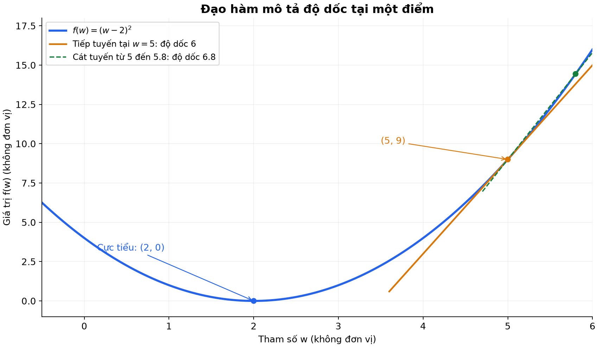
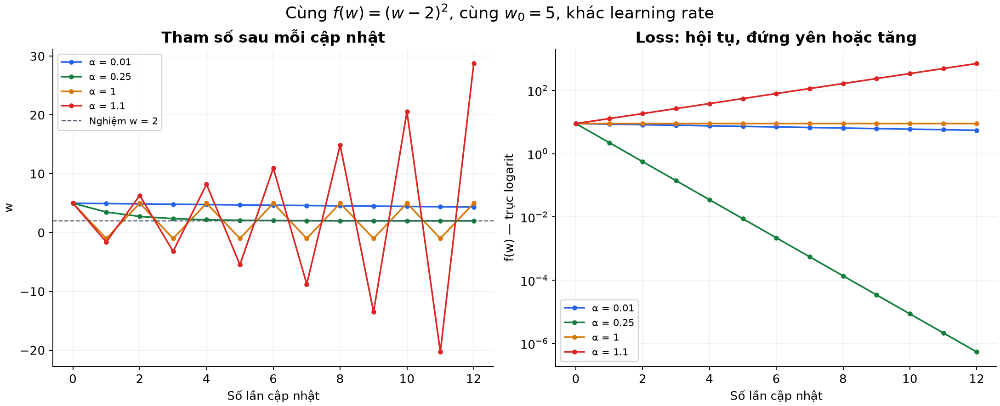
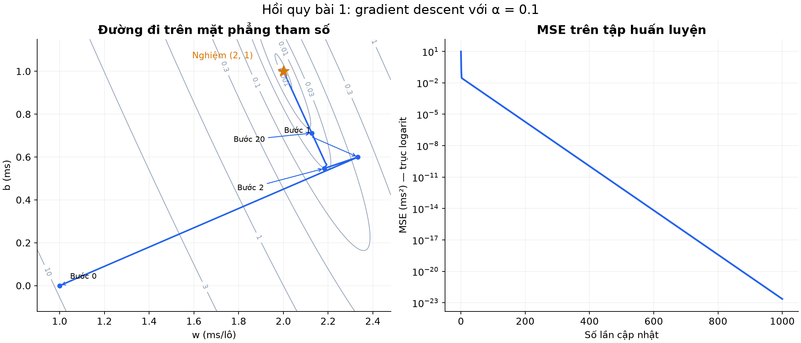

# Bài 2 — Đạo hàm và gradient descent

[Mục lục](../README.md) · [Bài 1](../01-mo-hinh-hoc-tu-du-lieu/README.md) · [Bài tập](exercises.md) · [Lời giải](solutions.md)

Trạng thái: đã biên soạn, bổ sung trực giác kỹ thuật và ứng dụng thực tế cho AI Engineer; mã thực hành và hình minh họa đã kiểm tra trên Python 3.14.6. Bài học được chia làm hai chặng: chặng 1 (mục 1–6) xây dựng trực giác một biến; chặng 2 (mục 7–12) áp dụng trực tiếp vào mô hình hai tham số thực tế.

---

## 1. Mục tiêu và điều kiện bắt đầu

Sau bài này, bạn sẽ nắm được:

- **Trực giác cốt lõi**: Hiểu đạo hàm không phải là giải tích hàn lâm, mà là "la bàn đo độ nhạy" giúp cỗ máy biết cần tinh chỉnh tham số theo hướng nào.
- **Phép ẩn dụ người leo núi**: Nắm vững cơ chế của thuật toán Gradient Descent (Xuống dốc theo độ dốc) để tìm điểm tối ưu.
- **Bản chất của Learning Rate ($\alpha$)**: Hiểu rõ sải bước chân của thuật toán: tại sao bước quá ngắn thì chậm chạp, bước quá dài thì sảy chân lao xuống vực (Loss = NaN).
- **Từ 1 biến sang nhiều biến**: Hiểu đạo hàm riêng và vector Gradient khi mô hình có nhiều núm vặn cùng lúc ($w$ và $b$).
- **Tính toán từng bước bằng tay**: Tự tính trọn vẹn một bước cập nhật tham số và hiểu vì sao phải cập nhật đồng thời (simultaneous update).
- **Kỹ thuật Gradient Checking**: Biết cách viết unit test kiểm tra công thức đạo hàm bằng sai phân số trong công việc thực tế của kỹ sư AI.

**Yêu cầu nền tảng**: Cần nắm vững khái niệm mô hình $\hat y = wx + b$ và hàm mất mát MSE từ [Bài 1](../01-mo-hinh-hoc-tu-du-lieu/README.md). Không cần học trước giải tích hay đạo hàm; bài này bắt đầu từ phép chia độ dốc thông thường trong đời sống.

---

## 2. Vì sao không thể tiếp tục "dò quét trên lưới" (Grid Search)?

Ở Bài 1, ta đã tìm tham số $w$ và $b$ bằng cách thử lần lượt từng nấc trên lưới (Grid Search). Với 2 tham số, mỗi tham số thử 41 nấc, máy tính phải tính $41 \times 41 = 1681$ lần.

Điều gì xảy ra khi hệ thống lớn dần?
- Nếu mô hình có $d$ tham số và mỗi tham số thử $k$ nấc, số lượng phép tính là $k^d$ (**Bùng nổ tổ hợp - Curse of Dimensionality**).
- Với một mô hình chỉ cần 10 tham số, mỗi tham số thử vỏn vẹn 10 nấc: bạn phải tính $10^{10}$ (10 tỷ) lần.
- Với các mô hình AI hiện đại như LLaMA hay GPT có từ 7 tỷ đến hàng trăm tỷ tham số: toàn bộ máy tính trên Trái Đất chạy suốt hàng triệu năm cũng không thể thử hết các nấc!

Thay vì "bịt mắt mò mẫm" khắp bản đồ, ta cần một cơ chế thông minh hơn: **Đứng ngay tại vị trí hiện tại, cảm nhận mặt đất đang dốc về hướng nào, rồi bước một bước theo hướng dốc xuống**.

Công cụ giúp ta cảm nhận độ dốc đó chính là **Đạo hàm (Derivative)** và **Gradient**.

```text
[Grid Search - Bài 1]          [Gradient Descent - Bài 2]
Thử mù mịt tất cả các ô        Đứng tại chỗ đo độ dốc và bước xuống đáy
   ┌───┬───┬───┬───┐                     ●  (Vị trí hiện tại)
   │ ? │ ? │ ? │ ? │                      \
   ├───┼───┼───┼───┤                       \  (Bước theo độ dốc)
   │ ? │ ? │ ? │ ? │                        \
   ├───┼───┼───┼───┤                         ▼
   │ ? │ ★ │ ? │ ? │                          ●───┐
   └───┴───┴───┴───┘                              ▼
(1681 phép tính vô hướng)                     ★ Đáy thung lũng (Loss nhỏ nhất)
```

---

## 3. Trực giác về đạo hàm: Đầu vào nhích nhẹ thì đầu ra đổi bao nhiêu?

Hãy tạm gác lại các định nghĩa toán học trừu tượng. Trong kỹ thuật và đời sống, **đạo hàm chính là thước đo độ nhạy (sensitivity)**:

> **Đạo hàm = Tỷ lệ thay đổi đầu ra khi đầu vào thay đổi một lượng cực nhỏ.**

### Hai ví dụ gần gũi trong đời sống:
1. **Chân ga ô tô**: Bạn nhấn sâu chân ga thêm $1\text{ cm}$, tốc độ xe tăng thêm $15\text{ km/h}$. 
   - Độ dốc (đạo hàm) = $+15\text{ km/h trên mỗi cm ga}$.
2. **Độ nhạy chuột máy tính (DPI)**: Bạn rê chuột sang phải $1\text{ mm}$, con trỏ dịch $10\text{ pixel}$.
   - Độ dốc = $+10\text{ px/mm}$.

### Thử nghiệm trên một hàm mất mát đơn giản:

Để dễ hình dung trước khi quay lại bài toán 2 tham số, ta xét một hàm mất mát đồ chơi một biến (toy loss):

$$
f(w) = (w - 2)^2
$$

Hàm này có giá trị nhỏ nhất bằng $0$ khi $w = 2$. Giả sử ta đang đứng ở vị trí $w = 5$, khi đó Loss là $f(5) = (5 - 2)^2 = 9$.

Nếu ta nhích nhẹ $w$ thêm một khoảng nhỏ $h = 0.1$ (tức $w$ lên $5.1$), Loss mới là $f(5.1) = (5.1 - 2)^2 = 9.61$.

Tỷ lệ biến thiên (độ dốc trung bình) là:

$$
\frac{\text{Thay đổi của Loss}}{\text{Thay đổi của } w} = \frac{f(5.1) - f(5)}{0.1} = \frac{9.61 - 9}{0.1} = 6.1
$$

Hãy quan sát khi ta thu nhỏ khoảng nhích $h$ lại:

| Bước nhích $h$ | Vị trí mới $5 + h$ | Loss mới $f(5+h)$ | Độ dốc $[f(5+h) - f(5)] / h$ |
|---:|---:|---:|---:|
| $1.0$ | $6.0$ | $16.00$ | $7.000$ |
| $0.1$ | $5.1$ | $9.61$ | $6.100$ |
| $0.01$ | $5.01$ | $9.0601$ | $6.010$ |
| $0.001$ | $5.001$ | $9.006001$ | $6.001$ |

Khi $h$ co dần về $0$, độ dốc hội tụ chính xác về con số **$6$**. Con số $6$ này chính là **đạo hàm của $f$ tại $w = 5$**, ký hiệu là $f'(5) = 6$ (hoặc $\frac{df}{dw} = 6$).



*Hình 1. Đường màu xanh là hàm Loss $f(w)=(w-2)^2$. Đường màu cam là tiếp tuyến tại điểm $w=5$, có độ dốc đúng bằng $6$. Đường cát tuyến màu xanh lá nối giữa hai điểm cách nhau $h=0.8$ cho độ dốc $6.8$, xấp xỉ tiếp tuyến.*

### Công thức tổng quát cho hàm này

Bằng đại số đơn giản, ta có thể rút ra đạo hàm tại vị trí $w$ bất kỳ mà không cần bấm máy tính nhiều lần:

$$
\frac{f(w+h) - f(w)}{h} = \frac{(w + h - 2)^2 - (w - 2)^2}{h} = \frac{2(w - 2)h + h^2}{h} = 2(w - 2) + h
$$

Khi khoảng nhích $h$ triệt tiêu dần về $0$:

$$
f'(w) = 2(w - 2)
$$

- Ở $w = 5 \implies f'(5) = 2(5 - 2) = 6$.
- Ở $w = 1 \implies f'(1) = 2(1 - 2) = -2$.
- Ở $w = 2 \implies f'(2) = 2(2 - 2) = 0$.

---

## 4. Dấu của đạo hàm: Chiếc la bàn chỉ đường

Con số đạo hàm nói cho ta biết điều gì? Hãy quan sát bảng chỉ dẫn:

| Vị trí $w$ | Giá trị Loss $f(w)$ | Đạo hàm $f'(w)$ | Ý nghĩa khi tăng nhẹ $w$ | Hành động để GIẢM Loss |
|:---:|:---:|:---:|---|---|
| $w = 5$ | $9$ | **$+6$ (Dương)** | Tiến tới $\implies$ Loss tăng lên (lên dốc) | **Lùi lại** (Giảm $w$) |
| $w = 1$ | $1$ | **$-2$ (Âm)** | Tiến tới $\implies$ Loss giảm xuống (xuống dốc) | **Tiến tới** (Tăng $w$) |
| $w = 2$ | $0$ | **$0$ (Bằng phẳng)** | Đang ở đáy thung lũng (cực tiểu) | **Dừng lại** |

> [!IMPORTANT]
> **Quy tắc vàng**:
> - Nếu đạo hàm **Dương** ($f' > 0$): Muốn giảm Loss, ta phải đi về bên trái (giảm $w$).
> - Nếu đạo hàm **Âm** ($f' < 0$): Muốn giảm Loss, ta phải đi về bên phải (tăng $w$).
> 
> Nhận xét thấy: **Hướng đi để giảm Loss luôn luôn NGƯỢC DẤU với đạo hàm!**

---

## 5. Thuật toán Gradient Descent: Từng bước bước xuống dốc

Từ phát hiện trên, ta có công thức cập nhật tham số kinh điển của Machine Learning:

$$
w_{\text{mới}} = w_{\text{cũ}} - \alpha \cdot f'(w_{\text{cũ}})
$$

Hay viết theo ký hiệu bước lặp thời gian $t$:

$$
w_{t+1} = w_t - \alpha \cdot f'(w_t)
$$

### Trong công thức này có 3 thành phần:
1. **$w_t$**: Vị trí tham số hiện tại.
2. **$f'(w_t)$**: La bàn chỉ hướng dốc (đạo hàm).
3. **Dấu trừ ($-$)**: Đảm bảo ta luôn đi **ngược chiều dốc** (đi xuống thung lũng, không leo lên đỉnh núi).
4. **$\alpha$ (Alpha - Learning Rate)**: Hệ số tốc độ học, đóng vai trò **độ dài của mỗi sải bước chân**.

### Tự tính tay từng bước cập nhật

Bắt đầu từ vị trí xuất phát $w_0 = 5$, chọn sải bước $\alpha = 0.1$:

- **Bước 1**:
  - Đạo hàm tại chỗ đứng: $f'(5) = 2(5 - 2) = 6$.
  - Cập nhật vị trí mới: $w_1 = 5 - 0.1 \times 6 = 4.4$.
  - Loss mới: $f(4.4) = (4.4 - 2)^2 = 5.76$ *(đã giảm mạnh từ 9.00 xuống 5.76!)*.
- **Bước 2**:
  - Tại vị trí mới $w_1 = 4.4$, tính lại đạo hàm: $f'(4.4) = 2(4.4 - 2) = 4.8$.
  - Cập nhật tiếp: $w_2 = 4.4 - 0.1 \times 4.8 = 3.92$.
  - Loss mới: $f(3.92) = (3.92 - 2)^2 = 3.6864$.

Bảng theo dõi hành trình 5 bước đầu tiên:

| Bước ($t$) | Vị trí tham số $w_t$ | Đạo hàm $f'(w_t)$ | Bước nhảy $\alpha \cdot f'$ | Loss $f(w_t)$ |
|---:|---:|---:|---:|---:|
| 0 | $5.0000$ | $+6.0000$ | $0.6000$ | $9.0000$ |
| 1 | $4.4000$ | $+4.8000$ | $0.4800$ | $5.7600$ |
| 2 | $3.9200$ | $+3.8400$ | $0.3840$ | $3.6864$ |
| 3 | $3.5360$ | $+3.0720$ | $0.3072$ | $2.3593$ |
| 4 | $3.2288$ | $+2.4576$ | $0.2458$ | $1.5099$ |
| 5 | $2.9830$ | $+1.9661$ | $0.1966$ | $0.9664$ |

Nhận xét quan trọng: Càng tiến gần đáy thung lũng ($w=2$), độ dốc $f'$ **tự động thoải dần và nhỏ lại**, khiến các bước chân tự động ngắn lại, giúp mô hình tiếp cận đáy một cách êm ái mà không bị vượt quá trớn!

---

## 6. Learning Rate ($\alpha$): Sải bước chân quyết định sống còn

Trong kỹ thuật AI, Learning Rate là siêu tham số (hyperparameter) nhạy cảm nhất. Hình ảnh ẩn dụ dưới đây giải thích rõ hành vi của 4 trường hợp:



*Hình 2. Thử nghiệm trên cùng hàm $f(w)=(w-2)^2$ từ vị trí $w_0=5$ qua 12 bước cập nhật. Đồ thị bên phải biểu diễn Loss theo thang đo Logarit để quan sát sự khác biệt qua các bậc độ lớn.*

1. **Quá nhỏ ($\alpha = 0.01$) — "Bước rón rén"**:
   - Sau 12 bước, $w$ mới chỉ bò từ $5.0$ về $4.35$, Loss vẫn còn cao ($5.54$). Cần hàng nghìn bước mới tới đích $\implies$ Tốn kém chi phí máy chủ và thời gian huấn luyện.
2. **Vừa vặn ($\alpha = 0.25$) — "Hội tụ mượt mà"**:
   - Khoảng cách đến nghiệm giảm một nửa sau mỗi bước. Sau 12 bước, $w = 2.0007$, Loss chạm ngưỡng $5 \times 10^{-7}$ $\implies$ Hoàn hảo!
3. **Chạm ngưỡng rung lắc ($\alpha = 1.0$) — "Bị kẹt giữa hai sườn dốc"**:
   - Bước quá dài, nhảy từ sườn bên này $w=5$ sang thẳng sườn đối diện $w=-1$, rồi lại bật ngược về $w=5$. Loss đứng im ở mức $9.0$ suốt 12 bước.
4. **Quá lớn ($\alpha = 1.1$) — "Sảy chân xuống vực (Phân kỳ / Exploding)"**:
   - Nhảy vọt qua sườn dốc và văng ngày càng xa: từ $5 \to -1.6 \to 6.32 \to \dots \to 28.7$. Loss bùng nổ lên $715$! Trong thực tế, các giá trị này sẽ nhanh chóng tràn số thành `inf` hoặc `NaN` (Not a Number).

---

## 7. Áp dụng vào thực tế: Mô hình hai tham số $(w, b)$

Bây giờ ta quay lại bài toán hồi quy backend ở Bài 1 với dữ liệu mẫu: `(1, 3), (2, 5), (3, 7)`:

$$
\hat y_i = w x_i + b, \qquad L(w, b) = \frac{1}{n}\sum_{i=1}^{n}(w x_i + b - y_i)^2
$$

Hàm Loss lúc này không còn là một đường cong một chiều nữa, mà là một **mặt hõm lòng chảo 2 chiều** phụ thuộc vào cả $w$ và $b$. Ta có 2 núm vặn:
- **$\frac{\partial L}{\partial w}$ (Đạo hàm riêng theo $w$)**: Giữ nguyên núm $b$, nhích nhẹ núm $w$ xem Loss phản hồi thế nào?
- **$\frac{\partial L}{\partial b}$ (Đạo hàm riêng theo $b$)**: Giữ nguyên núm $w$, nhích nhẹ núm $b$ xem Loss phản hồi thế nào?

Gộp hai đạo hàm riêng này lại thành một vector chỉ hướng 2 chiều, gọi là **Gradient**:

$$
\nabla L = \left(\frac{\partial L}{\partial w}, \frac{\partial L}{\partial b}\right)
$$

### Công thức Gradient của hàm MSE

Ký hiệu $r_i = \hat y_i - y_i = (w x_i + b - y_i)$ là sai số của mẫu thứ $i$:

$$
\frac{\partial L}{\partial w} = \frac{2}{n}\sum_{i=1}^{n} r_i \cdot x_i, \qquad \frac{\partial L}{\partial b} = \frac{2}{n}\sum_{i=1}^{n} r_i
$$

### Tại sao công thức của $w$ lại nhân thêm $x_i$ trong khi $b$ thì không?

Đây là một câu hỏi trực giác rất hay của dân kỹ thuật:
- Trong công thức $\hat y = w \cdot x + b$, hệ số $w$ gắn liền với đầu vào $x$. Nếu một request có kích thước rất lớn ($x = 100$), chỉ cần nhích nhẹ núm $w$ một chút xíu là kết quả dự đoán $\hat y$ đã thay đổi dữ dội! Do đó, mức độ nhạy của $w$ phải được nhân với độ lớn của $x_i$.
- Ngược lại, $b$ là chi phí nền cố định, không phụ thuộc vào $x$. Dù request lớn hay nhỏ, $b$ đều tác động như nhau lên mọi mẫu, nên đạo hàm theo $b$ chỉ đơn thuần là cộng tổng sai số $r_i$ mà không nhân với $x_i$.

---

## 8. Tự tính tay trọn vẹn một bước cho cả w và b

Giả sử ta xuất phát từ cùng điểm với Bài 1: $w_0 = 1.0, b_0 = 0.0$ và chọn learning rate $\alpha = 0.1$.
Số lượng mẫu $n = 3$.

Bảng tính sai số của từng mẫu:

| Mẫu ($i$) | Đầu vào $x_i$ | Đích thực tế $y_i$ | Máy đoán $\hat y_i = 1 \cdot x_i + 0$ | Sai số $r_i = \hat y_i - y_i$ | Tích $r_i \cdot x_i$ |
|---:|---:|---:|---:|---:|---:|
| 1 | 1 | 3 ms | 1 ms | $1 - 3 = \mathbf{-2}$ | $(-2) \times 1 = \mathbf{-2}$ |
| 2 | 2 | 5 ms | 2 ms | $2 - 5 = \mathbf{-3}$ | $(-3) \times 2 = \mathbf{-6}$ |
| 3 | 3 | 7 ms | 3 ms | $3 - 7 = \mathbf{-4}$ | $(-4) \times 3 = \mathbf{-12}$ |
| **Tổng ($\sum$)** | | | | $\sum r_i = \mathbf{-9}$ | $\sum r_i x_i = \mathbf{-20}$ |

Loss ban đầu: $\text{MSE}_0 = \frac{(-2)^2 + (-3)^2 + (-4)^2}{3} = \frac{4 + 9 + 16}{3} = \frac{29}{3} \approx 9.6667\text{ ms}^2$.

### Tính 2 đạo hàm riêng:

$$
\frac{\partial L}{\partial w} = \frac{2}{3} \times (-20) = -\frac{40}{3} \approx -13.3333
$$

$$
\frac{\partial L}{\partial b} = \frac{2}{3} \times (-9) = -6.0
$$

### Cập nhật đồng thời cả hai tham số:

$$
w_1 = w_0 - \alpha \cdot \frac{\partial L}{\partial w} = 1.0 - 0.1 \times \left(-\frac{40}{3}\right) = 1.0 + \frac{4}{3} = \frac{7}{3} \approx \mathbf{2.3333}
$$

$$
b_1 = b_0 - \alpha \cdot \frac{\partial L}{\partial b} = 0.0 - 0.1 \times (-6.0) = 0.0 + 0.6 = \mathbf{0.6}
$$

> [!NOTE]
> Nhìn xem điều kỳ diệu: Cả hai tham số $w$ và $b$ đều **tự động tăng lên** ($w$ từ $1 \to 2.333$, $b$ từ $0 \to 0.6$) vì cả hai đạo hàm đều âm! Dấu trừ trong công thức gặp dấu âm của đạo hàm đã biến thành dấu cộng. Mô hình tự động hiểu rằng nó đang đoán thiếu so với thực tế, nên phải tăng cả hai núm vặn lên.

Loss tại điểm mới $(w_1 \approx 2.3333, b_1 = 0.6)$ lập tức tụt từ **$9.6667\text{ ms}^2$** xuống chỉ còn **$0.1452\text{ ms}^2$** ngay sau đúng một bước chân duy nhất!

### Quy tắc bất di bất dịch: Cập nhật đồng thời (Simultaneous Update)

Trong code, bạn **bắt buộc** phải tính toán xong cả hai đạo hàm `dw` và `db` từ cùng một trạng thái cũ trước khi gán giá trị mới:

```python
# ĐÚNG: Tính toán gradient từ cùng trạng thái (w, b) rồi mới cập nhật
dw, db = gradients(data, w, b)
w = w - lr * dw
b = b - lr * db
```

Nếu bạn làm sai: cập nhật `w` trước, rồi mới dùng `w_mới` để tính `db`, bạn đã vô tình làm lệch hướng của vector gradient (hiện tượng cập nhật xen kẽ / Gauss-Seidel), làm sai lệch thuật toán Gradient Descent chuẩn.

---

## 9. Thực hành Python và Đọc hiểu biểu đồ

Mã nguồn đầy đủ nằm trong tệp [lab.py](lab.py). Mở terminal tại thư mục bài 2 và chạy các chế độ sau:

### Chạy huấn luyện mô hình 2 tham số:

```bash
python3 lab.py --mode linear --lr 0.1 --steps 1000
```

Kết quả in ra màn hình:

```text
step          w            b           train_mse
   0     1.000000     0.000000     9.666667e+00
   1     2.333333     0.600000     1.451852e-01
   2     2.182222     0.546667     3.003786e-02
   3     2.193481     0.564444     2.731796e-02
   5     2.182810     0.584482     2.476946e-02
1000     2.000000     1.000000     2.311749e-23
Held-out prediction at x=4: 9.000000 ms
Held-out MSE: 0.000000e+00
```

### Đọc hiểu trực quan qua Hình 3:



*Hình 3. Biểu đồ đường đồng mức (Contour Plot) bên trái và đồ thị giảm Loss bên phải.*

- **Biểu đồ bên trái (Bản đồ địa hình tham số)**:
  - Trục hoành là $w$, trục tung là $b$.
  - Các đường elip là các đường đồng mức: mọi điểm nằm trên cùng một đường elip đều có giá trị Loss bằng nhau.
  - Điểm sao vàng ở tâm chính là đáy thung lũng: nghiệm tối ưu $(w=2, b=1)$ với Loss = 0.
  - Vạch màu xanh thể hiện hành trình cập nhật: xuất phát từ $(1, 0)$, bước chân đầu tiên nhảy vọt sang $(2.33, 0.6)$, sau đó uốn lượn nhịp nhàng tiến thẳng vào tâm ngôi sao.
- **Biểu đồ bên phải (Hành trình tụt dốc của Loss)**:
  - Trục đứng là Loss theo thang logarit. Chỉ sau vài bước đầu tiên, Loss đã rơi tự do từ $9.66$ xuống dưới $0.03$, và dần tiệm cận về $0$.

---

## 10. Gradient Checking: Unit-test kiểm tra đạo hàm

Khi xây dựng các mô hình AI phức tạp, việc tính đạo hàm bằng tay trên giấy rất dễ bị nhầm lẫn (quên dấu trừ, thiếu hệ số 2, nhân nhầm biến). Làm sao kỹ sư AI chắc chắn rằng code tính đạo hàm của mình hoàn toàn chính xác?

Họ dùng kỹ thuật **Gradient Checking (Kiểm tra bằng sai phân số)**:
- Đo Loss tại $(w + h)$ và $(w - h)$ với khoảng cách cực nhỏ $h = 10^{-5}$.
- Tính độ dốc xấp xỉ bằng thước kẻ số học (sai phân trung tâm):
  $$g_w^{\text{số}} \approx \frac{L(w + h, b) - L(w - h, b)}{2h}$$
- So sánh kết quả của công thức giải tích với kết quả số học này. Nếu độ lệch nhỏ hơn $10^{-7}$, ta tự tin rằng công thức giải tích là chính xác!

Chạy lệnh kiểm tra trong `lab.py`:

```bash
python3 lab.py --mode check
```

Kết quả:

```text
point (w=1, b=0)
dw: analytic=-13.33333333; numerical=-13.33333333; abs_diff=1.47e-12
db: analytic=-6.00000000; numerical=-6.00000000; abs_diff=4.95e-11
```

Sai lệch tuyệt đối chỉ ở mức $10^{-11} \sim 10^{-12}$ (do giới hạn số thực dấu phẩy động của máy tính). Điều này chứng minh công thức đạo hàm bằng code hoàn toàn trùng khớp với định nghĩa toán học!

---

## 11. Các ứng dụng và cạm bẫy thực tế của AI Engineer

### Ứng dụng 1: Chiến lược điều chỉnh Learning Rate khi huấn luyện LLM

Trong thực tế huấn luyện các mô hình lớn (pre-training hoặc fine-tuning):
- Kỹ sư AI **không bao giờ** dùng một learning rate cố định từ đầu đến cuối.
- Họ dùng **Learning Rate Scheduler**:
  1. *Warmup*: Trong vài nghìn bước đầu, mô hình chưa ổn định nên dùng learning rate rất nhỏ rồi tăng dần lên, tránh làm xáo trộn các trọng số ban đầu.
  2. *Cosine Decay / Annealing*: Sau giai đoạn đỉnh cao, hạ dần learning rate xuống cực nhỏ về cuối quá trình để mô hình từ từ lắng đọng vào đáy thung lũng tối ưu sâu nhất.

### Ứng dụng 2: Phát hiện và xử lý lỗi Exploding Gradient (Loss = NaN)

Thử chạy lệnh với learning rate quá lớn $\alpha = 0.2$:

```bash
python3 lab.py --mode linear --lr 0.2 --steps 20
```

Bạn sẽ thấy Loss nhảy vọt từ $9.66 \to 14.3 \to 31.5 \to \dots \to 26,189$!
- Trong các hệ thống huấn luyện thực tế, khi Loss nhảy vọt bất thường hoặc xuất hiện `NaN`, nguyên nhân hàng đầu là Learning Rate quá lớn. Kỹ thuật phổ biến để khắc phục là giảm learning rate hoặc áp dụng **Gradient Clipping** (cắt bớt chiều dài vector gradient nếu nó vượt quá ngưỡng an toàn).

### Ứng dụng 3: Vì sao phải chuẩn hóa dữ liệu (Feature Scaling / Normalization)?

- Hãy tưởng tượng nếu bài toán có 2 đặc trưng: $x_1$ là số lô ($1 \sim 10$) và $x_2$ là chi phí tính bằng VNĐ ($1.000.000 \sim 100.000.000$).
- Vì $x_2$ quá khổng lồ, đạo hàm theo $w_2$ sẽ lớn gấp hàng triệu lần đạo hàm theo $w_1$.
- Mặt địa hình Loss sẽ bị biến dạng thành một khe núi hẹp và dốc đứng một chiều. Thuật toán Gradient Descent sẽ bị đập liên tục qua lại giữa hai vách đá thay vì đi dọc theo lòng suối. Chuẩn hóa dữ liệu về cùng thang đo (ví dụ đưa về khoảng $0 \sim 1$) là bước bắt buộc để Gradient Descent hội tụ nhanh.

---

## 12. Tổng kết và bước tiếp theo

| Khái niệm | Ý nghĩa cốt lõi |
|---|---|
| **Đạo hàm ($f'$)** | Độ nhạy cục bộ: Nhích nhẹ tham số thì Loss tăng hay giảm bao nhiêu? |
| **Gradient ($\nabla L$)** | Vector la bàn tổng hợp đạo hàm riêng của tất cả tham số. |
| **Dấu trừ ($-$)** | Bước ngược hướng dốc để kéo giảm Loss. |
| **Learning rate ($\alpha$)** | Sải bước chân: quá ngắn thì chậm, quá dài thì bay khỏi quỹ đạo (phân kỳ). |
| **Gradient Checking** | Unit-test kiểm tra độ chính xác của code tính đạo hàm bằng sai phân số. |

**Tự kiểm tra kiến thức:**
1. Hãy mở [exercises.md](exercises.md) và tự giải các bài tập tính tay (bài 1, 2, 4) và bài kiểm tra code (bài 3, 5, 6).
2. Đối chiếu lập luận chi tiết với [solutions.md](solutions.md).

**Học tiếp:**
[Bài 3 — Vector, ma trận và tensor](../03-vector-ma-tran-tensor/README.md). Bạn sẽ học cách gom hàng nghìn phép tính đạo hàm và dự đoán riêng lẻ thành các phép nhân ma trận siêu nhanh trên thư viện NumPy, đặt nền tảng cho việc tăng tốc tính toán trên GPU.

---

*Tài liệu tham khảo đối chiếu chuẩn:*
- [Google Machine Learning Crash Course: Gradient Descent](https://developers.google.com/machine-learning/crash-course/linear-regression/gradient-descent)
- [Google Machine Learning Crash Course: Hyperparameters](https://developers.google.com/machine-learning/crash-course/linear-regression/hyperparameters)
