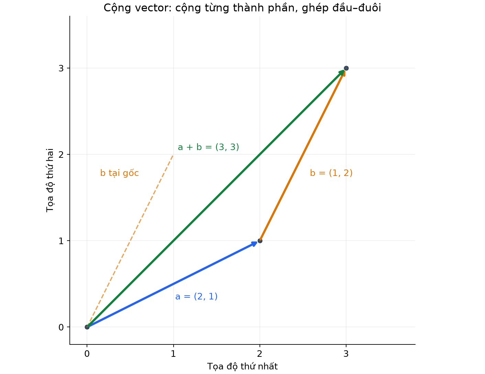
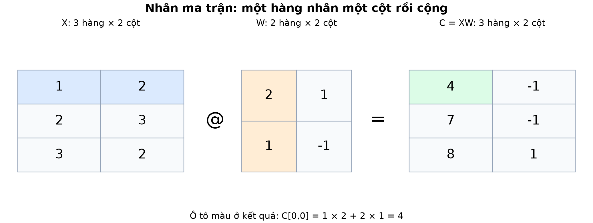
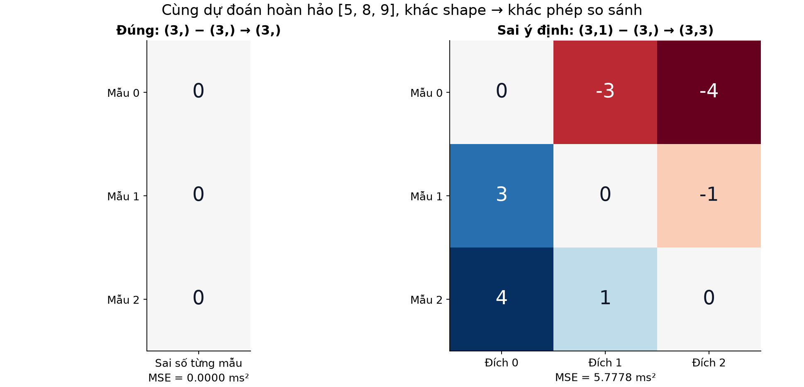
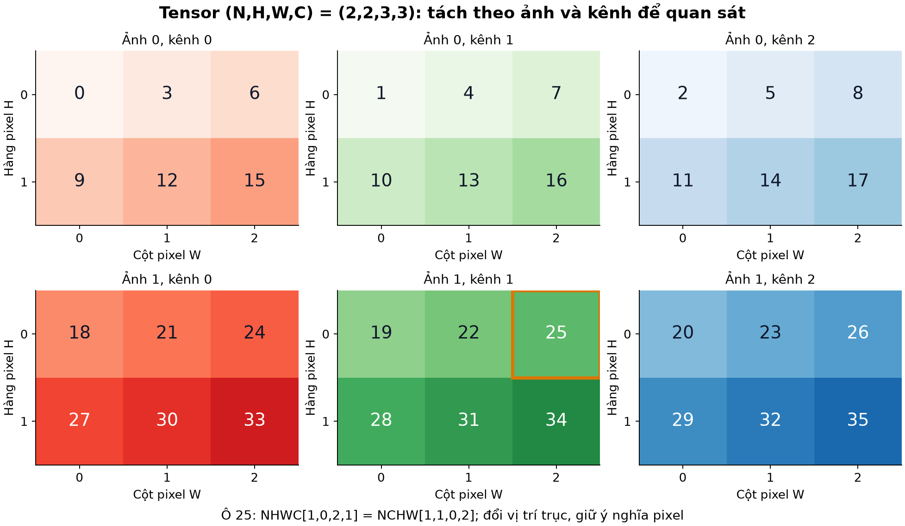

# Bài 3 — Vector, ma trận và tensor

[Mục lục](../README.md) · [Bài 2](../02-dao-ham-gradient-descent/README.md) · [Bài tập](exercises.md) · [Lời giải](solutions.md)

Trạng thái: đã biên soạn, bổ sung trực giác hình học, phân tích cạm bẫy kỹ thuật và ứng dụng thực tế cho AI Engineer; mã thực hành và 4 hình minh họa đã kiểm tra trên Python 3.14.6 và NumPy 2.5.4.

---

## 1. Mục tiêu và điều kiện bắt đầu

Sau bài này, bạn sẽ nắm được:

- **Trực giác kỹ thuật cốt lõi**: Hiểu rõ lý do đại số tuyến tính là nền tảng không thể thiếu của AI, giúp tối ưu hóa hiệu năng tính toán và loại bỏ các vòng lặp tuần tự (`for`) nhờ kỹ thuật vector hóa (vectorization).
- **Phân loại cấu trúc dữ liệu đa chiều**: Phân biệt rành mạch bản chất từ Scalar (0D), Vector (1D), Ma trận (2D) đến Tensor đa chiều ($N$-D).
- **Phân biệt bản chất phép nhân**: Nắm vững sự khác biệt giữa phép nhân từng phần tử (`*`, element-wise) và phép nhân ma trận đại số tuyến tính (`@`, matrix multiplication), tránh các lỗi logic nghiêm trọng trong lập trình mô hình.
- **Quy tắc Broadcasting và cạm bẫy lỗi ngầm (Silent Bug)**: Nhận diện nguy cơ sai lệch kích thước khi tính hàm mất mát — chương trình vẫn thực thi bình thường mà không báo lỗi ngoại lệ (Exception), nhưng kết quả huấn luyện bị sai lệch hoàn toàn.
- **Biến đổi cấu trúc mảng (Reshape vs Transpose)**: Hiểu cơ chế tổ chức bộ nhớ tuyến tính, phân biệt rõ khi nào chỉ cần thay đổi góc nhìn (Reshape) và khi nào bắt buộc phải hoán vị trục tọa độ (Transpose) để bảo toàn cấu trúc không gian dữ liệu.
- **Vector hóa tính toán Gradient ($X^T \mathbf{r}$)**: Biểu diễn công thức đạo hàm riêng cho toàn bộ tập dữ liệu đa biến thành một phép nhân ma trận duy nhất, khai thác tối đa khả năng tính toán song song của phần cứng.
- **Đọc hiểu cấu trúc Tensor trong AI thực tế**: Nắm vững các quy ước kích thước chuẩn như `(Batch, Seq_Len, Hidden_Dim)` trong mô hình ngôn ngữ lớn (Transformer) và `(N, C, H, W)` trong thị giác máy tính (Computer Vision).

**Yêu cầu nền tảng**: Nắm vững phương trình $\hat y = wx + b$ và cách tính đạo hàm/gradient từ [Bài 1](../01-mo-hinh-hoc-tu-du-lieu/README.md) và [Bài 2](../02-dao-ham-gradient-descent/README.md). Cần cài đặt sẵn môi trường Python có thư viện NumPy.

---

## 2. Vì sao AI bắt buộc phải dùng Ma trận thay cho biến đơn lẻ?

Trong Bài 1 và Bài 2, ta chỉ khảo sát bài toán đơn biến với một biến độc lập duy nhất: **Số lô dữ liệu** ($x$).
Tuy nhiên, trong các bài toán kỹ thuật thực tế, thời gian phản hồi (latency) của một dịch vụ backend thường chịu tác động đồng thời của nhiều yếu tố:
1. Số lô bản ghi xử lý (Lô).
2. Số truy vấn gửi sang cơ sở dữ liệu (Query).
3. Dung lượng gói tin mạng (Payload, KB).
4. Mức tải CPU tại thời điểm xử lý (%).

Xét bài toán đơn giản hóa gồm 2 đặc trưng đầu vào thu thập từ 3 yêu cầu (request) trong hệ thống:

| Request ($i$) | Đặc trưng 1: Số lô | Đặc trưng 2: Số truy vấn DB | Giá trị thực tế: Latency ($y$, ms) |
|:---:|:---:|:---:|:---:|
| Request 0 | 1 lô | 2 query | 5 ms |
| Request 1 | 2 lô | 3 query | 8 ms |
| Request 2 | 3 lô | 2 query | 9 ms |

*(Tập dữ liệu giả định được thiết lập theo quy luật $y = 2 \times \text{lô} + 1 \times \text{truy vấn} + 1$ phục vụ mục đích thực hành).*

### Hạn chế khi biểu diễn bằng biến vô hướng đơn lẻ:
Nếu quản lý dữ liệu bằng các biến độc lập rời rạc (`x0_batch`, `x0_query`, `x1_batch`, `x1_query`,...), mã nguồn sẽ gặp các rào cản lớn:
- **Độ phức tạp mã nguồn và nguy cơ nhầm lẫn chỉ số**: Việc lồng ghép nhiều vòng lặp `for` để duyệt qua từng mẫu và từng đặc trưng khiến code trở nên cồng kềnh, khó bảo trì và dễ phát sinh lỗi chỉ số (indexing error).
- **Điểm nghẽn hiệu năng (Performance Bottleneck)**: Vòng lặp `for` thuần túy của Python xử lý tuần tự từng phần tử ở tầng thông dịch. Cách tiếp cận này hoàn toàn bỏ phí năng lực tính toán song song từ tập lệnh SIMD (Single Instruction, Multiple Data) trên CPU đa lõi cũng như các nhân xử lý song song hàng loạt trên GPU.

### Giải pháp kỹ thuật: Biểu diễn tập trung dưới dạng Ma trận
Trong học máy, dữ liệu đa biến được tổ chức tập trung vào một **Ma trận thiết kế (Design Matrix)** $X$ và vector nhãn $\mathbf{y}$:
- Mỗi **hàng** tương ứng với một quan sát / mẫu dữ liệu (Sample / Instance).
- Mỗi **cột** tương ứng với một biến đặc trưng (Feature) theo đúng thứ tự quy ước.

$$
X = \begin{bmatrix} 1 & 2 \\ 2 & 3 \\ 3 & 2 \end{bmatrix}, \qquad \mathbf{y} = \begin{bmatrix} 5 \\ 8 \\ 9 \end{bmatrix}
$$

Nhờ cách đóng gói này, toàn bộ quá trình tính toán dự đoán cho hàng triệu bản ghi sẽ được thực hiện đồng thời thông qua **một phép nhân ma trận duy nhất**.

---

## 3. Bản đồ không gian số: Từ Scalar đến Tensor

Để làm chủ việc thao tác dữ liệu nhiều chiều, hãy hình dung các cấp độ biểu diễn số học theo sơ đồ sau:

```text
┌──────────────┐     ┌───────────────────────┐     ┌─────────────────────────────┐     ┌───────────────────────────────┐
│ Scalar (0D)  │     │      Vector (1D)      │     │      Ma trận Matrix (2D)    │     │       Tensor Đa chiều (ND)    │
│  Một con số  │ ──> │   Một danh sách số    │ ──> │   Một bảng số (Hàng x Cột)  │ ──> │ Khối hộp chứa nhiều bảng số   │
│  Ví dụ: 5.0  │     │ Ví dụ: [1.0, 2.0, 3.0]│     │ Ví dụ: Bảng dữ liệu (3 x 2) │     │ Ví dụ: Cuốn sổ nhiều trang 2D │
└──────────────┘     └───────────────────────┘     └─────────────────────────────┘     └───────────────────────────────┘
```

### 1. Scalar (Số vô hướng - 0 chiều):
- Là một đại lượng số học đơn lẻ, ví dụ: hệ số điều chỉnh (bias) $b = 1.0$ hoặc giá trị hàm mất mát $\text{Loss} = 9.66$.
- Trong NumPy: Mảng có số chiều `ndim = 0`, kích thước `shape = ()`.

### 2. Vector (Mảng 1 chiều - 1D):
- Biểu diễn một chuỗi các con số có thứ tự xác định.
- **Vector đặc trưng của Request 0**: $\mathbf{x}_0 = [1, 2]$ (gồm 1 lô và 2 truy vấn). Thứ tự các phần tử mang ý nghĩa ngữ nghĩa quyết định: $[1, 2]$ mang bản chất kỹ thuật hoàn toàn khác $[2, 1]$.
- **Vector trọng số**: $\mathbf{w} = [2, 1]$ (biểu thị tốc độ gia tăng latency: $w_1 = 2\text{ ms/lô}$, $w_2 = 1\text{ ms/truy vấn}$).
- Trong NumPy: Mảng có số chiều `ndim = 1`, kích thước có dạng `shape = (d,)` (ví dụ: `shape = (2,)`).



*Hình 1. Biểu diễn hình học của vector dưới dạng mũi tên có hướng trong không gian. Phép cộng hai vector $\mathbf{a}=(2,1)$ và $\mathbf{c}=(1,2)$ theo quy tắc hình bình hành (ghép nối tiếp) tạo ra vector tổng $(3,3)$.*

### Tích vô hướng (Dot Product): Nền tảng của phép tính tuyến tính

Để tính giá trị dự đoán cho Request 0 với vector đầu vào $\mathbf{x} = [1, 2]$ và vector trọng số $\mathbf{w} = [2, 1]$:
Ta tính tổng các tích của từng cặp phần tử tương ứng:

$$
\mathbf{x} \cdot \mathbf{w} = (1 \times 2) + (2 \times 1) = 2 + 2 = 4
$$

Cộng thêm hệ số bias $b = 1$, ta thu được giá trị dự đoán: $\hat y = 4 + 1 = 5\text{ ms}$.
Kết quả của phép tích vô hướng giữa hai vector luôn luôn là **MỘT SỐ VÔ HƯỚNG (Scalar)**.

---

## 4. Bốn thuộc tính căn bản của mảng trong NumPy

Trong quá trình phát triển và gỡ lỗi (debug) mô hình học máy, phần lớn sai sót bắt nguồn từ việc không tương thích kích thước mảng (shape mismatch). Kỹ sư AI cần nắm vững 4 thuộc tính cốt lõi của đối tượng `ndarray`:

| Thuộc tính | Ý nghĩa kỹ thuật | Câu hỏi kiểm tra | Ví dụ ma trận $X$ ở trên |
|---|---|---|---|
| `shape` | Kích thước từng trục (Tuple) | Mỗi chiều có bao nhiêu phần tử? | `(3, 2)` (3 hàng, 2 cột) |
| `ndim` | Số lượng trục tọa độ (Number of dimensions) | Mảng có mấy chiều? | `2` (Mảng 2 chiều) |
| `size` | Tổng số lượng phần tử trong mảng | Chứa tất cả bao nhiêu giá trị số? | `6` ($3 \times 2 = 6$) |
| `dtype` | Kiểu dữ liệu của các phần tử | Dữ liệu lưu dưới dạng số gì? | `float64` hoặc `float32` |

### Lưu ý phân biệt: Vector 1D `(3,)` với Ma trận hàng `(1, 3)` và Ma trận cột `(3, 1)`

Đây là điểm khác biệt cấu trúc rất thường gây nhầm lẫn:

```python
import numpy as np

v = np.array([1.0, 2.0, 3.0])         # shape (3,)   -> ndim = 1 (Vector 1D thuần túy)
row = np.array([[1.0, 2.0, 3.0]])     # shape (1, 3) -> ndim = 2 (Ma trận 1 hàng, 3 cột)
col = np.array([[1.0], [2.0], [3.0]]) # shape (3, 1) -> ndim = 2 (Ma trận 3 hàng, 1 cột)
```

- Vector 1D thuần túy `v` có `shape = (3,)` chỉ trải dài trên một trục duy nhất; mảng này **không có khái niệm hàng hay cột**.
- Vì vậy, phép chuyển vị `v.T` trên mảng 1D **không làm thay đổi kích thước mảng** (kết quả vẫn giữ nguyên `(3,)`).
- Để chuyển đổi `v` thành một ma trận cột 2 chiều thực thụ phục vụ các phép nhân ma trận, cần bổ sung một trục mới bằng cú pháp `v[:, np.newaxis]` (hoặc `v[:, None]`), hoặc gọi tường minh `v.reshape(3, 1)`.

---

## 5. Phép nhân: Phân biệt giữa toán tử `*` và `@`

Trong Python / NumPy, hai toán tử `*` và `@` biểu diễn hai phép toán mang bản chất đại số hoàn toàn khác nhau:

```text
┌───────────────────────────────────────┬───────────────────────────────────────┐
│        Toán tử: *                     │        Toán tử: @                     │
│  (Element-wise Multiplication)        │  (Matrix Multiplication - Matmul)     │
├───────────────────────────────────────┼───────────────────────────────────────┤
│ Nhân từng cặp phần tử tương ứng       │ Nhân ma trận đại số (Hàng nhân Cột)   │
│ Hai mảng phải cùng kích thước (hoặc   │ Trục liền kề phải khớp: (M, K) @ (K, P)│
│ thỏa mãn quy tắc broadcasting)        │                                       │
│ Kết quả giữ nguyên số chiều           │ Kết quả có kích thước: (M, P)         │
└───────────────────────────────────────┴───────────────────────────────────────┘
```

### 1. Phép dự đoán Vector hóa cho cả Batch (`X @ w + b`):

Thay vì duyệt vòng lặp qua từng request, ta thực hiện tính toán dự đoán đồng thời cho toàn bộ 3 mẫu:

$$
\hat{\mathbf{y}} = X \mathbf{w} + b = 
\begin{bmatrix} 1 & 2 \\ 2 & 3 \\ 3 & 2 \end{bmatrix} 
\begin{bmatrix} 2 \\ 1 \end{bmatrix} + 1 = 
\begin{bmatrix} (1\times2 + 2\times1) + 1 \\ (2\times2 + 3\times1) + 1 \\ (3\times2 + 2\times1) + 1 \end{bmatrix} = 
\begin{bmatrix} 5 \\ 8 \\ 9 \end{bmatrix}
$$

Trong mã nguồn Python:

```python
y_hat = X @ w + b  # X có shape (3, 2), w có shape (2,) -> y_hat có shape (3,)
```

Toàn bộ phép tính phức tạp được nén gọn trong **một biểu thức đại số duy nhất**. Đây chính là nguyên lý **Vector hóa (Vectorization)** — nền tảng tối ưu hóa hiệu năng của mọi thư viện học máy hiện đại.

### 2. Quy tắc nhân hai ma trận đại số ($A @ B$):

Để thực hiện được phép nhân giữa ma trận $A$ kích thước $(m \times k)$ và ma trận $B$ kích thước $(k \times p)$, **số cột của ma trận thứ nhất bắt buộc phải bằng số hàng của ma trận thứ hai**:

```text
       A               B              Kết quả C
    (m x k)    @    (k x p)    ───>    (m x p)
         ▲             ▲
         └──────┬──────┘
         Bắt buộc phải
         khớp kích thước!
```



*Hình 2. Cơ chế nhân ma trận đại số: Phần tử tại tọa độ $(i, j)$ của ma trận kết quả được tính bằng tích vô hướng giữa hàng thứ $i$ của ma trận thứ nhất và cột thứ $j$ của ma trận thứ hai.*

---

## 6. Cơ chế Broadcasting và Cạm bẫy sai số tiềm ẩn (Silent Bug)

### Nguyên lý Broadcasting:
Khi thực hiện phép toán số học giữa hai mảng có kích thước khác nhau (ví dụ: cộng ma trận `X` kích thước `(3, 2)` với hệ số bias `b = 1.0` là một scalar), NumPy kích hoạt cơ chế **Broadcasting (tự động mở rộng kích thước)**: giá trị $1.0$ được sao chép mở rộng thành ma trận cùng kích thước `(3, 2)` để thực hiện cộng trực tiếp trên từng phần tử.

**Quy tắc kiểm tra tính tương thích (So khớp từ chiều cuối cùng sang trái)**:
Hai trục kích thước được coi là tương thích nếu chúng thỏa mãn một trong hai điều kiện:
1. Có độ dài bằng nhau.
2. Hoặc một trong hai mảng có độ dài bằng 1 trên trục đó (sẽ được tự động kéo giãn để bằng kích thước bên còn lại).

### Cạm bẫy lỗi logic ngầm (The Silent Bug):
Đây là một trong những dạng lỗi nguy hiểm nhất trong lập trình AI: chương trình không hề phát sinh lỗi cú pháp hay cảnh báo thời gian chạy (Runtime Exception), nhưng hàm mất mát bị tính toán sai lệch hoàn toàn khiến mô hình không thể hội tụ.

Xét trường hợp mô hình đưa ra dự đoán hoàn toàn chính xác: `pred = np.array([5.0, 8.0, 9.0])` và nhãn thực tế là `y = np.array([5.0, 8.0, 9.0])`.
Độ lệch phần dư thực tế trên từng mẫu phải bằng $0$: `pred - y = [0., 0., 0.]`.

Tuy nhiên, nếu trong khâu tiền xử lý, `pred` vô tình ở dạng ma trận cột `(3, 1)` trong khi `y` lại là vector 1D `(3,)`:

```python
pred_col = pred[:, None]  # shape (3, 1)
residual = pred_col - y   # Thực hiện trừ ma trận (3, 1) với vector (3,)
```

NumPy **không báo lỗi** mà âm thầm áp dụng Broadcasting:
- Trục thứ nhất của `pred_col` (3) kết hợp với trục thứ nhất được mở rộng của `y` (1) $\to$ mở rộng thành 3.
- Trục thứ hai của `pred_col` (1) kết hợp với trục thứ hai của `y` (3) $\to$ mở rộng thành 3.
- Kết quả tạo thành một **ma trận vuông kích thước $(3 \times 3)$ chứa hiệu số giữa mọi cặp mẫu chéo nhau**:

$$
\begin{bmatrix} 5-5 & 5-8 & 5-9 \\ 8-5 & 8-8 & 8-9 \\ 9-5 & 9-8 & 9-9 \end{bmatrix} = 
\begin{bmatrix} 0 & -3 & -4 \\ 3 & 0 & -1 \\ 4 & 1 & 0 \end{bmatrix}
$$



*Hình 3. Minh họa trực quan cạm bẫy Broadcasting: Bên trái là phép trừ đúng tương ứng từng mẫu (Loss = 0). Bên phải là hiện tượng tự động mở rộng thành ma trận so sánh chéo $3 \times 3$, dẫn đến hàm mất mát bị tính sai thành $5.78\text{ ms}^2$ dù mô hình đang dự đoán chính xác tuyệt đối.*

> [!CAUTION]
> **Kinh nghiệm thực tiễn (Best Practice)**:
> Trước khi đưa dữ liệu vào biểu thức tính toán hàm mất mát (Loss function), luôn chủ động kiểm tra kích thước thông qua câu lệnh xác thực hoặc ép về cùng cấu trúc mảng:
> ```python
> assert pred.shape == y.shape, f"Kích thước không tương thích: {pred.shape} vs {y.shape}"
> ```

---

## 7. Vector hóa tính toán Gradient: Biểu diễn tinh gọn qua $X^T \mathbf{r}$

Nhắc lại kết quả từ Bài 2, đạo hàm riêng của hàm mất mát MSE theo từng trọng số $w_j$ có dạng:
$$
\frac{\partial L}{\partial w_j} = \frac{2}{n}\sum_{i=1}^n r_i \cdot X_{ij}
$$
(với $r_i = \hat y_i - y_i$ là sai số trên mẫu thứ $i$, và $X_{ij}$ là giá trị của đặc trưng thứ $j$ trên mẫu đó).

Nếu mô hình có hàng trăm hoặc hàng nghìn đặc trưng, việc sử dụng vòng lặp duyệt qua từng đặc trưng sẽ tạo ra điểm nghẽn hiệu năng nghiêm trọng. Phép nhân giữa **Ma trận chuyển vị $X^T$** và **Vector sai số $\mathbf{r}$** giải quyết trọn vẹn vấn đề này:

$$
X^T \mathbf{r} = 
\begin{bmatrix} 1 & 2 & 3 \\ 2 & 3 & 2 \end{bmatrix} 
\begin{bmatrix} r_1 \\ r_2 \\ r_3 \end{bmatrix} = 
\begin{bmatrix} 1\cdot r_1 + 2\cdot r_2 + 3\cdot r_3 \\ 2\cdot r_1 + 3\cdot r_2 + 2\cdot r_3 \end{bmatrix}
$$

Về mặt đại số:
- Hàng thứ nhất của $X^T$ (tập hợp toàn bộ giá trị của đặc trưng 1 trên mọi mẫu) nhân với vector sai số $\mathbf{r}$ chính là tổng đạo hàm riêng theo $w_1$.
- Hàng thứ hai của $X^T$ nhân với vector $\mathbf{r}$ chính là tổng đạo hàm riêng theo $w_2$.

Kiểm tra tính tương thích kích thước (Shape Check):
```text
X.T:          (d, n)      -> (2, 3)
r:               (n,)     -> (3,)
─────────────────────────────────────────────
X.T @ r:      (d,)        -> (2,)   (Vector gradient tương ứng cho mọi trọng số)
```

### Cài đặt Gradient Descent đa biến tinh gọn trong NumPy:

```python
# 1. Dự đoán đồng thời cho toàn bộ batch
y_hat = X @ w + b

# 2. Xác định vector sai số trên từng mẫu
r = y_hat - y

# 3. Tính gradient cho toàn bộ vector trọng số w và hệ số tự do b
dw = (2.0 / len(y)) * (X.T @ r)
db = 2.0 * np.mean(r)

# 4. Cập nhật đồng thời tất cả tham số
w = w - lr * dw
b = b - lr * db
```

Đoạn mã trên mang tính tổng quát cao, xử lý hiệu quả bài toán với số chiều đặc trưng và dung lượng dữ liệu tùy ý mà không làm thay đổi cấu trúc mã nguồn, đồng thời khai thác tối đa khả năng tăng tốc phần cứng thông qua các thư viện đại số tuyến tính cấp thấp (BLAS/LAPACK).

---

## 8. Tensor trong AI hiện đại: Đọc hiểu ý nghĩa các trục

Trong học sâu (Deep Learning), dữ liệu vượt ra ngoài giới hạn của bảng số 2 chiều và được biểu diễn dưới dạng **Tensor đa chiều (Multidimensional Tensor)**:

### 1. Dữ liệu chuỗi tuần tự trong LLM (Transformer) — Tensor 3D `(B, T, D)`:
Khi một lô câu hỏi được đưa vào xử lý trong mô hình Transformer:
- **`B` (Batch size)**: Số lượng câu/chuỗi được xử lý song song trong một lượt tính toán (ví dụ: 16).
- **`T` (Sequence Length / Tokens)**: Độ dài ngữ cảnh tối đa của chuỗi (ví dụ: 512 token).
- **`D` (Hidden Dimension / Embedding Size)**: Kích thước vector nhúng biểu diễn ngữ nghĩa của mỗi token (ví dụ: 768 hoặc 4096 chiều).
- Kích thước tensor đầu vào tương ứng là: `(16, 512, 4096)`.

### 2. Dữ liệu hình ảnh trong Thị giác máy tính (Computer Vision) — Tensor 4D:
- Định dạng **NHWC** (Channels-last, chuẩn phổ biến trong TensorFlow / Keras): `(Batch, Height, Width, Channels)` — ví dụ `(32, 224, 224, 3)`.
- Định dạng **NCHW** (Channels-first, chuẩn mặc định tối ưu hiệu năng phần cứng trong PyTorch / NVIDIA cuDNN): `(Batch, Channels, Height, Width)` — ví dụ `(32, 3, 224, 224)`.



*Hình 4. Minh họa cấu trúc Tensor 4D biểu diễn một batch gồm 2 ảnh, kích thước không gian mỗi ảnh là $2 \times 3$ (chiều cao $\times$ chiều rộng), với 3 kênh màu (RGB).*

---

## 9. Phân biệt bản chất: Reshape và Transpose (Hoán vị trục)

Sự nhầm lẫn giữa hai thao tác này là nguyên nhân phổ biến làm sai lệch dữ liệu trong xử lý ảnh, âm thanh và tín hiệu đa chiều:

```text
┌───────────────────────────────────────┬───────────────────────────────────────┐
│        Reshape                        │        Transpose (Hoán vị trục)       │
├───────────────────────────────────────┼───────────────────────────────────────┤
│ Đọc dữ liệu theo trật tự bộ nhớ tuyến │ Hoán vị các trục tọa độ trong không   │
│ tính liên tục (row-major order) rồi   │ gian đa chiều.                        │
│ tái cấu trúc thành kích thước mới.    │                                       │
│ KHÔNG BẢO TOÀN quan hệ không gian khi │ BẢO TOÀN nguyên vẹn ngữ nghĩa và vị   │
│ tráo đổi giữa các trục độc lập!       │ trí tương quan của từng điểm dữ liệu! │
└───────────────────────────────────────┴───────────────────────────────────────┘
```

### Thực nghiệm kiểm chứng:
Xét một mảng dữ liệu ảnh ở định dạng NHWC `(2, 2, 3, 3)` cần chuyển đổi sang định dạng NCHW `(2, 3, 2, 3)` để tương thích với mô hình trong PyTorch:

```python
images = np.arange(36, dtype=np.uint8).reshape(2, 2, 3, 3)  # Định dạng ban đầu: NHWC

# PHƯƠNG PHÁP CHUẨN: Dùng transpose để hoán vị trục Channel (trục 3) lên trước Height (trục 1)
correct_nchw = images.transpose(0, 3, 1, 2)  # shape (2, 3, 2, 3)

# PHƯƠNG PHÁP SAI: Dùng reshape để ép kích thước mảng
wrong_nchw = images.reshape(2, 3, 2, 3)      # shape vẫn là (2, 3, 2, 3) nhưng...
```

Kiểm tra giá trị của cùng một pixel tại tọa độ tương ứng:
- Trong mảng gốc `images[1, 0, 2, 1]`, giá trị ghi nhận là **25**.
- Trong mảng chuyển đổi đúng `correct_nchw[1, 1, 0, 2]`, giá trị vẫn được bảo toàn chính xác là **25** (điểm ảnh và kênh màu giữ nguyên vị trí thực tế trong bức ảnh).
- Trong mảng ép kiểu sai `wrong_nchw[1, 1, 0, 2]`, giá trị bị sai lệch thành **26**! Nguyên nhân là các byte dữ liệu bị đọc dàn trải theo bộ nhớ tuyến tính, làm xáo trộn hoàn toàn thông tin kênh màu và tọa độ không gian của hình ảnh.

> [!IMPORTANT]
> - Chỉ sử dụng `reshape` khi muốn biến đổi hình dạng mảng mà không phụ thuộc vào ngữ nghĩa đa chiều của các trục (ví dụ: làm phẳng dữ liệu thành vector 1D thông qua thao tác Flatten `(Batch, -1)`).
> - Khi cần thay đổi trật tự giữa các chiều mang ý nghĩa ngữ nghĩa (như chuyển vị kênh màu từ cuối lên đầu), **bắt buộc phải sử dụng `transpose` (hoặc `permute` trong PyTorch)**.

---

## 10. Thực hành Python với NumPy

Mã nguồn hoàn chỉnh được cung cấp trong tệp [lab.py](lab.py). Bạn có thể thực thi từng chế độ để kiểm chứng lý thuyết:

### 1. Quan sát thuộc tính mảng và cơ chế broadcasting:
```bash
python3 lab.py --mode shapes
python3 lab.py --mode broadcast
```

### 2. Kiểm chứng tính chính xác của Vector hóa Gradient:
```bash
python3 lab.py --mode gradient
```
Kết quả hiển thị:
```text
initial MSE: 29.333333333333332
dw: [-22.666667 -25.333333] ; db: -10.666666666666666
matches explicit loops: True
after one update, w: [1.226667 0.253333] ; b: 0.10666666666666666
new MSE: 18.013570370370374
```
Dòng `matches explicit loops: True` xác nhận kết quả tính toán từ phép nhân ma trận $X^T \mathbf{r}$ hoàn toàn trùng khớp với việc duyệt tính tuần tự bằng vòng lặp, khẳng định tính chính xác tuyệt đối của công thức vector hóa.

### 3. Huấn luyện hoàn chỉnh 10.000 bước bằng đại số ma trận:
```bash
python3 lab.py --mode train --lr 0.01 --steps 10000
```
Kết quả huấn luyện:
```text
w: [2.000157 1.000602] ; b: 0.998232
train MSE: 9.936969557714934e-08
```
Mô hình ước lượng tiệm cận chính xác các tham số mục tiêu: $w_1 \approx 2.0$, $w_2 \approx 1.0$, $b \approx 1.0$, tái hiện chuẩn xác quy luật ngầm định của hệ thống dữ liệu.

---

## 11. Các ứng dụng thực tế của AI Engineer

1. **Tối ưu hóa thông lượng (Throughput) bằng Batching**:
   - Thay vì xử lý tuần tự từng truy vấn (prompt) gửi tới mô hình ngôn ngữ lớn, hệ thống gom nhóm 16 hoặc 32 truy vấn thành một Tensor `(Batch, Seq_Len)`. Phép nhân ma trận trên các khối phần cứng chuyên dụng (Tensor Cores / TPU) cho phép tính toán song song toàn bộ dữ liệu, giúp tăng thông lượng xử lý lên nhiều lần với chi phí phần cứng tối ưu.
2. **Cơ chế Embedding Lookup**:
   - Mỗi token trong từ vựng được biểu diễn bằng một chỉ số nguyên (ID). Thao tác tra cứu vector nhúng (Embedding Lookup) trong các mô hình Transformer thực chất tương đương với phép nhân ma trận giữa một vector One-Hot và ma trận trọng số nhúng $W_{\text{embed}}$.
3. **Kiểm soát và gỡ lỗi kích thước Tensor (Shape Debugging)**:
   - Trong quá trình xây dựng pipeline RAG (Retrieval-Augmented Generation) hoặc tinh chỉnh (fine-tuning) mô hình, kỹ năng kiểm tra và theo dõi `tensor.shape` sau mỗi tầng biến đổi là phương pháp hữu hiệu hàng đầu để ngăn ngừa lỗi lệch trục, lỗi broadcasting ngầm và bảo đảm tính toàn vẹn của dữ liệu.

---

## 12. Tổng kết và bước tiếp theo

| Khái niệm | Ý nghĩa kỹ thuật | Biểu diễn trong NumPy |
|---|---|---|
| **Scalar** | Đại lượng số học 0 chiều | `np.array(1.0)` (`shape = ()`) |
| **Vector** | Mảng số 1 chiều có thứ tự | `np.array([1, 2])` (`shape = (2,)`) |
| **Matrix** | Bảng số 2 chiều (Hàng $\times$ Cột) | `X` (`shape = (n, d)`) |
| **Tensor** | Mảng dữ liệu đa chiều ($N$-D) | `(Batch, Seq_Len, Dim)` hoặc `(N, C, H, W)` |
| **`*`** | Nhân từng cặp phần tử tương ứng | `A * B` (Element-wise Multiplication) |
| **`@`** | Nhân ma trận đại số tuyến tính | `X @ w` (Matrix Multiplication) |
| **`X.T @ r`** | Vector hóa gradient cho mọi trọng số | Tính đạo hàm riêng toàn bộ tham số trong 1 phép tính |
| **Transpose** | Hoán vị trục tọa độ, bảo toàn vị trí dữ liệu | `img.transpose(0, 3, 1, 2)` |

**Tự kiểm tra kiến thức:**
1. Mở [exercises.md](exercises.md) và hoàn thành các bài tập: tính tay tích ma trận (Bài 3), phân tích cạm bẫy broadcasting (Bài 4, Bài 5), phân biệt bản chất reshape và transpose (Bài 6).
2. Đối chiếu chi tiết với lời giải chuẩn tại [solutions.md](solutions.md).

**Học tiếp:**
[Bài 4 — Xác suất, thống kê và bất định](../04-xac-suat-thong-ke-bat-dinh/README.md). Bạn sẽ tiếp cận các công cụ xác suất và thống kê: cách mô hình định lượng độ tin cậy của dự đoán và giải pháp xử lý nhiễu dữ liệu trong thực tế kỹ thuật.

---

*Tài liệu tham khảo đối chiếu chuẩn:*
- [NumPy Documentation: Array Attributes](https://numpy.org/doc/stable/user/absolute_beginners.html#array-attributes)
- [NumPy Documentation: Broadcasting Rules](https://numpy.org/doc/stable/user/basics.broadcasting.html)
- [PyTorch Documentation: Tensor Fundamentals](https://docs.pytorch.org/tutorials/beginner/basics/tensorqs_tutorial.html)
