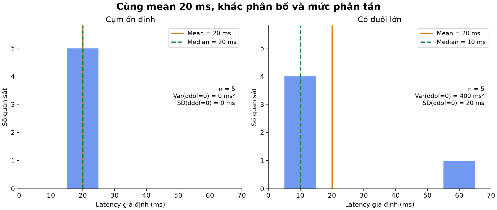
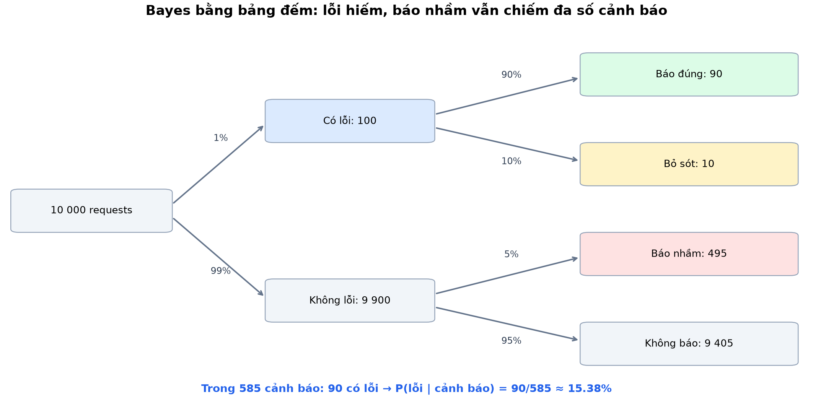
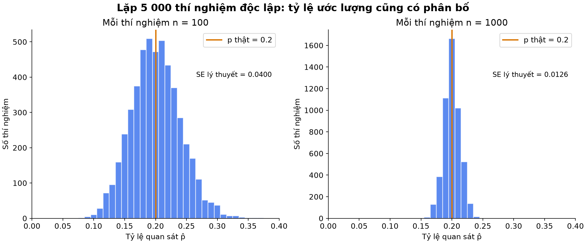
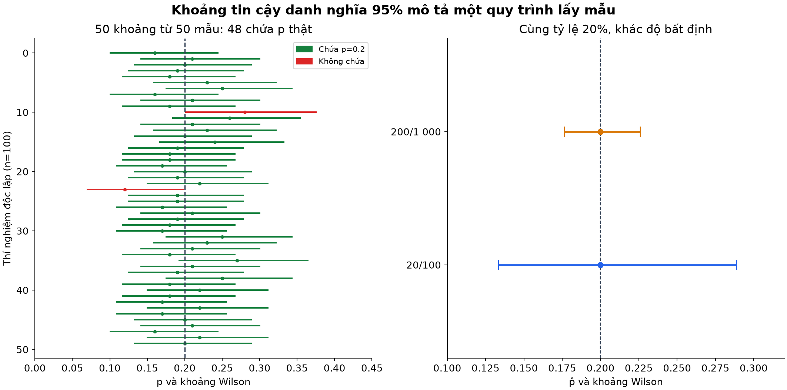
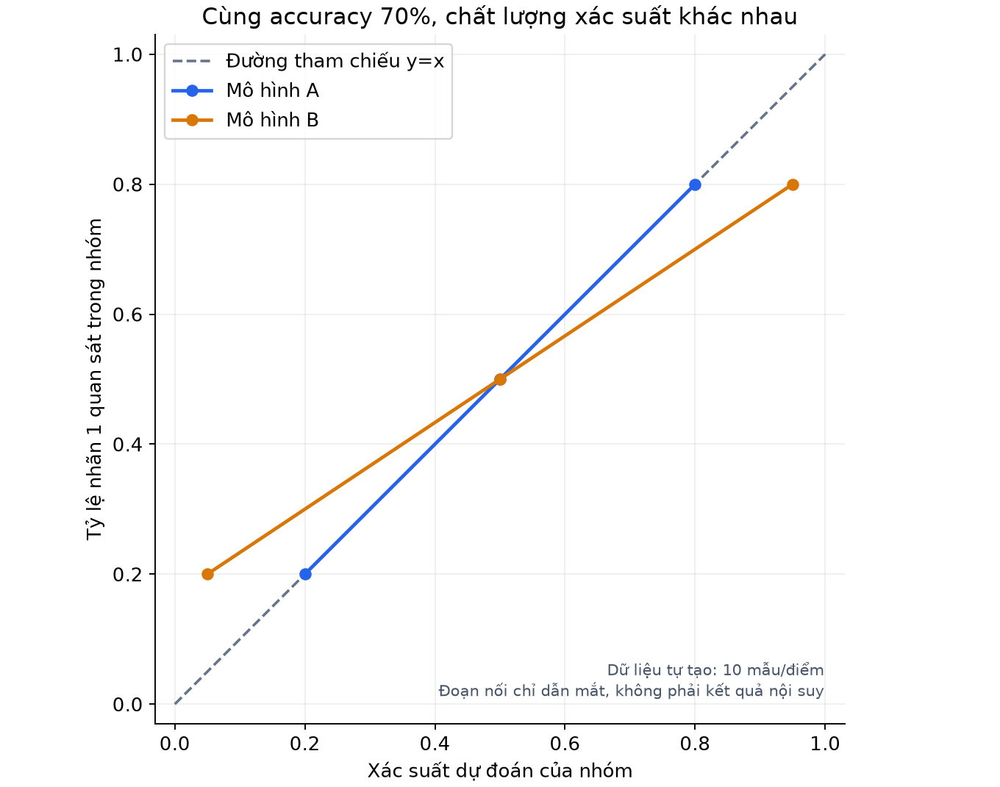

# Bài 4 — Xác suất, thống kê và bất định

[Mục lục](../README.md) · [Bài 3](../03-vector-ma-tran-tensor/README.md) · [Bài tập](exercises.md) · [Lời giải](solutions.md)

Biên soạn và kiểm tra ngày 04/11/2026. Toàn bộ dữ liệu và mô hình số trong bài là giả định để học, không phải thống kê thị trường hay kết quả đo một dịch vụ thật. Code dùng NumPy; không cần GPU, scikit-learn hay tài khoản AI.

## 1. Mục tiêu và cách đọc

Sau bài này, người học có thể:

- Phân biệt biến cố, xác suất, biến ngẫu nhiên và tần suất quan sát.
- Tính kỳ vọng, trung bình, trung vị, phương sai và độ lệch chuẩn cho ví dụ nhỏ.
- Tính xác suất có điều kiện và dùng Bayes bằng bảng đếm, không đảo chiều điều kiện.
- Giải thích vì sao ước lượng từ dữ liệu cũng có độ bất định.
- Đọc đúng ý nghĩa khoảng tin cậy và nhận ra giới hạn của giả định lấy mẫu.
- Phân biệt xác suất dự đoán, nhãn dự đoán, calibration và các nguồn bất định.

Cần biết phép tính số, tổng, vector và Python từ bài 1–3. Có thể học ba lượt: phần 2–6 về nền tảng và mô tả dữ liệu; phần 7–10 về suy luận từ mẫu; phần 11–14 nối sang AI. Công thức Wilson ở phần 10 là phần mở rộng: trước hết hiểu ví dụ và cách diễn giải, chưa cần tự suy ra toàn bộ công thức.

## 2. Tại sao AI Engineer cần xác suất và thống kê?

Backend có nhiều điều không được biết chắc từ một request: thời gian truy vấn, tải hệ thống, lỗi kết nối, nhãn của một ticket mới. Mô hình còn được huấn luyện từ một tập dữ liệu hữu hạn, nên bản thân các kết luận rút ra từ tập ấy cũng có thể thay đổi khi lấy mẫu khác.

Ta cần tách ba câu hỏi:

1. **Mô tả dữ liệu đã thấy:** latency trung bình, mức phân tán, tỷ lệ lỗi trong log.
2. **Mô hình hóa kết quả chưa biết:** xác suất lỗi hoặc phân bố latency theo những thông tin hiện có.
3. **Đánh giá điều mình chưa biết:** tỷ lệ ước lượng chắc đến đâu, kết quả có còn đúng ngoài dữ liệu đã quan sát không?

Một con số dự đoán hay một điểm accuracy không trả lời đủ ba câu hỏi ấy.

## 3. Biến cố và xác suất: bắt đầu từ một request

Gọi $E$ là biến cố “request gặp lỗi nghiêm trọng”, $A$ là “hệ thống phát cảnh báo”. Một **biến cố** là tập các kết quả thỏa một điều kiện. Không gian mẫu $\Omega$ chứa toàn bộ các kết quả được xét trong mô hình xác suất.

$P(E)$ là xác suất của $E$, nằm trong $[0,1]$. Hai kết quả “có lỗi/không lỗi” không có nghĩa mỗi bên có xác suất 1/2. Cần biết mô hình hoặc dữ liệu để gán xác suất.

Ký hiệu và quy tắc:

| Ký hiệu / công thức | Cách đọc |
|---|---|
| $E^c$ | Không xảy ra lỗi, phần bù của $E$ |
| $E\cap A$ | Vừa có lỗi vừa có cảnh báo |
| $E\cup A$ | Có lỗi hoặc có cảnh báo, gồm cả trường hợp có cả hai |
| $P(E^c)=1-P(E)$ | Xác suất biến cố bù |
| $P(E\cup A)=P(E)+P(A)-P(E\cap A)$ | Trừ phần bị đếm hai lần |

Nếu chọn đều một dòng trong bảng log hữu hạn, xác suất chọn được dòng lỗi bằng số dòng lỗi chia tổng số dòng. Với hệ thống đang vận hành, tỷ lệ $k/n$ trong một mẫu log là **ước lượng tần suất**, chưa tự động bằng xác suất thật của mọi request tương lai.

Ví dụ: mô hình sinh dữ liệu có xác suất lỗi $p=0.2$ không bắt buộc 10 request phải chứa đúng 2 lỗi. Có thể thấy 0, 1, 3 hoặc nhiều lỗi hơn. Xác suất và tần suất của một mẫu nhỏ khác nhau. [Seeing Theory: Basic Probability](https://seeing-theory.brown.edu/basic-probability/index.html)

## 4. Biến ngẫu nhiên và phân bố

**Biến ngẫu nhiên** ánh xạ kết quả của một phép thử thành số. Đặt $X=1$ nếu request lỗi, $X=0$ nếu không lỗi. Khi $P(X=1)=p$, ta nói $X$ có phân bố **Bernoulli** với tham số $p$.

```text
X = 0 với xác suất 1-p
X = 1 với xác suất p
```

**Phân bố** mô tả xác suất được phân bổ cho các giá trị hoặc khoảng giá trị thế nào. Kỳ vọng cho biến rời rạc là tổng có trọng số:

$$
\mathbb E[X]=\sum_x xP(X=x)
$$

Với Bernoulli $p=0.2$:

$$
\mathbb E[X]=0\times0.8+1\times0.2=0.2
$$

Một request không có “0.2 lỗi”; 0.2 là kỳ vọng, có thể hiểu qua trung bình dài hạn dưới điều kiện lấy mẫu phù hợp. Kỳ vọng không nhất thiết là một giá trị thực sự xuất hiện, và khác giá trị có khả năng xuất hiện cao nhất.

Phương sai của biến ngẫu nhiên:

$$
\operatorname{Var}(X)=\mathbb E[(X-\mathbb E[X])^2]
$$

Với Bernoulli, $\operatorname{Var}(X)=p(1-p)$; ở $p=0.2$, kết quả là 0.16. Các khái niệm kỳ vọng/phương sai được đối chiếu với [Seeing Theory](https://seeing-theory.brown.edu/basic-probability/index.html); ví dụ số của bài được kiểm tra bằng code.

### Rời rạc khác liên tục

Số lỗi là biến rời rạc. Thời gian có thể được mô hình hóa bằng biến liên tục, dù số đo máy tính có độ phân giải hữu hạn. Với mô hình liên tục có mật độ, xác suất nằm trong một khoảng là diện tích dưới đường mật độ trên khoảng ấy; giá trị mật độ tại một điểm không phải xác suất tại điểm đó và có thể lớn hơn 1. Xác suất đúng một giá trị điểm bằng 0 trong mô hình có mật độ liên tục, nhưng không có nghĩa không quan sát được một giá trị đã làm tròn.

Không mặc định mọi dữ liệu có phân bố chuẩn hình chuông. Latency có thể lệch phải, nhiều cụm hoặc có đuôi lớn. Phân bố dùng trong ví dụ cần được phân biệt với dữ liệu hệ thống thực.

## 5. Thống kê mô tả: cùng trung bình, khác trải nghiệm

Xét hai tập latency, đơn vị ms:

```text
S = [20, 20, 20, 20, 20]
T = [10, 10, 10, 10, 60]
```

Cả hai có **mean — trung bình cộng** bằng 20 ms. Nhưng phần lớn giá trị của T bằng 10 ms và có một giá trị lớn 60 ms. Chỉ nhìn mean sẽ bỏ sót khác biệt.

**Median — trung vị** là giá trị giữa của dãy đã sắp xếp; nếu số phần tử chẵn, lấy trung bình hai giá trị giữa. Median của S bằng 20 ms, của T bằng 10 ms. Median không dùng toàn bộ độ lớn của hai đuôi giống mean.



*Hình 1. Mỗi tập chỉ có 5 quan sát giả định. Đây là minh họa, không đủ ước lượng tốt các percentile ở đuôi. Giá trị lớn không tự động là dữ liệu sai cần xóa.*

### Tính phương sai và độ lệch chuẩn bằng tay

Với T, $\bar x=20$. Các độ lệch là $(-10,-10,-10,-10,40)$, tổng bình phương bằng $4\times100+1600=2000$ ms².

Hai mục tiêu khác nhau dẫn tới hai quy ước mẫu số:

| Mục tiêu | Công thức | Với T |
|---|---|---|
| Mô tả mức phân tán của chính tập giá trị đang có | $v_n=\frac1n\sum_i(x_i-\bar x)^2$ | $2000/5=400$ ms² |
| Ước lượng phương sai tổng thể từ mẫu iid | $s^2=\frac1{n-1}\sum_i(x_i-\bar x)^2$ | $2000/4=500$ ms² |

`iid` nghĩa là các quan sát độc lập và có cùng phân bố. Với giả định ấy và phương sai hữu hạn, mẫu số $n-1$ cho ước lượng không chệch của phương sai tổng thể. Việc ước lượng trung bình từ cùng dữ liệu đã làm mất một bậc tự do: tổng các độ lệch quanh trung bình mẫu luôn bằng 0.

**Standard deviation — độ lệch chuẩn** là căn bậc hai phương sai: $\sqrt{400}=20$ ms theo quy ước mô tả, hoặc $\sqrt{500}\approx22.360680$ ms theo quy ước mẫu. Phương sai có đơn vị ms², độ lệch chuẩn có đơn vị ms. [NIST: Measures of Scale](https://www.itl.nist.gov/div898/handbook/eda/section3/eda356.htm)

Trong NumPy:

```python
import numpy as np
values = np.array([10., 10., 10., 10., 60.])
np.mean(values)           # 20
np.median(values)         # 10
np.var(values, ddof=0)    # 400, chia n
np.var(values, ddof=1)    # 500, chia n-1
np.std(values, ddof=1)    # khoảng 22.360680
```

`ddof` được trừ khỏi số phần tử để tạo mẫu số. Luôn nói rõ quy ước; không so hai con số phương sai từ hai thư viện mà chưa kiểm tra mẫu số.

### Nối với MSE của bài 1–2

Nếu dự đoán **một hằng số** $c$ cho mọi giá trị của T, MSE nhỏ nhất tại trung bình mẫu $c=20$: MSE bằng 400. Chọn $c=10$ cho MSE bằng 500, dù 10 là giá trị xuất hiện nhiều nhất.

Có thể kiểm tra bằng đạo hàm: $\frac{d}{dc}\frac1n\sum_i(c-x_i)^2=\frac2n\sum_i(c-x_i)$; cho bằng 0 sẽ được $c=\bar x$. Mean phù hợp mục tiêu bình phương sai số, không nhất thiết mô tả “request điển hình” tốt nhất trong mọi tình huống. Phương sai và MSE không đồng nhất trong mọi bài toán: ở đây chúng trùng về biểu thức khi dự đoán đúng trung bình của tập ấy.

## 6. Độc lập và đếm số lỗi

Hai biến cố độc lập nếu $P(E\cap A)=P(E)P(A)$. Tương đương $P(A\mid E)=P(A)$ khi $P(E)>0$: biết E không đổi xác suất A. Độc lập không có nghĩa “không cùng xảy ra”. Hai biến cố loại trừ nhau, đều có xác suất dương, lại không độc lập.

Giả sử mỗi request lỗi với xác suất cố định $p$, độc lập giữa các request. Gọi $K$ là số lỗi trong $n$ request. Khi ấy $K$ có phân bố **Binomial — nhị thức**:

$$
P(K=k)=\binom nk p^k(1-p)^{n-k}
$$

$\binom nk=\frac{n!}{k!(n-k)!}$ đếm số cách chọn $k$ vị trí lỗi; $n!=n(n-1)\cdots1$, quy ước $0!=1$. Mỗi cách có xác suất $p^k(1-p)^{n-k}$ do giả định độc lập.

Với $n=10,p=0.2,k=2$:

$$
P(K=2)=45\times0.2^2\times0.8^8=0.301989888
$$

Xác suất đúng 2 lỗi khoảng 30.2%, không phải 100%, dù $\mathbb E[K]=np=2$. Phương sai số lỗi là $np(1-p)=1.6$.

Nếu một sự cố cơ sở dữ liệu làm nhiều request liên tiếp cùng lỗi, giả định độc lập có thể không đúng. Thêm số dòng log tương quan mạnh không tạo lượng thông tin độc lập như thêm từng ấy quan sát iid.

## 7. Xác suất có điều kiện: mẫu số đã thay đổi

$$
P(E\mid A)=\frac{P(E\cap A)}{P(A)},\qquad P(A)>0
$$

Đọc là “xác suất có lỗi khi biết có cảnh báo”. Ta chỉ xét nhóm đã có cảnh báo, nên mẫu số là xác suất cảnh báo, không phải toàn bộ request. [Seeing Theory: Conditional Probability](https://seeing-theory.brown.edu/compound-probability/index.html)

Giả định một bảng 10 000 request có cấu trúc sau:

| | Có lỗi E | Không lỗi $E^c$ | Tổng |
|---|---:|---:|---:|
| Có cảnh báo A | 90 | 495 | 585 |
| Không cảnh báo | 10 | 9405 | 9415 |
| Tổng | 100 | 9900 | 10000 |

Tính từ đúng nhóm được điều kiện hóa:

- $P(E)=100/10000=1\%$.
- $P(A\mid E)=90/100=90\%$: trong nhóm lỗi, hệ thống cảnh báo bao nhiêu.
- $P(A\mid E^c)=495/9900=5\%$: trong nhóm không lỗi, cảnh báo nhầm bao nhiêu.
- $P(E\mid A)=90/585\approx15.38\%$: trong nhóm cảnh báo, có lỗi thật bao nhiêu.

**90% và 15.38% không mâu thuẫn:** chúng trả lời hai câu hỏi khác nhau, dùng hai mẫu số khác nhau.

## 8. Bayes: đảo chiều điều kiện một cách đúng đắn

Từ định nghĩa điều kiện, $P(E\cap A)=P(A\mid E)P(E)$. Thay vào phần 7:

$$
P(E\mid A)=\frac{P(A\mid E)P(E)}{P(A)}
$$

Chia các request thành hai nhóm có lỗi và không lỗi:

$$
P(A)=P(A\mid E)P(E)+P(A\mid E^c)P(E^c)
$$

Thay số:

$$
P(E\mid A)=\frac{0.9\times0.01}{0.9\times0.01+0.05\times0.99}
=\frac{0.009}{0.0585}=\frac2{13}\approx0.153846
$$



*Hình 2. Bảng/cây được dựng theo các tỷ lệ giả định, không phải kết quả ngẫu nhiên của một lần mô phỏng. Cảnh báo nhầm nhiều vì nhóm không lỗi lớn hơn rất nhiều.*

$P(E)$ là **prior — xác suất trước khi biết cảnh báo**; $P(E\mid A)$ là **posterior — xác suất sau khi biết cảnh báo**, trong mô hình giả định này. $P(A\mid E)$ là likelihood của thông tin cảnh báo khi E xảy ra; nó không tự bằng xác suất E sau quan sát.

Nếu tỷ lệ lỗi nền tăng thành 10%, giữ hai tỷ lệ cảnh báo có điều kiện như cũ, posterior thành $0.09/(0.09+0.045)=2/3$. Vì vậy thay đổi tỷ lệ nền có thể đổi ý nghĩa cảnh báo. Ngoài thực tế, các tỷ lệ điều kiện cũng có thể thay đổi; không được giữ chúng cố định mà không kiểm tra.

Biết hai biến cố có liên hệ không chứng minh quan hệ nhân quả. Bayes ở đây là cập nhật xác suất theo thông tin, không phải phép kiểm tra cảnh báo có gây ra lỗi hay không.

## 9. Ước lượng từ mẫu cũng dao động

Nếu có $k$ lỗi trong $n$ request, $\hat p=k/n$ là ước lượng điểm của tỷ lệ lỗi. Trong mô hình iid Bernoulli với p cố định:

$$
\mathbb E[\hat p]=p,\qquad
\operatorname{Var}(\hat p)=\frac{p(1-p)}n,\qquad
\operatorname{SE}(\hat p)=\sqrt{\frac{p(1-p)}n}
$$

**Standard error — sai số chuẩn** là độ lệch chuẩn của một ước lượng khi lặp việc lấy mẫu. Khác độ lệch chuẩn của từng quan sát.

Với $p=0.2$, độ lệch chuẩn của một quan sát Bernoulli là $\sqrt{0.16}=0.4$. Nhưng SE của tỷ lệ là:

- $n=100$: $\sqrt{0.16/100}=0.04$, tức 4 **điểm phần trăm**.
- $n=1000$: $\sqrt{0.16/1000}\approx0.012649$, tức khoảng 1.265 điểm phần trăm.

Tăng số mẫu 10 lần làm SE giảm $\sqrt{10}$ lần, không phải 10 lần. Đây là độ dao động của **ước lượng tỷ lệ**, không nói tỷ lệ lỗi thật của hệ thống giảm khi thu thêm log.



*Hình 3. Mỗi cột histogram đếm số thí nghiệm có tỷ lệ quan sát trong khoảng đó; trục đứng không phải xác suất. Mỗi phía lặp 5000 thí nghiệm độc lập, p=0.2, seed=2026. Cùng seed ở hai phía giúp tái tạo riêng từng ví dụ, không biến hai bộ kết quả thành phép đo trên cùng một tập request.*

Trong lab, trung bình của 5000 ước lượng xấp xỉ 0.200830 ở n=100, 0.200214 ở n=1000. Đây là **kết quả mô phỏng**, khác kỳ vọng lý thuyết đúng bằng 0.2. Khi tăng mẫu, tỷ lệ thường tập trung hơn quanh p dưới giả định phù hợp, nhưng không được hứa sai lệch giảm sau mọi request được thêm vào.

## 10. Khoảng tin cậy cho tỷ lệ — cách đọc trước, công thức sau

20 lỗi trong 100 request và 200 lỗi trong 1000 request đều cho $\hat p=20\%$, nhưng lượng thông tin không giống nhau. Ta dùng **confidence interval — khoảng tin cậy** để biểu diễn bất định do lấy mẫu đối với tham số p.

Bài này dùng **Wilson score interval** hai phía, mức danh nghĩa 95%, hệ số $z=1.96$. Kết quả:

| Dữ liệu | Ước lượng điểm | Khoảng Wilson xấp xỉ |
|---|---:|---:|
| 20/100 | 20% | [13.34%, 28.88%] |
| 200/1000 | 20% | [17.64%, 22.59%] |
| 0/100 | 0% | [0%, 3.70%] |

Không thấy lỗi trong 100 request chưa chứng minh p=0. Khoảng cuối không bằng [0,0]. Bảng dùng giả định lấy mẫu nhị thức đã nêu; không sửa được việc lấy mẫu thiên lệch hoặc p thay đổi theo thời gian. Công thức được đối chiếu với [NIST: Confidence intervals for proportions](https://www.itl.nist.gov/div898/handbook/prc/section2/prc241.htm).

### 95% nói về điều gì?

Theo cách diễn giải frequentist, p là tham số cố định chưa biết; khoảng được tính từ mẫu nên thay đổi giữa các lần lấy mẫu. Phương pháp hướng tới việc tạo các khoảng chứa p với tỷ lệ phủ gần mức danh nghĩa khi lặp lấy mẫu trong mô hình phù hợp.

Sau khi có một khoảng cụ thể, **không diễn giải tự động thành “p có xác suất 95% nằm trong khoảng này”**. Một phát biểu posterior về tham số cần mô hình suy luận Bayesian và prior tương ứng. Khoảng tin cậy cũng không phải khoảng chứa 95% latency của request tiếp theo.



*Hình 4. Bên trái, đường đứt là p thật đã biết trong mô phỏng; một số khoảng không phủ nó. Bên phải, cùng tỷ lệ quan sát nhưng mẫu lớn hơn cho khoảng hẹp hơn. Chấm là tỷ lệ mẫu, không nhất thiết là tâm hình học của khoảng Wilson.*

Wilson có tỷ lệ phủ **xấp xỉ**, không luôn đúng 95% ở mọi p,n. Ở đúng mô hình Binomial(100,0.2), code cộng xác suất mọi k tạo khoảng chứa p cho tỷ lệ phủ khoảng **94.052%**. Mô phỏng 5000 lần với seed=2026 cho khoảng **94.38%**. Sai khác hữu hạn này phù hợp việc mô phỏng cũng dao động; không được thay kết quả 94% thành 95% cho đẹp.

### Công thức mở rộng để đọc code

Đặt $D=1+z^2/n$. Tâm và nửa độ rộng:

$$
c=\frac{\hat p+z^2/(2n)}{D},\qquad
h=\frac zD\sqrt{\frac{\hat p(1-\hat p)}n+\frac{z^2}{4n^2}}
$$

Khoảng là $[c-h,c+h]$. Hàm `wilson_interval` tính trực tiếp công thức này. $z$ là hệ số từ phân bố chuẩn cho mức danh nghĩa đã chọn, không phải learning rate hay điểm dữ liệu. Bài không yêu cầu tự suy ra phép đảo kiểm định dẫn đến công thức; có thể học sâu ở phần suy luận thống kê sau này.

## 11. Xác suất dự đoán khác nhãn dự đoán

Một bộ phân loại có thể trả $p_\theta(Y=1\mid x)=0.8$ rồi dùng ngưỡng để tạo nhãn. Đây là **xác suất do mô hình ước lượng**, phụ thuộc dữ liệu, tham số và giả định; không phải phép đo chắc chắn về thế giới.

**Calibration — hiệu chuẩn xác suất** đặt câu hỏi: trong những mẫu được dự đoán gần 0.8, tỷ lệ nhãn 1 quan sát có gần 80% không? Cần nhiều mẫu phù hợp để đánh giá; không thể biết một dự đoán đơn lẻ “đã hiệu chuẩn” chỉ qua việc nó đúng hay sai. [scikit-learn: Probability calibration](https://scikit-learn.org/stable/modules/calibration.html)

Ví dụ tự tạo gồm ba nhóm, mỗi nhóm 10 mẫu:

| Nhóm | Nhãn 1 quan sát | Mô hình A dự đoán | Mô hình B dự đoán |
|---|---:|---:|---:|
| 1 | 2/10 | 0.20 | 0.05 |
| 2 | 5/10 | 0.50 | 0.50 |
| 3 | 8/10 | 0.80 | 0.95 |

Trong mỗi nhóm, mọi mẫu nhận cùng một xác suất. Với quy tắc `p >= 0.5` gán nhãn 1, cả hai mô hình tạo cùng nhãn và cùng accuracy 21/30=70%. Nhưng xác suất của B cực đoan hơn mức dữ liệu nhóm này hỗ trợ.

Ngưỡng 0.5 chỉ là quy ước minh họa; một ứng dụng thực tế còn cần xét chi phí bỏ sót, báo nhầm và yêu cầu vận hành khi chọn ngưỡng.



*Hình 5. Mỗi điểm chỉ có 10 mẫu. A khớp đúng tỷ lệ của ba nhóm được dựng sẵn, chưa chứng minh A hiệu chuẩn trên mọi dữ liệu tương lai; đoạn nối chỉ giúp đọc, không khẳng định hành vi giữa các điểm.*

Hai cách chấm xác suất, cần nhãn $y_i\in\{0,1\}$:

$$
\text{Brier}=\frac1n\sum_i(p_i-y_i)^2
$$

$$
\text{LogLoss}=-\frac1n\sum_i\left[y_i\ln p_i+(1-y_i)\ln(1-p_i)\right]
$$

Trong ví dụ: Brier của A=0.190, B=0.205; log loss dùng log tự nhiên của A≈0.564651, B≈0.657836. Với một mẫu có y=1, dự đoán p=0.8 cho Brier 0.04 và log loss≈0.223144; p=0.2 cho 0.64 và ≈1.609438.

Hai điểm số này đánh giá chất lượng xác suất tổng thể, không phải phép đo riêng calibration; chất lượng phân biệt giữa các mẫu cũng ảnh hưởng. Code không huấn luyện hoặc hiệu chỉnh một mô hình thật, chỉ chấm các dự đoán được dựng sẵn. Tách dữ liệu dùng hiệu chuẩn với dữ liệu đánh giá sẽ học ở bài 5.

Nếu gán xác suất 0 cho một kết quả thực sự xảy ra, log loss lý thuyết là vô hạn. Lab giữ ý nghĩa ấy thay vì âm thầm cắt xác suất thành một số nhỏ. Khi triển khai thư viện có thể có quy tắc xử lý số học riêng cần đọc tài liệu.

## 12. Entropy và các nguồn bất định

Với phân bố Bernoulli, **entropy — độ bất định của phân bố** tính bằng bit:

$$
H(p)=-p\log_2p-(1-p)\log_2(1-p)
$$

Quy ước $0\log_20=0$ theo giới hạn. $H(0.5)=1$ bit, $H(0.2)\approx0.721928$ bit, $H(0.05)\approx0.286397$ bit, còn H(0)=H(1)=0. Phân bố càng dồn về một kết quả thì entropy Bernoulli càng thấp.

Công thức và cách chọn đơn vị theo cơ số log được đối chiếu với [SciPy: entropy](https://docs.scipy.org/doc/scipy/reference/generated/scipy.stats.entropy.html); lab tự tính bằng công thức, không cần cài SciPy.

Entropy thấp của **đầu ra mô hình** không chứng minh mô hình đúng: nó có thể tự tin vào kết quả sai. Entropy của xác suất dự đoán cũng không tự tách được hai nguồn bất định thường được thảo luận:

| Nguồn | Cách hiểu | Ví dụ giả định / hướng xử lý |
|---|---|---|
| Aleatoric | Dao động còn lại của quan sát với đầu vào đang có | Cùng số lô và truy vấn nhưng cache/tải khác nhau; có thể cần mô hình phân bố đầu ra hoặc thêm thông tin hữu ích |
| Epistemic | Thiếu hiểu biết về mô hình do dữ liệu/giả định hạn chế | Chưa có dữ liệu request rất lớn; có thể cần dữ liệu đại diện hơn, kiểm tra mô hình và đánh giá riêng |

Phân biệt trên được đối chiếu ở mức khái niệm với abstract của [Kendall & Gal, 2017](https://arxiv.org/abs/1703.04977); bài này chưa triển khai các phương pháp Bayesian Deep Learning trong nghiên cứu đó.

“Nhiễu không thể giảm” phải hiểu tương đối với những đầu vào và mô hình đang xét: đo thêm nguyên nhân hữu ích có thể giảm phần biến thiên chưa giải thích. Ngược lại, thêm nhiều dữ liệu cùng vùng cũ không đảm bảo giải quyết thiếu hiểu biết ở vùng mới. Dữ liệu triển khai đổi phân bố còn có thể làm xác suất/đánh giá cũ mất hiệu lực; không phải mô hình nào cũng phát hiện được việc đó bằng một điểm uncertainty.

## 13. Code thực hành và tái tạo hình

Mã: [lab.py](lab.py). Đã kiểm tra với **Python 3.14.6, NumPy 2.5.4**. Từ thư mục bài 4, nếu cần môi trường riêng:

```bash
python3 -m venv .venv
.venv/bin/python -m pip install -r requirements.txt
.venv/bin/python lab.py --mode all
```

Ví dụ lệnh dùng macOS/Linux; Windows dùng Python trong `.venv\Scripts`. Nếu Python hiện tại đã có NumPy:

```bash
python3 lab.py --mode probability
python3 lab.py --mode stats
python3 lab.py --mode bayes
python3 lab.py --mode sampling --repeats 5000 --seed 2026
python3 lab.py --mode intervals --repeats 5000 --seed 2026
python3 lab.py --mode calibration
```

`--mode all` chạy cả sáu phần. `--seed`/`--repeats` chỉ thay đổi mô phỏng trong `sampling` và `intervals`, không thay các ví dụ tính chính xác. `sampling` dùng `Generator.binomial`: mỗi số đếm tương đương tổng n quan sát Bernoulli độc lập trong mô hình, không phải dữ liệu thu thật từ server. Seed giúp tái tạo trong môi trường được ghi, không làm ví dụ thành bằng chứng thực tế.

Nếu ở gốc bộ tài liệu, thay `lab.py` bằng `04-xac-suat-thong-ke-bat-dinh/lab.py`.

Hình đã lưu sẵn dạng PNG/SVG trong [figures](figures/). Chỉ cần cài thư viện vẽ khi muốn tái tạo:

```bash
.venv/bin/python -m pip install -r requirements-figures.txt
.venv/bin/python make_figures.py
```

Mã vẽ: [make_figures.py](make_figures.py); phụ thuộc: [requirements.txt](requirements.txt), [requirements-figures.txt](requirements-figures.txt). Đã kiểm tra Matplotlib 3.11.2; gói ghim phiên bản cần Python/nền tảng tương thích. Hình luôn dùng cấu hình cố định ghi trong mã, không tự lấy tùy chọn từ lần chạy lab trước đó.

## 14. Tự kiểm tra và bước tiếp theo

Những cặp khái niệm không nên lẫn:

- Xác suất giả định p và tỷ lệ quan sát $\hat p$.
- Phương sai tổng thể, phương sai mẫu và quy ước mô tả chia n.
- Độ lệch chuẩn quan sát và sai số chuẩn của ước lượng.
- $P(A\mid E)$ và $P(E\mid A)$.
- Khoảng tin cậy của tham số và khoảng dự đoán cho kết quả mới.
- Xác suất mô hình xuất ra và chất lượng xác suất đã kiểm chứng.
- Entropy thấp và dự đoán chính xác.

Làm [bài tập](exercises.md), rồi đối chiếu [lời giải](solutions.md). Đủ nền để học tiếp khi tính được Bayes từ bảng đếm, nói rõ mẫu số phương sai, và giải thích vì sao thêm mẫu không sửa được mọi loại bất định. Phần Wilson có thể đọc lại sau khi đã nắm cách diễn giải.

**Học tiếp:** [Bài 5 — Train/validation/test và rò rỉ dữ liệu](../05-train-validation-test-ro-ri-du-lieu/README.md), thiết kế đánh giá để các con số phản ánh đúng khả năng làm việc với dữ liệu mới. Có ví dụ tính tay, thí nghiệm và hình minh họa. Nguồn và phạm vi đã đọc: [danh mục nguồn](../SOURCES.md).
