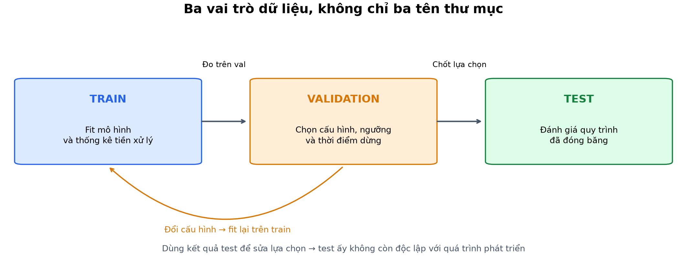
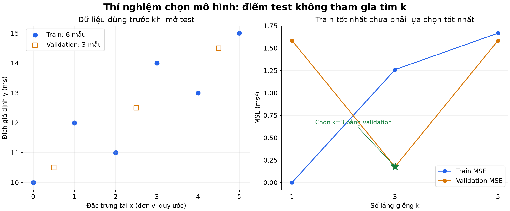
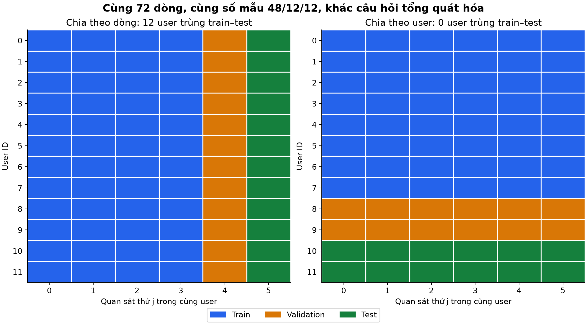
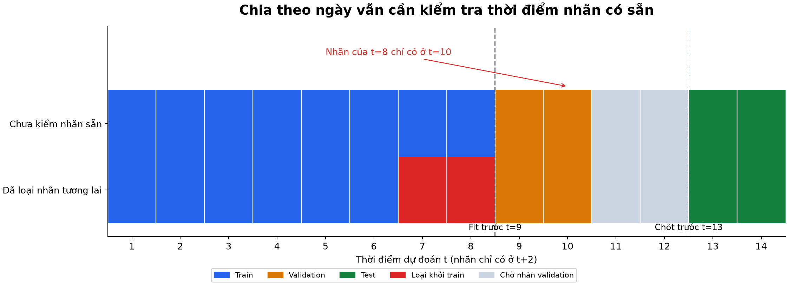
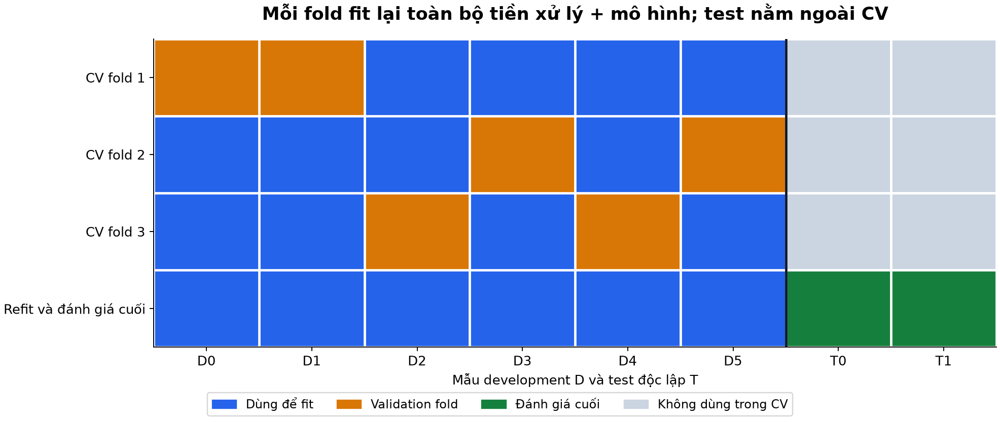

# Bài 5 — Train/validation/test và rò rỉ dữ liệu

[Mục lục](../README.md) · [Bài 4](../04-xac-suat-thong-ke-bat-dinh/README.md) · [Bài tập](exercises.md) · [Lời giải](solutions.md)

Biên soạn và kiểm tra ngày 04/11/2026. Dữ liệu, tỷ lệ và điểm số đều được dựng cho bài học; không phải benchmark hay hiệu quả của một hệ thống thật. Code chỉ cần NumPy; các API scikit-learn/Feast được dẫn để đọc nguyên tắc, không phải phụ thuộc thực hành.

## 1. Mục tiêu và cách học

Sau bài này, người học có thể:

- Phân biệt fit mô hình, chọn cấu hình và đánh giá cuối.
- Chọn đơn vị chia dữ liệu phù hợp: dòng, người dùng, tài liệu, hội thoại hoặc thời gian.
- Tính tay một ví dụ chọn mô hình theo validation, không chọn bằng train/test.
- Phát hiện việc fit tiền xử lý trên dữ liệu giữ riêng, đặc trưng chứa tương lai và nhãn chưa có sẵn.
- Giải thích cách cross-validation thay vai trò validation và vì sao phải fit lại pipeline trong từng fold.
- Thiết kế một quy trình đánh giá có thể kiểm tra từ chỉ số dòng, group ID, timestamp và mã nguồn.

Cần biết MSE, trung bình/độ lệch chuẩn và mảng NumPy từ bài 1–4. Phần 2–6 xây nền; phần 7–10 xét nhóm/thời gian; phần 11–14 nối thành quy trình thực hành. Không cần học trước cây quyết định hoặc mạng neural để làm thí nghiệm.

## 2. Trước khi chia: đang dự đoán điều gì, cho ai, vào lúc nào?

Ví dụ: “ngay khi request đến, dự đoán latency cuối cùng”. Ta cần xác định:

1. **Thời điểm quyết định:** khi mới nhận request, trước lúc xử lý.
2. **Đầu vào có sẵn:** payload, trạng thái hàng đợi đã quan sát, thông tin kế hoạch xử lý nếu có trước quyết định.
3. **Đích:** latency chỉ biết khi request hoàn tất.
4. **Môi trường cần đánh giá:** request tương lai của user đã biết, hay user chưa từng gặp, hay một nhóm tải/hạ tầng mới?

Các câu hỏi ấy xác định phép chia. Nếu muốn làm việc với user mới nhưng để cùng user xuất hiện cả train và test, điểm số có thể trả lời sai câu hỏi dù không trùng dòng nào.

Trong bài 3, ví dụ dùng “số truy vấn” làm đầu vào. Với bài toán dự đoán ngay khi nhận request, đặc trưng đó chỉ hợp lệ nếu là số truy vấn **đã biết/kế hoạch trước lúc dự đoán**. Nếu chỉ đếm được sau khi chạy xong, đó là thông tin tương lai. Tính hợp lệ phụ thuộc nhiệm vụ và thời điểm, không chỉ tên cột.

## 3. Ba tập có ba vai trò

| Tập | Được dùng để làm gì? | Ví dụ |
|---|---|---|
| **Train** | Fit các thành phần học từ dữ liệu | Trọng số, trung bình chuẩn hóa, từ vựng học từ corpus, bộ điền giá trị thiếu |
| **Validation / development** | Chọn quy trình và cấu hình | Số láng giềng, kiến trúc, learning rate, ngưỡng, checkpoint theo early stopping |
| **Test giữ riêng** | Đánh giá quy trình đã chốt trên dữ liệu phù hợp mục tiêu triển khai | Điểm cuối, phân tích theo các nhóm đã định trước, giới hạn và độ bất định |

Validation không nhất thiết được đưa vào phép tính gradient, nhưng nó vẫn ảnh hưởng mô hình cuối thông qua lựa chọn của người phát triển. Vì vậy điểm validation đã dùng chọn mô hình không phải một phép đánh giá cuối hoàn toàn độc lập. [scikit-learn: Cross-validation](https://scikit-learn.org/stable/modules/cross_validation.html)



*Hình 1. Tách vai trò thông tin, không chỉ đặt ba tên thư mục. Có thể quay lại train nhiều lần dựa trên validation; test không tham gia lựa chọn trong quy trình đánh giá cuối này.*

Sau khi chọn cấu hình, có thể **refit** một mô hình cuối trên train+validation nếu quy trình đã định như vậy. Lúc ấy fit lại cả tiền xử lý trên tập được phép mới, rồi đánh giá bằng test chưa dùng để chọn. Việc này không áp dụng máy móc cho mọi quy trình early stopping/calibration: có thể cần giữ một phần development hoặc dùng dự đoán out-of-fold cho các bước đó. Ví dụ số ở bài này **không refit** sau khi chọn k, để dễ đối chiếu bằng tay.

“Giữ test ngoài lựa chọn” không có nghĩa cấm chạy lại một chương trình cố định để tái lập kết quả. Vấn đề là dùng phản hồi từ test để sửa mô hình, ngưỡng, seed hoặc báo cáo biến thể tốt nhất, rồi vẫn coi điểm ấy là độc lập.

## 4. Tỷ lệ chia không phải công thức chung

Lab có ví dụ xáo 20 row ID rồi chia 12/4/4, tức 60%/20%/20%. Đây chỉ là minh họa. Không có tỷ lệ 70/15/15 hoặc 80/10/10 phù hợp mọi bài toán.

Cần cân nhắc số **đơn vị độc lập**, số ca của từng nhóm cần đo, độ hiếm của nhãn, thời gian dữ liệu và nhu cầu tuning. Một test 1000 dòng có thể chỉ tương đương vài nhóm sự cố; ngược lại, một test rất nhỏ có sai số lấy mẫu lớn dù chia đúng.

- **Random split:** phù hợp khi các mẫu gần độc lập và câu hỏi triển khai tương ứng; không tự xử lý dữ liệu nhóm hoặc tương lai.
- **Stratified split:** cố giữ tỷ lệ nhãn ở các phần, hữu ích khi một lớp hiếm; không sửa việc trùng nhóm hoặc đảo thời gian.
- **Group split:** giữ toàn bộ một nhóm ở một phía khi muốn đo khả năng với nhóm chưa thấy.
- **Time split:** dùng quá khứ để phát triển rồi đo ở tương lai, đồng thời kiểm tra thông tin/nhãn có sẵn.

Có trường hợp cần kết hợp: tương lai của **khách hàng mới**, hoặc dữ liệu có cả cụm hội thoại và mốc thời gian. Không ưu tiên cân bằng tỷ lệ nhãn bằng cách phá ranh giới nhóm/thời gian cần cho bài toán.

## 5. Ví dụ tính tay: chọn mô hình bằng validation

Để tập trung vào đánh giá, ta dùng thuật toán đơn giản: **k-nearest neighbors regression**. Với một x cần dự đoán, lấy k điểm train gần x nhất theo khoảng cách $|x-x_i|$, rồi trung bình các đích của chúng. Đây chỉ là mô hình minh họa, không phải yêu cầu chọn kNN cho mọi ứng dụng AI.

- x là chỉ số tải theo đơn vị quy ước, không phải timestamp.
- y là latency giả định, ms.
- Nếu khoảng cách bằng nhau, ưu tiên dòng đứng trước trong thứ tự train; quy tắc được chốt trước khi đánh giá.

Train:

| x | 0 | 1 | 2 | 3 | 4 | 5 |
|---|---:|---:|---:|---:|---:|---:|
| y | 10 | 12 | 11 | 14 | 13 | 15 |

Validation có ba cặp `(0.5,10.5), (2.5,12.5), (4.5,14.5)`. Ta thử k thuộc {1,3,5}; chưa dùng test để chọn.

Với k=1, dự đoán validation là `(10,11,13)`. MSE:

$$
\frac{(10-10.5)^2+(11-12.5)^2+(13-14.5)^2}{3}
=\frac{19}{12}\approx1.583333\text{ ms}^2
$$

Với k=3:

| x cần đo | Ba x train được chọn | Dự đoán là trung bình y |
|---:|---|---:|
| 0.5 | 0, 1, 2 | $(10+12+11)/3=11$ |
| 2.5 | 2, 3, 1 | $(11+14+12)/3=37/3$ |
| 4.5 | 4, 5, 3 | $(13+15+14)/3=14$ |

Sai số là $(1/2,-1/6,-1/2)$, nên MSE $=(1/4+1/36+1/4)/3=19/108\approx0.175926$ ms².

Tổng hợp:

| k | Train MSE | Validation MSE |
|---:|---:|---:|
| 1 | 0.000000 | 1.583333 |
| 3 | 1.259259 | **0.175926** |
| 5 | 1.666667 | 1.583333 |

k=1 có train loss bằng 0 vì tại một điểm train, láng giềng gần nhất chính là nó. Đó là đánh giá lại trên dữ liệu đã nhớ, chưa chứng minh khả năng với dữ liệu mới. Ta chọn k=3 theo validation, không chọn k=1 theo train loss.



*Hình 2. Chỉ dùng train/validation trong giai đoạn chọn k. Đường nối ba cấu hình giúp quan sát, không mô tả mọi mức độ phức tạp của mọi mô hình.*

### Chốt rồi mới đánh giá test

Test gồm `(1.5,11.5), (3.5,13.5)`. Mô hình k=3 đã chốt cho dự đoán `(11,38/3)`:

$$
\text{MSE}_{test}=\frac{(11-11.5)^2+(38/3-13.5)^2}{2}
=\frac{17}{36}\approx0.472222\text{ ms}^2
$$

Test loss khác validation loss là bình thường: đó là hai tập điểm khác nhau. Không được vì test chưa đẹp mà quay lại chọn một k khác bằng chính điểm test rồi gọi kết quả mới là đánh giá độc lập.

Các tập rất nhỏ này được dựng để tính tay. Chúng không cho phép ước lượng độ tin cậy vận hành hay khẳng định k=3 tốt nhất nói chung. Không coi train loss nhỏ/validation loss lớn tự nó là bằng chứng chắc chắn của một nguyên nhân duy nhất; cần kiểm tra dữ liệu và quy trình.

## 6. Rò rỉ dữ liệu là thông tin đi sai ranh giới

**Data leakage — rò rỉ dữ liệu** xảy ra khi quá trình xây mô hình/đánh giá dùng thông tin đáng lẽ không có trong điều kiện dự đoán hoặc không được dùng cho lựa chọn đó. [scikit-learn: Common pitfalls](https://scikit-learn.org/stable/common_pitfalls.html)

Các dạng thường gặp:

| Dạng | Ví dụ | Cách kiểm tra |
|---|---|---|
| Đặc trưng chứa đích hoặc hậu quả của đích | Dự đoán ticket khẩn cấp từ ghi chú đóng ticket; dự đoán latency từ tổng thời gian thực thi sau khi xong | Xác định feature có sẵn lúc ra quyết định hay không |
| Fit tiền xử lý trên toàn bộ dữ liệu | Mean, imputer, PCA hoặc chọn đặc trưng đã nhìn cả phần giữ riêng | Kiểm tra dữ liệu đi vào mỗi lệnh fit |
| Các bản sao/nhóm cùng nguồn vượt ranh giới | Cùng hội thoại, ảnh gốc và bản tăng cường, các đoạn của cùng tài liệu nằm hai phía | Audit ID nguồn, hash và nhóm liên quan |
| Nhãn/đặc trưng tương lai | Rolling mean chứa ngày mai; nhãn train chưa hoàn tất khi mô phỏng dự đoán | So event time, availability time, prediction time |
| Phản hồi đánh giá đi vào tuning | Chọn seed, prompt, threshold dựa trên điểm test | Lưu lịch sử lựa chọn và vai trò của từng tập |

Rò rỉ không luôn làm điểm số cao hơn ở mọi ví dụ. Bằng chứng nằm ở luồng thông tin sai, không chỉ một con số đáng ngờ. Overfitting trên train, distribution shift và lỗi triển khai cũng có thể làm chất lượng kém; không gọi tất cả những vấn đề ấy là leakage.

## 7. Ví dụ tính tay: chuẩn hóa đã nhìn test

Train có một đặc trưng với hai giá trị `[0,2]`; test có `[10]`. Chuẩn hóa bằng $z=(x-\mu)/s$, dùng SD chia n như các hàm trong lab.

Fit đúng trên train: $\mu=1$, $s=1$, nên test được biến đổi thành $(10-1)/1=9$.

Nếu ghép cả test trước khi fit:

$$
\mu_{all}=4,\qquad s_{all}=\sqrt{\frac{16+4+36}{3}}=\sqrt{56/3}\approx4.320494
$$

Test z thành $(10-4)/\sqrt{56/3}\approx1.388730$. Giá trị giữ riêng đã ảnh hưởng tham số tiền xử lý của mô hình.

Thí nghiệm này chứng minh **thống kê bị ảnh hưởng**, không chứng minh mọi thuật toán sẽ có điểm test đẹp hơn. Chẳng hạn một số phép biến đổi affine có thể không đổi dự đoán của một mô hình cụ thể. Không thể chỉ thử xem điểm có tăng rồi mới quyết định có leakage hay không.

Quy trình đúng cho đánh giá trên dữ liệu mới:

```python
from lab import fit_scaler, transform
import numpy as np

train_x = np.array([0.,2.])
test_x = np.array([10.])
mean, scale = fit_scaler(train_x)
train_z = transform(train_x, mean, scale)
test_z = transform(test_x, mean, scale)  # Dùng lại đúng tham số đã fit.
```

Nguyên tắc áp dụng cho cả bước không dùng nhãn: học mean, vocabulary, bộ chọn đặc trưng, imputer… Chuyển đơn vị bằng hằng số cố định như ms→giây không cần fit, nên bản thân thao tác ấy không lấy thông tin của test. Các thiết kế transductive có giả định khác phải được nêu riêng, không ngầm đổi giao thức đánh giá của bài này.

Pipeline giúp đóng gói tiền xử lý và mô hình để fit/cross-validate cùng nhau. Nó không tự sửa một đặc trưng có thông tin tương lai hay splitter sai nhóm. [scikit-learn: Pipeline](https://scikit-learn.org/stable/modules/generated/sklearn.pipeline.Pipeline.html)

## 8. Chia theo nhóm: đơn vị độc lập không phải luôn là dòng

Giả định 12 user, mỗi user có 6 quan sát, tổng 72 dòng. Mỗi user được gán một nhãn cố định tùy ý; các nhãn được cân bằng để dễ kiểm tra. Mô hình minh họa chỉ nhớ nhãn user từng thấy; với user chưa gặp, dùng nhãn đa số của train, hòa thì chọn 0.

Hai phép chia đều có 48 train, 12 validation, 12 test:

- **Theo dòng xen kẽ trong từng user:** 4 dòng đầu của mỗi user vào train, dòng thứ 5 vào validation, thứ 6 vào test.
- **Theo user:** user 0–7 vào train, 8–9 vào validation, 10–11 vào test; toàn bộ quan sát của một user cùng phía.



*Hình 3. Mỗi hàng là một user, mỗi ô là một quan sát. Hai cách có cùng số dòng nhưng khác mức trùng user. Đây là phép chia dựng sẵn, không phải một lần random split.*

Kết quả mô hình ghi nhớ:

| Phép chia | User chung giữa train/test | Test accuracy |
|---|---:|---:|
| Theo dòng | 12 | 100% |
| Theo user | 0 | 50% |

Ở cách thứ nhất, mô hình đã biết nhãn cả 12 user. Ở cách thứ hai, hai user test đều mới; fallback 0 đúng một trong hai nhãn cân bằng nên đạt 50%.

**Chia theo dòng không tự động sai trong mọi nhiệm vụ.** Nó có thể phù hợp câu hỏi dự đoán quan sát mới của user đã biết, nếu cả yếu tố thời gian và thông tin đầu vào cũng phù hợp. Nhưng dùng điểm ấy để khẳng định làm tốt với **user mới** là kết luận sai mục tiêu. [scikit-learn: GroupKFold](https://scikit-learn.org/stable/modules/generated/sklearn.model_selection.GroupKFold.html)

Ví dụ chưa chứng minh mọi group split làm điểm giảm hoặc mô hình thật chỉ đạt 50%. Nó chỉ phơi bày điều một phép đo có thể đang tận dụng. Với ticket, group có thể là hội thoại; với tài liệu là văn bản nguồn, với ảnh là ảnh gốc/đối tượng, không nhất thiết user ID.

## 9. Chia theo thời gian: lúc sự kiện xảy ra khác lúc biết thông tin

Giả sử mỗi mẫu có:

- `decision_time`: lúc cần tạo dự đoán.
- `label_available_at`: lúc nhãn đã đủ dữ liệu để dùng huấn luyện/đánh giá.
- Với từng đặc trưng: lúc sự kiện nguồn xảy ra và lúc giá trị đó thực sự có sẵn cho hệ thống.

Dữ liệu được chỉnh sửa/backfill hôm nay có thể mang event time của tuần trước, nhưng chưa có ở thời điểm dự đoán tuần trước. Lấy “giá trị mới nhất hiện nay” để mô phỏng lịch sử có thể đưa tương lai vào quá khứ.

Tài liệu [Feast: Point-in-time joins](https://docs.feast.dev/getting-started/concepts/point-in-time-joins) cũng phân biệt event timestamp với created timestamp. Trang hiện hành lưu ý ràng buộc event time mặc định chưa tự loại mọi giá trị backfill tạo sau thời điểm cần tái hiện. Cần kiểm tra cấu hình và ý nghĩa timestamp; bài này không cài hoặc chạy Feast.

### Ví dụ nhãn chỉ có ở t+2

Đặt `label_available_at = decision_time + 2`. Ta muốn fit mô hình **trước t=9**, đánh giá validation tại t=9,10; chốt cấu hình trước test tại t=13,14. Quy ước ví dụ: dữ liệu dùng để fit/chọn phải có timestamp **nhỏ hơn** cutoff. Quy tắc bằng timestamp cần được xác định theo thứ tự xử lý thật nếu muốn cho phép bằng nhau.

Nếu cứ lấy mẫu dự đoán t=1–8 vào train thì có lỗi:

| Mẫu train dự kiến | Nhãn có tại | Có thể fit trước t=9? |
|---|---:|---|
| t=1…6 | t=3…8 | Có |
| t=7 | t=9 | Không, theo cutoff nghiêm ngặt của ví dụ |
| t=8 | t=10 | Không |

Ta loại t=7,8 khỏi **lần fit trước validation này**. Nhãn validation t=9,10 chỉ có ở t=11,12, nên phải chờ rồi mới chốt cấu hình trước t=13. Nhãn test chỉ có ở t=15,16: đánh giá offline cuối phải đợi chúng; không được dùng nhãn ấy để tạo dự đoán tại t=13,14.



*Hình 4. Ô đỏ loại khỏi train trước validation; ô xám là khoảng chờ nhãn validation. Đây là lịch đánh giá cố định, không phải lịch học hoặc dữ liệu ngày thực.*

Điểm quan trọng: mẫu t=7,8 không bị cấm vĩnh viễn. Nếu refit sau này trước t=13 và nhãn của chúng đã có, có thể dùng theo quy trình đã định. Điều kiện luôn xét **ở lần fit nào**, với cutoff nào.

`gap` hoặc khoảng loại ở biên có thể giúp tránh dùng cửa sổ/nhãn chồng lấn. Nhưng không có “gap=2 là an toàn” cho mọi bài toán. `TimeSeriesSplit.gap` đếm số mẫu, không tự đọc timestamp thực, thời gian nhãn hoàn tất hay nguồn backfill của bạn. [scikit-learn: TimeSeriesSplit](https://scikit-learn.org/stable/modules/generated/sklearn.model_selection.TimeSeriesSplit.html)

## 10. Cross-validation: nhiều lần validation, test vẫn bên ngoài

**K-fold cross-validation (CV)** chia development thành K phần. Mỗi vòng dùng K−1 phần để fit, phần còn lại để validation; gộp các điểm để so cấu hình. K=3 ở đây là **số fold**, khác k của thuật toán láng giềng.



*Hình 5. Mỗi ô D là một mẫu development. Hàng cuối minh họa refit cấu hình đã chọn trên toàn bộ development rồi đánh giá test; mode `cv` chỉ chạy các fold, chưa thực hiện bước cuối ấy.*

Mỗi fold phải thực hiện lại:

```text
Tách train-fold và validation-fold
→ Fit mean/scale/feature selection chỉ trên train-fold
→ Transform hai phần bằng tham số vừa fit
→ Fit mô hình trên train-fold
→ Chấm trên validation-fold
```

Fit scaler hoặc chọn đặc trưng trên toàn development trước khi chia fold vẫn để thông tin validation-fold đi vào lần fit. Việc đã giữ test bên ngoài chưa đủ ngăn lỗi này.

Lab dùng ba fold trên **6 điểm development** của ví dụ, k thuộc {1,3}, seed=2026. Chọn k=1 nếu so mean fold MSE của lần chạy được ghi (k=1 khoảng 2.833333; k=3 khoảng 3.666667). Khác kết quả validation cố định chọn k=3 không phải mâu thuẫn: điểm validation, số mẫu fit và phép tổng hợp đều đã đổi; dữ liệu rất nhỏ. Không chọn giao thức có điểm đẹp hơn sau khi nhìn kết quả để báo cáo như một thiết kế định trước.

Trong 1-D, chuẩn hóa bằng cùng một biến đổi tăng tuyến tính không đổi thứ tự khoảng cách về mặt toán học; lab vẫn fit scaler trong từng fold để thể hiện đúng ranh giới. Tính toán dấu phẩy động có thể phá hòa khoảng cách cực sát nhau, nên không dùng các giá trị làm tròn làm quy tắc chung cho mọi môi trường.

K-fold ngẫu nhiên không tự phù hợp cho thời gian hoặc nhóm; cần splitter tương ứng. Các fold thường chia sẻ dữ liệu train nên điểm fold không độc lập; SD giữa fold không tự là sai số chuẩn hay khoảng tin cậy 95% cho chất lượng cuối.

Nếu chọn cấu hình bằng cùng các điểm CV rồi báo điểm tốt nhất như đánh giá hoàn toàn độc lập, vẫn có selection bias. Có thể giữ test ngoài cùng như bài này, hoặc dùng **nested CV** với vòng trong chọn cấu hình, vòng ngoài chấm toàn quy trình. Nested CV là phần mở rộng, chưa được triển khai trong lab. [scikit-learn: Cross-validation](https://scikit-learn.org/stable/modules/cross_validation.html)

## 11. Từ bài toán đến quy trình có thể kiểm tra

Một bản thiết kế đánh giá nên ghi được:

1. Mục tiêu: dự đoán gì, lúc nào, cho nhóm/đợt thời gian nào.
2. Đơn vị độc lập và ranh giới: source ID, group ID, cutoff, độ trễ nhãn, cửa sổ đặc trưng.
3. Cách chia đã chốt: thuật toán, seed nếu có, danh sách row/group ID và phiên bản dữ liệu.
4. Những bước có fit: scaler, imputer, chọn đặc trưng, mô hình, calibrator; bước nào dùng tập nào.
5. Tiêu chí chọn: metric, baseline, số cấu hình, quy tắc hòa, early stopping/ngưỡng nếu có.
6. Kết quả cuối: điểm tổng và theo nhóm đã định, số mẫu độc lập, sai số/bất định và giới hạn.

Chọn seed để tái lập khác chọn seed cho điểm đẹp nhất. Giữ một test file nhưng liên tục tối ưu prompt/kiến trúc theo điểm của nó cũng làm phản hồi test đi vào lựa chọn. Khi đã dùng test như development, nên ghi nhận điều đó và tìm đánh giá độc lập mới phù hợp, không đổi tên file để coi như sạch.

Vận dụng cho LLM/RAG: few-shot examples và prompt tuning thuộc quá trình phát triển; không lấy đáp án chuẩn của test vào prompt để báo khả năng trả lời mới. Tuy nhiên việc truy xuất tài liệu được phép trong nhiệm vụ hỏi–đáp không tự là leakage. Cần định nghĩa đang đo hỏi trên tài liệu đã biết hay tổng quát hóa sang tài liệu mới, và tách theo nguồn tương ứng. Đây là vận dụng nguyên tắc luồng thông tin, không phải một benchmark LLM được chạy trong bài.

## 12. Code thực hành và kết quả cần đối chiếu

Mã: [lab.py](lab.py), kiểm tra bằng **Python 3.14.6, NumPy 2.5.4**. Từ thư mục bài 5, nếu cần môi trường riêng:

```bash
python3 -m venv .venv
.venv/bin/python -m pip install -r requirements.txt
.venv/bin/python lab.py --mode all
```

Ví dụ dùng macOS/Linux; Windows dùng Python trong `.venv\Scripts`. Nếu Python hiện tại đã có NumPy:

```bash
python3 lab.py --mode split --seed 2026
python3 lab.py --mode select
python3 lab.py --mode preprocess
python3 lab.py --mode groups
python3 lab.py --mode time
python3 lab.py --mode cv --seed 2026
```

`--mode all` chạy cả sáu phần. `--seed` chỉ ảnh hưởng mode `split` và `cv`; các dữ liệu/phép chia dựng sẵn khác không đổi. Nếu ở gốc bộ tài liệu, thay `lab.py` bằng `05-train-validation-test-ro-ri-du-lieu/lab.py`.

| Mode | Điều cần quan sát |
|---|---|
| `split` | 20 ID không trùng giữa ba tập, kích thước 12/4/4 |
| `select` | Chọn k=3 bằng validation; test MSE≈0.472222 chỉ tính sau chọn |
| `preprocess` | Mean đúng=1, mean có nhìn test=4; hai phép transform khác nhau |
| `groups` | Cùng 48/12/12 dòng; 12 user trùng và 100% so với 0 user trùng và 50% |
| `time` | Train trước validation chỉ t=1…6; loại t=7,8; chờ nhãn validation ở t=11,12 |
| `cv` | Fit lại scaler trong từng fold; không tính final-test score |

`choose_k` không nhận test làm đầu vào. `fit_scaler` chỉ học từ mảng được truyền vào, vì vậy người gọi vẫn chịu trách nhiệm truyền đúng train-fold. Code không tự chứng minh dữ liệu sản xuất đã độc lập hoặc feature có sẵn đúng thời điểm. Mode `time` là kiểm tra lịch/nhãn, không huấn luyện một mô hình dự báo thời gian.

## 13. Hình minh họa và cách tái tạo

Có sẵn 5 hình PNG và SVG trong [figures](figures/). Đọc bài không cần cài thư viện vẽ. Để tái tạo, từ thư mục bài 5 dùng môi trường ảo ở trên:

```bash
.venv/bin/python -m pip install -r requirements-figures.txt
.venv/bin/python make_figures.py
```

Mã vẽ: [make_figures.py](make_figures.py); phụ thuộc: [requirements.txt](requirements.txt), [requirements-figures.txt](requirements-figures.txt). Đã kiểm tra Matplotlib 3.11.2 và NumPy 2.5.4; gói ghim phiên bản cần Python/nền tảng tương thích. Hình CV dùng seed cố định trong mã, không tự lấy từ một lần chạy CLI khác.

## 14. Tự kiểm tra và bước tiếp theo

Làm [bài tập](exercises.md), sau đó đối chiếu [lời giải](solutions.md). Có thể chuyển tiếp khi giải thích được vì sao train loss=0 chưa đủ, dùng đúng validation để chọn, fit tiền xử lý đúng phía và kiểm tra được group/cutoff theo một nhiệm vụ cụ thể.

Không có một thao tác duy nhất bảo đảm hết leakage: random split, stratify, Pipeline và gap đều chỉ giải quyết một phần khi điều kiện đúng. Điểm số cũng chỉ có ý nghĩa đối với tập dữ liệu, mục tiêu và quy trình được mô tả.

**Học tiếp:** [Bài 6 — Hồi quy và phân loại](../06-hoi-quy-phan-loai/README.md), xây mô hình, chọn hàm mục tiêu và diễn giải đầu ra cho các kiểu bài toán. Có tính tay, code và hình minh họa. Nguồn và phạm vi đã đọc: [danh mục nguồn](../SOURCES.md).
