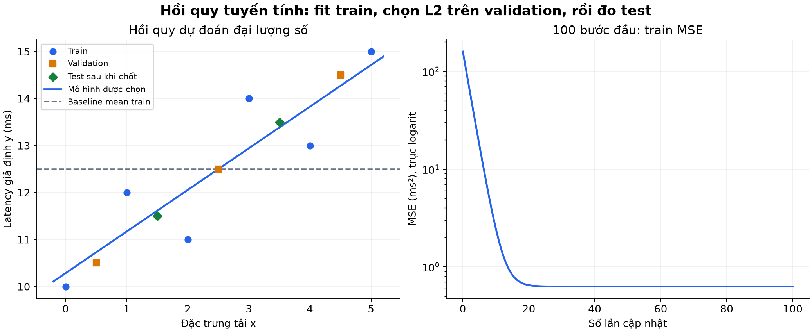
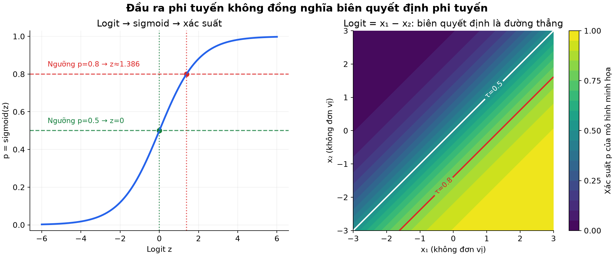
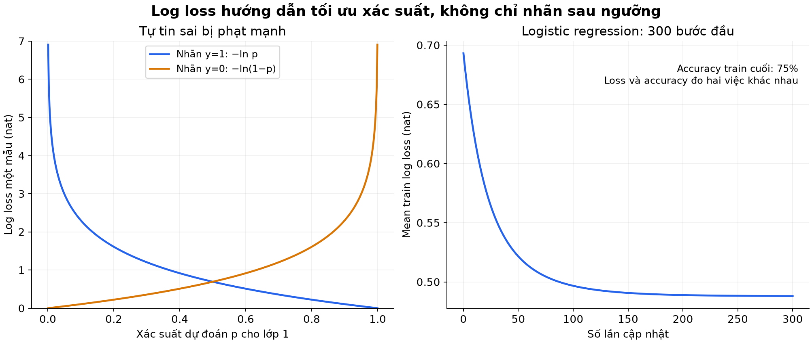
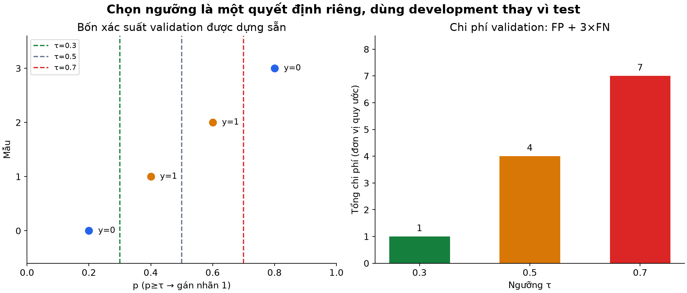
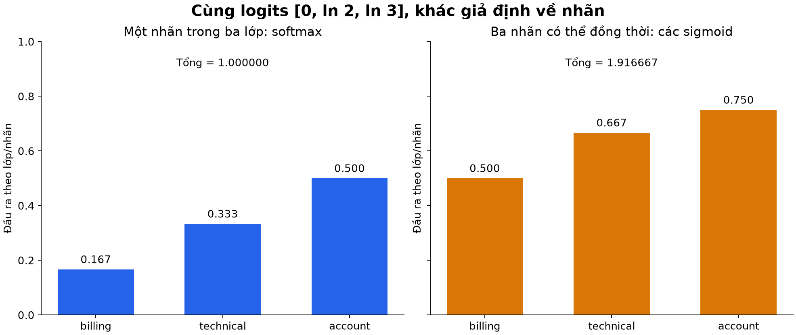

# Bài 6 — Hồi quy và phân loại

[Mục lục](../README.md) · [Bài 5](../05-train-validation-test-ro-ri-du-lieu/README.md) · [Bài tập](exercises.md) · [Lời giải](solutions.md)

Biên soạn và kiểm tra ngày 04/11/2026. Bổ sung các khối giải thích tường minh, trực giác kỹ thuật và ví dụ thực tế cho AI Engineer; toàn bộ dữ liệu, nhãn, chi phí và kết quả gốc được giữ nguyên vẹn để đối chiếu chuẩn. Code dùng NumPy; không cần scikit-learn, SciPy, GPU hay dịch vụ AI.

---

## 1. Mục tiêu và cách đọc

Sau bài học, người học có thể:

- Nhận diện hồi quy, phân loại nhị phân, đa lớp và nhiều nhãn từ ý nghĩa đầu ra.
- Phân biệt giá trị dự đoán, logit, xác suất và quyết định sau ngưỡng.
- Tính tay một bước gradient cho hồi quy tuyến tính và logistic regression.
- Giải thích MSE, binary cross-entropy và vai trò của regularization.
- Huấn luyện hai mô hình nhỏ theo ranh giới train/validation/test đã học.
- Đọc softmax, phân biệt nó với nhiều sigmoid và tránh một số lỗi số học.

Cần biết vector, đạo hàm, MSE, xác suất Bernoulli và vai trò validation từ bài 1–5. Có thể đọc phần 2–4 để ôn hồi quy; phần 5–9 học phân loại nhị phân; phần 10–14 mở rộng đầu ra và thực hành. Precision/recall, F1 và mất cân bằng sẽ học sâu ở bài 7.

---

## 2. Chọn kiểu bài toán từ ý nghĩa đích

**Hồi quy — regression** dự đoán đại lượng số mà sai lệch số có ý nghĩa. **Phân loại — classification** dự đoán loại/nhãn, thường thông qua một phân bố xác suất rồi một quy tắc quyết định.

| Nhu cầu | Đích | Cách đặt bài toán thường phù hợp |
|---|---|---|
| Dự đoán latency | Số ms | Hồi quy |
| Dự đoán số request giờ tới | Số đếm / kỳ vọng số đếm | Hồi quy cho dữ liệu đếm; có thể cần mô hình phù hợp tính không âm |
| Ticket có cần ưu tiên không? | Có/không | Phân loại nhị phân |
| Ticket thuộc đúng một nhóm chính? | Billing/technical/account | Phân loại đa lớp, một nhãn |
| Ticket đồng thời liên quan billing và technical? | Một tập nhãn | Phân loại nhiều nhãn |

Việc y được lưu bằng số nguyên chưa quyết định kiểu bài toán. Mã `billing=0, technical=1, account=2` chỉ là tên lớp được mã hóa; không mặc định account “gấp đôi” technical hoặc lỗi 0→2 nghiêm trọng gấp đôi 0→1.

Ngược lại, số đếm vẫn có thể là bài toán hồi quy dù chỉ quan sát số nguyên. Một dự đoán kỳ vọng 12.4 request có thể có nghĩa, nhưng xử lý miền giá trị và quyết định làm tròn cần theo mục tiêu. Mức độ ưu tiên có thứ tự còn có thể cần cách mô hình hóa ordinal; không tự coi mọi thang mức là khoảng cách bằng nhau.

Định dạng đầu vào cũng không quyết định kiểu bài toán: cùng một ảnh có thể được dùng dự đoán loại vật thể hoặc một đại lượng số. Cần chọn đích, loss và cách đánh giá cùng nhau.

> [!NOTE]
> ### 💡 Trực giác & Phân loại nhanh 4 dạng bài toán trong thực tế
> Để không bao giờ nhầm lẫn, hãy tự đặt câu hỏi về bản chất đầu ra:
> 1. **Hồi quy (Regression) — "Bao nhiêu?"**: Đầu ra là một con số thực liên tục có đơn vị đo lường (độ trễ ms, giá nhà tỷ VNĐ, nhiệt độ °C). Sai lệch giữa 10 ms và 12 ms có ý nghĩa toán học cụ thể.
> 2. **Phân loại nhị phân (Binary Classification) — "Có hay Không?"**: Đầu ra là 1 trong 2 lựa chọn loại trừ nhau (Email Spam hay Hợp lệ? Giao dịch Lừa đảo hay An toàn? Khách hàng Rời bỏ hay Ở lại?).
> 3. **Phân loại đa lớp (Multi-class Classification) — "Một trong số nhiều?"**: Đầu ra là duy nhất 1 nhãn trong $C$ nhãn ứng viên (Nhận diện giống chó: Poodle, Husky hay Corgi? Phân loại phòng ban xử lý: Kỹ thuật, Kế toán hay Nhân sự?). Các nhãn cạnh tranh nhau, tổng xác suất chia cho các nhãn bằng đúng 100%.
> 4. **Phân loại nhiều nhãn (Multi-label Classification) — "Những cái nào trong số nhiều?"**: Một mẫu có thể đồng thời mang nhiều nhãn (Một bài báo công nghệ có thể gắn cả 3 thẻ: `#AI`, `#Python`, `#Cloud`; một bộ phim có thể vừa là `Hành động`, vừa là `Hài hước`). Các nhãn độc lập với nhau.

---

## 3. Hồi quy tuyến tính: điểm dự đoán có đơn vị của đích

Ôn lại mô hình từ các bài trước:

$$
\hat y_i=\mathbf x_i^T\mathbf w+b,\qquad
L_{MSE}=\frac1n\sum_i(\hat y_i-y_i)^2
$$

Với y là ms, dự đoán cũng có đơn vị ms; MSE có đơn vị ms². Tuyến tính ở đây nói về cách các hệ số kết hợp với đặc trưng. Tên gọi quen thuộc vẫn là hồi quy tuyến tính khi có intercept b, dù ánh xạ với b khác 0 chính xác là affine. [Google: Linear regression](https://developers.google.com/machine-learning/crash-course/linear-regression)

Đầu ra không bị ràng buộc: mô hình có thể trả giá trị âm hoặc ngoại suy không hợp lý. Nếu đích chỉ có thể không âm, cần kiểm tra thiết kế đầu ra/loss hoặc mô hình thích hợp; cắt mọi số âm thành 0 không tự sửa hết giả định sai.

MSE phạt sai số lớn mạnh hơn. Hồi quy còn có thể dùng MAE, Huber, quantile loss… theo yêu cầu. Không có quy tắc “mọi hồi quy phải dùng MSE”. Tối thiểu hóa MSE trong một lớp mô hình hạn chế cũng không bảo đảm biểu diễn được mọi quan hệ thật.

Ba chỉ số dễ đối chiếu:

$$
\text{MAE}=\frac1n\sum_i|\hat y_i-y_i|,\qquad
\text{RMSE}=\sqrt{\text{MSE}}
$$

MAE/RMSE có cùng đơn vị đích; RMSE nhạy hơn với lỗi lớn. Không gọi `accuracy` cho hồi quy mà chưa định nghĩa rõ dung sai hoặc cách chấm khác. [scikit-learn: Regression metrics](https://scikit-learn.org/stable/modules/model_evaluation.html#regression-metrics)

### Tính tay một bước

Train có hai cặp `(x,y)=(1,3),(2,5)`, khởi đầu w=0,b=0. Không chuẩn hóa trong ví dụ tính tay này. MSE ban đầu $(9+25)/2=17$.

$$
g_w=\frac22[(-3)\times1+(-5)\times2]=-13,\qquad
g_b=\frac22(-3-5)=-8
$$

Với learning rate 0.1, cập nhật đồng thời w=1.3,b=0.8. Dự đoán mới là 2.1 và 3.4; MSE $=(0.9^2+1.6^2)/2=1.685$. Đây là cơ chế bài 2, nay đặt trong sự lựa chọn loại đầu ra và loss.

> [!TIP]
> ### 💡 So sánh thực tế: Khi nào chọn MAE và khi nào chọn RMSE?
> - **MAE (Mean Absolute Error — Sai số tuyệt đối trung bình)**: Đo độ lệch trung bình thực tế bằng cách lấy trị tuyệt đối $|\hat y - y|$. MAE giống như một vị trọng tài ôn hòa: lệch 1 ms thì phạt 1 điểm, lệch 10 ms thì phạt 10 điểm. MAE ít bị ảnh hưởng bởi các điểm dị biệt (outliers).
> - **RMSE (Root Mean Squared Error — Căn bậc hai sai số bình phương trung bình)**: Vì bình phương sai số trước khi lấy căn, RMSE giống như một vị thẩm phán nghiêm khắc: lệch 1 ms chỉ phạt 1 điểm, nhưng lệch 10 ms bị phạt tương đương 100 điểm trước khi căn!
> - **Ứng dụng AI Engineer**: Nếu trong hệ thống SLA của bạn, các lỗi dự đoán lớn gây hậu quả nghiêm trọng (ví dụ: dự đoán sai độ trễ làm server bị sập hàng loạt), hãy tối ưu **RMSE**. Nếu bài toán chấp nhận thỉnh thoảng có vài ngoại lai và bạn muốn đo lường mức sai lệch điển hình, hãy chọn **MAE**.

---

## 4. Huấn luyện hồi quy theo quy trình bài 5

Lab dùng lại dữ liệu nhỏ của bài 5 để nối mạch học:

```text
Train x: 0, 1, 2, 3, 4, 5
Train y: 10, 12, 11, 14, 13, 15
Validation: (0.5,10.5), (2.5,12.5), (4.5,14.5)
Test: (1.5,11.5), (3.5,13.5)
```

Đặc trưng tải và latency đều giả định; các điểm validation/test được dựng gần quan hệ y=10+x. Đây không phải benchmark chưa từng được biết để khẳng định một họ mô hình tốt hơn mọi họ khác.

Quy trình: fit mean/SD chỉ trên train → chuẩn hóa các phần bằng tham số ấy → fit ba mức L2 trên train → chọn bằng **validation MSE không cộng penalty** → chốt → chấm test, không refit train+validation trong lab này.

Với 3000 bước, learning rate 0.1, kết quả gần:

| L2 λ | Train MSE | Validation MSE | Nhận xét lựa chọn |
|---:|---:|---:|---|
| **0** | **0.628571** | **0.034830** | **Tốt nhất!** Validation loss nhỏ nhất, chọn cấu hình này |
| **0.1** | 0.633760 | 0.065281 | Phạt nhẹ trọng số, loss tăng nhẹ |
| **1** | 0.882804 | 0.447226 | Phạt quá nặng làm mô hình kém linh hoạt (Underfit) |

Phần định nghĩa penalty sẽ giải thích ở mục 8. Trong ví dụ này λ=0 được chọn. Đổi về tọa độ x gốc, mô hình gần $\hat y=(31/35)x+72/7$. Hai dự đoán test là khoảng 11.614286 và 13.385714 ms, MSE=16/1225≈0.013061 ms², RMSE=MAE≈0.114286 ms.

Baseline dự đoán mean train 12.5 cho mọi request có test MSE=1. Đây là mốc so sánh đơn giản được fit từ train, không lấy mean của test. Kết quả tốt hơn baseline ở hai điểm không đủ để kết luận độ tin cậy thực tế.



*Hình 1. Điểm test được hiển thị sau khi quy trình chọn đã chốt. Hình phải chỉ vẽ 100 bước đầu. Train loss không về 0 vì các điểm train không nằm chính xác trên một đường thẳng.*

---

## 5. Logistic regression: logit khác xác suất

Với y thuộc {0,1}, trước hết tạo một **logit — điểm số thô**:

$$
z=\mathbf x^T\mathbf w+b
$$

Rồi đưa qua **sigmoid**:

$$
p_\theta(Y=1\mid\mathbf x)=\sigma(z)=\frac1{1+e^{-z}}
$$

e≈2.71828. Trong toán thực với z hữu hạn, 0<p<1; trên máy tính p có thể bị làm tròn thành 0/1 ở giá trị rất lớn. Sigmoid không đổi logit thành nhãn ngay, mà tạo xác suất mô hình gán cho lớp 1. [Google: Sigmoid function](https://developers.google.com/machine-learning/crash-course/logistic-regression/sigmoid-function)

| z (Logit thô) | p xấp xỉ (Xác suất) | Ý nghĩa trực quan |
|---:|---:|---|
| −2 | 0.119203 | Nghiêng mạnh về lớp 0 (~11.9%) |
| 0 | 0.500000 | Điểm cân bằng tuyệt đối: 50/50 |
| 2 | 0.880797 | Nghiêng mạnh về lớp 1 (~88.1%) |

Đảo lại:

$$
z=\ln\frac p{1-p}
$$

$p/(1-p)$ là **odds**; z là log-odds. Ví dụ z=ln3 cho odds=3, p=3/4=0.75. Odds 3 không có nghĩa xác suất bằng 3.

Nếu tăng một đặc trưng một đơn vị, giữ các đặc trưng khác cố định, log-odds tăng $w_j$, odds nhân với $e^{w_j}$. Xác suất không tăng một lượng cố định vì sigmoid phi tuyến. Không tự diễn giải hệ số thành tác động nhân quả hoặc so độ quan trọng của hai hệ số khác đơn vị/thang đo.

Tên **logistic regression** dễ gây nhầm: trong cách gọi bài toán ML thông thường, đây là mô hình phân loại dù có chữ regression. Nó tuyến tính ở log-odds, không phải ở xác suất. [scikit-learn: Logistic regression](https://scikit-learn.org/stable/modules/linear_model.html#logistic-regression)

> [!NOTE]
> ### 💡 Trực giác: Vì sao không dùng đường thẳng $wx+b$ trực tiếp cho phân loại?
> - **Vấn đề của đường thẳng**: Hàm tuyến tính $\hat y = wx + b$ có thể chạy từ $-\infty$ đến $+\infty$. Nếu áp dụng cho bài toán xác suất (vốn chỉ được phép nằm trong đoạn $[0, 1]$), mô hình có thể cho ra dự đoán vô lý như: *"Xác suất spam là -2.5"* hoặc *"Xác suất gian lận là 180%"*!
> - **Hàm Sigmoid — Cỗ máy nén số học**: Hàm Sigmoid đóng vai trò như một chiếc kẹp đàn hồi mềm hình chữ S:
>   - Bất kỳ số âm rất lớn nào cũng bị nén tiệm cận về sát số $0$.
>   - Số $0$ rơi đúng vào điểm phân vân $0.5$ (50%).
>   - Bất kỳ số dương rất lớn nào cũng bị nén tiệm cận về sát số $1$.
> - **Logit vs Odds vs Xác suất**:
>   - *Xác suất $p$*: Tỷ lệ cơ hội xảy ra ($p = 0.75$, tức 75%).
>   - *Tỷ số cược (Odds)*: Tỷ lệ giữa cơ hội xảy ra và không xảy ra: $\text{Odds} = \frac{p}{1-p} = \frac{0.75}{0.25} = 3$ (Nói nôm na: "Cửa thắng sáng gấp 3 lần cửa thua").
>   - *Logit ($z$)*: Lấy log tự nhiên của Odds: $z = \ln(3) \approx 1.098$.

---

## 6. Từ xác suất đến quyết định

Chọn ngưỡng $\tau$, rồi:

$$
\hat y=\begin{cases}1 & p\ge\tau\\0 & p<\tau\end{cases}
$$

Bài dùng quy tắc hòa `>=`; quy tắc ở đúng biên phải được ghi rõ. Với τ=0.5, điều kiện tương đương z≥0. Với τ=0.8, điều kiện là z≥ln4≈1.386294.



*Hình 2. Trái là sigmoid theo logit, không phải đồ thị theo mọi đặc trưng. Phải dùng hệ số tự đặt z=x₁−x₂, chưa huấn luyện: các biên p=0.5 hoặc 0.8 vẫn là đường thẳng. Đầu ra phi tuyến không làm mọi ranh giới trong không gian đầu vào trở thành đường cong.*

Nếu đặc trưng đầu vào đã được biến đổi phi tuyến, ranh giới khi nhìn lại không gian gốc có thể khác. Và xác suất đúng miền [0,1] vẫn chưa chứng minh calibration tốt; phải kiểm tra trên dữ liệu phù hợp như bài 4.

Ngưỡng quyết định khác tham số w,b. Đổi ngưỡng không tự huấn luyện lại mô hình hoặc đổi p; nó đổi hành động cuối. Vai trò của ngưỡng được đối chiếu với [Google: Thresholds](https://developers.google.com/machine-learning/crash-course/classification/thresholding).

> [!TIP]
> ### 💡 Ứng dụng AI: Đổi ngưỡng quyết định theo bối cảnh kinh doanh
> Mô hình AI chỉ tính ra xác suất $p$, còn việc gán nhãn 0 hay 1 phụ thuộc vào **ngưỡng quyết định $\tau$ (Decision Threshold)** do kỹ sư lựa chọn:
> - **Khi nào chọn ngưỡng thấp ($\tau = 0.2$)?** Trong bài toán chẩn đoán ung thư hoặc phát hiện gian lận ngân hàng: Thà báo nhầm (False Alarm) để bác sĩ kiểm tra lại, còn hơn là bỏ sót một khối u ác tính!
> - **Khi nào chọn ngưỡng cao ($\tau = 0.85$)?** Trong bộ lọc email Spam: Thà để lọt một vài email rác vào Inbox, còn hơn là xóa nhầm một email quan trọng của đối tác kinh doanh!

---

## 7. Vì sao dùng binary cross-entropy?

Với y∈{0,1}, mô hình coi kết quả có phân bố Bernoulli điều kiện theo x:

$$
P_\theta(y\mid x)=p^y(1-p)^{1-y}
$$

Nếu y=1, biểu thức còn p; nếu y=0, còn 1−p. Lấy âm log tự nhiên để biến việc gán xác suất cao cho kết quả quan sát thành loss thấp:

$$
\ell(y,p)=-y\ln p-(1-y)\ln(1-p)
$$

Đây là **binary cross-entropy (BCE)**, cũng là log loss nhị phân. Với các quan sát được mô hình hóa độc lập có điều kiện, tối đa hóa tích likelihood tương đương tối thiểu hóa tổng âm log likelihood; chia n không đổi nghiệm khi chưa thêm penalty. Đây là lý do xác suất học của loss này, không chỉ vì sigmoid có hình chữ S.

Ở đây ln là log tự nhiên nên loss dùng đơn vị nat; entropy dùng log₂ ở bài 4 có đơn vị bit. Không so hai trị số mà bỏ qua cơ số log.

- Với y=1,p=0.8: loss=−ln0.8≈0.223144.
- Với y=1,p=0.2: loss=−ln0.2≈1.609438.
- Với y=0,p=0.8: loss=−ln0.2, cũng bị phạt vì tự tin vào lớp sai.

Ở các biên p=0/1, hiểu hạng không đóng góp theo giới hạn. Gán xác suất 0 cho kết quả xảy ra cho loss vô hạn trong biểu diễn xác suất lý thuyết.

### Gradient ngắn gọn nhưng cần hiểu nguồn gốc

Từ sigmoid, $dp/dz=p(1-p)$. Với 0<p<1:

$$
\frac{\partial\ell}{\partial p}=-\frac yp+\frac{1-y}{1-p}
=\frac{p-y}{p(1-p)}
$$

Nhân theo chain rule, $\partial\ell/\partial z=p-y$. Vì $\partial z/\partial w_j=x_j$ và $\partial z/\partial b=1$, ta được:

$$
\nabla_\mathbf w L=\frac1nX^T(\mathbf p-\mathbf y),\qquad
\frac{\partial L}{\partial b}=\operatorname{mean}(\mathbf p-\mathbf y)
$$

So với MSE hồi quy ở bài 3: dự đoán dùng p thay vì z, và không có hệ số 2 do **định nghĩa loss khác nhau**. Không nên chép gradient từ hồi quy rồi chỉ thay tên biến.

### Tính tay một bước logistic

Hai mẫu `(x,y)=(-1,0),(1,1)`, w=0,b=0, nên cả hai logit bằng 0, p=0.5 và mean BCE=ln2≈0.693147. Không chuẩn hóa trong ví dụ này.

$$
g_w=\frac12[(-1)(0.5-0)+(1)(0.5-1)]=-0.5,\qquad g_b=0
$$

Với learning rate 1, w mới=0.5,b mới=0. Hai xác suất thành khoảng 0.377541 và 0.622459; mean BCE giảm còn 0.474077. Learning rate 1 chỉ dùng cho ví dụ hai điểm này, không phải mặc định mọi mô hình.

### MSE có bị cấm cho phân loại không?

Không. MSE giữa xác suất và nhãn nhị phân chính là Brier score đã học. Nếu gắn sigmoid rồi tối ưu MSE, gradient theo logit có thêm $2(p-y)p(1-p)$; không phải gradient BCE ở trên. Logistic regression theo Bernoulli likelihood thường dùng BCE. Loss/optimizer phải khớp thiết kế và được đánh giá, không chọn bằng khẩu hiệu “phân loại không được bình phương sai số”. [Google: Loss and regularization](https://developers.google.com/machine-learning/crash-course/logistic-regression/loss-regularization)

> [!NOTE]
> ### 💡 Vẻ đẹp của công thức Gradient BCE: $(\mathbf p - \mathbf y)$
> Hãy nhìn vào biểu thức đạo hàm: $\nabla_\mathbf w L = \frac{1}{n}X^T(\mathbf p - \mathbf y)$.
> - Độ lệch chính là: **(Xác suất máy đoán $p$ - Nhãn thực tế $y$)**!
> - Nếu nhãn thật là $y = 1$ mà máy chỉ đoán $p = 0.2$: độ lệch là $0.2 - 1 = -0.8$ (độ dốc âm rất lớn $\implies$ cập nhật mạnh mẽ tham số để tăng xác suất lên).
> - Nếu nhãn thật là $y = 1$ và máy đã đoán đúng $p = 0.99$: độ lệch là $0.99 - 1 = -0.01$ (độ dốc gần bằng 0 $\implies$ máy gần như không cần điều chỉnh tham số nữa).
> - Sự kết hợp giữa đạo hàm của Sigmoid $p(1-p)$ và đạo hàm của BCE $\frac{p-y}{p(1-p)}$ đã triệt tiêu mẫu số một cách hoàn hảo, để lại biểu thức gradient thanh lịch bậc nhất trong toán học học máy.

---

## 8. Regularization: thêm một ưu tiên cho nghiệm

Bài này dùng mục tiêu:

$$
J(\mathbf w,b)=L_{data}+\frac\lambda2\|\mathbf w\|_2^2
$$

$L_{data}$ là mean MSE hoặc mean BCE; λ≥0 điều chỉnh mức phạt trọng số. Không phạt bias trong lab. Gradient theo w được cộng thêm λw; gradient bias không đổi.

Đây là **L2 regularization**. Nó ưu tiên trọng số nhỏ hơn theo hệ tọa độ đặc trưng đang dùng; có thể giảm độ phức tạp/độ nhạy nhưng cũng có thể làm underfit. Cần chọn mức phạt bằng development, không mặc định càng lớn càng tốt.

Hai lưu ý quan trọng:

- Feature đã chuẩn hóa khác feature thô; cùng một λ không luôn biểu diễn cùng ưu tiên sau đổi thang đo.
- Các thư viện có thể dùng tổng loss, trung bình loss, hệ số 1/2, trọng số mẫu hoặc tham số C đảo chiều regularization. Không copy λ của lab sang API khác mà chưa đọc định nghĩa. [scikit-learn: Linear Models](https://scikit-learn.org/stable/modules/linear_model.html)

Nếu dữ liệu phân tách hoàn hảo, logistic không regularize có thể tiếp tục tăng độ lớn trọng số để giảm BCE mà không có nghiệm trọng số hữu hạn tối ưu. Ví dụ hai điểm ở mục 7 chỉ minh họa một bước; không khẳng định chạy vô hạn sẽ dừng ở một bộ hệ số hữu hạn. Tập train logistic ở mục sau cố ý có các nhãn chồng lấn theo x, không phân tách hoàn hảo bằng một ngưỡng tuyến tính.

> [!TIP]
> ### 💡 Trực giác: Regularization là gì và vì sao lại cần "phạt trọng số"?
> - **Ẩn dụ đời thường**: Giống như việc bạn chấm bài luận của học sinh: ngoài điểm nội dung trả lời đúng trọng tâm ($L_{data}$), bạn còn trừ điểm nếu học sinh dùng từ ngữ quá đao to búa lớn, hoa mỹ phóng đại một cách không cần thiết ($\frac{\lambda}{2}\|\mathbf w\|_2^2$).
> - **Bản chất trong học máy**: Nếu không có Regularization, mô hình Logistic Regression sẽ cố gắng thổi phồng các trọng số $w$ lên hàng nghìn, hàng triệu để ép xác suất tiến sát tuyệt đối về $1.0$ và $0.0$. Trọng số khổng lồ làm mô hình trở nên cực kỳ "nhạy cảm thái quá" (Overfitting) — chỉ cần một biến động tí hon ở đầu vào là dự đoán nhảy dựng lên.
> - L2 Regularization (còn gọi là **Weight Decay / Co cụm trọng số**) ghì các trọng số ở mức vừa phải, giúp mô hình giữ được độ mượt mà và tổng quát hóa tốt hơn trên dữ liệu mới.

---

## 9. Huấn luyện logistic và giữ ranh giới đánh giá

Dữ liệu một đặc trưng x là chỉ số đã biểu diễn, có thể âm; không phải số request âm:

```text
Train x: -3, -2, -1, -0.5, 0.5, 1, 2, 3
Train y:  0,  0,  1,    0,   1, 0, 1, 1
Validation x: -2.5, -1.5, 0.25, 1.5, 2.5
Validation y:    0,    0,    0,   1,   1
Test x: -2.2, -0.8, 0.8, 2.2
Test y:    0,    0,   1,   1
```

Mọi giá trị được dựng sẵn; không phải ticket thật. Fit scaler trên train, thử ba mức λ, dùng **validation BCE không cộng penalty** để chọn. Với 3000 bước, lr=0.1:

| λ | Train BCE | Validation BCE | Kết quả lựa chọn |
|---:|---:|---:|---|
| **0** | **0.487924** | **0.301201** | **Tốt nhất!** Chọn mô hình này |
| **0.1** | 0.517555 | 0.410167 | Loss validation cao hơn |
| **1** | 0.629064 | 0.601882 | Phạt quá nặng làm suy giảm độ chính xác |

Ở dữ liệu này λ=0 được chọn, hệ số đổi về x gốc gần w=0.866926,b=0. Không suy ra mọi bài toán nên bỏ regularization.

Sau chốt, xác suất test gần `[0.129291,0.333246,0.666754,0.870709]`. Mean log loss≈0.271891. Với ngưỡng 0.5 đã định, cả bốn nhãn test đúng, accuracy=100% **trên đúng bốn mẫu giả định ấy**. Con số không chứng minh mô hình hoàn hảo hoặc xác suất đã hiệu chuẩn.

Baseline xác suất bằng tỷ lệ lớp 1 của train=0.5 có test log loss=ln2≈0.693147. Lab không chấm test của từng ứng viên để chọn λ, không refit train+validation sau chọn.



*Hình 3. Bên trái là loss một mẫu theo p; bên phải là 300 bước đầu trên tập train. Accuracy train cuối là 75%, khác test nhỏ trong ví dụ. Loss tối ưu xác suất và accuracy theo ngưỡng đo các khía cạnh khác nhau.*

---

## 10. Chọn ngưỡng theo mục tiêu hành động

Ví dụ validation riêng, **không lấy từ mô hình được fit ở mục 9**:

```text
Nhãn thật:           [0,   1,   1,   0]
Xác suất dự đoán:    [0.2, 0.4, 0.6, 0.8]
```

Giả định báo nhầm (FP) tốn 1 đơn vị, bỏ sót (FN) tốn 3 đơn vị; dự đoán đúng tốn 0. Tổng chi phí=FP+3×FN.

| Ngưỡng τ | Báo nhầm (FP) | Bỏ sót (FN) | Chi phí validation | Nhận xét |
|---:|---:|---:|---:|---|
| **0.3** | 1 | 0 | **1** | **Chi phí thấp nhất! Chọn ngưỡng này** |
| **0.5** | 1 | 1 | 4 | Chi phí gấp 4 lần |
| **0.7** | 1 | 2 | 7 | Bỏ sót quá nhiều ca nghiêm trọng |

Trong ba ứng viên, chọn 0.3 bằng validation. Không dùng test để chọn ngưỡng sau đó rồi vẫn báo điểm test như độc lập.



*Hình 4. Nhãn/xác suất tự tạo chỉ để thấy tác động quyết định. Bốn mẫu chưa đủ chọn một ngưỡng ổn định cho sản phẩm.*

Nếu p là xác suất điều kiện đáng tin cậy và chi phí đúng là các hằng số đã nêu, dự đoán 1 có chi phí kỳ vọng $C_{FP}(1-p)$; dự đoán 0 có chi phí $C_{FN}p$. Chọn 1 khi:

$$
p\ge\frac{C_{FP}}{C_{FP}+C_{FN}}
$$

Với chi phí 1 và 3, ngưỡng lý thuyết là 0.25. Không mặc định nó tối ưu thực tế nếu xác suất chưa hiệu chuẩn, chi phí thay đổi hoặc có giới hạn số cảnh báo được xử lý. Việc tìm trong ba ứng viên hữu hạn cũng khác bài toán tối ưu kỳ vọng với p thật. Các chỉ số FP/FN, precision/recall sẽ được tổ chức đầy đủ ở bài 7.

> [!IMPORTANT]
> ### 💡 Ứng dụng kỹ thuật: Tối ưu ngưỡng theo ma trận tổn thất kinh doanh
> Trong bài toán thực tế, sai lầm không bình đẳng:
> - **Bỏ sót một vụ gian lận (False Negative)**: Ngân hàng mất trắng 100 triệu VNĐ ($C_{FN} = 100$).
> - **Báo nhầm một khách hàng bình thường (False Positive)**: Tốn 1 tin nhắn SMS và 1 cuộc gọi CSKH, thiệt hại 20 nghìn VNĐ ($C_{FP} = 0.02$).
> - Công thức lý thuyết $\tau = \frac{C_{FP}}{C_{FP} + C_{FN}} = \frac{0.02}{0.02 + 100} \approx 0.0002$.
> - Ngưỡng tối ưu trong trường hợp này cực kỳ thấp: chỉ cần một giao dịch có xác suất gian lận $0.02\%$ là hệ thống đã phải kích hoạt xác thực sinh trắc học OTP để ngăn chặn tổn thất!

---

## 11. Đa lớp và nhiều nhãn: cùng shape chưa chắc cùng ý nghĩa

### Đúng một lớp trong C lớp

Mỗi mẫu có vector logits $\mathbf z=(z_1,\ldots,z_C)$. **Softmax** tạo:

$$
p_j=\frac{e^{z_j}}{\sum_{c=1}^{C}e^{z_c}},\qquad \sum_jp_j=1
$$

Nếu thứ tự lớp là `[billing,technical,account]` và logits `[0,ln2,ln3]`, ta có exp bằng `[1,2,3]`, nên p=`[1/6,1/3,1/2]`. Chọn lớp có xác suất lớn nhất cho nhãn account; nếu lớp thật là account, categorical cross-entropy bằng −ln(1/2)=ln2. Phải lưu thứ tự lớp cùng mô hình; không tự sắp tên lớp lại khi serving.

Trong một batch, X có shape `(n,d)`, W `(d,C)`, bias `(C,)`, logits/probabilities `(n,C)`. Với một nhãn mỗi mẫu, y có thể lưu `(n,)` bằng class ID; dạng one-hot tương ứng có shape `(n,C)`. Cách mã hóa không thay ý nghĩa mỗi mẫu chỉ có một lớp đúng.

### Nhiều nhãn có thể đồng thời đúng

Với ticket có thể mang nhiều nhãn, có thể dùng một sigmoid cho mỗi nhãn và mục tiêu nhị phân cho từng nhãn. Các xác suất không buộc cộng bằng 1. Với cùng logits trên, các sigmoid cho `[1/2,2/3,3/4]`, tổng≈1.916667, không phải lỗi chuẩn hóa.



*Hình 5. Hai phía thể hiện giả định đầu ra khác nhau. Không được thay softmax bằng sigmoid sau huấn luyện rồi coi mô hình/ý nghĩa loss vẫn giữ nguyên.*

Các sigmoid riêng mô hình hóa xác suất theo từng nhãn; cách đơn giản ấy chưa tự nắm hết phụ thuộc hoặc ràng buộc giữa nhãn. Lab chỉ tính softmax/categorical loss và các sigmoid minh họa, **chưa huấn luyện mô hình đa lớp hoặc nhiều nhãn**. Công thức và thủ thuật ổn định được đối chiếu với [SciPy: softmax](https://docs.scipy.org/doc/scipy/reference/generated/scipy.special.softmax.html); code không gọi SciPy.

> [!TIP]
> ### 💡 Phân biệt cốt lõi: Softmax vs Multiple Sigmoids
> - **Softmax — "Chia bánh 100%"**: 
>   - Các lớp cạnh tranh sống còn với nhau. Nếu xác suất lớp A tăng lên, bắt buộc xác suất các lớp B, C phải giảm xuống để tổng bằng đúng $1.0$ (100%).
>   - *Dùng khi*: Dự đoán giống loài động vật (Một con vật chỉ có thể là Mèo HOẶC Chó HOẶC Thỏ).
> - **Multiple Independent Sigmoids — "Mỗi lớp một cánh cửa riêng"**:
>   - Mỗi nhãn được dự đoán bằng một hàm Sigmoid độc lập. Xác suất nhãn này không ảnh hưởng đến nhãn kia; tổng các xác suất có thể bằng $1.9$ hoặc $0.3$.
>   - *Dùng khi*: Gán tag bài viết blog (Một bài viết có thể vừa là `#AI` ($85\%$), vừa là `#Python` ($90\%$), vừa là `#DataScience` ($75\%$)).

---

## 12. Ổn định số học: tính đúng ý nghĩa khi số rất lớn

Viết trực tiếp `1/(1+exp(-z))` có thể overflow khi z âm rất lớn. Lab tính sigmoid theo hai nhánh để chỉ mũ hóa số không dương.

BCE còn có dạng tương đương theo logit:

$$
\ell(y,z)=\log(1+e^z)-yz
$$

Tính `np.logaddexp(0,z) - y*z` ổn định hơn việc tính p trước rồi lấy log của một p đã bị làm tròn thành 0. [NumPy: logaddexp](https://numpy.org/doc/stable/reference/generated/numpy.logaddexp.html)

Lab dùng biến thể tương đương cho nhãn nhị phân: y=1 tính `logaddexp(0,-z)`, y=0 tính `logaddexp(0,z)`. Cách này còn tránh trừ hai số lớn gần nhau khi mô hình dự đoán đúng rất tự tin.

Ví dụ z=−1000,y=1: xác suất sigmoid có thể làm tròn thành 0 trên máy, nhưng âm log xác suất từ logit hữu hạn xấp xỉ 1000. Điều này không mâu thuẫn bài 4: nếu bạn thật sự **gán xác suất đúng bằng 0** cho kết quả xảy ra, log loss là vô hạn; ở đây 0 chỉ là kết quả làm tròn của một xác suất toán học cực nhỏ.

Softmax cũng không cần tính exp(1000) trực tiếp. Trừ cùng số m=max(z) khỏi mọi logit không đổi p:

$$
p_j=\frac{e^{z_j-m}}{\sum_ce^{z_c-m}}
$$

Lab chuẩn hóa theo **trục lớp cuối**, giữ tổng bằng 1 theo từng mẫu. Chuẩn hóa cả batch thành một tổng duy nhất sẽ mô tả bài toán khác. Phần ổn định này không thay thế kiểm tra input hữu hạn, shape, nhãn và chất lượng mô hình.

> [!NOTE]
> ### 💡 Bí kíp công nghệ: Mẹo trừ Max tránh lỗi tràn số (Numerical Stability)
> Trong lập trình AI trên máy tính:
> - Hàm số mũ $e^z$ tăng cực kỳ khủng khiếp: với số thực 64-bit, chỉ cần $z \ge 710$ là $e^z$ bị tràn số thành vô cực (`inf`), kéo theo toàn bộ phép tính sau đó bị lỗi `NaN` (Not a Number)!
> - **Thủ thuật trừ Max trong Softmax**:
>   - Đặt $m = \max(z_1, z_2, \dots, z_C)$.
>   - Lấy từng logit trừ đi $m$: $z_j - m$.
>   - Giá trị lớn nhất giờ đây trở thành $m - m = 0 \implies e^0 = 1.0$! Không còn bất kỳ số nào có thể vượt quá $1.0$, triệt tiêu hoàn toàn nguy cơ tràn số `inf`.
>   - Về mặt toán học, nhân tử $e^{-m}$ ở cả tử số và mẫu số tự động triệt tiêu nhau, giữ nguyên 100% giá trị xác suất gốc.

---

## 13. Thực hành và tái tạo hình

Mã: [lab.py](lab.py). Đã kiểm tra với **Python 3.14.6, NumPy 2.5.4**. Từ thư mục bài 6, nếu cần môi trường riêng:

```bash
python3 -m venv .venv
.venv/bin/python -m pip install -r requirements.txt
.venv/bin/python lab.py --mode all
```

Ví dụ dùng macOS/Linux; trên Windows dùng Python trong `.venv\Scripts`. Nếu Python hiện tại đã có NumPy:

```bash
python3 lab.py --mode hand
python3 lab.py --mode regression --lr 0.1 --steps 3000
python3 lab.py --mode classification --lr 0.1 --steps 3000
python3 lab.py --mode threshold
python3 lab.py --mode multiclass
python3 lab.py --mode stability
```

`all` chạy cả sáu phần; `--lr`/`--steps` chỉ đổi các lần fit trong `regression`, `classification`. Các ví dụ tính tay/ngưỡng/softmax giữ cấu hình được nêu. Nếu ở gốc bộ tài liệu, thay `lab.py` bằng `06-hoi-quy-phan-loai/lab.py`.

`model_scores` trả giá trị dự đoán đối với hồi quy, **logit** đối với binary. Khi dùng model binary, cần gọi `sigmoid` để lấy xác suất rồi áp ngưỡng nếu muốn nhãn. Code lưu cả mean/scale với w,b, tránh chuẩn hóa lại theo batch nhận được lúc suy luận.

Hình đã có PNG/SVG trong [figures](figures/). Để tái tạo, dùng môi trường ảo ở trên:

```bash
.venv/bin/python -m pip install -r requirements-figures.txt
.venv/bin/python make_figures.py
```

Mã vẽ: [make_figures.py](make_figures.py), phụ thuộc [requirements.txt](requirements.txt), [requirements-figures.txt](requirements-figures.txt). Đã kiểm tra Matplotlib 3.11.2; các phiên bản ghim cần Python/nền tảng tương thích. Các hình dùng cấu hình cố định trong script, không lấy tùy chọn từ lần chạy CLI trước đó.

---

## 14. Tự kiểm tra và bước tiếp theo

Những điều cần phân biệt:

- Đích số và class ID chỉ được mã hóa bằng số.
- Dự đoán hồi quy, logit, xác suất, nhãn và hành động.
- Data loss, objective có regularization và metric sau ngưỡng.
- Đúng miền xác suất và xác suất đã hiệu chuẩn.
- Một lớp trong C lớp và nhiều nhãn đồng thời.
- Kết quả trên vài mẫu giả định và chất lượng triển khai thực tế.

Làm [bài tập](exercises.md), rồi đọc [lời giải](solutions.md). Có thể học tiếp khi tính được hai bước cập nhật minh họa, giải thích được BCE gradient p−y, và giữ đúng ranh giới validation/test khi chọn mô hình hoặc ngưỡng. Không cần học mọi mô hình phân loại trước khi đạt các mục tiêu ấy.

**Học tiếp:** [Bài 7 — Precision, recall, confusion matrix và mất cân bằng dữ liệu](../07-precision-recall-mat-can-bang/README.md): chọn phép đo phù hợp với lỗi mà sản phẩm quan tâm, có tính tay, code và hình minh họa. Nguồn và phạm vi đã đọc: [danh mục nguồn](../SOURCES.md).
