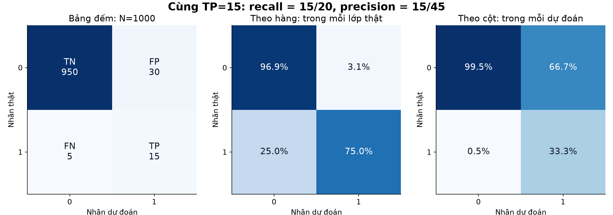
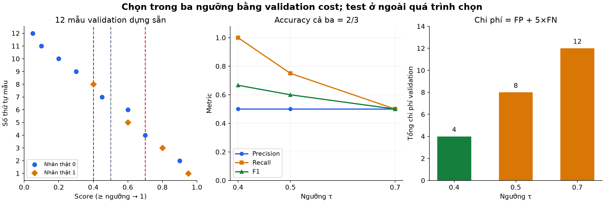
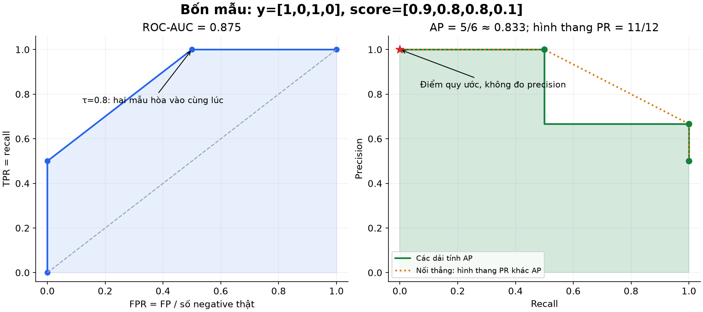
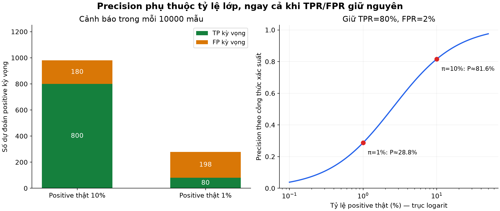
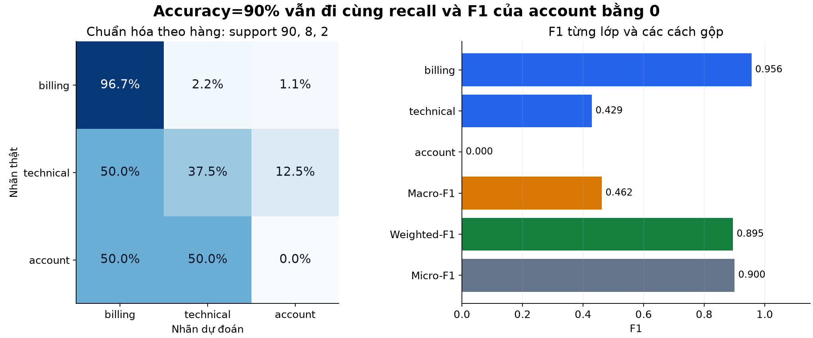

# Bài 7 — Precision, recall, confusion matrix và mất cân bằng dữ liệu

[Mục lục](../README.md) · [Bài 6](../06-hoi-quy-phan-loai/README.md) · [Bài tập](exercises.md) · [Lời giải](solutions.md)

Biên soạn và kiểm tra ngày 04/11/2026. Mọi dữ liệu, điểm số và chi phí trong bài là ví dụ tự tạo để học, không phải kết quả của hệ thống đang vận hành. Lab dùng NumPy và các điểm số dựng sẵn; không huấn luyện lại bộ phân loại bài 6.

## 1. Mục tiêu và kiến thức cần trước

Sau bài này, người học có thể:

- Lập confusion matrix và giải thích đúng mẫu số của precision, recall, FPR.
- Phát hiện khi accuracy hoặc một số trung bình che khuất lỗi ở lớp hiếm.
- Tính F1, balanced accuracy và phân biệt chúng với chi phí nghiệp vụ.
- Quét ngưỡng trên validation, chốt quy tắc rồi mới đánh giá test.
- Đọc PR/ROC cơ bản; phân biệt average precision với diện tích hình thang PR.
- Hiểu ảnh hưởng của tỷ lệ lớp, class weight và resampling đến đánh giá.

Cần kiến thức xác suất ở [bài 4](../04-xac-suat-thong-ke-bat-dinh/README.md), ranh giới dữ liệu ở [bài 5](../05-train-validation-test-ro-ri-du-lieu/README.md), xác suất/ngưỡng ở bài 6. Phần 2–7 là cốt lõi; phần 8–10 mở rộng về xếp hạng và đa lớp; phần 11–13 nối sang thực hành hệ thống. Không cần học thuộc mọi chỉ số một lượt.

## 2. Trước khi đếm: positive là lớp nào?

Giả sử backend có bộ phát hiện ticket cần xử lý ưu tiên:

- y=1: **thật sự cần ưu tiên** — positive, lớp dương.
- y=0: không cần ưu tiên — negative, lớp âm.
- Mô hình cho score; quy tắc `score >= ngưỡng` gán nhãn dự đoán 1.

Positive là lớp được chọn để theo dõi, không mang nghĩa “tốt”. Trong một hệ thống khác, positive có thể là request lỗi. Đổi lớp positive có thể đổi precision/recall; vì thế báo cáo phải ghi rõ ánh xạ nhãn.

**Ground truth** là nhãn tham chiếu dùng đánh giá. Nó cũng có thể có lỗi gán nhãn hoặc đến chậm. Chỉ đếm khi đã có nhãn theo định nghĩa thống nhất; ticket chưa được xác minh không tự được xem là negative.

| Kết quả | Nhãn thật | Dự đoán | Ý nghĩa ở ví dụ ticket |
|---|---:|---:|---|
| TP — true positive | 1 | 1 | Bắt đúng ticket cần ưu tiên |
| FP — false positive | 0 | 1 | Báo nhầm, làm tốn lượt xử lý |
| FN — false negative | 1 | 0 | Bỏ sót ticket cần ưu tiên |
| TN — true negative | 0 | 0 | Để đúng ticket thông thường ở luồng thường |

True/false nói dự đoán đúng/sai; positive/negative nói nhãn dự đoán. Không học FP thành “mọi dự đoán sai”: FN cũng là sai, nhưng theo hướng khác.

## 3. Confusion matrix: bảng đếm trước, tỷ lệ sau

**Confusion matrix — ma trận nhầm lẫn** tổng hợp nhãn thật và dự đoán. Bài này thống nhất **hàng là nhãn thật, cột là dự đoán**, thứ tự `[0,1]`:

| Thật \\ Dự đoán | 0 | 1 | Tổng thật |
|---|---:|---:|---:|
| 0 | TN | FP | TN+FP |
| 1 | FN | TP | FN+TP |
| Tổng dự đoán | TN+FN | FP+TP | N |

Một số tài liệu đảo hai trục. Luôn đọc tiêu đề trục trước khi đọc bốn ô. Với quy ước của bài và thứ tự nhãn cố định, `cm.ravel()` cho `[TN,FP,FN,TP]`. [scikit-learn: Confusion matrix](https://scikit-learn.org/stable/modules/model_evaluation.html#confusion-matrix)

Ví dụ 1000 ticket: 20 cần ưu tiên, 980 thông thường. Một quy tắc đã chốt cho:

```text
                    Dự đoán 0    Dự đoán 1
Thật 0                  950             30
Thật 1                    5             15
```

Kiểm tra tổng: 950+30+5+15=1000; số positive thật=5+15=20; số cảnh báo=30+15=45. Mất cân bằng ở đây là tỷ lệ thật 20/1000=2%, không phải tỷ lệ dự đoán 45/1000.



*Hình 1. Ba cách nhìn cùng bảng. Ô TP theo hàng là recall=15/20; ô TP theo cột là precision=15/45. Các panel tỷ lệ dùng thang màu riêng 0–100%, panel đếm dùng thang số lượng. Không so độ đậm giữa hai loại thang.*

Chuẩn hóa theo hàng trả lời “trong mỗi lớp thật, bị chia đi đâu?”. Chuẩn hóa theo cột trả lời “trong mỗi nhóm dự đoán, nguồn thật là gì?”. Nếu một hàng/cột có tổng 0, tỷ lệ ở đó không xác định; không tùy tiện coi là 100%.

## 4. Precision và recall: khác câu hỏi, khác điều kiện

**Precision** hỏi: trong những mẫu đã báo positive, có bao nhiêu mẫu đúng?

$$
P=\frac{TP}{TP+FP}
$$

**Recall**, còn gọi sensitivity hoặc true positive rate (TPR), hỏi: trong những positive thật, đã bắt được bao nhiêu?

$$
R=\frac{TP}{TP+FN}
$$

Với bảng trên:

- Precision=15/(15+30)=1/3≈33.33%: trong 45 cảnh báo chỉ 15 ticket cần ưu tiên.
- Recall=15/(15+5)=3/4=75%: bắt được 15 trong 20 ticket cần ưu tiên.

Đây là hai xác suất điều kiện thực nghiệm khác nhau: precision tương ứng $P(Y=1\mid\hat Y=1)$, recall tương ứng $P(\hat Y=1\mid Y=1)$. Không được đảo điều kiện như thể chúng bằng nhau. [Google: Accuracy, recall, precision](https://developers.google.com/machine-learning/crash-course/classification/accuracy-precision-recall)

Precision cũng không phải xác suất của **một** ticket cụ thể. Nó là tỷ lệ đúng trong tập đã được chọn theo một quy tắc, trên một tập dữ liệu và giai đoạn nhất định. Xác suất mô hình gán cho một mẫu thuộc chủ đề calibration bài 4.

### Các tỷ lệ liên quan

$$
\text{Accuracy}=\frac{TP+TN}{N},\qquad
\text{Specificity}=\frac{TN}{TN+FP},\qquad
\text{FPR}=\frac{FP}{TN+FP}
$$

Specificity là tỷ lệ bắt đúng negative; FPR là tỷ lệ báo nhầm trong **negative thật**. Chúng cộng bằng 1 khi có negative thật. Với ví dụ: accuracy=965/1000=96.5%; specificity=950/980≈96.94%; FPR=30/980≈3.06%.

Đừng nhầm FPR với `1−precision`: `1−precision=FP/(TP+FP)` là tỷ lệ cảnh báo sai **trong các cảnh báo**. Ở đây FPR chỉ 3.06% nhưng 66.67% cảnh báo là sai. Lượng negative lớn giải thích sự khác biệt này.

## 5. Vì sao accuracy 98% vẫn có thể bỏ sót hết?

Baseline luôn đoán 0 trên đúng 1000 ticket có TN=980,FN=20,TP=FP=0. Accuracy=98%, **cao hơn** 96.5% của quy tắc trước; recall=0, không phát hiện được positive nào.

Accuracy không sai về số học: nó đếm mọi mẫu với mức đóng góp đúng/sai như nhau. Nhưng nếu mục tiêu cần bắt lớp hiếm, báo duy nhất accuracy che khuất lỗi quan trọng. Mất cân bằng cũng không tự làm mọi mô hình thất bại; cần xem khả năng phân biệt, lượng dữ liệu từng lớp và chi phí lỗi.

Nếu chi phí FP=1,FN=10, dự đoán đúng có chi phí 0:

- Quy tắc có phát hiện: 30+10×5=80 đơn vị.
- Baseline luôn 0: 0+10×20=200 đơn vị.

Accuracy cao hơn không đồng nghĩa chi phí thấp hơn. Chi phí ở đây là giả định để học, không phải tỷ lệ mặc định của ticket thật.

### F1: tóm tắt precision và recall

Khi hai tỷ lệ dương, trung bình điều hòa cho:

$$
F_1=\frac{2PR}{P+R}=\frac{2TP}{2TP+FP+FN}
$$

Ví dụ cho F1=30/(30+30+5)=6/13≈0.461538. Trung bình cộng của P,R≈0.541667, cao hơn; trung bình điều hòa chịu ảnh hưởng mạnh hơn bởi tỷ lệ thấp.

F1 không dùng TN. Thêm 9000 negative đều được dự đoán đúng sẽ tăng accuracy nhưng không đổi F1. F1 không biểu diễn trực tiếp giới hạn 100 cảnh báo/ngày hay chi phí tiền; hai quy tắc có cùng F1 vẫn có thể tạo tải công việc khác nhau. Không mặc định F1 là chỉ số tốt nhất cho mọi lớp hiếm.

Mở rộng: $F_\beta=(1+\beta^2)TP/[(1+\beta^2)TP+FP+\beta^2 FN]$. β>1 nhấn mạnh recall hơn trong công thức; **β=2 không có nghĩa bỏ sót tốn đúng gấp đôi báo nhầm**. Chi phí cố định theo FP/FN là một mục tiêu khác.

### Balanced accuracy

Với hai lớp thật đều hiện diện:

$$
\text{Balanced accuracy}=\frac{\text{recall}+\text{specificity}}2
$$

Ví dụ cho khoảng 0.859694; baseline luôn 0 cho (0+1)/2=0.5. Nó cho hai lớp trọng lượng bằng nhau khi trung bình recall; không đòi cân bằng lại số mẫu trước khi tính. [scikit-learn: Balanced accuracy](https://scikit-learn.org/stable/modules/generated/sklearn.metrics.balanced_accuracy_score.html)

## 6. Mẫu số bằng 0: thiếu định nghĩa, không phải tự nhiên hoàn hảo

| Tình huống | Hệ quả theo công thức |
|---|---|
| Không dự đoán positive: TP+FP=0 | Precision không xác định |
| Không có positive thật: TP+FN=0 | Recall không xác định |
| Không có negative thật: TN+FP=0 | Specificity/FPR không xác định |
| TP=FP=FN=0 | F1 dạng đếm cũng là 0/0 |

Nếu có positive thật nhưng luôn đoán 0: precision không xác định; recall=0; F1 **dạng đếm** bằng 0 vì FN>0. Nếu toàn bộ mẫu là TN, accuracy=1 nhưng recall, precision, F1 đều không xác định theo công thức.

Lab binary mặc định trả `NaN` cho tỷ lệ không xác định. Có thể truyền `zero_division=0` để quy ước hiển thị 0; việc thay số không tạo thêm bằng chứng về lớp vắng mặt. Balanced accuracy binary của lab luôn `NaN` nếu thiếu một lớp thật, kể cả bật quy ước 0; lab không âm thầm bỏ lớp khỏi trung bình.

Thư viện có quy ước khác nhau. Ví dụ `precision_score` của scikit-learn mặc định trả 0 và cảnh báo khi chia 0; có tùy chọn khác. Bài không gọi API ấy, nên không coi mặc định lab giống mọi thư viện. [scikit-learn: precision_score](https://scikit-learn.org/stable/modules/generated/sklearn.metrics.precision_score.html)

## 7. Đổi ngưỡng: chọn theo câu hỏi của sản phẩm

Bài 6 đã tách score và quyết định. Bây giờ nhìn tác động lên metric. Giữ cố định các score validation sau; chưa khẳng định chúng đã được hiệu chuẩn thành xác suất:

```text
y:     1     0    1    0    1    0     0    1    0    0    0     0
score: .95  .90  .80  .70  .60  .60  .45  .40  .30  .20  .10  .05
```

Quy tắc hòa: score≥τ thì đoán 1. Ví dụ τ=0.5 chọn sáu mẫu đầu, trong đó 3 positive thật và 3 negative: TP=3,FP=3,FN=1,TN=5. Vì vậy P=3/6=0.5,R=3/4=0.75,F1=6/10=0.6.

Giả định **FP=1,FN=5**, xét đúng ba ứng viên:

| τ | TP | FP | FN | TN | Precision | Recall | F1 | Accuracy | Chi phí |
|---:|---:|---:|---:|---:|---:|---:|---:|---:|---:|
| 0.7 | 2 | 2 | 2 | 6 | 0.5 | 0.5 | 0.5 | 0.666667 | 12 |
| 0.5 | 3 | 3 | 1 | 5 | 0.5 | 0.75 | 0.6 | 0.666667 | 8 |
| 0.4 | 4 | 4 | 0 | 4 | 0.5 | 1 | 0.666667 | 0.666667 | **4** |

Chọn 0.4 bằng **validation cost** trong ba ứng viên, không tuyên bố nó là tối ưu trên mọi ngưỡng hoặc mọi phân bố. Nếu nhiều ngưỡng bằng cost, lab định trước chọn ngưỡng lớn hơn. Cost ở mục này khác mục 5; không trộn hai cấu hình.



*Hình 2. Ba ứng viên có accuracy bằng nhau nhưng chi phí khác nhau. Ngưỡng tác động quyết định; các score không được fit lại khi quét.*

Với score cố định, hạ ngưỡng không làm giảm TP hoặc FP; do đó recall không giảm khi có positive thật. **Precision không bắt buộc biến thiên đơn điệu**: các mẫu mới thêm có thể tốt hoặc xấu hơn nhóm đã chọn. Cả F1 và accuracy cũng không có bảo đảm đơn điệu. “Tăng precision thì luôn giảm recall” không phải định luật cho mọi tập hữu hạn.

Sau chốt τ=0.4 mới truy cập bộ test riêng trong lab. Kết quả test có TN=3,FP=3,FN=1,TP=1: accuracy=0.5,P=0.25,R=0.5,F1=1/3,cost=8. Baseline luôn 0 có accuracy=0.75,cost=10. **Không chọn lại ngưỡng sau khi nhìn các kết quả này.** Tập test có 8 mẫu tự tạo chỉ minh họa giao thức, không ước lượng chất lượng triển khai.

Một mục tiêu khác có thể là “recall cao nhất với precision≥0.8” hoặc “không quá K cảnh báo/ngày”. Cần quy định cách xử lý khi không ngưỡng nào đạt điều kiện; không hạ yêu cầu sau khi xem test. Score có thứ tự tốt chưa chắc đã có ngưỡng đáp ứng được nhu cầu.

## 8. PR, ROC và average precision — phần mở rộng

Một metric tại một ngưỡng mô tả một quyết định. Đường cong quét nhiều ngưỡng mô tả khả năng xếp hạng:

- **PR — precision–recall:** trục ngang recall, trục dọc precision.
- **ROC — receiver operating characteristic:** trục ngang FPR, trục dọc TPR=recall.

Dùng score liên tục, không chỉ đưa nhãn 0/1 sau ngưỡng vào hàm dựng đường cong. Score có thể là logit, không bắt buộc là xác suất. Đường ROC được đối chiếu với [scikit-learn: ROC](https://scikit-learn.org/stable/modules/model_evaluation.html#receiver-operating-characteristic-roc).

### Ví dụ bốn mẫu có điểm bằng nhau

| Mẫu | y | score |
|---|---:|---:|
| A | 1 | 0.9 |
| B | 0 | 0.8 |
| C | 1 | 0.8 |
| D | 0 | 0.1 |

Giảm ngưỡng qua từng **score khác nhau**; B và C phải đi vào cùng lúc. Không được phá hòa theo thứ tự file để tạo ngưỡng không tồn tại.

| Ngưỡng | TP | FP | Recall | Precision | FPR |
|---|---:|---:|---:|---:|---:|
| Lớn hơn mọi score | 0 | 0 | 0 | Không xác định | 0 |
| 0.9 | 1 | 0 | 1/2 | 1 | 0 |
| 0.8 | 2 | 1 | 1 | 2/3 | 1/2 |
| 0.1 | 2 | 2 | 1 | 1/2 | 1 |

Để vẽ, lab thêm điểm PR ở recall=0,precision=1 theo quy ước; **đây không phải precision đo được** của bộ không cảnh báo. Thứ tự mảng của lab là ngưỡng giảm, recall tăng; không mặc định giống thứ tự mọi API.

**Average precision (AP)** trong bài tính theo phần recall tăng:

$$
\text{AP}=\sum_k(R_k-R_{k-1})P_k
=\frac12\times1+\frac12\times\frac23+0\times\frac12
=\frac56\approx0.833333
$$

Nó là tổng các dải dùng precision ở điểm recall vừa đạt, không nội suy tuyến tính. Cùng các điểm ấy, diện tích hình thang PR=11/12≈0.916667, **khác AP**. Khi một công cụ ghi “PR-AUC”, cần đọc cách tích phân/nội suy trước khi so sánh. [scikit-learn: Average precision](https://scikit-learn.org/stable/modules/generated/sklearn.metrics.average_precision_score.html)



*Hình 3. Điểm ROC được nối thẳng để tính diện tích hình thang. Hình PR thể hiện quy ước dải AP, không coi mọi đoạn ngang/dọc là ngưỡng thực tế mới. Các chấm là quyết định đạt được từ ngưỡng score.*

ROC-AUC ví dụ=0.875. Có thể kiểm tra độc lập bằng bốn cặp positive–negative: positive A thắng cả hai negative; C thắng D, hòa B được tính nửa, nên (2+1+0.5)/4=0.875. AUC đánh giá thứ tự; không chứng minh calibration hoặc tìm sẵn ngưỡng vận hành tốt. Với phép biến đổi **tăng nghiêm ngặt** giữ thứ tự và hòa, AP/AUC không đổi; xác suất và quyết định tại một ngưỡng số cố định vẫn có thể đổi.

Khi positive hiếm, PR cho thấy trực tiếp tỷ lệ cảnh báo đúng. ROC vẫn hữu ích để xem TPR theo FPR, nhưng FPR nhỏ trên rất nhiều negative có thể tạo nhiều báo nhầm. Không kết luận “ROC vô dụng” hay so AP giữa hai tập có tỷ lệ positive khác mà bỏ qua bối cảnh.

## 9. Tỷ lệ lớp thay đổi thì precision thay đổi thế nào?

Gọi π=P(Y=1) là **prevalence — tỷ lệ positive thật**. Giữ một ngưỡng, giả định TPR và FPR giữ nguyên giữa hai quần thể. Từ quy tắc xác suất điều kiện:

$$
P(\hat Y=1)=\text{TPR}\,\pi+\text{FPR}(1-\pi)
$$

Suy ra, khi mẫu số dương:

$$
\text{Precision}=\frac{\text{TPR}\,\pi}
{\text{TPR}\,\pi+\text{FPR}(1-\pi)}
$$

Đây là phép suy ra từ xác suất bài 4, không cần mô hình dự đoán được calibration hoàn hảo. Điều kiện quan trọng là các tỷ lệ có điều kiện TPR/FPR có thể chuyển sang quần thể đang xét.

Giả định TPR=0.8,FPR=0.02, xét 10000 mẫu mỗi quần thể:

| π | TP kỳ vọng | FN kỳ vọng | FP kỳ vọng | TN kỳ vọng | Precision |
|---:|---:|---:|---:|---:|---:|
| 10% | 800 | 200 | 180 | 8820 | 800/980≈81.63% |
| 1% | 80 | 20 | 198 | 9702 | 80/278≈28.78% |



*Hình 4. Số lượng là kỳ vọng từ giả định, không phải kết quả mô phỏng hoặc đo triển khai. Trục tỷ lệ lớp ở panel phải dùng logarit; đường cong không phải bảo đảm khi đặc trưng/nhãn cũng đổi.*

Vì thế precision đo trên test cân bằng 50/50 không tự là precision khi vận hành với positive 1%. Khi chỉ đổi π còn phân bố score điều kiện theo lớp giữ nguyên, đường ROC lý thuyết giữ nguyên, PR thường thay đổi; nếu phân bố điều kiện cũng đổi thì TPR/FPR có thể đổi luôn. Với bộ hữu hạn còn có biến động lấy mẫu.

## 10. Đa lớp: macro, micro, weighted đang trung bình cái gì?

Với **mỗi mẫu đúng một lớp**, thứ tự cố định `[billing,technical,account]`, xét ma trận 100 ticket:

```text
                   Dự đoán billing  technical  account
Thật billing                   87          2        1
Thật technical                  4          3        1
Thật account                    1          1        0
```

Tổng hàng — **support**, số mẫu thật từng lớp — là `[90,8,2]`; tổng cột là `[92,6,2]`. Đối với từng lớp c, coi c là positive và gộp các lớp còn lại thành negative: TP là ô chéo, FN là phần còn lại của hàng c, FP là phần còn lại của cột c.

| Lớp | Support | Precision | Recall | F1 |
|---|---:|---:|---:|---:|
| billing | 90 | 87/92≈0.945652 | 87/90≈0.966667 | 174/182≈0.956044 |
| technical | 8 | 3/6=0.5 | 3/8=0.375 | 6/14≈0.428571 |
| account | 2 | 0/2=0 | 0/2=0 | 0 |

Các tỷ lệ 0 trong bảng đều có mẫu số dương. Với lớp vắng mặt ở bài khác cần ghi rõ quy ước; báo cáo đa lớp của lab dùng `zero_division=0`, khác mặc định `NaN` của hàm binary.

- **Macro-F1:** trung bình F1 từng lớp, mỗi lớp trọng lượng như nhau; ở đây ≈0.461538. Không lấy F1 từ macro-precision và macro-recall.
- **Weighted-F1:** trung bình F1 với trọng lượng support/N; ở đây ≈0.894725. Lớp phổ biến ảnh hưởng mạnh.
- **Micro-F1:** cộng TP/FP/FN của các bài one-vs-rest trước, rồi tính F1; ở đây bằng accuracy=0.9. Đẳng thức này áp dụng khi mỗi mẫu có đúng một nhãn thật và một nhãn dự đoán, bao gồm **đủ các lớp**, không tự áp dụng cho multi-label hoặc báo cáo chỉ một tập con lớp.

Ví dụ cho micro: tổng TP=90, tổng FP=10, tổng FN=10, nên F1=180/200=0.9. Macro-recall≈0.447222; khi các lớp thật đều có mặt, đây cũng là balanced accuracy đa lớp theo định nghĩa trung bình recall. [scikit-learn: Multiclass averaging](https://scikit-learn.org/stable/modules/model_evaluation.html#multiclass-and-multilabel-classification)



*Hình 5. Accuracy và weighted-F1 cao vẫn đi cùng recall/F1 bằng 0 ở account. Account chỉ có hai mẫu nên ước lượng cũng rất mong manh; không xem macro score như giải pháp thay cho thu thập thêm dữ liệu.*

Với nhiều nhãn đồng thời ở bài 6, có thể lập một ma trận 2×2 cho từng nhãn. Micro/macro vẫn cần định nghĩa rõ trục gộp; “đúng toàn bộ tập nhãn của một mẫu” là metric khác. Lab bài này chưa triển khai báo cáo multi-label.

## 11. Xử lý mất cân bằng: dữ liệu, mục tiêu học và quyết định

Không cần ép tỷ lệ 50/50 theo thói quen. Tách ba câu hỏi:

1. **Dữ liệu:** có đủ positive đại diện cho tình huống cần xử lý không? Nhãn có sai/thiếu, có nhóm chỉ được xác minh khi mô hình báo không? Bổ sung dữ liệu và kiểm tra cách thu thập trước khi tăng độ phức tạp.
2. **Mục tiêu học:** có cần class weight, oversampling hoặc undersampling trong train không? Đo bằng development đúng mục tiêu. Oversampling lặp lại không tạo thông tin độc lập mới; undersampling có thể bỏ dữ liệu hữu ích; tổng hợp mẫu có thể tạo điểm không hợp lệ với miền ứng dụng.
3. **Quyết định:** dùng ngưỡng hoặc chính sách theo chi phí/năng lực xử lý. Đổi ngưỡng không tự cải thiện thứ tự xếp hạng hay khắc phục feature không phân biệt được lớp.

Các cách sampling/weighting và sự thay đổi phân bố khi học được đối chiếu với [Google: Class-imbalanced datasets](https://developers.google.com/machine-learning/crash-course/overfitting/imbalanced-datasets). Không có tỷ lệ cân bằng hoặc trọng số tốt chung cho mọi bài toán.

### Tính tay: class weight đổi mục tiêu, không chỉ đổi tên metric

Cho một mô hình **chỉ có xác suất hằng q**, không dùng feature. Với 98 negative và 2 positive trong train, BCE trung bình không trọng số:

$$
L(q)=-\frac{2\ln q+98\ln(1-q)}{100}
$$

Đạo hàm bằng 0 cho $-2/q+98/(1-q)=0$, nên q=0.02. Nếu mỗi positive có weight 49, negative weight 1, dùng tổng loss có trọng số chia **tổng trọng số**:

$$
L_w(q)=-\frac{98\ln q+98\ln(1-q)}{196}
$$

Nghiệm thành q=0.5. Mô hình không có feature mới hay khả năng phân biệt mới, nhưng đầu ra tối ưu đã đổi. Không đọc q=0.5 như tỷ lệ positive tự nhiên của train là 50%.

Lab giải nghiệm hằng bằng công thức $q=\sum_i a_i y_i/\sum_i a_i$, rồi tính weighted BCE ổn định từ logit. Nó **không huấn luyện bộ phân loại có feature hoặc triển khai SMOTE**. Thư viện có thể chuẩn hóa loss bằng N thay vì tổng weight; điều này ảnh hưởng độ lớn gradient và tương tác regularization.

### Resampling phải nằm ở đúng phía ranh giới

Chia dữ liệu theo nhóm/thời gian phù hợp trước. Trong từng vòng CV: fit scaler, sampling và mô hình chỉ bằng phần train của fold đó. Validation/test giữ phân bố phù hợp quần thể cần đánh giá, không cân bằng chúng chỉ để điểm đẹp. Nếu cố ý lấy mẫu đánh giá lệch tỷ lệ, cần thiết kế trọng số/ước lượng cho mục tiêu và công bố rõ.

Resample toàn bộ rồi mới chia có thể đưa bản sao hoặc thông tin tạo mẫu qua ranh giới, đồng thời đổi phân bố đánh giá. Pipeline giúp đóng gói các bước nhưng vẫn cần splitter đúng như bài 5. [imbalanced-learn: Data leakage](https://imbalanced-learn.org/stable/common_pitfalls.html)

## 12. Báo cáo để người khác ra quyết định được

Một báo cáo ngắn nên ghi:

- Định nghĩa lớp positive, khoảng thời gian, cách có nhãn, đơn vị mẫu và phép chia dữ liệu.
- Support từng lớp, tỷ lệ lớp; số TP/FP/FN/TN và quy ước hàng/cột.
- Ngưỡng đã chốt, nơi chọn ngưỡng, metric/chi phí chính và baseline phù hợp.
- Precision/recall, số cảnh báo dự kiến ở lưu lượng đang xét; với đa lớp có điểm từng lớp và kiểu trung bình.
- Quy ước mẫu số 0, lớp/nhóm ít mẫu, giới hạn đại diện của tập đánh giá.

Không suy recall của toàn bộ hệ thống nếu chỉ gán nhãn các cảnh báo: còn chưa biết FN trong phần không báo. Không dùng “precision=90%” một mình mà bỏ số cảnh báo — 9/10 khác 9000/10000 về bằng chứng thống kê. Có thể quay lại khoảng tin cậy bài 4; với nhiều request cùng user/ngày, phải xét phụ thuộc thay vì giả định mọi hàng độc lập.

## 13. Thực hành và tái tạo hình

Mã: [lab.py](lab.py), kiểm tra với **Python 3.14.6, NumPy 2.5.4**. Từ thư mục bài 7, có thể tạo môi trường riêng:

```bash
python3 -m venv .venv
.venv/bin/python -m pip install -r requirements.txt
.venv/bin/python lab.py --mode all
```

Trên Windows dùng Python trong `.venv\Scripts`. Nếu Python hiện tại đã có NumPy:

```bash
python3 lab.py --mode hand
python3 lab.py --mode threshold
python3 lab.py --mode curves
python3 lab.py --mode prevalence
python3 lab.py --mode multiclass
python3 lab.py --mode weights
python3 lab.py --mode undefined
```

`all` chạy cả bảy phần. Nếu ở gốc bộ tài liệu, dùng `07-precision-recall-mat-can-bang/lab.py`. Không cần GPU, scikit-learn, imbalanced-learn hoặc dữ liệu tải ngoài.

Các hàm chính: `binary_confusion` đếm nhãn, `binary_metrics` tính metric từ bảng đếm, `choose_threshold` chỉ nhận validation, `ranking_curves` xử lý hòa điểm theo nhóm, `multiclass_report` dùng đủ thứ tự lớp, `constant_fit` giải mô hình xác suất hằng. Không truyền mảng score vào nơi cần nhãn rời rạc.

Ví dụ tự kiểm tra một thay đổi:

```python
from lab import binary_metrics
before = binary_metrics([[950,30],[5,15]])
after = binary_metrics([[9950,30],[5,15]])
print(before['accuracy'], after['accuracy'])
print(before['f1'], after['f1'])
```

Accuracy tăng từ 0.965 lên 0.9965; F1 giữ 6/13. Chỉ thêm TN, không đổi TP/FP/FN. Hãy giải thích trước khi chạy.

Hình PNG/SVG đã có trong [figures](figures/). Để tái tạo bằng cùng môi trường:

```bash
.venv/bin/python -m pip install -r requirements-figures.txt
.venv/bin/python make_figures.py
```

Mã vẽ: [make_figures.py](make_figures.py), phụ thuộc [requirements.txt](requirements.txt) và [requirements-figures.txt](requirements-figures.txt). Đã kiểm tra Matplotlib 3.11.2; các phiên bản ghim cần Python/nền tảng tương thích. Hình lấy từ cùng công thức/mảng số với lab, không sao chép hình của nguồn.

## 14. Tự kiểm tra và học tiếp

Làm [bài tập](exercises.md) trước, rồi đối chiếu [lời giải](solutions.md). Có thể học tiếp khi bạn lập đúng bảng đếm, giải thích được hai mẫu số precision/recall, nhận ra baseline 98% bỏ sót lớp hiếm và giữ test ngoài việc chọn ngưỡng. PR/AP và macro/micro là phần mở rộng để luyện thêm.

**Học tiếp:** [Bài 8 — Cây quyết định, boosting và baseline](../08-cay-quyet-dinh-boosting-baseline/README.md): học cách fit cây, hai vòng boosting tính tay và so sánh mô hình theo giao thức đã học. Nguồn và phạm vi đã đọc: [danh mục nguồn](../SOURCES.md).
