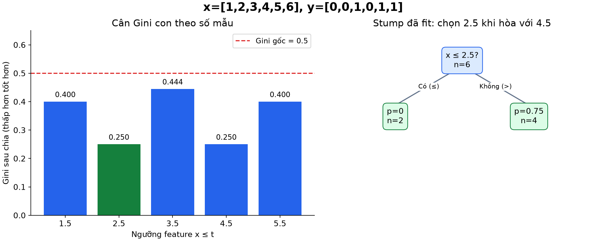
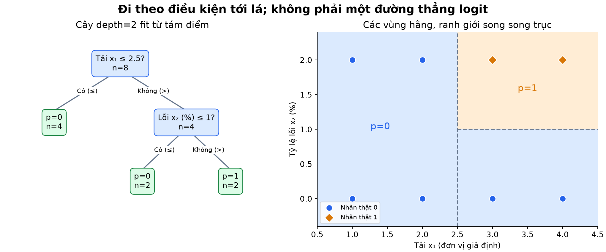
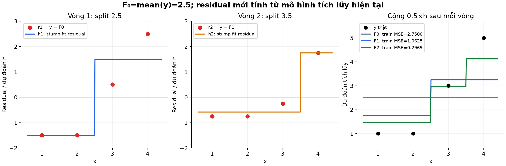
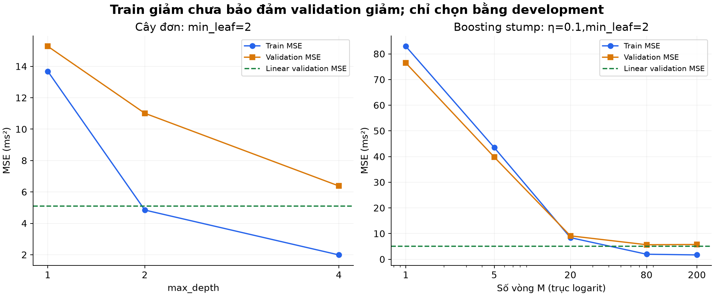
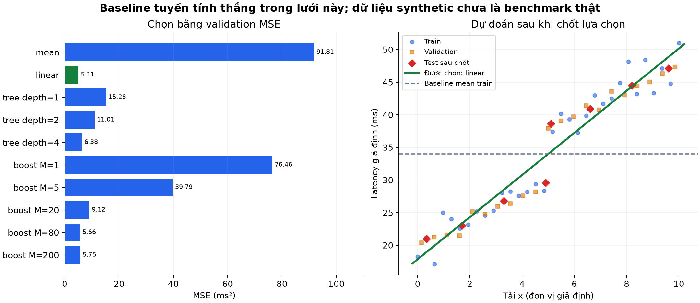

# Bài 8 — Cây quyết định, boosting và baseline

[Mục lục](../README.md) · [Bài 7](../07-precision-recall-mat-can-bang/README.md) · [Bài tập](exercises.md) · [Lời giải](solutions.md)

Biên soạn và kiểm tra ngày 04/11/2026. Toàn bộ dữ liệu và kết quả trong bài là ví dụ tự tạo để học. Code NumPy thực sự huấn luyện cây và boosting nhỏ, không cần GPU, tài khoản dịch vụ hoặc dữ liệu tải ngoài. Đây là bản minh họa cơ chế, không thay thế thư viện dùng trong sản phẩm.

## 1. Mục tiêu và cách học

Sau bài học, người học có thể:

- Đi từ một mẫu đầu vào qua các điều kiện tới lá để tính dự đoán.
- Tính Gini, điểm split có trọng số và giá trị lá của cây hồi quy.
- Phân biệt cây sâu hơn, ensemble nhiều cây và boosting nhiều vòng.
- Tính tay hai vòng boosting bằng residual; nối nó với gradient bài 2.
- Xây baseline không dùng feature và baseline tuyến tính, rồi so sánh công bằng trên validation/test.
- Nhận ra giới hạn: tham lam, overfit, ngoại suy, xác suất lá và dữ liệu thiếu.

Cần biết MSE, mean, gradient, train/validation/test và metric từ bài 1–7. Phần 2–7 học cây; phần 8–10 học boosting; phần 11–14 thực hành chọn mô hình và nối sang Deep Learning. Không cần học một thư viện boosting lớn trước khi hiểu các phép tính này.

## 2. Baseline: phải hơn được cái gì?

**Baseline** là mốc so sánh có quy tắc rõ ràng. Nó giúp trả lời “phần phức tạp thêm mang lại gì?”, không chỉ là một mô hình cố tình làm yếu để vượt qua dễ dàng.

| Nhiệm vụ | Mốc đơn giản | Cách fit hợp lệ |
|---|---|---|
| Hồi quy, đánh giá MSE | Dự đoán hằng bằng mean y_train | Tính mean chỉ từ train |
| Hồi quy, đánh giá MAE | Dự đoán hằng bằng median y_train | Tính median chỉ từ train |
| Phân loại, quan tâm accuracy | Luôn đoán lớp phổ biến nhất train | Ghi quy tắc nếu số lớp hòa |
| Đánh giá xác suất nhị phân | Dự đoán hằng bằng tỷ lệ positive train | Không lấy tỷ lệ nhãn test |
| Có feature số | Hồi quy tuyến tính hoặc logistic phù hợp | Fit từ train, chọn cấu hình bằng development |

Mean tối ưu MSE trong **các dự đoán hằng**: với $L(c)=\frac1n\sum_i(y_i-c)^2$, đạo hàm $L'(c)=2(c-\bar y)$ cho c=mean. Nó không phải tối ưu trên mọi họ mô hình. Tương tự, median tối ưu tổng sai số tuyệt đối; median có thể không duy nhất.

Baseline xác suất và baseline nhãn không giống nhau: train có positive 2% thì p=0.02 là một dự đoán xác suất hằng; nhãn sau ngưỡng 0.5 là 0. Không thay p bằng 0 rồi coi log loss vẫn giữ nguyên. Các chiến lược dự đoán hằng được đối chiếu với [scikit-learn: Dummy estimators](https://scikit-learn.org/stable/modules/model_evaluation.html#dummy-estimators).

Ở một hệ thống đã có rule hoặc mô hình đang chạy, chính nó còn là baseline nghiệp vụ cần đo. Lab này không có hệ thống thật; dùng mean và tuyến tính làm mốc, cùng feature và phép chia dữ liệu với cây/boosting.

## 3. Cây quyết định là chương trình if/else học từ dữ liệu

**Decision tree — cây quyết định** gồm:

- **Root:** nút gốc nhận mọi mẫu.
- **Internal node / split:** nút hỏi một điều kiện, chia mẫu sang nhánh.
- **Leaf:** nút lá chứa giá trị dự đoán.
- **Depth:** số cạnh từ gốc; trong lab gốc có depth=0.

Ví dụ cây một split, còn gọi **decision stump**:

```text
Nếu x <= 2.5: dự đoán p(Y=1)=0
Ngược lại:   dự đoán p(Y=1)=0.75
```

Đưa x=2 vào lá trái, x=4 vào lá phải. Ngưỡng feature `2.5` là điều kiện định tuyến, khác ngưỡng xác suất `0.5` dùng đổi p thành nhãn. Trong lab, điều kiện feature dùng `<=` sang trái, `>` sang phải; nhãn binary dùng `p>=0.5` gán 1.

Một cây có thể dự đoán lớp hoặc một số như latency. Mô hình học vị trí điều kiện và giá trị lá từ train; khi dự đoán chỉ đi theo đường đã học. Nó không tính gradient theo x để quyết định nhánh. [Google: Decision trees](https://developers.google.com/machine-learning/decision-forests/decision-trees)

## 4. Cây phân loại chọn split bằng Gini như thế nào?

Xét sáu cặp `(x,y)` đã sắp x:

```text
x: 1 2 3 4 5 6
y: 0 0 1 0 1 1
```

Với một nút có tỷ lệ positive p, **Gini impurity — độ pha trộn nhãn** là:

$$
G=1-[p^2+(1-p)^2]=2p(1-p)
$$

Nút toàn một lớp có G=0; với hai lớp G lớn nhất 0.5 tại p=0.5. Gini không phải precision, accuracy hay xác suất positive: p=0.25 và p=0.75 đều cho G=0.375. Nó đo độ pha trộn, không nói lớp nào đang chiếm đa số.

Ở gốc có 3 positive,3 negative nên p=0.5,G=0.5. Thử điều kiện x≤2.5:

- Trái: nhãn `[0,0]`, p_L=0,G_L=0, có 2 mẫu.
- Phải: `[1,0,1,1]`, p_R=3/4,G_R=2×(3/4)×(1/4)=3/8, có 4 mẫu.
- Điểm sau chia: $(2/6)\times0+(4/6)\times(3/8)=1/4$.
- **Gain — mức giảm impurity:** 1/2−1/4=1/4.

Phải cân theo số mẫu ở nút con. Lấy `(G_L+G_R)/2` sẽ mô tả một mục tiêu khác nếu hai nhánh không bằng số mẫu.

Với feature số trong lab, các ngưỡng ứng viên là trung điểm hai giá trị **khác nhau liền kề** tại nút. Không tách hai mẫu có cùng x chỉ dựa vào vị trí hàng.

| Ngưỡng x≤t | Gini sau chia | Gain |
|---:|---:|---:|
| 1.5 | 0.4 | 0.1 |
| 2.5 | **0.25** | **0.25** |
| 3.5 | 4/9≈0.444444 | 1/18≈0.055556 |
| 4.5 | **0.25** | **0.25** |
| 5.5 | 0.4 | 0.1 |

Lab thử feature theo chỉ số tăng, ngưỡng tăng; khi điểm bằng nhau trong sai số 1e−12, giữ ứng viên đầu. Vì vậy chọn 2.5 thay vì 4.5. Quy tắc này là của lab, không khẳng định mọi thư viện chọn cùng cây khi hòa.



*Hình 1. Mỗi ứng viên dùng cùng tập train. Hai split tốt ngang nhau; quy tắc hòa quyết định hình dạng cây cuối.*

### Lá trả xác suất gì?

Trong bản binary không trọng số, lá lưu mean nhãn 0/1, tức tỷ lệ positive train đến lá. Cây trên cho p=`[0,0,0.75,0.75,0.75,0.75]`, nhãn sau 0.5 là `[0,0,1,1,1,1]`. Accuracy **train**=5/6, chưa phải chất lượng giữ riêng.

Lá có một mẫu dương cho p=1 không chứng minh mọi mẫu tương lai vào lá đều dương. p=0/1 còn có thể gây log loss vô hạn khi gặp nhãn ngược ở dữ liệu mới; không xem tỷ lệ lá là xác suất tự động được hiệu chuẩn. Một tiêu chí split khác là entropy, nhưng lab chỉ dùng Gini cho binary. Công thức split/lá được đối chiếu với [scikit-learn: Mathematical formulation](https://scikit-learn.org/stable/modules/tree.html#mathematical-formulation).

## 5. Từ một split đến cây nhiều tầng

Lặp quá trình chọn split trong **từng tập con**: con không được tự xem các hàng ngoài nút để fit giá trị lá. Với nhiều feature, mỗi ứng viên là `(chỉ số feature, ngưỡng)`.

Lab có ví dụ hai feature số: tải x₁ và tỷ lệ lỗi x₂, đều giả định. Tám điểm là mọi cặp tải `[1,2,3,4]` với lỗi `[0%,2%]`. Nhãn 1 được dựng khi tải>2.5 **và** lỗi>1%.

Một cây depth=2 tìm được quy tắc đó:

```text
x₁ <= 2.5?  Có → p=0
             Không → x₂ <= 1%?  Có → p=0
                                Không → p=1
```



*Hình 2. Chỉ tám điểm được quan sát, các vùng màu biểu diễn cách cây mở rộng dự đoán trong không gian feature. Màu p=0/1 là tỷ lệ lá từ dữ liệu tự tạo, không phải bằng chứng chắc chắn ngoài mẫu.*

Mỗi split kiểu `x_j<=t` tạo ranh giới song song trục. Nhiều split kết hợp tạo vùng chữ nhật/hộp, quan hệ tổng thể có thể phi tuyến theo x gốc. Điều này khác đường thẳng logit của logistic trên feature gốc ở bài 6. Không phải mọi loại cây đều bắt buộc dùng split song song trục; bài chỉ nghiên cứu loại đó.

## 6. Cây hồi quy: lá là mean, split giảm sai số

Giờ y là số, không phải class ID. Với tập mẫu tại một nút, chọn dự đoán hằng c=mean y ở nút. Impurity dùng MSE quanh mean:

$$
H(Q)=\frac1{|Q|}\sum_{i\in Q}(y_i-\bar y_Q)^2
$$

Điểm split là trung bình có trọng số của H hai con. Nhân điểm ấy với N ở nút cho **SSE — tổng bình phương sai số**. Trong cùng nút, tối thiểu SSE hay MSE cho cùng split; không so SSE của hai tập kích thước khác nhau như cùng một metric.

Ví dụ bốn điểm `(x,y)=(1,1),(2,1),(3,3),(4,5)`, không chuẩn hóa:

- Mean gốc=(1+1+3+5)/4=2.5.
- SSE gốc=2.25+2.25+0.25+6.25=11; MSE=11/4=2.75.
- Với x≤2.5, lá trái mean=1, lá phải mean=4.
- Dự đoán `[1,1,4,4]`; SSE=0+0+1+1=2, MSE=0.5.

| Split | Mean trái | Mean phải | SSE sau chia | MSE sau chia |
|---:|---:|---:|---:|---:|
| 1.5 | 1 | 3 | 8 | 2 |
| 2.5 | 1 | 4 | **2** | **0.5** |
| 3.5 | 5/3 | 5 | 8/3 | 2/3 |

Vì mỗi lá trả hằng số, dự đoán theo x có dạng bậc thang. Cây một split này trả 1 cho x=0 và 4 cho x=10. Nó không tự kéo dài xu hướng tuyến tính. Một cây hồi quy với lá mean không trọng số luôn dự đoán trong khoảng min/max y_train; đặc tính ấy **không tự áp dụng** cho tổng nhiều cây cộng residual hoặc loại lá khác.

## 7. Dừng cây: độ sâu chưa phải chất lượng

Hai tham số lab:

- `max_depth`: số cạnh lớn nhất từ gốc đến lá; 0 nghĩa một lá, 1 nghĩa tối đa một split trên mỗi đường.
- `min_leaf`: mỗi lá sau split phải có ít nhất số mẫu này; điều kiện kiểm tra ở cả hai con.

Lab còn dừng khi impurity gần 0, không có split hợp lệ hoặc không có gain>1e−12. Cây sâu hơn có thể giảm train error bằng cách chia chi tiết hơn, nhưng dự đoán trên mẫu mới có thể tệ hơn. Thay ít dữ liệu cũng có thể đổi split được chọn; một cây ngắn dễ đọc không đồng nghĩa mọi kết luận từ nó đều ổn định.

Các thư viện còn có pruning — cắt tỉa — và các điều kiện dừng khác. Không đồng nhất tham số `min_leaf` tự viết với toàn bộ API của thư viện. [scikit-learn: Decision trees](https://scikit-learn.org/stable/modules/tree.html)

### Tham lam có thể bỏ qua lời giải biểu diễn được

**Greedy — tham lam** nghĩa chọn split tốt ngay tại nút, không tìm toàn bộ các cây tương lai. Với XOR cân bằng `(0,0)→0,(1,0)→1,(0,1)→1,(1,1)→0`, mọi split gốc theo một feature có gain=0.

Cây depth=2 được đặt tay vẫn biểu diễn XOR được: hỏi x₁ rồi hỏi x₂ ở mỗi nhánh. Nhưng thuật toán lab yêu cầu gain dương nên **dừng ngay tại gốc**, p=0.5 cho mọi điểm. “Họ cây biểu diễn được” khác “thuật toán tham lam cụ thể sẽ tìm được”. Không khẳng định mọi thư viện đều dừng trên XOR; điều kiện dừng có thể khác.

## 8. Ensemble: nhiều cây được kết hợp ra sao?

**Ensemble** là kết hợp nhiều mô hình. Hai ý tưởng cần phân biệt:

| Cách kết hợp | Các cây được fit như thế nào? | Khi dự đoán |
|---|---|---|
| Bagging / random forest điển hình | Các cây dùng mẫu bootstrap khác nhau; random forest còn lấy tập feature ứng viên ngẫu nhiên tại nút | Gộp dự đoán, như trung bình hoặc bỏ phiếu tùy thiết kế |
| Gradient boosting | Cây mới phụ thuộc dự đoán hiện tại để fit hướng sửa lỗi theo loss | Cộng dự đoán ban đầu và các đóng góp có hệ số |

Bootstrap lấy mẫu có hoàn lại từ train, không phải lấy test để tăng đa dạng. Các cây bagging không cần chờ residual của cây trước; boosting theo vòng có sự phụ thuộc ấy. Nhiều cây giống hệt nhau rồi lấy trung bình không tự tạo lợi ích từ tính đa dạng. [Google: Random forests](https://developers.google.com/machine-learning/decision-forests/random-forests)

Random forest và AdaBoost chỉ được giới thiệu để phân biệt; lab **không triển khai** chúng. Không phải mọi boosting đều là gradient boosting, hoặc mọi boosting đều chỉ tăng trọng số các mẫu có nhãn đoán sai.

## 9. Gradient boosting: gradient descent trên dự đoán

Chọn loss từng mẫu $\ell(y,F)=\frac12(y-F)^2$. Đạo hàm theo dự đoán F là F−y; **âm gradient** là y−F, chính là residual theo quy ước bài này.

Thay vì cập nhật một vector w của đường thẳng, ta fit một hàm cây nhỏ để xấp xỉ vector âm gradient tại các điểm train:

1. Khởi tạo $F_0(x)=\bar y_{train}$.
2. Ở vòng m, tính $r_{im}=y_i-F_{m-1}(x_i)$ bằng **dự đoán tích lũy** hiện tại.
3. Fit cây hồi quy $h_m$ vào cặp $(x_i,r_{im})$.
4. Cập nhật $F_m(x)=F_{m-1}(x)+\eta h_m(x)$ với learning rate η.

Sau M vòng, $F_M(x)=F_0(x)+\eta\sum_{m=1}^M h_m(x)$. Các cây cũ giữ nguyên; thêm hàm mới để sửa dự đoán tổng, không chỉ thay cây cũ bằng cây mới.

Ở đây chọn loss **nửa bình phương** để âm gradient đúng bằng residual. Báo cáo vẫn dùng mean bình phương đầy đủ — MSE. Hệ số 1/2 và hệ số chung do lấy trung bình không đổi nghiệm tối ưu nhưng ảnh hưởng quy ước gradient/bước; đừng sao chép công thức giữa các loss mà bỏ hệ số. [scikit-learn: Gradient boosting formulation](https://scikit-learn.org/stable/modules/ensemble.html#mathematical-formulation)

Nguồn có thể định nghĩa error=F−y rồi **trừ** cây error. Bài định nghĩa residual=y−F và **cộng** cây residual: hai dấu phải đi cùng nhau. Trực giác fit lỗi và shrinkage được đối chiếu với [Google: Gradient boosted decision trees](https://developers.google.com/machine-learning/decision-forests/intro-to-gbdt).

### Tính tay hai vòng trên bốn điểm

Dùng dữ liệu `(1,1),(2,1),(3,3),(4,5)` ở mục 6; mỗi h là stump, min_leaf=1, η=0.5.

**Ban đầu:** F₀=2.5 cho cả bốn mẫu, MSE=11/4=2.75.

**Vòng 1:** residual `[-1.5,-1.5,0.5,2.5]`. Cây tốt nhất chia x≤2.5; mean residual hai lá là −1.5 và +1.5, nên:

$$
F_1=[2.5,2.5,2.5,2.5]+0.5[-1.5,-1.5,1.5,1.5]
=[1.75,1.75,3.25,3.25]
$$

MSE mới=$(0.75^2+0.75^2+0.25^2+1.75^2)/4=17/16=1.0625$.

**Vòng 2:** residual phải tính lại từ F₁, được `[-0.75,-0.75,-0.25,1.75]`. Stump tốt nhất giờ chia x≤3.5; giá trị lá trái=(-0.75−0.75−0.25)/3=−7/12, lá phải=7/4. Vì vậy:

$$
F_2=F_1+\tfrac12[-7/12,-7/12,-7/12,7/4]
=[35/24,35/24,71/24,33/8]
$$

Dự đoán gần `[1.458333,1.458333,2.958333,4.125]`. Bình phương các sai số rồi trung bình cho MSE=19/64=0.296875. Split vòng sau không cần giống vòng trước.



*Hình 3. Cây h dự đoán residual có thể âm; đường F mới cộng thêm ηh. MSE trong hình là trên đúng bốn điểm train minh họa.*

Với squared loss, lá mean residual là tối ưu trong vùng lá đang xét. Khi 0<η≤1, cập nhật này không tăng train SSE trong số học lý tưởng vì η=1 là nghiệm tối ưu theo mỗi giá trị lá và η=0 là không đổi. Điều ấy không bảo đảm validation/test giảm, và không áp dụng nguyên xi cho mọi loss/thuật toán boosting.

## 10. Learning rate, số vòng và giới hạn của “fit lỗi”

η nhỏ làm mỗi cây đóng góp ít hơn; thường cần thêm vòng để đạt cùng mức fit train. Số vòng M, độ sâu cây con, min_leaf và η tương tác; không có η hoặc M tốt chung cho mọi dữ liệu. Nhiều vòng có thể tiếp tục giảm train error nhưng fit cả nhiễu.

**Early stopping** dùng development để quyết định dừng/chọn checkpoint khi metric không cải thiện theo quy tắc định trước. Nó vẫn là một bước chọn mô hình: không nhìn test qua từng vòng. Lab so sánh một lưới M định sẵn và giữ mô hình fit từ train, **chưa cài cơ chế patience/khôi phục checkpoint**.

### Nếu phân loại thì residual là gì?

Với binary log loss, F thường là **logit**, p=sigmoid(F). Đạo hàm theo F là p−y như bài 6; âm gradient là y−p. Fit một **cây hồi quy** vào các giá trị liên tục ấy, rồi cập nhật score tổng. Không cộng nhãn 0/1 hoặc các xác suất của các cây một cách tùy ý.

Các thuật toán còn có bước tối ưu giá trị lá theo loss, đôi khi dùng đạo hàm bậc hai. Vì vậy không thể chỉ thay y số bằng nhãn 0/1 trong `SquaredBoost` rồi gọi đó là bộ gradient boosting log loss. Lab chỉ huấn luyện boosting hồi quy squared error; cây binary là một phần thực hành riêng. [scikit-learn: Boosting classification](https://scikit-learn.org/stable/modules/ensemble.html#classification)

## 11. Thực nghiệm: baseline mạnh có thể thắng boosting nhỏ

### Dữ liệu và giao thức

Lab tạo feature tải x và latency y giả định theo tín hiệu:

$$
f(x)=20+2x+8\,I(x\ge5),\qquad y=f(x)+\text{nhiễu}
$$

I là hàm chỉ báo: bằng 1 khi điều kiện đúng. Train có 32 x cách đều trong [0,10], nhiễu Gaussian SD=2.2, seed=2026. Validation có 21 x trong [0.15,9.85], nhiễu Gaussian SD=0.8, seed=2027. Test có 8 x dựng riêng và một vector nhiễu nhỏ cố định, xem mã để tái tạo.

**Thiết kế nhiễu/sampling các phần không đồng nhất và đều do tác giả đặt**; thí nghiệm nhằm thấy cơ chế fit/chọn, không là benchmark iid đại diện hay bằng chứng độ tin cậy của hệ thống thật. Không cần scaler trong lab cây; baseline tuyến tính giải bằng bình phương tối thiểu thay vì gradient descent.

Chốt trước 10 ứng viên, cùng feature và train/validation:

- Mean và hồi quy tuyến tính có intercept.
- Cây hồi quy depth∈{1,2,4}, min_leaf=2.
- Boosting stump M∈{1,5,20,80,200}, η=0.1,min_leaf=2.

Tối thiểu hóa validation MSE; nếu hòa trong 1e−12, chọn ứng viên xuất hiện trước theo thứ tự bảng. Không refit train+validation sau chọn. Chỉ mô hình đã chọn và hai baseline định trước được chấm test; nếu mô hình chọn chính là một baseline thì không chấm lặp.

| Ứng viên | Train MSE | Validation MSE |
|---|---:|---:|
| Mean | 99.190776 | 91.810864 |
| Tuyến tính | 6.594010 | **5.105988** |
| Cây depth=1 | 13.688756 | 15.278485 |
| Cây depth=2 | 4.847746 | 11.012471 |
| Cây depth=4 | 1.988890 | 6.381348 |
| Boost M=1 | 82.945392 | 76.462444 |
| Boost M=5 | 43.501467 | 39.794713 |
| Boost M=20 | 8.427502 | 9.123214 |
| Boost M=80 | 1.965997 | 5.664355 |
| Boost M=200 | 1.697643 | 5.754190 |

Đơn vị MSE là ms² nếu y là ms. Boost 200 fit train tốt hơn boost 80 nhưng validation tệ hơn. Linear có train error cao hơn vài cây nhưng validation thấp nhất trong lưới; **chọn linear**, không đổi tiêu chí để ép boosting thắng.



*Hình 4. Các chấm boosting là đúng năm M trong lưới. Đường nối chỉ giúp đọc xu hướng giữa các ứng viên, không phải phép đo mọi checkpoint ở giữa. Không có test trong hình.*

Sau chốt: test MSE linear≈6.019883, mean≈88.979560. Không tính test của mọi ứng viên rồi chọn lại. Linear tốt hơn mean trên tám điểm này không đủ khẳng định một họ mô hình luôn tốt hơn; thiết kế synthetic, mức nhiễu, min_leaf và lưới tham số đều ảnh hưởng kết quả.



*Hình 5. Panel trái chỉ dùng validation; panel phải hiển thị test sau khi lựa chọn đã chốt. Cùng dữ liệu giúp thấy baseline tuyến tính vẫn bỏ lỡ một phần bước nhảy ở x=5.*

Khi mở rộng sang dữ liệu thật, giữ phép chia theo nhóm/thời gian bài 5, dùng metric/chi phí bài 7 và ghi lại phạm vi tuning. Lặp quá nhiều thử nghiệm trên một validation nhỏ cũng có thể làm quá khớp vào development; không thể sửa bằng cách xem test thường xuyên hơn.

## 12. Những giới hạn cần hiểu trước khi dùng thư viện lớn

- **Dữ liệu thiếu:** mini-tree từ chối NaN/inf. Nếu cần impute, fit bộ điền từ train. Một số thuật toán có nhánh xử lý missing riêng; không suy từ lab rằng mọi thư viện đều từ chối hoặc tự xử lý giống nhau.
- **Feature phân loại:** mã `billing=0,technical=1,account=2` đem so `<=0.5` áp đặt một thứ tự số. Cần encoding hoặc split categorical phù hợp; lab chỉ nhận feature số hữu hạn.
- **Thang đo:** cây numeric so ngưỡng thường không cần chuẩn hóa như mô hình tối ưu bằng gradient. Đổi đơn vị bằng phép affine tăng như ms→s giữ các phân hoạch trong số học lý tưởng; số thực máy tính có thể tạo khác biệt ở biên. Không suy mọi phép biến đổi phi tuyến hay mọi pipeline giữ cùng dự đoán ngoài mẫu.
- **Ngoại suy:** một cây lá hằng tiếp tục trả giá trị vùng biên; tổng hữu hạn các stump cũng vẫn là hàm bậc thang trong ví dụ 1-D, không tự thành mô hình xu hướng thời gian.
- **Diễn giải:** đường đi qua cây giải thích cách mô hình đưa ra dự đoán, không chứng minh nguyên nhân. Feature được dùng nhiều hoặc giảm impurity lớn không tự là tác động nhân quả hay quan trọng ổn định ngoài mẫu.
- **Tốc độ:** code thử mọi midpoint bằng mask và đệ quy Python để dễ đọc. Nó không có tối ưu histogram, song song hay quản lý bộ nhớ của thư viện. Không dùng thời gian chạy mini-lab để so tốc độ các hệ ML.

Các kỹ thuật nâng cao như histogram split, regularization giá trị lá, tối ưu bậc hai và hỗ trợ categorical/missing cần đọc theo implementation cụ thể. Chúng không tự có chỉ vì gọi mọi thứ là “boosting”. Bài dừng ở cơ chế để chuẩn bị bước so sánh thư viện sau này.

## 13. Thực hành và tái tạo hình

Mã: [lab.py](lab.py), đã kiểm tra với **Python 3.14.6, NumPy 2.5.4**. Từ thư mục bài 8:

```bash
python3 -m venv .venv
.venv/bin/python -m pip install -r requirements.txt
.venv/bin/python lab.py --mode all
```

Trên Windows dùng Python trong `.venv\Scripts`. Nếu Python hiện tại đã có NumPy:

```bash
python3 lab.py --mode classification
python3 lab.py --mode regression
python3 lab.py --mode boosting
python3 lab.py --mode comparison
python3 lab.py --mode limits
```

`all` chạy cả năm phần; từ gốc bộ tài liệu thay `lab.py` bằng `08-cay-quyet-dinh-boosting-baseline/lab.py`. Các cấu hình cố định trong mã; không có tham số CLI ngầm thay seed hoặc lưới so sánh.

Hàm/lớp chính: `split_candidates` trả các split hợp lệ; `SmallTree` fit cây; `SquaredBoost` fit residual; `staged_predict` trả F₀ rồi từng F_m; `select_model` chỉ nhận train/validation. **`SmallTree.predict` với task binary trả xác suất lá**, chưa phải nhãn. Đây là quy ước lab, khác tên `predict` ở nhiều API phân loại.

```python
from lab import SmallTree, hand_classification
X,y = hand_classification()
model = SmallTree('binary',max_depth=1,min_leaf=1).fit(X,y)
p = model.predict([[2.5],[2.6]])
print(p)                 # [0.   0.75]
print((p>=0.5).astype(int))  # [0 1]
```

Giữ thứ tự/cách biểu diễn feature khi suy luận. Lab không làm persistence/serving; nếu dùng lại trong sản phẩm cần lưu toàn bộ model và hợp đồng input, không chỉ một vài ngưỡng được chép từ hình.

Hình có sẵn PNG/SVG trong [figures](figures/). Để tái tạo:

```bash
.venv/bin/python -m pip install -r requirements-figures.txt
.venv/bin/python make_figures.py
```

Mã vẽ: [make_figures.py](make_figures.py); phụ thuộc [requirements.txt](requirements.txt), [requirements-figures.txt](requirements-figures.txt). Đã kiểm tra Matplotlib 3.11.2; phiên bản ghim cần Python/nền tảng tương thích. Mọi hình tạo từ công thức và mô hình trong lab, không lấy lại hình của nguồn.

## 14. Tự kiểm tra và học tiếp

Làm [10 bài tập](exercises.md), rồi đọc [lời giải](solutions.md). Có thể học tiếp khi bạn tính đúng split Gini, giá trị lá mean, hai residual mới và giải thích vì sao linear được chọn dù train MSE cao hơn boosting. Mục tiêu là hiểu cách kiểm tra một mô hình, không phải nhớ tên thư viện.

**Học tiếp:** [Bài 9 — Neuron, activation và mạng nhiều lớp](../09-neuron-activation-mang-nhieu-lop/README.md): bắt đầu Deep Learning từ phép tính đã học, với forward, XOR và thí nghiệm học head trên feature cố định. [Nguồn và phạm vi đã đọc](../SOURCES.md).
