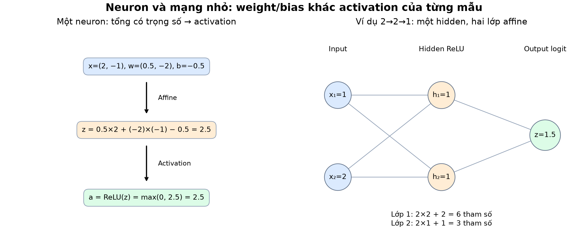
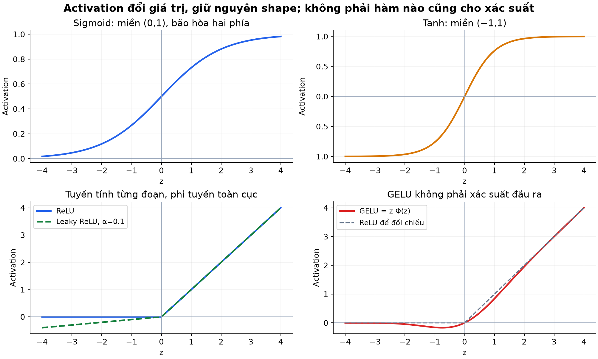
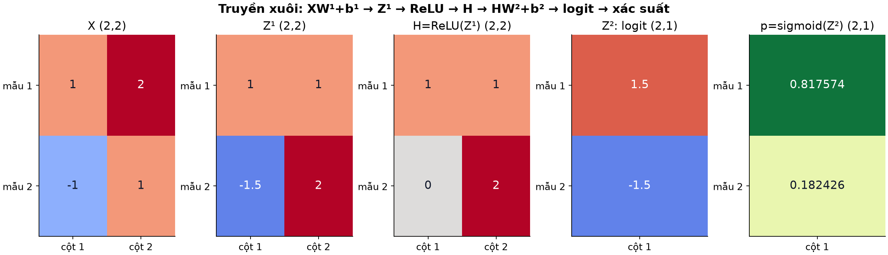
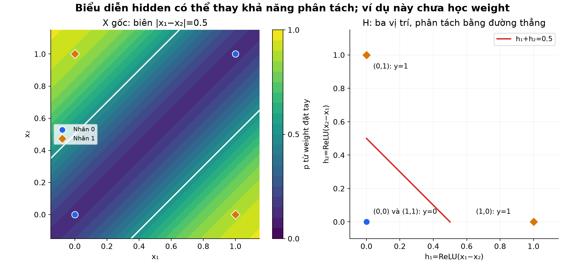
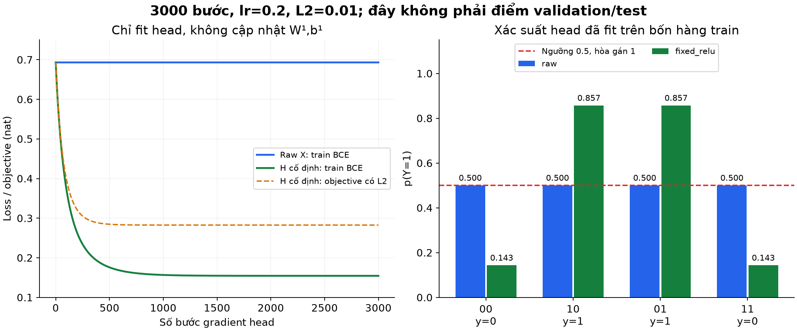

# Bài 9 — Neuron, activation và mạng nhiều lớp

[Mục lục](../README.md) · [Bài 8](../08-cay-quyet-dinh-boosting-baseline/README.md) · [Bài tập](exercises.md) · [Lời giải](solutions.md)

Biên soạn và kiểm tra ngày 04/11/2026. Ví dụ, trọng số và dữ liệu trong bài đều tự tạo để học. Code NumPy thực hiện truyền xuôi và một thí nghiệm **chỉ huấn luyện lớp đầu ra trên feature cố định**; chưa huấn luyện toàn bộ mạng bằng backpropagation. Bài 10 sẽ giải thích cơ chế cập nhật xuyên các lớp.

## 1. Mục tiêu và đường nối từ ML sang Deep Learning

Sau bài này, người học có thể:

- Tính đầu ra một neuron từ input, weight, bias và activation.
- Phân biệt pre-activation z, activation a, logit, xác suất và nhãn.
- Viết phép truyền xuôi một batch qua mạng fully connected, kiểm tra shape và số tham số.
- Chứng minh nhiều lớp affine không có phi tuyến có thể gộp lại.
- Giải thích cách hai ReLU tạo biểu diễn giúp phân loại XOR.
- Phân biệt trọng số đặt tay, feature cố định và mạng được học end-to-end.

Cần vector/ma trận ở bài 3, đạo hàm cơ bản ở bài 2, logistic/BCE ở bài 6 và quy trình đánh giá ở bài 5–8. Phần 2–8 là cốt lõi; phần 9–11 nối biểu diễn với huấn luyện; phần 12–14 hướng dẫn thực hành và học tiếp.

Một mô hình ở bài 6 nhận feature x rồi tạo dự đoán. Mạng nhiều lớp có thể còn học phép biến đổi x thành **hidden representation — biểu diễn ẩn** trước khi tạo đầu ra. Không có bảo đảm mạng luôn hơn cây/boosting hoặc baseline tuyến tính; bài 8 đã cho một ví dụ cần so sánh bằng dữ liệu giữ riêng.

## 2. Một neuron là một phép tính có tham số

Trong mạng dense đang học, một neuron thực hiện hai bước:

$$
z=\sum_{j=1}^{d}w_jx_j+b,\qquad a=\phi(z)
$$

- x: các giá trị đầu vào.
- w: **weight — trọng số**, điều chỉnh cách kết hợp input.
- b: **bias — hệ số chệch/intercept**, cho phép dịch vị trí hoạt động.
- z: **pre-activation**, tổng trước activation.
- φ: **activation function — hàm kích hoạt**, biến đổi z.
- a: **activation**, kết quả sau hàm ấy, dùng làm input cho lớp tiếp.

Neuron nhân tạo là mô hình toán đơn giản; tên gọi không có nghĩa mô phỏng đầy đủ neuron sinh học hoặc có khả năng hiểu như người. Trong bài này activation là phép tính xác định, không phải quyết định ngẫu nhiên “bật/tắt”.

### Tính tay một neuron

Cho x=(2,−1), w=(0.5,−2), b=−0.5:

$$
z=0.5\times2+(-2)\times(-1)-0.5=2.5
$$

Nếu φ là identity, a=2.5; ReLU cũng cho 2.5; sigmoid cho khoảng 0.924142; tanh cho khoảng 0.986614. **Cùng z, khác activation, khác đầu ra.** Giá trị ReLU=2.5 không phải xác suất vượt 100%.

Nếu không có bias và input toàn 0, tổng affine sẽ là 0. Bias cho phép output khác 0 tại gốc và dịch ranh giới z=0; nó không phải một input mới phải có ở dữ liệu triển khai.

### Mối liên hệ với bài 6

Một neuron có activation identity là một dự đoán affine như hồi quy tuyến tính. Một neuron có sigmoid ở đầu ra tạo p=sigmoid(wᵀx+b), chính là cấu trúc logistic nhị phân đã học. Ở một hidden layer, sigmoid chỉ là activation; **không mặc định mỗi giá trị hidden sigmoid có nghĩa xác suất của một nhãn cụ thể**. [Google: Nodes and hidden layers](https://developers.google.com/machine-learning/crash-course/neural-networks/nodes-hidden-layers)



*Hình 1. Weight gắn với kết nối, bias gắn với đầu ra mỗi neuron. Mạng 2→2→1 có 9 tham số nếu hai lớp affine đều có bias; activation trong hình không có tham số học.*

## 3. Activation: tính phi tuyến đến từ đâu?

Nếu φ(z)=z thì không thêm phi tuyến. Các hàm dưới đây tác động **theo từng phần tử**, giữ nguyên shape:

| Hàm | Công thức | Miền đầu ra toán học với z hữu hạn | Điều cần nhớ |
|---|---|---|---|
| Identity | z | ℝ | Hữu ích cho đầu ra số hoặc logit thô |
| Sigmoid | 1/(1+e⁻ᶻ) | (0,1) | Có thể dùng cho xác suất nhị phân ở đầu ra |
| Tanh | tanh(z) | (−1,1) | Giá trị âm/dương, bão hòa ở hai phía |
| ReLU | max(0,z) | [0,+∞) | Bằng 0 phía âm, giữ nguyên phía dương |
| Leaky ReLU, α=0.1 trong lab | z nếu z≥0, 0.1z nếu z<0 | ℝ | Giữ một nhánh âm có độ dốc nhỏ |

Trong tính toán float, sigmoid/tanh có thể làm tròn tới giá trị biên. ReLU là **piecewise linear — tuyến tính từng đoạn**, nhưng không phải một hàm affine duy nhất trên toàn trục. Có một đoạn thẳng không làm hàm mất tính phi tuyến tổng thể. [Google: Activation functions](https://developers.google.com/machine-learning/crash-course/neural-networks/activation-functions)

Ví dụ z=`[-2,-1,0,1,2]`:

- ReLU → `[0,0,0,1,2]`.
- Leaky ReLU với α=0.1 → `[-0.2,-0.1,0,1,2]`.
- Sigmoid → gần `[0.119203,0.268941,0.5,0.731059,0.880797]`.

### Đạo hàm để chuẩn bị cho bài sau

Sigmoid có đạo hàm σ(z)(1−σ(z)), lớn nhất 1/4; tanh có đạo hàm 1−tanh²(z). Ở |z| lớn, chúng có độ dốc gần 0 — **saturation, bão hòa**. Khi đạo hàm được nhân qua nhiều bước, gradient có thể rất nhỏ; bài 10 sẽ tổ chức phép nhân đó bằng chain rule.

ReLU có đạo hàm 0 khi z<0, 1 khi z>0; **không có đạo hàm cổ điển ở z=0**. Một implementation có thể chọn quy ước 0 ở đó. Neuron ReLU ra 0 cho một mẫu chưa đủ gọi là “chết”: một input khác vẫn có thể cho z>0. Nếu z luôn âm trên mọi mẫu train và gradient đi qua ReLU đều 0, neuron có thể không cập nhật qua đường ấy trong gradient descent thông thường.

Leaky ReLU giảm tình trạng chặn gradient hoàn toàn ở nhánh âm, nhưng không bảo đảm mọi vấn đề tối ưu biến mất. Không có activation tốt nhất cho mọi kiến trúc/bài toán.

### Mở rộng: GELU

**GELU** dùng $\operatorname{GELU}(z)=z\Phi(z)$, với Φ là CDF của phân bố chuẩn tắc N(0,1). Lab tính dạng này qua hàm `erf` của Python; không dùng xấp xỉ tanh. GELU(−1)≈−0.158655, GELU(0)=0, GELU(1)≈0.841345.

Giá trị GELU không phải xác suất dù Φ nằm trong [0,1]; tích với z có thể âm hoặc lớn hơn 1. Một API có thể hỗ trợ nhiều cách xấp xỉ, nên cần ghi đúng cách tính khi đối chiếu số. [PyTorch: GELU](https://docs.pytorch.org/docs/2.15/generated/torch.nn.GELU.html)



*Hình 2. Các panel dùng trục phù hợp từng hàm; không so độ cao như thể chúng luôn cùng miền đầu ra. Đường GELU lấy từ công thức zΦ(z), không phải hình của tài liệu thư viện.*

## 4. Từ neuron đến lớp dense và MLP

**Dense / fully connected layer**: mỗi neuron nhận toàn bộ đầu ra của lớp trước. **MLP — multilayer perceptron** trong bài là chuỗi lớp affine xen activation, đi từ input đến output; đây là mạng **feedforward — truyền thẳng**, không có trạng thái lặp theo thời gian.

Giả sử batch có n mẫu, mỗi mẫu d feature; hidden layer rộng h, đầu ra k số. Quy ước mỗi mẫu một hàng:

$$
Z^{(1)}=XW^{(1)}+b^{(1)},\quad H=\phi(Z^{(1)}),\quad
Z^{(2)}=HW^{(2)}+b^{(2)}
$$

| Đại lượng | Shape trong lab |
|---|---|
| X | (n,d) |
| W¹, b¹ | (d,h), (h,) |
| Z¹, H | (n,h) |
| W², b² | (h,k), (k,) |
| Z² | (n,k) |

Bias `(h,)` được broadcast theo batch: **mỗi neuron một bias, dùng chung qua các mẫu**. Không tạo n bias khác nhau chỉ vì batch có n mẫu. Cột j của W¹ chứa trọng số đầu vào của neuron hidden j.

Mạng d→h→k có một hidden layer, hai lớp affine chứa tham số. Có tài liệu vẽ cả input thành một “layer” nên hình có ba dãy nút; hãy ghi cách đếm thay vì cãi số lớp. “Deep” thường gợi nhiều tầng biến đổi, không có một con số tối thiểu thống nhất cho mọi ngữ cảnh.

**Width — độ rộng** là số neuron một lớp; **depth — độ sâu** nói số tầng biến đổi. Batch size không phải width. Hidden nghĩa không có nhãn mục tiêu trực tiếp riêng cho mỗi giá trị ẩn trong ví dụ này, không có nghĩa ta không thể in hoặc quan sát H.

### Quy ước thư viện có thể khác

Lab lưu W dạng `(in_features,out_features)` để tính `X @ W`. `torch.nn.Linear` lưu weight dạng `(out_features,in_features)` và tính `X @ weight.T + bias`. Để chuyển trọng số lab sang quy ước ấy phải xét transpose. Bài chỉ đọc tài liệu API, **chưa chạy PyTorch**. [PyTorch: Linear](https://docs.pytorch.org/docs/2.15/generated/torch.nn.Linear.html)

## 5. Truyền xuôi tính tay cả batch

Dùng:

$$
X=\begin{bmatrix}1&2\\-1&1\end{bmatrix},\quad
W^{(1)}=\begin{bmatrix}1&-1\\0.5&1\end{bmatrix},\quad b^{(1)}=[-1,0]
$$

$$
W^{(2)}=\begin{bmatrix}2\\-1\end{bmatrix},\quad b^{(2)}=[0.5]
$$

Hidden activation là ReLU, output giữ logit thô. Có n=2,d=2,h=2,k=1.

**Bước 1 — affine hidden:**

$$
Z^{(1)}=XW^{(1)}+b^{(1)}
=\begin{bmatrix}1&1\\-1.5&2\end{bmatrix}
$$

Ví dụ ô hàng 2,cột 1 là (−1)×1+1×0.5−1=−1.5. Bias được cộng sau tổng có trọng số.

**Bước 2 — activation hidden:**

$$
H=\operatorname{ReLU}(Z^{(1)})=\begin{bmatrix}1&1\\0&2\end{bmatrix}
$$

**Bước 3 — affine output:**

$$
Z^{(2)}=HW^{(2)}+b^{(2)}
=\begin{bmatrix}1\times2+1\times(-1)+0.5\\0\times2+2\times(-1)+0.5\end{bmatrix}
=\begin{bmatrix}1.5\\-1.5\end{bmatrix}
$$

**Bước 4 — diễn giải theo bài toán binary:** sigmoid cho `[0.817574,0.182426]`. Với ngưỡng 0.5, nhãn `[1,0]`. Nếu nhãn thật y=`[1,0]`, BCE trung bình=$\ln(1+e^{-1.5})$≈0.201413 nat. Đúng hai nhãn không đồng nghĩa loss bằng 0 hoặc xác suất đã hiệu chuẩn.



*Hình 3. Cột trong tensor hidden là neuron, hàng là mẫu. ReLU chỉ đổi ô −1.5 thành 0, không đổi shape hoặc trộn hai mẫu.*

### Đếm tham số

Lớp 1 có d×h+h=2×2+2=6; lớp 2 có h×k+k=2×1+1=3; tổng **9**. Số batch n không xuất hiện trong công thức. ReLU/sigmoid/tanh/GELU trong lab không thêm tham số học; không suy mọi loại activation trong mọi thư viện đều không có tham số.

Tổng quát cho dense widths `(d₀,d₁,…,d_L)` có bias mỗi lớp: $\sum_{\ell=1}^{L}(d_{\ell-1}d_\ell+d_\ell)$. Số activation trung gian tăng theo batch, nhưng chúng không phải weight mới.

## 6. Vì sao nhiều lớp affine chưa đủ?

Tạm bỏ ReLU, thay bằng identity. Khi ấy:

$$
Z^{(2)}=(XW^{(1)}+b^{(1)})W^{(2)}+b^{(2)}
=X\underbrace{W^{(1)}W^{(2)}}_{W_{eq}}
+\underbrace{b^{(1)}W^{(2)}+b^{(2)}}_{b_{eq}}
$$

Đây vẫn là một phép affine. Với trọng số mục 5, W_eq=`[[3],[0]]`, b_eq=`[-1.5]`, nên hai logit là `[1.5,-4.5]`. Truyền qua hai lớp identity hoặc một lớp đã gộp cho cùng kết quả ở **mọi X phù hợp**, không chỉ hai hàng ví dụ.

Đặt ReLU trở lại cho `[1.5,-1.5]`: trường hợp thứ hai khác vì nhánh âm đã bị đổi. Lưu ý ở mẫu đầu cả hai z hidden đều dương nên ReLU không làm đổi kết quả; có activation phi tuyến không có nghĩa nó phải bẻ mọi mẫu.

Nếu chỉ thêm sigmoid ở cuối một chuỗi affine, ta vẫn có logistic trên x gốc, biên ở ngưỡng 0.5 là affine. Phi tuyến hidden mới tạo ra họ biểu diễn khác; sigmoid output một mình không giải được XOR trên hai feature gốc. Phép gộp được đối chiếu với [Dive into Deep Learning: MLP](https://d2l.ai/chapter_multilayer-perceptrons/mlp.html#from-linear-to-nonlinear).

Một lớp giữa hẹp còn có thể giới hạn rank của W_eq; vì vậy “gộp được thành affine” không có nghĩa mọi kiến trúc hẹp đều biểu diễn được mọi ma trận affine kích thước lớn. Ta chưa cần học sâu rank để dùng công thức gộp này.

## 7. XOR: thay biểu diễn trước khi phân loại

Bốn điểm đã gặp ở bài 6/8:

| x₁ | x₂ | y |
|---:|---:|---:|
| 0 | 0 | 0 |
| 1 | 0 | 1 |
| 0 | 1 | 1 |
| 1 | 1 | 0 |

Một logit affine trên x₁,x₂ không phân loại đúng cả bốn ở ngưỡng 0.5. Thử đặt **hai neuron hidden**:

$$
h_1=\operatorname{ReLU}(x_1-x_2),\quad
h_2=\operatorname{ReLU}(x_2-x_1),\quad z=4h_1+4h_2-2
$$

Ở đây h₁+h₂=|x₁−x₂|. Hai điểm nhãn 0 cùng đến H=(0,0); hai điểm nhãn 1 đến (1,0),(0,1). Trên **không gian hidden**, logit z tạo đường thẳng h₁+h₂=0.5 và phân tách được hai nhóm.

| X | H | z | p=sigmoid(z) | Nhãn p≥0.5 |
|---|---|---:|---:|---:|
| (0,0) | (0,0) | −2 | 0.119203 | 0 |
| (1,0) | (1,0) | +2 | 0.880797 | 1 |
| (0,1) | (0,1) | +2 | 0.880797 | 1 |
| (1,1) | (0,0) | −2 | 0.119203 | 0 |

BCE trên bốn hàng=ln(1+e⁻²)≈0.126928. Toàn bộ 9 trọng số/bias của mạng này **được tác giả đặt tay**, không phải kết quả training. Nó chứng minh khả năng biểu diễn của cấu hình cụ thể; không chứng minh một optimizer bất kỳ sẽ tìm ra nó từ mọi khởi tạo.



*Hình 4. Biên z=0 ứng với |x₁−x₂|=0.5 trong mặt phẳng X. Bảng XOR chỉ định nhãn ở bốn góc; màu ở các vị trí giữa góc là cách mạng mở rộng dự đoán, không phải nhãn thật đã biết ở đó. Hai điểm (0,0),(1,1) trùng vị trí hidden và cùng nhãn.*

## 8. Chọn đầu ra theo ý nghĩa bài toán

Hidden activation và output transformation có vai trò khác nhau. Không áp một activation cuối chỉ vì đã chọn nó cho hidden.

| Nhiệm vụ | Raw output điển hình | Cách diễn giải | Loss cơ bản |
|---|---|---|---|
| Hồi quy đại lượng thực | (n,k) số thực | Identity, giữ đơn vị đích | MSE/MAE theo yêu cầu |
| Binary một nhãn | (n,1) logit | Sigmoid → p, rồi ngưỡng → nhãn | BCE từ logit |
| Đa lớp loại trừ nhau | (n,C) logits | Softmax trên trục lớp cuối | Categorical cross-entropy |
| Nhiều nhãn đồng thời | (n,C) logits | Một sigmoid cho mỗi nhãn | BCE theo nhãn, ghi cách giảm trung bình |

Softmax không phải activation từng phần tử độc lập: một p_j phụ thuộc các logit khác của **cùng mẫu**. Không chuẩn hóa toàn batch thành một tổng bằng 1. Sigmoid hidden không biến mạng thành binary nếu head thực tế là hồi quy/đa lớp.

Trong lab, output layer giữ identity và trả logit; chỉ gọi sigmoid/softmax khi cần diễn giải. BCE được tính ổn định trực tiếp từ logit như bài 6. Với API đã kết hợp sigmoid và BCE, không sigmoid thêm một lần trước khi truyền vào loss. Ví dụ `BCEWithLogitsLoss` có hợp đồng ấy; bài **chỉ đọc tài liệu, chưa chạy API PyTorch**. [PyTorch: BCEWithLogitsLoss](https://docs.pytorch.org/docs/2.15/generated/torch.nn.BCEWithLogitsLoss.html)

Sigmoid hai lần làm biến đổi thêm số: z=0 → p=0.5 → sigmoid(p)≈0.622459. Đó không còn là xác suất ban đầu. Với z hữu hạn rất lớn, lab vẫn dùng sigmoid hai nhánh và `logaddexp` để tránh một số overflow/loss vô hạn do làm tròn p, không bảo đảm mọi phép nhân ma trận với mọi số float đều an toàn.

## 9. Kiến trúc, tham số và việc học là ba thứ khác nhau

- **Kiến trúc:** bao nhiêu lớp, rộng bao nhiêu, kết nối và activation gì.
- **Tham số:** các giá trị W,b cụ thể; cùng kiến trúc có thể tạo nhiều hàm khác nhau.
- **Training:** dùng dữ liệu/loss và optimizer để thay tham số.

Forward tính dự đoán với tham số hiện tại; tự chạy forward không huấn luyện. Trong MLP thông thường, backpropagation tính gradient theo W,b qua chuỗi lớp, rồi optimizer cập nhật. Forward mới diễn ra bằng **các tham số đã đổi**. Backprop không phải đường dự đoán từ nhãn quay ngược về input lúc serving.

Thông thường mỗi hidden unit cần được khởi tạo sao cho không mãi có vai trò giống hệt nhau. Nếu các neuron hidden khởi tạo giống nhau và có kết nối/gradient đối xứng, gradient descent có thể giữ chúng giống nhau. Chi tiết khởi tạo và luồng gradient sẽ học tiếp; đừng suy “mọi bias đều phải random” hoặc “mọi ma trận cứ bằng 0 là đủ”.

Batch size, learning rate, số bước và hidden width là hyperparameter/cấu hình; chúng không được tự fit từ nhãn test. Nhiều neuron làm tăng khả năng biểu diễn và số tham số, không bảo đảm optimizer hội tụ hay khả năng tổng quát hóa tốt hơn.

## 10. Thí nghiệm cầu nối: chỉ học head trên feature cố định

Để chưa phải dùng backprop hidden trước bài 10, lab giữ W¹,b¹ của hai ReLU XOR ở mục 7, và **chỉ fit** w,b của:

$$
z=Hw+b,\quad J=\operatorname{mean}\operatorname{BCE}(y,z)
+\frac\lambda2\|w\|^2
$$

Gradient head đã biết từ bài 6: $\nabla_w J=H^T(p-y)/n+\lambda w$, $\partial J/\partial b=\operatorname{mean}(p-y)$. Không phạt bias. Không tính $\partial J/\partial W^{(1)}$ trong thí nghiệm này.

So với baseline logistic dùng x gốc, cùng bốn hàng train XOR. Khởi tạo **head** w=0,b=0; 3000 bước full-batch,lr=0.2,λ=0.01. Khởi tạo head bằng 0 trong phép hồi quy logistic trên feature cố định này không giống khởi tạo đối xứng mọi hidden neuron của một MLP end-to-end.

| Mô hình fit | Feature cho head | w,b cuối xấp xỉ | Train BCE | Objective có L2 | Accuracy train |
|---|---|---|---:|---:|---:|
| Logistic trên raw X | x₁,x₂ | w=(0,0),b=0 | 0.693147 | 0.693147 | 0.5 |
| Head trên hai ReLU cố định | h₁,h₂ | w=(3.578739,3.578739),b=−1.789369 | 0.154492 | 0.282566 | 1 |

Baseline p=0.5 cho mọi mẫu; theo hòa p≥0.5, tất cả nhãn là 1. Với X gốc đối xứng, gradient tại w=b=0 bằng 0; binary logistic objective có L2 là lồi nên đây là nghiệm tối ưu, không chỉ lỗi “chưa chạy đủ bước”. Nó vẫn không thể phân tách XOR hoàn hảo theo logit affine.

Head trên H cho p gần `[0.143150,0.856850,0.856850,0.143150]`. Khác bộ w=(4,4),b=−2 đặt tay vì mục tiêu fit có L2 và số bước được định trước. Trường hợp này minh họa **học bộ đọc đầu ra trên biểu diễn đã chọn**, chưa chứng minh mạng tự học ra biểu diễn ấy.



*Hình 5. Cả hai đường là train, không phải validation/test. Objective có penalty khác data loss. Hình xác suất bên phải dùng head đã fit, không dùng weight head đặt tay ở mục 7.*

Không có validation/test trong thí nghiệm bảng chân trị này; không tuning để báo một điểm test đẹp. Accuracy=100% trên bốn hàng fit không ước lượng được chất lượng ngoài mẫu, calibration hay độ bền trước nhiễu. Khi học end-to-end trên dữ liệu thật vẫn cần toàn bộ quy trình bài 5–8.

## 11. Những nhầm lẫn cần tự phát hiện

1. **“Activation luôn là xác suất”:** ReLU/tanh/GELU hidden không có nghĩa đó; softmax/sigmoid ở head còn cần diễn giải đúng nhiệm vụ.
2. **“ReLU làm dữ liệu luôn tuyến tính”:** từng miền có hàm affine, toàn mạng có thể đổi miền và biên phi tuyến.
3. **“Cứ tăng số lớp là mạnh hơn”:** chuỗi affine vẫn gộp được; activation, độ rộng, học và dữ liệu đều quan trọng.
4. **“Số tham số nhân thêm batch size”:** batch tăng số activation, không nhân số weight dùng chung.
5. **“Học head nghĩa là đã học hidden”:** code phải thật sự cập nhật W¹,b¹ mới có căn cứ gọi đó là học phần ẩn.
6. **“Mô hình biểu diễn được thì training chắc tìm được”:** đây là hai câu hỏi khác nhau, giống phân biệt cây XOR ở bài 8.

## 12. Thực hành và tái tạo hình

Mã: [lab.py](lab.py). Đã kiểm tra với **Python 3.14.6, NumPy 2.5.4**. Từ thư mục bài 9:

```bash
python3 -m venv .venv
.venv/bin/python -m pip install -r requirements.txt
.venv/bin/python lab.py --mode all
```

Trên Windows dùng Python trong `.venv\Scripts`. Nếu Python hiện tại đã có NumPy:

```bash
python3 lab.py --mode neuron
python3 lab.py --mode activations
python3 lab.py --mode forward
python3 lab.py --mode collapse
python3 lab.py --mode xor
python3 lab.py --mode readout
python3 lab.py --mode heads
```

`all` chạy cả bảy phần. Từ gốc bộ tài liệu thay `lab.py` bằng `09-neuron-activation-mang-nhieu-lop/lab.py`. Các thí nghiệm dùng trọng số/cấu hình cố định, không random seed hoặc thay đổi tham số ngầm giữa các mode.

Một layer trong code là `(W,b,tên_activation)`. `forward` trả output và trace của mọi Z,A để đọc được đường tính; trace **chưa phải** computational graph tự vi phân. `dense` yêu cầu X 2-D và bias 1-D đúng shape để tránh broadcasting hợp lệ nhưng sai ý định. Một mẫu cũng dùng shape `(1,d)`.

```python
from lab import hand_example, forward, sigmoid, parameter_count
X,layers = hand_example()
logits,trace = forward(X,layers)
print(trace[0]['Z'])
print(trace[0]['A'])
print(sigmoid(logits[:,0]))
print(parameter_count(layers))
```

Logit có shape `(n,1)`; khi dùng BCE 1-D trong lab, chỉ lấy trục cuối bằng `[:,0]`, không vô tình làm mất batch khi n=1. Không trừ nhãn `(n,)` trực tiếp với dự đoán `(n,1)` vì NumPy có thể tạo ma trận `(n,n)` như bài 3.

Hình PNG/SVG có sẵn trong [figures](figures/). Để tái tạo:

```bash
.venv/bin/python -m pip install -r requirements-figures.txt
.venv/bin/python make_figures.py
```

Mã vẽ: [make_figures.py](make_figures.py); phụ thuộc [requirements.txt](requirements.txt), [requirements-figures.txt](requirements-figures.txt). Đã kiểm tra Matplotlib 3.11.2; phiên bản ghim cần Python/nền tảng tương thích. Hình tính từ cùng mảng/công thức với lab, không sao chép hình nguồn.

## 13. Tự kiểm tra

Làm [10 bài tập](exercises.md) rồi đọc [lời giải](solutions.md). Các dấu hiệu đã nắm phần cốt lõi: tính được Z,H,logit và xác suất; đếm đúng 9 tham số; giải thích được affine collapse; lập bảng XOR trong hidden space; chỉ ra đúng lớp nào đã/ chưa được fit. Không cần học thuộc GELU để đạt các mục tiêu ấy.

## 14. Bước tiếp theo

**Học tiếp:** [Bài 10 — Chain rule, computational graph và backpropagation](../10-chain-rule-computational-graph-backpropagation/README.md): tính gradient qua các lớp và huấn luyện cả biểu diễn ẩn bằng NumPy. PyTorch/autograd sẽ học ở bài 11. [Nguồn và phạm vi đã đọc](../SOURCES.md).
