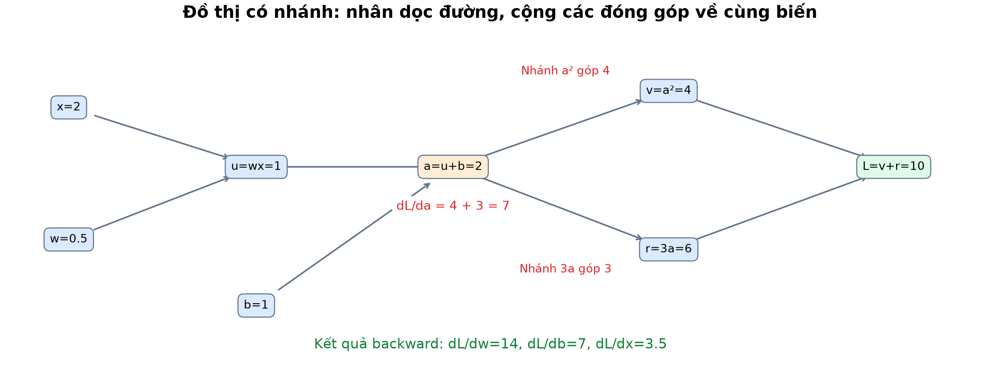
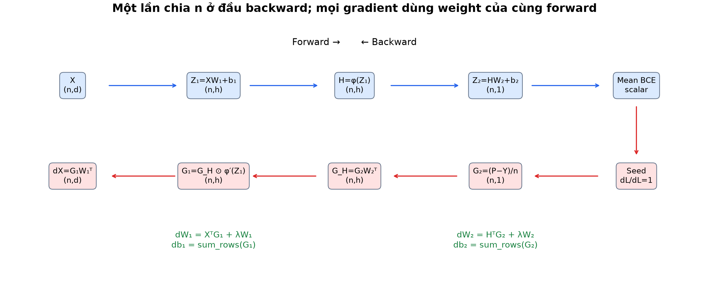
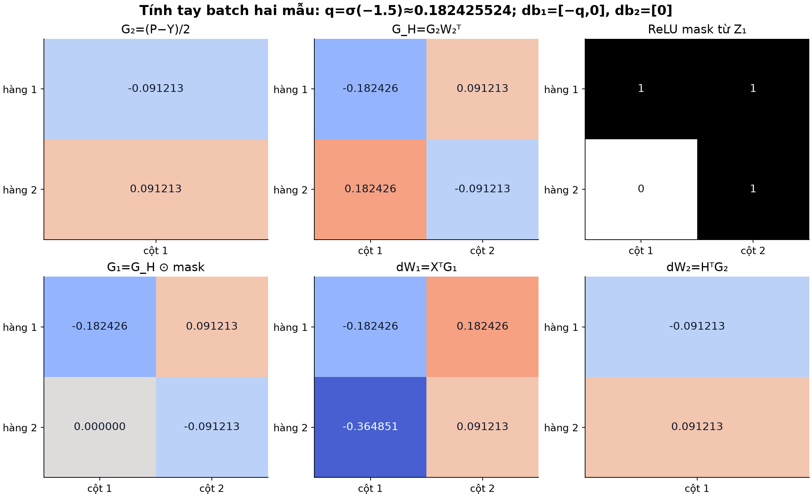
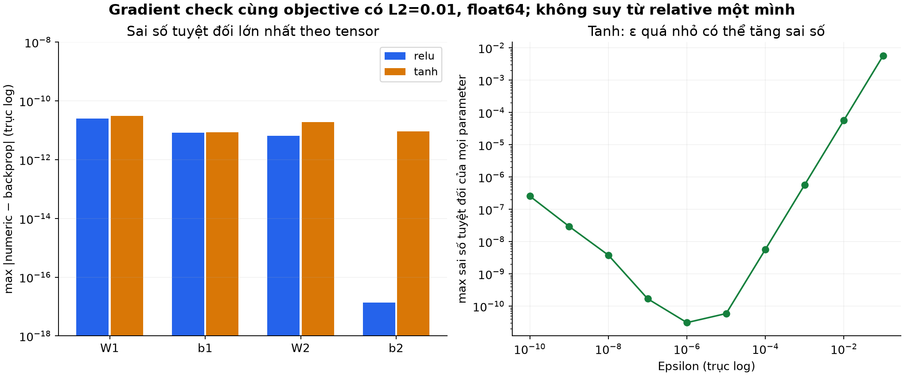
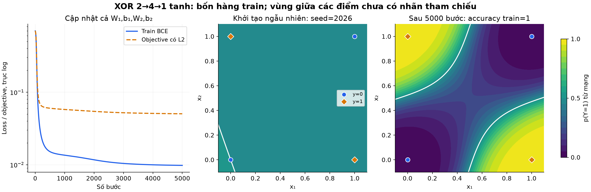

# Bài 10 — Chain rule, computational graph và backpropagation

[Mục lục](../README.md) · [Bài 9](../09-neuron-activation-mang-nhieu-lop/README.md) · [Bài tập](exercises.md) · [Lời giải](solutions.md)

Biên soạn và kiểm tra ngày 04/11/2026. Bổ sung định nghĩa tường minh các khái niệm giải tích và đồ thị tính toán (Chain Rule, Computational Graph, Local/Upstream Gradient, Vector-Jacobian Product, Gradient Checking, End-to-end Learning...), kèm trực giác kỹ thuật và cẩm nang debug cho AI Engineer; toàn bộ ví dụ, công thức ma trận, bước tính tay hai mẫu và kết quả huấn luyện XOR gốc được giữ nguyên vẹn 100% để đối chiếu chuẩn. Lab dùng NumPy float64 để tính gradient **cả lớp ẩn lẫn đầu ra** và huấn luyện mạng nhỏ; không dùng autograd. Bảng XOR chỉ gồm bốn hàng train, không phải đánh giá giữ riêng.

## 1. Mục tiêu và kiến thức cần trước

Sau bài này, người học có thể:

- Dùng chain rule để tính đạo hàm qua nhiều phép toán và cộng đóng góp từ nhiều nhánh.
- Vẽ computational graph, phân biệt giá trị forward với gradient backward.
- Suy ra gradient cho affine, activation và BCE theo logit theo đúng shape.
- Tính ngược đầy đủ mạng ví dụ bài 9 và cập nhật đồng thời mọi tham số.
- Kiểm tra gradient bằng sai phân trung tâm, nhận ra giới hạn ở ReLU kink và số gần 0.
- Huấn luyện MLP end-to-end và phân biệt điều đó với học head cố định ở bài 9.

Cần đạo hàm/gradient bài 2, ma trận/broadcasting bài 3 và forward MLP bài 9. Phần 2–7 đi từ scalar đến mạng cụ thể; phần 8–10 là kiểm tra và huấn luyện; phần 11–14 nối với autograd và cách thực hành. Chưa cần cài PyTorch.

## 2. Chain rule: tác động đi qua một chuỗi

Nếu u=g(x), L=f(u), khi các hàm khả vi tại điểm đang xét:

$$
\frac{dL}{dx}=\frac{dL}{du}\frac{du}{dx}
$$

Trực giác: x thay đổi một lượng nhỏ làm u đổi theo độ dốc du/dx; u lại làm L đổi theo dL/du. Nhân hai độ dốc để đo tác động từ x đến L. Các đạo hàm được tính tại **các giá trị của cùng một lần forward**, không ở những trạng thái tham số khác nhau.

Ví dụ L=(3x+1)² tại x=2: u=7, L=49; dL/du=14, du/dx=3, nên dL/dx=42. Khai triển L=9x²+6x+1 cho 18x+6=42, cùng kết quả. Chain rule giúp không phải khai triển mọi biểu thức lớn.

### Khi một biến đi theo nhiều đường

Nếu a ảnh hưởng L qua u và v:

$$
\frac{dL}{da}=\frac{\partial L}{\partial u}\frac{du}{da}
+\frac{\partial L}{\partial v}\frac{dv}{da}
$$

**Nhân dọc một đường, cộng giữa các đường.** Không chỉ giữ nhánh đến sau. Quy tắc tích cũng là một trường hợp: a×a dùng a ở hai vị trí, mỗi vị trí góp a, tổng thành 2a. [Stanford CS231n: Backpropagation](https://cs231n.github.io/optimization-2/)

> [!NOTE]
> ### 💡 Định nghĩa: Quy tắc chuỗi (Chain Rule) & Ẩn dụ Chuỗi cung ứng sản xuất
> 
> - **Định nghĩa Quy tắc chuỗi (Chain Rule)**: Định lý cơ bản của giải tích cho phép tính đạo hàm của một hàm hợp $L = f(g(x))$ bằng tích các đạo hàm thành phần dọc theo chuỗi phụ thuộc:
>   $$\frac{dL}{dx} = \frac{dL}{du} \cdot \frac{du}{dx}$$
> - **Định nghĩa Quy tắc chuỗi đa biến (Multivariate Chain Rule — Quy tắc rẽ nhánh)**: Khi một biến số $a$ tác động đến hàm mất mát $L$ thông qua nhiều con đường trung gian khác nhau ($u$ và $v$), tổng mức độ ảnh hưởng của $a$ đến $L$ bằng **tổng các đóng góp riêng rẽ từ từng nhánh**:
>   $$\frac{dL}{da} = \frac{\partial L}{\partial u}\frac{du}{da} + \frac{\partial L}{\partial v}\frac{dv}{da}$$
>   *Khẩu quyết cốt tử*: **"Nhân dọc một đường, cộng giữa các đường"**.
> 
> ---
> 
> ### 💡 Ẩn dụ đời thường: Hiệu ứng cánh bướm trong Chuỗi cung ứng xe hơi
> Hãy tưởng tượng chuỗi cung ứng sản xuất một chiếc ô tô:
> - $x$: Giá quặng sắt thô trên thị trường thế giới.
> - $u$: Giá thép thành phẩm cuộn.
> - $L$: Giá bán xuất xưởng của chiếc xe hơi.
> 
> Giả sử:
> 1. Khi giá quặng sắt $x$ tăng 1 đồng, giá thép cuộn $u$ tăng 2 đồng ($\frac{du}{dx} = 2$).
> 2. Khi giá thép cuộn $u$ tăng 1 đồng, giá xe hơi $L$ tăng 1.5 đồng ($\frac{dL}{du} = 1.5$).
> 
> Theo **Quy tắc chuỗi**, nếu giá quặng sắt tăng 1 đồng, giá xe hơi sẽ tăng:
> $$\frac{dL}{dx} = \frac{dL}{du} \cdot \frac{du}{dx} = 1.5 \times 2 = 3 \text{ đồng}$$
> 
> **Trường hợp phân nhánh**: Nếu quặng sắt vừa làm tăng giá khung vỏ xe (nhánh $u$), vừa làm tăng giá phụ tùng động cơ (nhánh $v$): bạn phải tính mức đội giá của từng nhánh rồi **cộng dồn cả hai nhánh lại** mới ra tổng mức tăng giá của chiếc xe!

## 3. Computational graph: viết phép tính thành quan hệ phụ thuộc

**Computational graph — đồ thị tính toán** biểu diễn các giá trị/phép toán và sự phụ thuộc của chúng. Ở graph truyền thẳng trong bài, cạnh có hướng từ input của phép toán đến output, không có vòng lặp phụ thuộc — một **DAG**, directed acyclic graph.

Không phải mọi nút đều là neuron: phép cộng, bình phương, mean và penalty cũng thuộc graph. Một node trung gian có thể được nhiều phép toán dùng lại. Cùng một tham số dùng cho nhiều mẫu cũng tạo nhiều đường đóng góp gradient.

**Forward:** tính theo thứ tự phụ thuộc, lưu giá trị cần dùng. **Backward:** bắt đầu từ loss scalar với dL/dL=1 rồi truyền gradient theo chiều ngược của các phụ thuộc. Thứ tự ngược này không phải đảo hàm hoặc cố khôi phục input từ output. [Dive into Deep Learning: Computational graphs](https://d2l.ai/chapter_multilayer-perceptrons/backprop.html)

### Tính tay một graph có nhánh

Cho x=2, w=0.5, b=1:

$$
u=wx=1,\quad a=u+b=2,\quad v=a^2=4,\quad r=3a=6,\quad L=v+r=10
$$

Biểu thức L này để luyện đạo hàm, chưa phải một loss ML được đề xuất cho dữ liệu thật.

Backward:

1. Từ L=v+r: dL/dv=1, dL/dr=1.
2. Nhánh v=a² góp 1×2a=4 về a.
3. Nhánh r=3a góp 1×3=3 về a.
4. Cộng tại a: dL/da=4+3=7.
5. a=u+b cho dL/du=7, dL/db=7.
6. u=wx cho dL/dw=7x=14, dL/dx=7w=3.5.

Nếu chỉ giữ nhánh 3a thì dL/dw sai thành 6; nếu chỉ giữ nhánh a² thì sai thành 8. Mỗi con số có thể trông hợp lý nếu không kiểm tra đường phụ thuộc.



*Hình 1. Các giá trị được tính với cùng x, w, b. Hai nhánh từ a trả về 4 và 3; gradient tại a là tổng 7, không phải tích 12 hoặc giá trị của nhánh cuối.*

## 4. Local derivative và upstream gradient

Tại một phép toán, gọi g là gradient của loss theo **output của phép toán** — upstream gradient. Muốn truyền về input, nhân g với đạo hàm cục bộ tương ứng:

| Forward scalar | Gradient truyền về |
|---|---|
| z=a+b | da += g; db += g |
| z=ab | da += gb; db += ga |
| z=a² | da += 2ag |
| z=ReLU(a) | da += g nếu a>0; 0 nếu a<0 |
| z=tanh(a) | da += g(1−z²) |
| L=mean(z₁, …, z_n) | Mỗi dz_i += 1/n khi seed ở L là 1 |

Trong cột phải, `da` là ký hiệu ngắn cho ∂L/∂a, không phải chính giá trị a hay một tham số mới. `+=` nhắc phải cộng nếu a nhận gradient từ nhiều đường. Trong biểu thức `gb`, g nhân b, không phải tên một biến duy nhất.

ReLU không khả vi cổ điển tại 0; lab chọn quy ước độ dốc 0 ở đó. Đây là lựa chọn dùng cho thuật toán, không phải chứng minh ReLU có đạo hàm ở 0. Cũng không được chỉ nhìn dấu activation rồi bỏ qua upstream gradient: upstream có thể âm, dương hoặc bằng 0.

> [!NOTE]
> ### 💡 Bảng định nghĩa: Đồ thị tính toán, Chiều xuôi, Chiều ngược & Upstream Gradient
> 
> - **Đồ thị tính toán (Computational Graph — DAG)**: Một đồ thị có hướng không chứa chu trình. Trong đó, mỗi nút (Node) đại diện cho một biến số hoặc một phép toán cơ sở ($+, -, \times, \operatorname{ReLU}$), còn các cạnh (Edge) đại diện cho luồng di chuyển của dữ liệu.
> - **Chiều xuôi (Forward Pass)**: Quá trình tính toán đi từ các biến đầu vào theo chiều mũi tên của đồ thị để cho ra giá trị mất mát scalar $L$. Trong quá trình này, các giá trị trung gian được lưu lại vào bộ nhớ tạm (**Cache**).
> - **Chiều ngược (Backward Pass / Backpropagation)**: Bắt đầu từ đích $L$ với "hạt giống" ban đầu $\frac{\partial L}{\partial L} = 1$, chảy ngược chiều các mũi tên để tính đạo hàm của $L$ đối với mọi nút trong đồ thị.
> - **Đạo hàm cục bộ (Local Derivative)**: Đạo hàm của đầu ra của một nút đối với từng đầu vào của chính nút đó. Đây là tính chất hoàn toàn độc lập với phần còn lại của đồ thị.
>   - *Ví dụ*: Với phép nhân $z = a \cdot b$, đạo hàm cục bộ là $\frac{\partial z}{\partial a} = b$ và $\frac{\partial z}{\partial b} = a$.
> - **Upstream Gradient ($g$)**: Gradient của hàm mất mát tổng $L$ đối với đầu ra $z$ của nút: $g = \frac{\partial L}{\partial z}$ (truyền từ phía sau tới).
> - **Downstream Gradient**: Gradient truyền ngược về đầu vào của nút, thu được bằng cách nhân Upstream Gradient với Local Derivative:
>   $$\text{Downstream} = \text{Upstream} \times \text{Local} = g \cdot \frac{\partial z}{\partial a}$$
> 
> ---
> 
> ### 💡 Ẩn dụ đời thường: Người quản lý dự án và Phân phối trách nhiệm
> - **Tổng giám đốc (Loss $L$)**: Gặp sự cố dự án bị trễ hạn 10 ngày. Ông gửi thông báo phê bình nghiêm khắc xuống Giám đốc Kỹ thuật với áp lực $g = 10$ (**Upstream Gradient**).
> - **Nút phép tính (Giám đốc Kỹ thuật)**: Ông biết rằng tiến độ chung của phòng phụ thuộc vào Trưởng nhóm Backend với hệ số cục bộ là $0.7$ (**Local Derivative**).
> - **Trách nhiệm truyền về (Downstream Gradient)**: Trưởng nhóm Backend phải chịu mức trách nhiệm tương đương $10 \times 0.7 = 7$ ngày trễ hạn để biết đường khắc phục.

## 5. Từ scalar sang ma trận: shape dẫn đường

Tiếp tục quy ước mỗi mẫu một hàng. Với X=(n, d), W=(d, h), b=(h, ), Z=XW+b và G=∂L/∂Z có shape (n, h):

$$
\frac{导 L}{\partial W}=X^T G,\qquad
\frac{\partial L}{\partial b}=\sum_{i=1}^{n}G_{i,:},\qquad
\frac{\partial L}{\partial X}=GW^T
$$

Ví dụ theo phần tử: Z_ik=Σ_j X_ij W_jk+b_k. Vì W_jk dùng cho mọi hàng i, $\partial L/\partial W_{jk}=\sum_i X_{ij}G_{ik}$. Đó chính là ô (j, k) của XᵀG. **Tổng trên batch là cộng các đường đóng góp vào tham số dùng chung.**

Bias đã được broadcast ra n hàng trong forward, nên backward phải cộng ngược các hàng: `G.sum(axis=0)`, không giữ nguyên ma trận G hoặc tự lấy mean thêm một lần. Gradient của mỗi parameter phải cùng shape với parameter ấy.

Activation từng phần tử cho $\partial L/\partial Z=(\partial L/\partial H)\odot\phi'(Z)$, ký hiệu ⊙ là nhân theo phần tử. Matmul và nhân theo phần tử có thể cùng hợp lệ về shape ở một ví dụ nhỏ nhưng không cùng phép tính. [CS231n: Vectorized gradients](https://cs231n.github.io/optimization-2/#gradients-for-vectorized-operations)

### Không cần dựng toàn bộ Jacobian

Một lớp có nhiều output có Jacobian chứa các đạo hàm output theo input. Với loss scalar, reverse mode chỉ cần đưa gradient từ phía sau qua từng lớp — một phép **vector–Jacobian product** theo quy ước vector phù hợp. Các công thức matmul trên thực hiện phép đó; không cần dựng một ma trận Jacobian khổng lồ cho mọi mẫu/neuron.

> [!NOTE]
> ### 💡 Trực giác AI Engineer: Quy tắc "Shape dẫn đường" & Vector-Jacobian Product (VJP)
> 
> - **Quy tắc vàng về kích thước (Shape Consistency Rule)**:
>   - Đạo hàm riêng của hàm mất mát scalar $L$ đối với bất kỳ tham số $\theta$ nào **bắt buộc phải có cùng kích thước (shape) chính xác với $\theta$ đó**:
>     $$\operatorname{shape}\left(\frac{\partial L}{\partial \theta}\right) \equiv \operatorname{shape}(\theta)$$
>   - Nếu ma trận trọng số $W$ có kích thước $(d, h)$, thì gradient $\nabla_W L$ chắc chắn phải là $(d, h)$.
>   - Nhìn vào kích thước hai ma trận $X$ $(n, d)$ và $G$ $(n, h)$, cách duy nhất để nhân ma trận tạo ra kích thước $(d, h)$ là chuyển vị $X$:
>     $$\underbrace{X^T}_{(d, n)} \times \underbrace{G}_{(n, h)} = \underbrace{\nabla_W L}_{(d, h)}$$
> - **Tại sao gradient của bias phải lấy tổng `G.sum(axis=0)`?**:
>   - Khi forward, vector bias $b$ $(h,)$ được nhân bản (broadcast) cộng vào toàn bộ $n$ hàng của batch.
>   - Do đó, khi backward, theo đúng quy tắc rẽ nhánh, mọi hàng trong batch đều đóng góp gradient về cho $b$. Ta phải **cộng dồn gradient qua toàn bộ $n$ hàng** để thu về vector $(h,)$.
> - **Tại sao gọi là Vector-Jacobian Product (VJP) mà không dựng ma trận Jacobian?**:
>   - Nếu mạng nơ-ron có $1.000$ đầu vào và $1.000$ đầu ra, ma trận Jacobian đầy đủ sẽ có $1.000 \times 1.000 = 1.000.000$ phần tử. Với mạng hàng triệu tham số, bộ nhớ sẽ nổ tung!
>   - Vì hàm mất mát cuối cùng $L$ là một số thực duy nhất (scalar), chiều ngược chỉ cần tính tích của một vector gradient từ lớp trên với Jacobian của lớp hiện tại. Phép nhân ma trận $X^T G$ và $G W^T$ thực hiện thẳng phép tính này mà không bao giờ cần tạo ra ma trận Jacobian trung gian.

## 6. Backprop toàn mạng hai lớp

Forward giữ nguyên bài 9:

$$
Z_1=XW_1+b_1,\quad H=\phi(Z_1),\quad Z_2=HW_2+b_2,\quad P=\sigma(Z_2)
$$

Z₂, P có shape (n, 1); nhãn y được đổi rõ ràng thành Y=y[: , None] có cùng shape. Data loss là **mean BCE**; không áp sigmoid lần nữa vào một loss đã nhận logit.

Mục tiêu có L2 của lab:

$$
J=L_{data}+\frac\lambda2\left(\sum_{j,k}(W_1)_{jk}^2+\sum_{j,k}(W_2)_{jk}^2\right)
$$

Đây là tổng bình phương mọi phần tử hai ma trận, còn gọi bình phương chuẩn Frobenius. Không phạt bias. L2 của bài này áp lên **cả hai W**, khác thí nghiệm chỉ học head ở bài 9.

Backward theo thứ tự:

$$
G_2=\frac{P-Y}{n}
$$

$$
\nabla_{W_2}J=H^TG_2+\lambda W_2,\qquad
\nabla_{b_2}J=\operatorname{sum}_{rows}(G_2)
$$

$$
G_H=G_2W_2^T,\qquad G_1=G_H\odot\phi'(Z_1)
$$

$$
\nabla_{W_1}J=X^TG_1+\lambda W_1,\qquad
\nabla_{b_1}J=\operatorname{sum}_{rows}(G_1)
$$

Nếu cần kiểm tra độ nhạy theo input: ∂J/∂X=G₁W₁ᵀ. **Không cập nhật X** trong huấn luyện supervised thông thường; tính được gradient theo input không đồng nghĩa input là parameter cần tối ưu.

Gradient BCE theo logit là P−Y như bài 6; sigmoid derivative đã được chain rule rút gọn trong đó, không nhân P(1−P) thêm. Hệ số 1/n được áp **một lần ở G₂** và truyền xuyên mạng. L2 thêm một nhánh phụ thuộc trực tiếp W→penalty→J; vì thế cộng λW vào gradient weight, không cộng nó vào G_H/G₁ như thể penalty phụ thuộc activation.



*Hình 2. G₂ đã chứa 1/n. Các gradient weight/bias cùng shape với parameter; backward dùng các W của lần forward hiện tại. Các phần λW đi trực tiếp vào gradient tham số.*

Nguồn D2L trình bày một mẫu theo vector cột; bài tự chuyển sang batch hàng và thêm bias. Không sao chép transpose từ nguồn mà bỏ qua quy ước. [D2L: Backpropagation và regularization](https://d2l.ai/chapter_multilayer-perceptrons/backprop.html#backpropagation)

## 7. Tính tay đầy đủ mạng bài 9

Dùng n=2, ReLU, λ=0:

$$
X=\begin{bmatrix}1&2\\-1&1\end{bmatrix},\quad Y=\begin{bmatrix}1\\0\end{bmatrix},\quad
W_1=\begin{bmatrix}1&-1\\0.5&1\end{bmatrix},\quad b_1=[-1,0],\quad
W_2=\begin{bmatrix}2\\-1\end{bmatrix},\quad b_2=[0.5]
$$

Forward đã biết: Z₁=`[[1,1],[-1.5,2]]`, H=`[[1,1],[0,2]]`, Z₂=`[[1.5],[-1.5]]`, mean BCE≈0.201413278.

Đặt q=σ(−1.5)≈0.182425524. P=`[[1−q],[q]]`, nên:

$$
G_2=\begin{bmatrix}-q/2\\q/2\end{bmatrix}
\approx\begin{bmatrix}-0.091212762\\0.091212762\end{bmatrix}
$$

**Gradient output:**

$$
\nabla_{W_2}L=H^TG_2=\begin{bmatrix}-q/2\\q/2\end{bmatrix},\qquad
\nabla_{b_2}L=[0]
$$

Bias output bằng 0 do hai đóng góp triệt tiêu trong batch này, không phải mọi bias output đều không học.

**Truyền về hidden:**

$$
G_H=G_2W_2^T=\begin{bmatrix}-q&q/2\\q&-q/2\end{bmatrix}
$$

ReLU mask từ Z₁ là `[[1,1],[0,1]]`, nên:

$$
G_1=\begin{bmatrix}-q&q/2\\0&-q/2\end{bmatrix}
$$

Ô hàng2, cột1 bị chặn do z=−1.5. Neuron hidden1 vẫn nhận đóng góp từ hàng1, nên một ô gradient0 không chứng minh cả neuron hoặc W liên quan luôn không học.

**Gradient hidden:**

$$
\nabla_{W_1}L=X^TG_1
=\begin{bmatrix}-q&q\\-2q&q/2\end{bmatrix},\qquad
\nabla_{b_1}L=[-q,0]
$$

Ví dụ ô (2, 2) của gradient W₁ là 2×(q/2)+1×(−q/2)=q/2. Hai mẫu cùng góp vào weight này; lấy mean lần nữa sẽ làm sai độ lớn.



*Hình 3. Các gradient đều được tính với W cũ. Mask là số 0/1 dùng nhân theo phần tử; màu trong panel mask có thang riêng, số hiển thị là giá trị để đối chiếu.*

### Cập nhật một bước đúng thời điểm

Với learning rate η=0.1, mỗi parameter θ mới bằng θ−η∇θL. Tính xong **toàn bộ gradient trước**, rồi mới tạo tất cả parameter mới. Không cập nhật W₂ rồi dùng W₂ mới tính G_H của cùng forward cũ.

Kết quả gần:

```text
W1 mới = [[ 1.018242552, -1.018242552],
          [ 0.536485105,  0.990878724]]
b1 mới = [-0.981757448, 0]
W2 mới = [[ 2.009121276], [-1.009121276]]
b2 mới = [0.5]
```

Forward lại với parameter mới cho logit≈`[1.756726896,-1.527447026]`, mean BCE≈0.177846597. Loss giảm trong bước ví dụ này, không bảo đảm mọi learning rate trên mọi mạng đều làm loss giảm.

**Backprop tính gradient; optimizer chọn cách cập nhật.** Lab dùng bước gradient descent full-batch đơn giản. Momentum/Adam không thay chain rule, chúng thay cách dùng gradient để tạo tham số mới.

> [!NOTE]
> ### 💡 Trực giác: Nguyên tắc Cập nhật tham số đồng thời (Simultaneous Update)
> 
> - **Định nghĩa Cập nhật đồng thời**: Toàn bộ quá trình tính toán gradient cho $W_1, b_1, W_2, b_2$ phải được hoàn tất trọn vẹn dựa trên **trạng thái tham số cũ** của lần forward hiện tại. Sau khi đã nắm trong tay toàn bộ các vector gradient, ta mới đồng loạt bước một bước Gradient Descent:
>   $$\theta \leftarrow \theta - \eta \nabla_\theta J$$
> - **Cạm bẫy chí mạng cần tránh**:
>   - Không bao giờ được cập nhật $W_2$ trước, rồi lại lấy $W_2^{\text{mới}}$ để nhân ngược tính $G_H = G_2 (W_2^{\text{mới}})^T$ truyền về cho $W_1$!
>   - Làm như vậy sẽ vi phạm tính toán giải tích: gradient của lớp trước sẽ bị tính dựa trên một trạng thái mạng "nửa nạc nửa mỡ", khiến toàn bộ đồ thị tính toán bị lệch lạc và quá trình tối ưu hóa mất ổn định.

## 8. Mean, sum và tích lũy gradient

Nếu data loss dùng sum BCE thay mean BCE thì G₂=P−Y. Với λ=0, trên cùng n mẫu, sum loss và mọi parameter gradient gấp n lần mean. Với λ giữ nguyên dương, gradient penalty λW **không** tự nhân n: hai objective không còn chỉ khác một hệ số chung.

Phân biệt hai việc cộng:

- **Cộng các đường trong một graph:** luôn cần để lấy đúng gradient của objective đã định; ví dụ hai nhánh về a hoặc nhiều mẫu dùng chung bias.
- **Cộng gradient qua nhiều backward/batch:** phải có chủ đích và đúng hệ số loss; không phải lúc nào cũng muốn cộng vào gradient của bước trước.

Lab tạo dict gradient mới ở mỗi lần gọi, không có bộ đệm `.grad` tự tích lũy. Thư viện có thể tích lũy; ví dụ PyTorch cần zero gradient trước bước mới nếu muốn gradient riêng của batch đó. Khi tích lũy microbatch để giả lập mean của batch lớn, các microbatch không bằng kích thước cần được cân theo số mẫu, không chỉ lấy mean của các mean tùy ý. [PyTorch: Autograd](https://docs.pytorch.org/tutorials/beginner/basics/autogradqs_tutorial.html#more-on-computational-graphs)

> [!NOTE]
> ### 💡 Kỹ thuật thực chiến AI Engineer: Tích lũy Gradient (Gradient Accumulation)
> 
> - **Bài toán thực tế trong huấn luyện mô hình lớn (LLM, Vision)**:
>   - Bạn muốn huấn luyện một mô hình với batch size lý tưởng là $1.024$ mẫu để gradient ổn định.
>   - Tuy nhiên, VRAM của GPU chỉ chứa vừa tối đa $32$ mẫu một lần; nếu tăng lên $64$ mẫu thì GPU lập tức báo lỗi `CUDA Out of Memory (OOM)`!
> - **Giải pháp Tích lũy Gradient**:
>   - Chia $1.024$ mẫu thành $32$ micro-batch (mỗi micro-batch $32$ mẫu).
>   - Chạy forward và backward trên từng micro-batch, **cộng dồn gradient** vào bộ đệm tích lũy (`loss.backward()` trong PyTorch mà không gọi `optimizer.zero_grad()`).
>   - Sau khi chạy đủ 32 lần micro-batch, ta mới gọi `optimizer.step()` một lần duy nhất để cập nhật trọng số, rồi mới xóa trắng gradient (`optimizer.zero_grad()`).
>   - Kết quả toán học thu được hoàn toàn tương đương với việc chạy một batch khổng lồ $1.024$ mẫu mà không tốn thêm một byte VRAM nào!

## 9. Gradient check: kiểm chứng implementation

Với một parameter scalar θ_j, giữ mọi parameter khác cố định:

$$
g_j^{num}=\frac{J(\theta+\epsilon e_j)-J(\theta-\epsilon e_j)}{2\epsilon}
$$

So g_num với gradient tính bằng backprop. Phải đối chiếu **cùng objective**: cùng mean/sum, L2, dữ liệu và tham số. Không kiểm gradient BCE bằng sai phân accuracy vì accuracy sau ngưỡng là một hàm khác.

Lab dùng float64, ε=1e−6, kiểm tất cả 9 parameter của mạng tính tay với cả ReLU và tanh, λ=0.01. Báo cho từng tensor:

- Sai số tuyệt đối lớn nhất: max|g_num−g_backprop|.
- Sai số tương đối theo norm: ||g_num−g_backprop|| / max(1e−12, ||g_num||+||g_backprop||).
- Có thay ReLU mask khi perturb parameter hay không.

Ở môi trường đã kiểm, sai số tuyệt đối lớn nhất của các tensor ở mức khoảng 10⁻¹¹ hoặc nhỏ hơn. b₂ của ví dụ ReLU có gradient gần 0 nên relative error có thể trông lớn hơn tensor khác dù absolute error chỉ khoảng 10⁻¹⁷. Không dùng một ngưỡng relative cứng cho mọi gradient gần 0.

Với P parameter, sai phân trung tâm cần 2P lần đánh giá objective; một backward tái dùng trung gian để tính mọi gradient. Numeric check dành cho mạng nhỏ/debug, không thay backprop trong training lớn. [CS231n: Gradient checks](https://cs231n.github.io/neural-networks-3/#gradcheck)

### Hai giới hạn quan trọng

1. **ε không càng nhỏ càng tốt:** ε lớn gây sai số xấp xỉ; quá nhỏ có thể mất chính xác khi trừ hai số gần nhau. Hãy xem cả absolute/relative và nhiều ε hợp lý.
2. **ReLU kink:** tại z=0 không có đạo hàm cổ điển; sai phân trung tâm của ReLU tại 0 cho 0.5, trong khi lab chọn slope 0. Một perturbation còn có thể đổi miền ReLU ở một điểm gần 0. Flag `crossed_relu_kink` nhắc phải xét trường hợp ấy; bất đồng không tự chứng minh code backward sai.



*Hình 4. Kiểm tensor dùng ε=1e−6; quét ε dùng tanh để tránh kink. Các giá trị rất nhỏ chịu ảnh hưởng float, không phải bằng chứng gradient đúng trên mọi dữ liệu/tham số.*

Một check qua tại một điểm chưa là chứng minh tổng quát. Kiểm thêm nhiều cấu hình nhỏ, λ=0 và λ>0, batch khác kích thước; lỗi regularization có thể che lỗi data gradient nếu penalty chiếm ưu thế.

> [!NOTE]
> ### 💡 Trực giác: Kiểm tra Gradient (Gradient Checking) & Cạm bẫy Điểm gập ReLU (Kink)
> 
> - **Định nghĩa Gradient Checking (Gradcheck)**: Kỹ thuật kiểm thử độ chính xác của code backpropagation tự viết bằng cách so sánh gradient giải tích (analytical gradient) với gradient xấp xỉ số học (numerical gradient) thông qua công thức sai phân trung tâm đối xứng với bước nhảy cực nhỏ $\epsilon \approx 10^{-6}$.
>   - Nếu code viết đúng: sai số tương đối giữa hai cách tính thường nhỏ hơn $10^{-7}$.
> - **Cạm bẫy "Điểm gập" (Kink) của hàm ReLU**:
>   - Đồ thị của hàm $\operatorname{ReLU}(z) = \max(0, z)$ bị bẻ gập một góc vuông tại đúng điểm $z=0$. Tại điểm này, đạo hàm giải tích không tồn tại (về mặt toán học).
>   - Nếu giá trị pre-activation $z$ vô tình nằm sát nút $0$ (ví dụ $z = 10^{-7}$), thì khi cộng thêm $\epsilon = 10^{-6}$, điểm rơi sang nhánh dương (độ dốc 1); khi trừ $\epsilon$, điểm rơi sang nhánh âm (độ dốc 0). Sai phân trung tâm sẽ tính ra đạo hàm là $0.5$, trong khi mã giải tích có thể gán độ dốc là $1$ hoặc $0$.
>   - Sự sai lệch tại điểm gập này là do bản chất hình học của hàm số chứ không phải do code backpropagation bị sai!

## 10. Học cả hidden: XOR end-to-end

Ở bài 9, W₁, b₁ được đặt tay và giữ cố định. Bây giờ code `train_xor` khởi tạo weight ngẫu nhiên rồi cập nhật **W₁, b₁, W₂, b₂** bằng gradient vừa suy ra.

Cấu hình định trước:

- Bốn hàng X=`[[0,0],[1,0],[0,1],[1,1]]`, y=`[0,1,1,0]`.
- Mạng 2→4→1, tanh hidden, output logit: tổng 17 parameter có bias.
- Seed 2026; W₁ lấy normal SD=1/√2, W₂ SD=1/√4; bias khởi tạo0. Đây là quy tắc minh họa cụ thể, không tuyên bố tối ưu cho mọi activation.
- Full-batch gradient descent, 5000 bước, lr=1, λ=0.001 phạt hai W, không phạt bias.

Code giữ bản sao parameter ban đầu, ghi loss trước cập nhật và sau từng bước. Trong thí nghiệm này:

| Mốc | Train BCE | Objective có L2 | Accuracy train |
|---|---: |---: |---: |
| Khởi tạo | 0.697609930 | 0.699451564 | 0.25 |
| Sau 5000 bước | 0.009790833 | 0.050311237 | 1 |

Xác suất cuối gần `[0.010045066,0.990694824,0.990694811,0.010316401]`. Mức thay đổi theo norm của W₁, b₁, W₂, b₂ lần lượt khoảng 4.903403, 3.575171, 6.367321, 1.608189: lớp ẩn đã thay đổi thật sự, không chỉ head. Baseline xác suất hằng 0.5 có BCE=ln2, accuracy 0.5 theo quy tắc hòa gán1.



*Hình 5. Chấm là đúng bốn hàng train; màu giữa các điểm là dự đoán của mạng, chưa có nhãn tham chiếu ở đó. Không có validation/test trong hình hoặc thí nghiệm.*

Kết quả là một lần chạy cấu hình cố định, không bảo đảm mọi seed hay learning rate đều tìm được nghiệm như vậy. Mạng có loss phi lồi; gradient đúng không bảo đảm tối ưu toàn cục hoặc tổng quát hóa. Accuracy1 trên bảng chân trị không chứng minh chất lượng với dữ liệu nhiễu/thực tế. Khi làm dự án thật vẫn giữ train/validation/test, baseline và lựa chọn metric từ các bài trước.

> [!NOTE]
> ### 💡 Trực giác AI Engineer: Huấn luyện End-to-End (End-to-End Training)
> 
> - **Định nghĩa Huấn luyện End-to-End**: Quá trình tối ưu hóa đồng bộ toàn bộ tất cả các tầng trong mạng nơ-ron (từ tầng trích xuất đặc trưng ẩn $W_1, b_1$ đến tầng phân loại cuối cùng $W_2, b_2$) dựa trên duy nhất một tín hiệu phản hồi từ hàm mất mát $L$.
> - **Sự khác biệt mang tính cách mạng so với Bài 9**:
>   - Ở Bài 9, con người phải "mớm" sẵn biểu diễn ẩn bằng cách tự tay thiết kế các trọng số $h_1 = \operatorname{ReLU}(x_1 - x_2), h_2 = \operatorname{ReLU}(x_2 - x_1)$.
>   - Ở Bài 10, mạng bắt đầu từ các con số ngẫu nhiên vô nghĩa (khởi tạo ngẫu nhiên, accuracy chỉ đạt $25\%$). Nhờ có dòng chảy gradient của Backpropagation truyền xuyên suốt qua từng tầng, các nơ-ron ẩn **tự động học cách xoay chuyển, bẻ cong không gian** để tìm ra biểu diễn tối ưu nhất, đẩy accuracy lên $100\%$ mà không cần bất kỳ sự can thiệp thủ công nào của con người!
>   - Đây chính là sức mạnh cốt lõi đã tạo nên cuộc cách mạng Deep Learning trong suốt thập kỷ qua.

## 11. Backprop, autograd và sai phân khác nhau ra sao?

| Cách | Cơ chế | Vai trò trong bài |
|---|---|---|
| Backprop viết tay | Quy tắc đạo hàm cục bộ + chain rule ngược, tái dùng cache | `loss_and_gradients` của NumPy |
| Automatic differentiation, reverse mode | Công cụ ghi phép toán/phụ thuộc và tự thực hiện các quy tắc đạo hàm | Khái niệm cầu nối sang PyTorch bài 11; chưa chạy ở đây |
| Sai phân số | Thử objective ở parameter±ε | Kiểm chứng gần đúng gradient trên mạng nhỏ |

Autograd không cần thử từng weight±ε, và cũng không phải chủ yếu khai triển symbolic một biểu thức khổng lồ. Nó áp quy tắc đạo hàm của các phép toán đã ghi. Đạo hàm tính bằng công thức vẫn được thực hiện trong floating point, nên không đồng nghĩa mọi kết quả số học chính xác tuyệt đối. [PyTorch: Tensors, functions and graph](https://docs.pytorch.org/tutorials/beginner/basics/autogradqs_tutorial.html#tensors-functions-and-computational-graph)

Forward cache của lab có X, Z₁, H, Z₂; backward dùng lại chúng với cùng W. Lưu trung gian là một lý do training tốn bộ nhớ hơn chỉ suy luận. Lab chưa là một autograd engine tổng quát: nó chỉ biết mạng một hidden đã định và hai activation được hỗ trợ.

## 12. Lỗi thường gặp và cách lần ra

- **Quên nhánh:** dùng gán thay vì cộng ở biến dùng nhiều lần, hoặc quên λW.
- **Sai reduction:** đã chia n ở G₂ rồi lại chia n tại mỗi lớp; dùng mean thay sum cho gradient bias.
- **Trộn parameter cũ/mới:** cập nhật W₂ trước khi hoàn tất backward của cùng forward.
- **Sai shape:** y=(n, ) trừ Z₂=(n, 1) thành(n, n); lab chuyển y thành(n, 1) rõ ràng.
- **Sai đạo hàm:** thêm sigmoid derivative vào G₂ đã rút gọn; dùng matmul thay nhân mask theo phần tử.
- **Cache cũ:** cập nhật parameter nhưng dùng output/loss từ trước cập nhật như thể đã forward lại.
- **Hiểu sai gradient0:** gradient bias có thể triệt tiêu theo batch; ReLU bị chặn trên một hàng chưa chắc chặn mọi hàng; khởi tạo mọi weight bằng 0 có thể giữ mạng đối xứng/đứng yên.
- **Loss không giảm:** kiểm objective/gradient/learning rate/trạng thái dữ liệu; không mặc định cứ thêm layer hoặc tăng số bước sẽ sửa được.

Thứ tự debug thực dụng: batch rất nhỏ → forward khớp tính tay → shape từng gradient → numeric check tránh kink → một bước nhỏ → thử overfit tập rất nhỏ. Overfit tập nhỏ là phép thử implementation, không là chứng nhận chất lượng sản phẩm.

> [!TIP]
> ### 💡 Cẩm nang debug vòng lặp huấn luyện (Training Loop) cho AI Engineer
> 
> Khi xây dựng mạng nơ-ron mới, hãy luôn tuân thủ quy trình kiểm thử 5 bước sau đây:
> 1. **Kiểm tra kích thước (Shape Check)**: Đặt breakpoint sau mỗi lớp forward và backward để in kích thước của ma trận. Kích thước gradient của biến nào phải khớp $100\%$ kích thước của biến đó.
> 2. **Kiểm tra Loss ban đầu (Sanity Loss Check)**: Với bài toán phân loại $C$ lớp, ở bước 0 với trọng số ngẫu nhiên, loss phải xấp xỉ bằng $-\ln(1/C) = \ln(C)$ (ví dụ nhị phân $C=2$ thì loss $\approx \ln(2) \approx 0.693$). Nếu loss ban đầu vọt lên $5.0$ hoặc rơi xuống $0.01$, code chắc chắn bị lỗi khởi tạo hoặc lỗi loss function!
> 3. **Kiểm tra Gradient số học (Gradient Check)**: Chạy gradcheck trên mạng nhỏ (vài chục tham số) với số thực `float64` để đảm bảo code đạo hàm ngược chuẩn xác đến mức sai số $< 10^{-7}$.
> 4. **Thử Overfit trên một batch siêu nhỏ (Overfit Tiny Batch)**: Lấy đúng 4 đến 8 mẫu dữ liệu và cho mạng huấn luyện 500 bước. Nếu code chuẩn, mô hình phải học vẹt được trọn vẹn tập này với Training Loss ép về sát $0$ và Accuracy $= 100\%$. Nếu mạng không overfit nổi 4 mẫu dữ liệu, đừng bao giờ mang đi train trên tập dữ liệu lớn!
> 5. **Theo dõi độ lớn Gradient (Gradient Norms)**: Kiểm tra chuẩn của gradient theo từng lớp. Nếu gradient ở các tầng đầu nhỏ hơn hàng triệu lần so với tầng cuối $\rightarrow$ Mạng đang bị **Vanishing Gradient**; nếu gradient vọt lên hàng nghìn hoặc xuất hiện `NaN` $\rightarrow$ Mạng đang bị **Exploding Gradient** (cần áp dụng Gradient Clipping).

## 13. Thực hành và tái tạo hình

Mã: [lab.py](lab.py), đã kiểm tra với **Python 3.14.6, NumPy 2.5.4**. Từ thư mục bài 10:

```bash
python3 -m venv .venv
.venv/bin/python -m pip install -r requirements.txt
.venv/bin/python lab.py --mode all
```

Trên Windows dùng Python trong `.venv\Scripts`. Nếu Python hiện tại đã có NumPy:

```bash
python3 lab.py --mode scalar
python3 lab.py --mode batch
python3 lab.py --mode step
python3 lab.py --mode check
python3 lab.py --mode reduction
python3 lab.py --mode train
```

`all` chạy cả sáu phần. Từ gốc bộ tài liệu thay `lab.py` bằng `10-chain-rule-computational-graph-backpropagation/lab.py`. Các mode dùng cấu hình cố định; không có tham số CLI ngầm đổi seed/lưới tuning.

Các hàm để đọc theo luồng: `forward` → `objective_value` → `loss_and_gradients` → `sgd_step`. Hàm loss/gradient không sửa params;`sgd_step` tạo dict mới để tránh cập nhật nửa chừng. `gradient_check` dùng `objective_value` cho các perturbation, nên phần numeric không gọi backward để tự xác nhận chính nó.

```python
from lab import hand_example, loss_and_gradients, sgd_step
X,y,params=hand_example()
loss,obj,grads,trace=loss_and_gradients(X,y,params)
print(grads['W1'],grads['b1'])
new_params=sgd_step(params,grads,lr=.1)
print(loss,loss_and_gradients(X,y,new_params)[0])
```

Hình PNG/SVG có sẵn trong [figures](figures/). Để tái tạo:

```bash
.venv/bin/python -m pip install -r requirements-figures.txt
.venv/bin/python make_figures.py
```

Mã vẽ: [make_figures.py](make_figures.py), phụ thuộc [requirements.txt](requirements.txt), [requirements-figures.txt](requirements-figures.txt). Đã kiểm tra Matplotlib 3.11.2; phiên bản ghim cần Python/nền tảng tương thích. Hình lấy từ cùng mảng/công thức và kết quả chạy lab, không sao chép hình nguồn.

## 14. Tự kiểm tra và học tiếp

Làm [10 bài tập](exercises.md) rồi xem [lời giải](solutions.md). Phần cốt lõi là cộng đúng nhánh, tính được gradient mạng hai mẫu, giải thích hệ số 1/n và dùng W cũ đến hết backward. Không cần nhớ mọi con số của XOR để đạt mục tiêu.

**Học tiếp:** [Bài 11 — PyTorch, tensor, autograd và DataLoader](../11-pytorch-tensor-autograd-dataloader/README.md). [Nguồn](../SOURCES.md).
