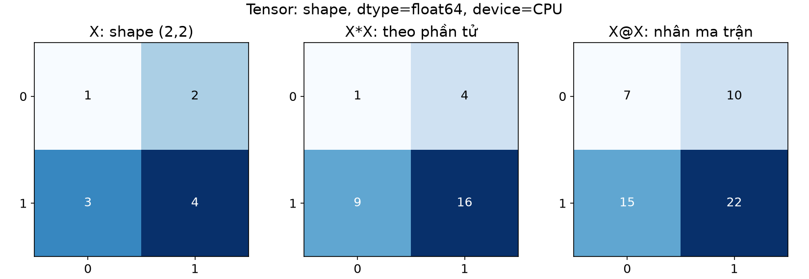
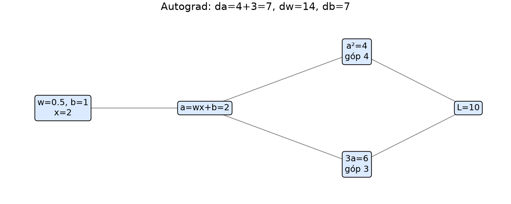
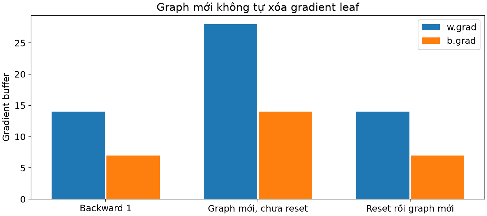
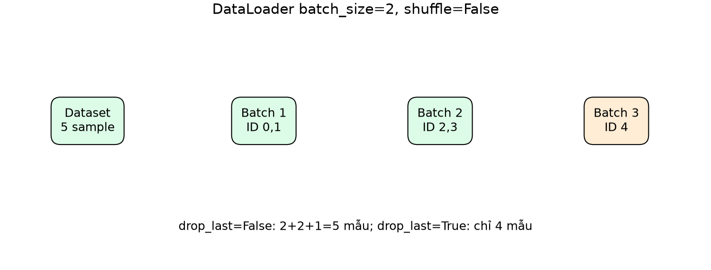

# Bài 11 — PyTorch, tensor, autograd và DataLoader

[Mục lục](../README.md) · [Bài 10](../10-chain-rule-computational-graph-backpropagation/README.md) · [Bài tập](exercises.md) · [Lời giải](solutions.md)

Biên soạn ngày 04/11/2026. Dữ liệu tự tạo; không tải dataset ngoài. Bài dùng PyTorch thật trên CPU. Trọng tâm là hiểu hợp đồng dữ liệu và cơ chế tự vi phân, nối trực tiếp với NumPy ở bài 10. Các số liệu thực hành chỉ là điểm train của ví dụ giảng dạy.

## 1. Mục tiêu và cách học

Sau bài này, bạn có thể tạo tensor đúng shape/dtype/device, chuyển trọng số từ quy ước NumPy sang `nn.Linear`, kiểm chứng autograd bằng tính tay, viết Dataset và đọc batch từ DataLoader. Bạn cũng phân biệt được `backward`, `step`, `zero_grad`, `eval` và `no_grad`.

Cần hiểu forward/backprop bài 9–10. Đọc phần 2–7 trước; phần 8–11 kết nối dữ liệu với một vòng học nhỏ. Vòng train/eval đầy đủ, checkpoint và giao thức đánh giá sẽ được phát triển ở bài 12. Không cần GPU để học bài này.

## 2. PyTorch thay phần nào của code NumPy?

PyTorch cung cấp tensor, các phép tính, module có tham số, công cụ autograd và tiện ích dữ liệu. Công thức toán không đổi: `loss.backward()` tính gradient theo chain rule thay cho các dòng gradient viết tay; optimizer dùng gradient để cập nhật.

| Bài 10 | PyTorch trong bài này |
|---|---|
| Mảng NumPy và matmul | `torch.Tensor`, `@`, `torch.relu` |
| Dict W, b | `nn.Linear`, `nn.Module`, `model.parameters()` |
| Gradient viết tay | Graph được ghi và `loss.backward()` |
| Bước gradient descent | `torch.optim.SGD(...).step()` |
| Tự chọn hàng thành batch | `Dataset` và `DataLoader` |

Thư viện không tự chọn nhãn, phép chia dữ liệu hay metric phù hợp. Autograd đúng không chứng minh dữ liệu không rò rỉ. Nguồn: [PyTorch Learn the Basics](https://docs.pytorch.org/tutorials/beginner/basics/intro.html).

## 3. Tensor: giá trị đi kèm shape, dtype, device

Tensor là mảng nhiều chiều. `shape` nói kích thước trục, `dtype` nói kiểu biểu diễn, `device` nói nơi lưu và tính. `requires_grad` cho biết tensor có yêu cầu theo dõi gradient hay không; đây không phải trục hoặc dtype mới.

```python
import torch
X=torch.tensor([[1.,2.],[3.,4.]],dtype=torch.float64)
print(X.shape,X.dtype,X.device)
print(X*X)
print(X@X)
```

Tính tay: `X*X=[[1,4],[9,16]]`; `X@X=[[7,10],[15,22]]`. Nhân phần tử khác nhân ma trận dù cùng shape output.

Mặc định số thực thường được tạo thành float32, danh sách số nguyên thành int64. Bài chủ động dùng float64 để đối chiếu gradient nhỏ với bài 10; không khẳng định float64 luôn phù hợp nhất khi huấn luyện lớn. Feature đưa vào Linear cần kiểu thực tương thích weight. Nhãn BCE là số thực đúng shape logit; class ID cho cross-entropy thường là `torch.long` và có hợp đồng khác.



*Một tensor 2×2: các trục và phép toán phải có nghĩa trước khi xem kết quả.*

### CPU và accelerator

Lab cố định CPU để dễ tái lập và không yêu cầu phần cứng đặc biệt. Khi chuyển sang thiết bị khác, cần chuyển cả model lẫn batch và dùng dtype được backend hỗ trợ: `model.to(device)`, `X=X.to(device)`. `.to(...)` có thể trả tensor mới; gọi mà bỏ kết quả không bảo đảm biến cũ đã chuyển. Seed không bảo đảm kết quả giống hệt mọi phiên bản/backend. Bài chưa kiểm chứng CUDA/MPS. [Tensors](https://docs.pytorch.org/tutorials/beginner/basics/tensorqs_tutorial.html)

## 4. Shape và bộ nhớ: tránh lỗi hợp lệ nhưng sai ý định

Một mẫu 2 feature vẫn có shape `(1,2)` khi qua Linear. Logit binary `(n,1)` cần target `(n,1)` trong BCE của bài. `squeeze()` không chỉ định trục có thể làm mất batch khi n=1; dùng `squeeze(-1)` nếu chủ đích lấy `(n,)`, hoặc giữ cả prediction và target dạng cột.

`reshape` đổi hình dạng nhưng không tự đổi ý nghĩa trục; có thể trả view hoặc bản sao. Một số slicing tạo view dùng chung bộ nhớ. `torch.tensor(numpy_array)` tạo bản sao, còn `torch.from_numpy` dùng chung bộ nhớ với mảng NumPy tương thích trên CPU.

```python
import numpy as np
import torch
source=np.array([1.,2.])
shared=torch.from_numpy(source)
copied=torch.tensor(source)
source[0]=9
print(shared,copied)  # [9,2] và [1,2]
```

`detach()` ngắt quan hệ autograd nhưng không tự tạo bản sao dữ liệu độc lập. Nếu cần snapshot không theo dõi gradient và không chia sẻ storage, dùng `tensor.detach().clone()`. Không sửa in-place tensor chia sẻ bộ nhớ mà backward còn cần; autograd có thể báo lỗi, hoặc thay đổi dữ liệu làm phép kiểm không còn cùng trạng thái.

## 5. Autograd từ graph đã tính tay

Dùng lại graph bài 10: x=2, w=0.5, b=1, a=wx+b, L=a²+3a. Forward cho a=2, L=10. Hai nhánh góp 4 và 3 nên dL/da=7, dL/dw=14, dL/db=7.

```python
import torch
w=torch.tensor(.5,dtype=torch.float64,requires_grad=True)
b=torch.tensor(1.,dtype=torch.float64,requires_grad=True)
a=w*2+b
a.retain_grad()
loss=a.square()+3*a
loss.backward()
print(loss.item(),a.grad.item(),w.grad.item(),b.grad.item())
```

Kết quả phải là `10,7,14,7`. w, b là **leaf tensor** được tạo để tối ưu; a là trung gian có `grad_fn`. Trung gian vẫn tham gia backprop dù `.grad` thường không được giữ mặc định; `retain_grad()` ở đây chỉ để quan sát a.grad. `loss.item()` lấy số Python để ghi log, không còn graph để gọi backward trên số ấy.



*Autograd cộng hai đường về a; không thử mỗi weight±epsilon.*

Autograd là automatic differentiation, không phải sai phân số và không phải optimizer. `backward()` tính gradient; nó không tự sửa w, b hay chọn learning rate. Với output không scalar cần chỉ rõ gradient từ phía sau hoặc giảm thành loss scalar có nghĩa. [Autograd tutorial](https://docs.pytorch.org/tutorials/beginner/basics/autogradqs_tutorial.html)

## 6. Graph và bộ đệm gradient có vòng đời khác nhau

Mỗi forward thông thường ghi graph mới. Sau backward, các trung gian cần thiết thường được giải phóng; gọi backward lần nữa trên cùng graph có thể báo lỗi. `retain_graph=True` giữ graph khi thật sự cần, không phải cách mặc định sửa lỗi vòng train.

Trong khi đó `.grad` ở leaf được **cộng dồn**. Nếu tính một forward mới cùng w, b rồi backward mà chưa xóa gradient, ví dụ trên cho w.grad=28, b.grad=14. Xóa bằng `optimizer.zero_grad(set_to_none=True)` trước batch mới rồi backward thì trở lại 14 và 7 nếu parameter chưa cập nhật.



*Ví dụ tính các graph mới với cùng parameter; không gọi backward lại vào graph đã giải phóng.*

`None` sau zero_grad không phải tensor 0: đó là chưa có gradient được lưu. Gradient bằng 0 có thể là kết quả tính thật, còn None có thể do chưa backward hoặc parameter không nằm trên đường loss. Không suy chỉ từ None rằng thư viện bị lỗi.

## 7. Chuyển mạng bài 10 sang nn.Linear

Lab dùng mạng 2→2→1 với ReLU và trọng số đặt giống bài 10 để kiểm toán. NumPy lưu W `(in,out)`, PyTorch Linear lưu weight `(out,in)` và tính `X @ weight.T + bias`. Vì vậy phải transpose weight khi chuyển; bias vẫn theo số output.

```python
from lab import hand_model
import torch
model=hand_model()
X=torch.tensor([[1.,2.],[-1.,1.]],dtype=torch.float64)
print(model(X))  # [[1.5],[-1.5]]
```

Với y cột `[1,0]`, mean BCE=0.201413278. Đặt q=σ(−1.5): gradient weight lớp1 theo **layout PyTorch** là `[[-q,-2q],[q,q/2]]`, bias1=`[-q,0]`; weight lớp2=`[[-q/2,q/2]]`, bias2 gần0. Đây là transpose của các weight gradient bài 10, không phải công thức mới.

Có thể kiểm từng bước trước khi chạy code:

1. Sau Linear đầu, Z₁=`[[1,1],[-1.5,2]]`; sau ReLU, H=`[[1,1],[0,2]]`.
2. Logit z=`H @ [[2],[-1]] + 0.5 = [[1.5],[-1.5]]`. Hai mẫu đều có BCE bằng `−log(1−q)`, nên mean cũng bằng 0.201413278.
3. Với mean loss trên hai mẫu, gradient theo logit là δ=`(sigmoid(z)−y)/2 = [[−q/2],[q/2]]`. Hệ số 1/2 đến từ phép lấy mean.
4. Gradient weight cuối là `δ.T @ H = [[−q/2,q/2]]`; gradient bias cuối là tổng δ bằng 0.
5. Truyền về hidden: `δ @ [[2,−1]]`, rồi nhân mask `Z₁>0`, được D=`[[−q,q/2],[0,−q/2]]`. Gradient weight đầu là `D.T @ X`, bias đầu là tổng D theo trục mẫu, đúng các kết quả ở trên.

Dùng `.T` và kiểm shape ở mỗi bước giúp thấy vì sao gradient có đúng shape của parameter. Không có pre-activation nào bằng 0 trong ví dụ nên không cần lựa chọn đạo hàm tại điểm gãy ReLU.

`hand_backward()` kiểm cả bốn tensor gradient bằng `torch.testing.assert_close`. Sau SGD lr=0.1, forward mới cho BCE≈0.177846597. Code dùng `torch.no_grad()` khi copy trọng số đặt tay; không dùng nó bao quanh forward tạo loss cần backward. [Linear API](https://docs.pytorch.org/docs/2.15/generated/torch.nn.Linear.html)

`nn.BCEWithLogitsLoss` nhận logit và đã kết hợp sigmoid; chỉ sigmoid để diễn giải xác suất khi cần. Không sigmoid hai lần. [BCEWithLogitsLoss](https://docs.pytorch.org/docs/2.15/generated/torch.nn.BCEWithLogitsLoss.html)

## 8. Dataset và DataLoader có trách nhiệm gì?

**Dataset** định nghĩa một mẫu và cách lấy mẫu. Dataset dạng map trong bài có `__len__` trả số mẫu, `__getitem__(index)` trả `(x,y)`. **DataLoader** lấy các mẫu theo sampler/thứ tự, gộp thành batch và cho phép lặp.

`TinyDataset` có 5 mẫu x=0, 1, 2, 3, 4 và y=2x+1. Một sample x, y đều shape `(1,)`; collate mặc định gộp hai sample thành X, y shape `(2,1)`.

```python
from lab import make_loader
for X,y in make_loader():
    print(X.shape,y.shape,X[:,0].tolist())
```

Không shuffle, batch size2 và `drop_last=False`: ID `[0,1]`, `[2,3]`, `[4]`, kích thước2, 2, 1. Có3 batch, không phải5 và không phải mọi batch đều đủ2 mẫu. Với `drop_last=True`, còn2 batch, mẫu4 không được dùng trong lượt này.



*Drop last thay tập mẫu được xử lý; không chỉ thay hình thức trình bày.*

`shuffle=True` đổi thứ tự lấy mẫu trong tập đã chọn, **không chia train/test**, không tách user trùng và không sửa leakage. Lab truyền generator có seed, num_workers=0 để tránh multiprocessing làm khó bước nhập môn. Tăng worker không bảo đảm nhanh hơn; dữ liệu nhỏ trong RAM có thể không hưởng lợi. Với nhiều worker, random transform và IterableDataset cần thiết kế seed/phân chia dữ liệu riêng; chưa kiểm chứng ở đây. [Datasets & DataLoaders](https://docs.pytorch.org/tutorials/beginner/basics/data_tutorial.html)

## 9. Tính tay loss khi batch cuối nhỏ

Với predictor cố định y_hat=0 trên năm target `[1,3,5,7,9]`, squared errors là `[1,9,25,49,81]`.

- Mean loss từng batch2, 2, 1 là5, 37, 81.
- Mean của ba batch mean=(5+37+81)/3=41 — **không phải mean trên mẫu**.
- Mean trên năm mẫu=(2×5+2×37+1×81)/5=33.

Nếu drop_last, chỉ còn bốn mẫu, mean=(1+9+25+49)/4=21; đó là metric trên một tập khác. Khi log metric toàn epoch, cộng `loss.item()*batch_size`, rồi chia số mẫu thực sự đã xử lý, với loss mean mỗi mẫu đúng như ví dụ này. Nếu loss giảm qua nhiều token/pixel/weight, cần dùng denominator phù hợp định nghĩa, không áp công thức sample máy móc.

Khi model được update giữa batch, loss ghi ngay lúc training đến từ nhiều trạng thái model khác nhau. Nó không bằng loss cuối epoch của model đã chốt. Lab đo lại MSE trên cả năm mẫu sau mỗi epoch bằng một model cố định.

## 10. Vòng học nhỏ: optimizer dùng gradient

Lab fit Linear(1, 1), khởi tạo w=b=0, SGD lr=0.05, MSE, batch size2, shuffle có seed, 100 epoch. Có3 update/epoch nên tổng300 update. Đây là minh họa plumbing Dataset→batch→model→loss→backward→step; không có validation/test hoặc chọn hyperparameter.

```python
from lab import train_toy
model,history=train_toy()
print(history[0],history[-1])
print(model.weight,model.bias)
```

Ban đầu mean MSE=33. Sau 100 epoch trên môi trường đã kiểm: MSE≈1.889×10⁻¹⁰, w≈2.000002206, b≈0.999982204. Cấu trúc dữ liệu đúng đường y=2x+1 nên nghiệm lý tưởng w=2, b=1 đạt MSE0. Kết quả hữu hạn bước cần đọc từ code đã chạy, không mặc định bằng0 tuyệt đối. Seed không là cam kết mọi phiên bản/backend giống từng bit.

Thứ tự mỗi batch trong lab:

1. `optimizer.zero_grad(set_to_none=True)`.
2. `prediction=model(X)` và `loss=criterion(prediction,y)`.
3. `loss.backward()`.
4. `optimizer.step()`.

`model.parameters()` trả các Parameter đã đăng ký trong module. Việc tạo tensor requires_grad=True rời rạc không tự đưa nó vào optimizer của model. Không thay Parameter sau khi tạo optimizer rồi mặc định optimizer tự theo tensor mới.

## 11. eval và no_grad là hai công tắc khác nhau

`model.train()`/`model.eval()` đổi chế độ hoạt động của những module có hành vi phụ thuộc mode, như Dropout/BatchNorm. Chúng không tự bật/tắt autograd. Với Linear/ReLU trong bài, eval không đổi công thức forward.

`torch.no_grad()` tắt ghi graph cho các phép toán trong context, hữu ích khi đo/suy luận. Nó không tự gọi eval. Cách đo thông thường kết hợp cả `model.eval()` và `with torch.no_grad():`.

Trong mode `modes`, gọi eval rồi forward vẫn có requires_grad=True do parameter cần grad; forward trong no_grad làFalse; ra khỏi context, forward mới lạiTrue. Bài chưa thực nghiệm Dropout/BatchNorm, nên không suy từ Linear rằng eval không bao giờ thay dự đoán.

## 12. Môi trường và lệnh chạy

Đã kiểm với Python 3.14.6, PyTorch 2.15.0, NumPy 2.5.4 trên macOS arm64, **CPU**, float64. Phụ thuộc ghi trong [requirements.txt](requirements.txt). Từ thư mục bài 11:

```bash
python3 -m venv .venv
.venv/bin/python -m pip install -r requirements.txt
.venv/bin/python lab.py --mode all
```

Windows dùng `.venv\Scripts\python`. Bản ghim cần Python/OS có wheel tương thích; hướng cài cho CUDA/thiết bị khác cần theo [trang cài chính thức](https://pytorch.org/get-started/locally/). Không dùng nhãn “latest” trên một trang làm thay phiên bản đã thực sự kiểm tra.

Các mode: `tensor`, `autograd`, `hand`, `loader`, `train`, `modes`, `all`. Ví dụ `python3 lab.py --mode hand`. Từ gốc bộ tài liệu dùng `11-pytorch-tensor-autograd-dataloader/lab.py`. Không cần torchvision hay dataset tải ngoài.

Hình có sẵn PNG/SVG trong [figures](figures/); tái tạo bằng:

```bash
.venv/bin/python -m pip install -r requirements-figures.txt
.venv/bin/python make_figures.py
```

Mã [make_figures.py](make_figures.py) dùng Matplotlib 3.11.2 và các mảng/kết quả lab, không sao chép hình nguồn. Môi trường ảo không nằm trong gói chia sẻ.

## 13. Tự đánh giá và học tiếp

Làm [10 bài tập](exercises.md) rồi đọc [lời giải](solutions.md). Cần giải thích được weight transpose, gradient tích lũy, batch cuối và phép tính33; phân biệt eval/no_grad và xác định đúng phần nào optimizer cập nhật.

**Học tiếp:** [Bài 12 — Vòng train/eval, validation, checkpoint và theo dõi thí nghiệm](../12-train-eval-validation-checkpoint/README.md). [Nguồn và phạm vi đã đọc](../SOURCES.md).
