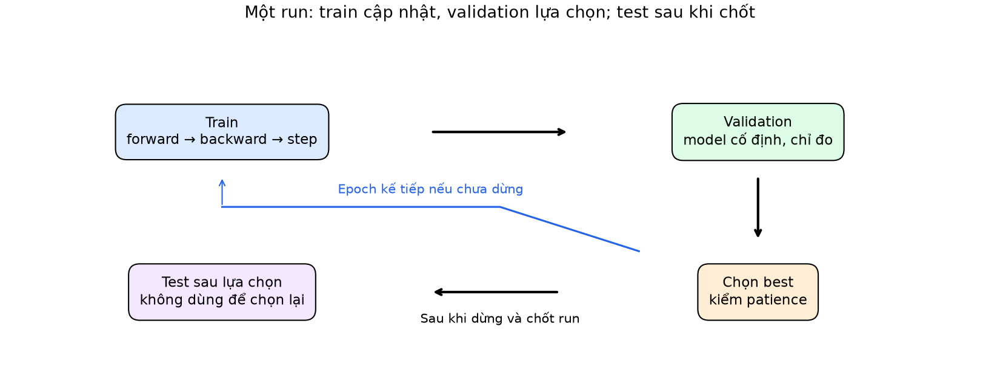
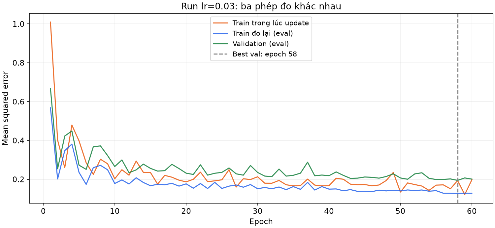
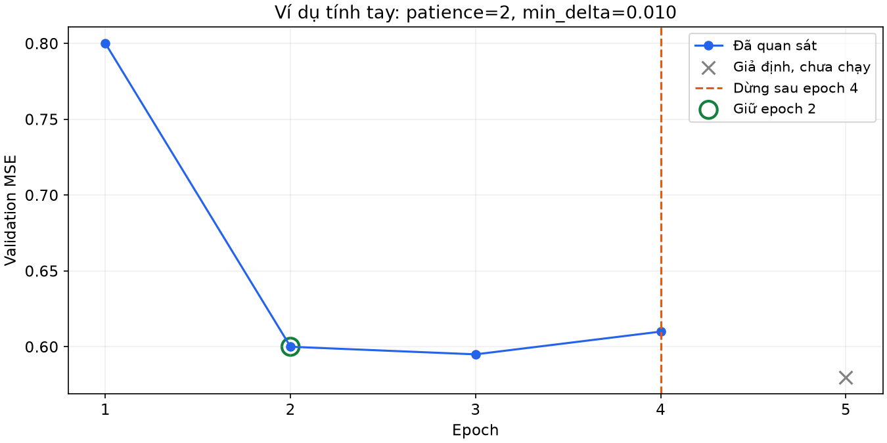
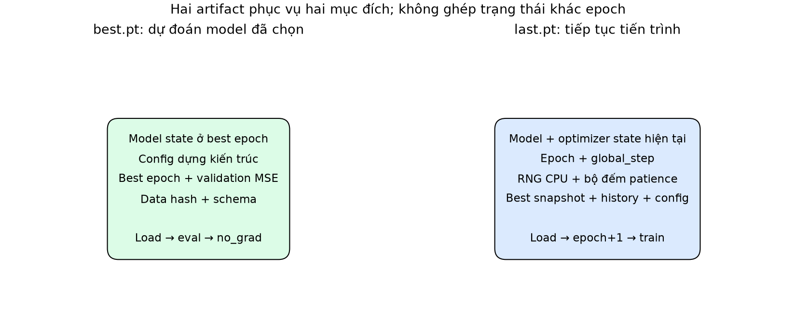
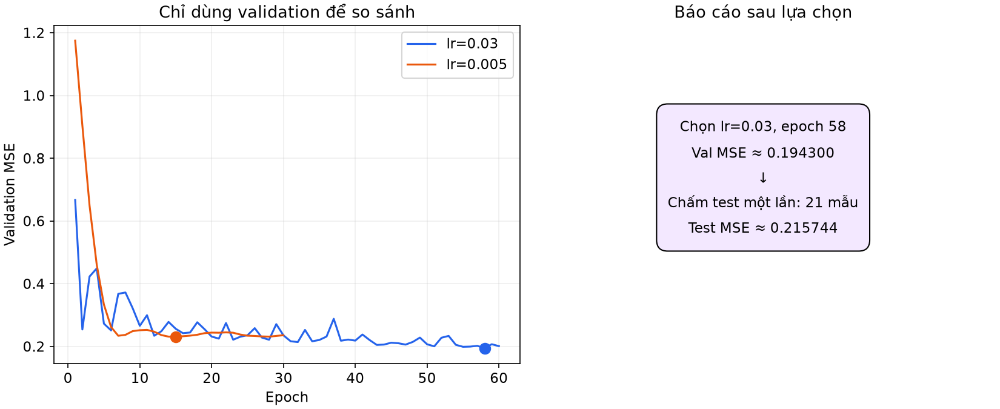

# Bài 12 — Vòng train/eval, validation, checkpoint và theo dõi thí nghiệm

[Mục lục](../README.md) · [Bài 11](../11-pytorch-tensor-autograd-dataloader/README.md) · [Bài tập](exercises.md) · [Lời giải](solutions.md)

Biên soạn ngày 04/11/2026. Bổ sung định nghĩa tường minh các khái niệm quản lý vòng đời huấn luyện (Training/Eval Loop, Epoch vs Step, 3 loại đường cong Loss, Early Stopping, Checkpoint State, Atomic Save & Resume, Experiment Tracking...), kèm trực giác kỹ thuật và cẩm nang MLOps cho AI Engineer; toàn bộ ví dụ giải tích, công thức tính tay, bảng so sánh và code kiểm toán gốc được giữ nguyên vẹn 100% để đối chiếu chuẩn. Ví dụ tự tạo, chạy PyTorch thật trên CPU; không cần GPU, dữ liệu ngoài hoặc tài khoản theo dõi thí nghiệm. Bài nối từ thao tác tensor/autograd ở bài 11 sang một thí nghiệm có thể kiểm tra, dừng và khôi phục.

## 1. Mục tiêu và kiến thức cần trước

Sau bài này, bạn có thể viết hai hàm train/eval có trách nhiệm rõ; dùng validation chọn epoch và cấu hình; lưu `best.pt` để dự đoán và `last.pt` để học tiếp; đọc log để giải thích một kết quả. Bạn sẽ thực hiện hai phép kiểm: dự đoán trước/sau lưu tải bằng nhau, và chạy liền mạch bằng chạy bị ngắt rồi khôi phục trong phạm vi môi trường đã kiểm.

Cần biết bài 5 về split/leakage, bài 6 về MSE và bài 11 về `backward`, optimizer, Dataset/DataLoader. Đọc phần 2–8 rồi chạy các mode `hand`, `modes`; tiếp theo đọc checkpoint và chạy `study`, `resume`. Các phép tính tay dùng mô hình tuyến tính nhỏ; thí nghiệm chính dùng MLP để thấy cả Dropout và trạng thái optimizer.

## 2. Một thí nghiệm là gì?

Với tư duy backend, một run giống một lần thực thi job có input, cấu hình, trạng thái và artifact đầu ra. Nhưng chất lượng mô hình còn phụ thuộc **cách chọn kết quả**: nếu liên tục xem test để quyết định, số test không còn là phép đánh giá giữ riêng ban đầu.

| Thành phần | Câu hỏi cần trả lời |
|---|---|
| Dữ liệu và split | Hàng nào ở train, validation, test? Có chung user hoặc nhìn trước tương lai không? |
| Cấu hình | Kiến trúc, optimizer, learning rate, batch size, seed, số epoch tối đa? |
| Vòng học | Khi nào sửa tham số, khi nào chỉ đo? |
| Quy tắc chọn | Metric gì, tăng hay giảm tốt hơn, khi hòa chọn ai? |
| Artifact | Trọng số nào là best, checkpoint nào đủ để resume? |
| Log và môi trường | Người khác biết cách chạy lại và giải thích kết quả không? |

Một epoch là một lượt đi qua train loader; một step trong lab là một lần optimizer cập nhật. Với 48 mẫu, batch size 16, không bỏ batch cuối: 3 step/epoch. 60 epoch đầy đủ là 180 step. Validation không làm tăng số optimizer step.



*Chỉ train sửa tham số; validation điều khiển lựa chọn. Test chấm cấu hình và checkpoint đã chốt.*

> [!NOTE]
> ### 💡 Bảng từ điển định nghĩa: Các đại lượng vòng đời huấn luyện (Lifecycle)
> 
> - **Thí nghiệm (Experiment / Study)**: Một chiến dịch nghiên cứu gồm nhiều lần chạy (Runs) nhằm trả lời một câu hỏi kỹ thuật cụ thể (ví dụ: *"Learning rate nào và độ sâu nào giúp mô hình MLP dự báo latency tốt nhất?"*).
> - **Lần chạy (Run)**: Một phiên thực thi huấn luyện đơn lẻ từ đầu đến cuối với một bộ siêu tham số (Hyperparameters / Config) cố định.
> - **Epoch**: Một chu kỳ quét trọn vẹn qua toàn bộ tập dữ liệu huấn luyện ($N_{\text{train}}$ mẫu).
> - **Step / Iteration (Bước tối ưu)**: Một lần thực hiện cập nhật trọng số của Optimizer (`optimizer.step()`) trên một mẻ (batch) dữ liệu.
>   $$\text{Số steps trong 1 Epoch} = \lceil \frac{N_{\text{train}}}{\text{batch\_size}} \rceil$$
> - **Artifact**: Toàn bộ các tệp tin sản phẩm sinh ra sau một Run (file trọng số `.pt`, file log `.csv`, cấu hình `.json`, báo cáo `.json`).
> 
> ---
> 
> ### 💡 Ẩn dụ đời thường: Chu kỳ ôn thi tốt nghiệp THPT
> - **Mỗi Epoch** giống như việc bạn đọc xong trọn vẹn toàn bộ một lượt cuốn sách giáo khoa ôn thi.
> - **Mỗi Step** giống như việc bạn làm xong một bài tập nhỏ trong sách, nhìn đáp án và tự rút kinh nghiệm.
> - **Huấn luyện 60 Epoch** nghĩa là bạn đã "cày nát" cuốn sách giáo khoa đó 60 lượt liên tiếp!

## 3. Tách train và evaluate từ nền tảng

Huấn luyện tối thiểu một batch gồm: chuyển mode train → xóa gradient cũ → forward → loss → backward → optimizer step. `model.train()` tự nó không huấn luyện nếu bạn không tính loss và cập nhật.

Hàm `train_epoch` trong [lab.py](lab.py) chạy đúng thứ tự này. Nó trả loss đo trong lúc học và số update; hàm không chọn checkpoint, không chấm test. Loss không hữu hạn làm dừng sớm với lỗi để người học tìm nguyên nhân, thay vì âm thầm chọn một checkpoint hỏng.

Hàm `evaluate` có `@torch.no_grad()` và gọi `model.eval()`. Nó chỉ đọc model, cộng sai số trên tất cả batch rồi chia đúng số mẫu thực tế. Nó không gọi backward, không gọi optimizer và không đổi weight. Nó để model ở mode eval sau khi trả về; đầu `train_epoch` kế tiếp chủ động gọi lại train.

```python
from lab import Config, make_data, make_loader, make_model, evaluate
config = Config()
data, split, fingerprint = make_data(config)
model = make_model(config)
val_mse = evaluate(model, make_loader(data['validation'], config))
print(len(data['validation']), val_mse)  # 21 mẫu; model này chưa huấn luyện
```

Ví dụ nối các hàm thành một epoch thực sự; mỗi hàm được định nghĩa đầy đủ trong lab:

```python
import torch
from lab import Config, make_data, make_loader, make_model, train_epoch, evaluate
config = Config()
torch.manual_seed(config.seed)
data, _, _ = make_data(config)
model = make_model(config)
optimizer = torch.optim.SGD(model.parameters(), lr=config.lr, momentum=config.momentum)
online, steps = train_epoch(model, make_loader(data['train'], config, epoch=1, training=True), optimizer)
train_end = evaluate(model, make_loader(data['train'], config))
val_end = evaluate(model, make_loader(data['validation'], config))
print(steps, online, train_end, val_end)  # 3 update; validation không gọi optimizer
```

Trong thực nghiệm nhiều epoch, vòng ngoài `fit` lặp khối này, so validation với best, ghi log/checkpoint rồi quyết định tiếp tục hoặc dừng. Nó không đưa validation vào loss để backward.

Cấu trúc tách hai vòng phù hợp với [hướng dẫn tối ưu của PyTorch](https://docs.pytorch.org/tutorials/beginner/basics/optimization_tutorial.html). Nguồn gọi vòng đo theo epoch là test loop; trong bài này, dữ liệu được xem để chọn mô hình mang vai trò **validation**. Tên hàm không quyết định vai trò thống kê của tập dữ liệu.

> [!NOTE]
> ### 💡 Phân định trách nhiệm: Vòng lặp Huấn luyện (Train) vs Vòng lặp Đánh giá (Eval)
> 
> - **Vòng lặp Huấn luyện (Training Loop)**:
>   - *Tập dữ liệu*: Tập Train (`data['train']`).
>   - *Trạng thái*: Bắt buộc gọi `model.train()` để kích hoạt các cơ chế học (Dropout ngắt kết nối ngẫu nhiên để chống overfit, BatchNorm tính mean/variance động).
>   - *Nhiệm vụ*: Tính toán đạo hàm (`loss.backward()`) và cập nhật trọng số (`optimizer.step()`).
> - **Vòng lặp Đánh giá (Evaluation Loop)**:
>   - *Tập dữ liệu*: Tập Validation hoặc Test.
>   - *Trạng thái*: Bắt buộc gọi `model.eval()` và bọc trong `@torch.no_grad()` (tắt hoàn toàn Dropout, đóng băng BatchNorm, ngắt bộ nhớ Autograd để tăng tốc).
>   - *Nhiệm vụ*: Chỉ đọc mô hình và tính toán độ đo hiệu năng khách quan. **Tuyệt đối cấm kỵ gọi `backward()` hay `optimizer.step()`!**
> 
> ---
> 
> ### 💡 Ẩn dụ đời thường: Giải bài tập về nhà vs Thi thử hàng tuần
> - **Training**: Bạn ngồi ở nhà tự giải bài tập, được quyền mở sách xem đáp án, gạch xóa và sửa sai thoải mái.
> - **Validation**: Kỳ thi thử hàng tuần ở trường. Bạn không được mở sách giải (`no_grad`), thầy cô chỉ chấm điểm để xem bạn tiến bộ đến đâu và quyết định bạn có cần ôn luyện thêm không. Nếu bạn vừa thi thử vừa mở lời giải ra chép (`train trên tập validation`), điểm số thi thử sẽ bị "ảo" và bạn chắc chắn sẽ trượt kỳ thi thật (Test)!

## 4. Ví dụ tính tay một bước train và một lượt eval

Dùng hai mẫu `(x,y)=(0,1),(1,3)`, mô hình ŷ=wx+b, ban đầu w=b=0. MSE là mean bình phương sai số, không có hệ số 1/2:

\[
L=\frac{(b-1)^2+(w+b-3)^2}{2}.
\]

Forward cho L=(1+9)/2=5. Gradient:

\[
\frac{\partial L}{\partial w}=w+b-3=-3,\quad
\frac{\partial L}{\partial b}=(b-1)+(w+b-3)=-4.
\]

SGD learning rate 0.1, không momentum trong ví dụ này: w mới=0−0.1×(−3)=0.3; b mới=0.4. Đo lại với model mới, dự đoán là 0.4 và 0.7. MSE=(0.36+5.29)/2=**2.825**.

Con số 5 là loss trước cập nhật; 2.825 là loss sau cập nhật trên cùng hai mẫu. Chúng không mâu thuẫn. Đây là tính tay về cơ chế, **chưa phải validation giữ riêng**, vì vẫn dùng chính hai mẫu train. Mode `hand` kiểm gradient −3, −4 và kết quả 2.825 bằng code.

## 5. Ba đường loss thường bị đọc lẫn

Lab ghi ba cột:

| Cột | Đo khi nào, ở mode nào? | Ý nghĩa |
|---|---|---|
| `train_online_mse` | Trong batch train, trước update của batch đó; Dropout bật | Trung bình có trọng số của loss qua nhiều trạng thái model |
| `train_eval_mse` | Cuối epoch, model cố định, mode eval | Sai số trên train của model cuối epoch |
| `val_mse` | Cuối epoch, cùng model cố định, mode eval | Sai số trên validation để lựa chọn |

Dropout bật khi train còn tạo thêm khác biệt giữa hai cột train. Không cần ép `train_online_mse` lớn hơn `train_eval_mse` ở mọi epoch. Ngay cả khi không có Dropout, model đã thay đổi giữa các batch nên hai số vẫn có thể khác.

Với batch cuối nhỏ, không lấy mean các batch mean tùy ý. Ví dụ ba squared error `[1,9,25]`, chia batch 2 và 1: batch mean là 5 và 25. Mean của hai số này là 15; mean trên ba mẫu đúng là (1+9+25)/3=**35/3≈11.666667**. Trong lab, mỗi mẫu có đúng một target scalar nên tổng squared error chia số mẫu là MSE. Với multi-output, mask, token hoặc sample weight cần xác định lại denominator.



*Đường cong lấy từ run lr=0.03 thực sự đã chạy. Vạch đánh dấu checkpoint được chọn theo validation, không theo điểm train thấp nhất.*

Khoảng cách train/validation có thể gợi ý overfit, khác phân bố, nhiễu hoặc mẫu nhỏ; một hình không đủ xác định nguyên nhân. Không phải mọi lần validation tăng đều là lỗi code.

> [!NOTE]
> ### 💡 Trực giác AI Engineer: Giải mã 3 đường cong Loss & Nhận diện Overfitting
> 
> - **Tại sao `train_online_mse` và `train_eval_mse` lại khác nhau dù cùng đo trên tập Train?**:
>   1. **Trạng thái mô hình khác nhau**: `train_online_mse` được tính bằng cách ghép các batch lại khi mô hình đang thay đổi liên tục sau mỗi step; trong khi `train_eval_mse` đo lại trên mô hình đã chốt cứng ở cuối epoch.
>   2. **Dropout tác động**: Trong lúc train online, Dropout ngắt ngẫu nhiên $15\%$ nơ-ron khiến mạng bị "khuyết tật" tạm thời, làm loss bị đẩy lên cao hơn. Khi chuyển sang eval, toàn bộ nơ-ron hoạt động trở lại bình thường, khiến `train_eval_mse` thường tụt xuống thấp hơn!
> 
> - **Chẩn đoán Overfitting (Học vẹt) & Underfitting (Học chưa tới)**:
>   - **Underfitting**: Cả 2 đường `train_loss` và `val_loss` đều cao và nằm bẹt dí $\rightarrow$ Mô hình quá nông, quá yếu, hoặc learning rate quá bé chưa học tới nơi.
>   - **Vùng lý tưởng (Sweet Spot)**: Cả `train_loss` và `val_loss` đều giảm đều đặn song hành cùng nhau.
>   - **Overfitting**: `train_loss` tiếp tục lao dốc xuống sát $0$, nhưng `val_loss` bắt đầu **bẻ cong quay đầu đi lên** $\rightarrow$ Mô hình bắt đầu học thuộc lòng từng hạt nhiễu của tập Train. Đây là thời điểm vàng cần bấm chuông dừng cuộc chơi (**Early Stopping**)!

## 6. train/eval và no_grad: thực nghiệm Dropout

Dropout p=0.5 trên vector toàn 1: trong train, mỗi phần tử được bỏ với xác suất 0.5, phần còn lại được nhân 1/(1−p)=2. Vì vậy một lần forward có các giá trị 0 hoặc 2. Trong eval, Dropout trả nguyên input toàn 1.

```python
import torch
from torch import nn
layer = nn.Dropout(0.5)
x = torch.ones(32, requires_grad=True)
layer.train()
with torch.no_grad():
    print(layer(x))  # Vẫn có dropout dù không ghi graph
layer.eval()
print(layer(x))      # Toàn 1; vẫn có thể theo dõi gradient
```

Mode `modes` dùng seed cố định kiểm đúng hai tính chất này. Cách scale được đối chiếu với [Dropout API](https://docs.pytorch.org/docs/2.15/generated/torch.nn.Dropout.html). Đừng suy rằng mọi module đổi output ở eval: Linear không có khác biệt mode. Bài không thực nghiệm BatchNorm; khi dùng module đó còn phải quan tâm running statistics. Quy tắc API: [Module.eval](https://docs.pytorch.org/docs/2.15/generated/torch.nn.Module.html#torch.nn.Module.eval).

## 7. Validation chọn checkpoint như thế nào?

Giả sử metric là MSE, **nhỏ hơn tốt hơn**. Sau mỗi epoch, chỉ lưu best nếu:

```text
current_val < best_val - min_delta
```

`min_delta` trong bài có đơn vị **MSE tuyệt đối**, không phải tỷ lệ %. Hòa không cải thiện. Quy tắc này đồng thời dùng để lưu best và reset bộ đếm early stopping; một số thư viện có quy ước khác nên cần đọc API khi chuyển công cụ.

**Ví dụ giả định tính tay:** validation lần lượt `[0.800,0.600,0.595,0.610,0.580]`, min_delta=0.010, patience=2. Khởi tạo best=∞:

| Epoch | Val MSE | Cải thiện đủ ngưỡng? | Best epoch | Số lượt không cải thiện | Dừng? |
|---|---:|---|---:|---:|---|
| 1 | 0.800 | Có | 1 | 0 | Chưa |
| 2 | 0.600 | Có | 2 | 0 | Chưa |
| 3 | 0.595 | Không: 0.595 không nhỏ hơn 0.590 | 2 | 1 | Chưa |
| 4 | 0.610 | Không | 2 | 2 | Có |

Dừng sau epoch 4, chọn epoch 2. Epoch 5 chưa được chạy; 0.580 chỉ là số giả định để làm rõ rằng early stopping không biết tương lai. Với min_delta>0, checkpoint được giữ có thể không phải minimum tuyệt đối của các giá trị đã thấy. Lab chính dùng min_delta=0 nên best là minimum đã quan sát, lấy epoch sớm hơn khi hòa.



*Patience đếm những lần validation liên tiếp chưa cải thiện đủ, không đếm tổng epoch. Lab đo validation mỗi epoch.*

Early stopping giới hạn việc tiếp tục học khi tiêu chí không cải thiện; nó không bảo đảm tối ưu hoặc test tốt nhất. Validation cũng bị dùng để lựa chọn nên score của người thắng có thể lạc quan. Không thử liên tục cấu hình mới chỉ vì không thích điểm test.

> [!NOTE]
> ### 💡 Định nghĩa: Thuật toán Dừng sớm (Early Stopping) & Ẩn dụ Vị huấn luyện viên kiên nhẫn
> 
> - **Định nghĩa Early Stopping**: Kỹ thuật điều khiển dừng quá trình huấn luyện một cách tự động khi độ đo hiệu năng trên tập Validation ngừng cải thiện sau một số lượng epoch liên tiếp định trước.
> - **Ba thông số cốt lõi**:
>   1. **Monitor Metric**: Chỉ số theo dõi (ví dụ: `val_loss` cần nhỏ hơn, `val_accuracy` cần lớn hơn).
>   2. **Patience (Độ kiên nhẫn)**: Số epoch liên tiếp chấp nhận mô hình "dậm chân tại chỗ" hoặc thụt lùi trước khi chính thức bấm chuông dừng cuộc chơi.
>   3. **Min Delta ($\Delta_{\text{min}}$)**: Ngưỡng cải thiện tối thiểu để được công nhận là một sự tiến bộ thực sự, tránh việc mô hình chỉ giảm được $0.000001$ mà vẫn reset bộ đếm kiên nhẫn.
> 
> ---
> 
> ### 💡 Ẩn dụ đời thường: Vị huấn luyện viên thể thao kiên nhẫn
> - Một vận động viên nhảy cao nhảy qua mức xà $2.0\text{m}$ ở hiệp thi đấu thứ 2 (**Kỷ lục Best Epoch = 2**).
> - Ở hiệp thứ 3, anh ta nhảy hỏng, chỉ đạt $1.99\text{m}$ (không tiến bộ $\rightarrow$ cảnh cáo lần 1: `bad_epochs = 1`).
> - Ở hiệp thứ 4, anh ta tiếp tục sa sút, chỉ đạt $1.98\text{m}$ (tiếp tục không tiến bộ $\rightarrow$ cảnh cáo lần 2: `bad_epochs = 2`).
> - Với mức kiên nhẫn quy định trước là `patience = 2`, vị huấn luyện viên lập tức thổi còi dừng buổi tập! Ông lấy thành tích tốt nhất ở hiệp thứ 2 ($2.0\text{m}$) làm đại diện đi thi đấu chính thức.

## 8. Chốt giao thức trước khi chạy

Thí nghiệm chính tự tạo 90 hàng: x phân bố đều trong [−1,1), y=sin(3x)+0.3x+ε, ε là nhiễu Gaussian độ lệch chuẩn 0.2. Dùng một generator riêng với data_seed=17 để tạo dữ liệu và hoán vị ID: 48 train, 21 validation, 21 test, không trùng hàng. Không có chuẩn hóa fit trên toàn dữ liệu; nếu thêm scaler, chỉ fit trên train và lưu cùng artifact.

MLP 1→16→1 dùng tanh, Dropout 0.15, CPU float64, SGD momentum 0.9, batch 16, không drop last. Cấu hình so sánh định trước: lr=0.03 và lr=0.005; cùng split và seed khởi tạo 2026; tối đa 60 epoch, patience 15, min_delta=0. Mỗi cấu hình chọn best epoch bằng validation; sau đó chọn run có best validation MSE nhỏ nhất. Nếu hòa chính xác, ưu tiên ứng viên đầu trong danh sách đã khai báo.

Mode `study` chỉ chấm **một lần trên test cho best checkpoint của run thắng**. Hàm `fit` không đọc test loader, không lưu test metric vào log theo epoch. Hàm tạo dữ liệu dựng sẵn cả ba tập để tiện minh họa; điều này khác dùng nhãn test cho lựa chọn. Trong hệ thống thực tế có thể khóa quyền truy cập test riêng.

Kết quả thực chạy trong môi trường phần 13:

| Run | Epoch đã chạy | Step | Best epoch | Best validation MSE |
|---|---:|---:|---:|---:|
| lr=0.03 | 60 | 180 | 58 | 0.194300365 |
| lr=0.005 | 30 | 90 | 15 | 0.230292046 |

Run lr=0.005 dừng vì 15 epoch liên tiếp sau best epoch 15 không cải thiện. Run lr=0.03 hết ngân sách 60 epoch, chưa chạm patience. Chọn checkpoint epoch 58 của lr=0.03, test MSE **0.215743741 trên 21 mẫu**. Kết quả này minh họa quy trình, không chứng minh learning rate đó tốt nhất nói chung, không là benchmark. Một seed và tập nhỏ không đủ ước lượng độ ổn định. So nhiều seed cần giao thức tổng hợp validation trước khi mở test; không chọn seed bằng test.

## 9. Checkpoint lưu gì?

Checkpoint là ảnh trạng thái đủ cho một mục đích khôi phục. File `.pt` chỉ là tên theo quy ước, không nói nó chứa những gì. `state_dict` của module chứa parameter và persistent buffer; nó không tự lưu toàn bộ kiến trúc, feature contract hoặc lịch sử huấn luyện. [Module.state_dict](https://docs.pytorch.org/docs/2.15/generated/torch.nn.Module.html#torch.nn.Module.state_dict)

| Artifact lab | Nội dung chính | Mục đích |
|---|---|---|
| `best.pt` | Weight/buffer best, config dựng kiến trúc, best epoch/val, data hash, schema | Tải model đã chọn để đo/dự đoán |
| `last.pt` | Model hiện tại, optimizer, epoch/step, RNG CPU, best snapshot/metric, bad_epochs, history, config, data hash | Tiếp tục từ ranh giới epoch vừa hoàn thành |

Best và last có thể trùng nhau nhưng không mặc định trùng. Resume từ last giữ trạng thái mới nhất của quá trình; phục vụ dự đoán dùng best đã chọn. Nếu resume từ best với optimizer của last, bạn đã ghép hai thời điểm khác nhau.



*Best phục vụ lựa chọn mô hình; last giữ tiến trình. Nếu muốn resume ngay từ best, cũng phải lưu trạng thái training đồng bộ ở epoch best.*

Không giữ best bằng `best = model.state_dict()` rồi tiếp tục train: các tensor trong dict còn tham chiếu storage của model. Lab dùng `copy.deepcopy(model.state_dict())` lúc cải thiện rồi ghi file. Việc gán dict không tự đóng băng tensor. `atomic_save` ghi file tạm cùng thư mục rồi rename để giảm rủi ro đọc dở một file; chưa phải giao thức bảo đảm lưu bền khi mất điện hoặc trên object storage.

Cách lưu/tải dict và optimizer được đối chiếu với [Saving and Loading Models](https://docs.pytorch.org/tutorials/beginner/saving_loading_models.html). Lab không pickle toàn bộ module; config và code vẫn cần để dựng model cùng cấu trúc.

> [!NOTE]
> ### 💡 Bảng định nghĩa: Phân biệt `best.pt` vs `last.pt` & Kỹ thuật Atomic Save
> 
> - **Phân biệt rạch ròi giữa `best.pt` và `last.pt`**:
>   - **`best.pt` (Dành cho Inference / Production)**:
>     - Chỉ lưu giữ ảnh chụp trọng số của mô hình tại thời điểm đạt đỉnh cao phong độ trên tập Validation (`model.state_dict()`).
>     - Tệp này nhỏ gọn, lược bỏ toàn bộ biến phụ trợ, sẵn sàng để đóng gói vào Docker container và deploy lên server API phục vụ người dùng.
>   - **`last.pt` (Dành cho Resume Training)**:
>     - Lưu giữ toàn bộ "hiện trường" tại thời điểm kết thúc epoch gần nhất để có thể nối lại quá trình học nếu server bị ngắt đột ngột (Spot instance bị thu hồi trên AWS, đứt kết nối mạng, cúp điện).
>     - Bắt buộc phải lưu đủ 5 thành phần: Trọng số mô hình (`model`), Bộ nhớ nội tại của Optimizer (`optimizer`), Vị trí bước học (`epoch`, `global_step`), Trạng thái sinh số ngẫu nhiên (`rng_state`), và Bộ đếm Dừng sớm (`best_metric`, `bad_epochs`).
> 
> - **Kỹ thuật Lưu an toàn nguyên tử (Atomic Save)**:
>   - Tuyệt đối không ghi đè trực tiếp vào file checkpoint chính. Nếu đang ghi được $50\%$ dữ liệu mà server mất điện hoặc đầy ổ cứng, file checkpoint sẽ bị hỏng vĩnh viễn (corrupted).
>   - **Chuẩn MLOps**: Luôn ghi dữ liệu ra một file tạm `temp_checkpoint.pt`, sau khi ghi hoàn tất $100\%$ mới thực hiện lệnh đổi tên nguyên tử `os.replace(temp, target)` (Atomic Rename ở cấp hệ điều hành).

## 10. Tải để dự đoán và tải để học tiếp

Để dự đoán: đọc dict → dựng kiến trúc từ config → `load_state_dict(..., strict=True)` → eval → no_grad khi forward. `map_location='cpu'` đặt tensor đã lưu lên CPU khi đọc; nó không chuyển cả quy trình sang accelerator.

```python
from pathlib import Path
from tempfile import TemporaryDirectory
import torch
from lab import Config, fit, make_model
with TemporaryDirectory() as directory:
    out = Path(directory)/'run'
    fit(out, Config(epochs=2, patience=10))
    checkpoint = torch.load(out/'best.pt', map_location='cpu', weights_only=True)
    model = make_model(Config(**checkpoint['config']))
    model.load_state_dict(checkpoint['model'], strict=True)
    model.eval()
    with torch.no_grad():
        print(model(torch.tensor([[0.5]], dtype=torch.float64)))
    print(checkpoint['epoch'])
```

Lab đọc các checkpoint tự tạo bằng `torch.load(..., weights_only=True)`; dict chỉ chứa tensor và kiểu dữ liệu cơ bản tương thích. Cờ này thu hẹp những gì unpickler được phép dựng, không biến mọi file thành đáng tin. Không đổi sang `weights_only=False` chỉ để lờ lỗi khi chưa hiểu nội dung. [Serialization semantics](https://docs.pytorch.org/docs/2.15/notes/serialization.html#torch-load-with-weights-only-true)

### Tại sao optimizer phải được lưu? Ví dụ momentum tính tay

Dùng SGD momentum không dampening/weight decay/Nesterov, learning rate 0.1, momentum μ=0.9. Gọi v là buffer momentum: sau bước đầu v₁=g₁; bước sau v₂=μv₁+g₂, w mới=w−0.1v₂. Giả sử bước đầu g₁=2, w ban đầu=1: v₁=2, w₁=0.8. Sau checkpoint, giả sử gradient kế tiếp g₂=1:

- Resume đủ buffer: v₂=0.9×2+1=2.8, w₂=0.8−0.28=**0.52**.
- Chỉ tải weight, optimizer mới: v₂=1, w₂=0.8−0.1=**0.70**.

Hai gradient giả định chỉ để minh họa trạng thái; đây không phải trace gradient của MLP. Công thức và cách khởi tạo buffer theo [SGD API](https://docs.pytorch.org/docs/2.15/generated/torch.optim.SGD.html). Với Adam còn có các bộ đệm khác; học công thức optimizer chi tiết ở bài 13.

### Phép kiểm khôi phục trong lab

Mode `resume` dùng cùng Config(epochs=12, patience=100), chạy ba nhánh: full 12 epoch; part dừng kỹ thuật sau epoch 5; continued tải `part/last.pt` rồi chạy epoch 6–12. `until=5` chỉ mô phỏng ngắt job, không đổi config tổng số epoch. File last ghi epoch **đã hoàn thành**, nên bắt đầu lại từ epoch+1.

Lab kiểm trọng số cuối, toàn bộ history và trạng thái RNG bằng nhau chính xác trên môi trường CPU đã nêu; dự đoán best sau lưu/tải cũng bằng nhau. Nhánh cố tình chỉ tải weight rồi học tiếp thiếu momentum cho max chênh parameter khoảng **0.151223918**, dù dùng lại thứ tự batch và RNG đúng.

> [!NOTE]
> ### 💡 Trực giác AI Engineer: Tại sao bắt buộc phải lưu `optimizer.state_dict()`?
> 
> - **"Quán tính chuyển động" của Optimizer**:
>   - Các thuật toán tối ưu hiện đại như SGD Momentum hay Adam không chỉ nhìn vào gradient của bước hiện tại, mà chúng tích lũy "quán tính di chuyển" (Momentum Buffer $v$, hoặc trung bình trượt bậc nhất $m$ và bậc hai $v$ trong Adam).
>   - Nếu bạn ngắt job và tiếp tục học lại nhưng **chỉ nạp trọng số mô hình**, optimizer sẽ bị "mất trí nhớ": toàn bộ quán tính rơi về $0$ ($v_2 = 1.0 \rightarrow w_2 = 0.70$ thay vì $v_2 = 2.8 \rightarrow w_2 = 0.52$).
>   - Hậu quả: Quỹ đạo tối ưu bị bẻ gãy đột ngột, mô hình giật cục và chênh lệch tới $0.15$ trên từng tham số! Khi huấn luyện các mô hình lớn nhiều tuần lễ, việc mất trạng thái optimizer sẽ phá hỏng hoàn toàn quá trình hội tụ.

## 11. Seed, RNG và phạm vi tái lập

Seed là điểm khởi tạo chuỗi ngẫu nhiên; RNG state là vị trí hiện tại trong chuỗi đó. Gọi lại manual_seed lúc resume không có nghĩa quay đến đúng vị trí Dropout đã dùng sau epoch 5.

Trong lab, nguồn ngẫu nhiên huấn luyện chỉ dùng PyTorch CPU. Dataset có generator riêng; DataLoader có generator riêng tái tạo từ seed+epoch, num_workers=0, không random transform. Vì vậy resume ở ranh giới epoch không cần lưu con trỏ sampler: thứ tự epoch kế tiếp được dựng lại. RNG CPU toàn cục phục vụ Dropout được lưu sau mỗi epoch và khôi phục **sau khi dựng model/optimizer**. Gọi evaluate không làm rút số ngẫu nhiên từ generator Dropout của lab.

Lab dùng một thread và deterministic algorithms. Điều này hỗ trợ phép kiểm trong cùng môi trường, không cam kết giống từng bit giữa phiên bản PyTorch, CPU/GPU hoặc hệ điều hành khác. [Reproducibility](https://docs.pytorch.org/docs/2.15/notes/randomness.html)

Nếu mở rộng sang CUDA, NumPy/Python random, scheduler, AMP GradScaler, random augmentation, worker hoặc distributed sampler, phải xác định và lưu/khôi phục trạng thái tương ứng. Resume giữa batch còn cần vị trí đọc, gradient nếu đang accumulation và dữ liệu chưa xử lý. Bài chỉ kiểm resume **cuối epoch** trên CPU, chưa triển khai các trường hợp này. Khi load optimizer state trong lab, lr và momentum được khôi phục từ checkpoint; đây không phải cách âm thầm đổi cấu hình giữa run.

## 12. Theo dõi thí nghiệm bằng file đơn giản

Không cần dịch vụ ngoài để bắt đầu. Mỗi run có thư mục mới, không ghi đè run đã tồn tại:

```text
run/
  config.json     Cấu hình có thể dựng lại model và vòng học
  split.json      ID từng tập và SHA-256 của dữ liệu/split
  metadata.json   Python, torch, CPU/dtype/thread, hash mã lab, nguồn resume
  metrics.csv     Epoch, step, lr, ba loss, best_epoch, bad_epochs
  best.pt         Model được chọn
  last.pt         Trạng thái training mới nhất
  summary.json    Số epoch/step, best metric, lý do dừng qua cờ stopped
```

Thư mục chính của `study` thêm `study.json` chứa bảng hai ứng viên, run được chọn và một điểm test. Tên thư mục phân biệt run; khi dùng lâu dài có thể thêm timestamp/run ID. Hash giúp phát hiện input/mã khác nhau nhưng không thay thế bản dữ liệu hoặc version control. Lab tái tạo dữ liệu bằng code+seed và kiểm hash; không tuyên bố hash tự cho phép phục hồi dữ liệu thực.

Nhánh continued ghi lại cả history trước checkpoint và ghi đường dẫn parent trong metadata; nó vẫn có best.pt từ phần lịch sử nếu không xuất hiện cải thiện mới. Mỗi file last được ghi sau validation và cập nhật bộ đếm. CSV flush trước checkpoint; nhiều file không có transaction chung, nên khi ngắt giữa lúc ghi, **checkpoint là mốc resume**, không phải dòng CSV mới nhất. Lab không tự sửa CSV bị ghi dở trong cùng thư mục, mà tạo thư mục resume mới từ history trong checkpoint.



*Chỉ dùng validation để chọn run. Test score nằm trong báo cáo sau lựa chọn; không phải một đường được quét theo epoch.*

Khi đọc log, hỏi: metric ở mode nào, denominator gì, model epoch nào, tập mẫu nào? Train loss thấp không đủ để nhận định có thể triển khai. Đây là thực nghiệm quy trình trên dữ liệu nhỏ, chưa có baseline mạnh, nhiều seed, đo độ trễ hoặc giám sát vận hành.

> [!TIP]
> ### 💡 Cẩm nang MLOps: Cấu trúc Thư mục Theo dõi Thí nghiệm chuẩn Công nghiệp
> 
> Trong thực tế kỹ thuật, không nên phụ thuộc hoàn toàn vào các dịch vụ đám mây (W&B, MLflow) mà cần duy trì một cấu trúc lưu trữ artifact dạng tệp cục bộ có thể tái lập 100%:
> 
> 1. `config.json`: Toàn bộ siêu tham số cấu hình (Hyperparameters). Bất kỳ ai chỉ cần đọc file này là có thể tái hiện chính xác kiến trúc mạng.
> 2. `split.json`: Chỉ số index phân chia dữ liệu Train/Val/Test kèm mã băm SHA-256 để chống rò rỉ dữ liệu (Data Leakage).
> 3. `metadata.json`: Ghi lại môi trường phần cứng, phiên bản thư viện (PyTorch, CUDA, OS) và commit hash của git repo.
> 4. `metrics.csv`: Bảng ghi nhật ký theo từng epoch (train loss, val loss, learning rate, thời gian chạy).
> 5. `best.pt`: Trọng số mô hình tốt nhất để đem đi phục vụ dự đoán (Serving).
> 6. `last.pt`: Toàn bộ trạng thái huấn luyện để sẵn sàng nối tiếp khi gặp sự cố ngắt nguồn.
> 
> > [!IMPORTANT]
> > **Nguyên tắc vàng "Khóa chặt tập Test" (Hold-out Test Freeze)**:
> > Tuyệt đối không bao giờ đưa tập Test vào vòng lặp huấn luyện, không ghi test metric theo từng epoch vào `metrics.csv`, và không dùng điểm test để chọn model! Tập Test là "két sắt niêm phong" chỉ được mở ra đúng 1 lần duy nhất để chấm điểm cho mô hình chiến thắng sau khi mọi quyết định đã được chốt xong.

## 13. Cài đặt và thực hành

Đã chạy Python 3.14.6, torch 2.15.0, NumPy 2.5.4, macOS arm64, CPU float64, một thread. Bản ghim nằm trong [requirements.txt](requirements.txt). Từ thư mục bài 12:

```bash
python3 -m venv .venv
.venv/bin/python -m pip install -r requirements.txt
.venv/bin/python lab.py --mode hand
.venv/bin/python lab.py --mode modes
.venv/bin/python lab.py --mode all --out /tmp/lesson12-run-01
```

Windows dùng `.venv\Scripts\python` và đường dẫn output tương ứng. Nếu output đã tồn tại, chọn tên mới. Bỏ `--out` để lab chọn thư mục tạm mới và in đường dẫn; thư mục tạm không phải nơi lưu lâu dài. `--mode study` chỉ chạy so sánh hai lr; `--mode resume` chỉ chạy kiểm khôi phục. `--mode all` chạy tất cả. Không có dữ liệu tải ngoài. Nếu môi trường không có wheel phù hợp cho bản ghim, đối chiếu [hướng cài chính thức](https://pytorch.org/get-started/locally/) và ghi lại môi trường bạn thực chạy.

Đọc `metrics.csv`, đối chiếu `best_epoch` với `best.pt`; mở `summary.json` để phân biệt dừng patience với hết epoch budget. Thay đổi batch_size hoặc patience là thí nghiệm mới, không sửa config lúc resume rồi mặc định còn là cùng đường học.

Hình đã có PNG/SVG; tái tạo bằng [make_figures.py](make_figures.py), dùng Matplotlib 3.11.2 và run tạo tạm bên ngoài bộ tài liệu:

```bash
.venv/bin/python -m pip install -r requirements-figures.txt
.venv/bin/python make_figures.py
```

## 14. Tự đánh giá và bước tiếp theo

Làm [10 bài tập](exercises.md), sau đó xem [lời giải](solutions.md). Dấu hiệu hiểu: tự tính 2.825, giải thích dừng epoch 4, xác định vì sao last khác best, phát hiện resume thiếu momentum/RNG và viết báo cáo có giao thức lựa chọn.

**Học tiếp:** [Bài 13 — Optimizer, regularization và chẩn đoán quá trình học](../13-optimizer-regularization-chan-doan/README.md). [Nguồn và phạm vi đã đọc](../SOURCES.md).
