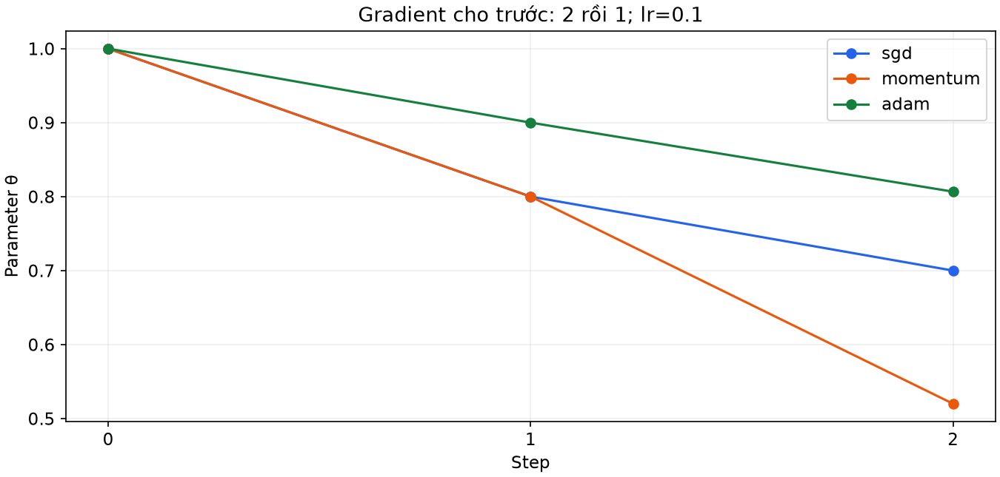
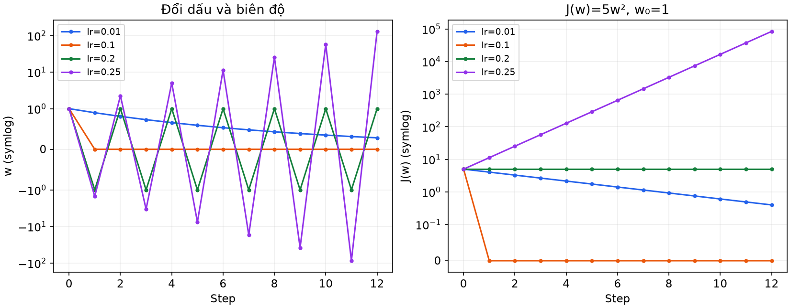
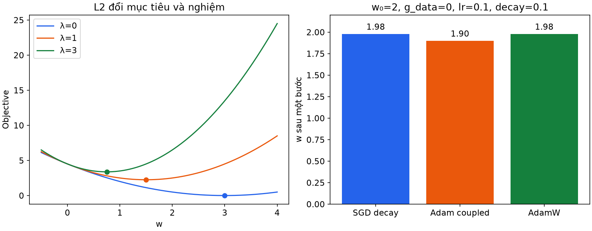
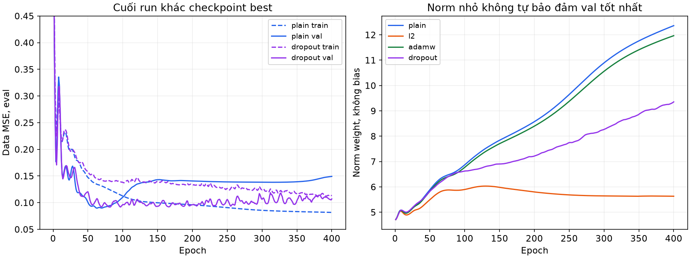
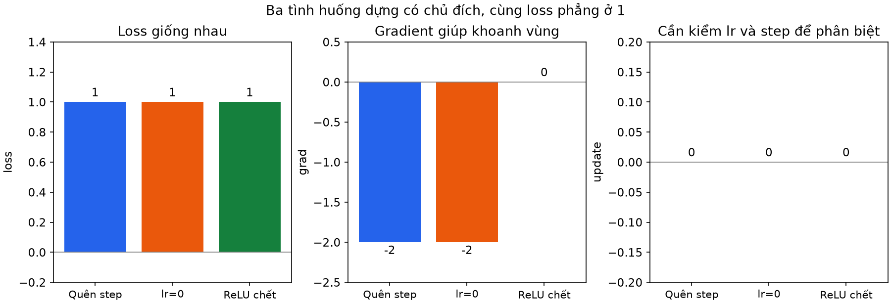

# Bài 13 — Optimizer, regularization và chẩn đoán quá trình học

[Mục lục](../README.md) · [Bài 12](../12-train-eval-validation-checkpoint/README.md) · [Bài tập](exercises.md) · [Lời giải](solutions.md)

Biên soạn ngày 04/11/2026. Dữ liệu tự tạo, PyTorch thật trên CPU. Bài phân biệt ba việc: **tìm tham số tốt cho mục tiêu đang tối ưu**, **hạn chế việc mô hình học quá sát train**, và **tìm nguyên nhân khi quá trình học không như mong đợi**. Một optimizer khác không tự sửa leakage hoặc nhãn sai.

> [!NOTE]
> **Định nghĩa ba trụ cột kỹ thuật của bài học:**
> 1. **Optimizer (Thuật toán tối ưu hóa):** Là cơ chế toán học nhận gradient từ backpropagation và tính toán xem mỗi tham số trong mạng nơ-ron cần thay đổi bao nhiêu ($\Delta\theta$) để hàm mất mát giảm nhanh và ổn định nhất.
> 2. **Regularization (Kỹ thuật điều hòa / chống quá khớp):** Là các ràng buộc bổ sung (như phạt độ lớn trọng số L2, Weight Decay, hoặc ngắt ngẫu nhiên nơ-ron Dropout) nhằm ngăn mô hình "học vẹt" từng chi tiết nhiễu của tập huấn luyện, giúp mô hình giữ được khả năng dự đoán chính xác trên dữ liệu thực tế tương lai.
> 3. **Training Diagnostics (Chẩn đoán quá trình huấn luyện):** Là phương pháp luận truy vết có hệ thống (tương tự bác sĩ bắt bệnh) khi biểu đồ loss đứng yên, biến mất, hoặc bùng nổ thành NaN; phân biệt rạch ròi giữa lỗi logic code (quên `step()`, gán `lr=0`), lỗi kiến trúc mô hình (Dead ReLU), và lỗi mất ổn định số học (learning rate quá lớn).

## 1. Mục tiêu và cách học

Sau bài này, bạn có thể tính hai bước SGD/momentum/Adam; viết L2 đúng hệ số; giải thích AdamW khác Adam với L2; đọc gradient norm và mức thay đổi parameter; đặt phép kiểm để phân biệt một số nguyên nhân loss đứng yên. Thực hành cuối bài so bốn cấu hình regularization trên cùng dữ liệu, chọn checkpoint bằng validation và giữ test đến sau lựa chọn.

> [!TIP]
> **Tại sao kỹ sư AI cần hiểu sâu tầng toán học và cơ chế cập nhật này?**
> Trong các dự án thực tế (huấn luyện LLM, mô hình thị giác máy tính hay hệ thống gợi ý), việc hiểu sai bản chất của optimizer và regularization có thể dẫn đến việc đốt hàng nghìn USD chi phí GPU mà mô hình không hội tụ hoặc bị sụp đổ (loss spike). Biết cách đọc gradient norm và tỷ lệ thay đổi tham số (update ratio) giúp bạn phát hiện sự cố ngay từ những batch đầu tiên thay vì chờ đợi nhiều ngày huấn luyện trong vô vọng.

Cần bài 2 về gradient descent, bài 10–11 về backprop/autograd và bài 12 về vòng train/eval, validation/checkpoint. Bắt đầu bằng tính tay ở phần 2–6, chạy mode `optimizers`, `decay`, `clip`; sau đó đọc cách chẩn đoán rồi chạy `diagnose`, `study`.

## 2. Optimizer nhận gì và quyết định gì?

Backprop cho gradient gₜ=∇J(θₜ₋₁). Optimizer dùng gradient, learning rate và có thể cả lịch sử để tạo bước cập nhật Δθ. Nó không quyết định dữ liệu đúng, mục tiêu đúng hoặc test độc lập.

> [!NOTE]
> **Vai trò của Backprop vs Optimizer trong chu trình học:**
> - **Backpropagation (Bài 10):** Đóng vai trò là "cảm biến đo độ dốc". Nó chỉ cho biết: *Tại vị trí hiện tại, nếu nhích tham số $\theta$ một chút thì hàm mục tiêu sẽ tăng hay giảm theo tốc độ nào*.
> - **Optimizer:** Đóng vai trò là "người điều hướng". Nó nhận giá trị độ dốc đó, kết hợp với tốc độ học (learning rate $\eta$), các bước đi trong quá khứ (momentum) hoặc thống kê độ lớn gradient từng chiều (Adam) để quyết định bước dời tham số thực tế $\Delta\theta_t = \theta_t - \theta_{t-1}$.
> - **Giới hạn trách nhiệm:** Optimizer chỉ làm một việc duy nhất là dịch chuyển tham số sao cho giá trị loss đầu vào giảm xuống. Nếu dữ liệu bị gán nhãn sai, bị rò rỉ (leakage), hoặc hàm loss được thiết kế sai mục tiêu bài toán, optimizer vẫn sẽ tối ưu mù quáng mục tiêu sai đó mà không hề báo lỗi.

Với n mẫu và một target scalar/mẫu, bài dùng:

\[
L_{data}(\theta)=\frac{1}{n}\sum_i(\hat y_i-y_i)^2.
\]

Khi có L2, mục tiêu huấn luyện J còn gồm penalty. Validation/test vẫn đo **data MSE**, không cộng penalty vào metric rồi so với run không penalty. Bài 12 đã tách mode train/eval; ở đây còn phải tách rõ data loss và objective.

> [!IMPORTANT]
> **Phân biệt rạch ròi giữa Objective $J$ và Data Metric $L_{data}$:**
> - **Hàm mục tiêu huấn luyện (Training Objective $J = L_{data} + L_{penalty}$):** Là biểu thức toán học mà optimizer trực tiếp tính đạo hàm để cập nhật trọng số. Penalty được cộng thêm vào chỉ nhằm "uốn nắn" trọng số không phình to quá mức.
> - **Thước đo đánh giá nghiệp vụ (Data Loss / Metric $L_{data}$):** Là sai số thực tế giữa dự đoán $\hat{y}$ và nhãn thật $y$ trên dữ liệu. Khi so sánh giữa mô hình không có regularization (plain) và mô hình có regularization (L2), bạn **bắt buộc phải so sánh bằng cùng một thước đo $L_{data}$ trên tập validation**. Nếu cộng cả điểm phạt penalty vào validation metric của mô hình L2 rồi đem so sánh với mô hình plain, bạn đang so sánh "táo với cam" và làm sai lệch hoàn toàn kết quả thẩm định.

### SGD: stochastic ở đâu?

SGD không momentum cập nhật `θ ← θ − ηg`. Khi g tính từ một mẫu hoặc mini-batch ngẫu nhiên, đó là ước lượng gradient toàn train và có nhiễu do lấy mẫu. Khi dùng toàn train, công thức cập nhật vẫn vậy nhưng không có nhiễu mini-batch. `torch.optim.SGD` có thể dùng cho cả hai; tên API không tự quyết định cách lấy batch.

> [!NOTE]
> **Tính chất "Stochastic" (ngẫu nhiên) đến từ đâu?**
> - **Batch Gradient Descent thuần túy:** Mỗi bước cập nhật tính gradient trên toàn bộ $N$ mẫu trong tập train. Hướng gradient hoàn toàn chính xác theo toàn bộ dữ liệu, chuyển động rất êm nhưng cực kỳ tốn RAM/VRAM và dễ kẹt ở điểm yên ngựa hoặc cực tiểu địa phương phẳng.
> - **Mini-batch Stochastic Gradient Descent:** Mỗi bước chỉ lấy ngẫu nhiên một nhóm nhỏ mẫu (ví dụ 32 hoặc 64 mẫu). Vì là mẫu ngẫu nhiên, vector gradient $g$ sẽ dao động quanh hướng gradient thật toàn tập (nhiễu lấy mẫu). Nhiễu này có tác dụng phụ rất tích cực: nó giúp "lắc nhẹ" tham số văng ra khỏi các hố cục bộ nông kém chất lượng.
> - **Trong PyTorch:** Lớp `torch.optim.SGD` không hề biết bạn nạp bao nhiêu dữ liệu vào mô hình. Nó chỉ lấy giá trị có sẵn trong thuộc tính `.grad` của tham số sau lệnh `loss.backward()` và thực hiện phép trừ $\theta \leftarrow \theta - \eta g$. Việc có "stochastic" hay không phụ thuộc hoàn toàn vào cách bạn chia batch trong `DataLoader`.

**Ví dụ giả định:** θ₀=1, η=0.1, hai gradient được cho trước g₁=2, g₂=1. SGD cho θ₁=0.8, θ₂=0.7. Đây là chuỗi gradient đặt tay để kiểm công thức, không phải ba optimizer cùng đi trên một hàm rồi có cùng gradient sau bước đầu.

> [!NOTE]
> **Giải thích bước tính tay SGD:**
> - Khởi tạo: $\theta_0 = 1.0$, tốc độ học $\eta = 0.1$.
> - Bước 1 với $g_1 = 2$: $\theta_1 = \theta_0 - \eta g_1 = 1.0 - 0.1 \times 2 = 0.8$.
> - Bước 2 với $g_2 = 1$: $\theta_2 = \theta_1 - \eta g_2 = 0.8 - 0.1 \times 1 = 0.7$.
> - Nhận xét: Mỗi bước cập nhật của SGD hoàn toàn "quên sạch" quá khứ; độ dời chỉ phụ thuộc duy nhất vào gradient tức thời $g_t$ của bước đó.

## 3. Momentum: gradient mới cộng với lịch sử

Trong phiên bản không dampening, không weight decay, không Nesterov:

\[
v_1=g_1,\qquad v_t=\mu v_{t-1}+g_t,\qquad \theta_t=\theta_{t-1}-\eta v_t.
\]

v là buffer momentum, μ kiểm mức giữ lịch sử. Không dùng nhầm công thức có `(1−μ)g` mà vẫn giữ nguyên η rồi coi kết quả phải giống. PyTorch khởi tạo buffer bằng gradient bước đầu. [SGD API](https://docs.pytorch.org/docs/2.15/generated/torch.optim.SGD.html)

> [!NOTE]
> **Ẩn dụ trực quan về Momentum (Quán tính hòn bi lăn):**
> Hãy tưởng tượng một hòn bi sắt lăn xuống sườn núi. Khi lăn qua một sườn dốc dài có cùng hướng dốc, hòn bi tích lũy vận tốc và lăn ngày càng nhanh. Nếu gặp một gờ giảm tốc nhỏ hay một vũng nước nông (tương đương với nhiễu ngẫu nhiên từ mini-batch hoặc cực tiểu địa phương cạn), quán tính giúp hòn bi lao vút qua mà không bị khựng lại như người đi bộ (SGD thuần).
> - Đại lượng $v_t$ đóng vai trò là "vận tốc tích lũy" (momentum buffer).
> - Hệ số $\mu \in [0, 1)$ (thường chọn $0.9$) là "hệ số ma sát/bảo toàn vận tốc". Nó quy định $90\%$ vận tốc của bước trước sẽ được truyền tiếp sang bước sau.
> - **Cảnh báo công thức:** Một số giáo trình lý thuyết viết $v_t = \mu v_{t-1} + (1-\mu) g_t$ (dạng trung bình động hàm mũ EMA). Nhưng PyTorch và phần lớn framework dùng công thức tích lũy trực tiếp $v_t = \mu v_{t-1} + g_t$. Với công thức này, ở vùng dốc phẳng gradient không đổi $g$, vận tốc tiệm cận sẽ là $v_\infty = \frac{g}{1-\mu} = 10g$ (khi $\mu=0.9$), nghĩa là bước nhảy hiệu dụng tăng gấp 10 lần so với SGD thuần!

Vẫn θ₀=1, η=0.1, g₁=2, g₂=1 và μ=0.9:

- Bước 1: v₁=2, θ₁=1−0.1×2=0.8.
- Bước 2: v₂=0.9×2+1=2.8, θ₂=0.8−0.1×2.8=**0.52**.

Lịch sử làm bước thứ hai khác SGD. Nó có thể giúp đi qua nhiễu hoặc hướng nhất quán, nhưng cũng có thể gây vượt quá vùng tốt. Momentum không bảo đảm mỗi batch loss đều giảm. Buffer là lý do phải lưu optimizer state khi resume, như bài 12.

> [!WARNING]
> **Mặt trái của Momentum — Hiện tượng trượt quá đà (Overshoot):**
> Vì tích lũy vận tốc lớn từ sườn dốc, khi hòn bi đã chạm đáy thung lũng (nơi gradient $g \approx 0$), vận tốc $v$ tích lũy từ trước vẫn đẩy hòn bi trượt vọt lên sườn núi đối diện trước khi trọng lực kéo nó quay trở lại. Do đó, momentum có thể gây dao động mạnh quanh cực tiểu. Nếu không lưu trạng thái buffer $v$ vào checkpoint khi tạm dừng huấn luyện, lúc resume lại mô hình sẽ mất trắng vận tốc đã tích lũy và bị khựng lại đột ngột.

## 4. Adam: hai trung bình động và hiệu chỉnh độ lệch

Adam dùng từng tọa độ parameter để giữ trung bình gradient m và trung bình bình phương gradient v. Khi chưa có weight decay, không AMSGrad:

\[
m_t=\beta_1m_{t-1}+(1-\beta_1)g_t,\qquad
v_t=\beta_2v_{t-1}+(1-\beta_2)g_t^2,
\]
\[
\hat m_t=\frac{m_t}{1-\beta_1^t},\quad
\hat v_t=\frac{v_t}{1-\beta_2^t},\quad
\theta_t=\theta_{t-1}-\eta\frac{\hat m_t}{\sqrt{\hat v_t}+\epsilon}.
\]

Các phép bình phương/chia/căn ở đây theo phần tử. m₀=v₀=0; hiệu chỉnh bias bù việc bắt đầu các trung bình từ 0. ε nằm **ngoài căn** trong công thức này. v không phải phương sai đã trừ mean². Adam vẫn cần chọn η; không nên hiểu “adaptive” là tự chọn mọi siêu tham số. [Adam API](https://docs.pytorch.org/docs/2.15/generated/torch.optim.Adam.html)

> [!NOTE]
> **Giải phẫu thuật toán Adam (Adaptive Moment Estimation):**
> Adam kết hợp điểm mạnh nhất của hai trường phái:
> 1. **Moment bậc 1 ($m_t$ — Tương tự Momentum):** Đo trung bình động có hướng của gradient, giúp làm mượt các dao động rung lắc và giữ đà di chuyển về phía trước. Hệ số $\beta_1$ (mặc định $0.9$) chi phối mức độ nhớ quá khứ.
> 2. **Moment bậc 2 ($v_t$ — Tương tự RMSProp):** Đo trung bình động của bình phương độ lớn gradient $g^2$. Đây là đại lượng đo "độ rung lắc / độ dốc" của từng tham số riêng rẽ. Nếu một trọng số thường xuyên nhận gradient rất lớn, $v_t$ sẽ lớn $\Rightarrow$ mẫu số $\sqrt{\hat{v}_t}$ lớn $\Rightarrow$ bước nhảy bị "hãm phanh" lại để tránh bị văng khỏi hàm mất mát. Ngược lại, trọng số nào ít khi nhận gradient thì mẫu số nhỏ $\Rightarrow$ bước nhảy được "tăng ga" để thoát khỏi vùng bằng phẳng.
> 3. **Hiệu chỉnh độ lệch khởi tạo (Bias Correction $\hat{m}_t, \hat{v}_t$):** Vì ban đầu ta đặt $m_0 = 0$ và $v_0 = 0$, ở các bước đầu tiên (ví dụ $t=1$), các giá trị $m_t, v_t$ bị kéo lệch về 0 rất nặng. Việc chia cho $1 - \beta^t$ sẽ bù trừ chính xác độ lệch này (ví dụ với $\beta_2=0.99$, tại $t=1$ mẫu số là $1 - 0.99 = 0.01$, nhân giá trị lên 100 lần để phản ánh đúng quy mô gradient thật). Khi $t \to \infty$, $1 - \beta^t \to 1$ và hiệu chỉnh tự biến mất.
> 4. **Hằng số ổn định số học $\epsilon$:** Tránh lỗi chia cho 0 khi gradient tiệm cận 0 (trong PyTorch, $\epsilon$ được cộng vào sau khi lấy căn bậc hai: $\sqrt{\hat{v}_t} + \epsilon$).

**Tính tay:** θ₀=1, η=0.1, β₁=0.9, β₂=0.99, ε=10⁻⁸; vẫn g₁=2, g₂=1. β₂=0.99 được chọn cho dễ tính, khác mặc định PyTorch 0.999.

| Đại lượng | Bước 1 | Bước 2 |
|---|---:|---:|
| m | 0.2 | 0.28 |
| v | 0.04 | 0.0496 |
| m̂ | 2 | 0.28/0.19≈1.473684211 |
| v̂ | 4 | 0.0496/0.0199≈2.492462312 |
| θ sau update | 0.9000000005 | 0.8066552009 |

Bước đầu giảm gần 0.1, dù g₁=2, vì chia theo căn moment bậc hai. Đừng suy rằng mọi bước Adam đều giảm đúng η; bước hai đã khác. Mode `optimizers` đối chiếu cả hai bước của ba optimizer với công thức viết bằng số Python.

> [!NOTE]
> **Giải thích chi tiết bảng tính tay Adam:**
> - **Bước 1 ($t=1, g_1=2$):**
>   - $m_1 = 0.9 \times 0 + (1 - 0.9) \times 2 = 0.2$.
>   - $v_1 = 0.99 \times 0 + (1 - 0.99) \times 2^2 = 0.04$.
>   - $\hat{m}_1 = \frac{0.2}{1 - 0.9^1} = \frac{0.2}{0.1} = 2.0$.
>   - $\hat{v}_1 = \frac{0.04}{1 - 0.99^1} = \frac{0.04}{0.01} = 4.0$.
>   - Bước nhảy: $\Delta\theta_1 = -0.1 \times \frac{2}{\sqrt{4} + 10^{-8}} = -0.1 \times \frac{2}{2 + 10^{-8}} \approx -0.0999999995$.
>   - Trọng số mới: $\theta_1 = 1.0 - 0.0999999995 = 0.9000000005$.
> - **Bước 2 ($t=2, g_2=1$):**
>   - $m_2 = 0.9 \times 0.2 + 0.1 \times 1 = 0.18 + 0.1 = 0.28$.
>   - $v_2 = 0.99 \times 0.04 + 0.01 \times 1^2 = 0.0396 + 0.01 = 0.0496$.
>   - $\hat{m}_2 = \frac{0.28}{1 - 0.9^2} = \frac{0.28}{0.19} \approx 1.473684211$.
>   - $\hat{v}_2 = \frac{0.0496}{1 - 0.99^2} = \frac{0.0496}{0.0199} \approx 2.492462312$.
>   - $\sqrt{\hat{v}_2} \approx 1.578753404$.
>   - Bước nhảy: $\Delta\theta_2 = -0.1 \times \frac{1.473684211}{1.578753404 + 10^{-8}} \approx -0.0933448$.
>   - Trọng số mới: $\theta_2 = 0.9000000005 - 0.0933448 \approx 0.8066552009$.

```python
from lab import optimizer_trace
trace = optimizer_trace()
for name, rows in trace.items():
    print(name, [row['weight'] for row in rows])
```



*Đây là kiểm toán công thức, không phải benchmark xem optimizer nào hội tụ tốt hơn.*

## 5. Learning rate và độ cong: tại sao có thể dao động?

Xét hàm một chiều J(w)=5w², gradient 10w, w₀=1. SGD cho:

\[
w_{t+1}=(1-10\eta)w_t.
\]

Muốn w tiến về 0 từ khởi tạo khác 0 cần |1−10η|<1, tức **0<η<0.2**. Đây là kết luận cho hàm bậc hai cụ thể, không phải khoảng η chung cho neural network.

> [!NOTE]
> **Độ cong (Curvature) và Ngưỡng ổn định của Bước nhảy:**
> Trong toán giải tích, đạo hàm bậc một $J'(w) = 10w$ cho biết độ dốc của tiếp tuyến. Đạo hàm bậc hai $J''(w) = 10$ (được gọi là độ cong hay Hessian trong không gian nhiều chiều) cho biết độ cong võng của đồ thị.
> Khi cập nhật theo gradient: $w_{t+1} = w_t - \eta (10 w_t) = (1 - 10\eta) w_t$.
> Hệ số $(1 - 10\eta)$ quyết định tương lai của chuỗi tham số:
> - Nếu $|1 - 10\eta| < 1 \iff -1 < 1 - 10\eta < 1 \iff 0 < 10\eta < 2 \iff 0 < \eta < 0.2$: Trọng số $w$ sẽ co dần về 0 (hội tụ).
> - Nếu $|1 - 10\eta| > 1$: Trọng số sẽ phóng đại dần qua từng bước (phát nổ phân kỳ).

| η | Hệ số | Hai weight tiếp theo | Hành vi |
|---|---:|---|---|
| 0.01 | 0.9 | 0.9, 0.81 | Giảm dần |
| 0.1 | 0 | 0, 0 | Tới nghiệm một bước trong ví dụ này |
| 0.2 | −1 | −1, 1 | Đổi dấu, loss đứng ở 5 |
| 0.25 | −1.5 | −1.5, 2.25 | Biên độ và loss tăng |

> [!NOTE]
> **Giải thích bốn hành vi thực tế của Learning Rate:**
> 1. **$\eta = 0.01$ (Học quá chậm — Under-stepping):** Hệ số $0.9 < 1$, tham số giảm đều đặn từ $1.0 \to 0.9 \to 0.81$, loss giảm dần nhưng cần rất nhiều epoch để tới đích.
> 2. **$\eta = 0.1$ (Bước nhảy hoàn hảo — Optimal Step):** Hệ số bằng đúng 0, ngay bước đầu tiên $w_1 = 0$ và loss chạm đáy 0 tuyệt đối.
> 3. **$\eta = 0.2$ (Dao động bảo toàn — Bouncing/Oscillation):** Hệ số bằng $-1$. Bước 1 nhảy sang $w_1 = -1$, bước 2 nhảy ngược lại $w_2 = 1$. Giá trị hàm mất mát luôn bằng $5 \times (\pm 1)^2 = 5.0$ không đổi! **Đây là một bẫy chẩn đoán kinh điển: Nhìn trên đồ thị thấy đường loss nằm phẳng lì nằm ngang, người mới dễ lầm tưởng là mô hình không học hay gradient bị tắt, nhưng thực chất tham số đang nhảy qua nhảy lại kịch liệt giữa hai bờ vách núi!**
> 4. **$\eta = 0.25$ (Phát nổ phân kỳ — Divergence):** Hệ số bằng $-1.5$ (có độ lớn $> 1$). Tham số nhảy từ $1.0 \to -1.5 \to 2.25 \to -3.375$, hàm loss vọt từ $5 \to 11.25 \to 25.3 \to 56.9$ và nhanh chóng tràn số thành `inf` hoặc `NaN`.



*Loss phẳng còn có thể do parameter đang dao động, không chỉ do parameter không đổi.*

Khi thử optimizer mới, chọn learning rate trên validation với ngân sách được ghi rõ. Cùng một η số học không có nghĩa bước cập nhật hoặc mức độ công bằng giống nhau giữa SGD và Adam. Bài không benchmark các optimizer trên MLP; chỉ kiểm công thức và thực hành regularization với cấu hình khai báo trước. Schedule, warmup, RMSProp, Nesterov và optimizer phân tán nằm ngoài code bài này.

> [!TIP]
> **Kinh nghiệm thực chiến:** Trong thực tế, bạn không bao giờ dùng cùng một learning rate khi chuyển đổi giữa SGD và Adam. Vì Adam tự chuẩn hóa theo căn moment bậc hai, learning rate của Adam thường nhỏ hơn nhiều (thường khởi điểm ở $10^{-3}$ hoặc $3 \times 10^{-4}$ cho mạng Transformer), trong khi SGD có thể cần learning rate từ $0.01$ đến $0.1$.

## 6. Regularization: thay ưu tiên của việc học

Regularization đưa thêm ràng buộc hoặc cơ chế làm mô hình bớt dựa vào các chi tiết của train. Nó có thể tăng train error nhưng cải thiện ngoài mẫu; cũng có thể làm cả hai tệ hơn nếu quá mạnh hoặc không phù hợp.

> [!NOTE]
> **Bản chất của Regularization (Sự thỏa hiệp Bias - Variance):**
> Khi một mạng nơ-ron có hàng triệu tham số, nó có đủ sức mạnh để "vẽ" một đường cong ngoằn ngoèo đi qua chính xác $100\%$ các điểm huấn luyện, kể cả những điểm dữ liệu nhiễu ngoại lai (outliers). Kết quả là train loss cực thấp nhưng khi gặp dữ liệu thực tế ngoài đời thì sai be bét (overfitting / high variance).
> Regularization là việc can thiệp vào quá trình học, "trói tay trói chân" mô hình một cách có chủ đích: buộc trọng số phải nhỏ, hoặc ngắt bớt liên kết nơ-ron. Khi đó, mô hình buộc phải học những quy luật tổng quát nhất thay vì học vẹt từng điểm dữ liệu.

### L2 với hệ số được định nghĩa rõ

Bài chọn:

\[
J=L_{data}+\frac{\lambda}{2}\sum_{W}\|W\|_F^2,
\qquad \nabla_WJ=\nabla_WL_{data}+\lambda W.
\]

Tổng chỉ qua **weight matrices của Linear**, không qua bias. Đây là chính sách của lab, không phải mọi mô hình đều bắt buộc loại bias. Nếu viết λΣW² không có 1/2 thì gradient penalty là 2λW. Mức λ còn phụ thuộc quy ước loss mean/sum và cách cộng penalty; không chép con số giữa hai code mà bỏ qua quy ước. [L2 regularization](https://developers.google.com/machine-learning/crash-course/overfitting/regularization)

> [!NOTE]
> **Tại sao phạt bình phương trọng số (L2) lại giúp mô hình bớt overfit? Và tại sao không phạt bias?**
> - **Nguyên lý của L2 (Ridge Penalty):** Trọng số $W$ đóng vai trò là hệ số khuếch đại tín hiệu đầu vào. Nếu một trọng số $W_{ij}$ quá lớn, chỉ cần một biến động nhỏ của đặc trưng đầu vào $x_j$ cũng sẽ làm đầu ra thay đổi chóng mặt. Bằng cách cộng thêm hình phạt $\frac{\lambda}{2} W^2$ vào loss, optimizer buộc phải tìm một bộ trọng số vừa làm giảm sai số dữ liệu, vừa giữ các giá trị $W$ nhỏ và phân bố đều. Kết quả là hàm dự đoán trở nên phẳng mượt, ổn định hơn rất nhiều.
> - **Tại sao loại trừ bias?** Bias $b$ chỉ đóng vai trò tịnh tiến đồ thị lên/xuống (dịch chuyển ngưỡng quyết định), nó không nhân trực tiếp với đặc trưng đầu vào nên không làm tăng độ nhạy cảm hay độ cong uốn lượn của mạng nơ-ron. Phạt bias không giúp giảm overfit mà chỉ gây khó khăn cho mô hình trong việc khớp với giá trị trung bình ban đầu của dữ liệu.

**Ví dụ tính tay:** J(w)=½(w−3)²+λw²/2. Đạo hàm là (w−3)+λw; nghiệm w*=3/(1+λ). Không regularization cho 3; λ=1 cho 1.5; λ=3 cho 0.75. Nghiệm co về 0 vì bài đã đổi mục tiêu, không phải optimizer bỗng tính sai. Data loss tại λ=1 là 1.125, penalty là 1.125, objective là 2.25. Không gọi 2.25 là data loss.

> [!NOTE]
> **Giải thích bài toán tính tay L2:**
> Cho hàm mục tiêu: $J(w) = \frac{1}{2}(w - 3)^2 + \frac{\lambda}{2}w^2$.
> - Đạo hàm theo $w$: $J'(w) = (w - 3) + \lambda w = w(1 + \lambda) - 3$.
> - Cho $J'(w) = 0 \implies w^* = \frac{3}{1 + \lambda}$.
> - Nhận xét:
>   - Khi $\lambda = 0$ (không phạt): Nghiệm tối ưu thuần túy theo dữ liệu là $w^* = 3$.
>   - Khi $\lambda = 1$: Điểm cân bằng chuyển về $w^* = \frac{3}{2} = 1.5$. Tại đây, data loss là $\frac{1}{2}(1.5 - 3)^2 = 1.125$, penalty là $\frac{1}{2}(1.5)^2 = 1.125$, tổng objective là $2.25$.
>   - Khi $\lambda = 3$: Điểm cân bằng co mạnh về $w^* = \frac{3}{4} = 0.75$.
> Trọng số co về 0 là kết quả toán học tất yếu của việc ta đã chủ động cộng thêm hình phạt vào hàm mục tiêu!

```python
import torch
w = torch.tensor(2., dtype=torch.float64, requires_grad=True)
lambda_ = 0.1
penalty = lambda_/2 * w.square()
penalty.backward()
print(penalty.item(), w.grad.item())  # 0.2, 0.2
```

### Weight decay có luôn giống L2 không?

SGD thuần, không momentum, dùng cùng tập parameter và hệ số λ:

`w_new = w − η(g_data + λw) = (1−ηλ)w − ηg_data`.

Trong điều kiện đó, cộng L2 và co weight mỗi bước cho cùng update. Khi optimizer có lịch sử hoặc chia gradient theo tọa độ, không được suy tương đương này tự động còn đúng.

> [!IMPORTANT]
> **Sự khác biệt cốt tử: L2 Regularization vs Weight Decay (Loshchilov & Hutter, 2017)**
> - **L2 Regularization:** Cộng thêm đạo hàm của penalty $\lambda w$ trực tiếp vào gradient trước khi đưa vào optimizer: $g_{total} = g_{data} + \lambda w$.
> - **Weight Decay:** Sau khi optimizer tính toán xong bước cập nhật thông thường, ta co trọng số trực tiếp bằng cách nhân với một hệ số nhỏ hơn 1: $w \leftarrow (1 - \eta \lambda) w$.
> - **Với SGD thuần:** Hai cách làm này hoàn toàn tương đương toán học:
>   $$w_{t} = w_{t-1} - \eta (g_{data} + \lambda w_{t-1}) = (1 - \eta \lambda) w_{t-1} - \eta g_{data}$$
> - **Nhưng với Adam:** Chúng phân kỳ một cách tai hại!

Adam với L2 kiểu coupled đưa λw vào gradient trước khi tính m, v. AdamW tách phép co weight khỏi m, v của gradient dữ liệu. Trong PyTorch 2.15, `Adam(..., decoupled_weight_decay=True)` cũng hỗ trợ hành vi tương đương AdamW; lab dùng `torch.optim.AdamW` để chỉ rõ lựa chọn. [AdamW API](https://docs.pytorch.org/docs/2.15/generated/torch.optim.AdamW.html)

> [!NOTE]
> **Tại sao L2 trong Adam chuẩn bị "hỏng" và tại sao cả thế giới chuyển sang AdamW?**
> Trong Adam tiêu chuẩn (Coupled L2): Khi đưa $\lambda w$ vào gradient tổng, đại lượng này đi vào cả moment bậc hai $v_t \propto g^2$.
> - Trọng số nào có độ lớn $|w|$ rất lớn $\Rightarrow$ gradient penalty $\lambda w$ rất lớn $\Rightarrow v_t$ bị thổi phồng $\Rightarrow$ mẫu số $\sqrt{\hat{v}_t}$ cực lớn $\Rightarrow$ bước phạt bị co nhỏ lại!
> - Ngược lại, trọng số nào nhỏ $\Rightarrow v_t$ nhỏ $\Rightarrow$ bước phạt lại lớn!
> Điều này hoàn toàn đi ngược lại triết lý của L2 (vốn muốn phạt mạnh các trọng số lớn và phạt nhẹ các trọng số nhỏ). Adam tiêu chuẩn đã vô tình làm mất tác dụng của L2 regularization.
> **AdamW (Decoupled Weight Decay)** giải quyết triệt để lỗi này: Nó chỉ tính $m_t$ và $v_t$ từ gradient dữ liệu thuần túy $g_{data}$, rồi thực hiện co trọng số $-\eta \lambda w$ độc lập ở bước cuối cùng. Toàn bộ các mô hình Transformer hiện đại (như GPT, LLaMA, BERT) đều bắt buộc phải dùng AdamW thay vì Adam tiêu chuẩn là vì lý do này.

**Ví dụ một bước:** w=2, g_data=0, η=0.1, weight_decay=0.1; optimizer mới, mặc định betas/eps của Adam:

- SGD decay: w mới=(1−0.01)×2=**1.98**.
- Adam coupled: g=0.2 đi vào m,v; sau hiệu chỉnh, update≈0.1×0.2/(0.2+10⁻⁸), w mới≈**1.900000005**.
- AdamW: co weight thành **1.98**, moment gradient dữ liệu bằng 0 nên không thêm bước theo gradient.

Mode `decay` kiểm các số này. Code gán **gradient tensor bằng 0**, không để `.grad=None`. Không dùng ví dụ này để suy mọi parameter có grad=None vẫn được cập nhật.

> [!NOTE]
> **Phân tích chi tiết ba con số trong ví dụ:**
> Ta xét trường hợp cực đoan: gradient dữ liệu $g_{data} = 0$, trọng số ban đầu $w = 2.0$, $\eta = 0.1$, $\lambda = 0.1$.
> 1. **SGD with Decay:** $w_{mới} = (1 - 0.1 \times 0.1) \times 2 = 0.99 \times 2 = 1.98$.
> 2. **AdamW:** Vì $g_{data} = 0$, moment $m = 0, v = 0$, không có bước cập nhật dữ liệu nào. Trọng số chỉ bị co trực tiếp bởi weight decay: $w_{mới} = w - \eta \lambda w = 2.0 - 0.1 \times 0.1 \times 2.0 = 1.98$. (Trùng khớp tuyệt đối với SGD).
> 3. **Adam Coupled L2:** Penalty $\lambda w = 0.1 \times 2.0 = 0.2$ được nạp làm gradient tổng $g = 0.2$. Adam tính $\hat{m} = 0.2, \hat{v} = 0.04 \implies \sqrt{\hat{v}} = 0.2$. Bước nhảy là $-0.1 \times \frac{0.2}{0.2 + 10^{-8}} \approx -0.099999995$. Trọng số tụt xuống $2.0 - 0.099999995 \approx 1.900000005$! Trọng số bị trừ đi một lượng gấp gần 5 lần so với mong muốn ban đầu vì phép chia cho $\sqrt{\hat{v}}$.



*Hệ số penalty và cách optimizer dùng nó đều ảnh hưởng kết quả. Giá trị λ/weight_decay giữa Adam và AdamW không tự có cùng ý nghĩa tác động.*

Không vô tình vừa cộng L2 vào loss vừa bật decay trên cùng weight nếu mục đích chỉ là một cơ chế. Lab cấm kết hợp hai cách trong ablation để dễ diễn giải.

## 7. Dropout, early stopping và dữ liệu

Dropout ngẫu nhiên bỏ activation trong train, scale phần giữ lại bằng 1/(1−p); eval là identity cho layer Dropout. Với p=0.5, activation 2 được biến thành 0 hoặc 4, kỳ vọng bằng 2. Đây là kỳ vọng của activation sau Dropout; không suy dự đoán của toàn mạng phi tuyến trong eval bằng trung bình mọi dự đoán train. [Dropout API](https://docs.pytorch.org/docs/2.15/generated/torch.nn.Dropout.html)

> [!NOTE]
> **Ẩn dụ về Dropout và Kỹ thuật Inverted Dropout:**
> - **Ẩn dụ đội bóng:** Nếu bạn có một đội bóng phụ thuộc hoàn toàn vào một siêu sao, khi cầu thủ đó bị chấn thương hoặc bị đối phương kèm chặt, cả đội sẽ tê liệt (hiện tượng nơ-ron đồng thích nghi - co-adaptation). Dropout giống như việc huấn luyện viên ngẫu nhiên bắt $50\%$ cầu thủ ngồi ngoài trong mỗi buổi tập. Các cầu thủ còn lại buộc phải tự nâng cao năng lực và phối hợp ăn ý với nhau. Khi ra trận thực tế (eval mode), cả đội hình trở nên cực kỳ bền vững và không phụ thuộc vào bất kỳ cá nhân nào.
> - **Inverted Dropout:** Trong lúc train, nếu ta ngẫu nhiên tắt đi một tỷ lệ $p$ nơ-ron, tổng mức năng lượng tín hiệu truyền sang tầng tiếp theo sẽ bị hụt mất một lượng $(1 - p)$. Để khắc phục, PyTorch nhân phóng đại các nơ-ron còn sống lên một hệ số $\frac{1}{1-p}$ ngay trong lúc train (ví dụ với $p=0.5$, nhân đôi tín hiệu). Nhờ phép phóng đại này, giá trị kỳ vọng toán học của tín hiệu trong lúc train bằng đúng tín hiệu trong lúc eval! Lợi ích lớn nhất là khi chuyển sang `model.eval()`, PyTorch chỉ việc biến Dropout thành phép truyền thẳng (identity) mà không cần phải thực hiện phép chia nào, giúp tối ưu tối đa tốc độ suy luận (inference speed).

Early stopping ở bài 12 giới hạn mức fit bằng validation. Nó không cộng penalty tường minh vào loss. Lab bài 13 chạy đủ ngân sách 400 epoch rồi chọn best epoch qua validation, giúp quan sát cả đoạn sau best; không gọi đó là đã tiết kiệm compute nhờ dừng sớm.

L1 dùng tổng trị tuyệt đối, có điểm gãy ở 0 và khuyến khích sparsity trong các bài toán phù hợp; bài chỉ giới thiệu, chưa thực nghiệm L1/proximal optimizer. Data augmentation chỉ hữu ích khi phép biến đổi giữ ý nghĩa nhãn và phù hợp dữ liệu; không áp ngẫu nhiên một biến đổi vào mọi bài toán. Chuẩn hóa feature có thể giúp tối ưu nhưng không tự thay thế regularization; scaler phải fit từ train như bài 5.

> [!TIP]
> **Bộ công cụ Regularization trong thực tế:**
> - **Data Augmentation:** Tăng cường dữ liệu (xoay ảnh, cắt xén, dịch văn bản) là dạng regularization tốt nhất vì nó trực tiếp cung cấp thêm biến thể dữ liệu cho mô hình mà không làm giảm dung lượng biểu diễn.
> - **L1 Regularization (Lasso):** Phạt $\lambda \sum |W|$. Đạo hàm là hằng số $\pm \lambda$, kéo các trọng số không quan trọng về bằng 0 tuyệt đối, tạo ra tính thưa (sparsity) hữu ích cho việc chọn lọc đặc trưng.
> - **Feature Scaling:** Đưa các đặc trưng về cùng thang đo (StandardScaler) giúp mặt phẳng hàm mất mát tròn đều hơn, giúp optimizer hội tụ nhanh hơn nhưng không thể thay thế cho cơ chế chống overfit của regularization.

## 8. Thực hành bốn cấu hình regularization

Thí nghiệm tạo 120 hàng: x đều trong [−1,1), y=sin(3x)+0.3x+ε, noise Gaussian std=0.3. Generator riêng data_seed=17 tạo dữ liệu và split ID không trùng: 24 train, 48 validation, 48 test. MLP **1→32→32→1** có tanh, hai vị trí Dropout; tổng 1.153 parameter. Cùng seed khởi tạo 2026, CPU float64, full batch train mỗi epoch, 400 epoch=400 update/run. Không có random mini-batch; nhiễu Dropout chỉ xuất hiện ở run bật Dropout.

Bốn ứng viên định trước, lr=0.01:

| Run | Optimizer và regularization |
|---|---|
| plain | Adam, không L2/decay, p=0 |
| l2 | Adam, thêm 0.001/2 × tổng bình phương weight, không decay, p=0 |
| adamw | AdamW, decay=0.03 chỉ trên weight, bias decay=0, p=0 |
| dropout | Adam, không L2/decay, p=0.2 ở hai layer Dropout |

Mỗi run giữ epoch có **validation data MSE** nhỏ nhất, hòa giữ epoch sớm hơn; chọn run best validation thấp nhất, hòa ưu tiên ứng viên đầu đã khai báo. Đây là so bốn cấu hình cụ thể, chưa tách mọi tương tác hoặc tìm hyperparameter tốt nhất cho từng phương pháp. So sánh p=0 và p=0.2 có cùng khởi tạo weight, nhưng gradient sau đó khác vì Dropout thay đổi forward.

Kết quả thực chạy:

| Run | Best epoch | Best val MSE | Train MSE cuối | Val MSE cuối | Norm weight cuối |
|---|---:|---:|---:|---:|---:|
| plain | 63 | 0.089757914 | 0.081752044 | 0.149218425 | 12.362015 |
| l2 | 70 | 0.090190619 | 0.093813536 | 0.137423154 | 5.631940 |
| adamw | 70 | 0.089841328 | 0.082174901 | 0.146898029 | 11.965555 |
| dropout | 82 | 0.091817363 | 0.112807123 | 0.107021615 | 9.354766 |

Mean predictor fit từ train có validation MSE≈0.868515026; đây là baseline ngữ cảnh, không thêm một ứng viên vào phép chọn bốn run. Chọn **plain, epoch 63**, test MSE≈**0.155154862 trên 48 mẫu**. Mode `study` chỉ chấm test cho model được chọn sau khi hoàn tất lựa chọn.

L2 ở cấu hình này giảm norm weight, Dropout cho val cuối tốt hơn plain cuối, nhưng **best validation của plain vẫn thấp nhất**. Không viết lại quy tắc để bắt regularization phải thắng; cũng không dùng norm thấp nhất làm tiêu chí thay validation. Chênh best val nhỏ và một split/seed chưa chứng minh phương pháp nào hơn nói chung. Bảng cuối epoch và best epoch là hai thời điểm khác nhau.

> [!IMPORTANT]
> **Bài học sâu sắc từ bảng kết quả:**
> 1. **Regularization không phải "viên đạn bạc":** Đừng mặc định rằng cứ thêm L2 hay Dropout là mô hình sẽ tự động tốt hơn mô hình gốc (plain). Trong thí nghiệm cụ thể này, `plain` đạt best validation MSE thấp nhất ($0.089758$ ở epoch 63) và được chọn một cách công bằng.
> 2. **Cơ chế hoạt động đúng như thiết kế:** L2 đã hoàn thành nhiệm vụ ép nhỏ trọng số (norm giảm mạnh từ 12.36 xuống 5.63). Dropout kiểm soát overfit về cuối xuất sắc nhất (val MSE cuối chỉ 0.107 so với 0.149 của plain).
> 3. **Tính chính trực của Kỹ sư ML:** Không bao giờ được phép "đổi luật chơi" sau khi đã nhìn thấy kết quả (ví dụ thấy Dropout có val cuối thấp hơn liền đổi tiêu chí từ *Best Val* sang *Last Val* để ép Dropout thắng). Mọi tiêu chí đánh giá phải được khóa cố định từ trước khi chạy thực nghiệm.



*Đường train/validation được đo lại ở eval; không cộng L2 penalty vào validation. Norm weight không phải thước đo chất lượng tổng quát.*

```python
from pathlib import Path
from tempfile import TemporaryDirectory
from lab import study
with TemporaryDirectory() as directory:
    report = study(Path(directory)/'study')
    print(report['selected'], report['test_mse'])
```

Các artifact gồm config.json, metadata.json (môi trường, split ID, data/code hash), metrics.csv, summary.json và best.pt. File best chỉ dùng tải model đã chọn; **không phải checkpoint resume**: không chứa optimizer/RNG/bộ đếm như last.pt bài 12. Nếu mở rộng resume với Adam, còn phải khôi phục m, v và step count. Không sửa mã bài 12 rồi mặc định optimizer state SGD dùng được cho Adam.

## 9. Log gì để hiểu một update?

| Cột trong metrics.csv | Thời điểm / định nghĩa |
|---|---|
| data_loss_online | MSE forward train trước update, Dropout bật nếu p>0 |
| l2_penalty | λ/2 × tổng bình phương weight trước update; bằng 0 với AdamW |
| objective_online | Tổng hai cột trên; AdamW không được biểu diễn thành penalty trong cột này |
| grad_norm_preclip | L2 norm nối tất cả gradient của objective sau backward, trước clipping |
| update_ratio | ‖θ_sau−θ_trước‖₂/(‖θ_trước‖₂+10⁻¹²), gồm weight và bias |
| train_mse, val_mse | Sau update, model cố định, mode eval, chỉ data MSE |
| weight_norm | Căn tổng bình phương weight sau update, không gồm bias |

Gradient norm khác update norm. Adam, momentum và decay có thể biến cùng gradient thành update khác. Ratio gần parameter bằng 0 có thể rất lớn; số toàn mạng còn che khuất layer bất thường. Cần kiểm từng layer khi điều tra sâu; không áp một “ngưỡng tốt” chung cho mọi model. Việc theo dõi actual update, thử fit tập nhỏ và kiểm gradient tham khảo [CS231n: Learning](https://cs231n.github.io/neural-networks-3/); các tình huống và ngưỡng thực hành ở đây tự thiết kế.

> [!TIP]
> **Chỉ số vàng để chẩn đoán: Update Ratio (Andrej Karpathy - CS231n):**
> $$\text{update\_ratio} = \frac{\|\theta_{sau} - \theta_{trước}\|_2}{\|\theta_{trước}\|_2 + 10^{-12}}$$
> Tỷ lệ này đo xem mỗi bước cập nhật làm tham số dịch chuyển bao nhiêu phần trăm so với chính kích thước của nó:
> - **Khoảng lý tưởng:** Thường nằm quanh $10^{-3}$ ($0.1\%$).
> - **Nếu quá nhỏ ($< 10^{-5}$):** Tốc độ học quá thấp hoặc gradient đang bị triệt tiêu (vanishing gradient), mô hình dường như dậm chân tại chỗ.
> - **Nếu quá lớn ($> 10^{-1}$):** Bước cập nhật quá thô bạo, làm đảo lộn cấu trúc trọng số đã học được, dễ gây bùng nổ loss.

## 10. Gradient clipping: giới hạn gradient trước step

Với norm clipping, vector gradient g được co gần theo `g × min(1, c/‖g‖₂)`. Ví dụ g=(3,4), norm=5, c=1 thì gradient mới≈(0.6,0.8), giữ hướng. Nếu SGD thuần lr=0.1, update≈(−0.06,−0.08). Đây không phải cắt mỗi tọa độ xuống [−1,1]; cách đó sẽ cho (1,1).

> [!NOTE]
> **Giải thích trực quan: Norm Clipping vs Coordinate Value Clamping:**
> Giả sử vector gradient là $g = (3, 4)$ có độ dài theo định lý Pytago là $\|g\|_2 = \sqrt{3^2 + 4^2} = 5$. Ngưỡng trần tối đa cho phép là $c = 1$.
> - **Cắt theo từng tọa độ (Value Clamping):** Kẹp mỗi giá trị vào $[-1, 1] \implies g' = (1, 1)$. Độ dài lúc này là $\sqrt{1^2+1^2} = \sqrt{2} \approx 1.414$, và góc nghiêng của vector bị bẻ cong từ $\approx 53.13^\circ$ thành $45^\circ$! Việc bẻ cong hướng gradient này làm mất đi hướng dốc giảm nhanh nhất của hàm mục tiêu.
> - **Cắt theo Norm (Norm Clipping — Chuẩn công nghiệp):** Co đều cả vector theo tỷ lệ $\frac{c}{\|g\|_2} = \frac{1}{5} = 0.2 \implies g' = 0.2 \times (3, 4) = (0.6, 0.8)$. Độ dài vector mới đúng bằng $\sqrt{0.6^2 + 0.8^2} = 1.0$, và **phương hướng di chuyển được bảo toàn nguyên vẹn $100\%$**.

```python
import torch
w = torch.nn.Parameter(torch.zeros(2, dtype=torch.float64))
w.grad = torch.tensor([3.,4.], dtype=torch.float64)
before = torch.nn.utils.clip_grad_norm_([w], max_norm=1., error_if_nonfinite=True)
print(before.item(), w.grad.tolist())  # norm cũ 5; gradient mới gần [0.6,0.8]
```

Gọi sau `backward()`, trước `optimizer.step()`. Hàm sửa `.grad` in-place và trả norm trước clipping. Code PyTorch dùng hệ số ổn định số nên không nhất thiết ra đúng 0.6,0.8 tuyệt đối. Với momentum/Adam hoặc decay, clipping gradient **không bảo đảm norm update parameter ≤ ηc**. [clip_grad_norm_ API](https://docs.pytorch.org/docs/2.15/generated/torch.nn.utils.clip_grad_norm_.html)

Clipping có thể hạn chế gradient lớn hữu hạn; không chữa dữ liệu NaN, loss sai, leakage hoặc learning rate không phù hợp. Bốn run chính mặc định không clipping để không thêm biến can thiệp; `Config(clip_norm=1.0)` là nhánh thực hành riêng. AMP cần xử lý scale trước clipping, chưa được thực nghiệm trong bài.

> [!WARNING]
> **Ứng dụng thực tế của Gradient Clipping:**
> Gradient clipping là "phao cứu sinh" bắt buộc khi huấn luyện các mô hình xử lý chuỗi (RNN, LSTM) và các mô hình ngôn ngữ lớn (Transformer, LLM). Trong quá trình tính toán qua hàng nghìn token, gradient có thể vô tình tích tụ và bùng nổ lên tới hàng nghìn, dễ dàng thổi bay toàn bộ trọng số của mô hình trong một bước duy nhất. Gradient clipping đóng vai trò là chiếc van an toàn, đảm bảo nếu có "cơn địa chấn" gradient xảy ra, bước đi vẫn bị khống chế trong giới hạn an toàn.

## 11. Chẩn đoán: triệu chứng → giả thuyết → phép kiểm

Không chẩn đoán chỉ từ một hình. Bắt đầu bằng một batch nhỏ: kiểm shape/nhãn/phân bố input, data loss hữu hạn, gradient có tồn tại không, parameter có thực sự thay đổi không. Giữ một snapshot để đo update; đừng chỉ thấy backward chạy mà kết luận model đã học.

| Triệu chứng | Một số giả thuyết | Phép kiểm giúp phân biệt |
|---|---|---|
| Loss phẳng, grad khác 0, update=0 | Quên step, lr=0, optimizer giữ parameter khác | In lr, kiểm identity parameter trong optimizer, đo trước/sau step |
| Loss phẳng, grad bằng 0 | ReLU chết, saturation, nhánh hằng; cũng có thể đã ở nghiệm | Kiểm activation/gradient từng layer, thử input khác và mục tiêu đơn giản |
| `.grad=None` | Chưa backward, graph bị cắt, parameter không được dùng hoặc đã reset | Kiểm requires_grad/grad_fn, đúng tensor loss và vị trí zero_grad |
| Loss/grad bùng lên hoặc NaN | Scale input/target, phép chia/log sai miền, lr lớn, lỗi số | Kiểm finite từ input đến loss, giảm lr có kiểm soát, khoanh batch gây lỗi |
| Train giảm, validation xấu dần | Overfit, lệch phân bố hoặc đánh giá không đồng nhất | So cùng mode/metric, kiểm split, giữ best; thử regularization theo validation |
| Train và val đều cao | Chưa tối ưu tốt, model/feature thiếu, nhãn nhiễu, regularization mạnh | Tắt regularization trên tiny subset, kiểm baseline và tăng độ khó từng bước |
| Val tốt bất thường | Bài dễ hoặc leakage, mẫu lặp, preprocessing nhìn val | Kiểm theo user/time, fit tiền xử lý từ train, rà target-derived feature |

### Ba lỗi có cùng loss=1

Mode `diagnose` dựng ba tình huống scalar trong bốn bước:

1. Quên `step`: prediction=w, w=0, loss=(w−1)², grad=−2, update=0.
2. Có `step` nhưng lr=0: cùng loss=1, grad=−2, update=0.
3. ReLU chết: prediction=ReLU(w), w=−1, loss=(prediction−1)²=1, grad=0, update=0.

Hai lỗi đầu cần kiểm cả lr và đường gọi step; gradient đơn thuần vẫn chưa phân biệt được. ReLU có input âm nên đạo hàm 0, không phải lỗi của autograd. Kết hợp thêm ví dụ η=0.2 ở phần 5: loss cũng phẳng nhưng update **khác 0** do weight đổi dấu.

> [!NOTE]
> **Ma trận phân biệt chữ ký trạng thái (Diagnostic Signatures):**
> Cả 4 trường hợp đều cho ra một biểu hiện duy nhất trên dashboard: **Loss nằm bất động ở mức 1.0**. Nhưng khi kiểm tra sâu vào log gradient và update, chân tướng lộ diện rõ ràng:
>
> | Nguyên nhân | Loss | Gradient | Actual Update ($\Delta\theta$) | Cách khắc phục |
> |---|:---:|:---:|:---:|---|
> | **Quên gọi `optimizer.step()`** | Phẳng ($1.0$) | Khác $0$ ($-2.0$) | Bằng $0$ | Thêm lệnh `optimizer.step()` vào sau `loss.backward()` |
> | **Learning Rate bằng $0$ (`lr=0`)** | Phẳng ($1.0$) | Khác $0$ ($-2.0$) | Bằng $0$ | Kiểm tra lại config và LR scheduler |
> | **Dead ReLU (Nơ-ron ReLU chết)** | Phẳng ($1.0$) | Bằng $0$ | Bằng $0$ | Đổi sang LeakyReLU, GELU hoặc khởi tạo lại trọng số |
> | **Dao động bước nhảy quá lớn ($\eta=0.2$)** | Phẳng ($5.0$) | Khác $0$ | **Khác $0$** (đảo dấu) | Giảm learning rate xuống vùng ổn định |



### Fit một tập rất nhỏ

`tiny_overfit()` dùng Linear(1,1), bốn mẫu trên đường y=2x+1, không regularization, SGD lr=0.1, 200 update. MSE sau học≈1.948×10⁻²⁰. Đây là kiểm cơ chế forward/loss/backward/step trên bài toán có nghiệm đã biết, không phải bằng chứng MLP thực tế tổng quát hóa tốt. Một pipeline sai vẫn có thể nhớ ít mẫu; một model thiếu năng lực cũng không thể fit mọi tiny subset tùy ý. Kết hợp kiểm dữ liệu, gradient và baseline thay vì coi một phép thử là chứng nhận toàn hệ thống.

> [!TIP]
> **Quy tắc vàng của Andrej Karpathy: "Overfit a Tiny Batch"**
> Trước khi nạp toàn bộ tập dữ liệu khổng lồ vào huấn luyện qua đêm:
> 1. Trích xuất đúng 1 batch siêu nhỏ (từ 2 đến 8 mẫu).
> 2. Tắt sạch toàn bộ các cơ chế regularization: đặt `dropout=0`, `weight_decay=0`.
> 3. Cho mô hình huấn luyện lặp đi lặp lại trên batch nhỏ này.
> 4. **Mục tiêu:** Loss phải giảm tiệm cận về 0 (như kết quả $1.95 \times 10^{-20}$ ở trên).
> Nếu một mạng nơ-ron không thể ghi nhớ nổi 4 mẫu dữ liệu đồ chơi, chắc chắn code huấn luyện của bạn đang dính bug nghiêm trọng (như sai hàm loss, tính sai nhãn, ngắt đồ thị autograd, hoặc tensor bị detach nhầm). Đây là phép thử nhanh nhất giúp bạn tiết kiệm hàng chục giờ gỡ lỗi.

## 12. Chạy thực hành và tự kiểm

Đã kiểm Python 3.14.6, torch 2.15.0, NumPy 2.5.4, macOS arm64, CPU float64, một thread; [requirements.txt](requirements.txt) ghi phụ thuộc. Từ thư mục bài 13:

```bash
python3 -m venv .venv
.venv/bin/python -m pip install -r requirements.txt
.venv/bin/python lab.py --mode optimizers
.venv/bin/python lab.py --mode decay
.venv/bin/python lab.py --mode clip
.venv/bin/python lab.py --mode diagnose
.venv/bin/python lab.py --mode all --out /tmp/lesson13-run-01
```

Windows dùng `.venv\Scripts\python` và đường dẫn output tương ứng. Bỏ `--out` để tạo output tạm mới; chọn đường dẫn mới nếu đã tồn tại. `--mode study` chỉ chạy bốn cấu hình. Output tạm cần chép ra nơi lưu lâu dài nếu muốn giữ. Không yêu cầu GPU hay dịch vụ tracking. Với nền tảng không có wheel phù hợp, xem [cài PyTorch](https://pytorch.org/get-started/locally/) và ghi lại môi trường thực chạy; seed không bảo đảm giống từng bit giữa phiên bản/backend.

Code ở [lab.py](lab.py). Năm hình PNG/SVG có sẵn; tái tạo bằng [make_figures.py](make_figures.py), Matplotlib 3.11.2, run tạo trong thư mục tạm:

```bash
.venv/bin/python -m pip install -r requirements-figures.txt
.venv/bin/python make_figures.py
```

Làm [10 bài tập](exercises.md), đối chiếu [lời giải](solutions.md). Cần tự tính được Adam bước hai, giải thích L2/AdamW, đọc đúng metric và chọn phép kiểm cho loss phẳng. **Học tiếp:** [Bài 14 — CNN và dữ liệu ảnh](../14-cnn-du-lieu-anh/README.md). [Nguồn và phạm vi đã đọc](../SOURCES.md).
