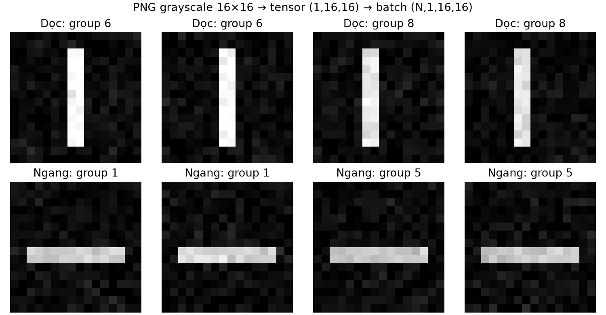
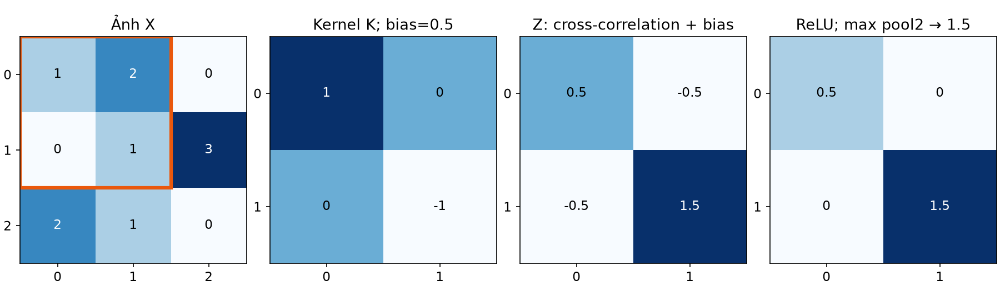
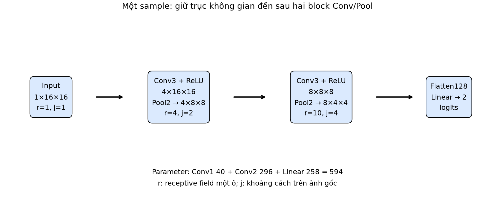
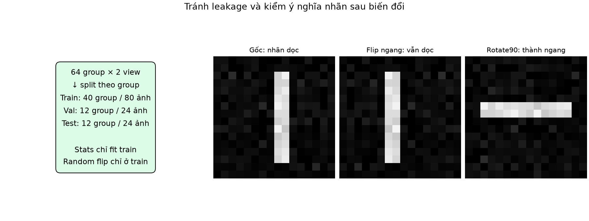
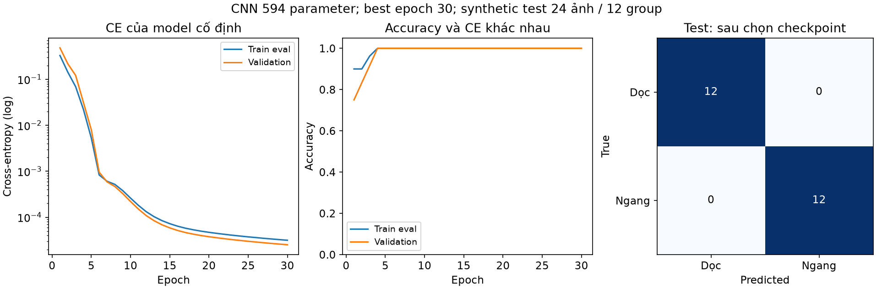

# Bài 14 — CNN và dữ liệu ảnh

[Mục lục](../README.md) · [Bài 13](../13-optimizer-regularization-chan-doan/README.md) · [Bài tập](exercises.md) · [Lời giải](solutions.md)

Biên soạn ngày 04/11/2026. Bài dùng ảnh PNG tự tạo và PyTorch thật trên CPU; không tải dataset, model pretrained hoặc dùng GPU. Các ảnh thanh dọc/ngang là bài toán giảng dạy có chủ đích để kiểm cả dữ liệu, convolution và vòng học, chưa đại diện ảnh thực tế phức tạp.

> [!NOTE]
> **Định nghĩa các khái niệm cốt lõi của bài học:**
> 1. **Convolutional Neural Network (CNN — Mạng nơ-ron tích chập):** Là kiến trúc mạng nơ-ron chuyên biệt cho dữ liệu dạng lưới không gian (như hình ảnh 2D, tín hiệu âm thanh 1D, hoặc video 3D). Thay vì nối mọi điểm ảnh vào nơ-ron như mạng MLP thông thường, CNN sử dụng các bộ lọc trượt nhỏ để tự động trích xuất các đặc trưng từ cơ bản (cạnh, góc, vệt sáng) đến phức tạp (hoa văn, bộ phận, vật thể).
> 2. **Kernel / Filter (Bộ lọc / Nhân tích chập):** Là một ma trận trọng số nhỏ (ví dụ $3 \times 3$ hoặc $5 \times 5$). Khi trượt qua từng vùng của ảnh, nó thực hiện phép nhân có trọng số để phát hiện sự xuất hiện của một hoa văn cục bộ cụ thể.
> 3. **Feature Map (Bản đồ đặc trưng):** Là ma trận kết quả đầu ra sau khi bộ lọc quét qua toàn bộ bức ảnh. Mỗi giá trị trong feature map thể hiện mức độ phản ứng mạnh hay yếu của bộ lọc tại vị trí không gian tương ứng.
> 4. **Pooling (Gộp / Giảm chiều không gian):** Thao tác lấy mẫu phụ (thường là lấy giá trị lớn nhất — Max Pooling) nhằm nén kích thước không gian của feature map, giúp giảm khối lượng tính toán và giữ lại tín hiệu đặc trưng nổi bật nhất.
> 5. **Receptive Field (Vùng cảm nhận thị giác):** Độ rộng của vùng ảnh gốc mà một nơ-ron ở tầng sâu có thể "nhìn thấy" và chịu ảnh hưởng.

## 1. Mục tiêu và kiến thức cần trước

Sau bài này, bạn có thể chuyển ảnh thành tensor đúng trục, tính một convolution nhỏ bằng tay, suy shape và số parameter của CNN, giải thích pooling và receptive field, huấn luyện bộ phân loại ảnh có split theo nhóm và tải model kèm preprocessing để dự đoán.

> [!TIP]
> **Tại sao kỹ sư AI cần hiểu sâu tầng biểu diễn ảnh và phép tính CNN cơ bản?**
> Mặc dù ngày nay có nhiều thư viện cấp cao hỗ trợ sẵn các mô hình thị giác khổng lồ, việc hiểu rõ bản chất thứ tự trục bộ nhớ (`HWC` vs `CHW`), cơ chế chia sẻ trọng số (weight sharing), cách tính kích thước feature map sau stride/padding, và nguy cơ rò rỉ dữ liệu khi chia split theo file ảnh là nền tảng sống còn để bạn tự thiết kế, gỡ lỗi (debug) và triển khai mô hình Computer Vision trong môi trường production thực tế.

Cần bài 3 về shape, bài 7 về confusion matrix, bài 10–11 về autograd/DataLoader, bài 12–13 về validation và optimizer. Đọc phần 2–8, chạy mode `hand`, `shapes`, `images`; sau đó đọc pipeline ảnh và chạy `train`. Chưa cần biết xử lý ảnh cổ điển hoặc mua GPU.

## 2. Ảnh là những con số có cấu trúc

Ảnh grayscale có một giá trị mỗi pixel, thường biểu diễn độ sáng. Ảnh RGB có ba channel đỏ, lục, lam. Với ảnh 8-bit, mỗi channel thường lưu số nguyên 0–255; không phải mọi định dạng ảnh đều là 8-bit hoặc có ba channel. Ảnh RGBA có thêm alpha; ảnh palette cần chuyển mode trước khi hiểu các số như màu.

> [!NOTE]
> **Pixel và Kênh màu (Channels) dưới góc nhìn máy tính:**
> - **Điểm ảnh (Pixel):** Là đơn vị nhỏ nhất cấu thành nên hình ảnh kỹ thuật số.
> - **Ảnh xám (Grayscale / Mode 'L'):** Mỗi pixel chỉ là một con số vô hướng duy nhất biểu diễn cường độ sáng: $0$ là màu đen tuyệt đối, $255$ là màu trắng tuyệt đối, và các giá trị ở giữa là các sắc độ xám.
> - **Ảnh màu (RGB):** Tương tự màn hình TV hoặc điện thoại, mỗi điểm ảnh được pha trộn từ 3 bóng đèn LED siêu nhỏ: Đỏ (Red), Xanh lục (Green), và Xanh lam (Blue). Mỗi pixel là một vector gồm 3 số nguyên $[R, G, B]$ trong khoảng $[0, 255]$.
> - **Kênh Alpha (RGBA):** Kênh thứ 4 biểu thị độ trong suốt (transparency), thường gặp trong đồ họa web hoặc file PNG trong suốt. Khi đưa vào mô hình thị giác máy tính, kênh Alpha thường được loại bỏ hoặc chuyển đổi về RGB/Grayscale để tránh gây nhiễu cho mạng nơ-ron.

Trong ví dụ 8-bit này, pixel RGB `[255,128,0]` sau chia 255 là `[1,0.5019608,0]`. Chia 255 chuyển thang giá trị, chưa phải standardization theo mean/std.

> [!NOTE]
> **Ý nghĩa của việc chia cho 255 (Min-Max Scaling về $[0, 1]$):**
> Trong tính toán số học của mạng nơ-ron, các phép nhân ma trận với số nguyên lớn từ $0$ đến $255$ rất dễ làm giá trị kích hoạt bùng nổ, khiến hàm kích hoạt bị bão hòa và gradient bị triệt tiêu (vanishing gradient). Phép chia cho $255.0$ là bước chuẩn hóa thang đo cơ bản đầu tiên đưa toàn bộ giá trị pixel về dải số thực $[0.0, 1.0]$. Tuy nhiên, đây mới chỉ là co thang đo (rescaling), chưa phải là chuẩn hóa thống kê (standardization: trừ mean, chia std) để dữ liệu có phân phối trung bình $0$ và phương sai $1$.

| Biểu diễn | Shape ví dụ | Ý nghĩa trục |
|---|---|---|
| Mảng NumPy RGB | `(16,16,3)` | H,W,C |
| Một tensor ảnh RGB | `(3,16,16)` | C,H,W |
| Một tensor grayscale | `(1,16,16)` | C,H,W, vẫn giữ channel |
| Batch grayscale 8 ảnh | `(8,1,16,16)` | N,C,H,W |

Bài dùng batch theo NCHW với Conv2d. Channel của feature map sau convolution không còn có nghĩa bắt buộc là màu RGB: đó là những giá trị tính từ filter được học.

> [!IMPORTANT]
> **Quy ước bố cục bộ nhớ: HWC vs CHW vs NCHW**
> - **Thư viện ảnh truyền thống (NumPy, OpenCV, Pillow):** Mặc định lưu theo định dạng **HWC** (Height $\times$ Width $\times$ Channels) — nghĩa là trong bộ nhớ RAM, 3 giá trị màu $R, G, B$ của cùng một pixel được đặt liền kề nhau.
> - **PyTorch & GPU:** Mặc định xử lý theo định dạng **CHW** (Channels $\times$ Height $\times$ Width) hoặc khi gom batch là **NCHW** (Batch Size $\times$ Channels $\times$ Height $\times$ Width). Ở định dạng này, toàn bộ mặt phẳng màu Đỏ của cả bức ảnh nằm cạnh nhau, tiếp theo là toàn bộ mặt phẳng màu Xanh lục, rồi đến Xanh lam. Cấu trúc này giúp GPU thực hiện tính toán tích chập 2D song song trên từng kênh màu với tốc độ tối ưu nhất.
> - **Giữ trục Channel cho ảnh Grayscale:** Đối với ảnh xám, dù chỉ có 1 kênh, PyTorch vẫn bắt buộc tensor phải có shape `(1, H, W)` thay vì ma trận 2D `(H, W)`. Trục channel độc lập là quy ước giao diện bắt buộc của các lớp `torch.nn.Conv2d`.

```python
import numpy as np
import torch
rgb = np.zeros((2,3,3), dtype=np.uint8)  # H=2, W=3, C=3
rgb[0,1] = [255,128,0]
chw = torch.from_numpy(rgb.copy()).permute(2,0,1).float()/255
batch = chw.unsqueeze(0)
print(chw.shape, batch.shape, chw[:,0,1])
```

`permute` đổi thứ tự trục; `reshape(3,2,3)` chỉ sắp cách đọc bộ nhớ, không thay thế phép đổi HWC→CHW. `unsqueeze(0)` thêm trục batch, không biến channel thành batch. Mode `images` kiểm một pixel cụ thể để tránh chỉ kiểm shape rồi bỏ qua ý nghĩa.

> [!WARNING]
> **Cạm bẫy tai hại: `permute` khác hoàn toàn `reshape`!**
> - `permute(2, 0, 1)`: Là thao tác hoán vị không gian vật lý của các chiều dữ liệu. Nó bóc tách mặt phẳng màu kênh 0 (Red), kênh 1 (Green), kênh 2 (Blue) xếp lại thành 3 ma trận $2 \times 3$ chuẩn xác. Giá trị pixel tại tọa độ $(H=0, W=1)$ vẫn giữ nguyên bộ màu $[1.0, 0.502, 0.0]$.
> - `reshape(3, 2, 3)`: Chỉ đơn thuần đọc phẳng dải byte trong bộ nhớ theo thứ tự từ trái qua phải rồi chia thành các lát cắt mới. Khi áp dụng `reshape` lên mảng HWC, các giá trị pixel của các hàng và kênh màu khác nhau sẽ bị trộn lẫn vào nhau, phá hủy hoàn toàn hình ảnh và biến bức tranh thành một mớ nhiễu hạt vô nghĩa!



*Các ảnh minh họa lấy từ corpus tự tạo của lab; 0=dọc, 1=ngang. Mỗi sample vào model có shape (1,16,16).*

## 3. Tại sao dùng convolution thay vì flatten ngay?

Flatten ảnh rồi đưa vào Linear vẫn có thể học, nhưng không tự thể hiện rằng pixel gần nhau có quan hệ không gian. Convolution đưa vào hai giả định: mỗi lần tính nhìn một vùng cục bộ, và dùng cùng filter ở nhiều vị trí. Một mẫu biên hữu ích ở trái ảnh có thể được tìm bằng cùng filter ở phải ảnh.

> [!NOTE]
> **Hai nguyên lý cốt lõi giúp CNN vượt trội hơn MLP trong xử lý hình ảnh:**
> 1. **Tính kết nối cục bộ (Local Connectivity / Receptive Field):** Trong thế giới tự nhiên, các điểm ảnh nằm sát cạnh nhau có mối tương quan rất cao (ví dụ: các pixel gần nhau cùng thuộc về một đường kẻ, một góc bàn hay màu da). Một nơ-ron tích chập chỉ nhìn vào một vùng lân cận nhỏ (cửa sổ $3 \times 3$) thay vì nhìn toàn bộ bức ảnh cùng lúc.
> 2. **Tính chia sẻ trọng số (Weight Sharing) & Bất biến tịnh tiến (Translational Equivariance):** Nếu một bộ lọc $3 \times 3$ học được cách nhận diện "cạnh dọc", bộ lọc đó có thể được trượt đi khắp mọi nơi trên bức tranh để tìm cạnh dọc. Cạnh dọc xuất hiện ở góc trên bên trái hay góc dưới bên phải đều được phát hiện bởi chính bộ trọng số đó, không cần mạng phải học lại một bộ tham số mới cho từng tọa độ.

Một filter không phải quy tắc “biết sẵn vật thể”: weight khởi tạo rồi được học qua loss/backprop. Filter đặt tay trong phần sau chỉ để thấy phép tính. Feature map là kết quả filter trượt qua ảnh; sau nhiều lớp, feature có thể phức tạp hơn nhưng không được mặc định mỗi channel tương ứng một khái niệm con người đặt tên.

> [!NOTE]
> **Sự hình thành đặc trưng qua các tầng sâu (Feature Hierarchy):**
> Trong các mạng CNN sâu (như VGG, ResNet):
> - **Các tầng đầu (Early layers):** Bộ lọc tự học các đường nét thô sơ nhất: cạnh ngang, cạnh dọc, đường chéo, tương phản sáng tối.
> - **Các tầng giữa (Middle layers):** Kết hợp các cạnh thành các họa tiết hình học: góc vuông, vòng tròn, vân lưới, mắt xích.
> - **Các tầng cuối (Deep layers):** Ghép các họa tiết thành các bộ phận hoàn chỉnh: bánh xe, mắt, mũi, cánh hoa... Tuy nhiên, các giá trị này là biểu diễn toán học trừu tượng được tối ưu theo hàm loss, không nên tự gán nhãn chủ quan rằng channel X là "chuyên nhận diện xe tải" hay channel Y là "chuyên nhận diện con mèo".

Ví dụ ảnh grayscale 16×16, Conv2d 1→4, kernel 3×3, có bias: số parameter=4×(1×3×3+1)=**40**. Một Linear 256→4 chỉ cho 4 số và có 1.028 parameter; output của Conv là 4×16×16 khi padding=1, nên hai lớp này **không có cùng output**. Nếu Linear tạo cùng 1.024 số từ 256 input thì có 256×1.024+1.024=263.168 parameter. Ví dụ làm rõ sharing, không phải benchmark CNN luôn nhanh hoặc tốt hơn MLP. [CS231n: convolutional networks](https://cs231n.github.io/convolutional-networks/)

> [!TIP]
> **Minh họa bài toán bùng nổ tham số trong thực tế:**
> Giả sử bạn xử lý một bức ảnh màu thông thường kích thước $224 \times 224 \times 3 \approx 150.528$ giá trị:
> - **Nếu dùng mạng kết nối đầy đủ (MLP / Linear):** Chỉ để tạo ra một tầng ẩn có $1.000$ nơ-ron, bạn cần $150.528 \times 1.000 \approx 150$ triệu tham số ($\approx 600$ MB bộ nhớ chỉ cho 1 tầng duy nhất!). Mạng sẽ khổng lồ, học cực chậm và overfit nghiêm trọng.
> - **Nếu dùng tầng tích chập Conv2d ($3 \to 64$, kernel $3 \times 3$):** Số tham số chỉ vỏn vẹn là $64 \times (3 \times 3 \times 3 + 1) = 1.792$ tham số (chưa đến $8$ KB bộ nhớ!). Cơ chế chia sẻ trọng số giúp CNN giảm số lượng tham số hàng ngàn lần mà vẫn giữ được độ phân giải không gian và cấu trúc hình học của bức ảnh.

## 4. Convolution tính thế nào? Ví dụ từng ô

Trong học sâu, phép thường được gọi convolution là **cross-correlation**: kernel không bị lật trước khi nhân. Bài dùng đúng quy ước Conv2d của PyTorch. Với một channel, stride 1, không padding:

\[
Z_{i,j}=b+\sum_{u,v}K_{u,v}X_{i+u,j+v}.
\]

> [!NOTE]
> **Convolution trong Toán học vs Convolution trong Deep Learning:**
> - Trong toán học và xử lý tín hiệu cổ điển, phép tích chập (Convolution) chuẩn tắc yêu cầu phải lật ngược ma trận nhân theo cả hai chiều ngang và dọc (xoay $180^\circ$) trước khi nhân chập: $K_{lật}(u, v) = K(-u, -v)$.
> - Trong Deep Learning và PyTorch, các trọng số kernel $K$ được khởi tạo ngẫu nhiên và tự động học qua quá trình lan truyền ngược (backpropagation). Việc lật kernel hay không lật kernel không ảnh hưởng đến khả năng biểu diễn toán học, vì optimizer hoàn toàn có thể tự học trọng số ở dạng đã lật. Do đó, hầu hết các framework học sâu đều thực hiện phép **tương quan chéo (Cross-Correlation)** và gọi tắt là Convolution để tiết kiệm thời gian tính toán lật ma trận.

Lấy ảnh và kernel đặt tay:

```text
X = [[1,2,0],      K = [[1, 0],      b = 0.5
     [0,1,3],           [0,-1]]
     [2,1,0]]
```

Kernel 2×2 có bốn vị trí đặt vừa ảnh 3×3:

- Trên trái: 1×1+2×0+0×0+1×(−1)+0.5=**0.5**.
- Trên phải: 2×1+0×0+1×0+3×(−1)+0.5=**−0.5**.
- Dưới trái: 0×1+1×0+2×0+1×(−1)+0.5=**−0.5**.
- Dưới phải: 1×1+3×0+1×0+0×(−1)+0.5=**1.5**.

Kết quả Z=`[[0.5,−0.5],[−0.5,1.5]]`. Bias được cộng **một lần vào mỗi ô output**, không cộng cho mỗi phần tử patch.

> [!NOTE]
> **Giải thích từng bước tính tích chập trên từng mẩu ảnh (Patch):**
> 1. **Cửa sổ trên - trái (Hàng 0-1, Cột 0-1):**
>    $\begin{bmatrix} 1 & 2 \\ 0 & 1 \end{bmatrix} \odot \begin{bmatrix} 1 & 0 \\ 0 & -1 \end{bmatrix} + 0.5 = (1 \times 1 + 2 \times 0 + 0 \times 0 + 1 \times (-1)) + 0.5 = (1 - 1) + 0.5 = 0.5$.
> 2. **Cửa sổ trên - phải (Hàng 0-1, Cột 1-2):**
>    $\begin{bmatrix} 2 & 0 \\ 1 & 3 \end{bmatrix} \odot \begin{bmatrix} 1 & 0 \\ 0 & -1 \end{bmatrix} + 0.5 = (2 \times 1 + 0 \times 0 + 1 \times 0 + 3 \times (-1)) + 0.5 = (2 - 3) + 0.5 = -0.5$.
> 3. **Cửa sổ dưới - trái (Hàng 1-2, Cột 0-1):**
>    $\begin{bmatrix} 0 & 1 \\ 2 & 1 \end{bmatrix} \odot \begin{bmatrix} 1 & 0 \\ 0 & -1 \end{bmatrix} + 0.5 = (0 \times 1 + 1 \times 0 + 2 \times 0 + 1 \times (-1)) + 0.5 = (0 - 1) + 0.5 = -0.5$.
> 4. **Cửa sổ dưới - phải (Hàng 1-2, Cột 1-2):**
>    $\begin{bmatrix} 1 & 3 \\ 1 & 0 \end{bmatrix} \odot \begin{bmatrix} 1 & 0 \\ 0 & -1 \end{bmatrix} + 0.5 = (1 \times 1 + 3 \times 0 + 1 \times 0 + 0 \times (-1)) + 0.5 = (1 - 0) + 0.5 = 1.5$.
> - **Lưu ý về Bias:** Bias $b = 0.5$ là một số thực vô hướng duy nhất gắn liền với bộ lọc đó. Nó được cộng vào kết quả tổng của cả cửa sổ, hoàn toàn không phải cộng vào từng pixel thành phần.

```python
import torch
from torch.nn import functional as F
x = torch.tensor([[[[1.,2.,0.],[0.,1.,3.],[2.,1.,0.]]]])
k = torch.tensor([[[[1.,0.],[0.,-1.]]]])
z = F.conv2d(x,k,bias=torch.tensor([.5]))
print(z)
```



*Kernel dùng lại ở bốn patch. Code conv_loop dùng vòng lặp NumPy độc lập để đối chiếu F.conv2d.*

### Nhiều channel và nhiều filter

Nếu có C_in channel, một filter bình thường có C_in×kH×kW weight. Nhân patch của từng channel với phần kernel tương ứng, **cộng qua cả channel**, rồi cộng một bias để ra một ô của một output channel. Không áp một kernel 2D riêng rẽ rồi mặc định ba màu tự trở thành ba class.

> [!NOTE]
> **Cơ chế hoạt động khi ảnh có nhiều kênh (Multi-channel Convolution):**
> - Giả sử ảnh đầu vào có $C_{in} = 3$ kênh màu (R, G, B). Một bộ lọc (filter) để tạo ra **1 kênh đặc trưng đầu ra** không phải là một lát cắt 2D, mà là một khối hộp 3D có kích thước $(C_{in}, kH, kW)$ (ví dụ $3 \times 3 \times 3 = 27$ trọng số).
> - Khi trượt qua ảnh, phần lát cắt màu Đỏ của filter nhân với mẩu ảnh màu Đỏ, lát cắt Xanh lục nhân với mẩu ảnh Xanh lục, lát cắt Xanh lam nhân với mẩu ảnh Xanh lam.
> - **Sau đó, kết quả tích chập của cả 3 kênh được cộng dồn lại với nhau thành một con số duy nhất**, rồi cộng thêm 1 giá trị bias để tạo ra đúng 1 pixel trên feature map đầu ra!
> - Để tạo ra $C_{out}$ kênh đặc trưng đầu ra khác nhau (ví dụ 64 kênh), mô hình sử dụng $C_{out}$ khối bộ lọc độc lập như vậy.

Với groups=1, shape weight là `(C_out,C_in,kH,kW)`, bias `(C_out,)`. Ví dụ Conv2d(3,8,3) có 8×(3×9+1)=224 parameter. Batch size và H,W không xuất hiện trong số parameter, nhưng vẫn ảnh hưởng số phép tính và bộ nhớ activation. [Conv2d API](https://docs.pytorch.org/docs/2.15/generated/torch.nn.Conv2d.html)

> [!NOTE]
> **Công thức đếm số tham số của lớp Conv2d:**
> $$\text{Parameters} = C_{out} \times (C_{in} \times kH \times kW + 1)$$
> Với `nn.Conv2d(in_channels=3, out_channels=8, kernel_size=3)`:
> - Mỗi filter có kích thước không gian $3 \times 3 = 9$.
> - Vì đầu vào có 3 channel, mỗi filter cần $3 \times 9 = 27$ trọng số ma trận.
> - Cộng thêm 1 trọng số bias cho mỗi filter $\implies 27 + 1 = 28$ tham số/filter.
> - Có tất cả 8 filter độc lập $\implies 8 \times 28 = 224$ tham số.
> - Kích thước ảnh đầu vào ($H, W$) và kích thước batch ($N$) hoàn toàn không làm thay đổi số lượng tham số của tầng Conv2d.

## 5. Stride, padding và kích thước output

Stride s là khoảng dịch giữa hai vị trí kernel. Padding p thêm biên quanh input; zero padding thêm số 0 ở biên. Với dilation d, kích thước kernel hiệu dụng là d(k−1)+1. Cho từng trục:

\[
H_{out}=\left\lfloor\frac{H+2p-d(k-1)-1}{s}\right\rfloor+1.
\]

W dùng công thức tương tự. Bài thực nghiệm dilation=1, groups=1; dilation khác chỉ được giới thiệu qua công thức.

> [!NOTE]
> **Ý nghĩa trực quan của Stride và Padding:**
> - **Stride ($s$ — Bước nhảy):** Là số bước mà cửa sổ kernel dịch chuyển sau mỗi lần tính toán.
>   - $s = 1$: Kernel dịch từng pixel một, quét rất kỹ lưỡng và bảo tồn chi tiết không gian.
>   - $s = 2$: Kernel nhảy cóc 2 pixel một lần, kích thước ảnh đầu ra sẽ giảm đi xấp xỉ một nửa (downsampling), tương tự như thu nhỏ ảnh.
> - **Padding ($p$ — Đệm biên):** Là việc đệm thêm các hàng và cột số 0 (Zero-Padding) bao quanh mép ngoài của bức ảnh.
>   - **Mục đích 1 (Chống teo ảnh):** Khi không có padding ($p=0$), mỗi lần qua tầng tích chập kích thước ảnh sẽ bị co lại $(k-1)$ pixel. Sau vài tầng, ảnh sẽ biến mất! Đệm $p=1$ với kernel $3 \times 3$ giúp giữ nguyên kích thước không gian ($H_{out} = H_{in}$).
>   - **Mục đích 2 (Bảo vệ thông tin viền ảnh):** Nếu không có padding, các pixel nằm ở 4 góc và đường viền ảnh chỉ được kernel quét qua đúng 1 lần, trong khi các pixel ở trung tâm được quét lặp lại nhiều lần. Đệm viền số 0 giúp các pixel ở mép được tham gia bình đẳng vào nhiều cửa sổ quét hơn.

Với H=5,k=3,d=1:

| Padding | Stride | Tính tay | H_out |
|---:|---:|---|---:|
| 0 | 1 | floor((5−3)/1)+1 | 3 |
| 1 | 1 | floor((5+2−3)/1)+1 | 5 |
| 0 | 2 | floor((5−3)/2)+1 | 2 |
| 1 | 2 | floor((5+2−3)/2)+1 | 3 |

Đừng bỏ floor khi chia không hết: H=6,k=3,p=0,s=2 cho floor(3/2)+1=2. Với kernel/padding/stride không hợp lệ, output có thể không tồn tại và framework báo lỗi. `padding=1` không luôn giữ kích thước: điều đó đúng trong trường hợp k=3,s=1,d=1 của lab. Với các biên hữu hạn, padding còn ảnh hưởng nội dung feature ở rìa.

> [!TIP]
> **Quy tắc "Same Padding" phổ biến nhất trong kiến trúc CNN:**
> Để giữ nguyên kích thước không gian sau khi qua tầng Conv2d (tức $H_{out} = H_{in}$) với bước nhảy $s=1$ và dilation $d=1$, ta luôn chọn:
> $$p = \frac{k - 1}{2}$$
> - Nếu kernel $3 \times 3 \implies p = \frac{3 - 1}{2} = 1$.
> - Nếu kernel $5 \times 5 \implies p = \frac{5 - 1}{2} = 2$.
> - Nếu kernel $7 \times 7 \implies p = \frac{7 - 1}{2} = 3$.
> Đó là lý do tại sao trong thực tế các kỹ sư Deep Learning hầu như luôn chọn kích thước kernel là số lẻ ($3, 5, 7$) để padding luôn là số nguyên đối xứng cân bằng hai bên mép ảnh.

## 6. ReLU và pooling làm gì?

ReLU áp từng phần tử: max(0,z). Từ Z ở phần 4, A=`[[0.5,0],[0,1.5]]`. MaxPool2d kernel2,stride2 trên A cho một số **1.5**. Pooling không có weight học được; nó chọn max trong mỗi cửa sổ và giảm kích thước theo cấu hình.

> [!NOTE]
> **Vai trò của ReLU và Max Pooling:**
> - **Hàm kích hoạt phi tuyến ReLU ($A = \max(0, Z)$):** Khử toàn bộ các giá trị âm về 0 và giữ nguyên các giá trị dương. Điều này tạo ra tính phi tuyến, giúp mạng học được các hàm phức tạp và tạo ra biểu diễn thưa (sparse activation — chỉ những nơ-ron nhận diện được đúng hoa văn mới "bật sáng").
> - **Max Pooling:** Hoạt động giống như một chiếc kính lúp trượt, nhưng thay vì nhân ma trận trọng số, nó chỉ đơn giản chọn ra giá trị lớn nhất trong cửa sổ (ví dụ $2 \times 2$). **Max Pooling hoàn toàn không có bất kỳ tham số học được (weights = 0)**.

Với A=`[[1,3,2,0],[4,6,1,2],[0,1,5,4],[2,3,0,7]]`, max pool2,stride2 cho `[[6,2],[3,7]]`. Nếu dùng average pooling trên cùng các cửa sổ thì giá trị khác; không gọi hai phép là một. Lab chỉ huấn luyện với max pooling mặc định ceil_mode=False. [MaxPool2d](https://docs.pytorch.org/docs/2.15/generated/torch.nn.MaxPool2d.html)

> [!NOTE]
> **Minh họa tính tay Max Pooling $2 \times 2$, Stride 2:**
> Cho ma trận $4 \times 4$:
> $$\begin{bmatrix} 1 & 3 & 2 & 0 \\ 4 & \mathbf{6} & 1 & \mathbf{2} \\ 0 & 1 & \mathbf{5} & 4 \\ 2 & \mathbf{3} & 0 & \mathbf{7} \end{bmatrix}$$
> Chia thành 4 ô không chồng lấn:
> - Cửa sổ trên - trái $\begin{bmatrix} 1 & 3 \\ 4 & 6 \end{bmatrix} \implies \max = 6$.
> - Cửa sổ trên - phải $\begin{bmatrix} 2 & 0 \\ 1 & 2 \end{bmatrix} \implies \max = 2$.
> - Cửa sổ dưới - trái $\begin{bmatrix} 0 & 1 \\ 2 & 3 \end{bmatrix} \implies \max = 3$.
> - Cửa sổ dưới - phải $\begin{bmatrix} 5 & 4 \\ 0 & 7 \end{bmatrix} \implies \max = 7$.
> Ma trận thu nhỏ lại thành $2 \times 2$: $\begin{bmatrix} 6 & 2 \\ 3 & 7 \end{bmatrix}$. Kích thước không gian giảm $75\%$ ($16 \to 4$ ô), giúp giảm đáng kể lượng tính toán cho các tầng tiếp theo.

Pool làm mất thông tin vị trí chi tiết trong cửa sổ. Nó có thể giúp giảm độ nhạy với một số dịch chuyển nhỏ, nhưng không bảo đảm toàn mạng bất biến với mọi phép dịch. Convolution stride1 thường có tính equivariance theo dịch chuyển ở vùng thích hợp: input dịch thì feature dịch tương ứng. Boundary, stride, pooling và head phụ thuộc vị trí có thể làm quan hệ đó không còn chính xác. Lab không chứng minh tính bất biến của CNN.

> [!NOTE]
> **Phân biệt Tính tương đương tịnh tiến (Equivariance) vs Tính bất biến tịnh tiến (Invariance):**
> - **Tính tương đương tịnh tiến (Translational Equivariance) của Convolution:** Nếu dịch chuyển đối tượng trong ảnh sang phải 3 pixel, đặc trưng được kích hoạt trên feature map cũng dịch chuyển sang phải tương ứng. Mạng vẫn "nhận ra vật thể và biết nó đang ở đâu".
> - **Tính bất biến cục bộ (Local Invariance) của Max Pooling:** Trong phạm vi cửa sổ $2 \times 2$, cho dù nét vẽ dịch chuyển nhẹ từ góc trên sang góc dưới của ô, giá trị cực đại $\max$ rút trích ra vẫn như cũ. Điều này giúp mô hình bớt nhạy cảm với các rung lắc nhẹ của camera hoặc góc chụp.

## 7. CNN nhỏ: theo shape đến logits

Model trong [lab.py](lab.py) nhận grayscale 16×16. Hãy đọc shape trước khi chạy:

| Lớp | Output với batch N | Parameter |
|---|---|---:|
| Input | N×1×16×16 | 0 |
| Conv2d 1→4, k3,p1 → ReLU | N×4×16×16 | 40 |
| MaxPool k2,s2 | N×4×8×8 | 0 |
| Conv2d 4→8,k3,p1 → ReLU | N×8×8×8 | 8×(4×9+1)=296 |
| MaxPool k2,s2 | N×8×4×4 | 0 |
| Flatten(start_dim=1) | N×128 | 0 |
| Linear 128→2 | N×2 | 2×128+2=258 |
| Tổng | 2 logits/mẫu | **594** |

> [!NOTE]
> **Giải phẫu kiến trúc và phép tính tham số từng tầng:**
> 1. **Conv2d 1 (1 channel vào $\to$ 4 filters ra, kernel $3 \times 3$, padding 1):**
>    - Mỗi filter: $1 \times (3 \times 3) + 1 \text{ (bias)} = 10$ tham số.
>    - 4 filters: $4 \times 10 = \mathbf{40}$ tham số. Kích thước giữ nguyên $16 \times 16$.
> 2. **MaxPool2d 1 (kernel 2, stride 2):**
>    - Không có tham số ($0$). Kích thước giảm một nửa: $16 \times 16 \to 8 \times 8$. Shape: $(N, 4, 8, 8)$.
> 3. **Conv2d 2 (4 channels vào $\to$ 8 filters ra, kernel $3 \times 3$, padding 1):**
>    - Mỗi filter: $4 \times (3 \times 3) + 1 \text{ (bias)} = 37$ tham số.
>    - 8 filters: $8 \times 37 = \mathbf{296}$ tham số. Kích thước giữ nguyên $8 \times 8$. Shape: $(N, 8, 8, 8)$.
> 4. **MaxPool2d 2 (kernel 2, stride 2):**
>    - Không có tham số ($0$). Kích thước giảm một nửa: $8 \times 8 \to 4 \times 4$. Shape: $(N, 8, 4, 4)$.
> 5. **Flatten (trải phẳng không gian):**
>    - Duỗi thẳng khối tensor 3D $(8, 4, 4)$ thành vector 1D có kích thước $8 \times 4 \times 4 = \mathbf{128}$ phần tử. Không có tham số ($0$). Shape: $(N, 128)$.
> 6. **Linear Head (Phân loại 2 lớp: dọc vs ngang):**
>    - $W \in \mathbb{R}^{2 \times 128}$, $b \in \mathbb{R}^2 \implies 2 \times 128 + 2 = \mathbf{258}$ tham số. Shape: $(N, 2)$.
> - **Tổng số tham số toàn mạng:** $40 + 296 + 258 = \mathbf{594}$ tham số.

```python
from lab import shape_demo
print(shape_demo())
```

Flatten bắt đầu ở trục 1 để giữ batch. `flatten()` không chỉ định trục có thể trộn cả batch; input sai 32×32 cũng làm head cố định 128 feature không khớp. Không sửa bằng reshape ép số phần tử để che lỗi kiến trúc. Nếu muốn nhiều kích thước ảnh, cần thiết kế resize/crop hoặc head khác; bài chưa huấn luyện adaptive pooling.

> [!WARNING]
> **Cạm bẫy `nn.Flatten(start_dim=1)`:**
> Mặc định nếu gọi `torch.flatten(x)` mà không chỉ định trục, PyTorch sẽ duỗi phẳng toàn bộ tensor bao gồm cả chiều Batch $N$ thành một vector 1D duy nhất! Khi đó thông tin giữa các mẫu ảnh trong batch sẽ bị hòa trộn lẫn lộn. Lớp `nn.Flatten(start_dim=1)` đảm bảo chiều batch $N$ được giữ nguyên vẹn ở vị trí trục 0, chỉ duỗi phẳng các chiều $(C, H, W)$ đằng sau: $(N, C, H, W) \to (N, C \times H \times W)$.

### Receptive field: một feature nhìn vùng nào?

Gọi r là độ rộng vùng input có thể ảnh hưởng một vị trí, j là khoảng cách trên ảnh gốc giữa hai vị trí feature kề nhau. Bắt đầu r=1,j=1. Với layer kernel k,dilation1,stride s: r_mới=r+(k−1)j; j_mới=js.

Conv3→Pool2→Conv3→Pool2 cho `(r,j)` lần lượt `(3,1),(4,2),(8,2),(10,4)`. Một ô feature cuối có receptive field lý thuyết 10×10, bao gồm phần padding nếu gần biên. Head Linear nối tất cả ô, nên một logit có thể phụ thuộc nhiều vùng hợp lại của ảnh, không chỉ một ô 10×10. Đây là phạm vi phụ thuộc tiềm năng, không có nghĩa mọi pixel đóng góp ngang nhau.

> [!NOTE]
> **Giải thích công thức và bảng tính Receptive Field:**
> - **Khái niệm:** $r$ là kích thước vùng ảnh gốc nhìn thấy được, $j$ (jump) là bước nhảy giữa hai vị trí liên tiếp trên feature map khi chiếu ngược về ảnh gốc.
> - **Khởi tạo ban đầu tại ảnh gốc:** $r_0 = 1, j_0 = 1$.
> 1. **Sau Conv2d 1 ($k=3, s=1$):**
>    $r_1 = r_0 + (3 - 1) \times j_0 = 1 + 2 \times 1 = \mathbf{3}$, $j_1 = j_0 \times 1 = \mathbf{1}$. Mỗi ô nhìn thấy vùng $3 \times 3$.
> 2. **Sau MaxPool 1 ($k=2, s=2$):**
>    $r_2 = 3 + (2 - 1) \times 1 = \mathbf{4}$, $j_2 = 1 \times 2 = \mathbf{2}$. Vùng nhìn mở rộng thành $4 \times 4$, bước nhảy tăng lên 2.
> 3. **Sau Conv2d 2 ($k=3, s=1$):**
>    $r_3 = 4 + (3 - 1) \times 2 = 4 + 4 = \mathbf{8}$, $j_3 = 2 \times 1 = \mathbf{2}$. Vùng nhìn mở rộng lên $8 \times 8$.
> 4. **Sau MaxPool 2 ($k=2, s=2$):**
>    $r_4 = 8 + (2 - 1) \times 2 = \mathbf{10}$, $j_4 = 2 \times 2 = \mathbf{4}$.
> - **Ý nghĩa thực tiễn:** Một ô nhỏ $1 \times 1$ ở feature map cuối cùng trước khi vào tầng Linear thực chất đã "nhìn thấu" và tổng hợp thông tin từ một vùng rộng lớn $10 \times 10$ trên bức ảnh $16 \times 16$ ban đầu!



## 8. CNN cũng học bằng backprop

Weight convolution dùng chung qua nhiều patch nên gradient weight nhận tổng đóng góp từ các vị trí đã dùng nó. Không tạo một bộ weight riêng cho từng ô output.

> [!NOTE]
> **Quy tắc cộng dồn Gradient khi Chia sẻ Trọng số (Weight Sharing):**
> Trong phép tích chập, một bộ lọc kernel $K$ được trượt qua rất nhiều vị trí khác nhau trên bức ảnh. Khi tính lan truyền ngược (backpropagation), theo quy tắc đạo hàm nhiều nhánh (Multivariate Chain Rule - Bài 10):
> $$\frac{\partial L}{\partial K} = \sum_{\text{mọi patch } (i, j)} \frac{\partial L}{\partial Z_{i,j}} \cdot \frac{\partial Z_{i,j}}{\partial K} = \sum_{\text{mọi patch } (i, j)} \text{Upstream Gradient} \times X_{\text{patch }(i,j)}$$
> Do đó, gradient cập nhật cho kernel là **tổng tích lũy** gradient từ tất cả các vị trí mà kernel đã quét qua trên toàn bộ bức ảnh.

Để tính tay dễ kiểm, chọn **L=sum(Z)** của convolution phần 4, chưa qua ReLU/pooling. Upstream gradient mỗi ô là 1, nên gradient kernel là tổng bốn patch:

```text
dK = [[1+2+0+1, 2+0+1+3], = [[4,6],
      [0+1+2+1, 1+3+1+0]]    [4,5]]
db = 1+1+1+1 = 4
```

Mode `hand` kiểm forward, dK và db bằng autograd float64. Nếu L=mean(Z) thì các gradient này chia 4. Nếu L là classification loss qua ReLU, pooling, head, upstream gradient khác; không lấy dK trên làm gradient của CNN đang phân loại. Tại max pool có một max duy nhất, gradient truyền về vị trí được chọn; bài không khảo sát quy tắc hòa max.

> [!NOTE]
> **Giải thích chi tiết phép cộng 4 mẩu ảnh:**
> Bốn mẩu ảnh ứng với 4 vị trí đặt kernel ở Phần 4:
> - Patch trên-trái: $\begin{bmatrix} 1 & 2 \\ 0 & 1 \end{bmatrix}$, Patch trên-phải: $\begin{bmatrix} 2 & 0 \\ 1 & 3 \end{bmatrix}$, Patch dưới-trái: $\begin{bmatrix} 0 & 1 \\ 2 & 1 \end{bmatrix}$, Patch dưới-phải: $\begin{bmatrix} 1 & 3 \\ 1 & 0 \end{bmatrix}$.
> - Vì $L = \sum Z \implies \frac{\partial L}{\partial Z_{i,j}} = 1$ cho cả 4 ô.
> - Gradient của kernel:
>   $dK = \begin{bmatrix} 1 & 2 \\ 0 & 1 \end{bmatrix} + \begin{bmatrix} 2 & 0 \\ 1 & 3 \end{bmatrix} + \begin{bmatrix} 0 & 1 \\ 2 & 1 \end{bmatrix} + \begin{bmatrix} 1 & 3 \\ 1 & 0 \end{bmatrix} = \begin{bmatrix} 1+2+0+1 & 2+0+1+3 \\ 0+1+2+1 & 1+3+1+0 \end{bmatrix} = \begin{bmatrix} 4 & 6 \\ 4 & 5 \end{bmatrix}$.
> - Gradient của bias: Mỗi ô cộng 1 lần bias $\implies db = 1 + 1 + 1 + 1 = 4$.

Model phân loại cuối nhận **logits N×2** và target class ID shape `(N,)`, dtype long: 0=dọc,1=ngang. CrossEntropyLoss đã kết hợp log-softmax với loss theo nhãn; không softmax logits trước khi đưa vào loss ở đây. Ví dụ logits `[2,0]`, nhãn0: p₀=e²/(e²+1)≈0.880797; loss=−log(p₀)≈**0.126928011**. Với một mẫu, gradient logit là `[p₀−1,p₁]≈[−0.119203,0.119203]`. [CrossEntropyLoss](https://docs.pytorch.org/docs/2.15/generated/torch.nn.CrossEntropyLoss.html)

> [!IMPORTANT]
> **Không Softmax trước `nn.CrossEntropyLoss`:**
> Trong PyTorch, lớp `nn.CrossEntropyLoss` nhận đầu vào là **Logits thô** (chưa qua chuẩn hóa xác suất). Bên trong nó đã tích hợp sẵn phép tính toán ổn định số học kết hợp giữa $\log(\text{Softmax}(\cdot))$ và hàm mất mát Negative Log-Likelihood (NLLLoss). Nếu bạn tự ý gọi `softmax(logits)` trước khi đưa vào `CrossEntropyLoss`, bạn đang tính log của xác suất hai lần, dẫn đến kết quả sai hoàn toàn và gradient bị lỗi.

## 9. Đường đi từ file ảnh đến batch

Lab thực sự ghi PNG rồi đọc lại bằng Pillow; không chỉ giữ tensor đã tạo trong RAM. `read_gray` thực hiện:

1. `with Image.open(path)` và chuyển mode `'L'` rõ ràng.
2. Copy pixel thành mảng uint8, kiểm shape 16×16.
3. Chuyển float32, thêm channel và chia255 → shape `(1,16,16)`, giá trị [0,1].
4. Dataset có thể flip ngang nếu thuộc train; sau đó áp `(x−mean_train)/std_train`.
5. DataLoader gộp thành `(N,1,16,16)` và nhãn `(N,)` long.

Dùng context manager để đóng file, và mảng copy độc lập với đối tượng ảnh. Bài không tự resize ảnh sai kích thước: nó báo lỗi, giúp thấy hợp đồng input. Ảnh RGB thực tế được chuyển về grayscale bởi loader này, nên thông tin màu mất đi; muốn học RGB phải đổi cả preprocessing và in_channels. [Pillow: Image](https://pillow.readthedocs.io/en/stable/reference/Image.html)

> [!NOTE]
> **Quy trình chuẩn kỹ thuật nạp dữ liệu ảnh trong Production:**
> - Sử dụng `with Image.open(path) as image:` đảm bảo file handle của hệ điều hành luôn được đóng ngay sau khi đọc, tránh lỗi cạn kiệt tài nguyên file descriptor (OS error: Too many open files) khi lặp qua hàng triệu ảnh.
> - Tạo bản sao mảng độc lập (`np.array(..., copy=True)`) giúp tách rời bộ đệm RAM của tensor khỏi đối tượng ảnh Pillow, tránh lỗi rò rỉ bộ nhớ (memory leak).
> - Kiểm tra shape nghiêm ngặt: Trong thị giác máy tính, việc âm thầm tự động bóp méo (stretch/resize) một bức ảnh sai tỉ lệ khung hình có thể làm mất đi các chi tiết bệnh lý trong ảnh y tế hoặc làm biến dạng logo sản phẩm. Báo lỗi rõ ràng giúp kiểm soát chặt chẽ hợp đồng dữ liệu đầu vào.

**Tính tay preprocessing:** pixel128 → 128/255≈0.5019608. Nếu mean_train=.25,std_train=.5 thì giá trị chuẩn hóa≈0.5039216. Sau standardization, giá trị có thể âm hoặc lớn hơn1. Mean/std phải dùng cùng thang đã chia255, không trộn mean0–255 với input0–1.

> [!NOTE]
> **Giải thích công thức chuẩn hóa từng pixel:**
> 1. Đưa về thang $[0, 1]$: $x_{rescaled} = \frac{128}{255} \approx 0.50196078$.
> 2. Chuẩn hóa theo thống kê tập Train:
>    $$x_{standardized} = \frac{x_{rescaled} - \mu_{train}}{\sigma_{train}} = \frac{0.50196078 - 0.25}{0.5} = \frac{0.25196078}{0.5} \approx \mathbf{0.50392157}$$
> Sau bước này, các pixel tối hơn mức trung bình sẽ mang giá trị âm, pixel sáng hơn mức trung bình mang giá trị dương. Phân phối dữ liệu đưa về quanh 0 giúp gradient lan truyền đối xứng và ổn định hơn.

Trong run thực, mean≈**0.122097693**, std≈**0.246240273**, tính chỉ từ 80 ảnh train trước random augmentation, std dùng correction=0 trên tất cả pixel. Ảnh một channel nên có một mean/std; RGB thường cần xét theo channel. Validation/test dùng nguyên stats train. Không fit lại stats trên ảnh cần dự đoán; checkpoint lưu stats và class mapping để tránh train/serving mismatch.

> [!IMPORTANT]
> **Nguyên tắc bất di bất dịch: Không bao giờ fit Mean/Std trên tập Test hoặc ảnh Inference!**
> Thông số thống kê $\mu_{train}$ và $\sigma_{train}$ là "tri thức" học được từ tập huấn luyện. Khi đưa mô hình vào triển khai thực tế (serving / production), bất kỳ bức ảnh mới nào người dùng gửi lên đều phải được chuẩn hóa bằng chính xác $\mu_{train}$ và $\sigma_{train}$ đã lưu trong checkpoint. Nếu mỗi bức ảnh inference tự tính mean/std của riêng nó, một bức ảnh toàn màu đen sẽ bị lỗi chia cho 0, hoặc một bức ảnh chụp trong bóng tối sẽ bị phóng đại tương phản sai lệch hoàn toàn so với phân phối mà mô hình đã học.

Với ảnh thực tế còn phải xử lý EXIF orientation, RGB/BGR theo thư viện đọc, alpha, ảnh hỏng, aspect ratio khi resize/crop, metadata và nguồn nhãn. Lab chỉ kiểm PNG grayscale tự tạo, không triển khai các xử lý đó. Resize có thể méo hình; crop có thể cắt mất đối tượng. Đó là quyết định dữ liệu cần kiểm theo bài toán, không chỉ đổi shape cho code chạy.

## 10. Split theo ảnh gốc và augmentation giữ nghĩa nhãn

Corpus có 64 group ảnh gốc, 32 group mỗi lớp. Mỗi group có cùng vị trí/độ sáng thanh và hai view nhiễu pixel độc lập. Split theo group và cân bằng lớp: 40 group train,12 validation,12 test; sau tạo hai view mỗi group có **80/24/24 ảnh**, tổng128 PNG. Group ID luôn chỉ nằm trong một tập; manifest lưu đường dẫn, nhãn, group, split và SHA-256 file.

Nếu chia ngẫu nhiên từng view, ảnh gần giống cùng nguồn có thể xuất hiện ở train và test. Với dữ liệu thật, group có thể là sản phẩm, bệnh nhân, video hoặc phiên chụp; hash file chỉ tìm trùng byte, không đủ phát hiện mọi ảnh gần trùng. Lab dùng group biết từ lúc tạo, không coi chỉ cần hash là hết leakage.

> [!WARNING]
> **Rò rỉ dữ liệu trong Thị giác máy tính (Computer Vision Data Leakage):**
> Hãy hình dung bạn xây dựng mô hình phát hiện khối u từ ảnh X-quang:
> - Mỗi bệnh nhân được chụp 3 tấm ảnh ở các góc chụp khác nhau.
> - **Nếu chia ngẫu nhiên từng file ảnh:** Tấm ảnh 1 và 2 của bệnh nhân A nằm ở tập Train, tấm ảnh 3 của chính bệnh nhân A lại nằm ở tập Test!
> - **Hậu quả tai hại:** Mạng nơ-ron không hề học cách nhận diện khối u. Nó chỉ học nhận diện đặc điểm khung xương, hình xăm, hay vết xước trên tấm phim của bệnh nhân A. Kết quả đánh giá trên test đạt $99\%$ độ chính xác giả tạo, nhưng khi đưa sang bệnh viện khác áp dụng cho bệnh nhân mới thì mô hình thất bại hoàn toàn!
> - **Giải pháp bắt buộc:** Phải chia split theo **Group (Nhóm nguồn)**: Toàn bộ ảnh của cùng một bệnh nhân (hoặc cùng một sản phẩm/khung video) bắt buộc phải nằm trọn vẹn trong duy nhất một tập Train, Validation, hoặc Test.

Augmentation không tự tạo thêm các quan sát độc lập. Lab chỉ random horizontal flip trên train: thanh dọc vẫn dọc, thanh ngang vẫn ngang. Rotate90 đổi dọc thành ngang, nên xoay mà giữ nguyên nhãn sẽ tạo mẫu sai. Một biến đổi hợp lệ ở bài này có thể không hợp lệ với chữ viết, hướng giao thông hoặc ảnh y khoa. Validation/test không random transform; `PNGDataset(..., augment=True)` với tập khác train bị chặn.

> [!NOTE]
> **Bản chất của Tăng cường dữ liệu (Data Augmentation) giữ nguyên ý nghĩa nhãn:**
> - Data Augmentation là kỹ thuật tạo thêm biến thể ảnh trong lúc huấn luyện (xoay nhẹ, lật, thay đổi độ sáng) để mô hình học được tính bất biến.
> - **Tuy nhiên, phép biến đổi phải bảo toàn nhãn (Label-Preserving Transformation):**
>   - Trong bài toán này (phân biệt thanh dọc vs thanh ngang): Lật ngang (Horizontal Flip) biến thanh dọc thành thanh dọc, thanh ngang thành thanh ngang $\implies$ **Hợp lệ**.
>   - Nếu xoay $90^\circ$ (Rotate 90): Thanh dọc biến thành thanh ngang nhưng nhãn vẫn bị gán là "dọc" $\implies$ **Làm sai lệch nhãn hoàn toàn**, mô hình bị "đầu độc" dữ liệu!
>   - Tương tự trong bài toán nhận diện chữ viết số (MNIST): Lật ngược số $6$ sẽ biến thành số $9$; lật ngang chữ "b" sẽ biến thành chữ "d". Bạn không thể áp dụng bừa bãi một kỹ thuật augmentation mà không xem xét ngữ nghĩa của bài toán.



*Split theo nguồn trước, augmentation online sau. Hai view của cùng group không được đi sang hai tập.*

## 11. Thực nghiệm: huấn luyện, chọn epoch và dự đoán

Một kiến trúc/cấu hình được định trước: model 594 parameter ở phần 7, Adam lr=.01, batch16, seed2026, tối đa30 epoch, CPU float32. Train có random flip, shuffle; worker0. Mỗi epoch5 optimizer update, tổng150 update. Đo lại train với transform deterministic riêng; validation không augmentation. Giữ checkpoint có validation CE thấp nhất; hòa giữ epoch sớm hơn. Không quét hyperparameter trên test.

Kết quả thực chạy:

| Đại lượng | Kết quả |
|---|---|
| Best epoch theo validation loss | 30 |
| Validation CE / accuracy | ≈0.0000252064 / 24/24=100% |
| Test CE / accuracy sau lựa chọn | ≈0.0001328481 / 24/24=100% |
| Baseline majority train: validation accuracy | 50% |
| Confusion test, hàng=true,cột=predicted, thứ tự dọc/ngang | `[[12,0],[0,12]]` |

Chọn bằng **loss**, không bằng accuracy cuối: accuracy có thể đã100% trước khi CE tiếp tục giảm. Test chỉ được chấm cho checkpoint đã chọn sau vòng train. Sau đó code dùng một ảnh test để kiểm hai đường inference cùng cho dự đoán bằng nhau, không dùng ảnh đó để chọn lại model. `prediction_roundtrip=True` xác nhận load checkpoint, preprocessing và class mapping nhất quán.

> [!NOTE]
> **Tại sao chọn checkpoint bằng Validation Loss thay vì Validation Accuracy?**
> - Accuracy là một hàm bậc thang không liên tục: Nếu mô hình dự đoán xác suất lớp đúng tăng từ $51\%$ lên $99\%$, accuracy vẫn giữ nguyên $100\%$. Nhưng rõ ràng mô hình ở mức tin cậy $99\%$ tự tin và khái quát hóa tốt hơn rất nhiều so với mô hình ở mức $51\%$.
> - Cross-Entropy Loss phản ánh liên tục độ tin cậy của phân phối xác suất. Việc chọn epoch có validation loss thấp nhất giúp bạn lấy được checkpoint có biên độ an toàn cực đại và phân phối xác suất sắc nét nhất.

Đây là mẫu hình synthetic rất dễ, không chứng minh CNN đạt100% trên ảnh thật hoặc chịu được domain shift. Test24 ảnh chỉ đến từ12 group nên không coi là24 quan sát nguồn độc lập để báo khoảng tin cậy ngây thơ. Không so CNN với MLP hoặc model pretrained trong lab này.



```python
from pathlib import Path
from tempfile import TemporaryDirectory
from lab import Config, train, predict_file
with TemporaryDirectory() as directory:
    out = Path(directory)/'run'
    report = train(out, Config(epochs=2))  # Thử pipeline ngắn; không kỳ vọng số bảng 30 epoch
    image_path = next((out/'data'/'images').glob('*.png'))
    print(predict_file(out/'best.pt', image_path))
    print(report['parameters'])  # 594
```

Output gồm data/images, data/manifest.json, config.json, preprocess.json, metadata.json, metrics.csv, best.pt và report.json. Best.pt chứa model state, config, preprocessing, class mapping, epoch/val loss và data hash; dùng tải inference, chưa chứa optimizer/RNG để resume. Nếu muốn resume, mở rộng checkpoint theo bài 12. Không đóng gói các output runtime vào bộ tài liệu; ảnh sẽ được tạo lại bằng code.

Bài này là **classification**: một nhãn cho toàn ảnh. Detection còn cần vị trí/box; segmentation cần nhãn theo pixel. Chúng có target, head, loss và metric khác; không chỉ đổi tên lớp của bộ phân loại này. Các kiến trúc ResNet, transfer learning và Vision Transformer là hướng đọc tiếp, chưa được huấn luyện hoặc benchmark ở đây.

> [!TIP]
> **Toàn cảnh các bài toán lớn trong Thị giác Máy tính (Computer Vision):**
> 1. **Image Classification (Phân loại ảnh — Bài học này):** Trả lời câu hỏi *"Bức ảnh này chứa cái gì?"* $\implies$ Đầu ra là một nhãn phân loại duy nhất cho toàn bộ bức ảnh (ví dụ: Chó, Mèo, Thanh dọc, Thanh ngang).
> 2. **Object Detection (Phát hiện vật thể — YOLO, Faster R-CNN):** Trả lời câu hỏi *"Vật thể ở đâu và là gì?"* $\implies$ Đầu ra là danh sách các hộp bao tọa độ (Bounding Boxes $[x, y, w, h]$) kèm nhãn cho từng vật thể trong khung hình.
> 3. **Semantic / Instance Segmentation (Phân đoạn ảnh — U-Net, Mask R-CNN):** Trả lời câu hỏi *"Từng pixel thuộc về đối tượng nào?"* $\implies$ Đầu ra là một mặt nạ phân loại chi tiết đến từng điểm ảnh (Pixel-level mask), ứng dụng rộng rãi trong xe tự lái và chẩn đoán y tế.

## 12. Chạy thực hành và tự đánh giá

Đã kiểm Python 3.14.6, torch 2.15.0, NumPy 2.5.4, Pillow 13.0.0, macOS arm64. CNN dùng CPU float32; phần convolution tính tay dùng float64. Phụ thuộc ở [requirements.txt](requirements.txt). Từ thư mục bài 14:

```bash
python3 -m venv .venv
.venv/bin/python -m pip install -r requirements.txt
.venv/bin/python lab.py --mode hand
.venv/bin/python lab.py --mode shapes
.venv/bin/python lab.py --mode images
.venv/bin/python lab.py --mode all --out /tmp/lesson14-run-01
```

Windows dùng `.venv\Scripts\python` và output phù hợp. Chọn thư mục output mới, không ghi đè run trước; bỏ --out để lab tạo output tạm và in đường dẫn. Chép output ra nơi lưu lâu dài nếu cần giữ. `--mode train` chỉ chạy pipeline ảnh. Không cần torchvision hoặc mạng để tải dữ liệu sau khi cài phụ thuộc. Với nền tảng không có wheel bản ghim, xem [hướng cài PyTorch](https://pytorch.org/get-started/locally/) và ghi môi trường bạn thực chạy; seed không bảo đảm giống từng bit giữa phiên bản/thiết bị.

Năm hình đã có PNG/SVG; [make_figures.py](make_figures.py) tái tạo bằng Matplotlib 3.11.2 và run tạm:

```bash
.venv/bin/python -m pip install -r requirements-figures.txt
.venv/bin/python make_figures.py
```

Làm [10 bài tập](exercises.md), rồi xem [lời giải](solutions.md). Cần tự suy shape,40/296/258 parameter, bốn ô convolution, gradient shared kernel và phát hiện augmentation làm sai nhãn. **Học tiếp:** [Bài 15 — Dữ liệu chuỗi và ý tưởng RNN](../15-du-lieu-chuoi-rnn/README.md). [Nguồn và phạm vi đã đọc](../SOURCES.md).
