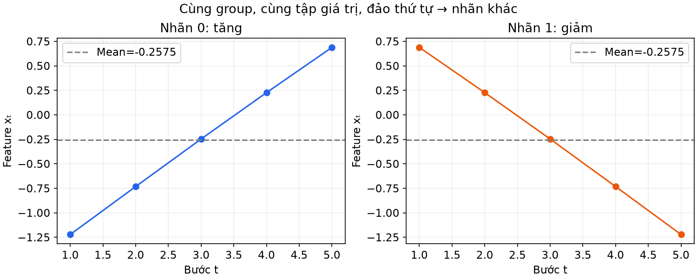
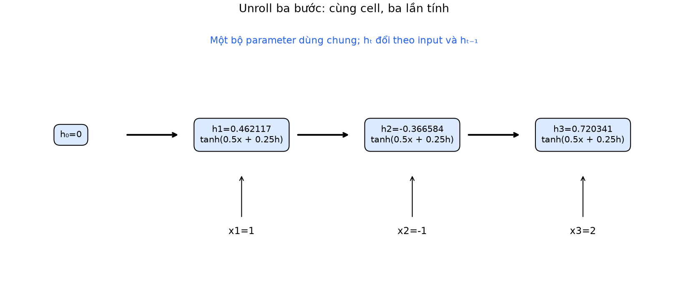
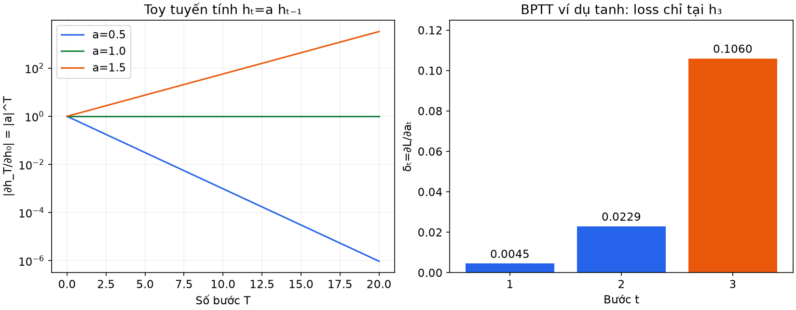
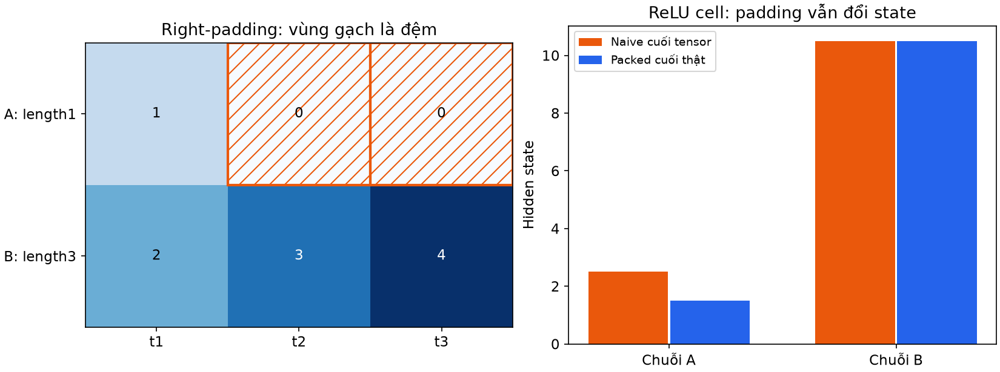
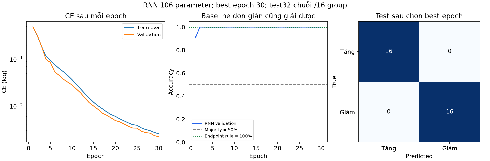

# Bài 15 — Dữ liệu chuỗi và ý tưởng RNN

[Mục lục](../README.md) · [Bài 14](../14-cnn-du-lieu-anh/README.md) · [Bài tập](exercises.md) · [Lời giải](solutions.md)

Biên soạn ngày 04/11/2026. Ví dụ tự tạo và PyTorch thật trên CPU; không tải dataset hay model. Bài học cơ chế chuỗi qua số thực trước khi học embedding ở bài 16. Không coi RNN là lựa chọn mặc định cho mọi bài toán có thời gian hoặc văn bản.

## 1. Mục tiêu và kiến thức cần trước

Sau bài này, bạn có thể phân biệt mẫu/bước thời gian/feature, tính RNN ba bước và gradient qua thời gian, tạo batch chuỗi không cùng độ dài, chọn đúng hidden state cuối, huấn luyện bộ phân loại chuỗi và nhận diện một số lỗi leakage/state.

Cần bài 3 về shape, bài 10–11 về graph/autograd/DataLoader, bài 12–13 về validation và clipping. Bài 14 chia sẻ weight theo vị trí ảnh; bài này chia sẻ weight theo bước thời gian. Đọc phần 2–7 rồi chạy `hand`, `padding`, `gradients`, `windows`; tiếp theo đọc thí nghiệm và chạy `train`.

## 2. Chuỗi khác một tập số ở điểm nào?

Chuỗi có thứ tự: `[1,−1,2]` và `[2,−1,1]` chứa cùng các giá trị nhưng trình tự khác nhau. Tổng/mean không phân biệt được chúng. Với dữ liệu cảm biến, chiều hướng thay đổi có thể quan trọng; với văn bản, đổi thứ tự từ có thể đổi ý nghĩa. Không phải mọi nhãn đều phụ thuộc thứ tự: tổng chi tiêu là ví dụ có thể chỉ cần aggregation.

Chỉ số bước không tự biểu diễn khoảng thời gian thực. Nếu các phép đo cách nhau không đều, cần quyết định resampling hoặc thêm thông tin khoảng cách thời gian theo bài toán; pipeline này chỉ dùng thứ tự bước, chưa xử lý irregular sampling.
Một sample có T bước, mỗi bước có F feature. Ví dụ 4 thời điểm, mỗi thời điểm có nhiệt độ và độ ẩm: shape `(4,2)`, không phải 8 bước thời gian. Batch B chuỗi có độ dài chung T được viết `(B,T,F)` trong bài này; dùng `batch_first=True` khi gọi RNN. Mặc định API có thể dùng thứ tự khác, nên phải đọc hợp đồng shape.

| Bài toán             | Input/target minh họa                   | Điểm cần chú ý                                         |
| -------------------- | --------------------------------------- | ------------------------------------------------------ |
| Phân loại toàn chuỗi | Đoạn tín hiệu → một class               | Many-to-one, có thể dùng hết đoạn input                |
| Dự báo bước tiếp     | Các giá trị đã biết → giá trị tương lai | Target phải sau các feature có sẵn tại lúc dự báo      |
| Gán nhãn từng bước   | Mỗi bước input → nhãn tương ứng         | Many-to-many, cần mask phần padding khi tính loss      |
| Sinh chuỗi           | Lịch sử → phân bố bước kế               | Cách dùng target/train và inference cần thiết kế riêng |

Lab huấn luyện **phân loại toàn chuỗi**, không huấn luyện mô hình dự báo hoặc sinh văn bản. Ví dụ windows ở phần 9 chỉ kiểm cách căn input/target.



_Hai chuỗi trong một cặp có cùng tập giá trị và mean, nhưng nhãn tăng/giảm khác nhau. Độ dài không phải số feature._

Trộn thứ tự các **sample độc lập** trong train loader không tự phá thứ tự bên trong mỗi sample. Đảo/trộn các bước thời gian bên trong một sample lại có thể đổi nhãn. Với stream cần nối state liên tục, cả thứ tự sample cũng cần giữ theo thiết kế.

## 3. RNN: cập nhật một trạng thái theo bước

Hidden state hₜ là vector tính từ input hiện tại và state trước đó. Nó là tóm tắt học được, không phải bản sao đầy đủ của mọi dữ liệu đã đi qua. Với vector hàng và một lớp tanh:

\[
a*t=x_tW*{ih}^{\top}+h*{t-1}W*{hh}^{\top}+b,\qquad h_t=\tanh(a_t).
\]

Tanh áp theo phần tử, output nằm trong (−1,1). Cùng W và b được dùng ở mọi bước. Khởi tạo h₀=0 là lựa chọn của lab. Một head có thể biến h_T thành logits nếu cần một class cho cả chuỗi. [D2L: Recurrent Neural Networks](https://d2l.ai/chapter_recurrent-neural-networks/rnn.html)

Đây là mạng được “trải theo thời gian” trên graph: x₁→h₁, x₂ cùng h₁→h₂, v.v. T không làm tăng số parameter của cell, nhưng làm tăng số phép tính và lượng thông tin trung gian cần cho backprop. Giữ kích thước state cố định không có nghĩa nhớ vô hạn hoặc không tốn bộ nhớ khi train.

### Ví dụ tính tay ba bước

Dùng một input feature, một hidden unit: w_x=0.5,w_h=0.25,b=0,h₀=0; x=`[1,−1,2]`.

|   t |  xₜ |                  aₜ=0.5xₜ+0.25hₜ₋₁ |  hₜ=tanh(aₜ) |
| --: | --: | ---------------------------------: | -----------: |
|   1 |   1 |                                0.5 |  0.462117157 |
|   2 |  −1 | −0.5+0.25×0.462117157≈−0.384470711 | −0.366583715 |
|   3 |   2 |  1+0.25×(−0.366583715)≈0.908354071 |  0.720341322 |

Đảo chuỗi thành `[2,−1,1]` với cùng parameter/h₀ cho state cuối≈**0.401118659**. RNN này phân biệt được thứ tự dù mean không đổi; không suy mọi parameter RNN đều phân biệt mọi cặp chuỗi.

```python
from lab import scalar_reference
a = scalar_reference([1.,-1.,2.])
b = scalar_reference([2.,-1.,1.])
print(a['states'], b['states'][-1])
```



_Ba lần sử dụng cùng cell, không phải ba bộ weight riêng. State thay đổi; parameter chỉ đổi khi optimizer update._

## 4. Chuyển sang nn.RNN: shape và hai bias

Trong PyTorch, một bước RNN có hai bias cộng lại: `b_ih+b_hh`. Ví dụ trên đặt cả hai bằng 0. Nếu muốn bias tổng b khác 0, không đặt cả hai bằng b rồi vô tình có tổng2b. Weight lưu theo layout `(out,in)` giống Linear bài 11. [RNN API](https://docs.pytorch.org/docs/2.15/generated/torch.nn.RNN.html)

Trong cấu hình một lớp, một hướng, batch_first=True:

| Thành phần | Shape với B mẫu,T bước,F feature,H hidden      |
| ---------- | ---------------------------------------------- |
| x          | B×T×F                                          |
| weight_ih  | H×F                                            |
| weight_hh  | H×H                                            |
| Hai bias   | mỗi vector H                                   |
| output     | B×T×H, nếu input là tensor padded thông thường |
| h₀ và h_n  | 1×B×H                                          |

`batch_first` **không đổi trục hidden state**. `output` chứa hidden theo từng bước, không tự là class logits. `h_n` chứa state cuối; với tensor padded thông thường, đó là cuối phần tensor đã đọc, có thể gồm cả padding. Khi input packed, output là PackedSequence; hidden cuối tương ứng các độ dài thật.

```python
import torch
from torch import nn
rnn = nn.RNN(input_size=2, hidden_size=4, batch_first=True)
x = torch.zeros(3,5,2)
output, h_n = rnn(x)
print(output.shape, h_n.shape)  # (3,5,4), (1,3,4)
```

Số parameter cell một lớp một hướng có bias là HF+H²+2H. Với F=1,H=8: 8+64+16=88. Head Linear8→2 thêm18, tổng **106**. Chuỗi dài4 hay9 bước vẫn106 parameter; tăng H làm phần H² tăng nhanh. Lab không dùng stacked/bidirectional RNN. RNN một hướng dùng input đến bước hiện tại; mô hình hai hướng có thể dùng cả phía sau trong đoạn được cung cấp, cần cân nhắc thông tin sẵn có lúc dự báo.

## 5. Backpropagation through time là chain rule

BPTT là backprop trên graph trải theo thời gian. Weight dùng chung nên gradient nhận tổng đóng góp từ mọi lần sử dụng, như kernel chia sẻ ở CNN. Không cần một thuật toán đạo hàm hoàn toàn khác. [D2L: Backpropagation Through Time](https://d2l.ai/chapter_recurrent-neural-networks/bptt.html)

Tiếp ví dụ scalar, chọn loss **chỉ tại state cuối**: L=½(h₃−0.5)²≈0.0242751492. Đặt δₜ=∂L/∂aₜ. Vì tanh′(aₜ)=1−hₜ²:

\[
\delta*3=(h_3-0.5)(1-h_3^2),\qquad
\delta_t=\delta*{t+1}w_h(1-h_t^2)\quad(t=2,1).
\]

Kết quả δ₃≈0.106008057, δ₂≈0.022940578, δ₁≈0.004510391. Cộng gradient về cùng parameter:

\[
\frac{\partial L}{\partial w*x}=\sum*{t=1}^3\delta*tx_t
\approx0.004510391-0.022940578+2(0.106008057)
=0.193585927,
\]
\[
\frac{\partial L}{\partial w_h}=\sum_t\delta_th*{t-1}\approx-0.028259593,
\qquad \frac{\partial L}{\partial b}=\sum_t\delta_t\approx0.133459025.
\]

Mode `hand` so các giá trị với nn.RNN float64. Trong API hai bias, gradient **mỗi bias** bằng ∂L/∂b trên; không cộng hai gradient rồi gọi đó là gradient của một bias khái niệm. Nếu tối ưu cả hai bias bằng SGD, tổng bias hiệu dụng đổi theo cả hai update, khác mô hình chỉ có một bias cùng learning rate.

Công thức δ ở đây chỉ đúng cho loss đặt tại h₃ và cell scalar này. Nếu mỗi bước đều có loss/head, gradient tại hₜ còn nhận nhánh loss trực tiếp ở bước đó. Không lấy ví dụ cuối chuỗi áp nguyên xi cho mọi bài many-to-many.

## 6. Vì sao gradient có thể mất dần hoặc bùng nổ?

Trong scalar tanh cell, ∂hₜ/∂hₜ₋₁=(1−hₜ²)w_h. Qua nhiều bước phải nhân nhiều đạo hàm. Tanh gần bão hòa làm hệ số1−h² nhỏ; weight và trạng thái quyết định tích cụ thể. Với vector, đó là tích các Jacobian, không thể chỉ nhìn một weight rồi kết luận toàn mạng chắc chắn mất/bùng gradient.

Để cô lập phép nhân, xét **mô hình tuyến tính giả định** hₜ=ahₜ₋₁, không tanh, h₀=1. Sau20 bước, ∂h₂₀/∂h₀=a²⁰:

- a=0.5 → khoảng9.5367×10⁻⁷.
- a=1 →1.
- a=1.5 → khoảng3.325,25673.

Mode `gradients` đối chiếu với autograd. Đây là minh họa độ nhạy qua chuỗi dài, chưa là đo gradient của RNN phân loại ở cuối bài.



Clipping bài 13 có thể giới hạn gradient lớn trước step; không khôi phục tín hiệu đã mất vì gradient rất nhỏ. Lab clip global norm ở1, ghi max norm **trước** clipping theo epoch. Với Adam, norm gradient bị giới hạn không có nghĩa norm update bị giới hạn đúng learning_rate×1.

LSTM đưa thêm cell state và các gate điều tiết luồng thông tin; GRU là một hướng gated recurrent khác. Chúng nhằm cải thiện việc truyền/lưu thông tin nhưng không bảo đảm nhớ mọi lịch sử. Bài chỉ giới thiệu động cơ, không huấn luyện LSTM/GRU. [LSTM API](https://docs.pytorch.org/docs/2.15/generated/torch.nn.LSTM.html)

## 7. Chuỗi dài/ngắn khác nhau: padding không phải “không làm gì”

Một batch cần cùng T để thành tensor. Ví dụ A=`[1]`,B=`[2,3,4]`: right-padding bằng0 cho `[[1,0,0],[2,3,4]]`, lengths=`[1,3]`. Số0 cũng có thể là dữ liệu thật; không đoán length bằng cách đếm phần tử khác0. Sau chuẩn hóa, padding0 của lab là0 trên thang đã chuẩn hóa, không phải raw value0.

[pad_sequence](https://docs.pytorch.org/docs/2.15/generated/torch.nn.utils.rnn.pad_sequence.html) gộp chuỗi và thêm đệm; nó không tự làm RNN bỏ qua phần đệm.

**Tính tay để thấy lỗi:** cell ReLU có w_x=w_h=1,b=0.5,h₀=0, mọi pre-activation đều dương:

| Chuỗi | Các state khi đọc tensor padded | State đúng tại bước thật cuối |
| ----- | ------------------------------- | ----------------------------: |
| A     | 1.5 →2.0 →2.5                   |                           1.5 |
| B     | 2.5 →6.0 →10.5                  |                          10.5 |

Lấy `output[:,-1]` hoặc hidden cuối của tensor padded cho A=2.5, sai nếu mục đích biểu diễn phần thật. Với **một hướng**, gather `output[batch_index,lengths−1]` lấy được state đúng ở các bước thật; vẫn tốn compute cho padding. Trong RNN hai hướng hoặc cấu hình khác, không tự mở rộng lập luận này.

Lab dùng [pack_padded_sequence](https://docs.pytorch.org/docs/2.15/generated/torch.nn.utils.rnn.pack_padded_sequence.html): lengths là vector CPU long, các bước thật đứng ở đầu mỗi sample, enforce_sorted=False để nhận lengths chưa sắp. RNN xử lý các bước hợp lệ và trả hidden theo các mẫu; mode `padding` kiểm cả thứ tự trả về với lengths `[1,3]`. Nếu lengths sai quá ngắn, thông tin thật có thể bị bỏ mất; lab chặn length≤0 hoặc lớn hơnT.

```python
from lab import padding_demo
print(padding_demo())  # naive [2.5,10.5]; valid/packed [1.5,10.5]
```

Mode này còn đổi padding của A thành99 và kiểm packed state không đổi. Không sửa giá trị thật: pack dựa **lengths**, không dựa vào giá trị0. Batch packing trong lab chỉ dùng right-padding; left-padding chưa được hỗ trợ bởi pipeline này.



### Nếu loss có ở từng bước

Cần mask các vị trí đệm khi đo loss/metric. Ví dụ ba loss thật là1,4,9, được bố trí trong tensor2×3 có ba ô padding: mean trên6 ô sau gán padding0 là14/6, còn mean theo bước thật là **14/3**. Nếu muốn mỗi chuỗi nặng như nhau, mean per-sequence là((1+4)/2+9)/2=5.75, một mục tiêu khác. Phải khai báo denominator. Lab phân loại toàn chuỗi có một target/mẫu nên CE được cộng theo số chuỗi, không tính token loss ở phần padding.

## 8. Hidden state có vòng đời

Các sample trong lab là các chuỗi độc lập. Mỗi forward không truyền hx nên nn.RNN bắt đầu bằng zeros; không đưa state của người A sang người B chỉ vì nằm cùng vị trí batch. Model không tự lưu lịch sử các lần gọi như một bộ nhớ xuyên request.

Nếu cố ý chia **cùng một stream** thành nhiều chunk theo thứ tự, có thể carry hidden sang chunk sau. Khi truncated BPTT, `hidden=hidden.detach()` giữ giá trị nhưng cắt đường gradient về các chunk trước; khác reset hidden về0. Cần biết sample nào nối với sample nào và reset ở ranh giới stream. Lab chỉ chạy full BPTT cho chuỗi4–9 bước, chưa thực nghiệm stateful streaming/truncated BPTT.

Trong nhiều lớp RNN, state tensor còn có trục layer/direction. Không dùng cách chỉ số `h_n[-1]` của model một lớp một hướng trong bài rồi suy áp được nguyên xi cho bidirectional hoặc LSTM có thêm cell state.

## 9. Chuỗi thời gian: căn window/target trước khi chọn model

Dãy `[10,12,11,13,15]`, lookback3, horizon1. Nếu index bắt đầu0:

| Input đã biết | Index input | Target | Index target |
| ------------- | ----------- | -----: | -----------: |
| [10,12,11]    | [0,1,2]     |     13 |            3 |
| [12,11,13]    | [1,2,3]     |     15 |            4 |

Mode `windows` tạo đúng hai dòng này. Chỉ số target phải sau input cuối; thêm giá trị15 vào feature để dự đoán13 sẽ nhìn tương lai trong ví dụ này.

Với forecasting, chia theo thời điểm **target** và thông tin có sẵn ở lúc dự báo, không random split các window chồng lấn rồi coi là độc lập. Ví dụ train target đến index5, validation target6–7, test target8–9. Window validation có thể dùng lịch sử đã quan sát thuộc đoạn train: điều đó có thể hợp lệ. Không phải mọi overlap input đều là leakage; phải kiểm horizon, thời điểm dữ liệu/nhãn có sẵn và cách đánh giá một bước hay nhiều bước. Khi nhãn bao phủ khoảng tương lai hoặc có nhiều nguồn tương quan, có thể cần gap/purge/group split riêng.

Scaler/vocabulary fit từ train, không từ cả timeline. Nếu feature là ID danh mục/token, giá trị ID không tự mang khoảng cách số học; embedding ở bài 16 sẽ xử lý chủ đề đó. Bài này dùng một feature số thực, không giả lập token ID thành tín hiệu đo lường.

## 10. Thực hành: phân loại tăng/giảm với chuỗi4–9 bước

Generator data_seed17 tạo96 group. Mỗi group có một dãy gần tăng gồm center ngẫu nhiên trong[−1,1], amplitude[0.6,1.2], độ dài nguyên4–9 và nhiễu Gaussian std0.06. Hai sample là dãy đó và bản đảo chính xác, nhãn0=tăng,1=giảm. Nhiễu không bảo đảm mọi cặp điểm kề tăng tuyệt đối; nhãn là hướng sinh của chuỗi, không phải kiểm toán strict monotonic.

Split giữ cả hai sample của group cùng tập:64/16/16 group → **128/32/32 chuỗi**. Cân bằng lớp và cùng phân bố độ dài giữa hai lớp nhờ ghép cặp. Fit mean/std chỉ từ **các bước thật của train**, mỗi time point có trọng số ngang nhau, không thêm padding: mean≈0.0246224512,std≈0.7806527695. Mỗi sample chuẩn hóa trước khi collate/pad.

Một layer RNN(1,8,tanh), head Linear8→2, tổng106 parameter. Input batch `(B,T_max,1)`, lengths `(B,)`, label `(B,)` long. Forward dùng pack và head trên h_n[-1]. Config định trước: Adam lr=.01, batch16,30 epoch, seed2026, CPU float32 một thread, clip norm1. Có8 update/epoch và240 update toàn run.

Collate chuẩn bị batch; shuffle chỉ đổi thứ tự sample, không đổi bước thời gian. Đánh giá dùng eval/no_grad, cộng CE reduction=sum rồi chia số chuỗi. Chọn minimum validation CE, hòa giữ epoch sớm hơn; test chỉ chấm sau lựa chọn. Checkpoint lưu weight, config, preprocessing, class mapping, data hash và epoch; là artifact inference, **chưa có optimizer/RNG để resume** như last.pt bài 12.

Kết quả thực chạy:

| Đại lượng                                            | Kết quả                  |
| ---------------------------------------------------- | ------------------------ |
| Best epoch                                           | 30                       |
| Validation CE / accuracy                             | ≈0.002202466 /32/32=100% |
| Test CE / accuracy                                   | ≈0.002150564 /32/32=100% |
| Confusion test, hàng=true,cột=pred, thứ tự tăng/giảm | `[[16,0],[0,16]]`        |
| Baseline majority: validation accuracy               | 50%                      |
| Quy tắc dấu điểm cuối−đầu: validation accuracy       | 100%                     |

Baseline endpoint được khai báo trước: cuối>đầu thì tăng, ngược lại giảm. Kết quả nhắc rằng bài đơn giản này **không cần RNN mới giải được**. Mean-only không có thông tin phân biệt trong cặp đảo: về toán học cùng mean mà nhãn đối nhau. Đây là giải thích mất thông tin thứ tự, không phải một mô hình mean-only đã được fit/benchmark trong lab.

Một seed/split synthetic không chứng minh chất lượng trên sensor thật hoặc chuỗi dài hơn. Test32 sample đến từ16 group; không coi là32 nguồn độc lập khi suy khoảng tin cậy. Không huấn luyện/so sánh LSTM, GRU hoặc Transformer ở đây.



```python
from pathlib import Path
from tempfile import TemporaryDirectory
from lab import Config, train, predict_sequence
with TemporaryDirectory() as directory:
    out = Path(directory)/'run'
    report = train(out, Config(epochs=2))  # Kiểm pipeline ngắn, không kỳ vọng số bảng 30 epoch
    print(report['parameters'])  # 106
    print(predict_sequence(out/'best.pt', [0.,.4,.8,1.2]))
```

`prediction_roundtrip=True` trong report kiểm đường predict_sequence và forward trên cùng chuỗi test cho xác suất giống nhau sau tải checkpoint; không dùng phép kiểm này để chọn lại model. Output gồm data.json có values/group/split/nhãn, config.json, preprocess.json, metadata.json, metrics.csv, best.pt và report.json. Hash hỗ trợ phát hiện dữ liệu/code đổi, không tự thay thế bản dữ liệu hoặc version control.

## 11. Chẩn đoán những lỗi thường gặp

- Shape đúng số phần tử nhưng sai trục: kiểm ý nghĩa B,T,F bằng một sample cụ thể, không sửa bằng reshape tùy ý.
- Model dùng padding như dữ liệu: so packed với chạy từng chuỗi riêng, thử thay giá trị chỉ trong vùng padding.
- Label hoặc lengths bị tráo sau sort: kiểm batch chưa sắp và đối chiếu từng sample; đừng tự sort một tensor mà quên các tensor đi kèm.
- Nhớ sang sample khác: kiểm vòng đời hx, ranh giới stream và thứ tự batch; state cùng index batch không có nghĩa cùng đối tượng.
- Gradient nhỏ/lớn: đọc norm trước clip, độ dài, saturation và scale feature; clipping không thay thế kiểm dữ liệu.
- Điểm tốt nhưng baseline cũng tốt: xem task có cần thứ tự/model phức tạp không; báo baseline trước khi kết luận năng lực.

## 12. Chạy thực hành và học tiếp

Đã chạy Python 3.14.6, torch 2.15.0, NumPy 2.5.4, macOS arm64. Model dùng CPU float32; hand/padding/gradient toy dùng float64. [requirements.txt](requirements.txt) ghim phụ thuộc. Từ thư mục bài 15:

```bash
python3 -m venv .venv
.venv/bin/python -m pip install -r requirements.txt
.venv/bin/python lab.py --mode hand
.venv/bin/python lab.py --mode padding
.venv/bin/python lab.py --mode gradients
.venv/bin/python lab.py --mode windows
.venv/bin/python lab.py --mode all --out /tmp/lesson15-run-01
```

Windows dùng `.venv\Scripts\python` và output phù hợp. Chọn output mới; bỏ --out để tạo thư mục tạm và in đường dẫn, chép ra nơi lưu lâu dài nếu cần giữ. `--mode train` chỉ chạy phân loại chuỗi. Không yêu cầu mạng tải dataset, GPU hay thư viện NLP. Bản ghim cần wheel phù hợp; đối chiếu [cài PyTorch](https://pytorch.org/get-started/locally/) nếu nền tảng khác. Seed không bảo đảm giống từng bit giữa các phiên bản/backend.

Năm hình PNG/SVG có sẵn. Tái tạo bằng [make_figures.py](make_figures.py), Matplotlib 3.11.2 và run tạm:

```bash
.venv/bin/python -m pip install -r requirements-figures.txt
.venv/bin/python make_figures.py
```

Làm [10 bài tập](exercises.md), đối chiếu [lời giải](solutions.md). Cần tính được h₁–h₃, giải thích gradient shared weight, phân biệt padding/length/mask và kiểm input/target không nhìn tương lai. **Bài 16 dự kiến:** embedding và biểu diễn, hiện mới là đề cương. [Nguồn và phạm vi đã đọc](../SOURCES.md).
