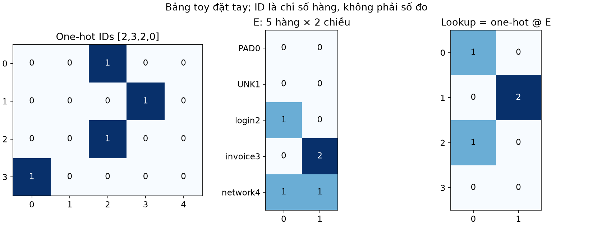
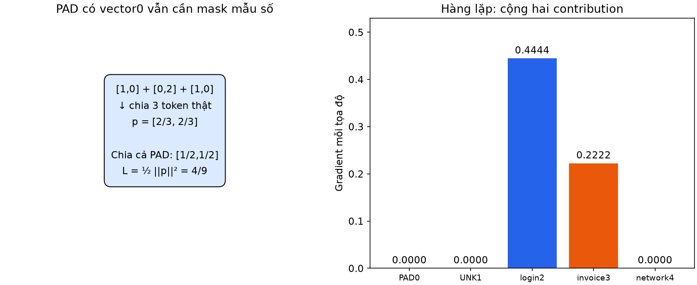
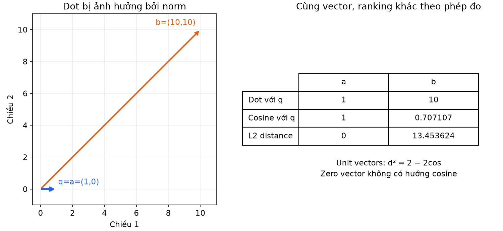
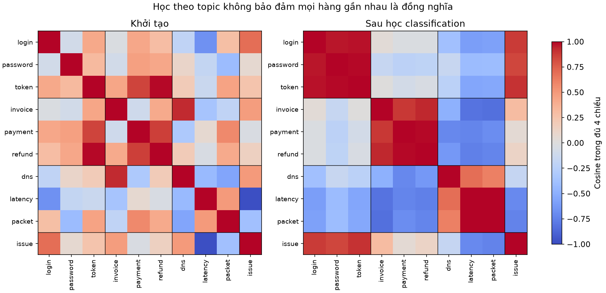
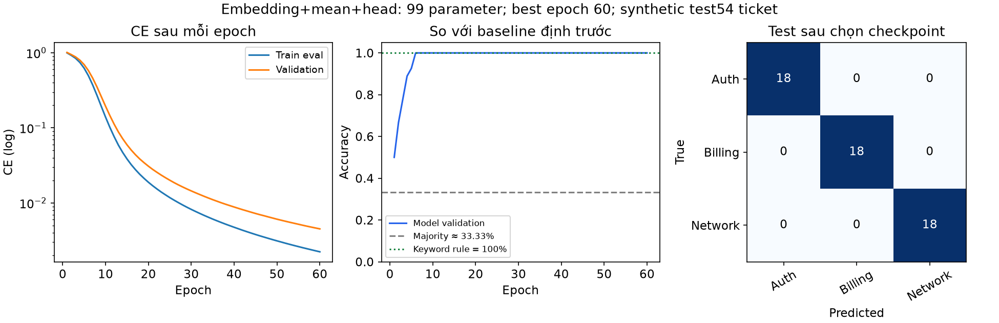

# Bài 16 — Embedding và biểu diễn

[Mục lục](../README.md) · [Bài 15](../15-du-lieu-chuoi-rnn/README.md) · [Bài tập](exercises.md) · [Lời giải](solutions.md)

Biên soạn ngày 04/11/2026. Ví dụ tự tạo và PyTorch thật trên CPU; không tải embedding pretrained, gọi API hoặc dùng vector database. Bài học cách biểu diễn danh mục/token bằng vector và kiểm vector đó có ích cho mục tiêu nào.

> [!NOTE]
> **Định nghĩa các khái niệm cốt lõi của bài học:**
> 1. **Biểu diễn dữ liệu (Data Representation):** Là cách thức chuyển đổi các thông tin phi cấu trúc trong thế giới thực (từ ngữ, danh mục, hình ảnh, âm thanh) thành các con số hoặc vector mà mô hình toán học có thể tính toán được.
> 2. **Token & Tokenization (Mã hóa thực thể):** Token là đơn vị cơ sở nhỏ nhất mà mô hình ngôn ngữ xử lý (có thể là một từ, một phần của từ - subword, một ký tự, hoặc mã ID của sản phẩm/người dùng). Tokenization là quá trình bẻ nhỏ một chuỗi văn bản thô thành danh sách các token.
> 3. **One-Hot Encoding (Mã hóa một vị trí bật):** Cách biểu diễn một từ trong từ điển kích thước $V$ bằng một vector có $V$ chiều, trong đó duy nhất vị trí ứng với ID của từ đó mang giá trị $1$, toàn bộ các vị trí còn lại bằng $0$.
> 4. **Embedding (Vector nhúng đậm đặc):** Là kỹ thuật ánh xạ một token từ không gian thưa thớt khổng lồ (one-hot $V$ chiều) sang một vector số thực đặc (dense vector) có số chiều nhỏ hơn rất nhiều ($D$ chiều, ví dụ $D = 4, 128, 512, 1536$). Bảng embedding là một ma trận trọng số học được $E \in \mathbb{R}^{V \times D}$.
> 5. **Lookup (Tra bảng):** Thao tác trích xuất vector embedding tương ứng với một token ID bằng cách lấy trực tiếp hàng thứ $i$ của ma trận embedding $E[i]$.

## 1. Mục tiêu và cách học

Sau bài này, bạn có thể phân biệt ID/one-hot/embedding, tính lookup và gradient của hàng lặp, gộp token đúng mask, so dot/cosine/L2 và giải thích static/contextual representation. Thực hành cuối bài học embedding trong mô hình phân loại ticket, giữ vocabulary train-only và tải model kèm tokenizer/vocabulary để inference.

> [!TIP]
> **Tại sao kỹ sư AI cần hiểu sâu tầng biểu diễn Embedding?**
> Embedding là "trái tim" của toàn bộ hệ thống AI hiện đại: từ các mô hình ngôn ngữ lớn (LLM, GPT, Claude), hệ thống tìm kiếm ngữ nghĩa (Semantic Search), truy xuất dữ liệu tăng cường (RAG), cho đến các hệ thống gợi ý sản phẩm (Recommender Systems của YouTube, Netflix, TikTok). Nắm vững bản chất số học của lookup, cơ chế tính gradient khi một từ xuất hiện nhiều lần, và cách bảo vệ từ điển (vocabulary contract) khi đưa mô hình lên production sẽ giúp bạn tránh được những lỗi sai ngầm (silent bugs) cực kỳ khó phát hiện.

Cần bài 3 về vector/ma trận, bài 10–11 về autograd, bài 12 về checkpoint và bài 15 về chuỗi/padding. Đọc phần 2–7 rồi chạy `hand`, `geometry`, `vocab`; tiếp theo đọc thực nghiệm và chạy `train`.

## 2. Biểu diễn là lựa chọn giữ thông tin nào

Cùng một ticket có thể biểu diễn bằng chuỗi ký tự, token ID, vector đếm từ, vector từng token hoặc một vector cho toàn ticket. Mỗi cách giữ/bỏ thông tin khác nhau. Embedding là ánh xạ dữ liệu sang vector; trong bài này chủ yếu là **bảng vector học được cho các token rời rạc**. Không phải mọi vector số đều tự có quan hệ ngữ nghĩa hữu ích.

> [!NOTE]
> **Biểu diễn là sự đánh đổi thông tin (Representation Trade-offs):**
> Khi chuyển văn bản thành số, mỗi phương pháp đều có ưu và nhược điểm riêng:
> - **Chuỗi ký tự thô (Raw Characters):** Giữ lại mọi dấu câu, lỗi chính tả, nhưng độ dài chuỗi quá lớn và mô hình khó học được ý nghĩa ngữ nghĩa cấp độ từ.
> - **Túi từ / Đếm tần suất (Bag of Words / TF-IDF):** Đếm số lần xuất hiện của các từ. Rất nhẹ và hiệu quả cho các bài toán phân loại đơn giản, nhưng làm mất sạch thứ tự ngữ pháp (câu *"không xấu lắm"* bị hiểu giống *"xấu không lắm"*).
> - **Dense Embedding:** Chuyển từng token thành một tọa độ không gian nhiều chiều. Các từ có ngữ cảnh sử dụng tương tự nhau sẽ được kéo lại gần nhau trong không gian hình học.

Ví dụ ID `login=2, invoice=3, network=4` chỉ là khóa tra bảng. Khoảng cách2 đến3 nhỏ hơn2 đến4 không chứng minh login gần nghĩa invoice hơn network. Nếu đổi cách đánh số nhất quán, bài toán danh mục không nên tự đổi ý nghĩa. Không đưa ID vào RNN như số đo liên tục chỉ vì dtype có thể đổi sang float.

> [!WARNING]
> **Sai lầm kinh điển của người mới: Coi Token ID như một đại lượng số học!**
> Token ID (ví dụ: `apple = 10, orange = 11, truck = 1000`) chỉ đơn thuần là các **nhãn định danh danh mục (categorical keys)**, hoàn toàn giống như số CMND/CCCD của con người:
> - Số 11 không có nghĩa là "lớn hơn" hay "nặng hơn" số 10.
> - Phép trừ $11 - 10 = 1$ không có nghĩa là `apple` và `orange` có mối quan hệ số học với nhau.
> Nếu bạn ngây thơ nạp trực tiếp các con số nguyên ID này vào mạng nơ-ron (như nạp vào một tầng Linear hoặc RNN) dưới dạng số thực float, mô hình sẽ ngộ nhận rằng các từ có ID gần nhau thì tương đồng nhau, dẫn đến kết quả huấn luyện hoàn toàn vô nghĩa.

One-hot với V mục có V chiều, một vị trí1 còn lại0. Hai ID khác nhau có dot/cosine0 và khoảng cách L2=√2; đó là quan hệ hình học của mã hóa, chưa phản ánh mức tương tự theo tác vụ. Bảng embedding thay mỗi ID bằng vector D chiều được học hoặc cung cấp trước. D thường nhỏ hơnV, nhưng API không bắt buộc D<V. [Google: Embedding space](https://developers.google.com/machine-learning/crash-course/embeddings/embedding-space)

> [!NOTE]
> **Tại sao One-Hot Encoding thất bại trước các bài toán lớn?**
> Giả sử từ điển của bạn có $V = 50.000$ từ:
> 1. **Lãng phí bộ nhớ khủng khiếp (Sparsity):** Mỗi từ cần một vector 50.000 chiều chứa toàn số 0 và duy nhất một số 1. Một câu 10 từ sẽ tốn $10 \times 50.000 = 500.000$ số thực!
> 2. **Hiện tượng "Mù ngữ nghĩa" (Semantic Blindness):** Vector của từ `vua` là $[1, 0, 0, \dots]$ và từ `hoàng đế` là $[0, 1, 0, \dots]$. Hai vector này vuông góc trực giao với nhau ($90^\circ$):
>    $$\operatorname{dot}(\text{vua}, \text{hoàng đế}) = 0, \quad \operatorname{cosine} = 0, \quad d_{L2} = \sqrt{1^2 + (-1)^2} = \sqrt{2} \approx 1.414$$
>    Mã hóa one-hot coi mọi cặp từ trên đời đều xa lạ và độc lập như nhau!
> **Embedding giải quyết triệt để vấn đề này:** Nén 50.000 chiều về $D = 128$ chiều số thực liên tục. Qua quá trình huấn luyện, vector của `vua` và `hoàng đế` sẽ tự động xoay về cùng một hướng, phản ánh sự tương đồng ngữ nghĩa.

### Token không luôn là một từ

Token có thể là từ, subword, ký tự hoặc ID sản phẩm/user. Tokenizer của lab chỉ `text.lower().split()`: đơn giản hóa chữ thường rồi tách whitespace, không tách dấu câu hoặc phân đoạn tiếng Việt. `login` và `login,` thành hai chuỗi token khác nhau với tokenizer này. Chưa dùng BPE hoặc tokenizer của LLM; không suy token ID của hai model có thể dùng lẫn.

> [!NOTE]
> **Các cấp độ Tokenization trong thực tế:**
> - **Word-level (Cấp độ từ):** Tách theo khoảng trắng (`login`, `error`). Nhược điểm: từ điển phình to nhanh chóng khi gặp các biến thể từ vựng, từ ghép, hoặc từ có dấu câu đi kèm (`login,`, `login!`).
> - **Character-level (Cấp độ ký tự):** Tách từng chữ cái (`l`, `o`, `g`, `i`, `n`). Từ điển cực nhỏ (chỉ vài chục ký tự) nhưng chuỗi trở nên quá dài và khó nắm bắt ngữ nghĩa từ ngữ.
> - **Subword-level (Cấp độ âm tiết / mảnh từ — BPE, WordPiece trong GPT, BERT):** Dung hòa cả hai: những từ phổ biến được giữ nguyên (`login`), còn những từ hiếm hoặc từ mới được ghép từ các mảnh nhỏ (`play` + `ing`, `un` + `happy`). Nhờ đó giải quyết triệt để vấn đề từ lạ ngoài từ điển (OOV).



*Các số trong hình là bảng đặt tay; không phải quan hệ ngữ nghĩa đã được model khám phá.*

## 3. Lookup chính là chọn hàng ma trận

Bảng E có shape `(V,D)`. ID i trả E[i], một vector D chiều. Với vector one-hot oᵢ:

\[
e_i=o_iE.
\]

Với B mẫu,T token, input ID shape `(B,T)` kiểu nguyên; `nn.Embedding` trả `(B,T,D)` số thực. Nó không tự tạo một vector duy nhất cho cả câu, cũng không tự giữ thứ tự như RNN. [Embedding](https://docs.pytorch.org/docs/2.15/generated/torch.nn.Embedding.html), [one_hot](https://docs.pytorch.org/docs/2.15/generated/torch.nn.functional.one_hot.html)

> [!NOTE]
> **Bản chất toán học của Phép tra bảng (Lookup) trong `nn.Embedding`:**
> - Hãy tưởng tượng ma trận embedding $E \in \mathbb{R}^{V \times D}$ là một danh bạ gồm $V$ hàng, mỗi hàng là một vector $D$ chiều.
> - Nếu bạn nhân một vector one-hot $o_i = [0, \dots, 0, 1, 0, \dots, 0]$ (với số 1 nằm ở vị trí thứ $i$) với ma trận $E$:
>   $$o_i \times E = \begin{bmatrix} 0 & \dots & 1 & \dots & 0 \end{bmatrix} \begin{bmatrix} — E_0 — \\ — E_1 — \\ \vdots \\ — E_i — \\ \vdots \end{bmatrix} = E_i$$
>   Kết quả của phép nhân ma trận này **chính là hàng thứ $i$ của ma trận $E$**!
> - **Tại sao PyTorch dùng Lookup thay vì nhân ma trận?** Việc tạo ra tensor one-hot khổng lồ rồi thực hiện phép nhân ma trận dày đặc tốn bộ nhớ và thời gian tính toán vô ích (nhân $99.9\%$ với số 0). Lớp `nn.Embedding(V, D)` dùng con trỏ mảng để bốc thẳng hàng thứ $i$ ra ngoài trong thời gian $O(1)$, đạt hiệu năng tối đa.

**Ví dụ tính tay:** V=5,D=2, dùng mapping riêng cho ví dụ:

| ID | Token | E[i] |
|---:|---|---|
| 0 | PAD | [0,0] |
| 1 | UNK | [0,0] |
| 2 | login | [1,0] |
| 3 | invoice | [0,2] |
| 4 | network | [1,1] |

Chuỗi ID `[2,3,2,0]` cho `[[1,0],[0,2],[1,0],[0,0]]`. One-hot của ID3 là `[0,0,0,1,0]`; nhân E chọn hàng `[0,2]`. Hai lần ID2 dùng cùng hàng, không tạo hai bộ parameter.

```python
import torch
from torch import nn
from torch.nn import functional as F
E = torch.tensor([[0.,0.],[0.,0.],[1.,0.],[0.,2.],[1.,1.]])
ids = torch.tensor([[2,3,2,0]], dtype=torch.long)
embedding = nn.Embedding.from_pretrained(E, freeze=False, padding_idx=0)
lookup = embedding(ids)
onehot = F.one_hot(ids, num_classes=5).float()
print(lookup)
torch.testing.assert_close(lookup, onehot @ E)
```

Đẳng thức trên là về forward. `padding_idx` quy định cách layer xử lý gradient hàng PAD; một phép nhân one-hot thông thường không tự có quy tắc đó nếu loss vẫn dùng vị trí PAD. Khi so backward cũng cần mask/quy ước nhất quán.

> [!NOTE]
> **Giải thích tham số `padding_idx` trong `nn.Embedding`:**
> Khi khai báo `nn.Embedding(num_embeddings=5, embedding_dim=2, padding_idx=0)`:
> 1. Trọng số ở hàng `padding_idx` (hàng 0) sẽ luôn được khởi tạo bằng vector toàn số 0 (`[0, 0]`).
> 2. Trong suốt quá trình lan truyền ngược (backward pass), **gradient của hàng này bị khóa cứng bằng 0**, đảm bảo vector của token đệm `<pad>` không bao giờ bị cập nhật hay biến đổi giá trị.

### Parameter và bộ nhớ

E có V×D số, không có bias riêng cho mỗi lookup. Với V=10.000,D=32, bảng float32 có320.000 số≈1.280.000 byte, tức1.28MB thập phân, chưa tính gradient/optimizer. Bảng vẫn có chi phí lưu trữ; không phải vì chỉ lookup một hàng mà toàn model chỉ có D parameter.

Một Linear(V,D,bias=False) trên one-hot có cùng V×D weight, lưu theo layout D×V. Lookup tránh dựng tensor one-hot lớn trong cách triển khai này; không tự giảm parameter so với **chính lớp tuyến tính tương đương đó**. Dense one-hot B×T×V, ID B×T và output embedding B×T×D có chi phí khác nhau. Đó là lý do tách kích thước biểu diễn khỏi số parameter/hiệu năng, không khẳng định embedding luôn nhanh hơn mọi cách xử lý sparse.

> [!TIP]
> **Chi phí bộ nhớ của Embedding trong các mô hình LLM lớn:**
> Trong các mô hình ngôn ngữ lớn như LLaMA-3 hay GPT-4, kích thước từ điển thường là $V \approx 128.000$ token, và số chiều embedding là $D \approx 4.096$:
> $$\text{Số tham số bảng Embedding} = 128.000 \times 4.096 \approx 524 \text{ triệu tham số!}$$
> Chỉ riêng tầng nhúng từ đầu vào này đã chiếm hơn $2$ GB VRAM (ở định dạng float32). Do đó, việc quản lý kích thước từ điển $V$ và số chiều $D$ luôn là bài toán cân não giữa khả năng diễn đạt và tài nguyên phần cứng.

## 4. PAD, UNK và cách gộp cả câu

PAD là vị trí đệm để ghép batch. UNK là token thực tế không có trong vocabulary. Chúng có thể cùng vector0 trong ví dụ nhưng có vai trò khác: PAD bị bỏ khỏi pooling, UNK vẫn là một vị trí thật.

> [!NOTE]
> **Phân biệt rạch ròi bản chất giữa `<pad>` và `<unk>`:**
> - **`<pad>` (Padding Token):** Là "miếng xốp chèn bao bì". Nó không phải là một từ ngữ trong ngôn ngữ con người, mà chỉ là phần đệm giả tạo để kéo dài các câu ngắn cho bằng độ dài câu dài nhất trong batch. Vì nó không mang thông tin, **nó bắt buộc phải bị loại bỏ khỏi mọi phép tính trung bình hoặc gộp câu (pooling)**.
> - **`<unk>` (Unknown Token / OOV):** Là "món hàng lạ". Nó đại diện cho một từ ngữ thực tế có trong văn bản của người dùng nhưng không xuất hiện trong từ điển huấn luyện. Nó chiếm một vị trí ngữ pháp có thật trong câu, do đó **nó vẫn được tính vào độ dài thực của câu khi gộp**.

Mean pooling có mask:

\[
p=\frac{\sum_t m_te_t}{\sum_t m_t},\qquad m_t=1[ID_t\ne PAD].
\]

Chuỗi `[2,3,2,0]` có3 token thật. Tổng vector=[2,2], masked mean=`[2/3,2/3]`. Mean tùy ý qua cả4 ô cho `[0.5,0.5]`, phụ thuộc độ dài padding dù PAD có vector0.

> [!WARNING]
> **Cạm bẫy ngây thơ: Lấy trung bình không có Mask (Naive Mean)!**
> Xét chuỗi 3 từ thật và 1 token đệm: `[login, invoice, login, <pad>]` ứng với ID `[2, 3, 2, 0]`.
> - Các vector tương ứng: $[1, 0], [0, 2], [1, 0], [0, 0]$.
> - Tổng các vector: $[1 + 0 + 1 + 0, 0 + 2 + 0 + 0] = [2, 2]$.
> - **Cách tính ngây thơ (Naive Mean — Lỗi phổ biến):** Chia cho toàn bộ độ dài tensor $T=4$:
>   $$p_{\text{naive}} = \frac{[2, 2]}{4} = \mathbf{[0.5, 0.5]}$$
> - **Cách tính đúng có mặt nạ (Masked Mean):** Chỉ chia cho số lượng token thật $\sum m_t = 3$:
>   $$p_{\text{masked}} = \frac{[2, 2]}{3} = \mathbf{\left[\frac{2}{3}, \frac{2}{3}\right]} \approx [0.667, 0.667]$$
> Nếu dùng Naive Mean, một câu ngắn bị đệm thêm nhiều số 0 sẽ có vector bị co nhỏ lại dần về 0 một cách giả tạo! Chiều dài đệm khác nhau sẽ làm thay đổi ý nghĩa của cùng một câu văn.

```python
import torch
from lab import masked_mean
ids = torch.tensor([[2,3,2,0]])
vectors = torch.tensor([[[1.,0.],[0.,2.],[1.,0.],[0.,0.]]])
print(masked_mean(vectors,ids))  # [[0.6666667,0.6666667]]
```

`padding_idx=0` làm hàng PAD không nhận gradient qua lookup và được khởi tạo0 trong layer mới; nó **không tự sửa mẫu số của mean**. Lab mask theo ID, không đoán padding từ vector bằng0. All-PAD và text rỗng bị chặn thay vì âm thầm trả vector0 cho một mẫu không có nội dung.

Masked mean không giữ thứ tự: `[login,invoice]` và `[invoice,login]` cho cùng p. Ví dụ hai câu “dog bites man” và “man bites dog” có cùng token multiset nhưng vai trò khác; mean pooling không thể phân biệt nếu chỉ dùng cùng bảng token. RNN ở bài15 hoặc attention/position ở các bài sau là cách bổ sung cơ chế xử lý thứ tự/ngữ cảnh, không phải tính chất tự có của lookup.

## 5. Embedding học được bằng gradient như thế nào?

Không có nhãn “đây là tọa độ đúng của từ” trong thực nghiệm. Embedding cùng head nhận gradient từ classification loss. Một hàng được kéo theo hướng giúp dự đoán nhãn trên dữ liệu train; không tự có bảo đảm đó là hướng ngữ nghĩa tổng quát.

> [!NOTE]
> **Embedding học như thế nào khi không có nhãn tọa độ?**
> Trong thực tế, bạn không bao giờ có một tập dữ liệu ghi rõ: *"Từ 'login' phải có tọa độ $[0.8, -0.4]$"*. Thay vào đó:
> 1. Các hàng trong bảng embedding được khởi tạo ngẫu nhiên.
> 2. Các vector được đưa qua mô hình phân loại (ví dụ: dự đoán chủ đề ticket: `auth`, `billing`, `network`).
> 3. Hàm mất mát đo sai số giữa dự đoán và nhãn thực tế.
> 4. Quá trình lan truyền ngược (backpropagation) tính toán xem mỗi tọa độ trong bảng $E$ cần dịch chuyển sang trái hay sang phải để làm giảm loss.
> Các từ thường xuyên xuất hiện cùng nhau trong các ticket hỗ trợ đăng nhập (như `login`, `password`, `token`) sẽ liên tục nhận các gradient kéo về cùng một hướng, tự nhiên gom cụm lại với nhau trong không gian vector.

Để tính tay, dùng p ở phần4 và loss **riêng cho ví dụ** L=½‖p‖². Khi p=[2/3,2/3], L=4/9≈0.444444444; gradient theo p cũng là `[2/3,2/3]`. Mỗi occurrence của token thật đóng góp1/3 khi lấy mean, nên gradient mỗi occurrence=`[2/9,2/9]`.

- ID2 xuất hiện hai lần: gradient hàng2=`[4/9,4/9]`.
- ID3 xuất hiện một lần: gradient hàng3=`[2/9,2/9]`.
- PAD, UNK và ID4 không có đóng góp trong loss này: gradient0.

SGD lr=.1 cho hàng2 mới=`[43/45,−2/45]`, hàng3=`[−1/45,89/45]`. Mean mới=`[17/27,17/27]`; loss mới=(17/27)²≈**0.396433471**. Mode `hand` kiểm lookup/one-hot, các gradient và bước SGD bằng float64. Đây không phải loss của classifier ticket; nó chỉ cô lập đạo hàm lookup và masked mean.

> [!NOTE]
> **Giải thích chi tiết phép cộng dồn Gradient khi một từ xuất hiện nhiều lần:**
> Xét chuỗi `[2, 3, 2, 0]` với $p = \frac{1}{3}(e_2 + e_3 + e_2) = \frac{2}{3}e_2 + \frac{1}{3}e_3$.
> - Hàm loss: $L = \frac{1}{2} \|p\|^2 = \frac{1}{2}(p_1^2 + p_2^2) \implies \frac{\partial L}{\partial p} = p = \left[\frac{2}{3}, \frac{2}{3}\right]$.
> - **Với token ID 3:** Xuất hiện 1 lần:
>   $$\frac{\partial L}{\partial E[3]} = \frac{\partial L}{\partial p} \cdot \frac{\partial p}{\partial e_3} = \left[\frac{2}{3}, \frac{2}{3}\right] \times \frac{1}{3} = \mathbf{\left[\frac{2}{9}, \frac{2}{9}\right]}$$
> - **Với token ID 2:** Xuất hiện ở cả vị trí 0 và vị trí 2! Theo quy tắc đạo hàm nhiều nhánh (Multivariate Chain Rule):
>   $$\frac{\partial L}{\partial E[2]} = \frac{\partial L}{\partial p} \cdot \frac{\partial p}{\partial e_2^{(vị trí 0)}} + \frac{\partial L}{\partial p} \cdot \frac{\partial p}{\partial e_2^{(vị trí 2)}} = \left[\frac{2}{9}, \frac{2}{9}\right] + \left[\frac{2}{9}, \frac{2}{9}\right] = \mathbf{\left[\frac{4}{9}, \frac{4}{9}\right]}$$
> **Quy tắc vàng:** Trong PyTorch `nn.Embedding`, gradient cập nhật cho một hàng bằng **tổng tích lũy gradient từ tất cả các lần xuất hiện** của từ đó trong batch.
> - Cập nhật SGD ($\eta = 0.1$):
>   - $E[2]_{mới} = [1, 0] - 0.1 \times \left[\frac{4}{9}, \frac{4}{9}\right] = \left[1 - \frac{2}{45}, 0 - \frac{2}{45}\right] = \left[\frac{43}{45}, -\frac{2}{45}\right]$.
>   - $E[3]_{mới} = [0, 2] - 0.1 \times \left[\frac{2}{9}, \frac{2}{9}\right] = \left[0 - \frac{1}{45}, 2 - \frac{1}{45}\right] = \left[-\frac{1}{45}, \frac{89}{45}\right]$.
>   - Sau cập nhật, loss giảm từ $0.4444$ xuống $0.3964$, chứng minh cơ chế học bằng autograd hoạt động hoàn hảo.



Các ID nguyên không nhận gradient ý nghĩa để “đổi ID2 thành ID2.1”; parameter được học là các hàng vector. Trong ví dụ chỉ lookup không decay, hàng không được dùng có gradient0. Với optimizer có state từ trước, weight decay hoặc objective khác, không suy mọi hàng vắng ở batch đều bất động tuyệt đối. Lab dùng Adam không decay cho mô hình chính, UNK chưa từng có trong train và được chủ động khởi tạo0.

### Freeze và fine-tune

`Embedding.from_pretrained(...,freeze=True)` giữ bảng cố định trong backprop; head phía sau vẫn có thể học. `freeze=False` cho phép cập nhật bảng. Mode `hand` kiểm frozen weight không có grad trong khi head có grad, dùng bảng toy tự tạo; không tải model pretrained. Fine-tune có thể thích nghi tác vụ nhưng cũng có thể mất đặc tính hữu ích hoặc overfit; cần đánh giá theo giao thức phù hợp.

> [!TIP]
> **Ứng dụng thực tế: Khi nào nên Freeze và khi nào nên Fine-tune?**
> - **Đóng băng (`freeze=True`):** Khi bạn sử dụng các embedding chất lượng cao đã được huấn luyện trước trên kho ngữ liệu khổng lồ (như Word2Vec, GloVe, hoặc OpenAI Text Embeddings) và tập dữ liệu huấn luyện của bạn rất nhỏ. Việc đóng băng giúp tránh hiện tượng "phá hủy tri thức" (catastrophic forgetting) và ngăn ngừa overfit.
> - **Tinh chỉnh (`freeze=False`):** Khi bạn có tập dữ liệu chuyên ngành đủ lớn (ví dụ: thuật ngữ y khoa, tài liệu pháp lý). Việc cho phép cập nhật bảng embedding giúp các vector thích nghi sâu sắc với ngữ nghĩa đặc thù của miền nghiệp vụ đó.

## 6. Dot, cosine và khoảng cách L2

Với vector không0:

\[
\operatorname{dot}(q,v)=q^Tv,\quad
\cos(q,v)=\frac{q^Tv}{\|q\|_2\|v\|_2},\quad
d(q,v)=\|q-v\|_2.
\]

Dot chịu ảnh hưởng cả hướng và norm. Cosine so hướng, không phải xác suất hai nội dung cùng nghĩa. L2 đo khoảng cách theo cả tọa độ/norm. Tác vụ và cách huấn luyện quyết định phép đo nào phù hợp; không mặc định lấy cosine cho mọi output vector. [Cosine API](https://docs.pytorch.org/docs/2.15/generated/torch.nn.functional.cosine_similarity.html)

> [!NOTE]
> **So sánh 3 phép đo hình học phổ biến nhất trong Vector Search / RAG:**
> 1. **Tích vô hướng (Dot Product $q^T v$):** Đo cả góc lẫn độ dài của vector. Nếu một tài liệu rất dài hoặc chứa một từ khóa lặp lại nhiều lần, vector của nó có thể có norm lớn, dẫn đến dot product cao ngay cả khi hướng của nó không hoàn toàn trùng khớp.
> 2. **Độ tương đồng Cosine ($\cos(q, v)$):** Bỏ qua hoàn toàn độ dài (norm), chỉ đo góc giữa hai vector trong không gian:
>    - $\cos = 1 \implies$ Hai vector cùng hướng tuyệt đối ($0^\circ$).
>    - $\cos = 0 \implies$ Hai vector vuông góc trực giao ($90^\circ$).
>    - $\cos = -1 \implies$ Hai vector đối nghịch hoàn toàn ($180^\circ$).
> 3. **Khoảng cách Euclid (L2 Distance $\|q - v\|_2$):** Đo độ dài đường thẳng vật lý nối giữa hai điểm đầu mút trong không gian.

**Tính tay:** q=[1,0],a=[1,0],b=[10,10]:

| So với q | a | b |
|---|---:|---:|
| Dot | 1 | 10 |
| Cosine | 1 | 1/√2≈0.707106781 |
| L2 distance | 0 | √181≈13.453624047 |

> [!NOTE]
> **Minh họa sự đối lập giữa Dot Product và Cosine Similarity:**
> Xét vector truy vấn $q = [1, 0]$:
> - Vector $a = [1, 0]$: Hoàn toàn cùng hướng với $q$.
> - Vector $b = [10, 10]$: Lệch một góc $45^\circ$ so với $q$, nhưng có độ dài cực lớn ($\|b\| = \sqrt{200} \approx 14.14$).
> - **Kết quả tính toán:**
>   - Theo Dot Product: $q^T b = 1 \times 10 + 0 \times 10 = \mathbf{10} > q^T a = \mathbf{1}$. Nếu tìm kiếm bằng Dot Product, hệ thống sẽ chọn nhầm $b$ chỉ vì $b$ có độ lớn khổng lồ!
>   - Theo Cosine Similarity: $\cos(q, a) = \mathbf{1.0} > \cos(q, b) = \frac{10}{1 \times \sqrt{200}} = \frac{1}{\sqrt{2}} \approx \mathbf{0.707}$. Cosine chọn chính xác $a$ vì hướng hoàn toàn trùng khớp.

Chọn dot lớn nhất sẽ chọn b; chọn cosine lớn nhất sẽ chọn a. Nếu cả hai vector đã chuẩn hóa L2 thành unit vector, d²=2−2cos: ranking L2 nhỏ nhất và cosine lớn nhất tương đương trong điều kiện đó. Không áp đẳng thức lên vector chưa chuẩn hóa.

> [!TIP]
> **Mối liên hệ thần kỳ khi vector được chuẩn hóa đơn vị (Unit Norm):**
> Khi tất cả các vector trong cơ sở dữ liệu được chuẩn hóa sao cho $\|q\|_2 = 1$ và $\|v\|_2 = 1$:
> $$d_{L2}^2 = \|q - v\|^2 = \|q\|^2 + \|v\|^2 - 2 q^T v = 1 + 1 - 2 \cos(q, v) = \mathbf{2 - 2 \cos(q, v)}$$
> Điều này mang ý nghĩa kỹ thuật vô cùng to lớn trong Vector Database (như Milvus, Pinecone, Qdrant): **Sắp xếp theo Cosine lớn nhất tương đương tuyệt đối với sắp xếp theo Khoảng cách L2 nhỏ nhất hoặc Dot Product lớn nhất!** Do đó, người ta thường chuẩn hóa trước toàn bộ vector thành Unit Vector để chỉ việc dùng phép nhân Dot Product siêu nhanh trên GPU.

```python
import torch
from lab import geometry_demo
print(geometry_demo())
```



Cos toán học không định nghĩa với zero vector. PyTorch dùng epsilon để tránh chia0; kết quả hữu hạn không tạo thêm ý nghĩa ngữ nghĩa cho PAD/UNK zero. Hàm tìm hàng gần trong lab loại PAD,UNK,self và vector norm quá nhỏ. Chưa xây hệ thống semantic search hoặc đánh giá retrieval ở đây.

### Vì sao không đặt tên tùy ý cho mỗi trục?

Có thể xoay cùng embedding bằng ma trận trực giao Q và đổi head W thành WQ để giữ logits: `(pQ)(WQ)ᵀ=pWᵀ`. Cosine cũng giữ khi xoay như vậy. Mode `geometry` kiểm đẳng thức bằng ví dụ2D. Vì vậy tọa độ riêng lẻ không nhất thiết là “mức đăng nhập” hoặc “mức tài chính”. Một hình2D tự đặt tên trục chỉ là minh họa; projection2D của embedding nhiều chiều còn có thể làm méo quan hệ lân cận. [Google: Embedding space](https://developers.google.com/machine-learning/crash-course/embeddings/embedding-space)

> [!NOTE]
> **Tính bất biến xoay (Rotational Invariance) của Không gian Embedding:**
> Nhiều người thường cố gắng gán nhãn giải thích cho từng chiều tọa độ (ví dụ: *"chiều thứ 1 là độ nam tính, chiều thứ 2 là độ giàu có"*).
> Nhưng về mặt toán học, nếu bạn nhân toàn bộ không gian embedding với một ma trận trực giao xoay $Q$ (thỏa mãn $Q Q^T = I$), mọi khoảng cách Euclid và mọi góc Cosine giữa các từ đều được giữ nguyên vẹn $100\%$:
> $$(p Q) (W Q)^T = p Q Q^T W^T = p I W^T = p W^T$$
> Mạng nơ-ron vẫn đưa ra các logits dự đoán giống hệt nhau! Do đó, các trục tọa độ riêng lẻ trong bảng embedding không có ý nghĩa cố định đối với con người; chỉ có **mối quan hệ tương đối giữa các vector với nhau** mới mang ý nghĩa thông tin.

## 7. Static, contextual và vector của cả câu

| Biểu diễn | Phụ thuộc gì? | Điều chưa được tự bảo đảm |
|---|---|---|
| Static token embedding E[id] | ID và bảng weight hiện tại | Cùng token có cùng vector dù nghĩa thay theo câu |
| Contextual token representation | Token cùng các token/ngữ cảnh mà encoder được phép thấy | Có thể đổi theo vị trí/ngữ cảnh, chưa tự thành vector retrieval tốt |
| Sentence/document embedding | Encoder và cách pooling/training cho toàn đoạn | Không phải mọi mean của word vector đều phù hợp semantic similarity |

> [!NOTE]
> **Tiến hóa biểu diễn: Static vs Contextual vs Sentence Embeddings:**
> 1. **Static Token Embedding (Word2Vec, GloVe, FastText — Bài học này):** Mỗi từ có đúng một vector tĩnh duy nhất trong bảng $E$. Từ `"bank"` trong *"ngân hàng gửi tiền"* và *"bờ sông"* đều nhận chung một vector $E[\text{bank}]$.
> 2. **Contextual Token Representation (BERT, RoBERTa, Transformer):** Vector của từ được tính toán phụ thuộc vào toàn bộ câu văn xung quanh. Từ `"bank"` đi kèm với `"money"` sẽ có vector mang ngữ nghĩa tài chính; `"bank"` đi kèm với `"river"` sẽ có vector mang ngữ nghĩa địa lý.
> 3. **Sentence / Document Embedding (Sentence-BERT, text-embedding-3):** Vector nén toàn bộ câu văn hoặc đoạn văn thành 1 vector duy nhất để so khớp tìm kiếm tài liệu (Semantic Search).

Ví dụ token `bank` trong ngữ cảnh tài chính và bờ sông có cùng hàng trong một bảng static. Encoder có ngữ cảnh có thể tạo output khác cho token đó. “Static” ở đây không có nghĩa weight không thể được cập nhật khi train; nó nói một vector theo token ở một trạng thái model. Không nhầm static với freeze. [Google: Obtaining embeddings](https://developers.google.com/machine-learning/crash-course/embeddings/obtaining-embeddings)

Word2vec là ví dụ học static embedding từ ngữ cảnh: skip-gram dùng token trung tâm dự đoán token xung quanh; CBOW đi chiều ngược lại. Nhãn học được tạo từ corpus, khác nhãn topic của lab. Bài không huấn luyện word2vec hoặc negative sampling. [D2L: Word embedding](https://d2l.ai/chapter_natural-language-processing-pretraining/word2vec.html)

Cùng một từ ở gần hay xa còn phụ thuộc dữ liệu/objective. Từ trái nghĩa có thể xuất hiện trong ngữ cảnh tương tự; model có thể giữ liên hệ không mong muốn từ corpus. Không suy “cosine cao” là đồng nghĩa, đúng sự thật hoặc không thiên lệch. Với truy xuất, phải đánh giá query/document thực, dùng cùng không gian embedding/version và giao thức scoring; nội dung này sẽ phát triển ở phần truy xuất/RAG.

## 8. Vocabulary train-only, OOV và hợp đồng inference

Lab dành ID0 cho `<pad>`,ID1 cho `<unk>`, token train còn lại được sort để đánh số ổn định. `build_vocab` chỉ đọc records có split=train. Token mới khi encode chuyển về UNK; không mở rộng bảng bằng cách fit cả validation/test rồi vẫn gọi là đánh giá giữ riêng. Mode `vocab` có ví dụ train “login error”, “invoice error”, validation “new login”: `new` không vào vocab và được mã hóaUNK.

> [!IMPORTANT]
> **Nguyên tắc bảo vệ Từ điển: Vocabulary chỉ được xây dựng từ tập Train!**
> Việc duyệt qua toàn bộ tập Validation hoặc Test để nhặt từ vựng vào từ điển là một dạng **rò rỉ dữ liệu (Data Leakage)** nghiêm trọng. Khi triển khai mô hình thực tế ngoài đời, người dùng chắc chắn sẽ nhập những từ ngữ mới tinh chưa từng xuất hiện trong quá khứ. Tập Validation phải mô phỏng chính xác tình huống này bằng cách biến mọi từ lạ thành `<unk>` (Out-of-Vocabulary).

Mapping ID phải lưu cùng weight. Nếu ID của login đổi nhưng E giữ nguyên, model có thể âm thầm nhìn vector của token khác, dù V,D và code vẫn chạy đúng shape. Một checkpoint dùng tokenizer/version, vocabulary, special IDs và class mapping nhất quán. Tạo vocab mới lúc inference là lỗi hợp đồng dữ liệu.

> [!WARNING]
> **Lỗi Silent Bug: Tráo đổi ID nhưng giữ nguyên ma trận Embedding!**
> Giả sử khi train: `login = 2`, `invoice = 3`. Vector $E[2]$ đã học cách nhận diện đăng nhập, $E[3]$ nhận diện hóa đơn.
> Nếu khi deploy inference, bạn vô tình xây dựng lại từ điển bằng hàm `set()` ngẫu nhiên khiến thứ tự bị đảo thành: `invoice = 2`, `login = 3`.
> - Code PyTorch vẫn chạy trơn tru, tensor shape hoàn toàn khớp, không hề có bất kỳ Exception nào báo lỗi!
> - Nhưng khi người dùng gõ chữ `login`, mô hình sẽ trích xuất vector của `invoice` để suy luận! Mô hình sẽ dự đoán sai hoàn toàn.
> **Quy tắc bắt buộc:** File từ điển `vocab.json` và ánh xạ nhãn `classes.json` phải được lưu kèm trọn gói trong cùng checkpoint với trọng số mô hình.

UNK không tự “hiểu từ mới”. Trong lab, không có UNK ở train nên hàng này không được học từ task; code đặt0 và Adam không decay giữ nó0. Tuy vậy UNK vẫn được tính vào số token thật của mean, nên có thể làm loãng vector của các token đã biết. Nếu input toàn OOV, pooled vector0 rồi head vẫn ra phân bố từ bias: không coi đó là hiểu nội dung. Cần nhìn tỷ lệ OOV và giới hạn ứng dụng, không chỉ nhìn output xác suất.

Empty text bị từ chối; literal `<pad>`/`<unk>` trong input text cũng bị từ chối để tránh nhập nhầm special token. Lab không cắt bớt chuỗi; hệ thống thực tế cần chính sách độ dài và xử lý input khác miền phù hợp. Tokenizer whitespace này không thay thế tokenizer sản phẩm hay ngôn ngữ cụ thể.

## 9. Thực hành: học embedding để phân loại ticket backend

Corpus có216 ticket tiếng Anh giả định, ba topic: auth,billing,network. Mỗi topic có3 keyword:

- Auth: login,password,token.
- Billing: invoice,payment,refund.
- Network: dns,latency,packet.

Ba service atlas,boreal,cygnus xuất hiện ở mọi topic. Có8 template câu; mỗi template tạo27 ticket=3 topic×3 keyword×3 service. Split theo **template group**:4 train,2 validation,2 test → **108/54/54 ticket**. Mục đích giữ cách diễn đạt khác nhau giữa các tập, còn keyword chủ đề cố ý xuất hiện ở train và các tập giữ riêng. Không phải split theo keyword hoặc đánh giá topic/từ chủ đề hoàn toàn mới.

Ví dụ train `please check login for atlas`; validation `investigate login affecting atlas`; test `urgent atlas request about login`. Split theo template làm bài có nhiều token nền OOV nhưng tín hiệu keyword vẫn đã biết. Không coi template split tự bảo đảm độc lập mọi yếu tố trong dữ liệu thực.

Model: Embedding(V=21,D=4,padding_idx=0) → masked mean → Linear4→3. Bảng84 số, head15 parameter, tổng **99 parameter**, có cả hàng PAD/UNK được lưu trong bảng. Không có RNN/attention và không giữ thứ tự. Một head trực tiếp trên bag-of-token21 chiều có21×3+3=66 parameter, ít hơn99 ở đây; bài này không chứng minh embedding luôn làm model nhỏ hơn. Với mean-pooling+Linear, đây là mô hình dựa vào tập token với phép phân rã tuyến tính, chưa là mô hình ngôn ngữ hay sentence encoder tổng quát.

Config định trước: Adam lr=.03, không decay, batch18,seed2026,CPU float32,60 epoch. Train108 mẫu có6 update/epoch, tổng360. Chọn best validation CE nhỏ nhất, hòa giữ epoch sớm hơn; test chấm sau lựa chọn. CE sum chia số ticket khi đo. Log tách online loss trước update và train/validation đo lại ở eval.

Kết quả thực chạy:

| Đại lượng | Kết quả |
|---|---|
| Best epoch / validation CE | 60 /≈0.004514543 |
| Validation accuracy | 54/54=100% |
| Test CE / accuracy | ≈0.012118222 /54/54=100% |
| Confusion test, hàng=true,cột=pred; auth,billing,network | `[[18,0,0],[0,18,0],[0,0,18]]` |
| Majority baseline validation | 1/3≈33.33% |
| Keyword rule baseline validation | 100% |
| Tỷ lệ OOV theo occurrence train/validation/test | 0% /55.56% /63.64% |
| Norm thay đổi toàn bảng, từ khởi tạo đến best | ≈14.743015 |

Keyword rule là quy tắc định trước từ các nhóm keyword của corpus. Baseline cũng giải được nên không kết luận embedding/model này cần thiết hoặc tốt hơn rule trên bài synthetic. Tỷ lệ OOV cao vẫn đạt điểm tốt vì OOV ở đây là từ nền, còn keyword đã biết; không suy model chịu được mọi trường hợp OOV cao.

> [!IMPORTANT]
> **Bài học sâu sắc về Tỷ lệ OOV cao nhưng kết quả vẫn đạt 100%:**
> Trong bảng kết quả, tỷ lệ từ lạ (OOV) ở tập Validation lên tới $55.56\%$ và tập Test lên tới $63.64\%$.
> Tuy nhiên, mô hình vẫn đạt độ chính xác hoàn hảo $100\%$! Lý do là vì:
> - Các từ OOV ở đây chỉ là các từ khung nền của mẫu câu (như `investigate`, `affecting`, `urgent`, `request`). Các từ này bị gán thành vector 0 của `<unk>`.
> - Các từ khóa quyết định chủ đề (`login`, `invoice`, `latency`) đã xuất hiện ở tập Train và mang vector đặc trưng rất mạnh.
> - **Nguyên lý Dao cạo Occam (Occam's Razor):** Một quy tắc keyword đơn giản cũng đạt $100\%$ accuracy, nhắc nhở kỹ sư AI rằng với các bài toán phân loại chủ đề ngắn có tập từ khóa rõ ràng, luật regex/keyword có thể là giải pháp triển khai nhanh và tiết kiệm hơn nhiều so với việc duy trì mô hình học sâu.

Ba hàng gần login nhất theo cosine ở run này: token≈0.975441,password≈0.962962,issue≈0.881483. `issue` không đồng nghĩa với login; nó chỉ cùng xuất hiện trong tín hiệu huấn luyện. Phân loại đúng không chứng nhận toàn bộ geometry phù hợp semantic search.



*Hình dùng cosine trong đủ4 chiều của bảng đã học, không phải projection2D hoặc embedding pretrained.*



```python
from pathlib import Path
from tempfile import TemporaryDirectory
from lab import Config, train, predict_text
with TemporaryDirectory() as directory:
    out = Path(directory)/'run'
    report = train(out, Config(epochs=2))  # Kiểm pipeline ngắn; không kỳ vọng số bảng 60 epoch
    print(report['vocab_size'], report['parameters'])  # 21,99
    print(predict_text(out/'best.pt', 'please check login for atlas'))
```

Output gồm data.json, vocab.json, config.json, metadata.json, metrics.csv, best.pt, embeddings.tsv và report.json. TSV xuất bảng token/vector của checkpoint best để đối chiếu. Best.pt lưu vocab/tokenizer version/class mapping cùng model state; dùng inference, chưa có optimizer/RNG để resume như last.pt bài 12. `prediction_roundtrip=True` kiểm cùng text có xác suất bằng nhau qua đường predict_text và forward sau load.

## 10. Những phép kiểm nên tự làm

- Lookup so với one-hot nhân E; kiểm đúng ID thay vì chỉ kiểm số chiều.
- Gradient cộng hàng lặp; PAD không góp vào lookup/pooling; all-PAD bị chặn.
- Thêm PAD ở cuối không đổi logits; đảo token thật cũng không đổi trong **mô hình mean-pooling này**, một giới hạn cần nhận biết.
- Vocabulary không chứa token chỉ ở validation/test; mapping không đổi qua save/load.
- Phân biệt0 vector, UNK và PAD; không đưa special vector vào nearest-neighbor rồi diễn giải ngữ nghĩa.
- Có baseline, metric giữ riêng và giới hạn dữ liệu. Điểm trên216 ticket giả định không phải bằng chứng trên ticket người dùng, đa ngôn ngữ hoặc semantic retrieval.

## 11. Chạy thực hành và học tiếp

Đã kiểm Python 3.14.6, torch 2.15.0, NumPy 2.5.4, macOS arm64. Model dùng CPU float32 một thread; ví dụ hand/geometry dùng float64. [requirements.txt](requirements.txt) ghim phụ thuộc. Từ thư mục bài 16:

```bash
python3 -m venv .venv
.venv/bin/python -m pip install -r requirements.txt
.venv/bin/python lab.py --mode hand
.venv/bin/python lab.py --mode geometry
.venv/bin/python lab.py --mode vocab
.venv/bin/python lab.py --mode all --out /tmp/lesson16-run-01
```

Windows dùng `.venv\Scripts\python` và output phù hợp. Chọn thư mục output mới; bỏ --out để tạo output tạm và in đường dẫn, chép ra nơi lưu lâu dài nếu muốn giữ. `--mode train` chỉ chạy classifier. Không cần tải pretrained model/dataset sau khi cài phụ thuộc. Với nền tảng khác, xem [cài PyTorch](https://pytorch.org/get-started/locally/) và ghi môi trường thực chạy; seed không bảo đảm giống từng bit giữa phiên bản/backend.

Năm hình PNG/SVG có sẵn, tái tạo bằng [make_figures.py](make_figures.py), Matplotlib 3.11.2 và run tạm:

```bash
.venv/bin/python -m pip install -r requirements-figures.txt
.venv/bin/python make_figures.py
```

Làm [10 bài tập](exercises.md), rồi đối chiếu [lời giải](solutions.md). Cần tính lookup/gradient/mean có mask, giải thích dot khác cosine và phát hiện vocabulary mismatch. **Học tiếp:** [Bài 17 — Attention](../17-attention/README.md). [Nguồn và phạm vi đã đọc](../SOURCES.md).
