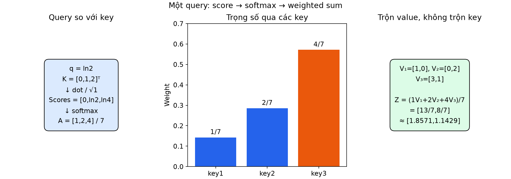
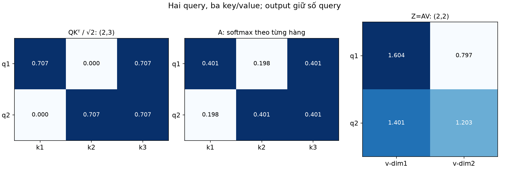
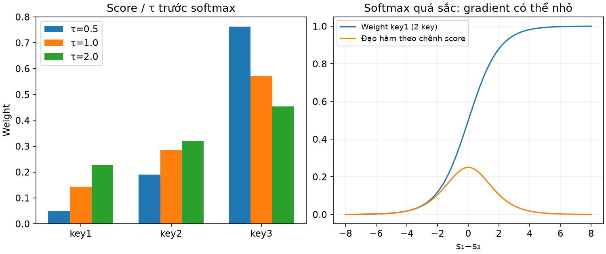
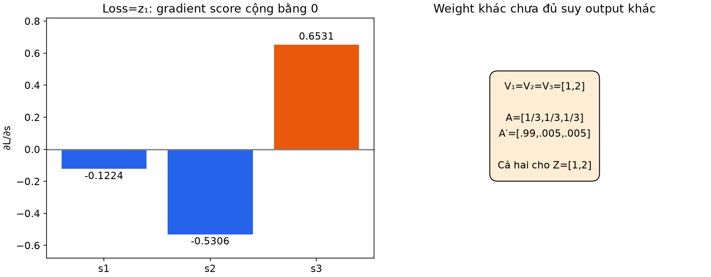
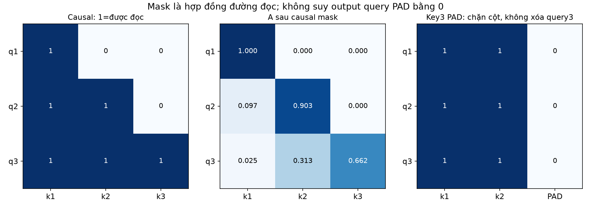
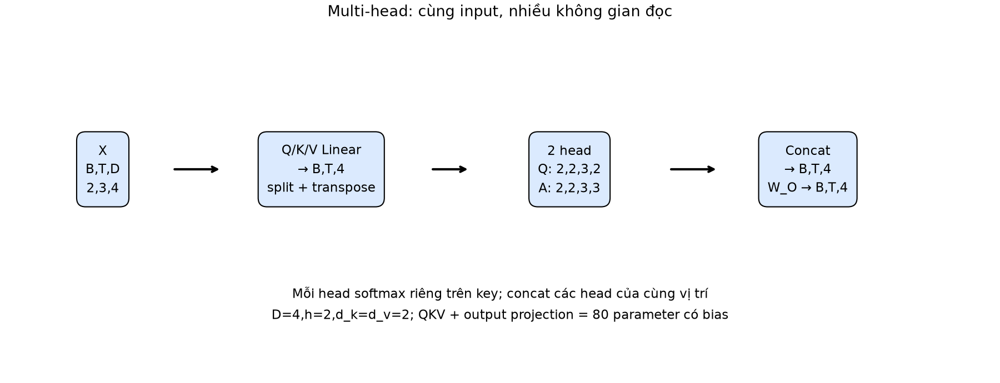
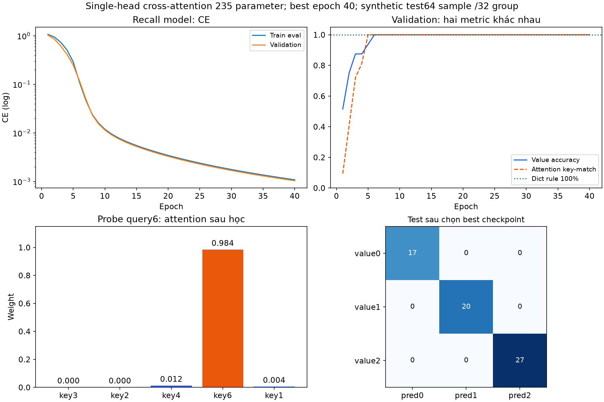

# Bài 17 — Attention: từ Q–K–V đến multi-head và mô hình học được

[Mục lục](../README.md) · [Bài 16](../16-embedding-bieu-dien/README.md) · [Đào sâu toán và API](deep-dive.md) · [Bài tập](exercises.md) · [Lời giải](solutions.md)

Biên soạn ngày 04/11/2026. Bài này được viết kỹ hơn vì attention là nền cho các bài Transformer sau. Toàn bộ ví dụ số, hình và dữ liệu là tự tạo; PyTorch chạy thật trên CPU, không tải model hay gọi API AI.

## 1. Mục tiêu và cách đọc

Sau bài này, bạn có thể tự tính score→softmax→weighted sum; suy shape Q, K, V và output; giải thích scaling/mask; phân biệt self-attention, cross-attention, multi-head; kiểm một implementation và nhận ra giới hạn khi diễn giải attention weight.

Cần hiểu vector/matmul bài 3, softmax/cross-entropy bài 6, gradient bài 10, padding bài 15 và embedding bài 16. Ký hiệu và shape được nhắc lại trong bài; không yêu cầu đã biết Transformer.

Nên học theo ba lượt, không cố nhớ hết tên ngay:

1. **Cơ chế một query:** phần 2–6, chạy `hand`, `matrix`; tự tính được1/7,2/7,4/7 trước khi xem code.
2. **Đúng khi dùng thật:** phần 7–12 và [phụ lục](deep-dive.md), chạy `masks`, `multihead`, `invariance`.
3. **Học và kiểm:** phần 13–15, chạy `train`, làm14 bài tập rồi đọc lời giải.

Bài đã huấn luyện một single-head cross-attention nhỏ và kiểm multi-head API; **chưa phải Transformer hoàn chỉnh**. Residual, LayerNorm, FFN và positional representation trong một block sẽ được kết nối ở bài 18.

## 2. Từ mean pooling đến “đọc theo câu hỏi”

Ở bài 16, mean pooling cho mọi token thật cùng trọng số1/T. Nếu một ticket có nhiều chi tiết mà câu hỏi chỉ cần một chi tiết, một vector mean cố định có thể trộn chúng lại. RNN bài 15 giữ state cập nhật theo thứ tự; attention cho phép tạo một kết quả **phụ thuộc query hiện tại** bằng cách gán trọng số cho các value được phép đọc.

Hãy nghĩ đến bảng dịch vụ và trạng thái. Câu hỏi cần dịch vụ nào là query; đặc trưng nhận diện mỗi dòng là key; nội dung trạng thái cần lấy là value. So query với từng key để tính mức phù hợp, chuẩn hóa các mức đó rồi trộn value.

| Thành phần | Vai trò | Không nên hiểu nhầm |
|---|---|---|
| Query q | Nhu cầu đọc của một vị trí/câu hỏi | Không nhất thiết là câu chữ người dùng nhập |
| Key kⱼ | Đặc trưng dùng để so với query | Không nhất thiết bằng raw token ID hoặc raw embedding |
| Value vⱼ | Nội dung được lấy/trộn từ dòng j | Key và value cùng dòng nhưng vector có thể khác |
| Weight αⱼ | Mức đóng góp tương đối của value j cho query này | Không tự là xác suất “dòng này đúng sự thật” |
| Output z | Tổng có trọng số của các value | Không phải chính bảng weight hoặc một token được chọn cứng |

Phép so sánh có thể học được; attention không mặc định thực hiện equality lookup chính xác như dict. Query khác có thể cho trọng số khác trên cùng memory. Thêm một key mới cũng thay đổi denominator softmax và có thể thay đổi các trọng số cũ.

Attention không bắt đầu từ Transformer năm2017. Bài [Bahdanau, Cho, Bengio](https://arxiv.org/abs/1409.0473) được đưa lên arXiv năm2014 mô tả soft alignment trong dịch máy để tránh chỉ nén nguồn vào một vector cố định. Bài [Attention Is All You Need](https://arxiv.org/html/1706.03762v7) phát triển kiến trúc Transformer với scaled dot-product và multi-head; ở đây tập trung cơ chế, không tái hiện kết quả dịch máy của các nguồn.

## 3. Một query: ví dụ tính tay có kết quả chính xác

Chọn q=[ln2], ba key k₁=[0], k₂=[1], k₃=[2], và:

```text
v1 = [1,0]
v2 = [0,2]
v3 = [3,1]
```

Query/key có d_k=1, value có d_v=2. Chúng **không bắt buộc có cùng số chiều**. Số key phải bằng số value để giữ cặp theo dòng.

### Bước A — So query với từng key

Scaled score sⱼ=q·kⱼ/√d_k. Vì √1=1:

| j | q·kⱼ | exp(score) |
|---:|---:|---:|
| 1 | 0 | 1 |
| 2 | ln2 | 2 |
| 3 | 2ln2=ln4 | 4 |

### Bước B — Softmax qua các key

Tổng exp=7 nên α=[1/7,2/7,4/7]. Ba trọng số không âm và tổng1. Softmax được tính **trên trục key**, nghĩa là với query này, phân phối mức đọc nằm trên ba dòng memory.

### Bước C — Trộn value, không trộn key

\[
z=\frac17[1,0]+\frac27[0,2]+\frac47[3,1]
=\left[\frac{13}{7}, \frac87\right]
\approx[1.857143,1.142857].
\]

Output có2 chiều vì value có2 chiều. Nó không bằng một value nguyên vẹn: attention này là phép đọc mềm. Nếu muốn chọn cứng key thứ3 bằng argmax thì output sẽ là[3,1], một phép toán khác.



```python
from lab import hand_demo
print(hand_demo())  # weights=[1/7,2/7,4/7]; output=[13/7,8/7]
```

Nếu giữ K, V mà đổi q=0 thì mọi score=0, weight đều1/3, output=[4/3,1]. Nếu giữ q, K mà đổi V thì weight không đổi nhưng output có thể đổi. Q/K điều khiển cách đọc; V quyết định nội dung được trộn. Trong self-attention, chúng có thể cùng bắt nguồn từ X và cùng được cập nhật khi X đổi, nên phép tách ở đây là để hiểu vai trò toán học.

## 4. Nhiều query cùng lúc: ma trận và shape

Gọi L là số query, S là số key/value. Không cần L=S:

\[
S_{score}=\frac{QK^\top}{\sqrt{d_k}}, \qquad
A=\operatorname{softmax}(S_{score}+M, \text{axis=key}), \qquad Z=AV.
\]

M là mask cộng vào score, sẽ học ở phần 8. Đừng nhầm chữ S dùng chỉ số lượng key với ma trận score; trong code tên biến là `scores`.

| Tensor | Một sample | Batch một head |
|---|---|---|
| Q | L×d_k | B×L×d_k |
| K | S×d_k | B×S×d_k |
| V | S×d_v | B×S×d_v |
| QKᵀ và A | L×S | B×L×S |
| Z | L×d_v | B×L×d_v |

Output có **một hàng cho mỗi query**, không một hàng cho mỗi key. Code dùng `k.transpose(-2, -1)` để đổi hai trục cuối, không đảo nhầm batch/head.

### Ví dụ2×3 có scaling khác1

Lấy Q=`[[1,0], [0,1]]`, K=`[[1,0], [0,1], [1,1]]`, V như phần 3. d_k=2 nên:

```text
scores = [[1/√2, 0,    1/√2],
          [0,    1/√2, 1/√2]]
```

Đặt r=exp(1/√2), a=r/(2r+1)≈0.401112093, b=1/(2r+1)≈0.197775815. Khi đó:

```text
A = [[a,b,a],         Z = [[4a,    2b+a],
     [b,a,a]]             [b+3a,  3a  ]]
```

Z≈`[[1.604448371,0.796663722], [1.401112093,1.203336278]]`. Mỗi hàng A cộng1; mỗi cột không cần cộng1. A không cần đối xứng, kể cả khi số query bằng số key; softmax theo từng hàng và Q, K khác nhau có thể phá đối xứng.



```python
from lab import matrix_demo
print(matrix_demo())
```

Lõi attention viết từ phép cơ bản trong [lab.py](lab.py):

```python
import torch
from lab import attention
Q=torch.tensor([[[1.,0.],[0.,1.]]])
K=torch.tensor([[[1.,0.],[0.,1.],[1.,1.]]])
V=torch.tensor([[[1.,0.],[0.,2.],[3.,1.]]])
Z,A=attention(Q,K,V)
print(Z.shape,A.shape)  # (1,2,2), (1,2,3)
```

## 5. Vì sao chia √d_k? Nó không phải cosine

Theo giả định minh họa: các thành phần q, k độc lập, mean0, variance1 thì dot là tổng d_k tích, có variance d_k. Chia √d_k đưa variance của score về1 theo giả định này. Score quá chênh có thể làm softmax gần one-hot và đạo hàm theo score rất nhỏ. [D2L: Attention scoring](https://d2l.ai/chapter_attention-mechanisms-and-transformers/attention-scoring-functions.html)

Đây là trực giác cho lựa chọn scaling, không phải chứng minh Q, K sau huấn luyện luôn độc lập hoặc có variance1. Trong self-attention, query/key cùng nguồn và score đường chéo có thể có đặc tính khác. Scaling không bảo đảm không bao giờ saturation.

Chia theo **chiều key/query mỗi head**, không theo số token, S, L hoặc số class. Ví dụ q=k=[1,1,1,1], dot=4, d_k=4, scaled score=2. Cosine của hai vector này là1: cosine chia thêm cho cả hai norm, nên khác scaled dot-product. Norm Q, K vẫn ảnh hưởng score của attention đang học.

### Softmax ổn định và độ sắc của phân phối

Softmax(s)=exp(s−max(s))/Σexp(s−max(s)), cùng kết quả toán học nhưng tránh exp của số dương quá lớn. Cộng cùng một hằng số vào cả hàng không đổi weight. Nhân score với một hằng số thì thường đổi weight.

Với nhiệt độτ>0, softmax(s/τ):τ nhỏ hơn làm phân phối sắc hơn khi score chênh, τ lớn hơn làm phẳng hơn. Với score[0, ln2, ln4], τ=.5 cho[1,4,16]/21; τ=1 cho[1,2,4]/7; τ=2 cho trọng số tỷ lệ[1, √2,2]. Nhiệt độ là cách phân tích ở đây; lab train dùng scale chuẩn1/√d_k, không thêm một temperature được tune.



Trước dropout, weight tạo một phân phối trên các **key được phép** và z là một tổ hợp lồi của V. Vì V có thể chứa số âm nên z không cần dương. Sau dropout trên A hoặc projection W_O, đừng mặc định các tính chất “tổng weight1” hoặc “output ở trong convex hull value gốc” vẫn giữ nguyên.

## 6. Q, K, V từ đâu đến? Projection và tham số học được

Các số Q, K, V trong phần 3–4 được đặt tay để thấy phép tính. Với representation X theo quy ước hàng:

\[
Q=XW_Q, \quad K=XW_K, \quad V=XW_V.
\]

W_Q, W_K, W_V là parameter học được, có thể khác nhau. Dùng chung X không có nghĩa Q=K=V. Trong PyTorch, Linear lưu weight theo(out, in), nên công thức forward tương ứng `X @ linear.weight.T + bias`.

Lõi `softmax(QKᵀ/√d_k)V` không có một bảng parameter riêng nếu đã cho Q, K, V; khả năng học đến từ các projection/embedding/head và những phần khác của model. `F.scaled_dot_product_attention` không tự tạo projection; `nn.MultiheadAttention` là module có projection và output projection.

Embedding lookup ở bài 16 lấy một hàng theo ID; attention trộn nhiều value theo query và memory. Attention không thay tokenizer, vocabulary hoặc biến raw ID thành ý nghĩa số học. Representation trước/sau attention cũng không tự là output xác suất class; classification cần head/loss riêng.

## 7. Attention học bằng gradient — một phép tính không bị giấu

Ở ví dụ phần 3, đặt loss kiểm toán **L=z₁=13/7**, chỉ lấy tọa độ thứ nhất output. Đây là loss tuyến tính để thấy đạo hàm, không phải objective phân loại của thí nghiệm cuối.

Gọi g=∂L/∂z=[1,0]. Vì z=Σαⱼvⱼ:

- ∂L/∂vⱼ=αⱼg.
- ∂L/∂αⱼ=g·vⱼ nên gradient theo A là[1,0,3].
- Softmax khiến tăng một score ảnh hưởng **cả hàng**, không chỉ một weight.

Đạo hàm theo score là `g_s = α * (g_α − Σ α*g_α)` theo phần tử. Σαg_α=13/7, nên:

```text
dL/dscores = [-6/49, -26/49, 32/49]
```

Tổng gradient score bằng0, phù hợp với việc cộng một hằng số vào hàng score không đổi softmax. Do score=qk/√1:

```text
dQ = 38/49 ≈ 0.775510204
dK = ln2 × [-6/49, -26/49, 32/49]ᵀ
dV = [[1/7,0],[2/7,0],[4/7,0]]
```

Mode `hand` đối chiếu các đạo hàm với autograd float64. [Phụ lục toán](deep-dive.md) suy Jacobian softmax và gradient ma trận đầy đủ, để bạn tự kiểm implementation chứ không chỉ học thuộc công thức forward.



Không có nhãn attention trực tiếp trong thí nghiệm cuối: classification loss truyền gradient qua head→Z→V/A→Q/K→parameter. V hoặc score khác nhau đều có thể ảnh hưởng loss; weight cao không tự là một giải thích nhân quả đầy đủ.

## 8. Mask: chặn đường đọc trước softmax

Mask không phải cách gán label, nó quy định cặp(query, key) nào được phép nối. Để chặn một ô, đặt score ô đó thành−∞ trước softmax; exp(−∞)=0. Với hàng còn ít nhất một key hợp lệ, các key còn lại được chuẩn hóa lại.

Ví dụ chặn key3 ở phần 3:score=[0, ln2, −∞], A=[1/3,2/3,0], Z=[1/3,4/3]. Nếu chỉ tính A cũ rồi set α3=0, hai weight còn lại tổng3/7, chưa phải attention đã mask đúng. Nếu score cần chặn đang âm, nhân score với0 còn có thể làm ô đó hấp dẫn hơn! Dùng mask theo đúng API.

### Padding mask và causal mask

| Loại | Câu hỏi trả lời | Ví dụ |
|---|---|---|
| Key padding mask | Dòng memory nào chỉ là đệm? | Bỏ key có ID0, giữ cả value0 nếu đó là class thật |
| Causal mask | Query i có được đọc key tương lai j>i không? | Self-attention vuông:cho j≤i |
| Query validity/loss mask | Output query nào là mẫu/bước thật cần đo? | Bỏ loss ở query PAD, không chỉ bỏ PAD key |

Causal allowed mask cho3 vị trí:

```text
[[1,0,0],
 [1,1,0],
 [1,1,1]]
```

Giữ đường chéo không tự là leakage:trong next-token training, representation tại token i thường dùng để dự đoán token i+1; cần căn input/target lệch đúng. Nếu vô tình đưa token target vào input trước đó, causal mask không sửa được lỗi căn dữ liệu.



Key padding mask chỉ cấm đọc **cột** PAD, nó không tự biến output ở **hàng query PAD** thành0. Mode `masks` cho một padded query vẫn có output norm≈1.300537 trong toy; cần bỏ các query đó khi pooling/loss, hoặc xử lý output theo mục tiêu. Không tạo một hàng bị chặn toàn bộ rồi mặc định mọi kernel xử lý giống nhau.

Lõi attention của lab chủ động báo lỗi khi một hàng không có key hợp lệ. Softmax của hàng toàn−∞ không tạo phân phối thông thường. Một API/backend có thể trả0 hoặc có hành vi khác; bài không dựa vào hành vi đó. Đừng thay−∞ bằng−1e9 rồi coi đã giải quyết:hàng bị chặn toàn bộ vẫn có thể thành phân phối đều sai ý định.

## 9. Self-attention và cross-attention

Hai tên này nói **nguồn Q và K/V**, không nói số head hoặc bắt buộc có causal mask.

| Cơ chế | Nguồn query | Nguồn key/value | Shape điển hình |
|---|---|---|---|
| Self-attention | Các representation của cùng chuỗi X | Cũng từ X, thường qua projection khác | L=S=T, output T vị trí |
| Cross-attention | Chuỗi/câu hỏi X_q | Memory/chuỗi khác X_m | L và S có thể khác nhau |

Ví dụ self:token trong một câu cập nhật theo các token được phép trong chính câu đó. Ví dụ cross:một query dịch vụ đọc một memory các trạng thái; hoặc decoder đọc output encoder. Cùng một cặp K/V có thể dùng cho nhiều query; với cross-attention, không cần ghép hai chuỗi bằng cách cộng tensor khác chiều.

Các quy tắc mask phải theo thông tin được phép có ở thời điểm dự đoán. Encoder self-attention có thể đọc cả đoạn input đã biết; decoder tự hồi quy cần hạn chế tương lai ở chuỗi đích. Không đánh đồng “self-attention” với “causal attention”.

## 10. Multi-head: nhiều phép đọc ở những không gian con

Một head tạo một A trên query/key đã projection. Multi-head dùng các projection khác nhau để mỗi head có thể tính score và trộn V khác nhau:

\[
H_r=\operatorname{Attention}(X_qW_Q^{(r)}, X_mW_K^{(r)}, X_mW_V^{(r)}),
\quad Y=\operatorname{Concat}(H_1, \ldots, H_h)W_O.
\]

Đây là kiến trúc cho phép các quan hệ khác nhau, không phải bảo đảm head1 học cú pháp, head2 học ngữ nghĩa. Head có thể dư thừa; thêm head không tự làm chất lượng tăng. Không lấy trung bình các head rồi mặc định tương đương concat→projection.

### Theo shape từng bước: D=4, h=2

Trong cấu hình thông dụng d_k=d_v=D/h=2, B=2, L=S=3:

| Bước | Shape |
|---|---|
| Input X | (2,3,4) |
| Projection Q, K, V toàn chiều D | mỗi tensor(2,3,4) |
| Reshape B, T, h, d rồi transpose | (2,2,3,2) |
| Score/weight từng head | (2,2,3,3) |
| Mỗi head sau nhân V | (2,2,3,2) |
| Đổi về B, T, h, d rồi concat | (2,3,4) |
| Output projection | (2,3,4) |

Trong `B, h, L, d_k`, softmax vẫn trên **S ở trục cuối của score**, không qua head hoặc batch. Cần transpose trước/sau reshape đúng ý nghĩa; số phần tử khớp chưa chứng minh các head đúng.



Module PyTorch D=4 có Q/K/V projection tổng3D²+3D và output D²+D: **4D²+4D=80 parameter** khi dùng bias mặc định. Ở cấu hình giữ tổng D, mỗi head dùng D/h, không nhân số parameter toàn bộ thêm h lần. `embed_dim` phải chia hết cho `num_heads` trong module này. [MultiheadAttention](https://docs.pytorch.org/docs/2.15/generated/torch.nn.MultiheadAttention.html)

Mode `multihead` lấy weight/bias của nn.MultiheadAttention, tự chạy projection→split→attention→concat→output Linear và đối chiếu API. Output sai khác max≈1.11×10⁻¹⁶ trên CPU float64. Cả weight theo head cũng được đối chiếu; xem[phụ lục API](deep-dive.md) để đọc công thức bằng code.

## 11. Attention không tự có vị trí hoặc thành một Transformer

Với self-attention không position, không mask cố định, hoán vị đồng thời hàng input sẽ hoán vị tương ứng hàng output: **permutation equivariance**. Nó không phân biệt thứ tự như RNN chỉ nhờ matmul. Nếu sau đó mean-pool output, representation toàn chuỗi sẽ không đổi theo hoán vị.

Với cross-attention không position, giữ Q và hoán vị đồng thời K, V theo cùng thứ tự sẽ giữ output; đó là điều phù hợp nếu memory là tập các dòng không có thứ tự. Hoán vị K mà không hoán vị V làm hỏng cặp key/value, có thể đổi ý nghĩa dù shape đúng.

Các kết luận trên cần giữ điều kiện:causal mask cố định tạo cấu trúc hướng, position encoding thêm thông tin vị trí. Nếu có mask riêng, muốn suy equivariance phải biến đổi mask phù hợp. Mode `invariance` kiểm trường hợp không position, không mask; không tuyên bố mọi Transformer bất biến thứ tự.

Transformer còn kết nối attention với residual, normalization, FFN, position và thiết kế encoder/decoder/loss. Bài 18 sẽ ghép những phần này. Bài này chưa train language model, LLM, KV cache hoặc flash kernel trên GPU.

## 12. Hai API PyTorch: mask polarity và dropout

Đừng chuyển nguyên boolean mask giữa các API chỉ vì đều gọi attention:

| Giao diện | Bool True | Float mask |
|---|---|---|
| `attention` của lab | Được đọc | Lab không nhận float mask |
| `F.scaled_dot_product_attention` | Được đọc | Cộng trực tiếp vào score |
| `nn.MultiheadAttention.attn_mask` | Bị chặn | Cộng trực tiếp vào score |
| `nn.MultiheadAttention.key_padding_mask` | Key bị bỏ qua | Mask cộng theo key |

Module MHA thường nhận input B×T×D khi batch_first=True; functional SDPA thường dùng B×h×L×d_k và trả B×h×L×d_v. Chỉ SDPA không có projection output và không trả A trong return chuẩn của hàm. MHA có thể trả A; `average_attn_weights=False` để thấy B×h×L×S, thay vì mặc định đã trung bình head. [SDPA API](https://docs.pytorch.org/docs/2.15/generated/torch.nn.functional.scaled_dot_product_attention.html)

SDPA áp dropout theo `dropout_p` truyền vào, kể cả module bọc đang eval. Khi evaluation, cần truyền0, hoặc trong forward dùng `self.p if self.training else 0.0`. Code đối chiếu của bài luôn dropout0. Hình weight tổng1 trong bài là trước dropout.

Mode `masks` kiểm SDPA bằng mask cho phép, so với MHA nhận mask chặn có polarity ngược. Kiểm causal square bằng cả explicit mask và is_causal=True. Non-square causal alignment, export, GQA, CUDA và mixed precision chưa được thực nghiệm; đừng tự suy mọi layout/combination được hỗ trợ như nhau.

## 13. Chi phí và cách đọc attention map

Cách triển khai explicit lưu score có B×h×L×S phần tử. Self-attention L=S=T làm phần này tăng theo T²; nếu T tăng gấp2 thì số ô score gấp4. Ví dụ B=1, h=8, T=4096, float32:chỉ một tensor score đã có8×4096²×4 byte=**512MiB**, chưa gồm A, gradient, QKV và phần khác. Đây là ước lượng cho **tensor explicit**, không phải số RAM bắt buộc của mọi kernel tối ưu.

QK và AV có chi phí tương ứng bậc B h L S d_k và B h L S d_v, ngoài projection. Bài train chỉ L=1, S≤5, nên không minh họa tốc độ/memory của long-context self-attention. Fused attention có thể tránh lưu đầy đủ một số tensor trung gian; code dễ đọc của bài không phải implementation tối ưu.

Attention map cho biết tỷ trọng trộn V trong một phép tính. Nó không tách được mọi tác động của projection, V, residual hoặc layer sau. Phản ví dụ cụ thể:ba value đều[1,2]; A=[1/3,1/3,1/3] và A′=[.99, .005, .005] đều cho z=[1,2]. Vì vậy chỉ nhìn weight sắc/nhạt chưa đủ suy đầu ra phải khác hoặc đã có giải thích nhân quả.

Mode `invariance` kiểm phản ví dụ đó. Trong task cuối, các dòng khác nhau còn có thể cùng value class; nên chọn đúng value và argmax attention trúng key là **hai metric khác nhau**, dù run hiện tại đều đạt100% trên tập giữ riêng.

## 14. Thực hành học cross-attention để truy xuất bộ nhớ

Mỗi sample có một query ID dịch vụ1–6 và2–5 dòng memory, key không trùng, value class0/1/2 gán ngẫu nhiên. Target là value ở dòng có key trùng query. Value cần trả đã nằm trong input memory **theo thiết kế bài truy xuất**, không phải dự báo một giá trị tương lai chưa có. Model cần học cách chọn dòng, hệ thống dict có thể giải chính xác.

Tạo192 memory mapping khác nhau, so theo canonical sorted(key, value) để không lặp group. Mỗi group tạo2 query khác nhau và xáo thứ tự dòng riêng. Split group128/32/32 → **256/64/64 sample**, giữ các query cùng memory một tập. Các ID dịch vụ đều là danh mục quen thuộc, đánh giá không phải unseen-ID generalization.

Model một head:

```text
Embedding ID (7×8, key0=PAD)
  query → Linear8→8 không bias → Q (B,1,8)
  keys  → Linear8→8 không bias → K (B,S,8)
Embedding value class (3×8)    → V (B,S,8)
  mask theo keys != 0 → Attention → Z (B,1,8)
  Linear8→3 → logits (B,3)
```

Tổng parameter=56+64+64+24+27=**235**. Không có W_V riêng trong model này vì vector V đã do embedding value học; không có W_O riêng trước head. Đây là thiết kế toy, cần phân biệt với MHA đầy đủ ở phần 10.

Padding theo keyID0; valueID0 là **class hợp lệ** nên không mask mọi value0. Train Adam lr=.01, batch32, seed2026, data_seed17,40 epoch=8×40=320 update, clip global grad norm1. Classification CE là loss duy nhất, không thêm loss buộc attention trúng key.

Chọn minimum validation CE, hòa giữ epoch sớm hơn.Test chỉ chấm sau lựa chọn; một probe test sau đó kiểm đường inference/forward nhất quán, không dùng để đổi model.

| Đại lượng | Kết quả thực chạy |
|---|---|
| Best epoch / validation CE | 40 /≈0.001039705 |
| Validation accuracy / argmax attention trúng query key | 100% /100% trên64 sample |
| Test CE / accuracy / key-match rate | ≈0.001068935 /100% /100% trên64 sample |
| Confusion test, hàng=true, cột=pred, value0/1/2 | `[[17,0,0], [0,20,0], [0,0,27]]` |
| Majority từ train:validation accuracy | 15/64=23.4375% |
| Dict lookup rule:validation accuracy | 100% |

Lớp không được ép cân bằng; không mặc định majority validation luôn≥1/3 khi nhãn tập giữ riêng khác train. Rule dict đã giải được bài, nên không coi attention là cần thiết cho tra cứu dịch vụ thực tế. Kết quả chỉ chứng minh cơ chế học được trong toy; chưa là benchmark Transformer hoặc năng lực ngôn ngữ.

Probe thật:query6, keys=[3,2,4,6,1], values=[0,2,0,1,0]. Weight≈[.00000836, .00000765, .01191081, .98360163, .00447158], trọng số lớn nhất ở key6, target/predict class1. Các ô khác vẫn có trọng số nhỏ, không phải equality lookup cứng.



```python
from pathlib import Path
from tempfile import TemporaryDirectory
from lab import Config,train,predict_memory
with TemporaryDirectory() as directory:
    out=Path(directory)/'run'
    report=train(out,Config(epochs=2))  # Pipeline ngắn,không kỳ vọng bảng40 epoch
    print(report['parameters'])  # 235
    print(predict_memory(out/'best.pt',2,[1,2,3],[0,1,2]))
```

Output gồm data.json, config.json, metadata.json, metrics.csv, best.pt, report.json. Checkpoint lưu model/config, domain ID và epoch/data hash để inference; chưa có optimizer/RNG để resume như last.pt bài 12. Không có vocabulary ngôn ngữ hoặc tokenizer trong task này.

## 15. Lệnh chạy, tự đánh giá và bước tiếp theo

Đã kiểm Python 3.14.6, torch 2.15.0, NumPy 2.5.4, macOS arm64. Hand/mask/MHA checks dùng CPU float64; model train dùng CPU float32 một thread. Phụ thuộc ở [requirements.txt](requirements.txt). Từ thư mục bài 17:

```bash
python3 -m venv .venv
.venv/bin/python -m pip install -r requirements.txt
.venv/bin/python lab.py --mode hand
.venv/bin/python lab.py --mode matrix
.venv/bin/python lab.py --mode masks
.venv/bin/python lab.py --mode multihead
.venv/bin/python lab.py --mode invariance
.venv/bin/python lab.py --mode all --out /tmp/lesson17-run-01
```

Windows dùng `.venv\Scripts\python` và output phù hợp.Chọn output mới; bỏ --out để tạo thư mục tạm, in đường dẫn rồi chép ra nơi lưu lâu dài nếu muốn giữ.`--mode train` chỉ chạy recall model.Không cần GPU, dataset hoặc pretrained model tải ngoài.Bản ghim cần wheel phù hợp; đối chiếu[cài PyTorch](https://pytorch.org/get-started/locally/)khi nền tảng khác.Seed không bảo đảm giống từng bit giữa phiên bản/backend.

Bảy hình đã có PNG/SVG, tái tạo bằng [make_figures.py](make_figures.py), Matplotlib 3.11.2 và run tạm:

```bash
.venv/bin/python -m pip install -r requirements-figures.txt
.venv/bin/python make_figures.py
```

Hoàn thành [14 bài tập](exercises.md), rồi đối chiếu[lời giải](solutions.md). Nếu chưa tự suy được A có L hàng, S cột hoặc vì sao mask trước softmax, hãy quay lại phần 3–4 và8 trước khi ghép Transformer. [Đào sâu toán và API](deep-dive.md) cung cấp phép suy gradient và code theo head. **Bài tiếp theo:** [Bài 18 — Transformer](../18-transformer/README.md), ghép attention với vị trí, residual, LayerNorm và FFN để xử lý/sinh chuỗi. [Nguồn và phạm vi đã đọc](../SOURCES.md).
