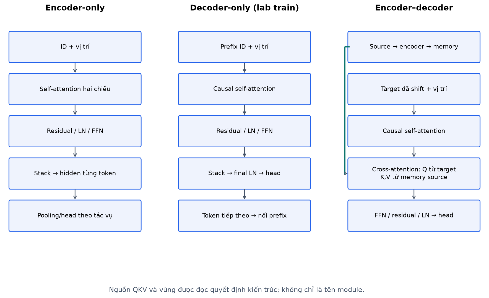
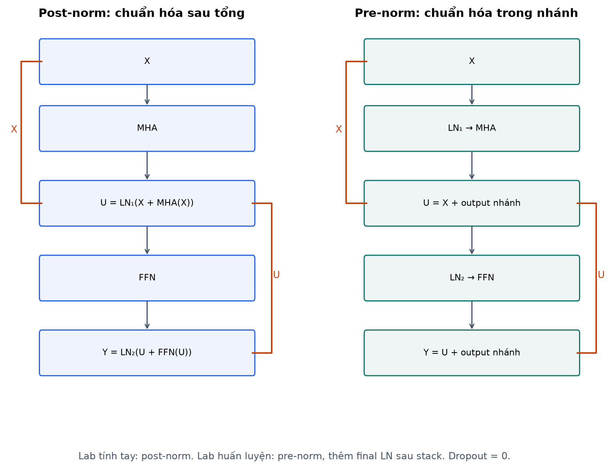
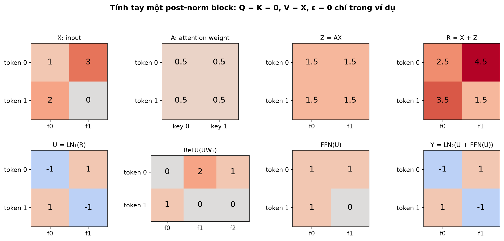
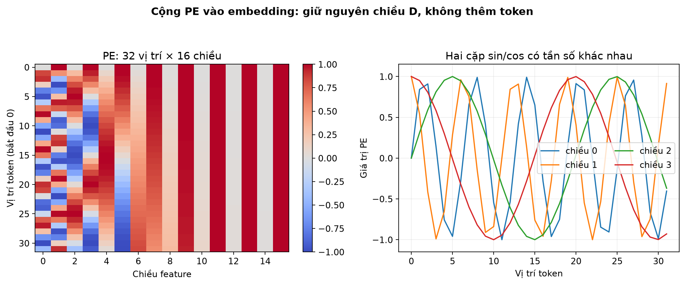
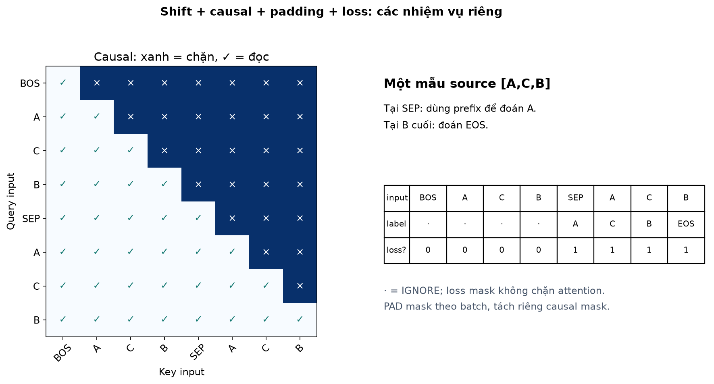
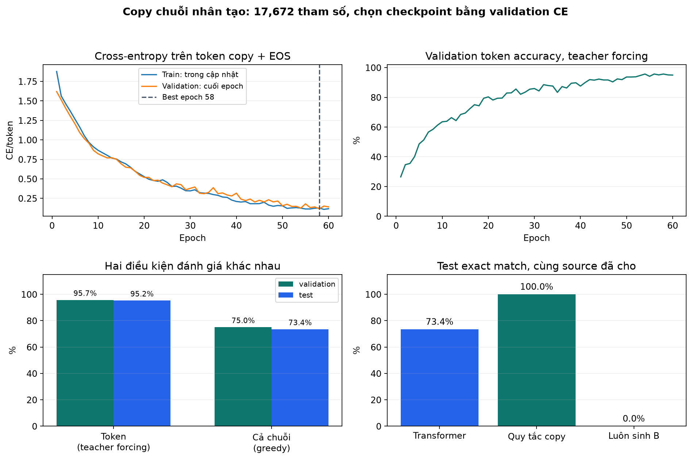
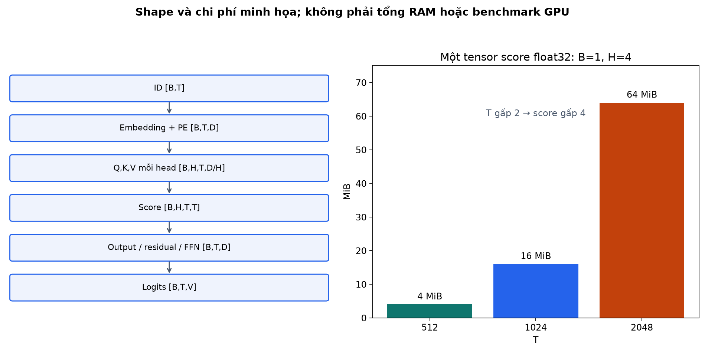

# Bài 18 — Transformer: ghép attention thành mô hình xử lý và sinh chuỗi

[Mục lục](../README.md) · [Bài 17 — Attention](../17-attention/README.md) · [Đào sâu và đọc code](deep-dive.md) · [Bài tập](exercises.md) · [Lời giải](solutions.md)

Biên soạn ngày 04/11/2026. Dành cho backend engineer đã học embedding và attention ở bài 16–17. Ví dụ, hình và dữ liệu trong bài được tự xây dựng; thực hành chạy thật trên CPU, không tải mô hình hoặc dữ liệu ngoài.

> [!NOTE]
> **Định nghĩa các khái niệm cốt lõi của kiến trúc Transformer:**
> 1. **Kiến trúc Transformer:** Là kiến trúc học sâu đột phá (Vaswani et al., 2017) loại bỏ hoàn toàn các vòng lặp tuần tự của RNN và tích chập của CNN, xây dựng hoàn toàn dựa trên các cơ chế Attention kết hợp với kết nối tắt (Residual), chuẩn hóa tầng (LayerNorm) và mạng truyền thẳng (FFN).
> 2. **Khối Transformer (Transformer Block):** Đơn vị cấu trúc cơ sở được xếp chồng nhiều lần (ví dụ: 12, 32, hoặc 96 tầng). Mỗi khối gồm hai tầng con chính: tầng Multi-Head Attention (giúp các token giao tiếp với nhau) và tầng Feed-Forward Network (giúp từng token tự xử lý phi tuyến).
> 3. **Kết nối tắt (Residual Connection / Skip Connection):** Phép cộng trực tiếp tín hiệu đầu vào vào đầu ra của một tầng con: $Y = X + F(X)$, tạo ra một "đường cao tốc thông tin" giúp gradient chảy thông suốt qua hàng chục tầng mà không bị suy giảm.
> 4. **Layer Normalization (LayerNorm):** Kỹ thuật chuẩn hóa các giá trị đặc trưng (features) của **riêng từng token độc lập**, đưa giá trị về phân phối trung bình 0 và phương sai 1, giúp ổn định động lực học khi huấn luyện mạng sâu.
> 5. **Mạng truyền thẳng theo từng vị trí (Position-wise Feed-Forward Network — FFN):** Mạng MLP hai tầng áp dụng độc lập và đồng nhất cho từng vị trí token trong chuỗi, thực hiện biến đổi phi tuyến sâu trong không gian đặc trưng.
> 6. **Mã hóa Vị trí (Positional Encoding — PE):** Vector biểu diễn thứ tự không gian được cộng trực tiếp vào vector embedding để bù đắp việc Attention thuần túy không có khái niệm về trật tự trước - sau.
> 7. **Teacher Forcing:** Kỹ thuật huấn luyện chuỗi trong đó toàn bộ câu đúng trong quá khứ được nạp làm đầu vào đồng thời ở tất cả các vị trí, cho phép GPU tính toán song song loss của cả câu chỉ trong một lần forward duy nhất.

## 1. Mục tiêu và cách học

Ở bài 17, bạn đã có một phép đọc: query so với các key, softmax thành trọng số rồi trộn value. Nhưng phép đọc đó chưa đủ để tạo một hệ thống nhiều tầng có thể học thứ tự, giữ thông tin đầu vào và dự đoán token tiếp theo. Bài này lấp đúng khoảng trống đó.

> [!TIP]
> **Tại sao kỹ sư AI cần tự tay xây dựng một Transformer từ số 0?**
> Hầu hết mọi mô hình ngôn ngữ lớn (LLM) hiện nay — từ GPT-4, Claude, Gemini, LLaMA cho đến DeepSeek — đều dựa trên nền tảng của các khối Transformer Decoder-only. Việc nắm vững cách ghép nối tensor, hiểu rõ cơ chế mặt nạ nhân quả (causal mask), kỹ thuật dịch nhãn (label shift) và cách hoạt động của vòng lặp sinh tự hồi quy (autoregressive generation) sẽ giúp bạn tự tin gỡ lỗi (debug), tối ưu hóa tốc độ suy luận (KV cache, vLLM) và làm chủ các kỹ thuật tinh chỉnh (fine-tuning) trong thực tế.

Sau bài này, bạn cần làm được:

- Vẽ luồng từ token ID đến embedding, vị trí, các block, logits và loss; ghi đúng shape từng bước.
- Tính tay một block nhỏ gồm attention, residual, LayerNorm và FFN.
- Phân biệt encoder-only, decoder-only và encoder–decoder bằng luồng thông tin cùng mask.
- Tạo input/label dịch một vị trí, huấn luyện có teacher forcing, sinh chuỗi không nhìn đáp án.
- Kiểm tra mask, padding, checkpoint và phân biệt token accuracy với chất lượng cả chuỗi.

Ba lượt đọc gợi ý:

1. **Hiểu block:** phần 2–8; chạy `hand`, `block`, `position`.
2. **Hiểu thông tin được phép nhìn:** phần 9–12; chạy `masks`, `seq2seq`; tự vẽ bảng input/label.
3. **Tự xây và đánh giá:** phần 13–17, [phụ lục](deep-dive.md), thực hành và 16 bài tập.

Cần nhắc lại: vector/matmul bài 3, cross-entropy bài 6, gradient bài 10, train/eval bài 12, padding bài 15, embedding bài 16, QKV/multi-head bài 17. “Biên soạn xong” không có nghĩa độc giả đã hiểu; các tiêu chí cuối bài giúp tự kiểm tra.

## 2. Từ attention đến Transformer

Ta giữ ký hiệu hàng là token, cột là feature. Với một chuỗi biểu diễn X có shape `[T,D]`:

\[
Q=XW_Q,\quad K=XW_K,\quad V=XW_V,\qquad
A=\operatorname{softmax}_{key}(QK^\top/\sqrt{d_k}+M),\quad Z=AV.
\]

M có giá trị 0 tại ô được đọc và −∞ tại ô bị chặn. Multi-head attention (MHA) làm nhiều phép đọc trong các không gian con, nối kết quả rồi chiếu về D chiều. Không cộng trực tiếp bảng A vào X: A có shape `[H,T,T]`, còn output MHA có shape `[T,D]`.

Nếu chỉ chồng những phép đọc này, ta còn phải trả lời: vị trí nằm ở đâu; thông tin gốc đi qua tầng bằng đường nào; mỗi token được biến đổi phi tuyến ra sao; khi sinh output thì có được nhìn tương lai không? Đó là lý do cần kiến trúc gồm nhiều bộ phận có vai trò khác nhau.

> [!NOTE]
> **Sự phối hợp nhịp nhàng giữa các bộ phận trong Transformer:**
> - **Self-Attention** đóng vai trò là *"phiên thảo luận nhóm"*: các từ ngữ tương tác qua lại, trao đổi thông tin để hiểu ngữ cảnh của nhau.
> - **FFN (Feed-Forward Network)** đóng vai trò là *"giờ tự suy ngẫm"*: sau khi đã lắng nghe ngữ cảnh từ các từ xung quanh, từng từ tự xử lý và biến đổi kiến thức của riêng mình qua các tầng phi tuyến.
> - **Residual Connection** là *"đường dây liên lạc thông suốt"*: giữ lại thông tin gốc ban đầu để không bị biến dạng qua quá trình thảo luận.
> - **LayerNorm** là *"người điều phối kỷ luật"*: giữ cho biên độ tín hiệu luôn ổn định, không để nơ-ron nào phát nổ hay tắt ngấm.

| Bộ phận | Câu hỏi nó giải quyết | Shape điển hình |
|---|---|---|
| Token embedding | ID rời rạc được đưa vào không gian số như thế nào? | `[B,T] → [B,T,D]` |
| Biểu diễn vị trí | Token này đang ở đâu trong chuỗi? | `[T,D]`, cộng theo batch |
| Self-attention | Token đọc thông tin từ các vị trí nào? | `[B,T,D] → [B,T,D]` |
| Residual | Giữ đường truyền trực tiếp bên cạnh nhánh biến đổi bằng cách nào? | Cộng hai tensor `[B,T,D]` |
| LayerNorm | Chuẩn hóa feature của từng token như thế nào? | `[B,T,D] → [B,T,D]` |
| FFN | Biến đổi phi tuyến feature sau khi đã đọc ngữ cảnh ra sao? | `D → F → D` ở mỗi vị trí |
| Output head | Biểu diễn được đổi thành điểm số cho tác vụ nào? | Ví dụ `[B,T,D] → [B,T,V]` |

Transformer gốc năm 2017 là mô hình encoder–decoder; encoder dùng self-attention, decoder thêm masked self-attention và cross-attention đọc output encoder. Bài này học cấu trúc gốc rồi tự xây một biến thể decoder-only để luyện sinh chuỗi. Đây là hai kiến trúc cần phân biệt, không gọi thí nghiệm nhỏ là tái hiện toàn bộ mô hình dịch máy gốc. [Attention Is All You Need, mục 3.1](https://arxiv.org/html/1706.03762v7).

> [!NOTE]
> **Ba nhánh phát triển lớn của họ mô hình Transformer:**
> 1. **Encoder-only (BERT, RoBERTa):** Sử dụng Self-Attention hai chiều (Bidirectional). Mọi từ đều được nhìn thấy toàn bộ câu. Thích hợp nhất cho các bài toán phân loại văn bản, trích xuất thực thể (NER), tìm kiếm ngữ nghĩa.
> 2. **Decoder-only (GPT, LLaMA, Mistral, Gemini):** Sử dụng Causal (Masked) Self-Attention. Mỗi từ chỉ được nhìn về quá khứ, cấm nhìn tương lai. Thích hợp nhất cho các bài toán sinh văn bản tự hồi quy (Text Generation, Chatbot, Code Completion).
> 3. **Encoder–Decoder (T5, BART, Transformer 2017):** Kết hợp cả Encoder hai chiều và Decoder một chiều qua tầng Cross-Attention. Thích hợp cho các bài toán chuyển đổi chuỗi sang chuỗi (Dịch máy, Tóm tắt văn bản).



## 3. Giữ đường truyền: residual connection

Một nhánh biến đổi F có thể được bọc bằng:

\[
Y=X+F(X).
\]

Ví dụ X=[2,−1], F(X)=[0.3,0.5] thì Y=[2.3,−0.5]. Nhánh học một phần cập nhật vào biểu diễn hiện có. X và F(X) phải cùng shape; vì vậy output MHA và FFN trong block quay về D chiều.

> [!NOTE]
> **Ẩn dụ Đường cao tốc Thông tin (Highway Analogy):**
> Hãy hình dung việc truyền tín hiệu qua mạng nơ-ron sâu giống như đi lại trong một thành phố:
> - Nhánh biến đổi $F(X)$ giống như con đường làng quanh co với nhiều ngã rẽ và đèn đỏ (các phép nhân ma trận trọng số và hàm phi tuyến).
> - Phép cộng $+ X$ tạo ra một **con đường cao tốc trên cao chạy thẳng tắp**.
> Thông tin gốc $X$ có thể phóng thẳng từ tầng 1 lên tầng 32 mà không bị suy hao. Nhánh $F(X)$ chỉ cần học cách "tinh chỉnh nhẹ" (residual - phần dư) trên nền thông tin gốc đã có, thay vì phải tái tạo lại toàn bộ dữ liệu từ đầu.

Nhìn theo gradient, nếu g là gradient đến Y, thì gradient đến X gồm hai đường: g qua phép cộng trực tiếp và phần qua F. Với quy ước gradient cột:

\[
\nabla_X L=g+J_F(X)^\top g.
\]

Đường trực tiếp tạo thêm lối truyền tín hiệu qua tầng. Không thể từ công thức này kết luận gradient luôn lớn hoặc không bao giờ triệt tiêu: hai nhánh vẫn có thể cộng hoặc bù nhau. Cũng không có nghĩa F không cần học.

> [!NOTE]
> **Phân tích toán học về Dòng chảy Gradient:**
> Khi lan truyền ngược (backpropagation), đạo hàm của phép cộng $Y = X + F(X)$ theo $X$ là:
> $$\frac{\partial Y}{\partial X} = I + \frac{\partial F}{\partial X}$$
> Khi nhân quy tắc dây chuyền, gradient truyền về luôn có số hạng $+ g$ trực tiếp (nhờ ma trận đơn vị $I$). Cho dù nhánh biến đổi $F$ có bị bão hòa hoặc triệt tiêu gradient ($\frac{\partial F}{\partial X} \approx 0$), gradient $g$ vẫn chảy thông suốt về các tầng trước mà không bao giờ bị biến mất hoàn toàn! Đây chính là bí quyết giúp ta có thể huấn luyện thành công các mạng Transformer sâu hàng trăm tầng.

Một phép kiểm tư duy hữu ích: nếu nhánh F bằng 0 thì pre-norm sublayer `X + F(LN(X))` trả X; post-norm sublayer `LN(X + F(X))` trả LN(X). Vị trí LayerNorm làm thay đổi hành vi dù nhánh biến đổi bằng 0.

## 4. LayerNorm: chuẩn hóa theo feature của từng token

Với x có D feature, lấy trung bình và phương sai **trên D feature của riêng token đó**:

\[
\mu=\frac1D\sum_i x_i,\qquad
\sigma^2=\frac1D\sum_i(x_i-\mu)^2,
\qquad \operatorname{LN}(x)_i=\gamma_i\frac{x_i-\mu}{\sqrt{\sigma^2+\epsilon}}+\beta_i.
\]

γ và β là tham số học được, mỗi vector dài D; ε là số dương nhỏ tránh chia cho 0. Với `nn.LayerNorm(D)` trên `[B,T,D]`, B và T không nằm trong phép tính mean/variance. PyTorch dùng phương sai chia D, tương đương `correction=0`; không dùng mặc định chia D−1 khi tự viết công thức. LayerNorm vẫn tính thống kê từ input trong cả train và eval. [Tài liệu LayerNorm 2.15](https://docs.pytorch.org/docs/2.15/generated/torch.nn.LayerNorm.html).

> [!IMPORTANT]
> **Phân biệt LayerNorm vs BatchNorm trong xử lý ngôn ngữ:**
> - **BatchNorm (Bài 14 - Phổ biến trong CNN ảnh):** Chuẩn hóa dọc theo trục Batch $B$ cho từng đặc trưng. Cách này thất bại trong xử lý văn bản vì độ dài câu $T$ thay đổi liên tục, và nếu batch size nhỏ hoặc khi suy luận từng câu đơn lẻ ($B=1$), thống kê batch sẽ bị sai lệch hoàn toàn.
> - **LayerNorm (Chuẩn mực của Transformer):** Chuẩn hóa ngang qua $D$ đặc trưng của **duy nhất một token tại một vị trí thời điểm**. Mỗi token tự tính mean $\mu$ và variance $\sigma^2$ của riêng mình. Phép tính này hoàn toàn độc lập với kích thước batch $B$ và độc lập với các token khác trong câu, hoạt động nhất quán $100\%$ cả lúc train lẫn lúc inference.

### Ví dụ tính tay

Chọn x=[1,2,3,4], γ=[1,1,1,1], β=0, tạm ε=0 để thấy số rõ:

- μ=2.5.
- Bình phương độ lệch: [2.25,0.25,0.25,2.25].
- σ²=5/4=1.25, căn phương sai=√5/2.
- LN(x)=[−3/√5,−1/√5,1/√5,3/√5] ≈ [−1.341641,−0.447214,0.447214,1.341641].

Nếu γ=[2,1,1,0.5], β=[0,0,1,−1], kết quả sau affine là [−2.683282,−0.447214,1.447214,−0.329180]. Vì có affine học được và ε, output tổng quát không bắt buộc có mean đúng 0 hoặc variance đúng 1.

**Trong code thực tế dùng ε=1e−5.** Khi mọi feature bằng nhau, phần chuẩn hóa bằng 0 và output bằng β. Đặt ε=0 cho trường hợp đó sẽ gây chia cho 0. LayerNorm không phải softmax, không tạo phân phối xác suất; nó cũng không chuẩn hóa bằng cách đọc tất cả token trong chuỗi.

```python
import torch
from torch import nn
x = torch.tensor([[1., 2., 3., 4.]], dtype=torch.float64)
manual = (x - x.mean(-1, keepdim=True)) / (x.var(-1, correction=0, keepdim=True) + 1e-5).sqrt()
layer = nn.LayerNorm(4).double()
torch.testing.assert_close(manual, layer(x))
print(layer(x))
```

## 5. FFN: cùng một MLP áp dụng riêng cho từng vị trí

Dùng quy ước vector hàng:

\[
\operatorname{FFN}(x)=\operatorname{ReLU}(xW_1+b_1)W_2+b_2,
\quad W_1\in\mathbb R^{D\times F},\quad W_2\in\mathbb R^{F\times D}.
\]

Với D=32, F=64, tensor `[B,T,32]` thành `[B,T,64]` rồi trở lại `[B,T,32]`. Tất cả token trong một tầng dùng chung W₁,W₂; tầng khác có bộ trọng số riêng. FFN không trực tiếp trộn các hàng token; attention thực hiện phép trộn đó. Nhưng input FFN đã chứa ngữ cảnh từ attention nên FFN vẫn có thể xử lý thông tin liên quan token khác. [D2L, mục 11.7.2](https://d2l.ai/chapter_attention-mechanisms-and-transformers/transformer.html).

> [!NOTE]
> **Vai trò của FFN trong khối Transformer:**
> - Attention chỉ thực hiện các phép kết hợp tuyến tính mềm giữa các từ (tính điểm rồi cộng dồn vector Value). Nếu không có FFN, toàn bộ mạng Transformer sẽ thiếu đi khả năng biểu diễn các phi tuyến phức tạp.
> - Tầng FFN thực hiện việc **phóng to số chiều** từ $D \to F$ (thường là $F = 4D$, ví dụ $512 \to 2048$), đưa qua hàm kích hoạt phi tuyến (ReLU hoặc GELU/SwiGLU trong LLaMA), rồi **thu nhỏ trở lại** $F \to D$.
> - Quá trình "nén - nở" này cho phép mạng trích xuất và ghi nhớ các tri thức ngữ nghĩa trừu tượng (nhiều nghiên cứu chỉ ra rằng các tầng FFN chính là nơi lưu giữ tri thức bách khoa của các mô hình LLM).

Nếu bỏ activation và chỉ nối hai affine, ta lại có một affine duy nhất như bài 9. ReLU làm hai lớp không thể luôn gộp theo cách đó. F là chiều ẩn của FFN, không phải số token, số head hay số lớp output.

PyTorch `Linear(in_features, out_features)` lưu weight theo `[out,in]`; vì vậy code thực hiện `x @ weight.T + bias`. Khi chép ma trận tính tay sang code, lỗi transpose dễ xảy ra.

## 6. Một block: post-norm và pre-norm

Đặt A là MHA với mask cần dùng, F là FFN. Tạm bỏ dropout khỏi công thức để nhìn rõ các nhánh:

| Cấu trúc | Sublayer attention | Sublayer FFN |
|---|---|---|
| Post-norm | U=LN₁(X+A(X)) | Y=LN₂(U+F(U)) |
| Pre-norm | U=X+A(LN₁(X)) | Y=U+F(LN₂(U)) |

Trong pre-norm self-attention, Q,K,V đều được chiếu từ LN₁(X), còn residual vẫn cộng vào X chưa chuẩn hóa. LN₁ và LN₂ là hai module có tham số riêng. Không dùng một LN chung chỉ vì cùng shape.

Kiến trúc gốc dùng post-norm; phần tính tay dưới đây theo dạng đó. Lab huấn luyện dùng pre-norm và một **final LayerNorm sau toàn bộ stack**, trước output head. Không tự thêm final norm vào mỗi kết quả tính tay hoặc quên final norm khi tải mô hình.

> [!IMPORTANT]
> **Tại sao thế giới chuyển từ Post-Norm sang Pre-Norm?**
> - **Post-Norm (Transformer 2017 gốc):** Chuẩn hóa được đặt **sau** khi cộng residual: $\text{LN}(X + F(X))$. Điểm yếu chí mạng là tín hiệu trên đường cao tốc residual bị bóp méo qua từng tầng LayerNorm, khiến gradient ở các tầng đầu bị suy giảm nghiêm trọng. Huấn luyện Post-Norm cực kỳ khó khăn, bắt buộc phải có giai đoạn làm nóng tốc độ học (Learning Rate Warmup) kéo dài hàng ngàn bước nếu không mô hình sẽ bị phân kỳ.
> - **Pre-Norm (Chuẩn công nghiệp hiện đại - GPT-2, GPT-3, LLaMA):** Chuẩn hóa được đặt **trước** khi vào nhánh biến đổi: $X + F(\text{LN}(X))$. Đường cao tốc residual được giữ thông suốt tuyệt đối từ tầng đầu đến tầng cuối mà không bị can thiệp. Huấn luyện cực kỳ ổn định, dễ hội tụ và không bị phụ thuộc khắt khe vào warmup.

Vị trí chuẩn hóa ảnh hưởng quá trình tối ưu. Công trình [On Layer Normalization in the Transformer Architecture](https://arxiv.org/abs/2002.04745) phân tích gradient ở khởi tạo và thực nghiệm pre/post-LN trong điều kiện nghiên cứu của họ. Không suy ra mọi mô hình pre-norm đều khỏi cần warm-up hay mọi post-norm đều không học được. Lab nhỏ không dùng warm-up; đó là cấu hình thí nghiệm, không phải khuyến nghị chung cho mô hình lớn.

Trong PyTorch, `TransformerEncoderLayer(..., norm_first=True)` chọn pre-norm; mặc định `False` chọn post-norm. [API 2.15](https://docs.pytorch.org/docs/2.15/generated/torch.nn.TransformerEncoderLayer.html).



### Dropout nằm ở đâu?

Khi dùng dropout, ta có thể dropout output của nhánh trước khi cộng residual; MHA còn có dropout trên attention weight; FFN có thể có dropout ở hidden. Những điểm này không phải cùng một thao tác. `eval()` tắt các module Dropout, không tắt autograd; `no_grad()` tắt ghi đồ thị gradient, không tự chuyển model sang eval.

Lab đặt toàn bộ dropout bằng 0 để so sánh công thức và kiểm nhân quả dễ dàng. Khi tự thêm dropout, phép kiểm output bằng nhau cần eval hoặc kiểm soát RNG. Không lấy sai khác ngẫu nhiên do dropout làm bằng chứng rò rỉ tương lai.

## 7. Tính tay trọn một block nhỏ

Ví dụ tự tạo: hai token, D=2, một head, FFN có F=3; dùng post-norm, không mask, không dropout. X đã là biểu diễn đưa vào block, **không cộng thêm PE trong ví dụ này**:

\[
X=\begin{bmatrix}1&3\\2&0\end{bmatrix},\quad
W_Q=W_K=0,\quad W_V=W_O=I_2.
\]

Tất cả bias bằng 0; hai LayerNorm có γ=1, β=0, tạm ε=0. Chọn Q,K bằng 0 là để phép tính gọn, không phải cách khởi tạo lab train.

### Bước 1 — Attention

QKᵀ/√2 là ma trận 0, mỗi hàng softmax thành [1/2,1/2]. V=X nên:

\[
A=\begin{bmatrix}1/2&1/2\\1/2&1/2\end{bmatrix},\qquad
Z=AX=\begin{bmatrix}1.5&1.5\\1.5&1.5\end{bmatrix}.
\]

### Bước 2 — Residual và LN thứ nhất

\[
R=X+Z=\begin{bmatrix}2.5&4.5\\3.5&1.5\end{bmatrix}.
\]

Hàng 1 mean=3.5, variance=1 → [−1,1]. Hàng 2 mean=2.5, variance=1 → [1,−1]. Do đó U=[[-1,1],[1,−1]].

### Bước 3 — FFN

Chọn ma trận theo vector hàng:

\[
W_1=\begin{bmatrix}1&-1&0\\0&1&1\end{bmatrix},\qquad
W_2=\begin{bmatrix}1&0\\0&1\\1&-1\end{bmatrix}.
\]

| Token | uW₁ | ReLU(uW₁) | FFN(u) | u+FFN(u) |
|---|---|---|---|---|
| 1: [−1,1] | [−1,2,1] | [0,2,1] | [1,1] | [0,2] |
| 2: [1,−1] | [1,−2,−1] | [1,0,0] | [1,0] | [2,−1] |

### Bước 4 — LN thứ hai

Hàng [0,2] có mean=1, variance=1 → [−1,1]. Hàng [2,−1] có mean=0.5, variance=2.25 → [1,−1].

\[
Y=\begin{bmatrix}-1&1\\1&-1\end{bmatrix}.
\]

Output tình cờ bằng U trong ví dụ nhỏ này; FFN không biến thành module vô dụng trong tổng quát. Với D=2, chuẩn hóa dễ làm mất khác biệt về độ lớn; không dùng ví dụ này để suy hành vi của D=32 hoặc D=4096. `lab.py --mode hand` đối chiếu từng bước với block PyTorch.



### Nối output block với head

Để thấy rõ một block chưa tự là phân phối token, thêm head minh họa 3 lớp, weight theo vector hàng `W_head=[[0,0,0],[0,ln2,0]]`, bias=0. Với Y vừa tính, logits hai hàng là `[0,ln2,0]` và `[0,−ln2,0]`. Softmax lần lượt `[1/4,1/2,1/4]` và `[2/5,1/5,2/5]`. Nếu nhãn hai hàng là lớp index 1 và 0 thì CE mean=(ln2+ln(5/2))/2=ln5/2≈0.804719. Trong lab train có 8 lớp, head học được; head 3 lớp này chỉ để nối phép tính tay với loss, không dùng các nhãn này để biến ví dụ noncausal thành mô hình sinh hợp lệ.

## 8. Thông tin vị trí: cùng token, khác vị trí

Self-attention không mask, không thông tin vị trí có tính **hoán vị tương đương**: đổi thứ tự các hàng input sẽ đổi các hàng output theo cùng thứ tự. FFN theo token và LayerNorm(D) cũng giữ tính chất đó. Nếu cuối cùng mean-pool, thứ tự có thể bị mất hoàn toàn. Bài 17 đã kiểm phiên bản core attention; ở đây `--mode position` kiểm cả block.

Để đưa vị trí vào, lab cộng một vector PE tại từng vị trí:

\[
X^{(0)}_{b,t,:}=\sqrt D\ E[\text{id}_{b,t}]+PE_{t,:}.
\]

Một lựa chọn cố định là sinusoidal encoding, đánh số vị trí t từ 0, cặp chiều 2i/2i+1:

\[
PE_{t,2i}=\sin(t/10000^{2i/D}),\qquad
PE_{t,2i+1}=\cos(t/10000^{2i/D}).
\]

Với D=4, hai tần số là 1 và 0.01:

| t | sin(t) | cos(t) | sin(0.01t) | cos(0.01t) |
|---:|---:|---:|---:|---:|
| 0 | 0 | 1 | 0 | 1 |
| 1 | 0.841471 | 0.540302 | 0.010000 | 0.999950 |
| 2 | 0.909297 | −0.416147 | 0.019999 | 0.999800 |

> [!NOTE]
> **Ẩn dụ Chiếc đồng hồ nhiều kim (Sinusoidal Positional Encoding):**
> Tại sao lại dùng các hàm sin và cos với tần số khác nhau để mã hóa vị trí?
> - Hãy tưởng tượng một chiếc đồng hồ cơ: kim giây quay rất nhanh (tần số cao), kim phút quay vừa phải, và kim giờ quay rất chậm (tần số thấp). Bằng cách kết hợp góc quay của cả 3 kim, bạn có thể xác định chính xác thời điểm trong ngày.
> - Trong công thức sinusoidal: các chiều đầu tiên ($i=0$) có bước sóng ngắn, biến thiên liên tục giúp mô hình nhận biết các **vị trí gần kề nhau**. Các chiều sau ($i$ lớn) có bước sóng cực dài, biến thiên chậm rãi giúp mô hình nhận diện **khoảng cách xa trên toàn bộ văn bản**.
> - Nhờ công thức cộng lượng giác $\sin(\alpha + \beta)$, mô hình có thể dễ dàng học được **khoảng cách tương đối** giữa hai từ bất kỳ bằng một phép biến đổi tuyến tính đơn giản.

PE là feature, không phải thêm một token. Tổng vẫn D chiều; phép nối embedding và PE sẽ thành 2D và cần thiết kế khác. Sinusoidal PE trong lab là buffer, không được optimizer học; embedding vẫn học được. Buffer đi vào `state_dict` nhưng không nằm trong `model.parameters()`.

Đây là công thức được dùng ở mục 3.5 của [Transformer gốc](https://arxiv.org/html/1706.03762v7). Có cách học vector vị trí hoặc thiết kế thông tin vị trí khác; bài này chỉ triển khai sinusoidal để dễ kiểm. Tính được sin/cos cho t lớn không chứng minh model tổng quát hóa tốt sang chuỗi dài chưa từng train.

Phép kiểm đúng: hoán vị token nhưng giữ PE gắn với **vị trí hiện tại**; output thường không còn chỉ hoán vị. Nếu hoán vị cả token và PE cùng nhau, ta chỉ đang hoán vị input hoàn chỉnh, chưa thử khả năng nhận thứ tự.

**Ngoại lệ cần nhớ:** causal mask tự tạo cấu trúc có hướng theo vị trí. Không có PE trong một causal Transformer không đồng nghĩa mô hình bất biến với mọi hoán vị; mask sẽ không giữ nguyên dưới hoán vị tùy ý. Không áp dụng chứng minh không mask sang causal block.



## 9. Encoder, decoder và cross-attention

B là batch, S là độ dài source, T là độ dài target, D là chiều mô hình, V là kích thước vocabulary. “Memory” trong encoder–decoder là tensor output encoder `[B,S,D]`, không phải cơ sở dữ liệu vector hay bộ nhớ lịch sử chat.

| Họ kiến trúc | Mỗi tầng đọc gì? | Output và cách dùng |
|---|---|---|
| Encoder-only | Self-attention thường đọc toàn bộ token thật của input | Biểu diễn theo token hoặc pooling/head tác vụ; không tự có cơ chế sinh autoregressive |
| Decoder-only trong bài | Causal self-attention trên một chuỗi prefix | Head dự đoán token tiếp theo; sinh bằng cách nối token mới vào prefix |
| Encoder–decoder | Encoder đọc source; decoder causal self-attention, rồi cross-attention đọc memory encoder | Sinh target có điều kiện theo source riêng biệt |

Ở cross-attention, Q từ hidden của decoder hiện tại `[B,T,D]`; K,V từ memory encoder `[B,S,D]`. Attention score mỗi head là `[B,H,T,S]`; T và S có thể khác nhau. Cross-attention không cần chặn source theo tam giác nhân quả khi **toàn bộ source đã có sẵn**. Nếu source cũng là dữ liệu tương lai chưa biết ở bài toán streaming/dự báo, thiết kế mask phải đổi theo thông tin thật sự có sẵn.

Một post-norm decoder layer của cấu trúc encoder–decoder có ba nhánh:

```text
U = LN1(X + masked_self_attention(X))
R = LN2(U + cross_attention(query=U, key=memory, value=memory))
Y = LN3(R + FFN(R))
```

Các layer xếp chồng có cấu trúc giống nhau nhưng không mặc định dùng chung trọng số. Số tầng encoder và decoder cũng không bắt buộc bằng nhau trong một thiết kế mới. Phần `seq2seq` trong lab chạy forward/backward một encoder và một decoder để kiểm shape, shift và mask; **không huấn luyện seq2seq model đó**. Thí nghiệm train dùng decoder-only riêng.

## 10. Ba phép kiểm khác nhau: causal mask, padding mask và loss mask

Với self-attention độ dài 4, causal blocked mask theo API MHA là:

```text
          key 0  1  2  3
query 0       F  T  T  T
query 1       F  F  T  T
query 2       F  F  F  T
query 3       F  F  F  F
```

True nghĩa là chặn. Đường chéo được đọc, vì ở vị trí t ta dùng token hiện tại để **dự đoán token t+1**. Tam giác dưới kể cả đường chéo là vùng được đọc.

| Cơ chế | Tác động | Shape trong lab |
|---|---|---|
| Causal mask | Chặn query nhìn các key tương lai | `[T,T]` bool |
| Key padding mask | Chặn các key là PAD trong từng mẫu | `[B,T]` bool |
| Loss mask | Không chấm loss ở nhãn không cần học | `[B,T]`, dùng label −100 |

Loss mask **không** chặn attention nhìn token. Bỏ loss ở tương lai nhưng bỏ causal mask vẫn có thể rò đáp án. Ngược lại, chặn PAD key không tự loại padded query khỏi loss hoặc làm output padded query bằng 0. Sau khi cộng PE, residual và bias, output PAD query có thể khác 0 hoàn toàn hợp lệ.

> [!WARNING]
> **Phân biệt rạch ròi 3 loại Mask — Tránh nhầm lẫn gây rò rỉ dữ liệu:**
> 1. **Causal Mask (Mặt nạ nhân quả):** Tác động trực tiếp vào bên trong tầng Attention trước hàm Softmax. Nó cấm từ ở vị trí hiện tại nhìn trộm các từ ở tương lai.
> 2. **Key Padding Mask:** Cũng tác động vào Attention, cấm các từ thật chú ý vào các ô đệm `<pad>`.
> 3. **Loss Mask (thường dùng `ignore_index = -100`):** Chỉ tác động ở tầng tính Loss cuối cùng! Nó báo cho hàm Cross-Entropy bỏ qua không tính điểm ở những vị trí không cần chấm (như các từ thuộc phần prompt câu hỏi, hoặc các ô đệm padding).
> *Lưu ý sống còn:* Việc đặt `label = -100` hoàn toàn KHÔNG ngăn được mô hình nhìn trộm từ tương lai trong các tầng attention. Bạn bắt buộc phải có Causal Mask ở tầng attention!

Trong encoder–decoder cần truyền source PAD mask hai nơi: vào encoder self-attention và vào decoder cross-attention (`memory_key_padding_mask`). Chỉ mask encoder chưa đủ vì hidden tại source PAD vẫn có thể khác 0.

API `nn.MultiheadAttention` dùng bool True=chặn; cả `attn_mask` và `key_padding_mask` trong lab cùng là bool. Ngược lại, bool True của functional SDPA là cho phép đọc như bài 17. Không tái sử dụng nguyên boolean mask giữa hai API. [MHA 2.15](https://docs.pytorch.org/docs/2.15/generated/torch.nn.MultiheadAttention.html).

Lab chỉ nhận **right padding**, mỗi hàng bắt đầu BOS thật ở cột 0; mọi query luôn có ít nhất BOS được đọc. Left padding với causal mask có thể tạo hàng không còn key hợp lệ và gây NaN tùy implementation. Code từ chối left padding thay vì ngầm hứa hỗ trợ mọi trường hợp.



## 11. Dịch input/label và teacher forcing

Với target thật `[A,B,EOS]`, mô hình cần học:

| Vị trí | Input đã biết | Nhãn dự đoán |
|---:|---|---|
| 0 | BOS | A |
| 1 | A | B |
| 2 | B | EOS |

Cách tạo: lấy chuỗi `[BOS,A,B,EOS]`, input bỏ token cuối, labels bỏ token đầu. **Không đưa `[A,B,EOS]` vào input rồi cũng dùng nó làm labels cùng vị trí**: residual có đường trực tiếp từ embedding token thật đến output, nên causal mask không cứu được lỗi này.

> [!NOTE]
> **Tại sao phải dịch chuyển 1 vị trí (Label Shifting)?**
> Hãy quan sát:
> - Tại vị trí 0: Mô hình nhìn thấy `BOS` $\implies$ Nhiệm vụ là phải dự đoán ra từ `A`.
> - Tại vị trí 1: Mô hình nhìn thấy `[BOS, A]` $\implies$ Nhiệm vụ là phải dự đoán ra từ tiếp theo `B`.
> - Tại vị trí 2: Mô hình nhìn thấy `[BOS, A, B]` $\implies$ Nhiệm vụ là phải dự đoán ra `EOS` (kết thúc câu).
> Do đó, mảng `input_ids` và `labels` luôn bị dịch lệch nhau đúng 1 nhịp:
> ```python
> input_ids = full_sequence[:-1]  # Bỏ token cuối cùng
> labels    = full_sequence[1:]   # Bỏ token đầu tiên
> ```

Teacher forcing nghĩa là trong train, prefix dùng token thật trước đó thay vì token model vừa đoán. Ta có thể tính logits cho mọi vị trí trong một forward vì đã có toàn bộ chuỗi train, nhưng causal mask vẫn chặn đường thông tin từ tương lai. Nhãn tương lai có mặt trong batch để tính loss, không được đọc như input tại query đang chấm nhãn đó.

> [!TIP]
> **Bản chất của Teacher Forcing (Kèm cặp của người thầy):**
> Trong lúc huấn luyện: Cho dù ở bước 1 mô hình có đoán sai từ `A` thành từ `X`, thì ở bước 2 ta **vẫn nạp từ đúng `A` vào làm đầu vào** (người thầy sửa sai ngay lập tức để học tiếp bước sau).
> Lợi ích tối thượng của Teacher Forcing: **Song song hóa cực đại**. Nhờ đã có sẵn toàn bộ chuỗi từ thật trong tập train kết hợp với Causal Mask, GPU có thể tính toán dự đoán và loss cho toàn bộ 2.048 token cùng một lúc chỉ trong 1 lần forward duy nhất, nhanh gấp hàng ngàn lần so với việc phải chạy vòng lặp tuần tự từng từ như RNN!

Với logits có 3 lớp `[0, ln2, 0]`, xác suất `[1/4,1/2,1/4]`; nếu nhãn là lớp thứ hai thì loss=−ln(1/2)=ln2≈0.693147. Batch có hai token được chấm, xác suất nhãn đúng là 1/2 và 1/4, thì CE trung bình=(ln2+ln4)/2≈1.039721. Hai vị trí PAD/IGNORE khác không thêm vào tử hoặc mẫu số.

```python
import math
import torch
from torch.nn import functional as F
logits = torch.tensor([[0., math.log(2), 0.], [0., math.log(2), 0.], [99., -99., 0.]], dtype=torch.float64)
labels = torch.tensor([1, 0, -100])
loss = F.cross_entropy(logits, labels, ignore_index=-100)
torch.testing.assert_close(loss, torch.tensor(1.5 * math.log(2), dtype=torch.float64))
print(loss.item())  # 1.0397207708399179
```

Đưa **raw logits**, không softmax trước `cross_entropy`. Với không class weight và không label smoothing như lab, `ignore_index=-100` bỏ vị trí đó khỏi mean; đánh giá gộp toàn dataset bằng tổng loss chia tổng số token thật được chấm, không lấy mean của các batch mean khi số token khác nhau. [CrossEntropyLoss 2.15](https://docs.pytorch.org/docs/2.15/generated/torch.nn.CrossEntropyLoss.html).

Trong `seq2seq_demo`, `nn.Transformer` nhận **vector** `[B,S,D]`, `[B,T,D]`, không nhận raw ID để tự embedding. Code thêm embedding/PE trước module và head sau module; labels dùng riêng để tính loss. `batch_first=True` cũng không đổi shape mask 2D. [Transformer API 2.15](https://docs.pytorch.org/docs/2.15/generated/torch.nn.Transformer.html).

## 12. Inference: sinh từng token

Khi không còn target thật, bắt đầu từ prefix đã biết. Lặp:

1. Chạy model trên prefix, lấy logits tại **vị trí cuối**.
2. Chọn token (lab dùng argmax, tức greedy).
3. Nếu EOS thì dừng; nếu chưa thì nối token vào prefix. Với tác vụ copy trong lab, nếu model sinh PAD/BOS/SEP ngoài cấu trúc mong đợi, dừng và tính là đáp án sai.
4. Dừng khi chạm giới hạn số bước, kể cả khi model không sinh EOS.

> [!NOTE]
> **Vòng lặp sinh tự hồi quy (Autoregressive Inference Loop):**
> Trong môi trường thực tế (khi ChatGPT trả lời bạn):
> - Bước 1: Nạp câu hỏi của bạn (Prompt) $\implies$ Mô hình dự đoán ra từ đầu tiên: `"Hôm"`.
> - Bước 2: Nối `"Hôm"` vào câu hỏi $\implies$ Nạp lại vào mô hình $\implies$ Dự đoán ra từ tiếp theo: `"nay"`.
> - Bước 3: Nối tiếp $\implies$ Dự đoán ra `"thời"`.
> - Quá trình này lặp lại từng token một (token-by-token) cho đến khi mô hình tự sinh ra token đặc biệt kết thúc câu (`EOS` — End of Sequence).

Lấy argmax cho tất cả hàng của một forward teacher-forced không tương đương sinh một chuỗi độc lập: các hàng sau vẫn đã nhìn token thật trước đó. Train có thể song song hóa theo vị trí trong một forward; sinh autoregressive vẫn phụ thuộc token vừa sinh. `eval()` không tự tạo vòng lặp này.

Lab recompute toàn bộ prefix ở mỗi bước, không có KV cache. Về ý tưởng, causal attention cho phép giữ key/value của token cũ theo tầng và chỉ tính cho query mới; attention của token mới vẫn phải đọc các key được phép. Cần vị trí, mask và trạng thái cache đúng khi triển khai. Bài 21 và nhánh inference dự kiến sẽ đi sâu; ở đây không có benchmark cache hoặc khẳng định độ trễ GPU.

> [!TIP]
> **Khái niệm KV Cache trong tối ưu hóa LLM Inference:**
> Khi sinh từ thứ 100, cách làm ngây thơ là phải tính toán lại toàn bộ ma trận $Q, K, V$ của 99 từ trước đó. Việc này gây lãng phí tính toán cực kỳ lớn (độ phức tạp $O(T^2)$).
> **KV Cache** là kỹ thuật lưu sẵn các vector Key và Value của 99 từ quá khứ vào bộ nhớ RAM/VRAM. Khi có từ thứ 100, ta chỉ việc tính duy nhất vector Query của từ thứ 100 và cho nó chú ý vào bộ nhớ KV Cache đã lưu. Đây là tính năng cốt lõi giúp các công cụ phục vụ mô hình như vLLM, TensorRT-LLM tăng tốc độ sinh văn bản lên gấp hàng chục lần.

## 13. Đọc code của một Transformer nhỏ

Mở [lab.py](lab.py). Hai lớp quan trọng nhất:

- `Block`: MHA + hai LayerNorm riêng + FFN; có cả pre/post-norm, dropout=0.
- `TinyTransformer`: embedding → nhân √D + sinusoidal PE → N causal pre-norm block → final LayerNorm → linear head.

Với config mặc định, B là số mẫu batch, T≤14 trong train:

| Bước | Shape | Số tham số học |
|---|---|---:|
| Embedding V=8, D=32 | `[B,T,32]` | 256 |
| PE buffer | `[32,32]`, lấy T hàng đầu | 0 |
| MHA mỗi block, H=4, dₖ=8 | `[B,T,32]` | 4D²+4D=4,224 |
| FFN mỗi block, F=64 | `[B,T,32]` | 2DF+F+D=4,192 |
| Hai LN mỗi block | `[B,T,32]` | 4D=128 |
| Hai block | `[B,T,32]` | 2×8,544=17,088 |
| Final LN | `[B,T,32]` | 64 |
| Head D→V, có bias, không weight tying | `[B,T,8]` | DV+V=264 |
| **Tổng** | | **17,672** |

Mỗi head có 8 chiều nhưng output ghép vẫn 32 chiều. Tăng H mà giữ D không tự nhân toàn bộ số tham số MHA lên H lần. Số tầng, chiều FFN và chiều D là các tham số kiến trúc khác nhau.

```python
import torch
from lab import Config, TinyTransformer, BOS, SEP
model = TinyTransformer(Config())
ids = torch.tensor([[BOS, 4, 5, 6, SEP]])
print(model(ids).shape)  # torch.Size([1, 5, 8])
assert sum(p.numel() for p in model.parameters()) == 17672
```

`nn.TransformerDecoderLayer` của kiến trúc encoder–decoder có cross-attention và nhận memory; lab decoder-only tự dùng `Block` causal, không giả rằng gọi DecoderLayer mà quên memory là cùng một thiết kế. Tên một API không thay thế việc đọc luồng tensor.

## 14. Bài thực hành: học chép một chuỗi có thứ tự

### Đặc tả dữ liệu

Vocabulary cố định của một ngôn ngữ nhân tạo: `PAD=0, BOS=1, SEP=2, EOS=3, A=4, B=5, C=6, D=7`. Đây là tập ký hiệu do ta định nghĩa, không học vocabulary từ test; tokenizer văn bản thật dành cho bài 19.

Source là chuỗi A–D dài 3–6, có thể lặp ký hiệu. Mục tiêu là sinh lại nguyên source rồi EOS sau dấu SEP. Ví dụ source `[A,C,B]`:

```text
chuỗi đầy đủ: BOS A C B SEP A C B EOS
input x:      BOS A C B SEP A C B
nhãn y:        ·  · · ·  A C B EOS
vị trí:        0  1 2 3  4 5 6  7
```

Dấu `·` là label −100. Query tại SEP dự đoán ký hiệu copy đầu tiên. Query tại B cuối input dự đoán EOS. Source nằm trong prompt **theo định nghĩa tác vụ**; đọc source không phải rò rỉ. Đọc phần copy tương lai mới là rò rỉ.

`make_records` liệt kê tất cả 4³+4⁴+4⁵+4⁶=5,440 source khác nhau, shuffle bằng seed 18, lấy 512 train, 128 validation, 128 test; phần còn lại không dùng. Chia theo toàn bộ chuỗi source nên không trùng nguyên source giữa split. Các token hoặc đoạn con vẫn được dùng chung; đây là học tổ hợp trong miền độ dài 3–6, không chứng minh tổng quát hóa ngoài miền.

DataLoader right-pad x bằng PAD, y bằng IGNORE. Với source dài n, x dài 2n+2, có n+1 nhãn được chấm. Pool uniform theo từng chuỗi, không uniform theo độ dài: có nhiều mẫu dài hơn vì số tổ hợp tăng theo chiều dài.

### Huấn luyện và chọn checkpoint

60 epoch, batch size 32 → 16 update/epoch → 960 update. Adam lr=0.003, clip gradient norm=1, seed model 2026, CPU float32 một thread. Không dropout, scheduler, early stopping hoặc label smoothing. Train loss mỗi epoch là loss đo trong quá trình cập nhật; validation loss đo model cố định ở cuối epoch, nên không phải hai phép đo hoàn toàn cùng điều kiện.

Mỗi epoch tính validation CE, lưu `best.pt` nếu CE giảm. Sau 60 epoch mới tải best và đo test; không chọn epoch theo test. Checkpoint có model/config/vocabulary/epoch/data hash để inference; **không có optimizer/RNG để resume** như bài 12. Log và artifact: `data.json`, `config.json`, `metadata.json`, `metrics.csv`, `best.pt`, `report.json`.

### Kết quả đã chạy thật

Môi trường ở phần 17; best theo validation CE là **epoch 58**, khác epoch cuối. Không điều chỉnh config theo test để tạo bảng này.

| Chỉ số | Validation | Test |
|---|---:|---:|
| CE trên token copy + EOS, teacher forcing | 0.115975 | 0.125402 |
| Token accuracy, teacher forcing | 95.6624% (816/853) | 95.2047% (814/855) |
| Greedy exact match, cả copy và EOS | 75.0000% (96/128) | 73.4375% (94/128) |
| Baseline luôn đoán B, token accuracy | 19.9297% | 21.4035% |
| Baseline luôn sinh B, greedy exact | 0% | 0% |
| Baseline quy tắc chép source + EOS | 100% | 100% |

Baseline B được chọn là token xuất hiện nhiều nhất trong **nhãn train**. Baseline quy tắc được cho cùng source như neural model; chép chuỗi là giải pháp đúng và đơn giản cho tác vụ xác định này. Neural model ở đây phục vụ học cơ chế, không phải phương án triển khai vượt quy tắc.

Probe test đầu tiên source `[C,A,D,D]`, output `[C,A,D,D,EOS]` đúng. Một ví dụ đúng không đại diện toàn test; vẫn còn 34/128 chuỗi sinh sai. Token accuracy cao dưới teacher forcing không đảm bảo cả chuỗi đúng khi model phải tự dùng token đã sinh. Một token sai/thiếu EOS cũng làm exact match bằng 0. Không suy trực tiếp chênh lệch hai metric là toàn bộ do một nguyên nhân; chúng khác cả đơn vị và điều kiện đánh giá.

> [!WARNING]
> **Khoảng cách tai hại: Token Accuracy 95% nhưng Exact Match chỉ đạt 73%! (Hiện tượng Exposure Bias)**
> Hãy chú ý sự chênh lệch lớn giữa hai chỉ số này:
> - **Token Accuracy (95.2%):** Đo dưới chế độ Teacher Forcing — tức là mô hình luôn được "mớm" sẵn các từ đúng trước đó để đoán từ tiếp theo.
> - **Exact Match (73.4%):** Đo khi mô hình phải tự sinh chuỗi từ đầu đến cuối một cách độc lập (Inference tự hồi quy).
> **Tại sao lại có sự sụt giảm này?**
> Trong thực tế, chỉ cần mô hình đoán sai duy nhất 1 token ở giữa câu, chuỗi đầu vào bị ô nhiễm bởi chính lỗi sai đó. Lỗi sai này tiếp tục dẫn đến chuỗi sai lầm dây chuyền ở các bước tiếp theo (hiện tượng trôi dạt phân phối - Exposure Bias). Toàn bộ câu bị hỏng dù 95% số từ riêng lẻ đoán đúng! Đây là lý do tại sao khi đánh giá các mô hình sinh (LLM), chỉ số đánh giá cấp độ toàn chuỗi (Exact Match, BLEU, ROUGE, LLM-as-a-judge) luôn quan trọng hơn nhiều so với token accuracy đơn thuần.



## 15. Chi phí và giới hạn cần hiểu sớm

Với dense self-attention, score mỗi layer có shape `[B,H,T,T]`. Việc tính và áp dụng score có bậc O(BT²D); QKV/output projection thêm O(BTD²), FFN thêm O(BTDF). Vì thế “toàn bộ Transformer chỉ có chi phí T²” là mô tả thiếu: ở chuỗi ngắn, phần tuyến tính theo T vẫn có thể tốn đáng kể.

Nếu tự vật hóa score/attention, riêng một tensor float32 với B=1,H=4,T=1024 chiếm 1×4×1024²×4 byte=16 MiB. T=2048 thành 64 MiB. Đây chưa phải tổng RAM huấn luyện: chưa tính gradient, activation khác, optimizer, nhiều layer hoặc bản sao softmax. Kernel tối ưu có thể tránh lưu toàn bộ ma trận; không lấy ước lượng minh họa này làm số bộ nhớ thực của mọi backend.

Không có convolution hay recurrence trong block không có nghĩa model không xử lý thứ tự; PE và mask định hình thông tin thứ tự. Cũng không có nghĩa Transformer tự biết ngôn ngữ: phải có dữ liệu, mục tiêu học và tối ưu. Lab không phải pretrained LLM, không có kiến thức thế giới hay khả năng instruction following.



## 16. Chẩn đoán các lỗi hay gặp

| Hiện tượng | Điều cần kiểm trước |
|---|---|
| Loss rất thấp nhưng generate sai nặng | Input/label có dịch đúng không; có causal mask không; có đang báo argmax teacher-forced như generation không? |
| Prefix thay đổi khi sửa future token | Bỏ causal mask, mask đảo chiều, hoặc phép chuẩn hóa/pooling trộn chiều thời gian |
| Thêm PAD làm đổi logits token thật | PAD key chưa bị chặn, vị trí bị dịch do padding trái, hoặc xử lý shape sai |
| NaN từ attention | Có query bị chặn mọi key không; mask có đúng dtype/ý nghĩa không? |
| Không có gradient về embedding | Có detach hoặc no_grad nhầm trong forward train không? |
| Sai shape sau attention | Có nhầm weight `[B,H,T,T]` với output `[B,T,D]` không? |
| Kết quả post/pre không khớp công thức | Kiểm vị trí norm, final norm và weight mapping, không chỉ cùng số tầng |
| Seq2seq nhìn source PAD | Truyền cả source padding mask và memory padding mask |
| Không tái lập số liệu khi đổi máy | Kiểm version, backend, seed, số thread; seed không bảo đảm giống bit giữa mọi môi trường |

Một bộ kiểm mạnh hơn chỉ xem loss: sửa future input rồi khẳng định prefix logits không đổi; kiểm gradient từ prefix tới future bằng 0; so block tự ghép với module tham chiếu; xác minh PAD không ảnh hưởng token thật; tải checkpoint và so logits.

## 17. Lệnh chạy và tự đánh giá

Đã chạy Python 3.14.6, torch 2.15.0, NumPy 2.5.4 trên macOS arm64 CPU; demo tính toán dùng float64, train dùng float32. Các package được ghim trong [requirements.txt](requirements.txt). Từ thư mục `18-transformer`:

```bash
python3 -m venv .venv
.venv/bin/python -m pip install -r requirements.txt
.venv/bin/python lab.py --mode hand
.venv/bin/python lab.py --mode block
.venv/bin/python lab.py --mode position
.venv/bin/python lab.py --mode masks
.venv/bin/python lab.py --mode seq2seq
.venv/bin/python lab.py --mode all --out /tmp/lesson18-run-01
```

`--mode train` chỉ train; `--epochs 2` kiểm pipeline ngắn, không kỳ vọng số liệu 60 epoch. Chọn output mới vì code từ chối ghi đè; không có `--out` sẽ in đường dẫn run tạm. Windows dùng `.venv\Scripts\python` và đường dẫn output phù hợp. Cần wheel phù hợp Python/hệ điều hành; xem [hướng dẫn cài PyTorch](https://pytorch.org/get-started/locally/) nếu môi trường khác. Không cần GPU, account AI, corpus tải ngoài hoặc checkpoint có sẵn.

```python
from pathlib import Path
from tempfile import TemporaryDirectory
from lab import Config, train, load_model, generate
with TemporaryDirectory() as directory:
    out = Path(directory) / 'run'
    report = train(out, Config(epochs=2))
    model, checkpoint = load_model(out / 'best.pt')
    print(generate(model, [4, 6, 5]))  # Chỉ demo pipeline; chưa kỳ vọng chép đúng sau 2 epoch.
    assert report['updates'] == 32
```

Bảy hình đã lưu PNG và SVG; mã [make_figures.py](make_figures.py) tái tạo từ công thức và một run 60 epoch. Matplotlib 3.11.2 chỉ cần khi vẽ lại:

```bash
.venv/bin/python -m pip install -r requirements-figures.txt
.venv/bin/python make_figures.py --run /tmp/lesson18-run-01
```

Nếu không có `--run`, script tự train trong thư mục tạm. Hình kết quả lấy đúng `report.json` và `metrics.csv`, không vẽ một đường “đẹp” giả định. Khi chạy khác môi trường, dùng số liệu run mới để đọc hình.

Trước khi học tiếp, hãy tự hoàn thành [16 bài tập](exercises.md), rồi xem [lời giải](solutions.md). Bạn cần giải thích được: vì sao đường chéo causal vẫn mở; vì sao residual khiến nhãn không shift bị rò; vì sao PAD query có thể khác 0; vì sao 95% token accuracy chưa bằng 95% cả chuỗi; vì sao decoder-only của lab không cần cross-attention. [Phụ lục](deep-dive.md) đi sâu gradient, mask xuyên nhiều tầng và code. **Bài tiếp theo:** [Bài 19 — Tokenizer và mô hình ngôn ngữ](../19-tokenizer-mo-hinh-ngon-ngu/README.md), nối văn bản thực với ID, next-token learning và perplexity. [Nguồn và phạm vi đối chiếu](../SOURCES.md).
