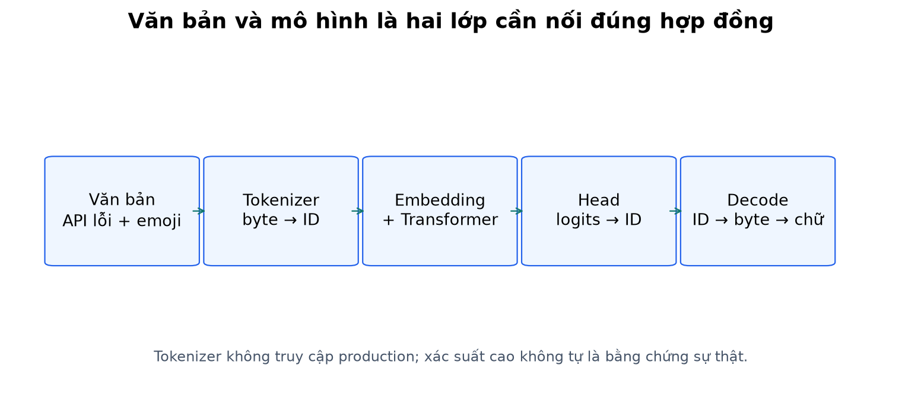
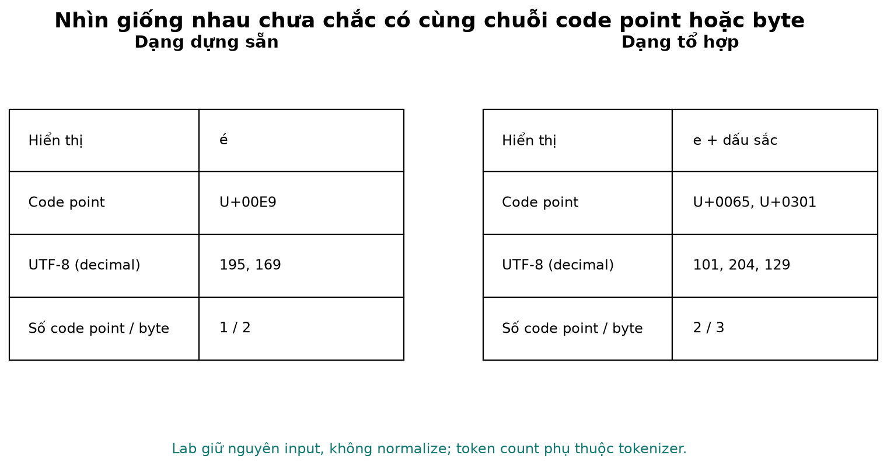
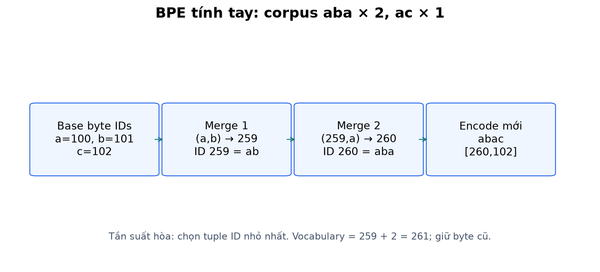
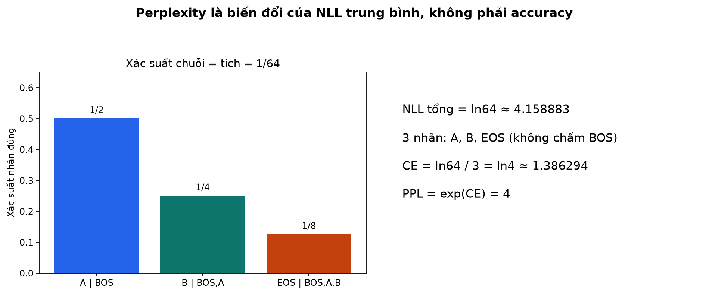
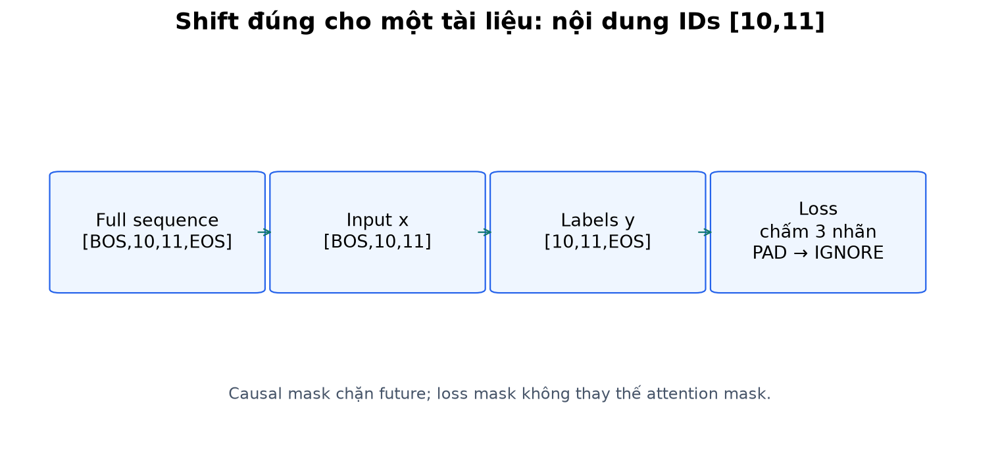
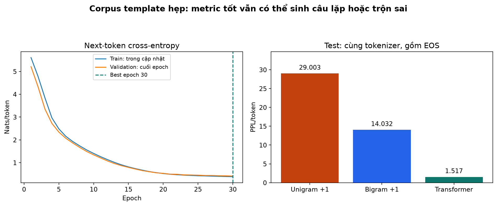

# Bài 19 — Tokenizer và mô hình ngôn ngữ: từ văn bản đến dự đoán token

[Mục lục](../README.md) · [Bài 18 — Transformer](../18-transformer/README.md) · [Đào sâu và ứng dụng](deep-dive.md) · [Bài tập](exercises.md) · [Lời giải](solutions.md)

Biên soạn ngày 04/11/2026. Ví dụ văn bản và dữ liệu trong bài do tác giả tự tạo theo tình huống backend; không dùng log khách hàng. Code chạy CPU, không tải pretrained model hoặc gọi dịch vụ AI.

## 1. Mục tiêu và cầu nối với bài 18

Bài 18 đã có Transformer nhận chuỗi ID và dự đoán ID tiếp theo. Nhưng văn bản thật không phải một dãy A–D với vocabulary cho trước: có tiếng Việt, dấu cách, xuống dòng, emoji, URL, JSON, tên biến và lỗi chính tả. Bài này xây cầu nối giữa văn bản và mô hình ấy.

Sau bài này, bạn cần tự làm được:

- Phân biệt từ, Unicode code point, byte, token, token ID và embedding.
- Giải thích pipeline tokenizer; tính tay hai vòng BPE và chạy tokenizer có encode/decode.
- Tạo input/label cho causal language model; tính xác suất chuỗi, CE và perplexity.
- Huấn luyện LM nhỏ trên văn bản, đánh giá trên split giữ riêng và đọc output với giới hạn phù hợp.
- Nhận ra lỗi tokenizer/model không khớp, normalization làm đổi dữ liệu, tràn context và so metric sai đơn vị.

Nên học ba lượt: phần 2–7 cho văn bản và tokenizer; phần 8–11 cho mục tiêu học; phần 12–15 cùng lab cho thực hành. Cần hiểu embedding bài 16, softmax bài 6 và causal Transformer bài 18. Không cần nhớ hết công thức attention để bắt đầu đọc ví dụ văn bản dưới đây.

## 2. Ví dụ thực tế: hệ thống nhận một ticket ra sao?

Một người viết:

```text
API /orders trả 504 sau 30s. Xin kiểm tra giúp tôi 🙂
```

Con người nhận ra URL, mã lỗi và ý nhờ hỗ trợ. Nhưng input của embedding phải là các số nguyên. Tokenizer chia văn bản thành các đơn vị và ánh xạ chúng sang ID; Transformer đọc embedding của các ID đó cùng thông tin vị trí. Head dự đoán một phân phối trên vocabulary; decoder của tokenizer ghép token sinh được về văn bản.

```text
văn bản → tokenizer.encode → IDs → embedding + vị trí → Transformer
                                                → logits → chọn ID → tokenizer.decode
```

Tokenizer không tự xác nhận HTTP 504 có đúng hay dịch vụ có lỗi thật không. Model cũng không truy cập dashboard chỉ vì trong ticket có tên API. Muốn kết luận tình trạng hệ thống cần log/metric hoặc công cụ bên ngoài; đó là lớp ứng dụng khác.

Ví dụ các mảnh `API`, ` /`, `orders`, ` trả`, ` 504` chỉ là **minh họa cách có thể chia**, không phải output của một tokenizer thương mại cụ thể. Muốn biết token/ID chính xác phải chạy đúng tokenizer và đúng phiên bản; bài này cung cấp tokenizer riêng để kiểm được mọi ví dụ có số.



## 3. Token không đồng nghĩa với từ hoặc ký tự

| Đơn vị | Ví dụ | Ý nghĩa |
|---|---|---|
| Từ theo ngôn ngữ | “máy học”, “cơ sở dữ liệu” | Cách phân định từ phụ thuộc ngôn ngữ; khoảng trắng không luôn là ranh giới từ hoàn chỉnh |
| Code point Unicode | `é` dạng dựng sẵn là U+00E9 | Đơn vị của `len(str)` trong Python, không luôn bằng ký tự nhìn thấy |
| Byte UTF-8 | `é` thành hai byte 195,169 | Đơn vị lưu trữ/biểu diễn, không phải ngữ nghĩa |
| Token | Có thể là từ, mảnh từ, dấu cách hoặc mảnh byte | Do tokenizer cụ thể quy định |
| Token ID | Số nguyên ánh xạ tới một mục vocabulary | Không phải độ lớn ý nghĩa; ID 100 không “gấp đôi” ID 50 |
| Embedding | Vector học được của ID | Được model cập nhật bằng gradient, không phải chính thuật toán chia token |

`é` và `e` cộng dấu sắc U+0301 trông tương tự, nhưng một chuỗi có 1 code point, chuỗi kia có 2. Emoji gia đình có thể gồm nhiều code point và ký tự nối. Vì vậy đếm `len(text)` không tự cho số token, số glyph hiển thị hay số byte.

```python
import unicodedata
composed = 'é'
decomposed = 'e\u0301'
assert composed != decomposed
assert unicodedata.normalize('NFC', decomposed) == composed
print(len(composed), len(composed.encode('utf-8')))    # 1 2
print(len(decomposed), len(decomposed.encode('utf-8')))  # 2 3
```

NFC ghép các dạng tương đương chuẩn tắc khi có thể; NFKC còn xử lý tương đương compatibility, có thể đổi cách biểu diễn cần giữ. API normalization và khác biệt các dạng được mô tả trong [Python 3.14 unicodedata](https://docs.python.org/3.14/library/unicodedata.html). Lab **không normalize** để giữ roundtrip nguyên bản; không dùng NFKC như bước “làm sạch” mặc định cho mọi dữ liệu.

### Vì sao backend engineer cần quan tâm?

- JSON `{"price": 10}` và `{"price":10}` có thể mang cùng ý nghĩa ứng dụng nhưng là chuỗi khác, có thể có token khác.
- Trong Python/YAML, indent có ý nghĩa; `split()` rồi nối bằng một dấu cách có thể phá chương trình.
- `UserID`, `user_id`, `userId` là những identifier khác nhau. Lowercase không phải phép biến đổi vô hại.
- Chuỗi `123456789` có thể bị chia nhiều mảnh; không giả định model nhìn nó như một số nguyên duy nhất.
- Tokenizer hỗ trợ mọi byte không đồng nghĩa model hiểu mọi ngôn ngữ hoặc xử lý emoji tốt.



## 4. Các cách chia token và đánh đổi

| Cách | Trực giác | Lợi ích | Giới hạn |
|---|---|---|---|
| Theo khoảng trắng/từ | Tách “api timeout” thành hai mục | Dễ hiểu, chuỗi ngắn trên từ quen | Từ mới cần UNK hoặc cơ chế dự phòng; dấu câu/space cần xử lý |
| Theo code point | Tách từng phần tử của chuỗi Python | Vocabulary nhỏ hơn từ, dễ tự viết | Chuỗi dài; ký tự chưa thấy có thể OOV nếu alphabet chỉ fit từ train |
| Theo byte | UTF-8 → 256 đơn vị byte cơ sở | Bao phủ mọi chuỗi Unicode hợp lệ mà không cần UNK | Tiếng Việt/emoji có thể tốn nhiều token; một token riêng có thể chưa decode được |
| Subword | Ghép các mảnh hay gặp thành đơn vị lớn hơn | Cân bằng độ dài và vocabulary | Phụ thuộc dữ liệu/thuật toán; không đảm bảo theo hình vị hay ngữ nghĩa |

Vocabulary càng lớn không tự làm model tốt hơn: embedding và output head có thể lớn hơn; đơn vị hiếm khó được học đủ. Vocabulary nhỏ có thể làm T dài hơn, tăng tải attention và dùng nhiều context hơn. Cần đo trên loại văn bản thật của ứng dụng.

BPE là một cách học subword bằng ghép cặp thường gặp. Ngoài BPE còn có thuật toán khác; bài này không triển khai hay coi mọi tokenizer subword đều là BPE. [Hugging Face, phần BPE training/tokenization](https://huggingface.co/learn/llm-course/chapter6/5).

## 5. Pipeline tokenizer: bốn việc riêng

1. **Normalization:** có đổi dạng Unicode, chữ hoa/thường hay không? Lab chọn không đổi.
2. **Pre-tokenization:** tạo ranh giới trước thuật toán chính. Lab tách các run whitespace và non-whitespace, giữ nguyên cả hai; không dùng `str.split()` làm mất space.
3. **Mô hình tokenization:** chuyển từng run thành byte ID, áp các merge BPE đã học theo thứ tự.
4. **Đóng khung và decode:** thêm BOS/EOS theo tác vụ; ghép byte khi decode; xử lý special ID theo quy ước.

Trong lab, cặp không được merge qua ranh giới space/non-space hoặc qua tài liệu. Chuỗi nhiều khoảng trắng vẫn được giữ; các byte trong cùng run whitespace có thể được merge. Dấu câu ở cùng non-space run nên có thể ghép cùng chữ. Đây là lựa chọn đơn giản riêng của bài, không mô phỏng regex của mọi tokenizer có sẵn.

**Hai quá trình học độc lập:** fit tokenizer đếm cặp, không dùng backprop; train LM cập nhật embedding/Transformer/head bằng gradient, không tự sửa merge list. Với pretrained model, phải dùng tokenizer tương thích, không fit lại ID tùy ý rồi giữ nguyên weight.

## 6. Tính tay BPE: học và áp merge

Corpus tự tạo gồm hai tài liệu `aba`, `aba` và một tài liệu `ac` (tức ba tài liệu). Base byte ID trong lab là `byte+3`, nên `a=100`, `b=101`, `c=102`; PAD=0, BOS=1, EOS=2. Bắt đầu có 259 ID gồm 256 byte và 3 special.

### Vòng 1

```text
aba × 2 → [a,b,a] × 2
ac  × 1 → [a,c]
```

Cặp (a,b) xuất hiện 2 lần; (b,a) 2 lần; (a,c) 1 lần. Quy tắc hòa của lab: chọn cặp có tuple ID nhỏ nhất. (100,101) thắng (101,100); tạo ID 259 cho byte `ab`.

Sau merge: `[ab,a] × 2`, `[a,c]`. Không ghép ký tự từ cuối tài liệu này sang đầu tài liệu khác.

### Vòng 2

(ab,a) có 2 lần, (a,c) 1 lần. Tạo ID 260 cho `aba`. Vocabulary cuối có **261 mục**, các byte cũ không bị xóa.

Encoding sau fit: `aba → [260]`, `ac → [100,102]`, `abac → [260,102]`. Từ mới vẫn encode được bằng merge quen và byte còn lại. Encoding không đếm lại tần suất của input mới để học merge mới.

Nếu input là `aaaa`, số cặp (a,a) kề nhau là 3 nhưng phép thay cặp không chồng lấn từ trái sang phải chỉ tạo 2 token `aa` trong một lượt. Phải phân biệt thống kê cặp với số phép thay thực hiện.

```python
from lab import ByteBPE
tok = ByteBPE.fit(['aba', 'aba', 'ac'], steps=2)
assert tok.encode('aba') == [260]
assert tok.encode('abac') == [260, 102]
assert tok.decode(tok.encode('  Xin chào 🙂\n')) == '  Xin chào 🙂\n'
print(tok.merges)  # [(100, 101), (259, 100)]
```

Lab dùng phiên bản BPE byte đơn giản, ưu tiên dễ kiểm. Tốc độ không phù hợp corpus lớn; không nhận dạng special token trong raw text; không có offset mapping hoặc streaming decoder tối ưu. Nguyên lý đếm cặp và áp merge theo thứ tự được đối chiếu với [Hugging Face BPE](https://huggingface.co/learn/llm-course/chapter6/5); ví dụ số và code ở đây được tự xây.



## 7. Token đặc biệt, decode và hợp đồng với checkpoint

| ID của lab | Vai trò | Lưu ý |
|---|---|---|
| PAD=0 | Điền batch cho cùng chiều dài | Chặn key PAD và bỏ nhãn PAD bằng IGNORE, hai việc khác nhau |
| BOS=1 | Bắt đầu tài liệu/prefix | Thêm bằng code khi tạo batch, không phải chuỗi chữ tự được hiểu |
| EOS=2 | Dự đoán kết thúc tài liệu | Là nhãn thật cần chấm loss; không bỏ như PAD |
| IGNORE=−100 | Bỏ vị trí loss | Không nằm trong vocabulary, không đưa vào embedding |
| UNK | Lab không cần | Vì mọi UTF-8 byte đều có trong base vocabulary |

Raw text `<BOS>` trong lab là các byte chữ và dấu ngoặc, **không** biến thành ID 1. Chat template với role system/user/assistant và control token là hợp đồng riêng của từng mô hình; không có một chuỗi role chung áp dụng mọi tokenizer. Lab chỉ LM tiếp diễn văn bản, chưa huấn luyện hội thoại.

Đảm bảo `decode(encode(text)) == text` cho mọi chuỗi Unicode hợp lệ của Python trong phạm vi UTF-8 strict (không chứa surrogate đơn lẻ). Nhưng một **dãy ID model tự sinh tùy ý** có thể là byte không tạo thành UTF-8 hợp lệ. Cần ghép byte rồi decode; không decode từng byte token một cách độc lập với `errors='ignore'` vì có thể mất dấu và mất dữ liệu.

Tokenizer lab có `raw(ids)` để xem byte; `decode(..., errors='strict')` báo lỗi dữ liệu sai. Khi hiển thị generation, code dùng replacement nếu cần và báo `valid_utf8=False`. Việc thay ký tự để hiển thị không sửa nội dung sinh.

Tokenizer và model giống một giao thức serialization: đổi bảng ID mà giữ weight khiến model đọc nhầm vector. Khi load, lab kiểm hash ordered merge list; version/normalization/pre-tokenizer cũng được kiểm. Lưu tokenizer JSON cùng checkpoint, không chỉ lưu “vocab size=323”. Hai tokenizer có cùng size vẫn có thể có mapping khác.

## 8. Mô hình ngôn ngữ thực sự học gì?

Causal language model học phân phối token tiếp theo khi biết prefix. Ví dụ prefix `Dịch vụ api: ` có thể được nối `timeout`, `lỗi kết nối` hoặc một phần byte của chữ khác tùy vocabulary. Mô hình không phải lúc nào cũng dự đoán trọn một từ hay một câu.

Với chuỗi token x₁…xₙ và BOS:

\[
P(x_1,\ldots,x_n,EOS\mid BOS)=\prod_{t=1}^{n+1}P(x_t\mid BOS,x_{<t}),\quad x_{n+1}=EOS.
\]

Đây là phân rã theo chain rule xác suất, không phải chain rule đạo hàm bài 10. Giả định Markov bậc 1 của bigram chỉ dùng token liền trước; Transformer có thể dùng nhiều token trong context cho phép, không bị giới hạn đúng một token.

Một hệ thống autocomplete gợi ý `return` sau code có xác suất cao không đồng nghĩa đoạn code chạy đúng. Tương tự, câu “đã khắc phục lỗi” dễ xuất hiện trong mẫu ticket không phải bằng chứng lỗi thực đã được khắc phục. Muốn làm trợ lý hỏi đáp cần dữ liệu, instruction tuning/điều khiển tác vụ và đánh giá riêng; LM base không tự có các khả năng ấy.

Encoder masked-LM giấu một số vị trí để dự đoán theo context hai phía là mục tiêu học khác causal next-token. Không dùng nguyên công thức likelihood trái→phải của lab để báo PPL cho mọi masked-LM. [Hugging Face perplexity](https://huggingface.co/docs/transformers/main/en/perplexity).

## 9. Ví dụ tính tay xác suất, CE và perplexity

Xét một chuỗi đã tokenize thành hai token nội dung A,B rồi EOS. Model gán:

```text
P(A | BOS) = 1/2
P(B | BOS,A) = 1/4
P(EOS | BOS,A,B) = 1/8
```

Xác suất đúng cả chuỗi có kết thúc =1/64=0.015625. Tổng negative log-likelihood (NLL) =ln2+ln4+ln8=ln64. CE trung bình chia 3 nhãn thật, bao gồm EOS, không bao gồm BOS:

\[
CE=-\frac13\sum_t\ln p_t=\ln4\approx1.386294\text{ nats/token},
\qquad PPL=\exp(CE)=4.
\]

Không lấy mean xác suất (0.5+0.25+0.125)/3 rồi đảo; phải dùng log hoặc geometric mean. PPL=4 không có nghĩa model chỉ biết 4 từ hoặc token accuracy=25%; nó là cách biến đổi mức NLL trung bình. Hai model cùng PPL có thể khác top-1 accuracy.

Nếu model uniform trên V class thì mỗi nhãn có xác suất 1/V, CE=lnV, PPL=V. Nếu đã mask một số output class rồi renormalize lúc generation, phân phối lúc sinh đã khác phân phối đầy đủ dùng để tính CE của lab.

**So sánh PPL cần cùng điều kiện:** dữ liệu, tokenizer, nhãn được chấm (có EOS không), context và cách reset tài liệu. Chia cùng văn bản thành token khác làm thay đổi đơn vị; không xếp hạng hai tokenizer chỉ vì PPL/token thấp hơn. Xem [phụ lục](deep-dive.md) cho ví dụ và giới hạn của đo theo byte. [Định nghĩa PPL và context window](https://huggingface.co/docs/transformers/main/en/perplexity).



## 10. Chuyển văn bản thành bài toán next-token

Giả sử một tokenizer minh họa chia `api lỗi` thành `[api,space,lỗi]`:

```text
full:  BOS  api  space  lỗi  EOS
x:     BOS  api  space  lỗi
y:     api  space lỗi   EOS
```

Đây là minh họa shift; tokenizer byte BPE thực tế của lab có thể chia khác. `batch()` tự thêm BOS/EOS, lấy full[:-1] và full[1:]. Khác task conditional copy ở bài 18, **lab này chấm tất cả token nội dung và EOS**, không bỏ loss ở prompt train. Self-supervised learning nghĩa là nhãn được lấy từ chính dữ liệu văn bản; không có nghĩa mọi nội dung văn bản là sự thật hoặc không cần dữ liệu.

Mỗi tài liệu là một hàng, right padding; causal mask giữ đường chéo, padding mask chặn PAD key; labels PAD được thay IGNORE. Không nối các tài liệu qua nhau trong lab nên không có attention xuyên tài liệu. Đừng shift thêm lần nữa nếu một API LM khác đã tự shift labels bên trong; `LanguageModel` của bài này không tự tính loss hoặc shift.

`cross_entropy` nhận raw logits `[N,V]`, class labels `[N]` và ignore_index; không softmax trước. Đánh giá lấy tổng loss chia tổng nhãn thật, rồi mới exponentiate. Không trung bình PPL từng batch. [CrossEntropyLoss 2.15](https://docs.pytorch.org/docs/2.15/generated/torch.nn.CrossEntropyLoss.html).



## 11. Ví dụ ứng dụng: context và dữ liệu cần giữ

Giả sử một ứng dụng đặt giới hạn minh họa 100 token tổng, template/role dùng 10, câu hỏi 20 và dự trù output 30; còn tối đa 40 cho tài liệu. Các số này giả định, không phải quota của một sản phẩm cụ thể. Một đoạn log “chỉ 40 từ” vẫn có thể vượt 40 token, nhất là ID dài, mã nguồn hoặc nhiều byte Unicode.

Cách xử lý hữu ích là đo bằng đúng tokenizer sau khi thêm template; chọn thông tin cần giữ, chừa output budget và ghi rõ chính sách cắt. Cắt bừa đuôi có thể làm mất phần stack trace gốc hoặc câu hỏi; cắt bừa đầu có thể làm mất định nghĩa biến. Nhiều token hơn không tự là nhiều thông tin hữu ích hơn.

Đối với completion, `encode(prefix + suffix)` không luôn bằng `encode(prefix) + encode(suffix)` do merge có thể đi qua ranh giới ghép trong một non-space run. Ví dụ tokenizer tính tay: `encode('ab')=[259]`, `encode('a')=[100]`, nhưng `encode('aba')=[260]`. Khi sinh, model nối token vào ID prefix cố định; không retokenize toàn bộ chuỗi văn bản sau mỗi bước để mong “làm đẹp” token.

## 12. Lab: byte BPE và Transformer LM trên văn bản backend

### Dữ liệu và kiến trúc

Tạo 192 câu từ 8 tên dịch vụ × 4 loại vấn đề × 6 hành động:

```text
Dịch vụ api: timeout khi đọc hồ sơ.
Dịch vụ auth: thiếu quyền khi xác thực.
```

Tất cả là câu tự tạo, không phải sự cố được xác nhận. Shuffle seed 19, chia nguyên câu 128 train /32 validation /32 test, không trùng câu đầy đủ. Các mảnh template, dịch vụ và vấn đề được chia sẻ: đây là tổng quát hóa tổ hợp hẹp, không phải kiểm chứng trên log thực ngoài miền. Với corpus thật, phải kiểm nguồn/tài liệu/thời gian và trùng gần, không chỉ shuffle từng dòng.

BPE học **64 merge chỉ trên train**; base byte không học từ test vì tập byte được định nghĩa trước. Vocabulary=323. D=32,H=4,F=64, một pre-norm causal block và final LN như bài 18; **learned position embedding** 128×32 thay cho sinusoidal để thấy đây là cấu hình kiến trúc riêng. Không weight tying, không dropout, head 323 class. Toàn mô hình có 33,699 tham số.

BPE không normalize; mọi câu độc lập; không truncation trong dữ liệu này. Mỗi lần forward từ chối input vượt context 128. Fit tokenizer trước, freeze merge rồi xây embedding/head theo size mới; tokenizer fit lại sẽ đòi model tương thích mới.

### Huấn luyện và artifact

30 epoch, batch 16 (8 update/epoch, tổng 240), Adam lr=0.003, clip norm 1, seed model 2026. Chọn best bằng validation CE; test chỉ đo sau khi chọn best. Checkpoint là inference artifact, không có optimizer/RNG để resume. Run lưu tokenizer.json, data.json, best.pt, metrics.json và report.json chứa config/môi trường/metric/mẫu sinh. Chỉ tải checkpoint tin cậy; dùng weights_only=True.

### Kết quả đã chạy

| Phép đo | Validation | Test |
|---|---:|---:|
| CE, nats/token | 0.412029 | 0.416568 |
| Perplexity | 1.509878 | 1.516747 |
| Top-1 token accuracy, teacher forcing | 84.4681% | 83.2589% |
| Số nhãn gồm EOS | 940 | 896 |

Best theo validation CE là **epoch 30**; số tham số 33,699 và cấu hình được lưu trong `report.json`. Hai baseline đếm token trên train, dùng cùng tokenizer/split/nhãn: unigram add-one có test PPL=29.002664, bigram add-one=14.031948. Đây là baseline đơn giản, smoothing +1 trên toàn 323 class khá mạnh với corpus nhỏ; chênh lệch không chứng minh Transformer luôn hơn mọi mô hình n-gram hoặc tokenizer khác.

Train có 7,423 byte UTF-8, encode thành 3,444 token nội dung (không BOS/EOS), khoảng 2.1553 byte/token. Đây là tỷ số của tokenizer trên corpus cụ thể, không phải công thức đổi từ/byte sang token dùng chung.

Output greedy chạy thật:

```text
Prompt: Dịch vụ api:
Tiếp diễn: phản hồi chậm khi đọc cấu vụ.

Prompt: Dịch vụ auth:
Tiếp diễn: thiếu quyền khi đọc đọc cấu vụ.
```

Prompt thực có một space sau dấu hai chấm, continuation có newline cuối. Cả hai sinh EOS và UTF-8 hợp lệ, nhưng `đọc cấu vụ` bị trộn sai và `đọc đọc` bị lặp. **Không sửa output để làm minh họa đẹp hơn.** PPL thấp trên template dễ đoán vẫn có thể đi kèm văn bản sinh lỗi. Không có một continuation duy nhất đúng cho prompt mở; không báo exact match với một câu tùy chọn như bài copy.



## 13. Inference và decoder của tokenizer

`generate` encode prompt một lần, thêm BOS, chạy model ở eval/no_grad, lấy logits hàng cuối, chọn greedy rồi nối ID. Dừng EOS hoặc hết 32 token mới. PAD và BOS bị chặn trước argmax; đây là ràng buộc cấu trúc rõ ràng, không phải argmax hoàn toàn không ràng buộc. Các ID byte/merge khác vẫn có thể tạo UTF-8 sai; xem valid_utf8 trong report.

Không có KV cache, temperature, top-p hoặc beam search trong lab; bài 21 dự kiến đi sâu decoding. Greedy không phải cách tối đa hóa xác suất cả chuỗi trong mọi trường hợp. Dự đoán token đầu có xác suất cao nhất có thể dẫn tới phần tiếp diễn yếu hơn một nhánh đầu ít xác suất hơn.

Giới hạn context kiểm theo token input trước từng bước: với prompt gồm p token nội dung, có BOS nên input đầu dài p+1; để thực hiện m bước sinh cần input dài nhất p+m. Output token cuối chưa cần chạy lại forward. Chính sách ở lab là báo lỗi khi budget vượt, không tự cắt prompt và mất thông tin âm thầm.

## 14. Chạy và tự kiểm

Đã chạy Python 3.14.6, torch 2.15.0 trên macOS arm64 CPU một thread; NumPy 2.5.4 và Matplotlib 3.11.2 dùng vẽ hình. Không cần GPU hay tài khoản. Từ thư mục bài 19:

```bash
python3 -m venv .venv
.venv/bin/python -m pip install -r requirements.txt
.venv/bin/python lab.py --mode tokenizer
.venv/bin/python lab.py --mode hand
.venv/bin/python lab.py --mode all --out /tmp/lesson19-run-01
```

`--mode train` chỉ train, `--epochs 2` kiểm pipeline ngắn. Output phải mới; bỏ --out sẽ in đường dẫn tạm. Windows dùng `.venv\Scripts\python`; phiên bản ghim cần wheel phù hợp nền tảng. Seed không đảm bảo giống từng bit khi đổi môi trường.

```python
from pathlib import Path
from tempfile import TemporaryDirectory
from lab import train, Config, load, generate
with TemporaryDirectory() as folder:
    run = Path(folder) / 'run'
    report = train(run, Config(epochs=2))
    model, tok, cfg, checkpoint = load(run)
    print(generate(model, tok, 'Dịch vụ api: ', max_new=16))
    assert tok.decode(tok.encode('GET /orders\n  504 🙂')) == 'GET /orders\n  504 🙂'
```

Sáu hình có sẵn PNG/SVG; tái tạo bằng [make_figures.py](make_figures.py):

```bash
.venv/bin/python -m pip install -r requirements-figures.txt
.venv/bin/python make_figures.py --run /tmp/lesson19-run-01
```

## 15. Tiêu chí hoàn thành và học tiếp

Làm [16 bài tập](exercises.md) trước khi xem [lời giải](solutions.md). Bạn cần tự giải thích được: vì sao token không bằng từ; tại sao space và Unicode phải được giữ theo hợp đồng; vì sao tokenizer cùng size chưa chắc tương thích; vì sao EOS cần học nhưng PAD cần bỏ loss; tại sao PPL thấp chưa chứng minh câu sinh đúng; vì sao chia dữ liệu phải trước fit tokenizer.

[Phụ lục](deep-dive.md) nối các ý này với thiết kế backend, perplexity và kiểm artifact. **Bài tiếp theo:** [Bài 20 — Tiền huấn luyện và tinh chỉnh](../20-tien-huan-luyen-tinh-chinh/README.md), nối LM với SFT, loss mask, transfer và kiểm regression. [Nguồn đã đọc](../SOURCES.md).
