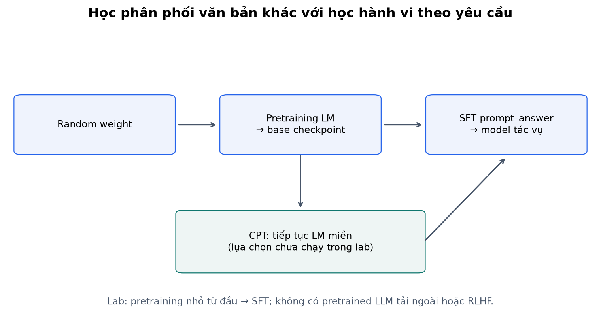
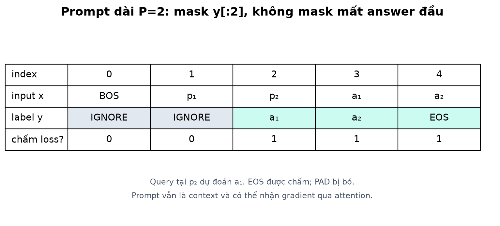
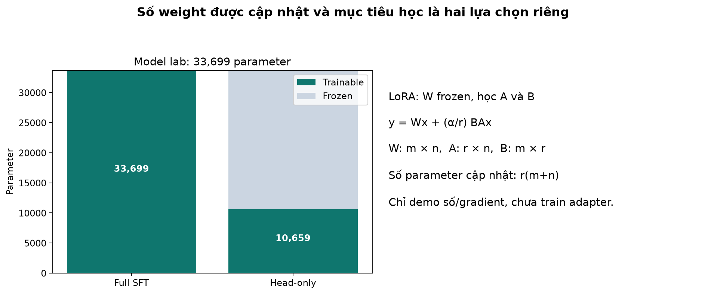
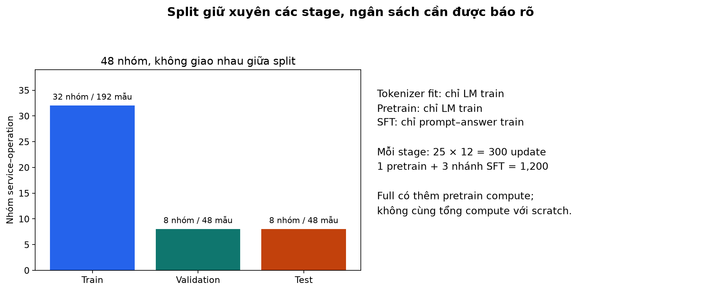
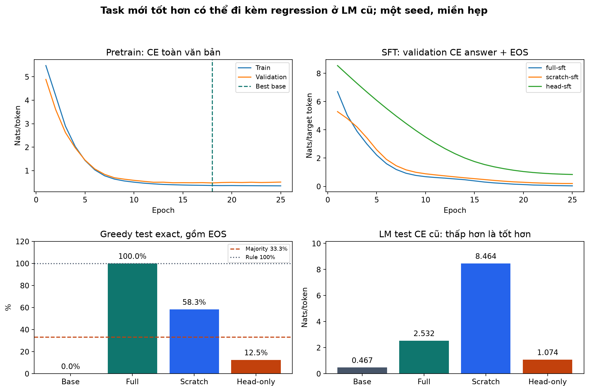
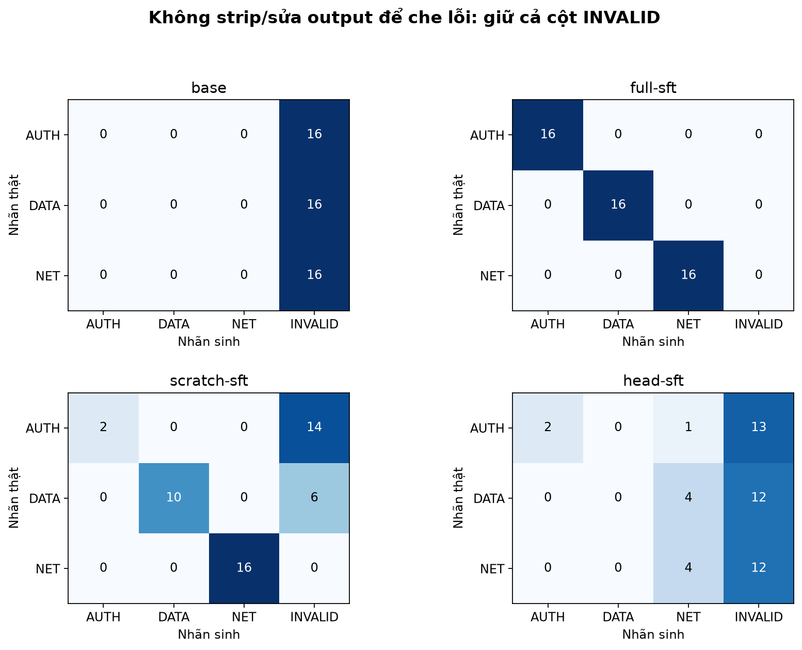

# Bài 20 — Tiền huấn luyện và tinh chỉnh: từ mô hình nền đến hành vi cho tác vụ

[Mục lục](../README.md) · [Bài 19](../19-tokenizer-mo-hinh-ngon-ngu/README.md) · [Đào sâu và đọc code](deep-dive.md) · [Bài tập](exercises.md) · [Lời giải](solutions.md)

Biên soạn ngày 04/11/2026. Dành cho người có nền backend và đã học Transformer, tokenizer, next-token loss ở bài 18–19. Ví dụ và dữ liệu trong bài tự tạo, không dùng log khách hàng hoặc tải pretrained model. Lab chạy thật trên CPU; “mô hình nền” trong lab là mô hình rất nhỏ tự train, không đại diện chất lượng LLM thương mại.

## 1. Mục tiêu và cách đọc

Ở bài 19, model đã biết viết tiếp văn bản nhưng có thể sinh câu lặp hoặc không làm điều người dùng muốn. Bài 20 hỏi: có thể dùng weight đã học rồi dạy một hành vi cụ thể không? Nếu được, thay đổi dữ liệu, loss và những parameter nào?

Sau bài này, bạn cần:

- Phân biệt pretraining, continued pretraining, supervised fine-tuning (SFT), instruction tuning và học từ ưu tiên.
- Biến một tình huống backend thành dữ liệu prompt–answer, xác định rõ output được mong đợi.
- Tự tạo loss mask sau shift, giữ EOS, bỏ PAD và kiểm prompt vẫn có thể nhận gradient qua context.
- Đọc thí nghiệm trước/sau cùng control scratch và head-only, nhận ra chi phí thêm và khả năng bị quên.
- Giải thích full fine-tuning khác freezing/LoRA và lưu artifact đủ cho inference.

Ba lượt đọc: phần 2–6 cho bức tranh và ví dụ thực tế; phần 7–10 cho tính tay/cơ chế; phần 11–15 cho lab, đánh giá và thực hành. Không cần GPU, tài khoản hay quyền truy cập model bên ngoài.

## 2. Ví dụ thực tế: đọc log khác với định tuyến ticket

Một corpus có nhiều dòng:

```text
service=api op=read event=timeout.
service=auth op=check event=expired-token.
```

Pretraining theo next-token có thể dạy pattern `service=`, tên dịch vụ, thứ tự các trường và cách kết thúc dòng. Nhưng khi ứng dụng hỏi “chuyển ticket này cho đội nào?”, model có thể chỉ tiếp tục viết thêm log. Không có gì trong mục tiêu viết tiếp bắt buộc câu trả lời phải là nhãn đội.

Ta tạo một hợp đồng cụ thể:

```text
Prompt:
Route: service=api op=read event=timeout.
Team: 

Answer mong muốn: NET
```

Trong ví dụ giả định của bài, timeout/connection-reset → NET; denied/expired-token → AUTH; deadlock/duplicate-key → DATA. Đây là **quy tắc tác vụ do ta định nghĩa**, không phải chính sách vận hành chuẩn cho mọi tổ chức. Trong production, cần đội nghiệp vụ xác nhận nhãn; timeout có thể có nhiều nguyên nhân và không luôn thuộc đội network.

SFT cho model xem input cùng answer mẫu và tăng xác suất answer đó ở đúng context. Nó không tự gửi ticket, thay đổi database hoặc chứng minh nhãn mẫu đúng. Ví dụ đủ cụ thể để đo: output phải đúng nhãn và kết thúc EOS; `NET vì...` không đạt hợp đồng exact dù chứa chữ NET.

## 3. Các giai đoạn học: cùng công cụ tối ưu, khác dữ liệu và mục tiêu

| Giai đoạn | Khởi đầu | Dữ liệu/mục tiêu | Điều không được suy ra |
|---|---|---|---|
| Pretraining từ đầu | Weight khởi tạo ngẫu nhiên | Học dự đoán văn bản/tín hiệu trên corpus; lab dùng causal LM | Model tự có instruction following hoặc hiểu đúng mọi sự thật |
| Continued pretraining (CPT) | Checkpoint đã được pretrain | Tiếp tục mục tiêu LM trên corpus phù hợp | Chỉ đổi domain là tự học đúng format trả lời |
| Supervised fine-tuning (SFT) | Thường từ model đã học | Input–output mẫu cho tác vụ; lab chấm completion + EOS | Mọi output mới sẽ đúng hoặc luôn giữ nguyên khả năng cũ |
| Instruction tuning | Thường từ base hoặc model đã thích nghi | Một dạng SFT với instruction và response mong muốn | Một tập route nhãn hẹp đã là trợ lý hội thoại tổng quát |
| Học từ ưu tiên/phản hồi | Model và dữ liệu theo phương pháp | Dùng so sánh/đánh giá hành vi thay vì chỉ answer mẫu | Đồng nghĩa mọi fine-tuning hoặc chỉ cần chấm CE trên chosen answer |

“Fine-tuning” trong cách nói rộng còn bao gồm các kiểu thích nghi khác; bài này gọi rõ **SFT** khi nói đến supervised prompt–answer. Pretraining không bắt buộc causal LM trong mọi kiến trúc: masked modeling cũng là một mục tiêu khác như bài 19. Lab chỉ triển khai causal LM → SFT.

SFT và học từ ưu tiên có thể nằm ở các bước khác nhau trong post-training. Công trình [Training language models to follow instructions with human feedback](https://arxiv.org/abs/2203.02155) mô tả dùng demonstration để supervised fine-tune rồi dùng ranking và RLHF. Ở đây chỉ đối chiếu sự khác nhau của dữ liệu/mục tiêu; không tái hiện pipeline hay kết quả của nghiên cứu.



## 4. Continued pretraining: thêm văn bản miền chưa phải thêm câu trả lời

Giả sử model ít quen log hệ thống, tên trường và thuật ngữ nội bộ. Có thể tiếp tục LM training trên tài liệu được phép dùng để mô hình thích nghi phân phối văn bản đó, rồi SFT bằng ví dụ thực hiện tác vụ. Domain-adaptive pretraining nhấn vào corpus miền; task-adaptive pretraining nhấn vào dữ liệu không nhãn gần tác vụ. Hai khái niệm này được nghiên cứu trong [Don't Stop Pretraining](https://arxiv.org/abs/2004.10964).

Nguồn trên báo cáo lợi ích trong các miền/tác vụ phân loại được nghiên cứu; không chứng minh CPT luôn cải thiện mọi LLM hoặc mọi corpus log. Cần một phép thử riêng, kiểm chất lượng và ngân sách. **Lab bài này không chạy thêm nhánh CPT** sau base: nó chạy pretraining nhỏ từ đầu rồi SFT, nhằm giữ thí nghiệm dễ kiểm.

Ví dụ khác: tài liệu có câu “API hoàn tiền dùng endpoint /refunds” có thể giúp học văn bản miền. Nhưng muốn trả về JSON `{"action":"refund", "requires_approval":true}` cần ví dụ hành vi và phép kiểm riêng. Đưa một file tài liệu vào training không tương đương có cơ chế tra cứu phiên bản mới nhất hoặc xác minh quyền hành động.

## 5. Chọn cách giải bài toán trước khi chọn cách train

Bảng dưới là suy luận thiết kế, không phải khuyến nghị sản phẩm/nhà cung cấp:

| Nhu cầu cụ thể | Thử nghiệm phù hợp để bắt đầu | Vì sao |
|---|---|---|
| Đổi format/giọng điệu, tác vụ đã có thể làm | Prompt và ví dụ trong context, có eval giữ riêng | Có thể chưa cần cập nhật weight |
| Nhãn được xác định bởi vài quy tắc ổn định | Rule engine hoặc classifier đơn giản | Có lời giải trực tiếp và dễ kiểm hơn cho quy tắc rõ |
| Câu trả lời cần dữ liệu mới hoặc theo quyền người dùng | Truy xuất dữ liệu/công cụ đúng quyền, kiểm nguồn | Weight không tự là bản sao tức thời của database |
| Hành vi lặp lại cần thích nghi theo mẫu | SFT cùng baseline và kiểm hồi quy | Dạy pattern input–output ở weight |
| Model chưa quen phân phối văn bản miền | Đánh giá CPT rồi SFT nếu có cơ sở | Cần phân biệt học miền và học tác vụ |

Lab route có rule đạt 100%, nên không phải lý do triển khai neural model cho bảng quy tắc này. Mục đích là nhìn rõ cơ chế chuyển weight đã học sang tác vụ. Các bài RAG/công cụ sau sẽ đi sâu nhu cầu dữ liệu riêng, không giả rằng fine-tuning giải quyết mọi trường hợp.

## 6. Dữ liệu SFT là đặc tả hành vi bằng ví dụ

Một record tối thiểu của lab có `group`, `text`, `prompt`, `answer`. `text` dùng mục tiêu LM; `prompt` và `answer` dùng SFT. Nhãn phải thống nhất: cùng loại event không bị gán hai đội chỉ vì copy lỗi. Tác vụ thật có trường hợp thiếu dữ liệu thì cần định nghĩa “chưa đủ thông tin”, không dạy model bịa một đội để luôn có answer.

Những việc cần xác định trước khi train:

1. Tác vụ/format và tiêu chí đạt: đúng nhãn, đúng JSON schema, hoặc rubric phù hợp.
2. Đơn vị split: incident, khách hàng, hội thoại, tài liệu hoặc mốc thời gian; không chia ngẫu nhiên các đoạn của cùng incident qua train/test.
3. Dữ liệu được phép dùng, loại thông tin cần bỏ và khả năng dữ liệu nhạy cảm đi vào output. Loại thông tin nhận diện không đồng nghĩa đã loại mọi cách ghi nhớ dữ liệu.
4. Template render và tokenizer version; inference phải dùng cùng hợp đồng.
5. Chính sách độ dài: sau truncation còn answer/EOS hay không; sample không còn target thì không có tín hiệu SFT hữu ích.

Đây là việc thiết kế tập học/eval, không phải nghi thức thay thế chạy kiểm. Một dataset nhiều ví dụ gần trùng có thể làm train loss đẹp và test bị lạc quan. Cần giữ test không tham gia tokenizer fit, pretraining, SFT hoặc chọn checkpoint khi muốn đánh giá độc lập theo split ấy.

## 7. Loss SFT: không dự đoán prompt nhưng vẫn đọc prompt

Đặt p là prompt, a là answer. Mục tiêu completion-only thường dùng:

\[
L_{SFT}=-\frac{1}{N_{answer}}\sum_{t\in answer+EOS}\log P_\theta(x_t\mid x_{<t}).
\]

Mỗi query vẫn chỉ nhìn prefix qua causal mask. Ta bỏ loss ở các vị trí dự đoán prompt; không xóa prompt khỏi input. Mô hình phải đọc prompt mới biết answer cần gì. EOS là target thật, PAD là phần điền và bị bỏ loss.

Ví dụ token minh họa, không là tokenization cố định của một sản phẩm:

```text
prompt IDs = [10,11]; answer IDs = [20]
full = [BOS,10,11,20,EOS]
x    = [BOS,10,11,20]
y    = [IGNORE,IGNORE,20,EOS]
index=    0,     1,   2,  3
```

Query tại prompt token cuối, index 2, dự đoán answer token 20. Nếu prompt có P token nội dung thì mask `y[:P]`, **không phải `y[:P+1]`**; mask thừa một vị trí sẽ bỏ token answer đầu. BOS làm chỉ số shift dễ lệch.

`ignore_index=-100` khiến gradient trực tiếp tới logits của vị trí ignore bằng 0. Nhưng embedding/hidden của prompt vẫn có thể nhận gradient vì answer query đọc chúng qua attention. “Prompt loss bị bỏ” khác “prompt bị detach”. Xem [phụ lục](deep-dive.md) để kiểm bằng code.

Một thư viện có thể tự shift labels, template có thể chèn role hoặc EOS khác. Không chuyển nguyên chỉ số từ lab sang mọi Trainer. [TRL SFTTrainer](https://huggingface.co/docs/trl/sft_trainer) phân biệt completion-only và assistant-only loss; assistant-only còn cần template tạo được mask thích hợp. Bài này tự tính loss bằng PyTorch, không cài hay chạy TRL.



## 8. Ví dụ tính tay: đổi mục tiêu và một bước cập nhật

### 8.1 Loss toàn chuỗi có thể che mờ answer khó

Giả sử 8 token prompt có xác suất nhãn đúng 0.9 mỗi token, 2 token answer/EOS có xác suất 1/4 và 1/2:

\[
L_{full}=\frac{-8\ln 0.9-\ln(1/4)-\ln(1/2)}{10}\approx 0.292233,
\qquad L_{answer}=\frac{\ln 4+\ln 2}{2}\approx 1.039721.
\]

Loss nhỏ hơn không tự là model trả lời tốt hơn: hai số đang chấm các vị trí khác nhau. Không so loss pretraining toàn văn bản với loss SFT answer-only rồi kết luận chất lượng tăng chỉ từ độ lớn số. Lab giữ phép đo LM cũ và task riêng để so trước/sau đúng mục tiêu.

### 8.2 Cross-entropy cập nhật logits thế nào?

Tại một answer query có hai lớp, logits z=[ln 2,0], nhãn đúng là lớp index 1. Softmax=[2/3,1/3], loss=ln 3≈1.098612. Gradient theo logits:

\[
\nabla_z L=p-onehot(y)=[2/3, -2/3].
\]

Một bước SGD minh họa lr=0.1:

\[
z'=[\ln 2-1/15, \;1/15].
\]

Xác suất nhãn đúng tăng. Đây là cập nhật **logits coi như biến độc lập để hiểu hướng gradient**; khi train Transformer, optimizer cập nhật weight tạo ra logits, không lưu z của từng record như parameter. Tất cả layer trainable liên quan có thể nhận gradient qua chain rule.

```python
import math
import torch
from torch.nn import functional as F
z = torch.tensor([[math.log(2), 0.]], dtype=torch.float64, requires_grad=True)
loss = F.cross_entropy(z, torch.tensor([1]))
loss.backward()
torch.testing.assert_close(z.grad, torch.tensor([[2/3, -2/3]], dtype=z.dtype))
assert (z.detach() - .1*z.grad).softmax(-1)[0,1] > 1/3
print(loss.item(), z.grad)
```

Với nhiều nhãn answer và `reduction='mean'`, gradient của từng vị trí còn chia cho tổng số nhãn được chấm. Không đem gradient một token chưa chia so với gradient batch mean rồi coi khác là lỗi. [CrossEntropyLoss 2.15](https://docs.pytorch.org/docs/2.15/generated/torch.nn.CrossEntropyLoss.html).

## 9. Những weight nào được cập nhật?

| Phương án | Weight học | Cần hiểu đúng |
|---|---|---|
| Full fine-tuning | Toàn bộ parameter được chọn của model | Không chỉ head; cần lưu weight đã cập nhật và kiểm hồi quy |
| Head-only trong lab | Linear head D→V và bias, freeze phần còn lại | Vẫn sinh chuỗi label qua LM head; không thay bằng classifier 3 lớp |
| LoRA | Các ma trận cập nhật hạng thấp trên module được chọn, thường giữ base weight cố định | Vẫn cần base checkpoint tương thích; không tự xóa chi phí base/activation |

`requires_grad_(False)` ngăn tạo gradient cho parameter đó. `.eval()` không freeze weight; `no_grad()` bao toàn forward có thể làm mất graph cần train. Khi train head-only với backbone thật sự frozen và input không cần gradient, có thể tổ chức tính feature không graph; nhưng khi có adapter nằm sâu trong mạng, không được bao tùy ý cả backbone trong no_grad vì sẽ chặn gradient tới adapter.

Bài này thực sự train full/head-only, còn LoRA chỉ có demo tính tay/gradient, **chưa train adapter trên Transformer**. [PyTorch autograd: freezing và grad modes](https://docs.pytorch.org/docs/2.15/notes/autograd.html).

### Tính tay một phép LoRA

Theo vector cột, W có shape m×n, A có shape r×n, B có shape m×r:

\[
y=Wx+\frac\alpha r BAx.
\]

Chọn r=α=1:

```text
W = [[1,0,-1], [0,2,1]]
A = [[1,0,1]]
B = [[0.2],[-0.1]]
x = [2,1,3]
```

Wx=[−1,5], Ax=5, BAx=[1, −0.5], nên y=[0,4.5]. Parameter cập nhật A/B có 3+2=5 phần tử; W nhỏ ở ví dụ chỉ có 6 nên không kỳ vọng tiết kiệm lớn ở kích thước này. Với W 1024×1024 và r=4, A/B có 8,192 phần tử thay vì 1,048,576 phần tử W; đó là đếm parameter, không phải benchmark tổng VRAM.

Nếu A khác 0, B=0 ở khởi tạo, update BA bằng 0 nên forward bằng base; ở bước đầu gradient A bằng 0 nhưng gradient B có thể khác 0. Không khởi tạo cả A lẫn B bằng 0 rồi kỳ vọng chúng tự học bình thường. Khái niệm cập nhật hạng thấp và freeze base đối chiếu [LoRA](https://arxiv.org/abs/2106.09685); `--mode lora` kiểm ví dụ tự tạo này, không tái hiện số tiết kiệm phần cứng của nghiên cứu.



## 10. Không chỉ “loss giảm”: forgetting và đánh giá hành vi

Sau SFT, model có thể làm task tốt hơn nhưng giảm khả năng viết tiếp loại văn bản cũ. Đây là dấu hiệu cần kiểm của **forgetting** (quên/giảm năng lực đã học), không tự chứng minh model mất mọi kiến thức hay không thể phục hồi. Đo một suite nhiệm vụ cũ cùng tokenizer/context thay vì suy từ vài câu nhìn khác.

Ví dụ route cần ít nhất ba phép đo:

- Answer CE dưới teacher forcing: model gán xác suất cho nhãn/EOS thật tốt không?
- Greedy exact và valid format: khi không có answer thật trong prefix, có tự sinh đúng nhãn rồi EOS không?
- LM CE trên văn bản miền cũ: khả năng viết tiếp trước kia có bị giảm không?

Chọn checkpoint bằng validation với tiêu chí xác định trước, rồi mở test. Nếu dùng nhiều variant hoặc xem test nhiều vòng để sửa model, cần một holdout phù hợp cho kết luận cuối. Nhiều seed, tập ngoài miền và metric nghiệp vụ là bước tiếp theo; lab một seed chưa đủ để khẳng định phương pháp nào luôn tốt hơn.

## 11. Thực hành: pretrain nhỏ → SFT, có control

### 11.1 Dữ liệu và split

8 service ×6 operation tạo 48 nhóm `[service, operation]`. Shuffle seed 20, chia 32/8/8 nhóm; mỗi nhóm có 6 event →192 train,48 validation,48 test. Mỗi lớp có 2 event mỗi nhóm nên test có 16 AUTH,16 DATA,16 NET.

Các câu LM và record SFT cùng incident phải nằm chung split. Pretraining chỉ dùng trường `text` của train; không có prompt/answer của test trong base training. Mỗi service/operation/event riêng có thể xuất hiện ở nhiều split, nhưng **cặp service–operation** không giao nhau. Đây là holdout tổ hợp hẹp, không phải dữ liệu production hoặc holdout event chưa thấy.

BPE fit 64 merge **chỉ trên text pretrain train**; freeze tokenizer cho mọi nhánh. Answer viết hoa có thể chưa gặp lúc fit nhưng vẫn encode được nhờ base byte. Prompt kết thúc space, answer bắt đầu non-space; pre-tokenizer của lab tạo ranh giới nên encode(prompt)+encode(answer)=encode(prompt+answer). `batch()` kiểm hợp đồng này; không giả định mọi tokenizer/template đều có tính chất đó.

### 11.2 Kiến trúc và các nhánh

Kế thừa bài 19: vocabulary 323, D=32, H=4, F=64, một pre-norm causal block, learned position 128×32, final LN, head không tying, dropout=0. Tổng **33,699 parameter**. `core.py` lưu phần lõi ngay trong bài, nên không cần import file của bài trước để chạy.

```text
initial random weights
  ├─ pretrain LM → best base ─┬─ full SFT → best full-sft
  │                          └─ freeze backbone, SFT head → best head-sft
  └─ cùng initial weights ────── SFT từ đầu → best scratch-sft
```

Mọi nhánh dùng clone để không làm thay đổi base. Pretraining 25 epoch lr=0.003; mỗi nhánh SFT 25 epoch lr=0.001; batch 16, Adam, clip norm 1, CPU float 32 một thread. 192/16=12 update/epoch, 300 update mỗi giai đoạn. Scratch và full có cùng ngân sách **SFT**, nhưng full còn có chi phí pretraining thêm; đây không phải so sánh cùng tổng compute. Toàn run có 1,200 update.

Mỗi stage dùng optimizer mới; đây là đổi mục tiêu/adaptation, không phải resume chính xác. Base chọn best theo validation LM CE; các SFT chọn best theo validation answer CE. Code không early stop, vẫn chạy hết số epoch; best epoch có thể sớm hơn epoch cuối.



### 11.3 Kết quả đã chạy thật

| Nhánh | Best epoch | Parameter train trong stage | Test answer CE | Greedy exact, gồm EOS | Format hợp lệ | Test LM CE cũ |
|---|---:|---:|---:|---:|---:|---:|
| Base sau pretrain | 18 | 33,699 | 9.211146 | 0/48 =0% | 0% | 0.466955 |
| Base → full SFT | 25 | 33,699 | 0.034129 | 48/48 =100% | 100% | 2.531813 |
| Random → SFT | 25 | 33,699 | 0.231383 | 28/48 =58.3333% | 58.3333% | 8.464169 |
| Base → head-only SFT | 25 | 10,659 | 0.827183 | 6/48 =12.5% | 22.9167% | 1.073547 |

Full SFT cải thiện routing trong thí nghiệm này, đồng thời LM CE cũ tăng từ khoảng 0.467 lên 2.532. Đây là sự đánh đổi đã đo trên văn bản template cũ, không phải bằng chứng về mọi năng lực ngôn ngữ. Scratch chưa từng pretrain nên LM CE cao của nó không gọi là “quên so với base”; nó có điểm bắt đầu khác.

Head-only giữ nguyên 23,040 parameter backbone, nhưng output head vẫn đổi nên LM CE cũng có thể đổi. Freeze backbone không bảo đảm hành vi đầu ra cũ được giữ. Ít parameter train hơn không tự là chất lượng tốt hơn.

Baseline luôn đoán một lớp chọn từ train (ba lớp hòa, chọn AUTH theo thứ tự cố định) đúng 16/48=33.3333%. Baseline rule theo mapping event đúng 48/48=100%. Task được định nghĩa bằng rule nên model không vượt lời giải trực tiếp; không lấy kết quả 100% trên 48 câu template làm lý do triển khai cho routing thực.

Mẫu test đầu, event timeout, answer NET:

```text
Base:        event=denied.\n       (viết tiếp log, sai format)
Full SFT:    NET                   (đúng, có EOS)
Scratch SFT: NET                   (mẫu này đúng; toàn test còn lỗi)
Head-only:   NET                   (mẫu này đúng; toàn test chỉ đúng 6/48)
```

Mẫu event denied của scratch có output `AT`, head-only có `DATH`. Không sửa thành AUTH để bảng đẹp hơn. Nhãn display không bị strip hay chuẩn hóa để che lỗi; exact kiểm ID answer chuẩn + EOS.




## 12. Đọc code và artifact

[lab.py](lab.py) chứa tạo split, batch LM/SFT, train từng stage, generation và đo metric. [core.py](core.py) chứa tokenizer/model kế thừa bài 19. Không có thư viện TRL/PEFT hoặc tải model ngoài.

Run lưu `tokenizer.json`, `data.json`, `report.json`, bốn file checkpoint `base.pt`, `full-sft.pt`, `scratch-sft.pt`, `head-sft.pt` và log `*-metrics.json`. Checkpoint gồm state_dict, config, tokenizer hash, stage, best epoch và hash weight trước stage; report có hyperparameter từng stage, số update, các parameter đổi và metric. Hash giúp truy dòng weight, không chứng minh nguồn checkpoint đáng tin.

`load_checkpoint` kiểm tokenizer hash rồi dựng model/tải weight cho inference; flags requires_grad không nằm trong state_dict. Muốn train lại head-only phải thiết lập freeze lại, không coi tên file head-sft tự freeze module. Checkpoint này không có optimizer/RNG để resume như bài 12.

```python
from pathlib import Path
from tempfile import TemporaryDirectory
from lab import run, load_checkpoint, ByteBPE, generate
with TemporaryDirectory() as folder:
    out = Path(folder) / 'run'
    report = run(out, pre_epochs=1, sft_epochs=1)  # Kiểm pipeline, chưa kỳ vọng bảng 25 epoch.
    tok = ByteBPE.load(out / 'tokenizer.json')
    model, info = load_checkpoint(out / 'full-sft.pt', tok)
    print(generate(model, tok, 'Route: service=api op=read event=timeout.\nTeam: '))
    assert report['stages']['full-sft']['updates'] == 12
```

Generation greedy chặn PAD/BOS, dừng EOS hoặc budget 10. Không ràng buộc output chỉ được AUTH/DATA/NET nên có thể invalid; metric giữ cột INVALID. Không có KV cache, top-p hoặc logit bias phục vụ trả đúng label bằng mẹo. Bài 21 sẽ đi sâu decoding/context.

## 13. Những bẫy cần phát hiện

| Bẫy | Hậu quả / cách kiểm |
|---|---|
| Chấm prompt dài, answer ngắn mà chỉ xem loss tổng | Model viết prompt tốt che answer kém; log answer CE riêng |
| Mask cả token answer đầu do lệch shift | Mất tín hiệu chọn nhãn; in x/y và vị trí mask trước train |
| Mask theo `id == EOS` khi EOS dùng làm PAD | Có thể bỏ cả EOS thật; dùng length/attention metadata đúng hợp đồng |
| `no_grad` toàn model khi muốn train adapter bên trong | Chặn graph cần học; kiểm parameter nào có gradient/thay đổi |
| Nhánh head-only khởi tạo sau full SFT đã sửa base | So sai điểm bắt đầu; clone và kiểm parent hash |
| Đổi tokenizer/template tại inference | Shape có thể vẫn đúng nhưng ý nghĩa ID hoặc ranh giới khác |
| Chọn epoch bằng test hoặc pretrain trên incident test | Contamination; giữ split xuyên mọi stage |
| SFT làm format đúng nên tưởng nội dung đúng | Đo riêng exact/format và metric tác vụ thật |
| Train loss giảm, khả năng cũ không đo | Bỏ sót regression/forgetting |

## 14. Lệnh chạy và hình

Đã kiểm Python 3.14.6, torch 2.15.0, macOS arm 64 CPU; NumPy 2.5.4, Matplotlib 3.11.2 dùng kiểm/vẽ. Không cần GPU hay tài khoản. Từ thư mục bài 20:

```bash
python3 -m venv .venv
.venv/bin/python -m pip install -r requirements.txt
.venv/bin/python lab.py --mode mask
.venv/bin/python lab.py --mode hand
.venv/bin/python lab.py --mode lora
.venv/bin/python lab.py --mode all --out /tmp/lesson20-run-01
```

`--mode train` chỉ chạy các stage; `--pre-epochs 1 --sft-epochs 1` để kiểm ngắn. Output phải mới; bỏ --out sẽ in đường dẫn run tạm. Windows dùng `.venv\Scripts\python` cùng đường dẫn phù hợp. Phiên bản ghim cần wheel phù hợp; seed không bảo đảm giống bit giữa mọi backend.

Sáu hình có PNG/SVG, tái tạo từ công thức và artifact run thật:

```bash
.venv/bin/python -m pip install -r requirements-figures.txt
.venv/bin/python make_figures.py --run /tmp/lesson20-run-01
```

## 15. Tự đánh giá và bước tiếp

Làm [16 bài tập](exercises.md) rồi xem [lời giải](solutions.md). Trước khi đi tiếp, hãy tự giải thích vì sao SFT vẫn là next-token nhưng khác vị trí chấm loss; vì sao prompt không có direct loss vẫn có gradient; vì sao freeze backbone không giữ nguyên mọi output; và vì sao full SFT thắng scratch ở đây chưa chứng minh lợi thế trên mọi task/ngân sách.

[Phụ lục](deep-dive.md) có thêm gradient, dữ liệu đa lượt, đếm ngân sách và cách đọc artifact. **Bài tiếp theo:** [Bài 21 — Decoding, context và inference](../21-decoding-context-inference/README.md), chọn token, quản lý context và kiểm KV cache/streaming. [Nguồn và phạm vi đối chiếu](../SOURCES.md).
