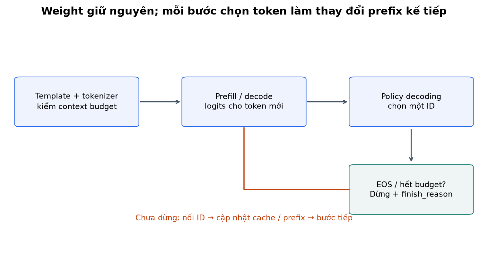
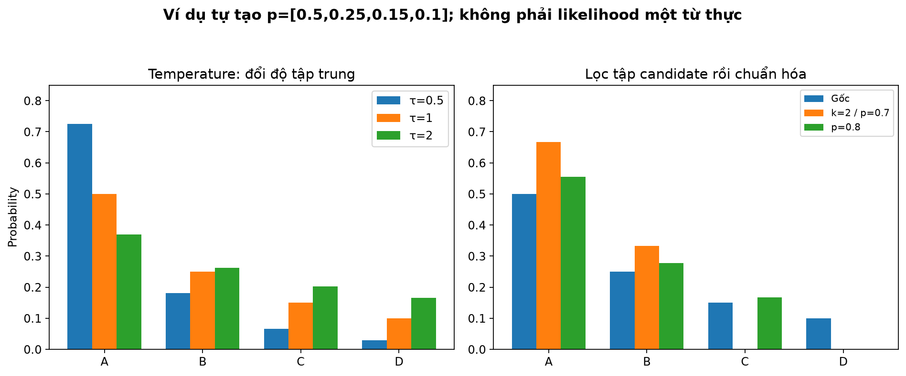
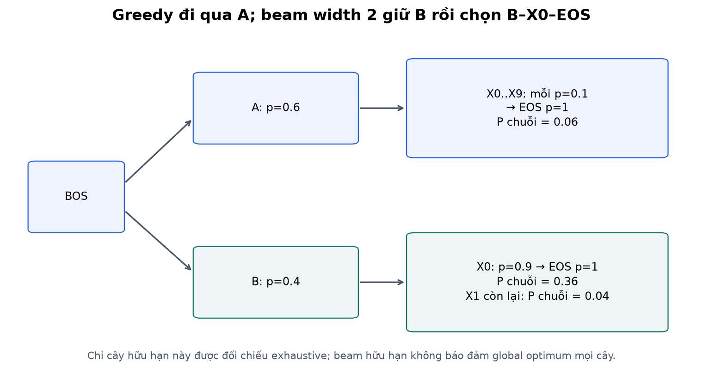
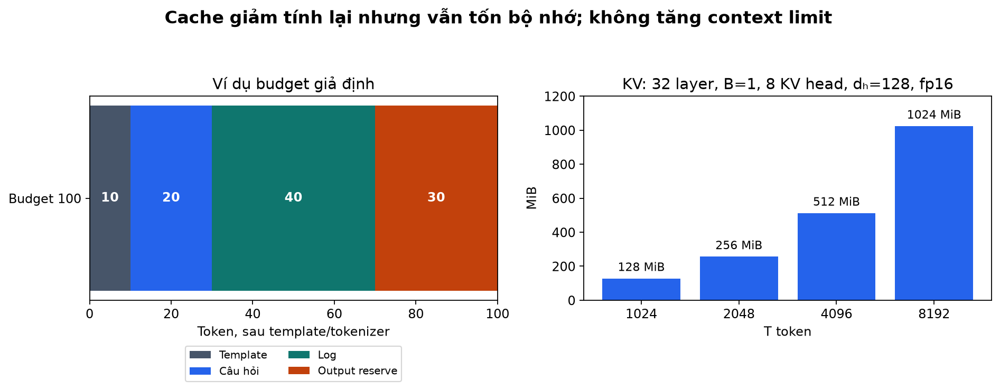
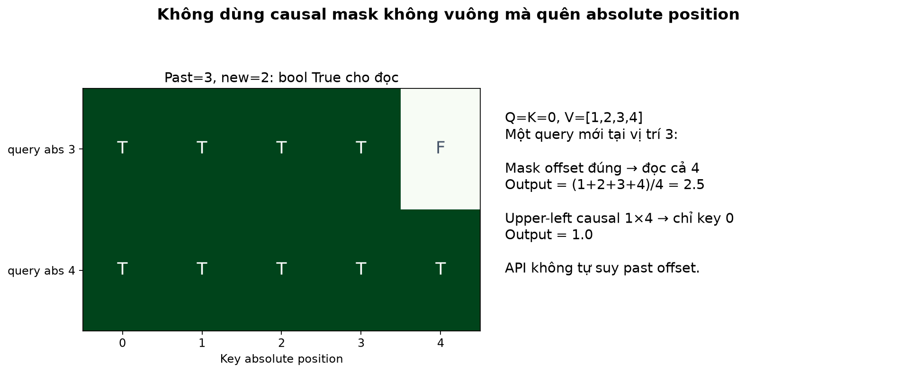
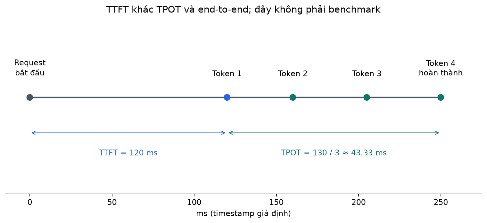
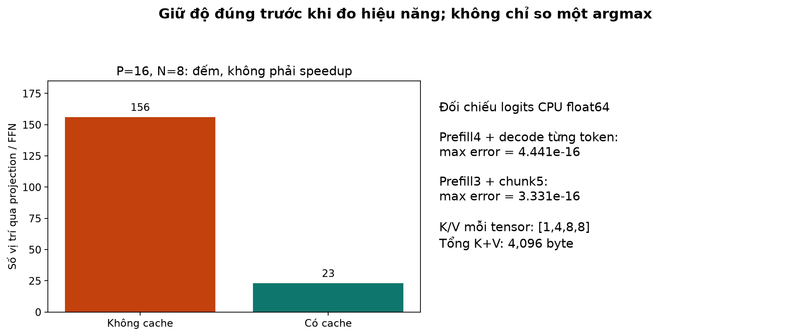

# Bài 21 — Decoding, context và inference: từ logits đến một phản hồi hoàn chỉnh

[Mục lục](../README.md) · [Bài 20 — Tiền huấn luyện và tinh chỉnh](../20-tien-huan-luyen-tinh-chinh/README.md) · [Đào sâu và đọc code](deep-dive.md) · [Bài tập](exercises.md) · [Lời giải](solutions.md)

Biên soạn ngày 04/11/2026. Ví dụ, hình và cây xác suất trong bài tự tạo. Code CPU không tải model, không gọi dịch vụ AI và không cần train mới. Có chế độ nạp checkpoint SFT **do người học tạo ở bài 20**, được tách rõ khỏi demo model random để không nhầm kiểm cơ chế với chất lượng ngôn ngữ.

## 1. Mục tiêu và cầu nối

Bài 20 dạy model tăng xác suất answer mẫu. Nhưng inference vẫn còn nhiều quyết định: chọn token nào từ phân phối; khi nào dừng; giữ thông tin gì trong context; có tính lại toàn prefix không; báo gì khi hết budget hoặc byte chưa thành chữ?

Sau bài này, bạn cần:

- Tính và so greedy, temperature, top-k, top-p; giải thích beam search không tương đương greedy hay một bộ xác minh sự thật.
- Đếm context sau tokenizer/template và dành chỗ cho output; phân biệt context, model weight và KV cache.
- Vẽ prefill/decode; tự ghép một KV cache nhỏ và đối chiếu logits với forward đầy đủ.
- Xử lý EOS, giới hạn output, Unicode streaming và đọc đúng TTFT/TPOT.
- Thiết kế kiểm inference cho tác vụ backend, không chỉ nhìn một câu nghe hợp lý.

Cần bài 17–18 về attention/mask, bài 19 về tokenizer/likelihood, bài 20 về SFT và đánh giá. Đọc ba lượt: phần 2–8 cho decoding; 9–12 cho context/cache; 13–17 cho hệ thống, lab và tự kiểm.

## 2. Ví dụ thực tế: cùng một model, khác cách dùng

**Định tuyến ticket:** ứng dụng yêu cầu đúng `AUTH`, `DATA` hoặc `NET`. Một đoạn giải thích hay nhưng khác schema có thể làm downstream parser lỗi. Cần đo format và đúng nhãn, không chọn temperature cao chỉ để câu trả lời “đa dạng”. Greedy có thể là một baseline; nếu cần output bị giới hạn phải thiết kế constraint/parser riêng và đánh giá nội dung.

**Soạn email hỗ trợ:** có nhiều cách viết cùng hợp lệ. Sampling có thể tạo vài phương án khác nhau; vẫn phải kiểm thông tin đơn hàng, lời hứa hoàn tiền và giọng điệu. Tăng tính đa dạng không tự tăng tính đúng.

**Tóm tắt stack trace dài:** context phải giữ phần câu hỏi, exception gốc và những dòng liên quan. Cắt chuỗi theo số ký tự hoặc lấy toàn log cho đủ dài có thể làm mất thông tin cần thiết. Decode nhanh không bù được input thiếu dữ kiện.

Inference là quá trình dùng weight đã học để tạo output. Decoding là một phần lựa chọn output từ score; nó không thay thế dữ liệu, reasoning, truy xuất hay kiểm quyền công cụ. Tham số decoding thay đổi hành vi sinh mà không chạy một bước optimizer nào.



## 3. Phân phối model và phân phối dùng để sinh

Với prefix x₍<t₎, model trả logits z có V phần tử. Softmax biến chúng thành pᵢ=exp(zᵢ)/Σⱼexp(zⱼ). ID được chọn rồi nối vào prefix; model lại chạy cho bước sau. Bước thứ hai đã phụ thuộc token sinh ở bước thứ nhất, không chỉ phụ thuộc prompt ban đầu.

Có thể chặn token không hợp lệ về cấu trúc, đổi temperature hoặc lọc candidate trước khi lấy mẫu. Khi ấy phân phối dùng để sinh q có thể khác p của model gốc. Không gọi probability sau lọc là likelihood gốc của model nếu đã renormalize.

Lab chặn PAD/BOS ở mỗi bước vì hai control token đó không phải nội dung cần sinh. EOS vẫn được phép. Đây là một ràng buộc được công bố; nó **không** giới hạn answer chỉ còn ba nhãn route, nên output vẫn có thể sai format.

## 4. Greedy: lấy token có score cao nhất tại mỗi bước

Greedy chọn `argmax(z)`. Vì softmax giữ thứ tự, không bắt buộc tính softmax chỉ để tìm argmax. Lab quy định khi hòa chọn ID nhỏ hơn theo vị trí đầu tiên. Không phải mọi backend/API đều công bố cùng chính sách hòa.

Ưu điểm là dễ tái lập trong cùng điều kiện và không cần RNG lấy mẫu. Nhưng token tốt nhất ở bước hiện tại không bảo đảm toàn chuỗi có xác suất cao nhất; xác suất chuỗi còn gồm các bước tiếp theo. Model có thể tự lặp hoặc chọn một nhánh kết thúc kém.

Với temperature τ>0, chia tất cả logits cho τ không đổi argmax. Vì thế giảm temperature trong một vòng **chỉ greedy** không tự làm lựa chọn “chắc chắn hơn”; nó chỉ thay phân phối nếu ta thực sự dùng phân phối đó. Trong lab, greedy bỏ qua tham số sampling; muốn thử temperature phải chọn `strategy='sample'`.

“Temperature=0” thường được dùng như cách gọi greedy ở một số giao diện, nhưng softmax(z/0) không phải công thức hợp lệ. Hàm `distribution` của bài chỉ nhận τ>0; greedy là nhánh riêng, không chia cho 0.

## 5. Temperature: thay độ tập trung, không sửa kiến thức

\[
q_i(\tau)=\frac{\exp(z_i/\tau)}{\sum_j\exp(z_j/\tau)}.
\]

τ<1 làm phân phối tập trung hơn vào score lớn; τ>1 làm phẳng hơn. Không có nghĩa τ cao luôn tạo nội dung tốt, hoặc τ thấp loại hallucination. Phân phối có thể tự tin với một đáp án sai.

### Ví dụ tính tay dùng xuyên bài

Bốn candidate A, B, C, D có xác suất model p=[0.5,0.25,0.15,0.1]. Chọn logits z=ln(p); cộng cùng một hằng vào z sẽ không đổi softmax.

Vì exp(ln(pᵢ)/τ)=pᵢ^(1/τ), với τ=0.5 ta bình phương p rồi chuẩn hóa. Tổng bình phương=0.25+0.0625+0.0225+0.01=0.345:

| Candidate | τ=1 | τ=0.5 | τ=2 |
|---|---:|---:|---:|
| A | 0.500000 | 0.724638 | 0.370090 |
| B | 0.250000 | 0.181159 | 0.261693 |
| C | 0.150000 | 0.065217 | 0.202707 |
| D | 0.100000 | 0.028986 | 0.165509 |

Với τ=2, lấy căn bậc hai rồi chia tổng các căn. Thứ hạng vẫn A>B>C>D, nhưng lấy mẫu sẽ có tần suất khác. Đây là phép biến đổi phân phối tự tạo, không phải xác suất đã đo cho một từ trong LLM thương mại.

## 6. Top-k và top-p: chọn tập candidate rồi chuẩn hóa lại

### Top-k

Giữ k candidate có score cao nhất; các candidate khác có xác suất 0. Với k=2 ở ví dụ trên, giữ A, B và chia cho 0.75:

```text
q = [2/3, 1/3, 0, 0]
```

k cố định số candidate, không cố định tổng probability mass. Nếu phân phối rất phẳng, k=2 có thể cắt quá mạnh; nếu rất tập trung, giữ nhiều candidate có thể không cần thiết. Lab giữ đúng k ID theo thứ tự stable khi hòa; một implementation dựa ngưỡng có thể giữ hơn k ở điểm hòa, nên kiểm contract cụ thể.

### Top-p / nucleus sampling

Sắp candidate theo probability giảm dần, giữ tập nhỏ nhất có tổng xác suất **ít nhất p**, gồm candidate làm vượt ngưỡng, rồi renormalize.

- p=0.7: A có 0.5 chưa đủ, thêm B đạt 0.75 → giữ A, B →[2/3,1/3,0,0].
- p=0.8: A+B=0.75 chưa đủ, thêm C đạt 0.9 →[5/9,5/18,1/6,0].
- p=1: không lọc nucleus; không có nghĩa lấy cả mọi token cùng xác suất bằng nhau.

Lỗi thường gặp là chỉ giữ các token có cumulative≤p rồi bỏ chính token vượt ngưỡng, hoặc p rất nhỏ làm không còn candidate. Lab luôn giữ ít nhất một token và kiểm không có hàng logits bị chặn hết.

Nguồn nghiên cứu [The Curious Case of Neural Text Degeneration](https://arxiv.org/abs/1904.09751) thảo luận suy biến văn bản và nucleus sampling; bài này chỉ dùng khái niệm, không tái hiện đánh giá chất lượng văn bản của nguồn.

### Thứ tự kết hợp là một phần cấu hình

Lab dùng: **chặn control → temperature → top-k → top-p → normalize → sample**. Top-p được tính trên phân phối **sau top-k**. Ví dụ k=2 rồi p=0.6: sau k, A có 2/3≥0.6 nên chỉ giữ A. Nếu áp p=0.6 trực tiếp trên p gốc thì A 0.5 chưa đủ, phải giữ cả A, B. Không chuyển số hyperparameter qua hai pipeline khác thứ tự rồi kỳ vọng cùng hành vi.

```python
import torch
from lab import distribution
z = torch.tensor([.5,.25,.15,.1], dtype=torch.float64).log()
print(distribution(z, top_p=.8))       # [0.555556,0.277778,0.166667,0]
assert distribution(z, top_k=2, top_p=.6).tolist() == [1.,0.,0.,0.]
```



## 7. Sampling và seed

Sampling rút một ID theo q; ID xác suất thấp vẫn có thể được chọn nếu chưa bị lọc. Lặp cùng một câu nhiều lần có thể cho output khác. Seed giúp tái lập chuỗi lấy mẫu trong cùng môi trường và cùng luồng RNG, không phải bằng chứng nội dung đúng.

Lab dùng `torch.Generator().manual_seed(seed)` riêng cho mỗi request để không vô tình phụ thuộc các số random được dùng khi khởi tạo model. Cùng seed chưa bảo đảm giống từng bit giữa version, dtype, kernel, thiết bị hoặc khi phân phối đã đổi nhẹ. Khi q có ties gần nhau, sai số số thực có thể ảnh hưởng chọn token.

Sampling trong lab dùng [torch.multinomial 2.15](https://docs.pytorch.org/docs/2.15/generated/torch.multinomial.html) với generator riêng. Ở ví dụ top-p 0.7, lab lấy 10,000 mẫu với seed 21, thu A=6,599, B=3,401, C=D=0. Tần suất xấp xỉ 2/3 và 1/3, không cần đúng chính xác 6,666.67. Đừng dùng một lần rút token để kết luận implementation khớp phân phối.

Các chế độ greedy/sampling/beam được đối chiếu ở mức khái niệm với [Hugging Face generation strategies](https://huggingface.co/docs/transformers/main/en/generation_strategies). Lab tự viết decoder và không cài Transformers.

## 8. Beam search: giữ vài prefix, vẫn có thể bỏ nhánh tốt

Beam width b giữ tối đa b candidate sequence qua mỗi bước, thường theo tổng log probability. Nó không lấy mẫu ngẫu nhiên như sampling. Sau khi một nhánh kết thúc EOS, lab giữ nhánh đó nhưng không mở rộng thêm token. Budget hết có thể còn candidate chưa EOS; code trả cờ `ended`, không giả đó là câu đã kết thúc.

### Cây tính tay: greedy chưa tối ưu toàn chuỗi

```text
Bước 1: P(A)=0.6, P(B)=0.4
Sau A: 10 lựa chọn X0..X9, mỗi lựa chọn p=0.1
Sau B: P(X0)=0.9, P(X1)=0.1
Sau mọi cặp: P(EOS)=1
```

Greedy: A→X 0→EOS, probability 0.6×0.1×1=0.06. Beam width 2 giữ A và B ở bước đầu; bước sau B→X 0 có 0.36, cao hơn mọi nhánh A có 0.06. Kết quả B→X 0→EOS đạt 0.36. Lab so với duyệt hết 12 chuỗi để xác minh cây này.

Điều đó không chứng minh beam 2 luôn tìm global optimum: một nhánh có prefix thấp có thể bị prune trước khi bộc lộ lợi thế. Tăng beam còn tăng tài nguyên và không tạo bộ kiểm sự thật. Tổng log probability chưa chuẩn hóa độ dài có thể ưu tiên chuỗi ngắn; length penalty/normalization là một lựa chọn objective cần công bố. Lab dùng tổng log probability thô, không length penalty; các chuỗi hoàn chỉnh trong cây đều dài 3 token gồm EOS nên ví dụ không mắc chênh độ dài.

**Phạm vi code:** beam search chạy trên cây xác suất hữu hạn kiểm được bằng tay; inference LM trong lab chạy greedy/sampling. Chưa triển khai beam cache reorder trên neural model. Xem [phụ lục](deep-dive.md) để hiểu vì sao mỗi beam cần cache riêng theo đúng prefix.



## 9. Context là thông tin trong request, không phải mọi thứ model từng biết

Phân biệt ba tầng:

| Thành phần | Chứa gì? | Được cập nhật thế nào? |
|---|---|---|
| Model weight | Các parameter đã học | Optimizer khi training; lab inference không thay weight |
| Context token | Template, lịch sử, câu hỏi, dữ liệu được đưa vào lần chạy | Ứng dụng xây prompt, tokenizer encode và nối output |
| KV cache | Key/value theo tầng cho prefix đã xử lý | Tính trong inference, dùng lại khi prefix tiếp tục hợp lệ |

Cache không là bộ nhớ dài hạn tự học về người dùng, không bổ sung dữ kiện ngoài context và không làm tăng context limit. Nếu một chat dài hơn giới hạn, ứng dụng phải chọn giữ/tóm tắt/truy xuất lại thông tin; model không tự đọc mọi tin nhắn từng có chỉ vì UI còn hiển thị chúng.

### Tính budget thực tế bằng token

Ví dụ giả định limit 100 token: template 10+câu hỏi 20+log 40=70 input, dự trù 30 output →vừa 100. Log thêm 1 token thì phải thay chính sách hoặc báo lỗi; không âm thầm giữ nguyên lời hứa 30 token output.

Đếm bằng đúng tokenizer **sau khi render template**, gồm BOS/control nếu có. Trong lab `prompt_tokens` gồm BOS. Dùng `max_new_tokens` cho số token mới, không nhầm với tổng chiều dài input+output. EOS cũng được tính vào output token count khi sinh.

Lab dùng policy bảo thủ **P+N≤C**: dành chỗ cho cả prompt và output. Về số lượt forward, input dài nhất chỉ là P+N−1 vì token cuối vừa sinh chưa cần feed lại; policy bảo thủ không tận dụng thêm một slot đó. Đây là lựa chọn của lab, không khẳng định mọi API có cùng kiểm budget.

### Cắt và tóm tắt phải theo nhu cầu

Một stack trace có thể chứa exception bọc ở cuối nhưng nguyên nhân gốc ở phần `caused by`; một yêu cầu hoàn tiền cần cả chính sách và trạng thái đơn. Cắt đầu/cuối máy móc có thể làm câu trả lời sai. Tóm tắt cũng có thể mất ID/điều kiện quan trọng; cần giữ nguồn hoặc dữ kiện gốc cần kiểm và đo chất lượng trên task.

Context dài về mặt kỹ thuật không đảm bảo model dùng đúng mọi chi tiết. Thử các vị trí đặt dữ kiện, trường hợp thông tin xung đột hoặc thiếu dữ kiện. Không lấy câu trả lời nghe hợp lý làm bằng chứng model đã đọc đúng toàn context.



## 10. Prefill và decode: hai phần của vòng inference

**Prefill** xử lý toàn prompt một lần để có hidden/logits cuối và K, V của prefix. Logits cuối ấy đủ để chọn token output đầu tiên. Không cần một forward riêng cho token đầu sau prefill.

**Decode** feed token mới vừa chọn để tính logits cho token tiếp theo, lặp cho tới EOS/budget. Với cache, query mới chỉ tính cho phần input mới; key/value gồm phần quá khứ lưu lại cộng phần mới. FFN/LayerNorm/head cũng không cần tính lại cho mọi vị trí cũ trong implementation incremental đúng.

Không cache: mỗi bước chạy lại prefix dài P, P+1, …; cache: prefill P rồi mỗi decode thêm 1 token. Nếu sinh N token và dừng ngay sau token cuối, số vị trí xử lý qua projection/FFN minh họa là:

\[
\text{không cache}=NP+\frac{N(N-1)}2,
\qquad \text{có cache}=P+N-1.
\]

Với P=16, N=8:156 so với 23. Đây là **đếm vị trí được xử lý**, không phải tốc độ thực nhanh gấp 156/23; kernel, memory copy, attention đọc cache và overhead còn ảnh hưởng. Dynamic cache ghép tensor bằng `cat` trong lab còn có chi phí sao chép.

Theo [How caching works](https://huggingface.co/docs/transformers/main/en/cache_explanation), cache tái sử dụng KV từ các vị trí cũ trong autoregressive inference. Bài này không benchmark hoặc tái hiện các cache class/serving engine của thư viện.

## 11. Tự ghép KV cache: shape, vị trí và mask

Core bài 20 có một block pre-norm, D=32, H=4, dₕ=8. Với batch 1, cache K và V mỗi tensor `[1,4,S,8]`. Nó lưu **K, V đã chiếu từ LN₁(input của block)**, không phải token ID, attention score hoặc output cuối. Q cũ không cần để tính query mới.

Ở nhiều tầng phải có cache riêng mỗi layer vì input/weight từng tầng khác nhau. Lab chỉ một tầng; không dùng một cache chung giả cho N tầng.

### Bước tính incremental trong code

1. Past length là S. Input mới có L token; position ID phải là S…S+L−1.
2. Embedding+position → LN₁ → chiếu Q/K/V mới.
3. Nối K, V mới sau K, V cũ theo trục sequence; Q chỉ có L hàng.
4. Attention đọc đúng key theo mask; output projection, residual, FFN và final norm/head chỉ cho input mới.
5. Trả logits cùng cache dài S+L. Không tự nối token đã xử lý vào cache lần nữa.

### Causal mask không vuông phải có offset

Query hàng i mới có vị trí tuyệt đối S+i, key cột j được đọc khi j≤S+i. Ví dụ đã có 3 token, nhận 2 token mới:

```text
key tuyệt đối: 0 1 2 3 4
query vị trí 3: T T T T F
query vị trí 4: T T T T T
```

Ở functional SDPA, bool True=**cho phép đọc**, ngược bool mask của `nn.MultiheadAttention` bài 17–18. Lab truyền `attn_mask=allowed_mask(...)`, `is_causal=False`, `dropout_p=0` rõ ràng.

Không mù quáng gọi `is_causal=True` cho query mới dài 1, key quá khứ dài 4. PyTorch 2.15 mô tả causal mask không vuông có dạng **upper-left alignment**, không tự biết past offset của request. Với Q=K=0, V=[1,2,3,4] và một query ở vị trí cuối, mask đúng đọc cả 4 nên output 2.5; upper-left 1×4 chỉ đọc key 0 nên output 1.0. [SDPA API 2.15](https://docs.pytorch.org/docs/2.15/generated/torch.nn.functional.scaled_dot_product_attention.html).

### Phạm vi implementation

`cached_forward` chỉ cho CPU, batch 1, không PAD, một block của `core.py`, model eval. Prefill bắt đầu BOS; phần tiếp nhận token mới không lặp BOS. Cache có owner tag để chặn đưa sang object model khác, nhưng tag **không phát hiện weight bị sửa tại chỗ hoặc prefix khác trên cùng model**. Người gọi phải giữ model/prefix bất biến trong lifetime request; cache không dùng xuyên request tùy tiện.



## 12. Cache tốn bộ nhớ dù giảm tính lại

Cho N_layer tầng, B batch, H_KV head key/value, T token, dₕ chiều mỗi head, b byte mỗi phần tử:

\[
\text{KV bytes}=2 N_{layer}BH_{KV}Td_hb.
\]

Hệ số 2 cho K và V. Với model minh họa giả định 32 layer, B=1, H_KV=8, dₕ=128, T=4096, fp16 có b=2:536,870,912 byte=512 MiB. Batch 4 nhân 4 thành 2 GiB nếu mọi điều kiện còn lại giữ nguyên. Đây chưa gồm weight, activation/workspace, allocator hoặc metadata.

Với MHA thông thường, H_KV bằng số headQ; không mặc định công thức dùng số query head khi kiến trúc có head KV khác. Bài không triển khai GQA/MQA hoặc lượng tử hóa cache. Dynamic/static/offload/quantized cache có đánh đổi khác nhau; [Cache strategies](https://huggingface.co/docs/transformers/main/en/kv_cache) được đọc để định hướng, không phải các phương án đã chạy trong lab.

Context cache còn tăng theo số request đồng thời; một response ngắn sau prompt dài vẫn có prefill và memory footprint đáng kể. Cache giúp tính lại ít hơn, không làm attention query mới ngừng đọc các key hợp lệ trong quá khứ.

## 13. Inference trong backend: dừng, stream và telemetry

### EOS, stop và hết budget

Lab trả `finish_reason='eos'` hoặc`'length'`. Hết length không có nghĩa câu trả lời đã hoàn chỉnh; JSON có thể còn dang dở. Không tự thêm dấu đóng ngoặc rồi báo model đã sinh đúng schema. EOS là token điều khiển, không phải substring bất kỳ trong raw text.

Stop string có thể trải qua nhiều token hoặc nhiều chunk stream; substring matching trên từng chunk riêng sẽ bỏ sót. Lab chưa cài stop-string matcher, min length, repetition penalty hoặc grammar-constrained decoding. Những cơ chế đó phải có test riêng khi thêm, vì có thể chặn EOS hoặc làm toàn bộ logits bị mask.

### Streaming không luôn một token bằng một ký tự

Tokenizer byte có thể sinh byte C 3 rồi A 9 cho `é`. UTF-8 incremental decoder nhận C 3 trước và chưa xuất ký tự, sau A 9 mới xuất `é`. Không dùng `errors='ignore'` trên từng token vì có thể mất dấu. Luồng hết mà byte còn thiếu phải báo/hiển thị lỗi theo policy; streaming không biến output model thành UTF-8 đúng một cách tự động.

Chỉ hiển thị một phần output khác với cho phép thực thi một phần lệnh/công cụ. Với JSON hoặc hành động backend, cần đợi parse/validate và kiểm điều kiện tác vụ, không chạy lệnh khi thấy vài ký tự đầu có vẻ đúng.

Cơ chế incremental và flush bộ đệm được đối chiếu với [Python 3.14 codecs](https://docs.python.org/3.14/library/codecs.html).

### TTFT, TPOT và throughput

- **TTFT (time to first token):** từ thời điểm bắt đầu đo tới token output đầu. Có thể gồm queue, tokenization, prefill/network tùy boundary đo.
- **TPOT (time per output token sau token đầu):** ví dụ đơn giản `(t_last−t_first)/(N−1)` khiN≥2; không chiaN nếu đang đo khoảng giữa các token.
- **End-to-end latency:** từ bắt đầu tới hoàn thành request theo boundary đã chọn.
- **Throughput:** số token hoặc request trên một cửa sổ thời gian, với concurrency và cách tính rõ; không thay thế latency từng request.

Ví dụ timestamp **giả định**, không phải benchmark: request bắt đầu 0 s, token tới 0.120,0.160,0.205,0.250 s; TTFT 120 ms, TPOT≈43.333 ms, end-to-end 250 ms nếu đóng request tại token cuối. Nếu chỉ có 1 token, TPOT chưa xác định bằng công thức này, không ghi 0 ms rồi tưởng decode vô hạn nhanh.

Log model/tokenizer/config, input/output token count, finish reason, cache mode và seed khi sampling để tái kiểm. Nội dung log cần theo chính sách dữ liệu của hệ thống; không cần lưu nguyên mọi prompt nhạy cảm chỉ để biết latency. Bài không triển khai server, SSE, cancel/timeout hoặc continuous batching.



## 14. Kết quả lab đã kiểm

### Chạy mặc định: cơ chế, không phải ngôn ngữ

`--mode all` không cần checkpoint: tạo model random seed 21 để kiểm toán học/cấu trúc. Không gọi văn bản random là ví dụ chất lượng generation. Báo cáo chứa nguồn weight rõ ràng.

Phép kiểm cache CPU float64 dùng chuỗi 8 token, prefill 4 rồi 4 decode đơn:

| Phép đo | Kết quả đã chạy |
|---|---:|
| Max absolute logit error so với full forward | 4.440892×10⁻¹⁶ |
| Prefill 3 rồichunk 5, so logits chunk với full | 3.330669×10⁻¹⁶ |
| Shape K và V cuối | `[1,4,8,8]` mỗi tensor |
| Tổng byte K+V, float64 | 4,096 byte |
| SDPA upper-left sai offset /mask offset đúng | 1.0 /2.5 |

Sai số là số thực thông thường, không hứa exact bitwise cho mọi kernel. Code kiểm cả prefill, một token và chunk nhiều token; không chỉ so câu cuối tình cờ giống.

### Nối với checkpoint đã train ở bài 20

Đã chạy `--mode infer --run20 ...` bằng full-sft checkpoint được tạo từ code mặc định bài 20. Prompt:

```text
Route: service=api op=read event=timeout.
Team: 
```

Prompt có 24 token gồm BOS; output `[N,E,T,EOS]` gồm 4 token trong tokenizer của run ấy. Greedy, sampling τ 0.7, top-k 5 và top-p 0.9 với seed 21 đều sinh `NET`, finish_reason=eos. Điều này không chứng minh sampling luôn giống greedy: phân phối đã tập trung và đây chỉ một prompt/seed. Chương không đánh giá lại toàn test để chọn decoder tối ưu.

Với từng strategy này, cache và no-cache cho cùng output IDs trong môi trường đã chạy. No-cache xử lý 24+25+26+27=102 vị trí; cache 24+1+1+1=27 vị trí. Cache cuối giữ 27 token, không có EOS vừa sinh vì dừng ngay mà không feed EOS lại; K+V float32=6,912 byte. **Không báo tốc độ nhanh gấp 102/27** từ đếm vị trí.



## 15. Chạy code và tái tạo hình

Đã chạy Python 3.14.6, torch 2.15.0, macOS arm 64 CPU một thread. Demo cache dùng float64; random/loaded model inference dùng float32. NumPy 2.5.4 và Matplotlib 3.11.2 dùng kiểm/vẽ. Từ thư mục bài 21:

```bash
python3 -m venv .venv
.venv/bin/python -m pip install -r requirements.txt
.venv/bin/python lab.py --mode hand
.venv/bin/python lab.py --mode beam
.venv/bin/python lab.py --mode cache
.venv/bin/python lab.py --mode context
.venv/bin/python lab.py --mode all --out /tmp/lesson21-run-01
```

`--mode infer` mặc định dùng random weight. Để xem output từ SFT, trước tiên chạy bài 20 theo hướng dẫn của bài đó, với output `/tmp/lesson20-run-01`, rồi:

```bash
.venv/bin/python lab.py --mode infer --run20 /tmp/lesson20-run-01 --out /tmp/lesson21-trained-01
```

Chỉ tải checkpoint tin cậy; code dùng weights_only=True và kiểm tokenizer hash. Không có artifact run 20 sẵn trong ZIP; code nguồn toàn khóa có thể tự tạo lại. Không cần tải model ngoài. `core.py` chép cấu trúc một block của bài 20 để demo mặc định chạy độc lập.

Output nếu dùng --out là thư mục mới chứa report.json; code từ chối ghi đè. Không có --out chỉ in kết quả. Windows thay `.venv/bin/python` bằng `.venv\Scripts\python`. Phiên bản ghim cần wheel phù hợp; seed không bảo đảm giống từng bit khi đổi backend.

Bảy hình PNG/SVG được lưu sẵn. Tái tạo hình từ default report (không cần run 20):

```bash
.venv/bin/python -m pip install -r requirements-figures.txt
.venv/bin/python make_figures.py --run /tmp/lesson21-run-01
```

## 16. Tự chẩn đoán trước khi tối ưu

| Triệu chứng | Điều cần kiểm |
|---|---|
| Cache và no-cache khác logits lớn | Position offset, mask không vuông, chiều ghép K/V, weight/checkpoint, eval/dropout |
| Token đầu lặp lại sau prefill | Có feed lại toàn prompt vào cache không; logits cuối prefill đã dự đoán token đầu |
| Sampling không tái lập | Có dùng đúng generator/seed và cùng luồng xử lý phân phối không? |
| Top-p bỏ hết candidate | Giữ token vượt ngưỡng và ít nhất token đầu; kiểm mask chặn hết |
| Greedy đổi khi chỉ đổi temperature | Có thực sự dùng greedy không; tie/numerical differences hoặc pipeline khác |
| Output đúng mẫu nhưng cache vẫn sai | So logits nhiều vị trí/chunk, không chỉ argmax một câu |
| Context overflow | Đếm sau template/tokenizer, gồm control, dự trù output theo policy |
| Unicode stream mất dấu | Buffer byte bằng incremental decoder thay vì decode từng token riêng |
| JSON dang dở | Kiểm finish_reason và parse/schema; không đồng nhất length với thành công |

## 17. Hoàn thành bài và bước tiếp

Làm [16 bài tập](exercises.md), rồi đối chiếu [lời giải](solutions.md). Bạn cần giải thích được tại sao greedy không tối ưu mọi chuỗi; tại sao temperature không cập nhật weight; tại sao cache không tăng context; tại sao mask mới phải có offset; và vì sao nhiều token/s không đồng nghĩa ít thời gian đợi token đầu.

[Phụ lục](deep-dive.md) có chứng minh cache hợp lệ, phân phối sau lọc, lifetime cache và các kiểm tra. **Bài tiếp theo:** [Bài 22 — API, đầu ra có cấu trúc và đánh giá](../22-api-dau-ra-cau-truc-danh-gia/README.md), nối output model với contract, orchestration và eval của ứng dụng. [Nguồn và phạm vi đối chiếu](../SOURCES.md).
