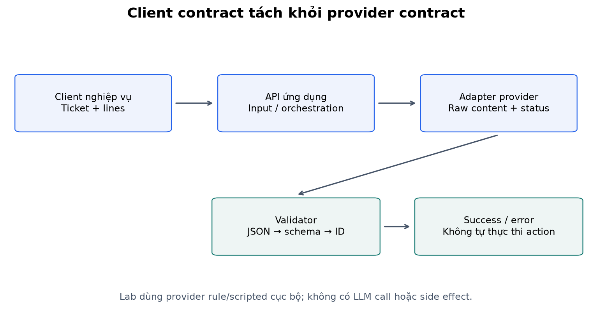
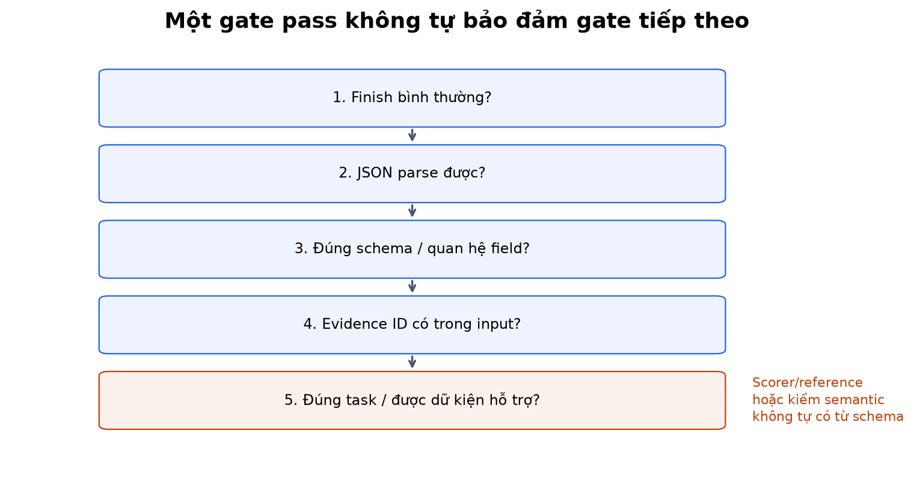
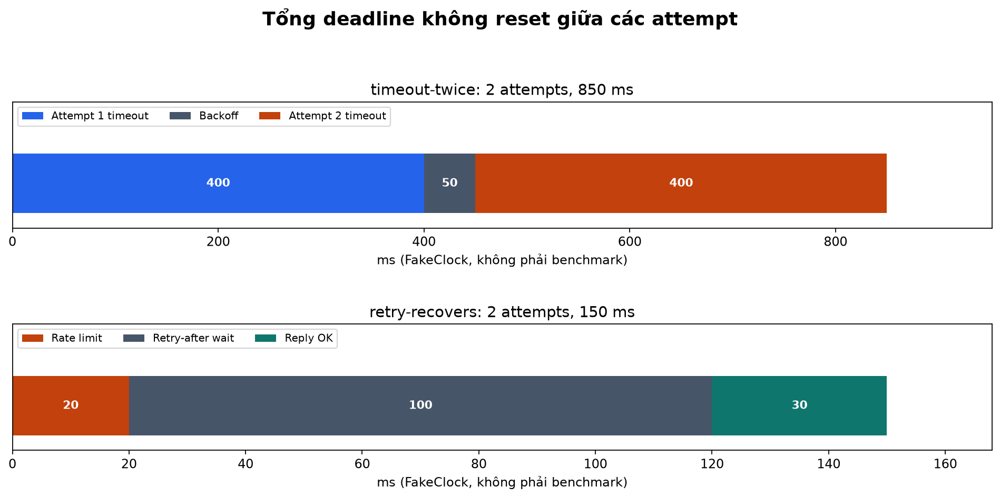
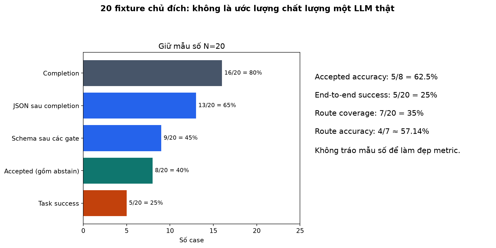
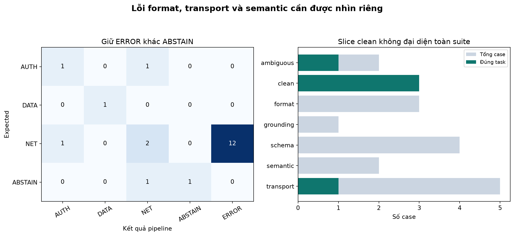
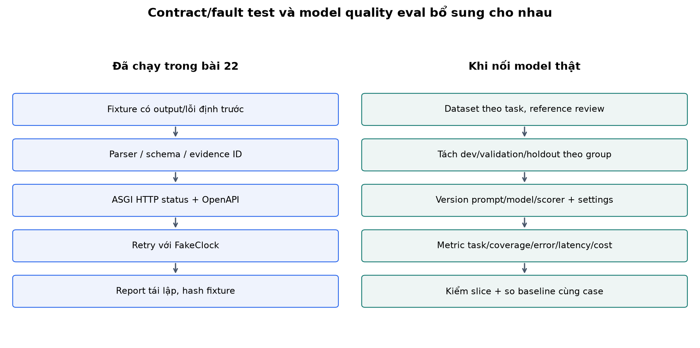

# Bài 22 — API, đầu ra có cấu trúc và đánh giá

[Mục lục](../README.md) · [Bài 21](../21-decoding-context-inference/README.md) · [Đào sâu và thiết kế hệ thống](deep-dive.md) · [Bài tập](exercises.md) · [Lời giải](solutions.md)

Biên soạn ngày 04/11/2026. Đây là bài nối mô hình với ứng dụng backend. Ví dụ và dữ liệu tự tạo; lab không có tài khoản, API key, model tải ngoài hoặc cuộc gọi trả phí. API chạy cục bộ bằng FastAPI, có provider quy tắc để demo và provider giả lập lỗi để kiểm hệ thống. **Số liệu đánh giá trong bài là kết quả contract/fault fixtures, không phải chất lượng của một LLM thật.**

## 1. Mục tiêu và cầu nối

Bài 21 đã có logits → chọn token → EOS hoặc hết budget. Nhưng downstream không thể chỉ tin rằng một chuỗi sinh ra “có vẻ đúng”. API phải biết request hợp lệ chưa, upstream đã kết thúc chưa, output có parse/validate được không và hành vi có đáp ứng tác vụ hay không.

Sau bài này, bạn cần:

- Phân biệt API của ứng dụng với API model/provider; thiết kế request, response và mã lỗi rõ ràng.
- Tạo schema cho output có nhánh route/abstain; kiểm JSON, type, field và quan hệ giữa các field.
- Xử lý finish reason, timeout, retry có giới hạn và thông tin usage không đầy đủ.
- Xây bộ đánh giá có denominator đúng, slice, confusion matrix và giới hạn được công bố.
- Phân biệt test hệ thống, eval chất lượng model và đánh giá tác vụ đầu cuối.

Cần bài 5 về leakage, bài 7 về metric, bài 19 về tokenizer, bài 20–21 về hành vi và inference. Bạn có nền backend nên có thể đọc nhanh phần HTTP quen thuộc; nên dành thời gian cho schema không đồng nghĩa đúng nội dung và cách đánh giá khi có abstention/error.

## 2. Ví dụ thực tế: từ ticket đến đề xuất đội xử lý

Một hệ thống nhận ticket:

```text
L1: API /orders gặp timeout khi đọc đơn hàng.
L2: Auth vẫn hoạt động bình thường.
```

Ứng dụng cần một đề xuất có cấu trúc:

```json
{
  "schema_version": "1",
  "decision": "route",
  "team": "NET",
  "evidence_ids": ["L1"]
}
```

Nhãn AUTH/DATA/NET là quy ước minh họa của khóa học, không phải chính sách vận hành phổ quát. Nếu ticket thiếu dữ kiện, contract cho phép:

```json
{
  "schema_version": "1",
  "decision": "abstain",
  "team": null,
  "evidence_ids": []
}
```

`abstain` là không đưa ra đề xuất đội với dữ kiện hiện có; không phải timeout hoặc HTTP error. API của bài chỉ tạo **proposal**. Nó không đóng ticket, phân công nhân viên hoặc thực hiện công cụ. Việc thay đổi trạng thái hệ thống là một bước nghiệp vụ khác, cần quyền và điều kiện riêng.

Tách rõ hai API:

| Lớp | Client biết gì? | Trách nhiệm |
|---|---|---|
| API ứng dụng `/v1/route-proposals` | Ticket, các dòng được cung cấp, contract nghiệp vụ | Input validation, orchestration, output validation, lỗi, observability |
| Adapter model/provider | Prompt/messages, timeout, cấu hình model, response envelope | Gọi upstream, chuẩn hóa finish/usage/lỗi về giao diện nội bộ |

Không để client ứng dụng tùy ý chọn URL upstream, system prompt hoặc model đặc quyền trong request công khai. Cấu hình đó thuộc phía server theo sản phẩm. Lab không kết nối nhà cung cấp nào; các field provider trong code là giao diện minh họa, không phải wire format của một vendor.



## 3. Hợp đồng request và response

Request của lab:

```json
{
  "schema_version": "1",
  "ticket_id": "ticket-demo-1",
  "lines": [
    {"id": "L1", "text": "event=timeout."}
  ]
}
```

`lines` có 1–8 dòng; mỗi ID dạng L 1, L 2, … và không trùng; mỗi text 1–500 code point theo giới hạn string. Server không nhận label đúng từ client để “giúp model trả lời”. Eval giữ reference ở bên scorer, không nhét và o prompt của ca đang đo.

Success envelope tách kết quả nghiệp vụ khỏi metadata. Các giá trị request_id/elapsed dưới đây là **minh họa**, không phải snapshot cố định:

```json
{
  "request_id": "server-generated-id",
  "provider": "local-keyword-rule-v1",
  "prompt_version": "route-v1",
  "result": {
    "schema_version": "1",
    "decision": "route",
    "team": "NET",
    "evidence_ids": ["L1"]
  },
  "metrics": {
    "attempts": 1,
    "elapsed_ms": 1.0,
    "known_input_tokens": 100,
    "known_output_tokens": 25,
    "usage_complete": true
  }
}
```

Hai token counter 100/25 trong adapter lab là **giá trị giả lập**, không đo bằng tokenizer, không là hóa đơn. `elapsed_ms` ở API dùng monotonic clock từ lúc và o orchestration tới sau validation, không bao gồm toàn bộ mạng/queue của client. Eval dùng FakeClock riêng nên ghi `simulated_elapsed_ms` và không biến thành benchmark latency.

FastAPI dùng type/response_model để tạo tài liệu và kiểm/lọc response theo model khai báo. Lab còn kiểm candidate upstream trước khi tạo success; không dựa và o việc lọc response để che field lỗi. [FastAPI response model](https://fastapi.tiangolo.com/tutorial/response-model/).

## 4. JSON đọc được chưa đủ để downstream tin dùng

Có ít nhất năm câu hỏi riêng:

1. **Hoàn thành:** upstream báo kết thúc bình thường, hay length/refusal/timeout?
2. **Syntax:** raw text có đúng một giá trị JSON theo policy parser không?
3. **Schema:** root, field bắt buộc, type, enum và quan hệ field có đúng không?
4. **Tham chiếu/nghiệp vụ:** evidence ID có thuộc input được cung cấp cho request này không?
5. **Đúng tác vụ:** nhãn có thực sự được dữ kiện hỗ trợ và có đúng reference/rubric không?

Ví dụ `{"team":"AUTH"}` parse được nhưng thiếu decision/version/evidence. Ví dụ đầy đủ schema, team AUTH và evidence L 1 vẫn có thể sai khi L 1 mô tả timeout cần NET theo định nghĩa tác vụ. Một evidence ID tồn tại chỉ chứng minh nó có trong input, chưa chứng minh suy luận từ dòng đó là đúng.

Câu `timeout đã được loại trừ; event=denied` còn minh họa lỗi ngữ nghĩa: tìm thấy từ timeout không có nghĩa nó là lỗi hiện tại. Rule demo của API chỉ dựa từ khóa, nên không được coi là bộ hiểu ticket tiếng Việt hoàn chỉnh.



## 5. Schema: required, null, enum và extra field

Xem [schema đầy đủ](output-schema.json), được sinh từ [contracts.py](contracts.py) theo JSON Schema Draft 2020-12. Phần lõi:

```json
{
  "type": "object",
  "required": ["schema_version", "decision", "team", "evidence_ids"],
  "additionalProperties": false,
  "properties": {
    "schema_version": {"const": "1"},
    "decision": {"enum": ["route", "abstain"]},
    "team": {"anyOf": [{"enum": ["AUTH", "DATA", "NET"]}, {"type": "null"}]},
    "evidence_ids": {"type": "array", "items": {"type": "string"}, "uniqueItems": true, "maxItems": 8}
  }
}
```

Đây là **trích lược** để đọc; schema thật còn pattern cho ID và `oneOf` kiểm các nhánh:

- Route: team thuộc enum và evidence có ít nhất một ID.
- Abstain: team=null, evidence rỗng.

`required` kiểm key có mặt, không tự đồng nghĩa giá trị khác null. `team` vẫn bắt buộc ở nhánh abstain nhưng có giá trị null; thiếu key không được coi như null ngầm. `properties` tự nó không bắt field phải có; cần required. Extra field `"action":"close_ticket"` bị từ chối thay vì mặc nhiên truyền xuống hệ thống khác. [JSON Schema object](https://json-schema.org/understanding-json-schema/reference/object).

`oneOf` nghĩa là hợp lệ với đúng một nhánh, không phải chỉ một nhánh bất kỳ được kiểm rồi bỏ qua phần còn lại. Lab có decision const khác nhau nên hai nhánh không chồng lấn. Có thể thiết kế union theo discriminator khác, nhưng cần kiểm schema cuối thực sự được render. [Schema composition](https://json-schema.org/understanding-json-schema/reference/combining).

### Strict type và parser policy

Pydantic mặc định có thể coerce một số kiểu; lab bật strict và extra=forbid cho request/response, không tự biến số thành text hoặc giữ field lạ. Strict mode vẫn có chi tiết khác nhau theo type/input, nên phải kiểm domain cần dùng. [Pydantic strict mode](https://docs.pydantic.dev/latest/concepts/strict_mode/).

Parser lab còn từ chối:

- Markdown fence trước/sau JSON; không tự cắt một object bằng regex.
- Duplicate key trong cùng object, tránh hai thành phần hiểu khác nhau khi một bên giữ giá trị cuối.
- NaN/Infinity ngoài JSON chuẩn, dù parser Python có thể cho phép theo mặc định.
- Candidate raw vượt 16,000 byte UTF-8.

Chuỗi root `"NET"` là JSON hợp lệ nhưng không là object theo schema. JSON trống hoặc nhiều object nối nhau cũng không hợp lệ theo contract một object. Các hook parser được đối chiếu với [Python json](https://docs.python.org/3.14/library/json.html). Giới hạn candidate không thay thế body-size limit ở reverse proxy/server; lab chưa xây lớp giới hạn transport đó.

```python
from contracts import RouteRequest, validate_candidate
from service import proposal_json
request = RouteRequest(schema_version='1',ticket_id='demo',lines=[{'id':'L1','text':'event=timeout.'}])
proposal = validate_candidate(proposal_json('AUTH'),request)
assert proposal.team == 'AUTH'  # Qua contract, nhưng sai nhãn tác vụ ở ví dụ này.
```

## 6. Prompt yêu cầu JSON, JSON mode và schema-constrained generation

Ba khái niệm không được gộp làm một:

| Cách | Ý nghĩa | Vẫn cần gì? |
|---|---|---|
| Viết “hãy trả JSON” trong prompt | Yêu cầu bằng ngôn ngữ, model có thể không tuân thủ | Kiểm finish, parse, schema, task |
| Chế độ bảo đảm JSON theo API/model cụ thể | Ràng buộc cú pháp JSON ở phạm vi được dịch vụ hỗ trợ | Không tự bảo đảm field/enum của ứng dụng |
| Sinh có ràng buộc schema/grammar | Giới hạn output theo tập cấu trúc được implementation hỗ trợ | Kiểm khả năng hỗ trợ, kết thúc, refusal, semantic/business rule |

Tên gọi và tập schema hỗ trợ thay đổi giữa provider; bài không tuyên bố vendor nào bảo đảm gì hoặc đưa config chưa chạy cho họ. Nếu dùng một API cụ thể, phải đọc đúng phiên bản tài liệu và kiểm raw envelope của nó. Draft 2020-12 của validator cục bộ không đồng nghĩa mọi structured-output API hỗ trợ toàn bộ draft ấy.

**Lab không triển khai constrained decoding.** Nó nhận raw candidate từ provider giả lập/rule rồi validate sau sinh. Passing schema không tạo bằng chứng sự thật, kể cả khi cấu trúc được bảo đảm trong quá trình generation.

## 7. Error không giống abstention

Lab map trạng thái theo contract riêng:

| Trường hợp | HTTP của API lab | Code/body |
|---|---:|---|
| Request không đúng type/field/ID | 422 | FastAPI validation response |
| Candidate hợp lệ và route hoặc abstain | 200 | Success với result.decision |
| JSON/schema/evidence sai, length, refusal, upstream bị từ chối | 502 | ErrorBody có code cụ thể |
| Lỗi transient/rate limit hết số lần thử | 503 | upstream_unavailable |
| Timeout hết lần thử hoặc tổng deadline | 504 | upstream_timeout/deadline_exceeded |

Mapping refusal sang 502 là **quyết định minh họa của API này**, không là luật bắt buộc cho mọi sản phẩm. Cũng không có quy tắc rằng một HTTP 200 của provider đồng nghĩa API ứng dụng phải trả 200. Phải xem finish/content trước.

Các nghĩa HTTP 502/503/504 được đối chiếu với [RFC 9110, phần 15.6](https://www.rfc-editor.org/rfc/rfc 9110.html). ErrorBody không trả nguyên candidate hoặc stack trace upstream cho client. Request validation response mặc định vẫn có chi tiết input lỗi của FastAPI; ứng dụng có yêu cầu riêng về redaction cần thiết kế thêm.

Lỗi lập trình ngoài các lỗi provider/contract đã phân loại không được biến thành một answer giả. Lab không có middleware xử lý mọi exception hay tuyên bố ready cho production.

## 8. Timeout và retry phải có ngân sách

Policy mặc định: tối đa 2 attempt, tổng deadline 1,000 ms, mỗi attempt tối đa 400 ms, backoff đầu 50 ms. Lần thử lại dùng remaining budget; không khởi tạo lại deadline mỗi retry. Khi có retry-after ở adapter, chọn delay ít nhất bằng giá trị đó nếu còn budget.

### Tính tay theo clock giả

Ca timeout 2 lần: attempt 1 đợi 400 ms → backoff 50 ms → attempt 2 đợi 400 ms =850 ms rồi trả 504. Không thử vô hạn dù tổng deadline còn 150 ms vì đã hết max_attempts.

Ca rate limit rồi hồi phục: attempt 1 mất 20 ms, yêu cầu chờ 100 ms; delay=max(50,100)=100 ms; attempt 2 mất 30 ms → tổng 150 ms,2 attempt và thành công. Fixture đánh dấu usage_complete=False vì lỗi attempt đầu có thể đã dùng tài nguyên upstream mà client không biết đầy đủ.

Không retry lỗi JSON/schema như retry network một cách mặc định. “Yêu cầu model sửa JSON” là một lượt model call khác, có thể đổi nội dung và tăng chi phí; muốn làm cần policy và eval riêng. Refusal/length cũng không được lặp mù quáng trong lab.

Trong hệ thống nhiều client, retry thường cần jitter/backpressure để tránh cùng thức dậy; lab dùng delay cố định theo công thức để kiểm tái lập, **chưa có jitter hoặc circuit breaker**. Retry-After ở fixture là millisecond đã chuẩn hóa nội bộ, không là bộ parse HTTP date/seconds ngoài mạng.



### Timeout parameter chưa phải phép hủy thần kỳ

`execute()` truyền per-attempt timeout và o adapter và kiểm monotonic deadline. Provider giả lập tuân thủ timeout. Nếu adapter thật chạy một thao tác blocking và phớt lờ timeout, caller đồng bộ này không tự ngắt được nó giữa chừng; kiểm deadline sau call không thay thế transport timeout/cancellation đúng. Đây là phần phải bổ sung khi nối upstream thật, không được nói lab đã kiểm hủy mọi cuộc gọi mạng.

### Request ID không là idempotency key

Request ID dùng trace; retry có thể tạo nhiều lượt tính và nhiều hóa đơn dù cùng nội dung. Nếu API sau này có side effect như tạo ticket/hoàn tiền, cần idempotency/dedup theo nghiệp vụ; không dựa temperature 0 hoặc cùng request ID để tránh hành động lặp. POST không tự có tính idempotent chỉ vì request body giống. [RFC 9110, mục 9.2.2](https://www.rfc-editor.org/rfc/rfc 9110.html).

## 9. Từ contract test đến eval chất lượng

| Loại kiểm | Ví dụ | Nó chứng minh gì? |
|---|---|---|
| Unit/contract test | Reject extra key, bắt null sai nhánh | Quy tắc parser/schema chạy theo thiết kế |
| Integration/fault test | HTTP 422, timeout→retry→503/504 | Các thành phần kết nối và xử lý lỗi đúng |
| Model eval | Chạy model thật trên ticket giữ riêng | Hành vi model trong tập và cấu hình được đo |
| End-to-end eval | Request thật qua context/provider/validator tới kết quả | Chất lượng và lỗi của toàn pipeline theo nhiệm vụ |

Bộ fake output của lab tốt để tạo lỗi chắc chắn và kiểm branch hiếm. Nó không cho một tỷ lệ lỗi production hoặc bảng xếp hạng model. Một model mới có thể giữ nguyên schema nhưng làm semantic accuracy giảm; unit test không thay thế eval ấy.

Đánh giá cần gắn nhiệm vụ cụ thể thay vì chỉ dùng benchmark chung. Bài [Emerging Patterns in Building GenAI Products, phần Evals](https://martinfowler.com/articles/gen-ai-patterns/) mô tả kinh nghiệm tổ chức scoring ở mức thành phần và toàn hệ thống. Đây là nguồn thực hành của tác giả, không phải bằng chứng một judge hay metric luôn đáng tin.

## 10. Thiết kế một bộ eval có thể dùng lại

Mỗi case nên có ID, group/nguồn, input, expected answer hoặc rubric, slice và metadata cần thiết. Reference chỉ scorer biết. Giữ dữ liệu nhạy cảm theo quyền và mục đích sử dụng; đừng mặc định đưa mọi production log và o bộ chia sẻ.

Các slice phù hợp route ticket:

- Rõ ràng theo lớp, nhiều cách diễn đạt.
- Thiếu dữ kiện, mâu thuẫn, nhiều sự cố cùng lúc.
- Phủ định: “timeout đã được loại trừ”.
- Input có instruction nằm trong nội dung dữ liệu.
- Output/schema edge case và upstream fault (nên báo riêng với chất lượng semantic).

Giữ group incident/hội thoại qua split như bài 5. Dùng development/validation để sửa prompt/schema/policy; sau khi chốt mới đo test. Một fixture suite được mở để phát triển code, như lab này, **không phải holdout chất lượng chưa từng xem**. Không đổi tên nó thành “test độc lập” vì file tên test.

Khi gọi model thật nhiều lần, lưu version model, prompt, tokenizer/template khi có, decoding settings, dataset hash, scorer version và số lần lặp. So candidate với baseline trên cùng case; dùng paired analysis khi phù hợp thay vì so hai bộ khác nhau. Thay đổi provider/model phía server có thể làm kết quả cũ không tái lập hoàn toàn dù prompt không đổi.

## 11. Metric: phải công bố mẫu số

Giả sử cóNrequest:

- Completion pass: qua gate finish bình thường /N.
- JSON pass: qua completion rồi parse được /N.
- Schema pass: qua các gate trước và đúng schema /N.
- Acceptance: qua schema và kiểm reference ID /N; gồm route lẫn abstain.
- Task success: response accepted và đúng expected decision/team /N; lỗi hệ thống vẫn nằm trong mẫu số.
- Route coverage: số response accepted có decision route /N.
- Route accuracy: số route đúng /số route accepted.

Task success và conditional accuracy không thay nhau. Hệ thống chỉ nhận và i case dễ có thể conditional accuracy cao trong khi end-to-end success thấp. Abstain đúng trên case thiếu dữ kiện là một success; provider error không phải abstain hợp lệ.

Với câu mở như email/tóm tắt, exact match một câu tham chiếu thường quá chặt. Tách deterministic check (schema, con số, ID, điều cấm) khỏi rubric như đủ thông tin/đúng nguồn/giọng điệu. LLM-as-judge chỉ là một scorer có sai số: cần rubric, ví dụ chuẩn, đối chiếu người chấm và kiểm ổn định/thiên lệch; không để model tự chấm rồi gọi đó là ground truth.

Lab không chạy LLM judge hoặc suy calibration từ một field confidence do model tự viết. Nếu muốn dùng confidence để quyết định abstain, cần dữ liệu đánh giá và phép hiệu chỉnh/phân tích phù hợp như bài 4/7, không mặc định số 0.9 có nghĩa 90% đúng.

## 12. Kết quả lab và ví dụ tính metric

Lab có 20 case chủ đích:3 clean,2 ambiguous,2 semantic,3 format,4 schema,1 reference-ID,5 transport. Các case này nằm trong `fixtures()` ở [lab.py](lab.py), không lấy ngẫu nhiên từ một quần thể thực.

| Gate/metric | Kết quả đã chạy |
|---|---:|
| Completion pass | 16/20 =80% |
| JSON pass sau completion | 13/20 =65% |
| Schema pass sau các gate trước | 9/20 =45% |
| Accepted, gồm abstain | 8/20 =40% |
| Task success trên mọi case | 5/20 =25% |
| Đúng trong số accepted | 5/8 =62.5% |
| Route coverage | 7/20 =35% |
| Route accuracy có điều kiện | 4/7 ≈57.1429% |
| Số attempt quan sát | 23 cho 20 case |

Một raw candidate JSON đầy đủ nhưng finish=length bị loại ở gate completion, nên không tăng “JSON pass sau completion”. Điều đó **không nói bản raw ấy parse lỗi**; metric ở bảng là pipeline pass, không là tỷ lệ syntax tách riêng khỏi status. Các timeout/refusal vẫn nằm trong mẫu số 20.

Ba accepted response vẫn sai tác vụ: sai team dù schema đúng; ép route khi có hai dấu hiệu mâu thuẫn; evidence ID tồn tại nhưng nội dung không hỗ trợ team được đề xuất. Không có validator schema nào trong lab “bảo đảm đúng semantic”.

Slice clean đúng 3/3, semantic đúng 0/2, transport có 1/5 case thành công sau retry. Nếu chỉ báo 3/3 clean, bạn che toàn bộ khó khăn còn lại. Nếu chỉ báo 5/8 accepted, bạn che 12 case không có output được chấp nhận. Bảng và confusion matrix giữ cả cột ERROR.




### Chi phí và latency ở fixture

20 case dùng 23 attempt: overhead số lần gọi =23/20=1.15 attempt/case. Đây không là chi phí tiền thực. Timeout có thể phát sinh usage không được trả về; dùng counter biết được như một phần thông tin thay vì điền 0 rồi gọi “miễn phí”. Lab chỉ giữ usage counter trên success envelope, không có billing reconciliation cho mọi failure.

Clock giả cho 850 ms/150 ms/70 ms ở ba case có retry là tổng duration/backoff do fixture định nghĩa. Nhiều case khác có 0 ms là vì fake clock không tự đếm CPU parse/validation. Không tính p 95 latency production từ dãy số giả lập này.

## 13. API cục bộ và các file cần đọc

- [contracts.py](contracts.py): Pydantic model, JSON Schema và parser/validator.
- [service.py](service.py): adapter protocol, provider script/rule, clock, retry policy và execute.
- [api.py](api.py): FastAPI app với endpoint đề xuất và response model.
- [lab.py](lab.py): schema/API demo,20 fixture và scorer/report.
- [output-schema.json](output-schema.json): schema đầy đủ để đối chiếu.

`demo_provider` mặc định là **rule từ khóa**, không phải model học từ bài 20 hoặc API LLM. Nhờ tách adapter, có thể thay bằng provider thật sau này mà vẫn chạy contract/fault suite. Bài này không tự cấu hình account/key hoặc tiêu tiền để có output mẫu.

TestClient gửi request qua ASGI trong process, kiểm HTTP status/body/OpenAPI mà không cần mở cổng. Đó là integration check, không là benchmark mạng hoặc kiểm TLS/proxy. Lệnh Uvicorn localhost cũng đã được chạy để kiểm health, POST proposal và OpenAPI qua HTTP thật; server được dừng sau khi kiểm. [FastAPI testing](https://fastapi.tiangolo.com/tutorial/testing/).

```python
from fastapi.testclient import TestClient
from api import create_app
payload = {'schema_version':'1','ticket_id':'demo','lines':[{'id':'L1','text':'event=timeout.'}]}
with TestClient(create_app()) as client:
    response = client.post('/v1/route-proposals',json=payload)
    assert response.status_code == 200
    assert response.json()['result']['team'] == 'NET'
    assert client.post('/v1/route-proposals',json={**payload,'unexpected':True}).status_code == 422
```



## 14. Lệnh chạy

Đã kiểm Python 3.14.6, FastAPI 0.162.0, Pydantic 2.14.2, jsonschema 4.26.0, httpx 0.28.1, Starlette 1.10.0, Uvicorn 0.54.0 trên macOS arm 64. Phiên bản ghim ở [requirements.txt](requirements.txt); bài này **không cần PyTorch**. Từ thư mục bài 22:

```bash
python3 -m venv .venv
.venv/bin/python -m pip install -r requirements.txt
.venv/bin/python lab.py --mode schema
.venv/bin/python lab.py --mode api
.venv/bin/python lab.py --mode all --out /tmp/lesson22-run-01
```

`--mode eval` chỉ chạy scorer; --out cần đường dẫn mới. Không có --out chỉ in kết quả. Run lưu report.json và output-schema.json; không có weight hoặc dữ liệu người dùng thật. JSON schema bản nguồn được sinh từ contracts.py và được kiểm không lệch so với file lưu.

Để mở server cục bộ ở terminal riêng:

```bash
.venv/bin/python -m uvicorn api:app --host 127.0.0.1 --port 8000
```

Sau đó gọi bằng terminal khác:

```bash
curl -sS http://127.0.0.1:8000/v1/route-proposals \
  -H 'Content-Type: application/json' \
  -d '{"schema_version":"1","ticket_id":"demo","lines":[{"id":"L1","text":"event=timeout."}]}'
```

Xem `/docs` hoặc `/openapi.json` trên cùng server; dừng bằng Ctrl+C. Windows thay đường dẫn Python tương ứng; các lệnh curl có thể cần cách quote phù hợp shell. Server chỉ là demo localhost, chưa có auth, tenant isolation, rate limit, idempotency store, cancellation thật hoặc deployment config.

Bộ phiên bản TestClient đã kiểm có thể in cảnh báo deprecation từ Starlette về adapter httpx; đây không là lỗi test. Bài ghim phiên bản để tái lập; nếu đổi HTTP client/Starlette cần chạy lại integration check, không giả định version mới giữ mọi hành vi.

Sáu hình PNG/SVG đã lưu; tái tạo với NumPy 2.5.4 và Matplotlib 3.11.2:

```bash
.venv/bin/python -m pip install -r requirements-figures.txt
.venv/bin/python make_figures.py --run /tmp/lesson22-run-01
```

## 15. Tự kiểm và bước tiếp

Làm [16 bài tập](exercises.md), rồi xem [lời giải](solutions.md). Bạn cần tự giải thích: schema valid chưa đủ đúng task; unknown evidence khác evidence không hỗ trợ; HTTP 200 khác semantic success; retry cần tổng budget; và vì sao metric phải giữ lỗi/abstain đúng mẫu số.

[Phụ lục](deep-dive.md) đào sâu schema contract, adapter và eval thực tế. Tiếp tục với [bài 23 — Tìm kiếm từ khóa và vector](../23-tim-kiem-tu-khoa-vector/README.md), đã có thực hành, bài tập và lời giải. [Nguồn và phạm vi đối chiếu](../SOURCES.md).
