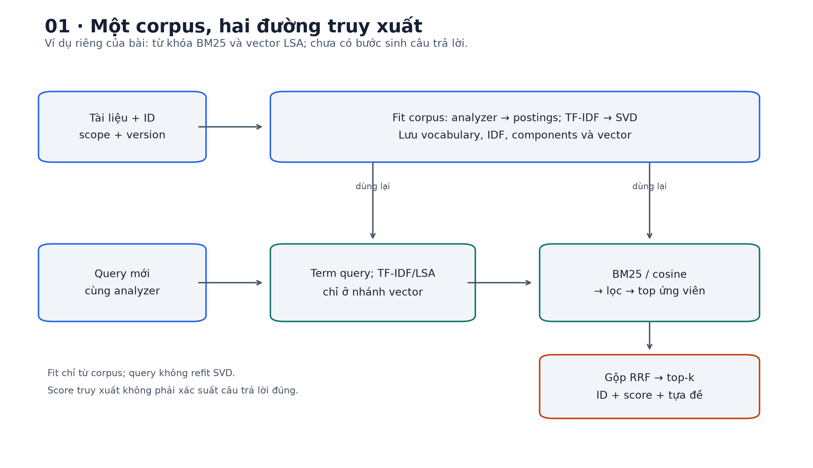
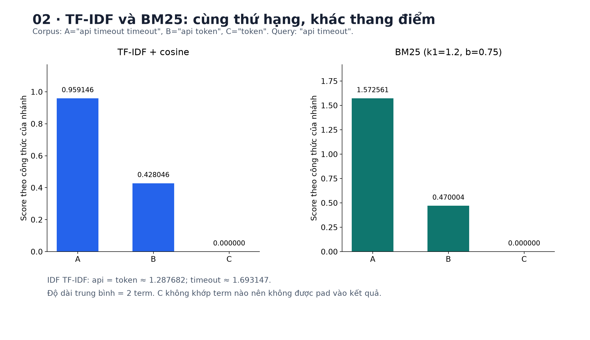
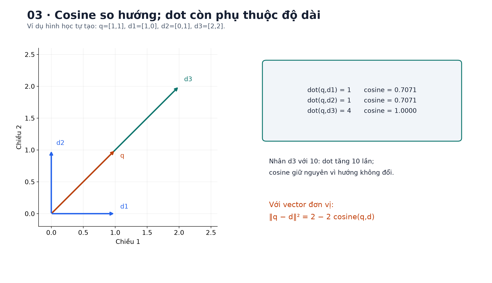
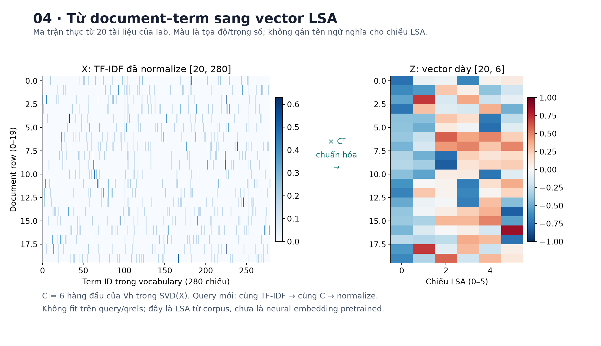
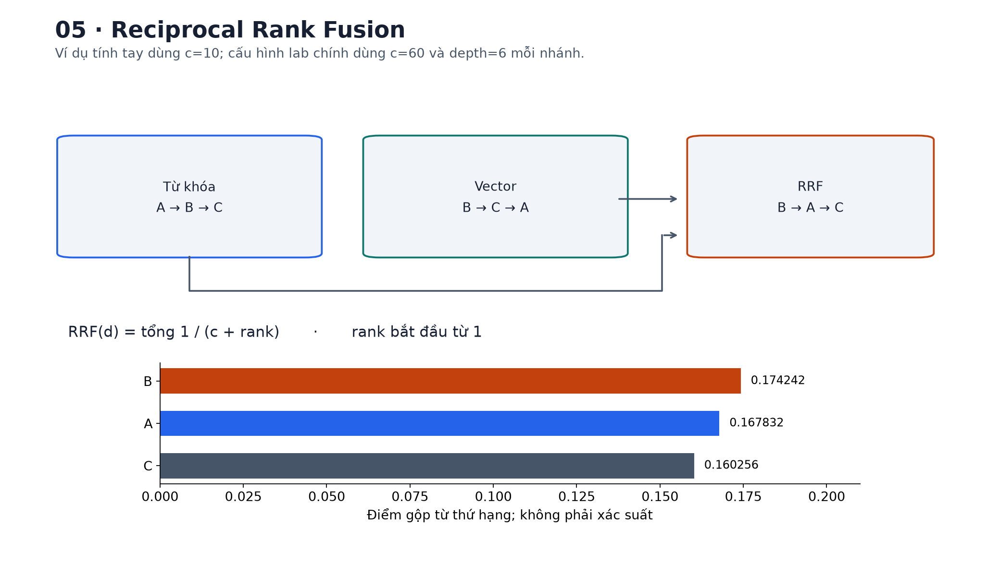
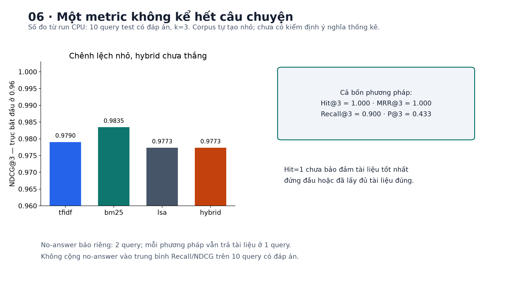
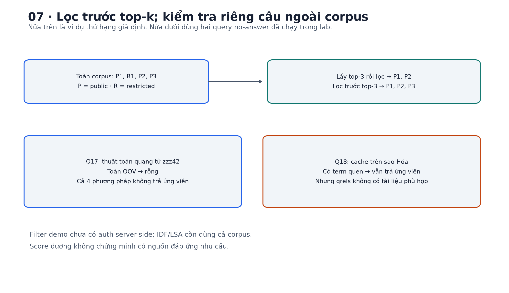

# Bài 23 — Tìm kiếm từ khóa và vector

[← Mục lục](../README.md) · [Bài 22](../22-api-dau-ra-cau-truc-danh-gia/README.md) · [Bài tập](exercises.md) · [Lời giải](solutions.md) · [Đào sâu](deep-dive.md)

## 1. Bài toán: tìm đúng tài liệu trước khi trả lời

Bài 22 giúp xây API có contract và đánh giá đầu ra. Bây giờ giả sử API phải trả lời câu hỏi về một hệ thống thanh toán: kiến thức nằm trong runbook, không có sẵn trong request. Ta cần **retrieval — truy xuất**: nhận câu hỏi, tìm các tài liệu liên quan và trả thứ hạng cùng ID để thành phần tiếp theo sử dụng.

Ví dụ giả định, gần với công việc backend:

| Người dùng gõ | Điều cần tìm | Khó khăn |
|---|---|---|
| `ERR_BILL_042` | Runbook đúng mã lỗi | Một ký tự khác có thể là lỗi khác |
| “Gửi lại yêu cầu mà không tạo thêm đơn” | Idempotency | Câu hỏi có thể không chứa thuật ngữ trong tài liệu |
| `token` | Access token hay token bucket? | Một từ có nhiều nghĩa |
| “Cache trên sao Hỏa” | Có thể không có tài liệu phù hợp | Trùng từ `cache` chưa đủ để trả lời |

Sau bài này, bạn cần làm được: giải thích inverted index; tính TF-IDF/BM25/cosine; phân biệt vector thưa và vector dày; dựng truy xuất LSA; gộp thứ hạng bằng RRF; đo chất lượng theo query; lưu/tải index và chỉ ra giới hạn của kết quả. Kiến thức cần trước: vector/chuẩn L2 ở bài 3, precision/recall ở bài 7, embedding ở bài 16, tách validation/test ở bài 5.

Lab chỉ dùng NumPy trên CPU. Có **20 tài liệu và 18 query tự biên soạn**, không tải model, không gọi API, không cần GPU. Vector dày trong lab do **LSA** học từ corpus, chưa phải embedding neural pretrained. Các ví dụ số nhỏ, nội dung runbook và nhãn đều là dữ liệu minh họa, không phải hướng dẫn vận hành một hệ thống thanh toán thật.



## 2. Các từ cần phân biệt

**Corpus** là tập tài liệu được phép lập chỉ mục. **Document** là một đơn vị truy xuất: bài này dùng một runbook ngắn; thực tế có thể dùng một đoạn (*chunk*). **Query** là nhu cầu tìm kiếm viết thành văn bản. **Index** là cấu trúc đã tính sẵn để tìm nhanh. **Retriever** nhận query và trả các document được xếp hạng. **Top-k** là tối đa k kết quả đầu.

Score chỉ là đại lượng dùng xếp hạng theo một cách tính cụ thể. BM25=3.2 không có nghĩa xác suất đúng 3.2; cosine=0.8 không có nghĩa 80% thông tin là đúng. Truy xuất tìm tài liệu liên quan; nó chưa chứng minh tài liệu còn hiệu lực, nội dung đúng hoặc câu trả lời suy ra được từ đó.

Trong bài, “từ khóa” chỉ truy xuất dựa trên các term sau phân tích văn bản; “vector dày” chỉ biểu diễn ít chiều hơn, mỗi chiều thường không còn là một từ riêng. **TF-IDF cũng là vector**. Hai tên “keyword search” và “vector search” thường gặp trong sản phẩm không phải một phân loại toán học loại trừ nhau.

## 3. Từ văn bản đến term và inverted index

### 3.1. Analyzer quyết định cái gì còn được tìm thấy

Trước khi đếm từ, cần thống nhất cách phân tích cho cả tài liệu và query. Analyzer của lab làm ba bước:

1. Chuẩn hóa Unicode về NFC, giúp hai cách mã hóa dấu tổ hợp biểu diễn cùng chữ trở nên nhất quán.
2. `casefold()` để so khớp không phân biệt hoa thường.
3. Regex lấy chuỗi chữ/số/underscore và giữ một số dấu nối nằm giữa chúng.

```python
from lab import analyze
assert analyze('ERR_BILL_042 API /v1/refunds') == ['err_bill_042', 'api', 'v1/refunds']
assert analyze('HTTP 429; Retry-After') == ['http', '429', 'retry-after']
```

Ở đây `/` đầu đường dẫn bị bỏ, `/` giữa hai phần được giữ; đây là lựa chọn sư phạm, cần kiểm tra với dữ liệu thật. Analyzer không tự hiểu `HTTP429` và `HTTP 429` là cùng mã; không tự sửa lỗi gõ, bỏ dấu hay mở rộng đồng nghĩa. Regex tiếng Việt này tách theo các mảnh chữ có khoảng trắng, chưa phải bộ tách từ hiểu “kết nối” là một từ ghép.

Tokenizer dùng cho tìm kiếm không bắt buộc giống tokenizer của LLM ở bài 19. Tìm mã lỗi cần giữ nguyên nhận diện; một LLM có thể chia mã đó thành nhiều subword. “Tokenizer tốt” luôn phải gắn với tác vụ.

### 3.2. Lập chỉ mục đảo

Giả sử corpus nhỏ có ba tài liệu:

| ID | Nội dung | Số term |
|---|---|---:|
| A | `api timeout timeout` | 3 |
| B | `api token` | 2 |
| C | `token` | 1 |

**Inverted index — chỉ mục đảo** đi từ term đến những document chứa nó:

```text
api     -> [(A, tf=1), (B, tf=1)]
timeout -> [(A, tf=2)]
token   -> [(B, tf=1), (C, tf=1)]
```

`tf(t,d)` là số lần term t xuất hiện trong d. `df(t)` là số document có chứa t, không phải tổng số lần xuất hiện. Vì vậy `df(timeout)=1` dù `tf(timeout,A)=2`. Query `api timeout` chỉ cần xét postings của hai term này để tính điểm từ khóa; không cần dò từng chuỗi trong mọi tài liệu mỗi lần request.

Lab có postings thật cho BM25, nhưng vẫn giữ ma trận NumPy dày để dễ quan sát TF-IDF và SVD. Đây là cách triển khai cho corpus nhỏ; không phải thiết kế bộ nhớ phù hợp hàng triệu tài liệu.

## 4. TF-IDF: từ đếm đến độ quan trọng

### 4.1. Trực giác và công thức dùng trong bài

Một từ xuất hiện nhiều trong một tài liệu có thể mô tả tài liệu đó. Một từ có mặt ở gần hết corpus lại ít giúp phân biệt tài liệu. TF-IDF kết hợp hai ý này.

Với N document, bài dùng IDF có smoothing, raw term frequency và chuẩn hóa L2:

$$\operatorname{idf}(t)=\ln\frac{N+1}{\operatorname{df}(t)+1}+1,$$
$$x_{d,t}=\operatorname{tf}(t,d)\operatorname{idf}(t),\qquad
\hat x_d=\frac{x_d}{\|x_d\|_2}.$$

Đây là quy ước khớp phần TF-IDF mặc định được mô tả trong [tài liệu scikit-learn](https://scikit-learn.org/stable/modules/feature_extraction.html#tfidf-term-weighting); lab tự tính bằng NumPy. Các tài liệu khác có thể dùng IDF/TF khác, nên cần đọc đúng định nghĩa trước khi so số.

Query cũng được đếm và nhân **IDF đã fit từ corpus**, cùng thứ tự vocabulary, rồi chuẩn hóa. Không fit IDF mới trên mỗi query. Từ ngoài vocabulary bị bỏ qua trong lab; nếu toàn bộ query đều ngoài vocabulary thì vector bằng 0 và trả rỗng.

### 4.2. Tính tay trên ba tài liệu

Chọn thứ tự chiều `[api, timeout, token]`. Có N=3, df=`[2,1,2]`, nên:

$$a=\ln(4/3)+1\approx1.287682,\qquad b=\ln2+1\approx1.693147.$$

Các vector **trước chuẩn hóa**:

```text
A = [a, 2b, 0]     B = [a, 0, a]     C = [0, 0, a]
q = [a,  b, 0]     cho query "api timeout"
```

Cosine là dot product chia tích hai chuẩn:

$$s(q,A)=\frac{a^2+2b^2}{\sqrt{a^2+b^2}\sqrt{a^2+4b^2}}\approx0.959146,$$
$$s(q,B)=\frac{a}{\sqrt2\sqrt{a^2+b^2}}\approx0.428046,\qquad s(q,C)=0.$$

Đừng bỏ IDF khi tính chuẩn: `timeout` hiếm hơn nên có trọng số khác `api`. A chứa cả hai term và đứng đầu. B có `api`, còn C không có term query nào. Do không pad kết quả điểm 0, top-3 thực tế chỉ trả A và B.

TF-IDF dạng bag-of-words bỏ thứ tự từ. “A gọi B” và “B gọi A” có thể có cùng biểu diễn nếu analyzer sinh cùng số term. Nó cũng không tự suy ra “hoàn tiền” đồng nghĩa với `refund`. Có thể bổ sung phrase/ngram hoặc query expansion, nhưng đó là thiết kế bổ sung phải đánh giá.

## 5. BM25: độ bão hòa và độ dài tài liệu

Lặp `timeout` 100 lần không nên làm điểm tăng mãi theo tỷ lệ 100. Đồng thời, 2 lần xuất hiện trong một dòng và trong một trang dài có ý nghĩa phân biệt khác nhau. BM25 đưa vào **TF saturation — độ bão hòa** và chuẩn hóa theo độ dài.

Biến thể của bài dùng các term query duy nhất:

$$\operatorname{BM25}(q,d)=\sum_{t\in\operatorname{unique}(q)}
\ln\left(1+\frac{N-\operatorname{df}(t)+0.5}{\operatorname{df}(t)+0.5}\right)
\frac{\operatorname{tf}(t,d)(k_1+1)}{\operatorname{tf}(t,d)+k_1(1-b+b|d|/\operatorname{avgdl})}.$$

`|d|` là số term, `avgdl` là độ dài trung bình corpus; `k1>0` điều khiển bão hòa, `b` trong [0,1] điều khiển hiệu chỉnh độ dài. Khi `b=0`, mẫu số không còn phụ thuộc độ dài; TF vẫn bão hòa. Bài chọn `k1=1.2, b=0.75`. Công thức IDF và ý nghĩa tham số được đối chiếu với [Lucene BM25Similarity 9.12.2](https://lucene.apache.org/core/9_12_2/core/org/apache/lucene/search/similarities/BM25Similarity.html). Đây không phải bản tái hiện đầy đủ điểm số Lucene: analyzer, field và encoding độ dài có thể khác.

Trên corpus A/B/C ở trên: `avgdl=(3+2+1)/3=2`. IDF của `api` là `ln(1.6)=0.470004`, của `timeout` là `ln(8/3)=0.980829`.

Với A, hệ số độ dài là `1.2 × (0.25 + 0.75 × 3/2)=1.65`:

$$s(q,A)=\ln(1.6)\frac{2.2}{1+1.65}
+\ln(8/3)\frac{4.4}{2+1.65}\approx1.572561.$$

Với B, độ dài bằng trung bình, chỉ `api` khớp, TF factor=`2.2/2.2=1`: điểm `0.470004`. C có điểm 0. Thứ hạng vẫn A > B, nhưng **không được so trực tiếp** điểm BM25=1.57 với cosine=0.96 để quyết định nhánh nào “tự tin hơn”.



## 6. Vector dày và cosine: tìm theo biểu diễn

### 6.1. Đổi câu thành tọa độ

Ở bài 16, embedding biểu diễn một đối tượng bằng vector có thể học được. Với truy xuất, ta cần ánh xạ query và document vào **các không gian tương thích** rồi dùng khoảng cách/độ tương tự để xếp hạng. Nếu bộ mã hóa được huấn luyện tốt cho truy xuất, câu “bấm lại nút trả tiền” có thể gần đoạn nói về duplicate payment dù ít trùng từ. Đây là khả năng cần đo trên dữ liệu, không phải bảo đảm của mọi vector dày.

**Bi-encoder** mã hóa document trước, mã hóa query lúc request rồi so vector. **Cross-encoder** nhận cặp query–document để chấm điểm chung, thường dùng để rerank một tập ứng viên; bài 24 mới đi sâu reranking. Nguồn [Sentence Transformers: semantic search](https://www.sbert.net/examples/sentence_transformer/applications/semantic-search/README.html) giải thích truy xuất đối xứng/bất đối xứng và cách mã hóa query/document. Bài này chưa chạy thư viện hay model đó.

Không thể lấy vector tài liệu từ model A và query từ model B chỉ vì cùng có 768 chiều. Số chiều bằng nhau là điều kiện về shape, không chứng minh hai hệ tọa độ cùng nghĩa. Một số model dùng query/document prompt hoặc encoder riêng đã được học chung; phải giữ đúng cặp và quy ước.

### 6.2. Tính tay cosine và dot product

Cho q=`[1,1]`, d1=`[1,0]`, d2=`[0,1]`, d3=`[2,2]`:

| Tài liệu | Dot với q | Chuẩn L2 | Cosine |
|---|---:|---:|---:|
| d1 | 1 | 1 | 0.707107 |
| d2 | 1 | 1 | 0.707107 |
| d3 | 4 | 2.828427 | 1 |

Cosine chỉ xét hướng; nhân d3 với 10 không đổi cosine, nhưng làm dot tăng 10 lần. Với **hai vector đơn vị**, dot=cosine và:

$$\|\hat q-\hat d\|_2^2=2-2\cos(q,d).$$

Do đó, trên cùng tập vector đã normalize, xếp cosine giảm dần tương đương xếp khoảng cách L2 tăng dần. Nếu không normalize, kết luận này có thể sai. Vector 0 không có hướng: lab quy ước normalize về 0, score 0, không trả kết quả giả.



### 6.3. LSA trong lab: học phép chiếu từ chính corpus

**Latent Semantic Analysis — LSA** tìm các chiều tiềm ẩn từ ma trận document–term. Đặt X là ma trận TF-IDF đã normalize, shape `[N,V]`. SVD phân tích:

$$X=U\Sigma V^\top.$$

Trong công thức này chữ V là ma trận SVD, còn trong shape `[N,V]` V là số từ vựng; để tránh nhầm, gọi `components = V_r^T` trong code, shape `[r, vocab_size]`. Lấy r=6 chiều đầu:

```text
docs_z = normalize(X @ components.T)           # [N, 6]
query_z = normalize(query_tfidf @ components.T) # [6]
scores = docs_z @ query_z                       # [N]
```

Không có nhãn liên quan nào được dùng để fit SVD; chỉ có văn bản corpus. Query mới dùng lại vocabulary, IDF và components đã lưu. Bài dùng `numpy.linalg.svd(..., full_matrices=False)` rồi cắt r hàng đầu của `Vh`; [NumPy](https://numpy.org/doc/stable/reference/generated/numpy.linalg.svd.html) mô tả thứ tự trả về. Ý tưởng LSA trên TF-IDF được đối chiếu với [TruncatedSVD](https://scikit-learn.org/stable/modules/generated/sklearn.decomposition.TruncatedSVD.html); lab không gọi scikit-learn.

Chiều LSA là tổ hợp nhiều term, có thể gom các mẫu đồng xuất hiện. Nhưng corpus nhỏ, không có tri thức ngôn ngữ từ trước, mất thông tin do giảm chiều, và **term hoàn toàn OOV vẫn không thể mã hóa**. Không nên dùng kết quả LSA này để kết luận model embedding neural tốt hay kém hơn BM25. Xem ví dụ phép chiếu tính tay ở [phụ lục](deep-dive.md).



## 7. Exact search, ANN và vòng đời index

Lab tính score trên mọi vector rồi sort: **exact search**, hữu ích làm mốc đối chiếu. Với N document, r chiều, tính một lượt dot tốn cỡ O(Nr); riêng sort toàn bộ cỡ O(N log N). Dữ liệu float32 thô tốn `N × r × 4` byte, chưa kể metadata, index và bản sao. Ví dụ giả định 1 triệu vector × 768 chiều cần khoảng 3.072 GB thập phân chỉ cho vector.

**Approximate nearest neighbor — ANN** đổi một phần độ đầy đủ của tìm kiếm lấy chi phí/độ trễ phù hợp hơn. Một index ANN không tự biến embedding kém thành hiểu ngữ nghĩa tốt. Cần đo riêng: (1) ANN có lấy lại top-k của exact theo cùng embedding không; (2) các kết quả ấy có liên quan với nhu cầu người dùng không. [Faiss](https://faiss.ai/) giới thiệu các đánh đổi này; bài chưa chạy Faiss hay benchmark ANN.

Luồng cập nhật thường là: văn bản/version → analyzer/encoder → vector và metadata → index version → kiểm tra → chuyển phiên bản phục vụ. Đổi embedding model, analyzer hoặc cách chunk cần đánh giá lại, thường cần lập lại index tương ứng. Sửa mỗi query encoder mà giữ vector cũ có thể làm hệ thống vẫn chạy đúng shape nhưng trả kết quả hỏng.

Lab lưu cả corpus, cấu hình, vocabulary, IDF, components và vector. `SearchIndex.load` dựng lại thống kê từ corpus đã lưu, **không fit lại SVD**, rồi đọc arrays và kiểm tính nhất quán. Chưa có incremental update, xóa tài liệu, index service hay atomic rollout; xem [phụ lục](deep-dive.md) để chuyển kiến thức này sang backend.

## 8. Hybrid search và Reciprocal Rank Fusion

Từ khóa hữu ích khi có identifier chính xác; vector có thể bắt mẫu biểu diễn khác. Có thể truy xuất hai nhánh rồi gộp ứng viên. **Hybrid** là cách kết hợp, không mặc định tốt hơn từng nhánh.

Nếu cộng thẳng BM25 và cosine, kết quả phụ thuộc thang điểm không tương thích. **Reciprocal Rank Fusion — RRF** dùng thứ hạng, không dùng score thô:

$$\operatorname{RRF}(d)=\sum_{j:d\in L_j}\frac1{c+\operatorname{rank}_{L_j}(d)}.$$

Rank bắt đầu từ 1; tài liệu vắng trong một nhánh đóng góp 0. [Tài liệu Elastic RRF](https://www.elastic.co/docs/reference/elasticsearch/rest-apis/reciprocal-rank-fusion) mô tả công thức và cửa sổ ứng viên. Code bài tự tính, không cần Elasticsearch.

Ví dụ tính tay, dùng c=10 **để dễ đọc số**, nhánh từ khóa `[A,B,C]`, nhánh vector `[B,C,A]`:

| ID | Rank từ khóa | Rank vector | RRF |
|---|---:|---:|---:|
| A | 1 | 3 | 1/11 + 1/13 = 0.167832 |
| B | 2 | 1 | 1/12 + 1/11 = 0.174242 |
| C | 3 | 2 | 1/13 + 1/12 = 0.160256 |

Kết quả B > A > C. Trong lab chính, cấu hình cố định c=60, lấy tối đa 6 ứng viên mỗi nhánh BM25/LSA, gộp rồi trả top-3. Một ID xuất hiện ở hai nhánh được cộng hai đóng góp; không trả hai bản sao. Không được lặp một ID nhiều lần trong cùng nhánh để tăng điểm.

RRF không cứu được tài liệu nằm ngoài **hợp ứng viên**. Thay `candidate_depth`, c hoặc thêm một nhánh gần trùng nhánh cũ đều có thể đổi thứ hạng. Cần chọn trên dev, giữ test để đánh giá sau cùng; không thử nhiều cấu hình trên test rồi báo cấu hình thắng như một đánh giá độc lập.



## 9. Đánh giá: đúng tài liệu nào, ở vị trí nào?

### 9.1. Query và qrels

**Qrels — relevance judgments** là nhãn query–document do người đánh giá xác lập. Lab quy ước grade 3=trực tiếp đáp ứng, 2=đáp ứng đáng kể, 1=liên quan một phần, 0=không liên quan. Trong ví dụ này nhãn đã được biên soạn cho toàn corpus; ở dữ liệu thật, “chưa được gán nhãn” không tự đồng nghĩa “không liên quan”. Phải có hướng dẫn và rà soát nhãn, nhất là khi tài liệu gần trùng hoặc thay phiên bản.

Tập nhỏ có 6 query dev, 10 query test có đáp án và 2 query test không có đáp án. Các query dev/test khác nhau, nhưng một số chủ đề có thể giao nhau; đây chưa phải split tách hẳn intent hay đánh giá theo thời gian. IDF/LSA học trên corpus có các document đích là bình thường: tài liệu cần tìm phải ở trong index. Cần tránh dùng **query test và nhãn của nó** để chọn analyzer, model hay tham số.

### 9.2. Metric ở k=3

Gọi R là tập tài liệu có grade>0, L3 là tối đa ba ID trả về không trùng:

- **Hit@3:** có ít nhất một ID thuộc R hay không.
- **Precision@3:** số ID đúng trong L3 chia **3**, kể cả chỉ trả 1–2 ID.
- **Recall@3:** số ID đúng trong L3 chia tổng số ID thuộc R.
- **MRR@3:** trung bình nghịch đảo vị trí ID đúng đầu tiên trong top-3; không có thì bằng 0. Hàm cho từng query trả RR@3, report lấy trung bình.
- **NDCG@3:** so thứ hạng có grade với thứ hạng lý tưởng; bài chọn gain `2^grade − 1` và discount `log2(rank+1)`.

$$\operatorname{DCG@3}=\sum_{i=1}^{3}\frac{2^{g_i}-1}{\log_2(i+1)},\qquad
\operatorname{NDCG@3}=\frac{\operatorname{DCG@3}}{\operatorname{IDCG@3}}.$$

Với kết quả `[B,X,A]`, A grade3, B grade1, X grade0: Hit=1; P=2/3; R=1; RR=1. Nhưng DCG=`1+7/2=4.5`, IDCG=`7+1/log2(3)=7.630930`, nên NDCG=`0.589705`. Có tài liệu liên quan ở hạng 1 chưa có nghĩa tài liệu tốt nhất đứng hạng 1. [API NDCG của scikit-learn](https://scikit-learn.org/stable/modules/generated/sklearn.metrics.ndcg_score.html) giải thích discount/ideal; nó dùng trực tiếp giá trị relevance làm gain. Muốn đối chiếu quy ước bài phải truyền gain đã đổi `2^g−1` và thống nhất cách xử lý tie.

Với query không có đáp án, Recall/NDCG theo định nghĩa trên không có mẫu số phù hợp. Lab **tách riêng** số query vẫn bị trả tài liệu, không âm thầm gán điểm 0 hay loại khỏi báo cáo tổng mà không nói.

### 9.3. Kết quả đã chạy của lab

Môi trường kiểm: Python 3.14.6, NumPy 2.5.4, CPU; 20 document, 280 term, 19 document công khai, LSA 6 chiều. Cấu hình cố định như phần 8, không chọn cấu hình bằng kết quả test.

| Phương pháp | Hit@3 | P@3 | Recall@3 | MRR@3 | NDCG@3 |
|---|---:|---:|---:|---:|---:|
| TF-IDF | 1.0000 | 0.4333 | 0.9000 | 1.0000 | 0.9790 |
| BM25 | 1.0000 | 0.4333 | 0.9000 | 1.0000 | 0.9835 |
| LSA | 1.0000 | 0.4333 | 0.9000 | 1.0000 | 0.9773 |
| Hybrid BM25 + LSA | 1.0000 | 0.4333 | 0.9000 | 1.0000 | 0.9773 |

Bảng là macro mean trên **10 query test có đáp án**, không gồm 6 dev và 2 no-answer. Trên dev, NDCG của TF-IDF/BM25≈0.9926; LSA/hybrid≈0.9645. Chênh lệch nhỏ trên bộ tự tạo không chứng minh ưu thế tổng quát hay có ý nghĩa thống kê. Đừng kết luận “mọi query đều đúng hoàn toàn” chỉ vì Hit/MRR=1: Recall chưa bằng 1, và một tài liệu grade1 cũng được tính là hit.

Hai ca nên xem riêng:

- Q12 hỏi hồ sơ vừa cập nhật vẫn hiện giá trị cũ: LSA đặt D08 thứ 2 nên NDCG=1, BM25 không lấy D08 trong top-3 nên ≈0.9173. Hybrid lại mất D08 khỏi top-3; kết hợp không giữ mọi lợi ích của từng nhánh.
- Q10 hỏi token bucket: BM25 xếp D19,D13,D03 và NDCG=1; các nhánh còn lại xếp D19,D03,D13 nên ≈0.9558. `token` trong access token có thể gây nhiễu.

**No-answer:** cả bốn phương pháp trả rỗng cho Q17 hoàn toàn OOV, nhưng đều trả tài liệu cho Q18 “cache trên sao Hỏa”: `returned_any=1/2`. Đây là số ca trả ứng viên khi qrels rỗng, chưa là đánh giá một hệ thống trả lời có abstention. Lab chưa học ngưỡng liên quan hoặc kiểm chứng câu trả lời. Score dương chỉ nói có tín hiệu khớp trong biểu diễn.



## 10. Lọc metadata và không có kết quả

D18 là tài liệu scope `team-blue`, còn 19 tài liệu khác là `public`. Mặc định chỉ trả `public`. Lab lọc scope **trước khi lấy top-k** ở từng nhánh; gộp RRF chỉ dùng ứng viên đã lọc. Nếu lấy top-3 toàn corpus rồi bỏ tài liệu không được xem, có thể còn ít kết quả dù vẫn có tài liệu được phép ở hạng tiếp theo.

Ở code demo, `allowed_scopes=None` nghĩa mặc định `public`; `set()` nghĩa không scope nào được phép và trả rỗng. Đừng dùng `allowed_scopes or {'public'}` vì sẽ biến tập quyền rỗng thành được xem tài liệu công khai.

**Giới hạn cụ thể:** caller tự truyền scopes, chưa có authentication/authorization server-side; đây không phải hệ thống phân quyền production. IDF và SVD hiện fit trên cả 20 tài liệu, gồm D18: lọc kết quả không cách ly thống kê giữa các scope. Nếu yêu cầu cách ly tenant nghiêm ngặt, phải thiết kế cả việc fit/index, metadata, cache, log và truy xuất theo ranh giới quyền. Không gửi ID/tựa đề/đoạn trích của ứng viên bị cấm sang bước rerank hoặc LLM rồi mới lọc output.

Kết quả rỗng cũng có nhiều nguyên nhân: query trống/OOV, không có tài liệu liên quan, chưa index xong, filter quá chặt hoặc lỗi index. API nên phân biệt lỗi hạ tầng với truy xuất thành công nhưng không có ứng viên; đừng coi mọi ca rỗng là người dùng hỏi sai.



## 11. Thực hành từ đầu đến kết quả

### 11.1. Chuẩn bị

Từ gốc bộ tài liệu, chuyển vào đúng thư mục bài; Python 3.11+ là mức khởi đầu dự kiến, bản đã chạy là 3.14.6. Nếu phiên bản máy bạn không cài được bộ phụ thuộc ghim này, dùng môi trường tương thích rồi chạy lại các kiểm chứng số thay vì mặc nhiên coi kết quả giống hệt.

```bash
cd courses/ai-engineer-2026/23-tim-kiem-tu-khoa-vector
python3 -m venv .venv
.venv/bin/python -m pip install -r requirements.txt
.venv/bin/python lab.py --mode hand
.venv/bin/python lab.py --mode search --query 'ERR_BILL_042'
.venv/bin/python lab.py --mode search --query 'vừa cập nhật hồ sơ mà màn hình vẫn hiện giá trị cũ'
.venv/bin/python lab.py --mode filter
.venv/bin/python lab.py --mode all --out /tmp/lesson23-run-01
```

Windows dùng `.venv\Scripts\python.exe`; chọn output path tương ứng. Mỗi lần dùng một thư mục output **chưa tồn tại**, code không ghi đè. Không cần tạo `.venv` trong thư mục bài nếu đã có môi trường đúng phiên bản. Lệnh `all` in phép tính tay, kết quả tìm kiếm, demo scope và toàn bộ báo cáo dev/test.

```text
23-tim-kiem-tu-khoa-vector/
  README.md          Giải thích và lộ trình thực hành
  deep-dive.md       Phép chiếu tính tay, vận hành và các giới hạn
  exercises.md       16 bài tập
  solutions.md       Lời giải và code tự đối chiếu
  data.py            Corpus, query, split, scope và qrels tự tạo
  lab.py             Analyzer, index, search, RRF, metric, CLI
  make_figures.py    Tái tạo 7 hình từ công thức và report
  figures/           PNG và SVG đã có sẵn
```

Output runtime ngoài bộ tài liệu:

```text
/tmp/lesson23-run-01/
  report.json         Kết quả, phiên bản, cấu hình, hash corpus/query
  index/metadata.json Corpus, analyzer version, vocabulary, IDF, cấu hình
  index/arrays.npz    Ma trận đếm, TF-IDF, components, vector LSA, singular values
```

### 11.2. Theo dấu một query trong code

Mở `data.py`, đọc query Q10 và nhãn trước khi chạy. Trong `lab.py`, lần theo `analyze → query_tfidf → scores → search`. Với BM25, lần theo `analyze → postings → bm25 → search`. Cả hai cùng dùng text `title + ' ' + text`, không có field boost.

In top-3 của bốn phương pháp, đối chiếu ID với nội dung tài liệu và grade. Sau đó xem Q12, Q17, Q18. Sản phẩm cần có: một bảng query, nhu cầu, top-3, một lỗi cụ thể và giả thuyết nguyên nhân. Chỉ nhìn điểm trung bình sẽ bỏ qua cả lỗi từ đồng nghĩa lẫn lỗi mã định danh.

### 11.3. Lưu và tải không đổi kết quả

Chạy snippet này **trong thư mục bài**, sau khi tạo output ở trên:

```python
from pathlib import Path
import numpy as np
from data import documents
from lab import SearchIndex
fresh = SearchIndex(documents())
loaded = SearchIndex.load(Path('/tmp/lesson23-run-01/index'))
for method in ['tfidf', 'bm25', 'lsa', 'hybrid']:
    before = fresh.search('token bucket giới hạn request', method)
    after = loaded.search('token bucket giới hạn request', method)
    assert [d['id'] for d in before] == [d['id'] for d in after]
    np.testing.assert_allclose([d['score'] for d in before], [d['score'] for d in after])
print('Round-trip OK')
```

Chỉ nạp index tự tạo/tin cậy. Lab dùng `allow_pickle=False` cho NPZ, nhưng không phải sandbox kiểm mọi file đầu vào, không chống tamper/malformed archive toàn diện. Lưu version và kiểm định contract là một phần của vòng đời index; không chỉ lưu vector trần.

### 11.4. Tái tạo hình

Hình đã lưu sẵn; chỉ cần cài thêm Matplotlib nếu muốn tái tạo. Script đọc report có dữ liệu đo, không gán cứng bảng metric giả.

```bash
.venv/bin/python -m pip install -r requirements-figures.txt
.venv/bin/python make_figures.py --run /tmp/lesson23-run-01
```

## 12. Tự kiểm và bước tiếp

Bạn đã sẵn sàng đi tiếp khi có thể tự tính thứ hạng A/B/C; giải thích vì sao TF-IDF vẫn là vector; chỉ ra LSA khác neural encoder ở đâu; tìm được một ca hybrid thua một nhánh; tách retrieval relevance, ANN recall và answer correctness; và chứng minh tải index không làm đổi kết quả. Đọc hết bài chưa phải bằng chứng đã nắm vững: hãy dùng [16 bài tập](exercises.md) và [lời giải](solutions.md) để đối chiếu.

Tiếp tục với [bài 24 — Chunking, embedding và reranking](../24-chunking-embedding-reranking/README.md), đã có lab huấn luyện neural model, bài tập và lời giải. RAG và kiểm chứng nguồn sẽ nối tiếp sau đó. [Nguồn đã đọc và phạm vi kiểm](../SOURCES.md).
