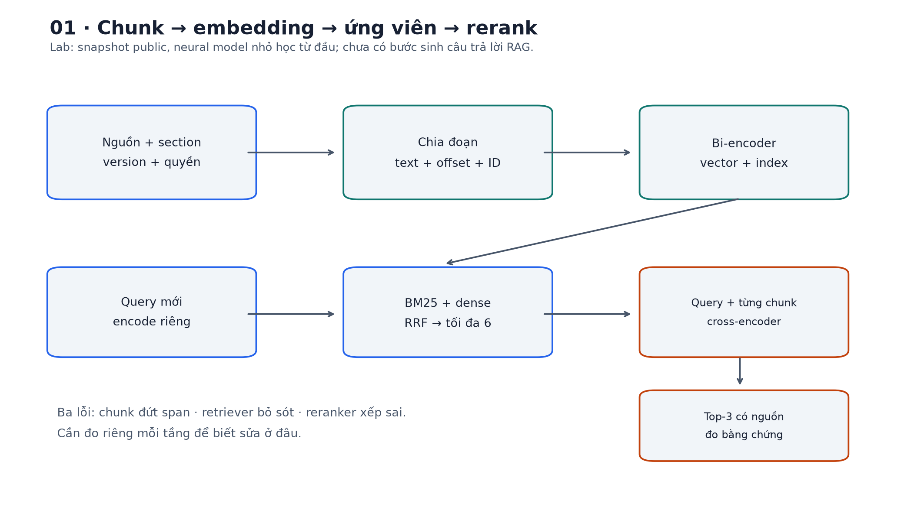
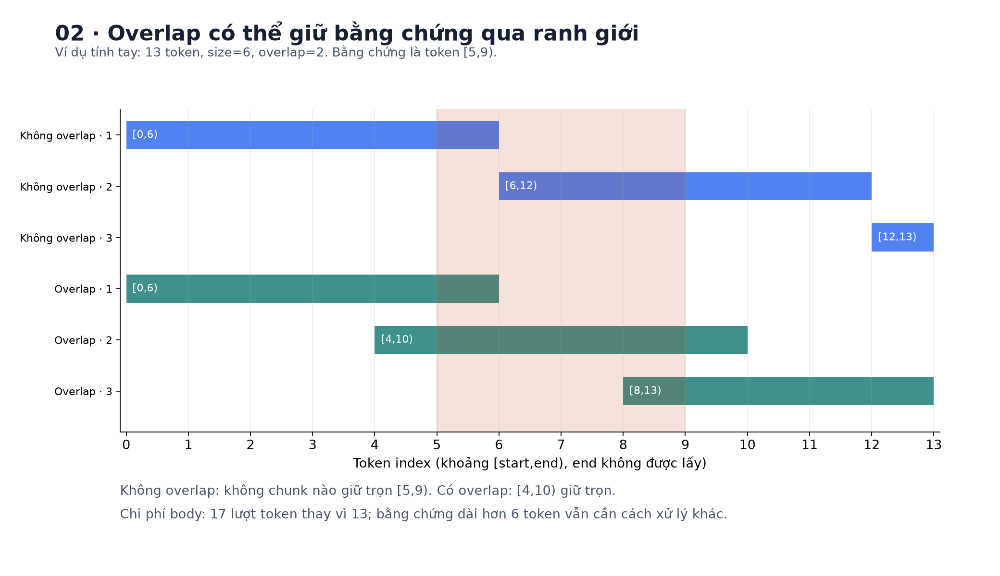
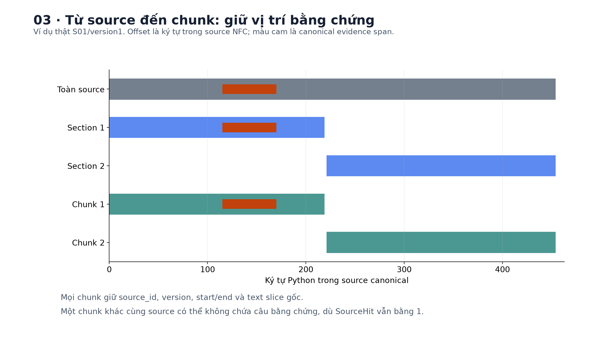
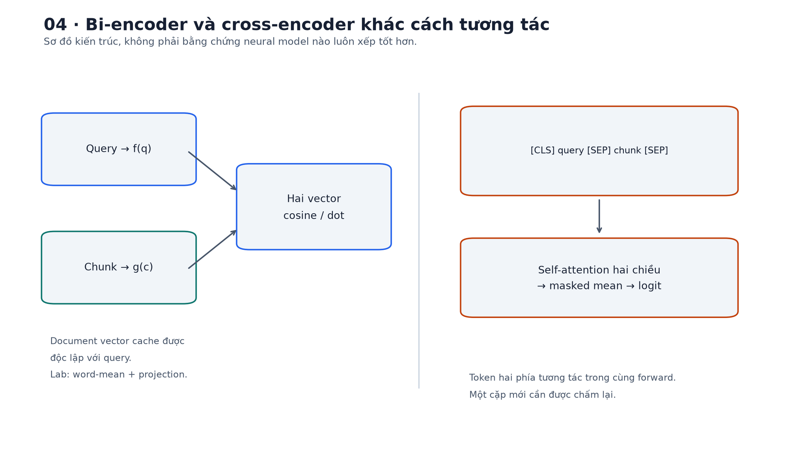
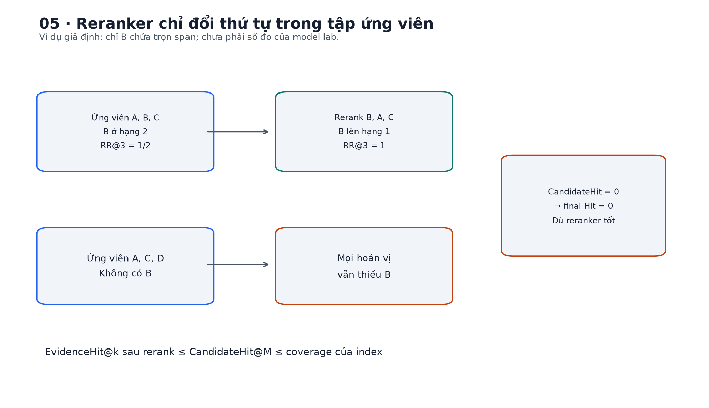
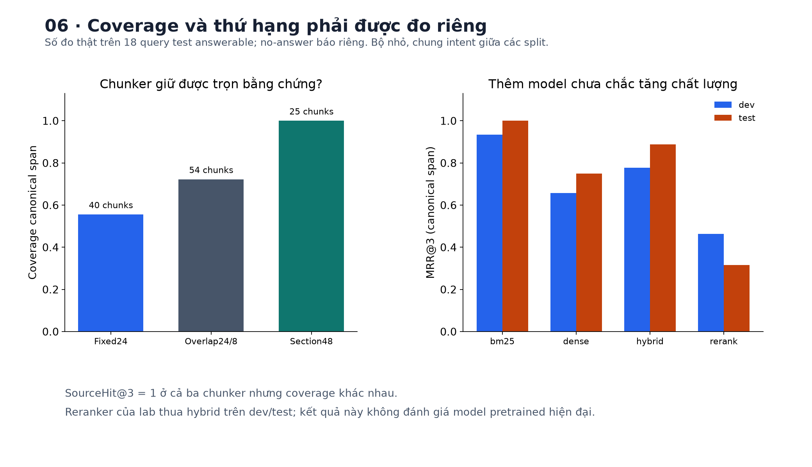
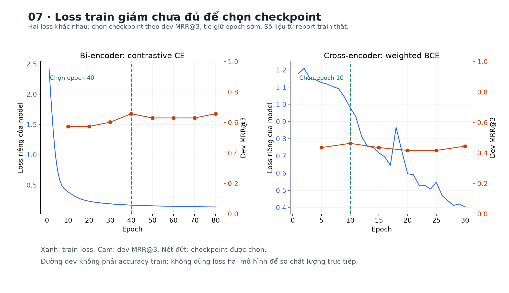

# Bài 24 — Chunking, embedding và reranking

[← Mục lục](../README.md) · [Bài 23](../23-tim-kiem-tu-khoa-vector/README.md) · [Bài tập](exercises.md) · [Lời giải](solutions.md) · [Đào sâu](deep-dive.md)

## 1. Từ tìm một tài liệu đến tìm đúng đoạn bằng chứng

Bài 23 xem một runbook ngắn là một document. Nhưng một trang wiki có thể chứa cả HTTP 401, HTTP 403, cách refresh token và cách cấp quyền. Query “đã đăng nhập nhưng không đọc được tài nguyên” cần đoạn nói về quyền; lấy đúng trang nhưng chỉ đưa đoạn refresh token cho bước sau vẫn có thể dẫn đến câu trả lời sai.

Bài này nối ba quyết định: **chia tài liệu thành đơn vị truy xuất**, **mã hóa các đơn vị ấy thành vector**, rồi **chấm lại các ứng viên theo query**. Ta sẽ phân biệt ba lỗi: bằng chứng bị cắt; bằng chứng còn nguyên nhưng không vào tập ứng viên; bằng chứng đã vào ứng viên nhưng bị xếp xuống dưới.

Ví dụ giả định dùng xuyên bài là bộ runbook backend về thanh toán, auth, cache, database, rate limit, webhook, queue, search index và retry. Đây là nội dung tự tạo phục vụ học tập, không phải quy trình xử lý sự cố của một dịch vụ thực tế.

Sau bài, bạn cần làm được:

- Chọn và kiểm tra chunk theo cấu trúc/độ dài, giữ ID nguồn, version và vị trí văn bản.
- Tính số cửa sổ, overlap, masked mean, cosine và contrastive loss bằng tay.
- Giải thích bi-encoder và cross-encoder khác nhau ở tương tác query–document và chi phí.
- Chạy huấn luyện embedding neural và reranker nhỏ bằng PyTorch, không cần tải model.
- Đo chất lượng bằng chứng qua từng tầng, đối chiếu baseline và quyết định có nên dùng reranker.

Cần kiến thức vector ở bài 3, embedding ở bài 16, attention/Transformer ở bài 17–18, train/validation ở bài 12 và retrieval ở bài 23. Bài sẽ nhắc lại các phép toán cần dùng. Lab là mô hình học từ đầu trên bộ nhỏ, **không phải benchmark embedding/reranker pretrained hiện đại**.



## 2. Chunk là gì, vì sao phải chia?

**Chunking** là chia nội dung thành những đoạn để lập chỉ mục hoặc đưa vào model. Chunk không bắt buộc là câu, đoạn văn hay một số token cố định. Nó là một quyết định thiết kế: “đơn vị nào đủ nhỏ để tìm chính xác, nhưng đủ lớn để giữ ý nghĩa và bằng chứng?”

Một file là đơn vị lưu trữ; một section là đơn vị cấu trúc; một chunk là đơn vị truy xuất; một đoạn được ghép vào context cuối có thể lại là đơn vị khác. Đừng mặc nhiên coi bốn thứ này trùng nhau.

### 2.1. Quá lớn và quá nhỏ gây lỗi khác nhau

| Lựa chọn | Có thể có lợi | Có thể gây lỗi |
|---|---|---|
| Cả trang | Giữ liên hệ giữa các mục | Nhiều chủ đề bị nén vào một vector, vượt input/context budget |
| Một section | Giữ tiêu đề và mạch giải thích | Section rất dài vẫn cần chia tiếp |
| Một câu ngắn | Khớp chi tiết cụ thể | “Nó”, “trường hợp này”, điều kiện và phủ định có thể bị tách |
| Cửa sổ token cố định | Dễ giới hạn kích thước và tái lập | Cắt đôi câu, bảng hoặc đoạn code |

Ví dụ một cặp câu: “Chỉ retry lỗi tạm thời khi tác vụ cho phép. Không retry lỗi thiếu quyền bằng cách gọi lại liên tục.” Nếu chunk chỉ giữ “retry ... gọi lại liên tục”, điều kiện và phủ định có thể mất. Tìm trúng vài từ không đồng nghĩa đã giữ được hướng dẫn đúng.

Chunking còn hữu ích ngay khi cả file vừa input limit: một vector duy nhất có thể biểu diễn không tốt nhiều chủ đề khác nhau. [Hướng dẫn chunking của Microsoft](https://learn.microsoft.com/en-us/azure/search/vector-search-how-to-chunk-documents) mô tả cách chia cố định, theo cấu trúc và các đánh đổi của overlap. Các kích thước gợi ý trong một dịch vụ chỉ là điểm bắt đầu để đo, không là hằng số tối ưu cho mọi corpus/ngôn ngữ/model.

### 2.2. Token của model nào?

“500 ký tự”, “500 từ” và “500 token” khác nhau. Tiếng Việt có từ ghép nhiều âm tiết; mã lỗi, đường dẫn và JSON có thể được tokenizer chia khác văn xuôi. Embedding model, reranker và model sinh câu trả lời có thể dùng **ba tokenizer và ba input limit khác nhau**.

Lab dùng tokenizer word-level đơn giản giống analyzer bài 23: NFC, casefold, regex giữ identifier. Chẳng hạn `ERR_BILL_042` là một token, nhưng “kết nối” là hai. Các con số 24/48/64 trong lab chỉ có nghĩa theo tokenizer này; không được mang nguyên sang một model subword rồi giả định cùng độ dài.

[API tokenizer của Hugging Face](https://huggingface.co/docs/transformers/main/en/main_classes/tokenizer) mô tả truncation, token overflow và stride. Đáng chú ý: `stride` trong API đó là **số token overlap**, trong khi “bước trượt” toán học thường là `chunk_size − overlap`. Luôn đọc quy ước của công cụ.

## 3. Chia theo cửa sổ: tính tay và kiểm biên

### 3.1. Cửa sổ có overlap

Có L=13 token đánh số 0–12, chunk size C=6, overlap O=2. Bước tiến S=C−O=4. Dùng khoảng **nửa kín [start,end)**: lấy start, không lấy end.

```text
chunk 1: [0,6)   → token 0 1 2 3 4 5
chunk 2: [4,10)  → token     4 5 6 7 8 9
chunk 3: [8,13)  → token             8 9 10 11 12
```

Có 3 chunk và tổng số lượt token body được xử lý là `6+6+5=17`, dù nguồn chỉ có 13 token. Phần lặp là 4 token; hệ số tăng ở ví dụ này `17/13≈1.3077`. Với văn bản rất dài, bỏ qua hiệu ứng biên, hệ số gần `C/(C−O)=1.5`. Chưa tính tiêu đề lặp lại hoặc special token.

Với L>0, số chunk của thuật toán dừng ngay khi đã phủ hết đuôi là:

$$n=1+\left\lceil\frac{\max(0,L-C)}{C-O}\right\rceil.$$

L=0 cho 0 chunk. Cần `C>0` và `0≤O<C`; O=C làm bước tiến 0, có nguy cơ lặp vô hạn nếu không kiểm. Khi L=10,C=6,O=2, chỉ cần `[0,6),[4,10)`; không sinh thêm `[8,10)` vì đuôi đã được phủ.

```python
from retrieval import windows
assert windows(13, 6, 2) == [(0,6), (4,10), (8,13)]
assert windows(10, 6, 2) == [(0,6), (4,10)]
assert windows(0, 6, 2) == []
```

### 3.2. Overlap cứu được và không cứu được gì?

Giả sử bằng chứng nằm ở token `[5,9)`. Không overlap, các đoạn `[0,6),[6,12),[12,13)` đều không chứa trọn bằng chứng. Có overlap, `[4,10)` chứa toàn bộ. Nhưng nếu bằng chứng dài hơn C, không có cửa sổ C token nào giữ được nó nguyên vẹn.

Overlap có thể giảm lỗi biên, nhưng tăng số vector, số token encode và ứng viên gần trùng. Top-3 có thể là ba bản gần giống của cùng một đoạn, làm mất chỗ của bằng chứng khác. Không nên tăng overlap như một cách sửa mọi lỗi; hãy kiểm tra cả coverage và độ đa dạng.



## 4. Chia theo cấu trúc và giữ nguồn

### 4.1. Section trước, giới hạn token sau

Cách chính trong lab: tách theo section có sẵn, rồi áp trần 48 token **bên trong từng section**. Section ngắn giữ nguyên; section dài chia tiếp thành cửa sổ, không nối đuôi section này sang đầu section khác. Có 18 section công khai nhưng sinh **25 chunk** vì một số section dài hơn trần; “section chunking” chưa bảo đảm mỗi section là đúng một chunk.

Trong dữ liệu thực, có thể ưu tiên heading → đoạn → câu, với nhánh xử lý riêng cho code/table/list. Tách bằng dòng trống đơn thuần có thể làm header bảng rời dữ liệu; tách code giữa hàm có thể mất signature/import; PDF hai cột có thể đã sai thứ tự đọc trước cả bước chunking. Cần kiểm tra chất lượng **parser**, không chỉ chỉnh chunk size.

**Semantic chunking** dùng tín hiệu nội dung để tìm ranh giới, chẳng hạn sự thay đổi giữa các câu. Nó cũng có tham số, chi phí và lỗi; lab chưa triển khai semantic boundary detector. Đừng gọi việc dùng heading là bằng chứng hệ thống đã hiểu ngữ nghĩa sâu.

### 4.2. Chunk cần mang gì?

| Trường | Mục đích |
|---|---|
| `id` | Tham chiếu ứng viên, kết quả và cache |
| `source_id`, `version` | Biết đoạn thuộc nguồn và snapshot nào |
| `start`, `end` | Trỏ về vị trí thật để xem lại bằng chứng |
| `text` | Văn bản gốc trong khoảng ấy |
| `title`, `heading` | Giữ ngữ cảnh chủ đề |
| `scope` | Ràng buộc phạm vi dữ liệu |

Offset của lab là **chỉ số ký tự Python trong nguồn đã chuẩn NFC**, không phải byte UTF-8 hay token index. Phải canonicalize trước khi gán nhãn; đổi normalization sau đó có thể làm lệch span. Invariant cần giữ: `chunk['text'] == source['text'][start:end]`.

ID được băm từ source ID/version, chiến lược, size/overlap và offset. Nó ổn định khi các thành phần đó giữ nguyên; không là ID bất biến nếu sửa/chèn nội dung trước chunk. Nếu nội dung đổi, phải tăng version và làm mất hiệu lực vector/cache cũ; hash ID không thay thế kỷ luật version.

Embedding text của lab là `title / heading / text`. Prefix giúp một đoạn giữa trang còn biết đang nói về gì; prefix cũng tốn token và có thể tạo nhiễu. Vì fixed chunk dùng heading “Toàn văn”, còn section dùng heading thật, bảng ablation sau đo **gói quyết định chia đoạn + heading**, không tách riêng hoàn toàn hiệu ứng ranh giới.

```python
from data import dataset
from retrieval import chunk_sources
sources, queries = dataset()
chunks = chunk_sources(sources, strategy='section', size=48, overlap=0)
by_source = {s['id']:s for s in sources}
assert len(chunks) == 25
assert all(c['scope'] == 'public' for c in chunks)
assert all(c['text'] == by_source[c['source_id']]['text'][c['start']:c['end']] for c in chunks)
print(chunks[0])
```



## 5. Embedding cho truy xuất: học cái gì?

### 5.1. Bi-encoder và mục tiêu biểu diễn

Bi-encoder mã hóa riêng query và chunk:

$$z_q=\operatorname{normalize}(f_\theta(q)),\qquad
z_c=\operatorname{normalize}(g_\phi(c)),\qquad s(q,c)=z_q^\top z_c.$$

Có thể dùng chung trọng số `f=g`, hoặc hai encoder được huấn luyện để tương thích. Query thường ngắn và hỏi, document thường dài và giải thích: hai bên có vai trò khác nhau dù cùng chung model. Có model cần prefix/instruction riêng cho mỗi vai trò; phải giữ đúng contract của model đó.

Vì document vector độc lập với query, ta tính trước và lập index. Online chỉ encode query rồi tìm hàng xóm. [Sentence-BERT](https://arxiv.org/abs/1908.10084) là nguồn lịch sử cho hướng tạo sentence embedding bằng mạng Siamese; [Sentence Transformers semantic search](https://www.sbert.net/examples/sentence_transformer/applications/semantic-search/README.html) phân biệt truy xuất symmetric/asymmetric. Bài không tải model từ hai nguồn này.

Trong bài 23, LSA học phép chiếu từ thống kê corpus. Ở đây, lab dùng **embedding neural có gradient**: bảng embedding từ → masked mean → Linear → tanh → L2 normalize. Trọng số học bằng cặp query–chunk có nhãn. Đây là bi-encoder word-level nhỏ, không có contextual attention; không nên gọi nó là Sentence-BERT hoặc model pretrained đa ngôn ngữ.

### 5.2. Masked mean tính tay

Giả sử ba vị trí sau một bước biểu diễn cho ra H=`[[2,0],[0,2],[100,100]]`, vị trí cuối là padding và mask=`[1,1,0]`:

$$m=\frac{1[2,0]+1[0,2]+0[100,100]}{1+1}=[1,1],$$
$$\hat m=[1/\sqrt2,1/\sqrt2].$$

Chia cho tổng số vị trí 3 sẽ đổi mean; cộng PAD cũng làm mean sai và có thể đổi hướng. Riêng PAD `[100,100]` trong ví dụ này cùng hướng với tổng token thật nên normalize che được lỗi về hướng, nhưng mean vẫn sai. Projection/tanh phía sau còn có thể làm output khác. Padding không phải nội dung. Trong Transformer, PAD output vẫn có thể khác 0 dù đã chặn PAD làm key; bước pooling vẫn phải loại PAD. Lab áp mask trong cả bi-encoder và cross-encoder.

Với bi-encoder thật của lab, còn projection và tanh sau mean, nên không được lấy con số masked mean này làm output cuối của model đã train. Đây là phép tính riêng để hiểu pooling.

### 5.3. Cosine và embedding chỉ có ích theo tác vụ

q=`[1,0]`, c+=`[.8,.6]`, c1−=`[0,1]`, c2−=`[-.6,.8]` đều là vector đơn vị. Dot/cosine lần lượt `[.8,0,−.6]`. Độ tương tự âm là hợp lệ; chính sách truy xuất có thể loại nó. Lab chỉ giữ score dương, không pad kết quả thiếu bằng những đoạn tùy ý.

Một vector gần query chưa chứng minh chứa đáp án: “refresh token không sửa được thiếu quyền” và “refresh token để xử lý hết hạn” có nhiều từ chung nhưng điều kiện khác nhau. Với mean word embedding, đổi thứ tự từ không đổi biểu diễn; phủ định có thể bị mô hình nhỏ xử lý kém. Cần chọn model theo ngôn ngữ, mã định danh, độ dài và mục tiêu truy xuất thực tế.



## 6. Huấn luyện embedding: positive, negative và loss

### 6.1. Contrastive loss

Positive là chunk được gán chứa bằng chứng cho query; negative là các chunk còn lại theo giao thức nhãn. Với score cosine s và temperature τ>0:

$$p_+=\frac{\exp(s_+/\tau)}{\exp(s_+/\tau)+\sum_j\exp(s_j^-/\tau)},\qquad L=-\ln p_+.$$

Loss giảm khi positive được tách khỏi các negative cạnh tranh. Đây là softmax trên **tập ứng viên huấn luyện**, không phải xác suất đáp án đúng trên mọi câu hỏi ngoài thế giới. [DPR, mục 3.1–3.2](https://aclanthology.org/2020.emnlp-main.550.pdf) trình bày dual encoder, negative log-likelihood và cách lấy negative; lab dùng cosine/temperature và encoder nhỏ riêng, không tái hiện BERT/DPR.

Với score `[.8,0,−.6]`, τ=.2: logits=`[4,0,−3]`; trừ max để tính ổn định:

```text
exp(logits − max) = [1, exp(−4), exp(−7)]
p = [0.981135, 0.017970, 0.000895]
L = −ln(0.981135) ≈ 0.019045
```

Gradient theo score có dạng `(p−y)/τ`, xấp xỉ `[-.094324,.089851,.004473]`: gradient descent có xu hướng tăng score positive và giảm score negative, mạnh hơn với negative còn cạnh tranh. Gradient qua encoder còn phụ thuộc normalize, projection và embedding, không chỉ ba số này.

Một loss khác là triplet margin: `max(0, margin+s_negative−s_positive)`. Với margin=.2, negative=.65, positive=.8, loss=.05. Đây là ví dụ so sánh mục tiêu; code huấn luyện bi-encoder dùng contrastive CE, không dùng triplet.

### 6.2. Negative dễ, hard negative và false negative

Negative ngẫu nhiên như một đoạn về pagination có thể quá dễ cho query webhook. **Hard negative** là đoạn dễ bị nhầm: cùng chứa `token`, cùng mã HTTP hoặc cùng trang nhưng điều kiện khác. Tuy nhiên một đoạn được miner trả về mà chưa có nhãn không tự là negative thật; nhãn thiếu sẽ đẩy hai đoạn cùng hữu ích ra xa nhau.

Trong batch có nhiều query cùng một positive, không được mặc nhiên dùng đường chéo của ma trận score như các positive duy nhất. Lab có 36 query train nhưng chỉ 25 chunk; target là **cột chunk ID đúng**, không phải chỉ số hàng query. Hai query khác nhau có thể cùng trỏ một cột. Tất cả chunk được so cùng lúc, CE shape `[36,25]`; các chunk ngoài positive bị coi là negative theo tiêu chí canonical span của bộ tự tạo.

Nếu thực tế có nhiều chunk hợp lệ, cần nhãn đa positive/mask false negative hoặc mục tiêu phù hợp. Xem công thức ở [phụ lục](deep-dive.md). Thêm negative làm thay đổi độ khó; không so loss của hai batch khác số negative rồi tự kết luận model nào tốt hơn.

## 7. Reranking: đọc chung query và ứng viên

### 7.1. Cross-encoder làm gì khác?

Reranker nhận tập ứng viên của tầng đầu rồi xếp lại. Với **cross-encoder**, query và chunk vào chung một chuỗi:

```text
[CLS] query tokens [SEP] title + heading + chunk tokens [SEP]
```

Self-attention hai chiều cho phép token query nhìn token chunk và ngược lại. Vector biểu diễn chunk trong phép tính đó phụ thuộc query, nên không thể cache một vector chunk duy nhất rồi thay việc chấm cặp bằng cosine độc lập. Có thể cache kết quả theo cặp/query version, nhưng đó là loại cache khác.

Lab dùng token embedding + position embedding + segment embedding, một TransformerEncoder layer (`dim=32`, 4 head, FFN=64, dropout=.1), masked mean trên output và Linear ra **một logit**. Không dùng causal mask; bool padding mask True nghĩa bỏ key PAD. [PyTorch TransformerEncoder 2.15](https://docs.pytorch.org/docs/2.15/generated/torch.nn.TransformerEncoder.html) là API đã đối chiếu. Đây là cross-encoder thật theo luồng dữ liệu chung, nhưng trọng số khởi tạo ngẫu nhiên và học trên bộ rất nhỏ.

Kiến trúc retrieve → rerank được giải thích trong [Sentence Transformers Retrieve & Re-Rank](https://www.sbert.net/examples/sentence_transformer/applications/retrieve_rerank/README.html). Khả năng cải thiện tùy model, dữ liệu và bài đo; tên “reranker” không bảo đảm xếp tốt hơn.

### 7.2. Tính tay thứ hạng và pair loss

Ví dụ **giả định độc lập với số đo lab**: retriever lấy A,B,C với score `.92,.83,.80`; chỉ B chứa bằng chứng. RR@3 trước rerank=1/2. Cross-encoder chấm logits A=−.2, B=1.4, C=−.7, xếp B,A,C nên RR@3=1.

Với label B=1, binary cross-entropy không trọng số là `ln(1+exp(−1.4))≈.220417`. Với A label 0, loss=`ln(1+exp(−.2))≈.598139`. Logit không bị giới hạn [0,1]; sigmoid chỉ chuyển thang, chưa làm model được calibration. Lab dùng **BCE có pos_weight** để cân tỷ lệ positive/negative train, nên loss train không trùng ví dụ BCE không trọng số này.

Nếu B không vào tập ứng viên, reranker không lấy B ra được. Với M ứng viên và k≤M:

$$\operatorname{EvidenceHit@k\ sau\ rerank}\leq\operatorname{CandidateHit@M}.$$

Bất đẳng thức áp dụng khi reranker chỉ hoán vị tập ứng viên và cùng tiêu chí bằng chứng. Tăng M có thể tăng trần chất lượng, nhưng cần chấm nhiều cặp hơn; không chắc metric cuối tăng nếu thêm nhiều nhiễu.

### 7.3. Chi phí hai tầng

Offline encode N chunk một lần cho mỗi model/index version. Online: encode một query, tìm top-M, chấm M cặp, giữ top-k. Transformer attention tiêu chuẩn của reranker có phần chi phí theo bình phương độ dài chuỗi ghép; batching giúp tận dụng tính toán nhưng không biến M cặp thành một cặp.

M=6,k=3 là cấu hình nhỏ của lab, không phải khuyến nghị production. Nhiều chunk overlap cùng nguồn có thể chiếm hết M; cân nhắc dedup/diversity hoặc hạn mức theo parent, nhưng không được xóa mất các đoạn khác nhau cần cho một câu trả lời. Lab giữ các chunk khác ID, chưa có semantic dedup hay MMR.



## 8. Budget: đừng để tokenizer âm thầm cắt bằng chứng

Giả sử reranker có tổng input limit 128 token, query 17, special token 3, prefix tiêu đề/heading 9. Body còn tối đa `128−17−3−9=99` token. Nếu chunk body 110 token, việc gọi tokenizer với truncation có thể cắt đúng câu trả lời ở đuôi mà không báo lỗi nghiệp vụ.

Đây là ví dụ số giả định. **Cấu hình thật của lab**: query≤32, document text gồm prefix≤64, pair≤112. Worst case `32+64+3=99≤112`; ba số đặc biệt là của tokenizer custom này, không phải mọi model. Chunk body tối đa 48 không có nghĩa model text dài 48 vì còn prefix.

Lab kiểm độ dài và **raise khi vượt**, không tự truncate. Nếu thêm dữ liệu, cần chủ động rechunk/rút query/đổi budget. Với thư viện pretrained, cần kiểm tokenizer/model config, giới hạn cả cặp và chính sách cắt query/document; không chỉ nhìn `chunk_size`. Embedding budget vừa chưa chắc reranker budget vừa; cả hai vừa chưa chắc context cuối còn đủ.

## 9. Đo bằng chứng, không chỉ đúng trang

### 9.1. Nhãn độc lập với cách chia chunk

Nếu gán qrels trực tiếp theo chunk ID, đổi chunker sẽ làm toàn bộ ID cũ mất nghĩa. Lab gán một **canonical evidence span** cho mỗi query answerable: source ID, offset bắt đầu/kết thúc và câu trích gốc. Một chunk đúng theo bài đo khi cùng source và chứa **trọn span** ấy.

Đây là phép đo bằng chứng đã chọn, không phải phán quyết mọi đoạn ngoài span đều vô ích. Một đoạn khác có thể diễn đạt tương đương; nhiều chunk liền kề có thể ghép lại thành bằng chứng. Lab chưa đánh giá các cách đó, cũng chưa kiểm model đọc hiểu hay câu trả lời cuối.

Mỗi query có một span, kể cả overlap làm nhiều chunk chứa cùng span, ta chỉ tính việc lấy được span ấy một lần:

- **Pool coverage:** có ít nhất một chunk trong toàn index chứa trọn span.
- **CandidateHit@6:** top tối đa 6 ứng viên có chunk chứa trọn span.
- **EvidenceHit@3:** top tối đa 3 cuối cùng có chunk chứa trọn span.
- **MRR@3:** trung bình nghịch đảo vị trí chunk chứa trọn span đầu tiên, không có thì 0.
- **SourceHit@3:** có chunk cùng source; metric này dễ cao dù lấy sai section hoặc đoạn đứt bằng chứng.

Với mỗi query: `EvidenceHit@3 ≤ CandidateHit@6 ≤ pool coverage`. Cùng lấy trung bình trên tập query đó vẫn giữ bất đẳng thức. Không loại các query có coverage=0 khỏi mẫu số để làm retriever trông tốt hơn.

### 9.2. Dữ liệu và giao thức đã chạy

Dữ liệu có 10 source (9 public, một riêng tư), 18 section public → 25 chunk cho chiến lược chính. Có 36 query train, 18 dev, 18 test answerable và 2 test no-answer. Query các split khác text, nhưng **chung source, ý định và bằng chứng**, nên đây là kiểm tra cách diễn đạt trong miền đã học, chưa là tổng quát hóa sang intent/nguồn/thời gian mới.

Vocabulary fit từ chunk public + query train; không fit từ query dev/test. Public corpus có chứa tài liệu đích là bình thường cho retrieval. S10 riêng tư bị loại **trước chunk/index/vocabulary/training**, không chỉ trước response; caller demo chưa có auth server. Index là snapshot public duy nhất, chưa hỗ trợ đổi quyền động hoặc multi-tenant production.

Bi-encoder train 80 epoch, kiểm dev mỗi 10, chọn MRR@3 tốt nhất (tie giữ checkpoint sớm). Model tốt nhất là epoch 40. Sau đó đóng băng nó và mine hard negatives bằng hybrid BM25+dense trên query **train**. Cross-encoder train 30 epoch, kiểm dev mỗi 5, chọn epoch 10. Tầng rerank có 216 pair train: 36 positive, 180 negative; pos_weight=5. Code có nhánh thêm positive bị miner bỏ sót chỉ cho train; run này số thêm là 0. **Không chèn gold vào ứng viên dev/test.**

Các checkpoint chọn theo dev, không theo train loss thấp nhất hay điểm test cao nhất. Chunk strategy/size, M=6,k=3,RRF c=60, τ=.2 là cấu hình cố định của ví dụ. Không có vòng tối ưu tham số trên test. Nguồn/qrels tự biên soạn và bộ nhỏ không đủ để chứng minh model nào tốt hơn nói chung.

### 9.3. Kết quả chunking ablation đã chạy

Bảng dùng BM25 ở mọi hàng để không lẫn thay đổi model neural vào so sánh. Token body lặp được tính nhiều lần; token model text gồm title/heading lặp nhưng chưa có special token cross-encoder.

| Cách chia | Chunk | Lượt token body | Token model text | Coverage | Test EvidenceHit@3 | Test MRR@3 |
|---|---:|---:|---:|---:|---:|---:|
| Fixed 24, overlap0 | 40 | 874 | 1,046 | .5556 | .5556 | .4352 |
| Fixed 24, overlap8 | 54 | 1,234 | 1,468 | .7222 | .7222 | .4815 |
| Section, trần48 | 25 | 874 | 970 | 1.0000 | 1.0000 | 1.0000 |

Coverage giống giữa dev/test vì từng cặp query trong hai split trỏ cùng bằng chứng. SourceHit@3 của cả ba đều 1.0000 trên test: chỉ đo đúng trang sẽ che việc nhiều chunk không giữ được câu cần đọc. Heading/size/cách chia đều đổi theo gói cấu hình, nên chưa là thí nghiệm cô lập một yếu tố; không kết luận section chunking luôn tốt hơn fixed.

### 9.4. Embedding và reranker đã học được đến đâu?

Cùng 25 chunk, cùng query và tiêu chí span, CPU với Python 3.14.6, PyTorch 2.15.0, NumPy 2.5.4:

| Phương pháp | Dev MRR@3 | Test CandidateHit@6 | Test EvidenceHit@3 | Test MRR@3 |
|---|---:|---:|---:|---:|
| BM25 | .9352 | 1.0000 | 1.0000 | 1.0000 |
| Bi-encoder đã train | .6574 | .9444 | .8333 | .7500 |
| Hybrid BM25 + bi-encoder | .7778 | 1.0000 | .9444 | .8889 |
| Cùng hybrid → cross-encoder | .4630 | 1.0000 | .5000 | .3148 |

Bi-encoder khởi tạo ngẫu nhiên có dev MRR≈.4074; sau train/chọn dev đạt .6574. Có học được tín hiệu nhưng vẫn thua baseline từ khóa. Reranker **làm xấu thứ hạng** dù train loss giảm; dev đã cho thấy điều đó trước khi đọc test. Với kết quả này, lựa chọn có cơ sở cho bộ demo là giữ baseline, chưa có lý do triển khai reranker này để tăng chất lượng.

Model bi-encoder chỉ 13,760 tham số, cross-encoder 24,929; vocabulary 397, chỉ 36 query train. Dữ liệu nhỏ, encoder đơn giản và query có nhiều term khớp trực tiếp là giới hạn cụ thể. Đây là các yếu tố cần điều tra, chưa là phép chứng minh một nguyên nhân duy nhất. Không dùng bảng này kết luận neural retrieval hoặc cross-encoder pretrained kém nói chung.

Vẫn có ca rerank sửa được lỗi: query test về **invalidation cache** có hybrid RR@3=0 vì chunk chứa span đứng ngoài top-3 nhưng còn trong top-6; rerank đưa nó lên hạng3, RR@3=1/3. Ngược lại, query về **connection pool** có hybrid RR=1 nhưng rerank đẩy bằng chứng khỏi top-3. Cần xem từng query chứ không chỉ nhìn loss.



### 9.5. No-answer không tự được giải bằng reranking

Query toàn OOV `zzquasar999 nebula999` bị gate word-level của lab trả rỗng. Đây là policy rõ ràng, không phải model tự phát hiện “không biết”. Query “cache trên sao Hỏa” có từ quen, hybrid vẫn lấy ứng viên và reranker vẫn xếp lại chúng dù không có span đáp ứng. Lab chưa học ngưỡng abstain, không có no-answer train và chưa calibration.

Sigmoid(logit)>0.5 không đủ làm ngưỡng tin cậy chung, nhất là khi BCE có pos_weight. Phải có tập nhãn no-answer phù hợp và đo riêng lỗi trả lời/abstain ở hệ thống cuối. Bài này mới đo truy xuất và thứ hạng bằng chứng, chưa sinh câu trả lời RAG.

## 10. Lab thực hành

### 10.1. Cấu trúc và môi trường

```text
24-chunking-embedding-reranking/
  README.md          Bài chính
  deep-dive.md       Mục tiêu loss, budget, index và kỹ thuật nối tiếp
  exercises.md       16 bài tập
  solutions.md       Lời giải độc lập với chat
  data.py            Runbook, query split và evidence span tự tạo
  retrieval.py       Chunker, tokenizer, hai model, search, save/load
  lab.py             Train/validation/eval, ablation và CLI
  make_figures.py    Tái tạo 7 hình từ dữ liệu/report
  figures/           PNG + SVG đã lưu sẵn
```

Bản đã chạy: Python 3.14.6, torch 2.15.0, NumPy 2.5.4; CPU một thread, seed 24. Không cần GPU, tài khoản hay tải model pretrained. Cài các phiên bản này có thể phụ thuộc Python/nền tảng; nếu máy bạn dùng phiên bản khác, ghi lại và kiểm lại số/shape/thứ hạng. Không xem một số đo CPU cục bộ là benchmark tốc độ chung.

Từ gốc dự án, vào thư mục bài:

```bash
cd courses/ai-engineer-2026/24-chunking-embedding-reranking
python3 -m venv .venv
.venv/bin/python -m pip install -r requirements.txt
.venv/bin/python lab.py --mode hand
.venv/bin/python lab.py --mode chunks
.venv/bin/python lab.py --mode train --out /tmp/lesson24-run-01
.venv/bin/python lab.py --mode search --bundle /tmp/lesson24-run-01/bundle --query 'hồ sơ đã sửa mà màn hình vẫn lấy cache cũ'
```

Windows thay bằng `.venv\Scripts\python.exe` và output path phù hợp. Mỗi run chọn một thư mục output **chưa tồn tại**. Nếu đã có môi trường đúng phiên bản, có thể dùng trực tiếp, không bắt buộc tạo `.venv` trong bài.

### 10.2. Những bước cần quan sát

Đầu tiên dự đoán cửa sổ L13/C6/O2 rồi chạy `hand`. Với `chunks`, đối chiếu coverage và số token, giải thích vì sao đúng source chưa đủ. Với `train`, đọc checkpoint nào được chọn bằng dev và so bảng bốn phương pháp. Không lấy loss epoch cuối làm bằng chứng model đang dùng tốt nhất.

Sau đó mở `report.json`: chọn hai query có cùng candidate nhưng thứ hạng trước/sau khác nhau. Dùng chunk ID trong `bundle/manifest.json` xem source, offset và text. Hãy giải thích lỗi bằng **đoạn cụ thể**: bị cắt, không được lấy, hay bị rerank xuống dưới.

Output runtime nằm ngoài tài liệu:

```text
/tmp/lesson24-run-01/
  report.json             Loss/dev history, checkpoint selection, metric, top-M và hash
  bundle/manifest.json    Chunk, vocabulary, config, analyzer và model hash
  bundle/models.pt        State dict bi/cross tốt nhất theo dev, dùng inference
  bundle/vectors.npy      Document embedding tương ứng checkpoint bi đã chọn
```

Checkpoint **chưa đủ resume đúng trạng thái**: không lưu optimizer, RNG hay vị trí epoch cho tiếp tục train. Đây là bundle phục vụ inference/kiểm đối chiếu, khác checkpoint resume ở bài 12.

### 10.3. Theo dấu luồng tensor

Bi-encoder: query IDs `[36,Tq]`, document IDs `[25,Td]` → vector `[36,32]` và `[25,32]` → score `[36,25]` → CE với target `[36]`. Query cùng positive vẫn trỏ cùng cột, không tạo hai bản vector positive giả để dùng đường chéo.

Cross-encoder: pair IDs `[B,Tpair]`, segment IDs cùng shape → embedding `[B,Tpair,32]` → self-attention hai chiều → masked mean `[B,32]` → logits `[B]` → BCE với labels `[B]`. Khi inference, `eval()` tắt dropout và `inference_mode()` không dựng graph gradient. PAD bị chặn làm key và bị loại khỏi mean.

### 10.4. Load bundle và xem cùng ứng viên

Snippet chạy từ thư mục bài sau khi tạo run:

```python
from pathlib import Path
import torch
from retrieval import Pipeline
torch.set_num_threads(1)
pipeline = Pipeline.load(Path('/tmp/lesson24-run-01/bundle'))
query = 'hồ sơ đã sửa mà màn hình vẫn lấy cache cũ'
candidates = pipeline.retrieve(query, 'hybrid')
reranked = pipeline.rerank(query, candidates)
assert set(reranked) == set(candidates)
for cid in reranked[:3]:
    c = pipeline.byid[cid]
    print(cid, c['source_id'], c['heading'], (c['start'],c['end']), c['text'])
```

Reranker chỉ đổi thứ tự, không thêm/đổi nội dung chunk. `Pipeline.load` dùng `weights_only=True`, kiểm hash snapshot/model và encode lại corpus để xác nhận vector cache tương thích. Việc encode kiểm tra diễn ra lúc load; một service nên load một lần lúc khởi động, không mỗi request. Đây là loader sư phạm, chưa là index service lớn hay trình kiểm mọi file không tin cậy. Chỉ load bundle tự tạo/tin cậy theo [hướng dẫn torch.load](https://docs.pytorch.org/docs/2.15/generated/torch.load.html).

### 10.5. Kiểm bằng chứng trực tiếp

```python
from data import dataset
from retrieval import chunk_sources, relevant_ids
sources, queries = dataset()
q = next(q for q in queries if q['id'] == 'test-06-1')
source = next(s for s in sources if s['id'] == q['evidence']['source_id'])
e = q['evidence']
assert source['text'][e['start']:e['end']] == e['quote']
chunks = chunk_sources(sources, 'section', 48, 0)
ids = relevant_ids(q, chunks)
assert ids
print('Bằng chứng:', e['quote'])
print('Chunk chứa trọn:', sorted(ids))
```

Sản phẩm thực hành tối thiểu: bảng ba cấu hình chunk, bảng bốn phương pháp truy xuất/xếp hạng, hai query đối chiếu trước/sau rerank, một ca no-answer và một kiểm chứng save/load. Nếu muốn thay size hoặc architecture sau khi xem lỗi test, hãy ghi rõ đó là vòng phát triển tiếp và chuẩn bị holdout mới; không gọi test cũ là chưa từng thấy.

### 10.6. Tái tạo hình và đọc đường học

Hình có sẵn. Để tái tạo từ report vừa chạy:

```bash
.venv/bin/python -m pip install -r requirements-figures.txt
.venv/bin/python make_figures.py --run /tmp/lesson24-run-01
```



Đường train loss giảm cho biết model tối ưu mục tiêu train; MRR dev cho biết thứ hạng theo giao thức khác. Bài dùng dev MRR chọn checkpoint, không lấy epoch cuối hay ép đường dev phải tăng. Hai mô hình dùng loss khác nhau, nên hai trục loss ở hình không dùng để so model nào “giỏi hơn”.

## 11. Từ lab sang một hệ thống thực tế

Đối với backend engineer, các contract cần quản lý là source/version → parser/chunker → tokenizer/encoder → vector index → candidate/reranker → context. Đổi chunking làm thay ID/nội dung; đổi encoder làm thay không gian vector; đổi reranker có thể đổi thứ hạng mà không cần tính lại vector của bi-encoder nếu tầng đó giữ nguyên. Phải version cache và evaluation theo đúng thành phần đổi.

Với model pretrained, hãy kiểm model card về ngôn ngữ/tác vụ, query/document prompt, pooling, normalization, input limit và điều kiện sử dụng; đo trên dữ liệu của bạn trước khi chọn. Không đưa một vector `[CLS]` từ model ngôn ngữ bất kỳ vào index rồi mặc nhiên coi đó là embedding truy xuất tốt.

Có thể nghiên cứu tiếp **parent–child retrieval**, ghép các chunk lân cận, contextualized text, late chunking và late interaction. [Phụ lục](deep-dive.md) phân biệt chúng; lab chưa triển khai các kỹ thuật đó. Tiếp tục với [bài 25 — RAG và nguồn dẫn](../25-rag-nguon-dan/README.md), đã có lab pipeline, bài tập và lời giải.

## 12. Tự kiểm

Làm [16 bài tập](exercises.md) rồi xem [lời giải](solutions.md). Bạn cần tự chỉ ra: offset đang tính theo gì; prefix/special token chiếm budget nào; vì sao nhiều query cùng positive không dùng CE đường chéo máy móc; khi nào reranker không thể sửa lỗi; vì sao lab này nên giữ baseline; và tại sao “cùng source” vẫn thiếu bằng chứng. Việc có tài liệu hoàn chỉnh không chứng minh người đọc đã nắm bài.

[Nguồn đã đọc và phạm vi kiểm chứng](../SOURCES.md) · [Trở về mục lục](../README.md).
