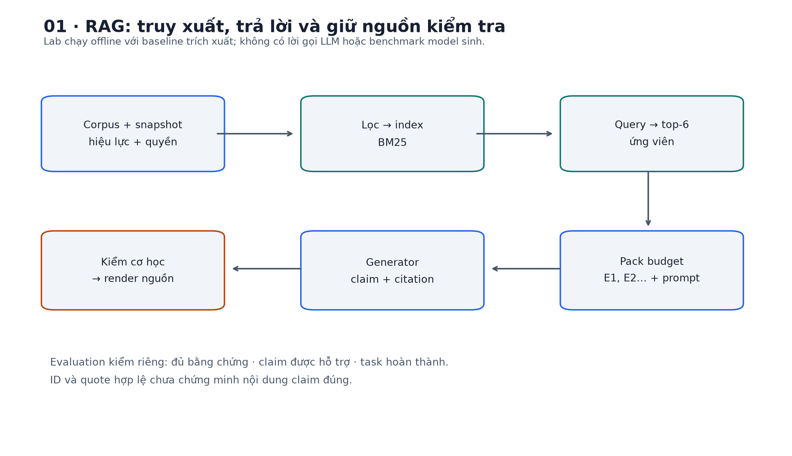
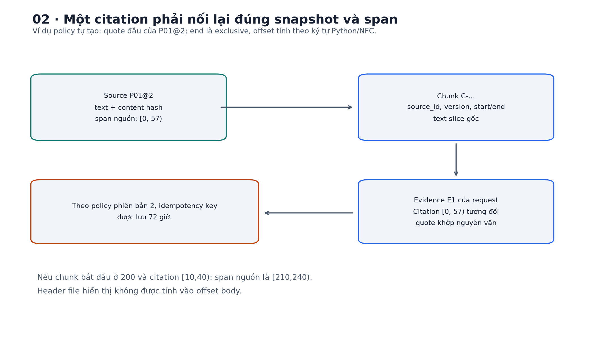
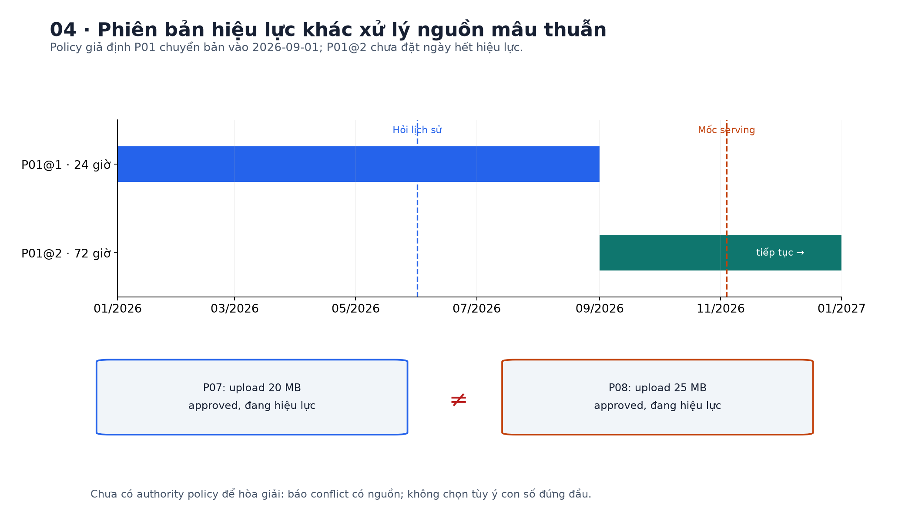
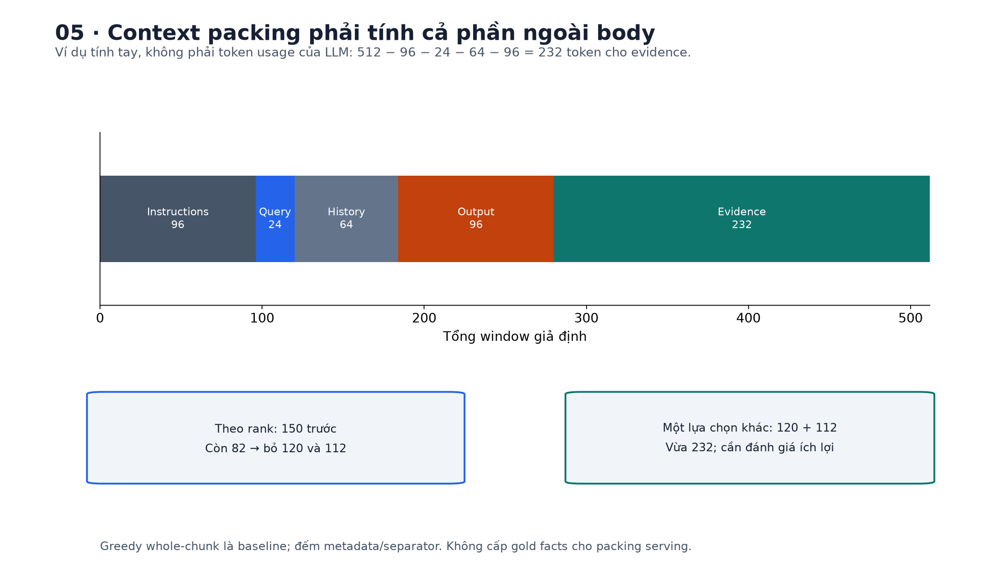
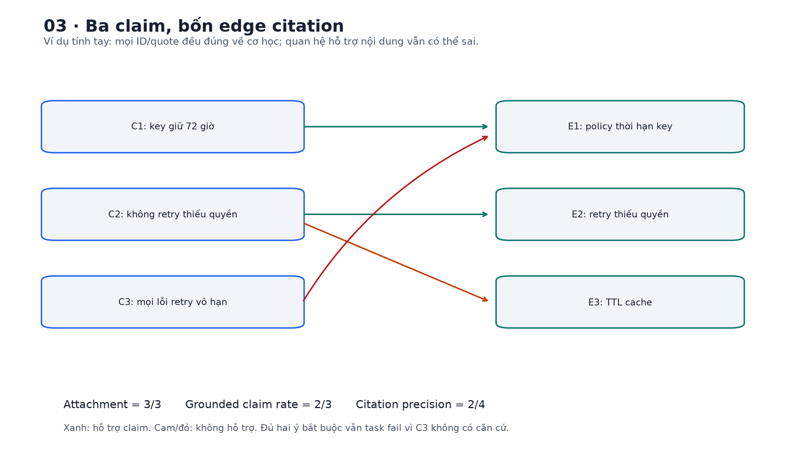
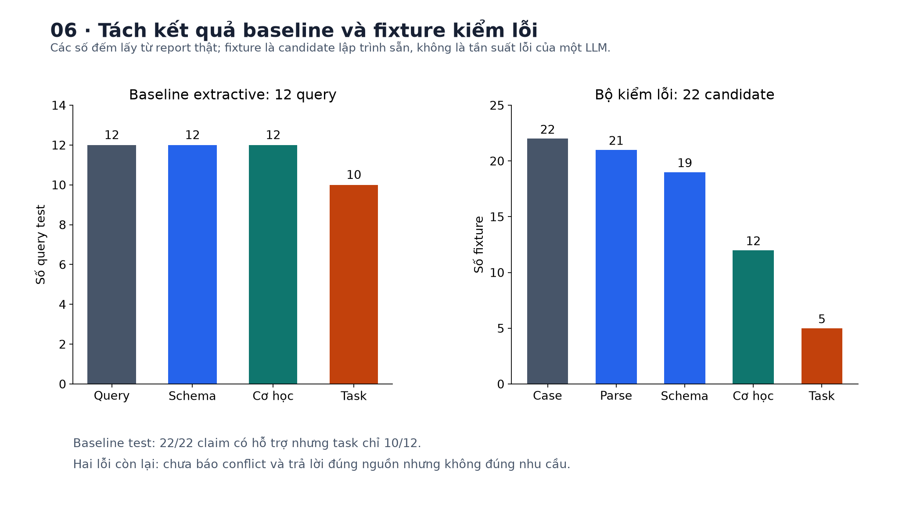
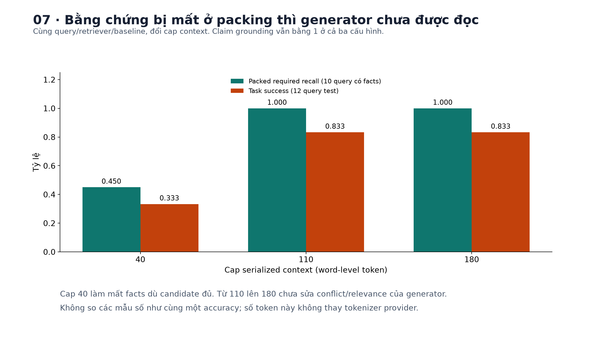

# Bài 25 — RAG và nguồn dẫn

[← Mục lục](../README.md) · [Bài 24](../24-chunking-embedding-reranking/README.md) · [Bài tập](exercises.md) · [Lời giải](solutions.md) · [Đào sâu](deep-dive.md)

## 1. Từ “tìm được đoạn” đến “trả lời có thể kiểm tra”

Bài 23 giúp tìm tài liệu; bài 24 giúp chọn chunk và xếp lại ứng viên. Bây giờ người dùng không muốn một danh sách đoạn văn: họ muốn biết “idempotency key giữ bao lâu, và cùng key nhưng khác payload thì xử lý thế nào?”, kèm căn cứ để tự kiểm tra.

Một hệ thống trả lời phải giải được thêm các việc: chọn nguồn đúng thời điểm và phạm vi; giữ đủ bằng chứng trong context; tổng hợp câu trả lời; gắn từng nhận định với nguồn thực sự hỗ trợ; phát hiện thiếu thông tin hoặc mâu thuẫn; và đánh giá cả kết quả cuối. Đây là phần ứng dụng thường gọi là **Retrieval-Augmented Generation — RAG**, tức tạo câu trả lời có bổ sung thông tin truy xuất.

Ví dụ xuyên bài là **policy/runbook giả định** của một hệ thống backend. Policy idempotency phiên bản 1 ghi 24 giờ, phiên bản 2 ghi 72 giờ. Cả hai đều có thể là câu trích đúng, nhưng chỉ một phiên bản có hiệu lực ở thời điểm được hỏi. Hai runbook upload lại đồng thời ghi 20 MB và 25 MB: lúc đó câu hỏi không giải được bằng việc chọn ngẫu nhiên một con số rồi gắn nguồn.

Sau bài, bạn cần làm được:

- Giải thích RAG khác việc chỉ hỏi model, fine-tuning hoặc đưa cả corpus vào prompt ở đâu.
- Theo dấu nguồn → snapshot → chunk → evidence trong request → câu trích → claim trong câu trả lời.
- Tính budget context, một ví dụ xác suất RAG và các tỷ lệ đánh giá nguồn dẫn bằng tay.
- Chạy pipeline retrieve → pack → extract → cite → validate → render, tách phần cơ học với phần đánh giá nội dung.
- Phân biệt trả lời có nguồn, trả lời được nguồn hỗ trợ, trả lời đúng câu hỏi và trả lời đầy đủ.

Kiến thức cần trước: bài 21 về context/inference; bài 22 về structured output; bài 23–24 về retrieval, chunk, embedding và reranking. Lab chọn BM 25 làm baseline vì bài 24 đã cho thấy thêm neural model chưa tự bảo đảm cải thiện.

**Phạm vi thực hành:** pipeline và file nguồn chạy thật trên CPU; generator mặc định chọn câu nguyên văn bằng overlap từ khóa, **không phải LLM**. Có giao diện thay generator bằng LLM, nhưng không tải model hay gọi API trong bài. Bộ 22 candidate giả lập dùng để kiểm các lỗi citation riêng; số đo của nó không là benchmark một LLM. Bài không huấn luyện mới.



## 2. RAG thêm gì vào một model ngôn ngữ?

### 2.1. Hai nơi thông tin có thể nằm

Ở bài 19–20, model học các mẫu và thông tin trong trọng số. Đó là **parametric memory — bộ nhớ trong tham số**. Khi phục vụ, ta còn có thể lấy thông tin từ tài liệu/index bên ngoài: **external/non-parametric memory** trong cách diễn đạt của nghiên cứu RAG. Index này vẫn có thể chứa embedding được model neural tạo ra; “non-parametric” ở đây không có nghĩa pipeline hoàn toàn không dùng tham số học được.

RAG đưa thông tin truy xuất vào điều kiện tạo câu trả lời. Mô hình vẫn sinh token theo xác suất và có thể suy luận sai, bỏ qua nguồn hoặc trộn tri thức cũ với dữ liệu mới. Retrieval không tự sửa trọng số; cập nhật tài liệu cũng chưa có tác dụng nếu index, cache hoặc snapshot đang phục vụ chưa đổi.

[Paper RAG của Lewis và cộng sự, NeurIPS 2020](https://papers.nips.cc/paper/2020/file/6b493230205f780e1bc26945df7481e5-Paper.pdf) mô tả việc kết hợp retriever với seq 2seq generator, cùng hai cách marginalize theo document/sequence hoặc token. Nhiều ứng dụng hiện dùng “RAG” theo nghĩa rộng hơn: retrieve các đoạn rồi ghép vào prompt của một model đã có. Pipeline đó không mặc nhiên là bản tái hiện thuật toán huấn luyện trong paper.

### 2.2. So sánh theo mục tiêu

| Cách làm | Thông tin thêm ở đâu? | Hợp với nhu cầu nào? | Chưa bảo đảm điều gì? |
|---|---|---|---|
| Hỏi model trực tiếp | Chỉ prompt và tri thức trong trọng số | Tác vụ đã đủ dữ kiện, giải thích chung | Biết policy nội bộ mới nhất |
| Fine-tuning | Cập nhật một phần/toàn bộ tham số | Hành vi, định dạng, tác vụ hoặc miền có dữ liệu huấn luyện | Mọi sự kiện mới đều được cập nhật và có nguồn |
| Đưa toàn tài liệu vào context | Prompt của lần gọi | Tập tài liệu đã chọn, đủ vừa và dễ sử dụng | Model đọc hết đúng, dùng đúng vị trí |
| RAG | Chọn thông tin bên ngoài theo request rồi cấp cho generator | Corpus lớn/thay đổi, cần dẫn về nguồn | Nguồn đúng, retrieval đủ, tổng hợp đúng và citation chuẩn |

Các cách có thể kết hợp. Fine-tuning có thể dạy model trả lời theo contract/cite tốt hơn, còn retrieval cấp dữ kiện mới. Context dài có thể giảm nhu cầu cắt nhỏ trong một số tác vụ, nhưng vẫn cần chọn tài liệu, quyền và chất lượng nguồn. Không có một lựa chọn thắng mọi trường hợp.

### 2.3. Ví dụ xác suất tính tay

Một dạng RAG-Sequence trong paper có trực giác:

$$p(y\mid q)\approx\sum_{d\in\operatorname{topK}}p_\eta(d\mid q)\,p_\theta(y\mid q,d).$$

Trong đó q là câu hỏi, d là tài liệu, y là chuỗi câu trả lời; η/θ là tham số retriever/generator. Nó cộng các đường sinh cùng câu trả lời qua tài liệu tiềm ẩn. RAG-Token marginalize bên trong từng bước sinh token; xem [phụ lục](deep-dive.md).

**Ví dụ giả định:** coi ba tài liệu là toàn bộ không gian của ví dụ. Xác suất truy xuất `[.6,.3,.1]`, xác suất sinh cùng y nếu điều kiện theo từng tài liệu `[.7,.2,.1]`:

$$p(y\mid q)=.6\times.7+.3\times.2+.1\times.1=.49.$$

Đây là xác suất của một chuỗi theo mô hình giả định, không phải 49% khả năng câu trả lời đúng. Trong lab, score BM 25 cũng không được coi là xác suất truy xuất; lab **không triển khai marginalization này**. Phép tính dùng để nối retrieval với xác suất sinh ở bài 19, không để diễn giải sai score production.

## 3. Một pipeline có nhiều chỗ có thể làm hỏng câu trả lời

1. **Ingest:** đọc nguồn, parse nội dung, giữ metadata, version và quyền.
2. **Index:** chia chunk, mã hóa/lập chỉ mục; bài 24 đã xem các lựa chọn.
3. **Retrieve/rerank:** lấy ứng viên liên quan trong phạm vi được phép.
4. **Pack context:** chọn, sắp xếp, loại trùng và giữ đủ bằng chứng trong budget.
5. **Generate:** trả lời từ context theo contract, có thể trả partial/abstain/conflict.
6. **Validate/render:** kiểm nguồn mà output viện dẫn, tạo link từ metadata server.
7. **Evaluate:** xem câu trả lời có được hỗ trợ, đúng nhu cầu và đủ các ý bắt buộc không.

Một cách kiểm lỗi gần với backend: query chạy được không chứng minh kết quả join đúng; foreign key tồn tại không chứng minh ta đã nối đúng thực thể. Tương tự, citation ID hợp lệ chưa chứng minh nội dung nguồn hỗ trợ claim.

Các điểm cần phân biệt: source có trong kho không; source có đủ quyền và đúng snapshot không; chunk có được retrieval lấy không; chunk có được đưa vào context không; claim có cite nó không; đoạn được cite có hỗ trợ claim không. Lỗi ở tầng sau không nên được báo thành “embedding chưa tốt” một cách chung chung.

## 4. Nguồn dẫn: claim phải nối về đâu?

### 4.1. Claim, evidence và provenance

**Claim** là một nhận định có thể kiểm tra, ví dụ “idempotency key được lưu 72 giờ”. Một câu có thể chứa nhiều claim: “Key giữ 72 giờ và mọi lỗi đều được retry vô hạn” có một phần có nguồn và một phần không.

**Evidence** là phần nội dung được đưa ra để hỗ trợ claim. **Provenance** là thông tin về xuất xứ: source ID, version, snapshot/content hash, vị trí, quá trình truy xuất và request sử dụng nó. Evidence nói “nội dung nào hỗ trợ”; provenance giúp tìm lại đúng nội dung đó.

Source đáng tin, còn hiệu lực và đúng phạm vi là điều kiện riêng. Một policy viết sai vẫn có thể được quote chính xác. RAG có thể trung thành với một nguồn sai; citation không biến nguồn thành sự thật.

### 4.2. Ba loại ID có vai trò khác nhau

- `P01@2`: một snapshot/version của nguồn.
- `C-...`: một chunk ổn định theo source/version/hash và span trong lab.
- `E1`: nhãn cục bộ của evidence trong **một request** sau packing.

E1 ở requestA có thể khác E1 ở requestB. Không cache câu trả lời có `[E1]` rồi ghép vào context khác chỉ vì câu hỏi trông tương tự. Cần giữ mapping và version của chính request đã tạo output.

Lab lưu `start/end` của chunk theo ký tự Python trong source NFC. Citation output lại dùng `start/end` **tương đối với evidence.text**. Nếu chunk bắt đầu ở ký tự 200, citation chỉ `[10,40)`, vị trí nguồn là `[210,240)`. Header/title thêm vào prompt không được lẫn vào body offset.



### 4.3. Đừng giao URL cuối cho model tự sáng tác

Output của lab chỉ chứa evidence ID, span và quote. Server tra mapping, kiểm snapshot, rồi tạo link đến file nguồn đã lưu. Trường URL tự ý thêm bị schema từ chối. Điều đó hạn chế một nhóm link bịa, nhưng vẫn phải kiểm **claim–evidence**, không chỉ đường dẫn.

Một citation nên ở gần claim nó hỗ trợ. Danh sách năm link cuối bài không nói rõ câu nào dựa vào link nào. Khi một claim cần hai nguồn, cần giữ cả tập bằng chứng; không ép thành “mỗi claim đúng một citation” nếu điều đó làm mất lập luận.

Gắn nguồn sau khi đã tạo câu trả lời (*post-hoc citation*) có thể là một thiết kế, nhưng phải kiểm nguồn thực sự hỗ trợ; tìm một đoạn cùng từ rồi gắn link có thể tạo vẻ đáng tin giả. Ngay cả citation đúng cũng chưa chứng minh model đã dùng nguồn đó như nguyên nhân tạo câu trả lời.

## 5. Kiểm quote cơ học khác kiểm nội dung hỗ trợ

### 5.1. Những gì có thể kiểm bằng code xác định

Lab kiểm raw JSON/schema; claim có citation; evidence ID ở trong context của request; evidence thuộc snapshot được phép; source hash và text slice còn khớp; offset đúng biên; quote đúng nguyên văn; không lặp cùng citation trong một claim. Không tìm mọi nơi trong corpus để “cứu” một ID không có trong context.

Một nguồn có trong index nhưng bị packing loại ra thì model chưa được cung cấp nó. Source ID có thật cũng không cho phép model viện dẫn bất kỳ nội dung nào của source mà không chỉ ra evidence đã nhận. Nếu muốn cho model gọi thêm retrieval, phải thiết kế một bước mới có trace, thay vì im lặng coi nguồn ngoài context là đã đọc.

### 5.2. Phản ví dụ: quote đúng, claim sai

Claim: “Key được lưu 72 giờ”. Citation trỏ tới P02 có quote thật “Mọi attempt retry phải chia sẻ cùng một tổng deadline.” ID có thật, offset đúng, quote khớp; nhưng nguồn đang nói deadline, không nói thời gian lưu key. Bộ kiểm cơ học có thể chấp nhận candidate này; bộ đánh giá claim–evidence phải đánh là chưa được hỗ trợ.

```python
from fixtures import evaluate_fixtures
report = evaluate_fixtures()
row = next(r for r in report['rows'] if r['name'] == 'real_quote_wrong_claim')
assert row['validation']['accepted']
assert row['semantic']['supported_claims'] == 0
assert row['semantic']['task_success'] == 0
print(row['validation']['accepted'], row['semantic'])
```

Một phản ví dụ khác: câu “Cache hồ sơ có TTL 300 giây” được cite đúng nhưng không trả lời “TTL cache trên sao Hỏa”. Câu trả lời có thể hoàn toàn trung thành với nguồn mà vẫn sai nhu cầu.

### 5.3. Entailment không phải overlap từ khóa

**Entailment** hỏi nội dung nguồn có đủ căn cứ cho nhận định hay không. Cùng từ không đủ: “không retry lỗi thiếu quyền” khác “retry mọi lỗi thiếu quyền”. Ngược lại, “72 giờ tương đương 3 ngày” có thể được hỗ trợ bằng policy 72 giờ cộng phép đổi đơn vị, dù source không có chuỗi “3 ngày”.

[ALCE, mục 3.3](https://aclanthology.org/2023.emnlp-main.398.pdf) phân biệt độ hỗ trợ cho statement và các citation không liên quan, dùng NLI để đánh giá tự động, cùng kiểm bằng người. Lab **không chạy NLI hay LLM judge**. Nó dùng catalog claim và các span hỗ trợ đã được người biên soạn gán trước, chỉ áp dụng cho ví dụ đóng này. Claim ngoài catalog được ghi là chưa được đánh giá, không tự chứng minh là sai.

## 6. Khi thiếu nguồn, trả lời một phần hay có mâu thuẫn?

| Trạng thái | Ý nghĩa mong muốn | Ví dụ |
|---|---|---|
| `answer` | Đáp ứng đủ nội dung cần trả lời theo bằng chứng | Có policy thời hạn và quy tắc payload |
| `partial` | Có căn cứ cho một phần, nêu giới hạn | Biết thời hạn key nhưng chưa có phần deadline được hỏi |
| `abstain` | Chưa đủ bằng chứng để trả lời | Không có thông tin về hệ thống được hỏi |
| `conflict` | Có các nguồn chưa hòa giải được | Hai runbook đang hiệu lực ghi 20 MB và 25 MB |

Schema chỉ phân biệt hình dạng các trạng thái; nó không tự xác định đủ bằng chứng, đúng nhu cầu hoặc có mâu thuẫn thật. Candidate ghi `answer` kèm hai claim mâu thuẫn vẫn có thể qua kiểm cơ học; evaluation phải kiểm thêm hành vi mong muốn.

Không nên diễn giải “không tìm thấy” thành “sự kiện không tồn tại”. Có thể do chưa ingest, query sai từ, filter, index cũ, context quá nhỏ hoặc retrieval bỏ sót. Câu trả lời hữu ích nên cho biết giới hạn thông tin, không tự bịa phần còn thiếu.

Partial trung thực có thể là hành vi đúng trong tình huống thiếu context dù chưa hoàn thành tác vụ đầy đủ. Vì vậy cần giữ cả metric faithfulness và task completeness; đừng ép model thêm nội dung không có bằng chứng chỉ để tăng tỷ lệ trả lời.

## 7. Thời điểm, phiên bản và độ tin cậy của nguồn

Mốc serving mặc định của thí nghiệm được cố định ở 2026-11-04; nó không là ngày hiện tại của máy. Trong corpus giả định, P01@1 có hiệu lực `[2026-01-01,2026-09-01)`, P01@2 có hiệu lực từ 2026-09-01. Query hỏi lịch sử ở2026-06-01 phải lấy bản 1; query ở2026-11-04 phải lấy bản 2. Khoảng thời gian dùng đầu bao gồm, cuối không bao gồm để tránh hai bản cùng hiệu lực ngay thời điểm chuyển.

Lab lọc theo ngày, trạng thái `approved` và scope **trước khi** lập thống kê BM 25 và retrieval. Draft P09 và source riêng P10 không vào snapshot public. Đây là metadata giả định đã biết, không phải code tự suy ra tài liệu nào đáng tin từ văn bản.

```python
from data import dataset
from rag import Index
sources, _, _ = dataset()
old = Index(sources, '2026-06-01')
new = Index(sources, '2026-11-04')
boundary = Index(sources, '2026-09-01')
assert 'P01@1' in old.sources and 'P01@2' not in old.sources
assert 'P01@2' in new.sources and 'P01@1' not in new.sources
assert 'P01@2' in boundary.sources and 'P01@1' not in boundary.sources
assert 'P09@1' not in new.sources and 'P10@1' not in new.sources
assert not Index(sources, '2026-11-04', scopes=set()).sources
```

Nếu hai nguồn khác nhau đều được duyệt và còn hiệu lực nhưng mâu thuẫn, chọn “mới nhất” một cách toàn cục chưa đủ: có thể khác authority, phạm vi sản phẩm, tenant hoặc phiên bản hệ thống. Cần policy hòa giải nguồn, hoặc trả `conflict` có dẫn cả hai. P07/P08 được cố ý giữ đồng thời để kiểm ca này.

Nguồn dẫn nên giữ snapshot, không chỉ link có thể thay nội dung ngày mai. Nếu nguồn bị xóa/đổi quyền, cần quyết định lại retention/cache và khả năng người nhận mở link; một response đã cache không nên làm lộ nội dung nay không còn được xem. Lab chưa có auth service hoặc thay đổi quyền động; bài 26 sẽ đi sâu hơn.



## 8. Context budget và packing

### 8.1. Tính tay

Giả định model window 512 token, system/instructions 96, question 24, history 64, output reserve 96. Phần evidence còn tối đa:

$$B=512-96-24-64-96=232\text{ token}.$$

Phải đếm serialized context thật, gồm evidence label, metadata và separator, không chỉ body. Nếu ba ứng viên theo thứ hạng có chi phí `[150,120,112]`, greedy giữ đoạn 150 trước rồi không còn chỗ cho hai đoạn còn lại. Hai đoạn 120+112 lại vừa 232. Greedy theo rank là một baseline, không phải nghiệm tối ưu cho mọi giá trị/nhu cầu bằng chứng.

Ví dụ này chưa cho biết đoạn nào đúng với query. Không được dùng nhãn test/gold fact để chọn các đoạn khi serving rồi báo đó là chất lượng packing thật. Có thể nghiên cứu thuật toán chọn theo độ đa dạng hoặc dự đoán ích lợi, nhưng phải đánh giá độc lập.

### 8.2. Policy của lab

Lab lấy tối đa 6 ứng viên BM 25; giữ nguyên whole chunk, thử lần lượt theo rank; bỏ exact duplicate theo source/version/span; nếu một chunk không vừa thì bỏ qua và thử chunk tiếp. Không truncate giữa câu để ép vừa. Nhãn E1,E2,... được gán sau khi chunk được giữ.

Cấu hình chính: window 320, output reserve 48, context cap 110 token. Budget khả dụng là min(cap, phần còn sau instructions/question/output reserve). Hàm đếm là tokenizer word-level của bài, **không là tokenizer của provider LLM**. Reserve chỉ là hạch toán capacity: baseline không sinh token autoregressive và chưa bị code giới hạn độ dài output theo 48 token.

```python
from data import dataset
from rag import Config, run, token_count
sources, _, _ = dataset()
cfg = Config()
result = run('idempotency key lưu bao nhiêu giờ', sources, cfg=cfg)
assert result['packing']['context_tokens'] <= cfg.context_tokens
assert token_count(result['prompt']) + cfg.output_reserve <= cfg.model_window
print(result['packing'])
```

Nếu thay bằng LLM, phải dùng tokenizer/cách tính message overhead đúng model và giới hạn output thực; kết quả đếm của lab không có giá trị bảo đảm budget API. Nếu vượt, cần lựa chọn/rút lịch sử/retrieve lại có chủ đích; không âm thầm bỏ câu ở đuôi mà không trace.

### 8.3. Nhiều context hơn chưa chắc dùng tốt hơn

Thêm đoạn có thể bổ sung bằng chứng hoặc thêm nhiễu, bản cũ, trùng lặp và token không cần thiết. [Lost in the Middle, TACL 2024](https://aclanthology.org/2024.tacl-1.9/) quan sát tác động vị trí trên các model/tác vụ được nghiên cứu; không dùng kết quả đó như quy luật mọi model 2026 đều giống nhau. Cần đo ảnh hưởng vị trí/độ dài trên model và tác vụ thực tế.

Khi có overlap, hai chunk không phải hai nguồn độc lập xác nhận cùng một việc. Khi ghép đoạn cùng source, phải giữ đúng version/span và bằng chứng mới mang lại; nhiều citation không đồng nghĩa bằng chứng mạnh hơn.



## 9. Prompt và contract trả lời

Prompt của lab gồm instruction, question được serialize JSON và danh sách evidence JSON. Nó yêu cầu chỉ dùng bằng chứng, không bịa ID/quote, báo thiếu/mâu thuẫn và trả JSON theo contract. Nội dung tài liệu là **dữ liệu**, không là instruction được nâng quyền. JSON quoting giúp giữ cấu trúc chuỗi; bản thân nó không giải quyết prompt injection cho LLM.

Ví dụ rút gọn về hình dạng output, không là kết quả gọi API:

```json
{
  "status": "answer",
  "reason": "",
  "claims": [
    {
      "text": "Theo policy phiên bản 2, idempotency key được lưu 72 giờ.",
      "citations": [
        {
          "evidence_id": "E1",
          "start": 0,
          "end": 57,
          "quote": "Theo policy phiên bản 2, idempotency key được lưu 72 giờ."
        }
      ]
    }
  ]
}
```

Ví dụ này dùng E1 là chunk chứa đoạn policy phiên bản 2, bắt đầu tại câu thời hạn. Mapping E1 phải đến từ chính context của request; cùng JSON đem sang context khác chưa chắc còn hợp lệ. Offset/quote thực tế của từng run được lưu trong `candidate.txt`. Schema đầy đủ nằm trong `rag.py` và được xuất ra output khi chạy eval/all.

Schema đóng chặn field thừa và phân biệt abstain với các trạng thái có claim. Sau schema vẫn cần kiểm nguồn/span/quote; sau kiểm cơ học vẫn cần kiểm semantic. Điều này tiếp nối sự phân biệt JSON valid, schema valid và task correct ở bài 22.

Giao diện `Generator.generate(question, context, prompt)` nhận dữ liệu serving, không nhận required facts hoặc catalog lời giải. Built-in `ExtractiveGenerator` không diễn giải prompt bằng model: nó chấm câu theo số term query trùng, chọn tối đa 2 câu có ít nhất 2 term chung, copy quote và offset. Policy đơn giản này có lỗi dễ phân tích; ngưỡng 2 không là ngưỡng abstain đã calibration.

Để thay bằng LLM, adapter cần gọi model với prompt/structured contract, trả raw JSON về cùng validator, đồng thời giữ model revision, sampling, tokenizer, timeout, output limit và usage trong trace. Không có adapter nhà cung cấp hoặc lời gọi LLM thật được kiểm trong bài này.

## 10. Đánh giá: nguồn đúng, claim đúng, task đúng

### 10.1. Các mẫu số khác nhau

**Required facts** là các ý bắt buộc đã được gán nhãn cho query. Metric retrieval/packing đo tỷ lệ required facts có span trọn vẹn trong pool, candidate hoặc context. **Complete** bằng 1 nếu có đủ tất cả ý, không chỉ một ý. Query không có đáp án được báo riêng.

Đối với candidate trả về, bài định nghĩa:

$$\operatorname{Attachment}=\frac{\#\text{claim có citation}}{\#\text{claim}},$$
$$\operatorname{GroundedClaimRate}=\frac{\#\text{claim được tập citation hỗ trợ đầy đủ}}{\#\text{claim}},$$
$$\operatorname{CitationPrecision}=\frac{\#\text{citation hỗ trợ một phần/toàn bộ claim đã được hỗ trợ đầy đủ}}{\#\text{citation}}.$$

Attachment chỉ đếm có gắn cite, không chứng minh ID hoặc ý nghĩa đúng. Grounded claim rate gần ý tưởng citation recall trong ALCE nhưng **không là recall tài liệu**. Precision của lab dùng annotation đóng và chỉ tính edge hữu ích khi toàn claim đã được hỗ trợ; nó không kiểm tập citation tối thiểu hay độc lập của nguồn, và không tái hiện đầy đủ thuật toán NLI của ALCE.

**Required fact recall trong câu trả lời** chỉ đếm ý được khẳng định bởi claim có hỗ trợ. **Task success** ở lab yêu cầu: candidate qua kiểm cơ học; đúng trạng thái mong đợi; đủ required facts; mọi claim đều có hỗ trợ. Đây là giao thức hẹp, chưa đo văn phong, tính hữu ích tổng thể hoặc phạt mọi chi tiết thừa nhưng có nguồn.

Khi không có claim/citation, các tỷ lệ tương ứng để `None`, không tự chấm 1 cho abstain. Parse/schema lỗi vẫn là failure trong mẫu số task. Tỷ lệ claim/citation tổng là **micro** theo số claim/edge của candidate schema-valid, kể cả candidate bị reject cơ học; task success là macro theo case. Không gộp hai cách lấy trung bình mà không nói.

### 10.2. Ví dụ tính tay: ba claim, bốn citation

- C1: thời hạn key 72 giờ, cite đúng policy.
- C2: không retry thiếu quyền, cite đúng runbook **và** thêm cite TTL cache không liên quan.
- C3: mọi lỗi retry vô hạn, cite một quote thật về thời hạn key.

Cả ba đều có citation; mọi quote/ID đều hợp lệ về cơ học. Nhưng chỉ 2/3 claim được hỗ trợ. Có 2/4 citation là edge hữu ích; attachment=1, grounded claim rate=2/3, citation precision=1/2. Hai required facts của ví dụ đều được trả lời nên required fact recall=1, nhưng task success=0 vì còn claim bịa.

```python
from lab import hand_demo
metrics = hand_demo()
assert metrics['mechanically_accepted']
assert metrics['citation_attachment'] == 1
assert metrics['grounded_claim_rate'] == 2/3
assert metrics['citation_precision'] == .5
assert metrics['required_fact_recall'] == 1
assert metrics['grounded_task_success'] == 0
```



### 10.3. Vì sao cần oracle context và các phép đo tách tầng?

Nếu required fact có trong corpus nhưng không vào candidate, lỗi retrieval; nếu có trong candidate nhưng packing loại mất, lỗi cấp context; nếu đã có trong context nhưng câu trả lời sai/thiếu, điều tra generator, instruction và contract. Có thể cấp gold context như một **thí nghiệm chẩn đoán** để xem trần khi retrieval hoàn hảo, nhưng phải ghi là oracle; không dùng nó như quality serving.

[KILT](https://aclanthology.org/2021.naacl-main.200/) là một nguồn định hướng việc đánh giá cả downstream task lẫn provenance. Lab tự dùng các metric trên corpus nhỏ, không chạy benchmark KILT. Khi có LLM/NLI judge, cần hiệu chỉnh bằng nhãn người, đọc lỗi và giữ version/prompt judge; “judge nói đúng” không thay bằng chứng.

## 11. Kết quả đã chạy

Dữ liệu có 11 snapshot của 10 source ID,25 fact được gán span,16 query:4 dev và 12 test. Ở ngày 2026-11-04, snapshot public được duyệt có 8 source/13 chunk. Test gồm 9 câu trả lời thông thường,1 ca mâu thuẫn và 2 no-answer; lịch sử ngày 2026-06-01 lấy policy cũ. Query dev/test khác text nhưng dùng chung corpus/ý định; không là kiểm tổng quát hóa sang nguồn hay lĩnh vực mới.

Không có training hoặc tune tham số theo test. Threshold, số claim, BM 25 và packing cap là cấu hình minh họa cố định. Semantic evaluator dùng nhãn do người biên soạn tạo; generator không nhận các nhãn đó. Những con số sau là cơ chế pipeline và baseline trích xuất trên bộ đóng, **không là chất lượng RAG của một LLM**.

### 11.1. Pipeline baseline, cap 110

| Phép đo | Kết quả test | Mẫu số |
|---|---:|---|
| Candidate qua schema/kiểm cơ học | 12/12 | Tất cả query test |
| Candidate và context giữ đủ required facts | 10/10 | 10 query có required facts, gồm ca conflict |
| Grounded claim rate | 22/22 | Các claim được tạo |
| Citation precision | 22/22 | Các edge citation được tạo |
| Task success | 10/12≈.8333 | Tất cả query test |
| No-answer vẫn bị trả claim | 1/2 | Hai query ngoài thông tin có đáp án |

Dev task success=4/4. Hai ca test thất bại là T09 và T12. Với T09, generator copy cả 20 MB lẫn 25 MB nhưng ghi `answer` thay vì `conflict`. Với T12, nó trả TTL cache của dịch vụ demo cho câu hỏi ngoài phạm vi “TTL cache trên sao Hỏa”. Cả hai có quote đúng; vì vậy citation precision=1 không chứng minh task success=1.

### 11.2. Budget ablation

Cùng retriever/generator/query, chỉ đổi cap serialized context. Các cap này là cấu hình so sánh định trước, không chọn cap thắng trên test rồi gọi đó là đánh giá độc lập.

| Cap context | Packed required fact recall | Context đầy đủ | Task success |
|---|---:|---:|---:|
| 40 | .4500 | 3/10 | 4/12≈.3333 |
| 110 | 1.0000 | 10/10 | 10/12≈.8333 |
| 180 | 1.0000 | 10/10 | 10/12≈.8333 |

Tỷ lệ fact/context tính trên 10 query có required facts; task trên 12 query. Grounded claim rate vẫn 1 ở cả ba cap: baseline có thể nói ít và cite đúng nhưng chưa giải quyết đủ bài toán. Thêm context từ 110 lên 180 không sửa được logic nhận mâu thuẫn hoặc relevance của generator.



### 11.3. Bộ 22 fixture kiểm lỗi citation

22 candidate được lập trình sẵn để tạo từng lỗi: quote bịa, ID ngoài context, offset sai, thiếu/lặp cite, field URL thừa, bool thay integer, nguồn cũ, nguồn restricted, multi-source support, partial, abstain, conflict và câu đúng nguồn nhưng sai nhu cầu.

Kết quả: parse 21/22, schema 19/22, kiểm cơ học 12/22, task success theo annotation 5/22. Có 20 claim và 22 edge từ candidate schema-valid: attachment 19/20, grounded claim rate 11/20, citation precision 13/22. Đây là **coverage của các tình huống kiểm tra đã thiết kế**, không là tỷ lệ lỗi tự nhiên của model hoặc traffic production.



## 12. Thực hành từ đầu

### 12.1. Tệp và môi trường

```text
25-rag-nguon-dan/
  README.md          Bài chính
  deep-dive.md       Xác suất, multi-source support, provenance và điều tra lỗi
  exercises.md       16 bài tập
  solutions.md       Lời giải và snippet tự kiểm
  data.py            Nguồn giả định, fact/span và query tham chiếu
  rag.py             Index, packing, prompt, generator, validator, renderer
  evaluation.py      Scorer dùng annotation đóng, không phải NLI
  fixtures.py        22 candidate giả lập kiểm lỗi
  lab.py             CLI, evaluation và xuất nguồn/trace
  make_figures.py    Tái tạo7 hình PNG/SVG từ công thức và report
```

Đã chạy Python 3.14.6, jsonschema 4.26.0 trên CPU. Pipeline chỉ cần thư viện chuẩn và jsonschema; không cần PyTorch/GPU/tài khoản dịch vụ. Matplotlib 3.11.2, NumPy 2.5.4 chỉ cần khi tái tạo hình. Nếu đổi môi trường, ghi phiên bản và chạy lại kiểm chứng; không mặc nhiên coi mọi tokenizer cho cùng kết quả.

Từ gốc dự án:

```bash
cd courses/ai-engineer-2026/25-rag-nguon-dan
python3 -m venv .venv
.venv/bin/python -m pip install -r requirements.txt
.venv/bin/python lab.py --mode hand
.venv/bin/python lab.py --mode fixtures
.venv/bin/python lab.py --mode all --out /tmp/lesson25-run-01
.venv/bin/python lab.py --mode ask --out /tmp/lesson25-ask-01 --question 'idempotency key lưu bao nhiêu giờ và cùng key khác payload xử lý thế nào'
.venv/bin/python lab.py --mode ask --as-of 2026-06-01 --out /tmp/lesson25-history-01 --question 'policy idempotency key lưu bao nhiêu giờ'
```

Windows dùng `.venv\Scripts\python.exe` và path phù hợp. Mỗi output phải là thư mục **chưa tồn tại**. Các run đã có không bị ghi đè. Có thể dùng môi trường đúng phiên bản đã có thay vì tạo `.venv` mới.

### 12.2. Mở một câu trả lời và kiểm nguồn

`ask` lưu `answer.md`, `prompt.txt`, `candidate.txt`, `trace.json` và thư mục `sources/`. Link trong answer được dựng từ snapshot server, mở file Markdown chứa nguyên văn nguồn. Chỉ số ký tự tính trong body nguồn gốc, không tính header/code fence của file hiển thị; dùng trace để đối chiếu slice.

`all` còn tạo report và một request cho mỗi query:

```text
/tmp/lesson25-run-01/
  report.json
  answer-schema.json
  requests/T03/
    answer.md
    prompt.txt
    candidate.txt
    trace.json
    sources/P01-2.md
```

Các source file thực tế phụ thuộc context được giữ; có thể có nguồn khác ngoài P01. File snapshot đầy đủ chỉ được lưu sau khi kiểm scope/hiệu lực, còn prompt chỉ có các chunk đã pack. Chia sẻ snapshot hoặc trace trong hệ thống thật cũng cần giữ quyền dữ liệu; bộ lab chỉ chứa nội dung tự tạo.

### 12.3. Theo dấu một citation

```python
from data import dataset
from rag import run
sources, _, _ = dataset()
result = run('idempotency key lưu bao nhiêu giờ', sources)
assert result['validation']['accepted']
by_source = {(s['source_id'],s['version']):s for s in sources}
for cite in result['validation']['citations']:
    source = by_source[cite['source_id'],cite['version']]
    assert source['text'][cite['source_start']:cite['source_end']] == cite['quote']
print(result['answer_markdown'])
```

Bây giờ thay **claim text** thành một nhận định không được quote đó hỗ trợ nhưng giữ citation đúng. Xem fixture `real_quote_wrong_claim` để thấy validator không phải semantic judge. Đây là giới hạn được kiểm rõ, không là lỗi mà schema có thể tự sửa.

### 12.4. Tái tạo hình

Hình đã có sẵn. Để tái tạo từ report:

```bash
.venv/bin/python -m pip install -r requirements-figures.txt
.venv/bin/python make_figures.py --run /tmp/lesson25-run-01
```

## 13. Tự kiểm và bước tiếp

Làm [16 bài tập](exercises.md), rồi xem [lời giải](solutions.md). Bạn cần tự giải thích vì sao ID/quote hợp lệ chưa đủ; vì sao faithfulness=1 vẫn có task failure; phân biệt candidate recall với packed evidence và answer completeness; tính được các mẫu số; và tìm lại đúng snapshot/span của một citation.

[Phụ lục](deep-dive.md) đi sâu multi-source support và evaluation. Đọc tiếp [Bài 26 — Context engineering, phân quyền và prompt injection](../26-context-engineering-phan-quyen-prompt-injection/README.md). [Nguồn đã đọc và phạm vi kiểm](../SOURCES.md).
