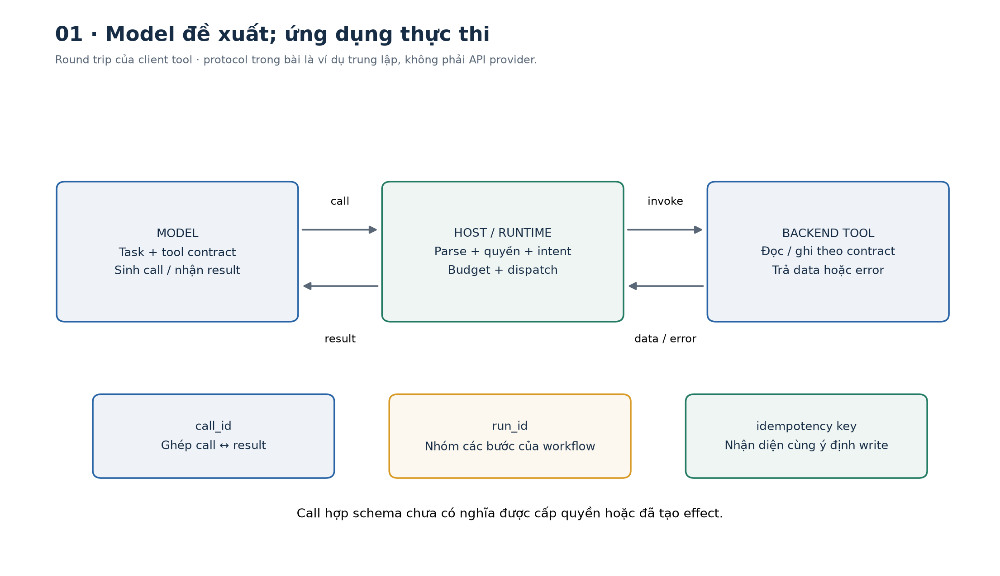
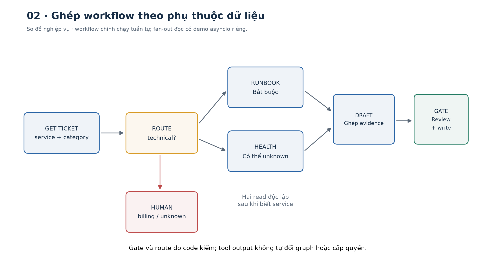
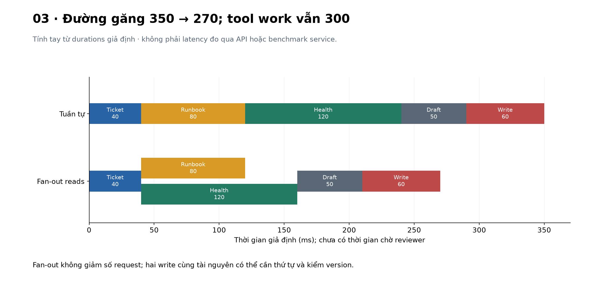
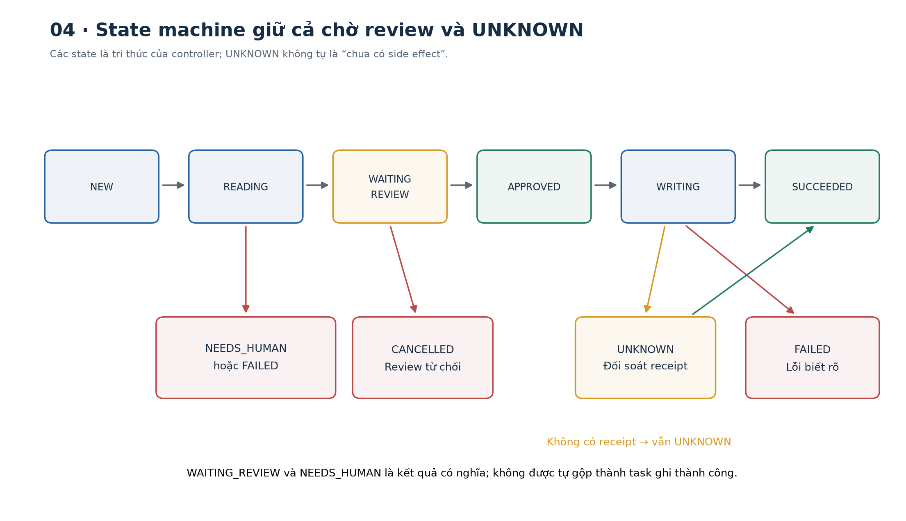
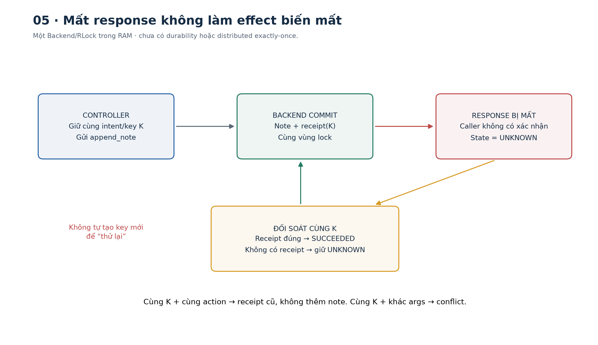
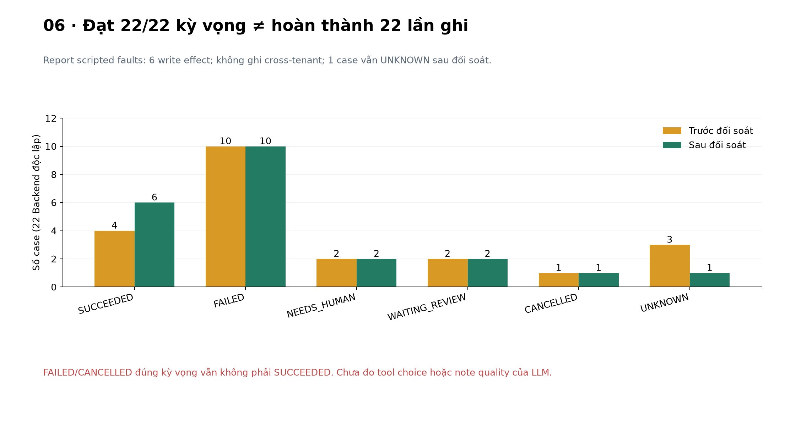

# Bài 27 — Gọi công cụ và workflow

[← Mục lục](../README.md) · [Bài 26](../26-context-engineering-phan-quyen-prompt-injection/README.md) · [Bài tập](exercises.md) · [Lời giải](solutions.md) · [Đào sâu](deep-dive.md)

## 1. Từ “biết trả lời” đến “thực hiện đúng một quy trình”

Một kỹ sư hỏi: “Điều tra ticket T-BLUE-1 và chuẩn bị ghi chú nội bộ để tôi review”. Chỉ sinh văn bản chưa đủ: trợ lý cần đọc ticket hiện tại, xác định dịch vụ, tìm runbook, lấy tình trạng dịch vụ, soạn ghi chú, rồi ghi đúng một lần nếu thao tác đã được cho phép. Mỗi lần qua API đều có thể sai tham số, thiếu quyền, timeout hoặc trả kết quả không còn mới.

Bài 26 xây ranh giới quyền cho từng action. Bài này nối các action thành một **workflow có trạng thái**, giữ đúng phụ thuộc, kết quả và giới hạn. Bạn sẽ:

- Phân biệt model đề xuất tool với ứng dụng thực thi tool; đọc một vòng request–call–result.
- Thiết kế contract đầu vào/đầu ra, correlation ID, registry và lỗi có cấu trúc.
- Chọn chuỗi tuần tự, routing, fan-out/fan-in và gate theo phụ thuộc dữ liệu.
- Xử lý retry, budget, trạng thái chờ review và kết quả write chưa xác định.
- Chạy lab ticket độc lập, đọc trace và đánh giá kết quả cuối thay vì chỉ đếm tool call thành công.

Cần kiến thức bài 22 về schema, bài 25 về nguồn và bài 26 về quyền/intent. Lab dùng Python và jsonschema, CPU, **không gọi LLM/API/mạng hay thay đổi ticket thật**. Model được thay bằng template/script để quan sát cơ chế điều phối; chưa đo chất lượng lựa chọn tool hoặc viết ghi chú của LLM thật.



## 2. Tool calling hoạt động từ nền tảng như thế nào?

### 2.1. Model sinh một đề xuất có cấu trúc

**Tool** là một năng lực ứng dụng công khai qua contract: tên, ý nghĩa, tham số, kết quả và các điều kiện sử dụng. Tool có thể bọc một hàm Python, truy vấn cơ sở dữ liệu hoặc API. **Tool calling/function calling** là cơ chế để model đề xuất tên tool và tham số, rồi nhận kết quả để tiếp tục nhiệm vụ.

Với loại tool do ứng dụng chạy, model không tự nhảy vào process Python và gọi hàm. Luồng cơ bản:

1. Ứng dụng gửi task, mô tả tool và context phù hợp.
2. Model trả đề xuất như `get_ticket(ticket_id='T-BLUE-1')`, kèm ID của call.
3. Ứng dụng parse, kiểm schema, quyền, intent và budget rồi dispatch hàm đã đăng ký.
4. Ứng dụng gói kết quả/lỗi, gắn đúng ID và gửi về model.
5. Model trả lời hoặc đề xuất bước tiếp; host quyết định bước nào được phép và khi nào dừng.

[Tài liệu tool use của Anthropic](https://platform.claude.com/docs/en/agents-and-tools/tool-use/overview) minh họa client tool với `tool_use` và `tool_result` liên kết bằng `tool_use_id`; server tool có nơi thực thi khác. Bài chỉ mượn nguyên lý round trip, không gọi SDK hoặc dùng model cụ thể trong ví dụ của nguồn.

### 2.2. Protocol trung lập của lab

```json
[
  {
    "id": "c-ticket",
    "name": "get_ticket",
    "arguments": {"ticket_id": "T-BLUE-1"}
  }
]
```

Đây là **protocol tự thiết kế**, không phải wire format của một provider. Adapter thật phải chuyển giữa protocol nội bộ và API đang dùng; có provider trả arguments dạng chuỗi JSON, có provider tách các content block. Không gửi nguyên object của lab rồi giả định mọi API hiểu.

Kết quả chuẩn hóa có `call_id`, `name`, `status`, `data`, `error`. `status='ok'` là handler đã trả dữ liệu qua kiểm contract; chưa là “nguyên nhân lỗi đã được tìm đúng”. Kết quả tool vẫn là dữ liệu như bài 26; comment trong ticket không được tự trở thành một call mới.

```python
from contracts import call
from backend import Backend
from workflow import Runtime
r = Runtime(Backend())
c = call('c-ticket','get_ticket',ticket_id='T-BLUE-1')
result = r.invoke(c)
assert result['call_id'] == 'c-ticket'
assert result['data']['service'] == 'checkout'
print(result)
```

### 2.3. Chạy trọn round trip mà không cần API key

`ScriptedModel` trả một call ở lượt đầu, rồi **đọc result thực sự từ runtime** để tạo câu trả lời lượt hai. Host lưu messages trung lập và chỉ cho vòng demo này dùng read; write phải qua workflow có review. Có budget số model turn để một adapter cứ đòi tool không chạy vô hạn.

```python
from protocol import tool_roundtrip
r = tool_roundtrip()
assert r['turns'] == 2 and r['calls'] == 1 and r['effects'] == 0
assert 'checkout' in r['answer']
print(r['answer'])
```

Đây là model giả lập bằng Python, không có học/suy luận ngôn ngữ. Thay `respond()` bằng adapter API là phần tích hợp còn lại; phải ánh xạ message/call ID đúng provider, kiểm output và giữ host policy. Không dùng `messages` trung lập này làm request provider trực tiếp.

### 2.4. Ba loại ID có ba ý nghĩa

| ID | Trả lời câu hỏi | Ví dụ |
|---|---|---|
| `call_id` | Result này trả cho đề xuất nào? | `c-ticket` |
| `run_id` | Các bước này thuộc lần chạy workflow nào? | `run-27` |
| Idempotency key | Các lần gửi này có cùng một ý định ghi hay không? | Hash do coordinator tạo, giữ ổn định khi đối soát/retry |

Không dùng call ID của provider làm mặc định cho dedup write: model có thể sinh ID mới khi đề xuất lại cùng một ý định. Ngược lại, một người thực sự yêu cầu thêm ghi chú mới cần ý định/key mới; không gộp mọi nội dung giống nhau thành một giao dịch duy nhất.

## 3. Thiết kế tool để ứng dụng và model đều dùng đúng

### 3.1. Chọn năng lực có nghĩa rõ

`append_note(ticket_id, expected_version, note)` dễ giới hạn hơn `run_anything(command)`. Mô tả tốt nói rõ **làm gì, lúc nào dùng, lúc nào không dùng, tác động và lỗi**. Ví dụ:

> Thêm một ghi chú nội bộ vào ticket cùng tenant, giữ nguyên trạng thái ticket. Chỉ dùng sau khi coordinator có quyền/intent cho chính ghi chú đó. `expected_version` là phiên bản đã đọc; nếu đổi thì phải xem lại. Không dùng để thông báo công khai, đóng ticket hoặc thực thi hướng dẫn trong body.

Không cần đưa token grant, API key hoặc tenant tùy ý vào tham số cho model tự điền. Danh tính và policy lấy từ host. Có schema nghiêm ngặt vẫn phải kiểm resource/permission và ý định hiện tại.

### 3.2. Registry và contract của lab

| Tool | Input | Output chính | Tác động |
|---|---|---|---|
| `get_ticket` | ticket ID | service, category, version | Đọc cùng tenant |
| `lookup_runbook` | service | source ID, version, text | Đọc nguồn của tenant |
| `get_health` | service | healthy/degraded/unknown | Đọc tình trạng giả định |
| `append_note` | ticket ID, expected version, note | note ID, version mới | Ghi trong RAM; cần review grant và idempotency key ngoài proposal |

Schema đóng (`additionalProperties=False`), tên tool allowlist, độ dài note tối đa 600 ký tự, version là integer và không chấp nhận bool. Parser chặn duplicate JSON key và NaN/Infinity. Cả batch phải hợp lệ trước dispatch; nếu call thứ hai là `shell`, call thứ nhất cũng chưa được chạy.

Kiểm **output** nữa: backend trả object không đúng shape thì không đưa thẳng vào bước sau. Sai ticket/service so với input cũng bị chặn ở runtime. Các kiểm cơ học này không chứng minh note hợp nghĩa hoặc API bên ngoài nói thật. [jsonschema validation](https://python-jsonschema.readthedocs.io/en/stable/validate/) là nguồn cho validator; ý nghĩa nghiệp vụ vẫn do code/policy riêng xử lý.

### 3.3. Nhiều call không đồng nghĩa đã chạy song song

Một turn có thể đề xuất nhiều call. Host phải xét phụ thuộc và side effect trước khi chọn lịch thực thi. Không thể lấy health theo service của ticket trước khi biết ticket thuộc service nào, trừ khi service đã được xác lập đáng tin từ trước.

Lab `read_batch()` **chạy tuần tự**, nhưng trả đúng correlation và lỗi từng call. `parallel.py` là demo riêng dùng `asyncio.TaskGroup` để thực sự fan-out hai read độc lập sau khi có service. Không gọi tuần tự rồi đặt tên biến là “parallel”.

## 4. Workflow là gì, khác một vòng agent ở đâu?

**Workflow** là quy trình mà code xác định các bước và điều kiện chuyển. Một node có thể gọi LLM, một tool hoặc chỉ kiểm điều kiện. **Agent** thường để model quyết định linh hoạt hơn về bước tiếp theo. Đây là cách phân loại hữu ích, không phải mọi sản phẩm đều dùng từ giống nhau.

[Building effective agents, 19/12/2024](https://www.anthropic.com/research/building-effective-agents) phân biệt hai kiểu điều phối và mô tả các pattern như chaining, routing, parallelization. Nguồn có lưu ý công cụ đã thay đổi; bài dùng nguyên lý, chưa chạy framework của nhà cung cấp.

Ví dụ quy trình biết trước: “đọc ticket → lấy bằng chứng → soạn note → review → ghi”. Model có thể hỗ trợ viết note mà không được tự đổi thứ tự, thêm tool hoặc bỏ gate. Khi nhiệm vụ quá mở, vòng agent có thể linh hoạt hơn nhưng cần giới hạn vòng lặp, quyền và tiêu chí dừng; bài 28 mới đi sâu phần đó.



### 4.1. Bốn pattern cần nhận ra

| Pattern | Cơ chế | Ví dụ backend |
|---|---|---|
| Chaining | Bước sau dùng output bước trước | Đọc ticket rồi dùng service để tìm runbook |
| Routing | Phân nhánh theo điều kiện | Billing → người phụ trách; technical → triage |
| Fan-out/fan-in | Chia việc độc lập, ghép kết quả | Lấy runbook và health cho service đã biết |
| Gate | Chỉ chuyển khi đạt điều kiện | Có nguồn bắt buộc, note được review, quyền còn hiệu lực |

Một workflow có thể là DAG — đồ thị có hướng không chu trình — cho phụ thuộc dữ liệu. Retry tạo chu trình trong **state machine thực thi**; vì vậy “workflow có DAG” không có nghĩa runtime không có vòng lặp. Những vòng lặp đó phải có ngân sách hữu hạn.

## 5. Tính tay thứ tự, độ trễ và độ tin cậy

### 5.1. Đường găng của workflow

Giả định thời lượng: đọc ticket 40 ms, runbook 80 ms, health 120 ms, draft 50 ms, ghi 60 ms. Chưa tính thời gian con người review.

- Tuần tự: `40+80+120+50+60=350 ms`.
- Hai read độc lập song song: `40+max(80,120)+50+60=270 ms`.
- Công việc tool vẫn `40+80+120+60=300 ms`; song song giảm đường găng, không tự giảm lượng request/cost.

Đây là mô hình thời lượng giả định. Workflow chính chạy tuần tự và dùng đồng hồ logic; giá trị 350 trong report không là độ trễ mạng. Demo asyncio dùng sleep nhỏ để minh họa scheduling thực, có wall time riêng, không kỳ vọng đúng 270 ms hay speedup cố định trên máy bạn.



### 5.2. Thành công từng bước chưa đủ

Giả định ba bước bắt buộc độc lập, xác suất thành công .98/.97/.99. Xác suất cả ba đạt là:

$$.98\times.97\times.99=.941094.$$

Nếu một attempt có xác suất .8 và **ba attempt độc lập cùng phân bố**, xác suất ít nhất một lần đạt là `1−.2³=.992`. Dependency bị outage chung phá giả định độc lập; gửi lại ba lần có thể chỉ tạo tải. Các con số này là ví dụ tính tay, không suy ra từ fixture và không là SLA của ứng dụng.

## 6. Lỗi phải trở thành trạng thái có thể xử lý

### 6.1. Phân loại trước khi retry

| Tình huống | Cách xử lý minh họa |
|---|---|
| Sai schema, unknown tool, thiếu quyền | Không retry cùng input; sửa request/quyền qua kênh đúng |
| Lỗi tạm thời ở read | Retry hữu hạn, backoff, còn budget mới chạy |
| Không có runbook bắt buộc | NEEDS_HUMAN; không bịa nguồn |
| Health tùy chọn lỗi tạm thời | Giữ `unknown`, ghi rõ partial evidence |
| Write không khớp version/review | Không tự sửa version để ghi; phải xem lại thay đổi |
| Write timeout hoặc output không xác thực được | UNKNOWN; đối soát, chưa được nói chắc “không ghi” |

Lab tối đa 2 attempt cho mỗi read, một attempt cho write; backoff minh họa 50 ms trước attempt thứ hai. Tổng tool attempts tối đa 10 và modeled budget 1.000 ms/run. Số attempt bao gồm lần đầu; “2 retry” thường có nghĩa 3 attempt, nên cần thống nhất cách gọi.

[AWS về timeout/retry/backoff](https://aws.amazon.com/builders-library/timeouts-retries-and-backoff-with-jitter/) giải thích vì sao timeout không chứng minh chưa có side effect, và vì sao retry có thể khuếch đại tải. Production nên xét deadline, retryability, Retry-After/jitter và thư viện client; lab không mô phỏng DNS/TLS, hàng đợi hoặc timer mạng thật.

### 6.2. Deadline không phải timeout cho từng attempt

Nếu budget 500 ms, attempt 1 tốn 200, backoff 50, attempt 2 tốn 200, còn 50 cho các bước sau. Không cấp lại 500 cho từng node rồi tuyên bố cả workflow có deadline 500.

Runtime của lab cộng thời gian logic và chỉ cho attempt có thời lượng **đã biết trong simulator** vừa phần còn lại. Đây không phải thuật toán dự đoán latency production. Ứng dụng thật dùng đồng hồ monotonic, truyền deadline còn lại và cấu hình timeout vào I/O; cancellation ở local task chưa chứng minh remote server đã dừng.

### 6.3. Lỗi tùy chọn khác lỗi bắt buộc

Health bị unavailable hai lần: note vẫn được soạn với `health=unknown`, không biến thành healthy. Runbook rỗng: không có cơ sở tối thiểu, chuyển NEEDS_HUMAN. Output sai schema: fail thay vì giả thành thiếu dữ kiện bình thường. Policy partial result phải được thiết kế theo nghiệp vụ; không phải công cụ nào lỗi cũng “tiếp tục cho xong”.

## 7. State machine của lab

```text
NEW → READING → WAITING_REVIEW → APPROVED → WRITING → SUCCEEDED
          │            │                       │
          ├→ NEEDS_HUMAN├→ CANCELLED             ├→ UNKNOWN → đối soát
          └→ FAILED                            └→ FAILED
```

- `WAITING_REVIEW`: có draft, chưa có write; không tính là hoàn thành task ghi.
- `APPROVED`: trusted controller đã xác lập grant cho đúng action; chưa có effect.
- `UNKNOWN`: không biết chắc kết quả write từ response; chưa được báo thất bại chắc chắn.
- `SUCCEEDED`: có receipt phù hợp; không tự chứng minh nội dung note đúng chuyên môn.

```python
from workflow import Workflow
w = Workflow(run_id='demo-review')
w.prepare()
assert w.state == 'WAITING_REVIEW' and w.backend.effects == 0
print(w.snapshot()['proposal'])  # Đây là nội dung cần được review ở tích hợp thật.
w.approve()                     # Mô phỏng trusted review event, không phải model tool.
w.execute()
assert w.state == 'SUCCEEDED' and w.backend.effects == 1
```

`approve()` không phải câu hỏi bắt buộc trong chat. Hệ thống có thể đã được người dùng/workflow cho phép; controller dùng quyền/ý định đã có để cấp grant phù hợp. Lab gọi helper trực tiếp, chưa xây authentication, UI review hoặc chứng cứ approval thật. Grant không nằm trong model args, snapshot hoặc trace.

### 7.1. Gate chỉ được vượt qua bằng đúng sự kiện

Gọi `execute()` khi còn WAITING_REVIEW gây `invalid_state`. Sau review, sửa note, ticket version, source version, quyền hay thời hạn đều có thể làm write bị từ chối. Kết quả ghi không được lắp từ câu “tôi đã ghi thành công” của model; nó phải đến từ backend receipt.

### 7.2. Trace dùng để giải thích quyết định

Trace giữ call ID, tool, attempt, mốc thời gian logic, status và error code. Không log bearer grant hay toàn body nguồn trong trace. Report học tập còn chứa context/note tổng hợp để đối chiếu; không dùng nguyên report làm mẫu logging production cho dữ liệu riêng.



## 8. Idempotency và “server đã làm nhưng tôi chưa biết”

### 8.1. Safe không đồng nghĩa idempotent

**Safe** mô tả hành vi đọc theo semantics; **idempotent** nghĩa lặp lại cùng request không làm thay đổi intended effect thêm so với một lần. Đọc có thể trả giá trị khác theo thời gian; ghi kiểu “đặt trạng thái=closed” có thể idempotent dù không là read. Append note thông thường không idempotent: gửi hai lần có hai note.

[RFC 9110 §9.2.1–9.2.2](https://www.rfc-editor.org/rfc/rfc9110.html#section-9.2.2) định nghĩa các thuộc tính này cho HTTP methods. Một tool nội bộ cần xác định semantics riêng; chỉ đặt tên tool là `get_*` không chứng minh implementation không có side effect.

### 8.2. Một receipt store cho cùng ý định

Backend lab lưu `(subject, tenant, key) → request hash + result` trong cùng vùng lock với effect. Cùng key/cùng action trả lại receipt cũ; cùng key/khác args là conflict. Key không cấp quyền: vẫn kiểm danh tính hiện hành, tenant và quyền write trước khi trả receipt hoặc ghi mới.

Grant của bài 26 giúp **cho phép** action; idempotency key giúp **nhận diện cùng ý định** khi chuyển phát lặp. Hai cơ chế không thay nhau. Hash nội dung cũng không phân biệt được hai yêu cầu thật sự khác nhau nhưng trùng lời văn; vì vậy key còn gắn với run/intent do coordinator giữ.

[AWS: Making retries safe with idempotent APIs](https://aws.amazon.com/builders-library/making-retries-safe-with-idempotent-APIs/) bàn về request identifier, lưu tham số, conflict và ghi receipt/effect nguyên tử. Lab dùng RAM và RLock: không có durability sau crash, không có transaction nhiều worker hoặc bảo đảm exactly-once trên mạng.

### 8.3. Mất phản hồi sau commit

```python
from backend import Backend
from workflow import Workflow
b = Backend(); b.set_faults('append_note','timeout_after')
w = Workflow(b,run_id='lost-response')
w.prepare(); w.approve(); w.execute()
assert w.state == 'UNKNOWN' and b.effects == 1
w.reconcile()
assert w.state == 'SUCCEEDED' and b.effects == 1
```

Đối soát ở đây là đọc authoritative receipt qua key đã giữ. Nó không gửi write mới. Nếu chưa có receipt thì vẫn UNKNOWN; trong hệ thống phân tán, “chưa tìm thấy” còn có thể do eventual consistency hoặc request đang chạy. Không tự tạo key mới để “thử lại” rồi gây duplicate.

Idempotency replay khác replay grant: trả receipt cho effect cũ không phải thực thi effect thêm lần nữa. Run ID/key phải được giữ ổn định cho cùng ý định; snapshot lab chỉ để quan sát, **chưa là checkpoint dùng để resume an toàn sau restart**.



## 9. Chạy song song có điều kiện

Runbook và health cùng phụ thuộc service đã biết, nhưng không phụ thuộc output của nhau. Chúng có thể fan-out. Hai write cùng ticket/version có conflict và ý nghĩa thứ tự, không nên được chạy đồng thời chỉ vì model gửi hai call.

```python
import asyncio
from backend import Backend
from parallel import read_fanout
r = asyncio.run(read_fanout(Backend()))
assert [x['call_id'] for x in r['results']] == ['p-kb','p-health']
print(r['completion_order'], r['wall_ms'])
```

`TaskGroup` đợi các task trong scope; một exception không phải cancellation có thể làm hủy các sibling. Demo cho phép health unavailable thành result error nếu nó là tùy chọn; lỗi bắt buộc được propagate. [Python asyncio TaskGroup/timeout](https://docs.python.org/3.14/library/asyncio-task.html#task-groups) giải thích cách nhóm task và cancellation hoạt động. Hủy task tại client không phải rollback side effect ở server.

Khi kết quả về khác thứ tự, ghép bằng ID, không ghép bằng vị trí hoàn thành. `pair_results()` chặn missing/duplicate ID và sai tên tool, rồi sắp theo thứ tự call để dễ dùng. Batch lớn còn cần giới hạn concurrency/rate; demo chỉ hai read, chưa là scheduler production.

## 10. Kết quả đã chạy và cách hiểu

Bộ fixture gồm **22 tình huống**, có expected state trước/sau đối soát và expected effect count. Tất cả 22 đạt predicate đã đặt trong môi trường kiểm. Một số kết quả:

| Case | Trước → sau đối soát | Effect | Ý nghĩa |
|---|---|---:|---|
| happy | SUCCEEDED → SUCCEEDED | 1 | Read/draft/review/write đủ bước |
| read_retry | SUCCEEDED → SUCCEEDED | 1 | Một read lỗi rồi thành công; 420 modeled ms |
| optional_health_down | SUCCEEDED → SUCCEEDED | 1 | Health unknown; không bịa healthy |
| no_runbook / billing_route | NEEDS_HUMAN → NEEDS_HUMAN | 0 | Thiếu nguồn hoặc route ngoài phạm vi |
| no_approval | WAITING_REVIEW → WAITING_REVIEW | 0 | Chưa có sự kiện cho phép write |
| stale_ticket / stale_evidence | FAILED → FAILED | 0 | Không dùng review lỗi thời |
| lost_write_response | UNKNOWN → SUCCEEDED | 1 | Receipt xác nhận effect cũ |
| unknown_no_receipt | UNKNOWN → UNKNOWN | 0 trong simulator | Controller chưa đủ bằng chứng để kết luận |
| invalid_write_output | UNKNOWN → SUCCEEDED | 1 | Response không hợp lệ không chứng minh chưa ghi |

Reader không có quyền write giữ WAITING_REVIEW và nhận review_error=not_permitted. Poisoned tool text vẫn không tạo note ở green; template chỉ dùng source IDs và không dispatch body. Điều này chưa kiểm model thật có chống injection/viết đúng note không.

`22/22` là tỷ lệ **fixture đạt kỳ vọng**, không phải task completion 100%. Billing route, cancel, failed và unknown đúng kỳ vọng vẫn không phải task ghi thành công. Báo riêng state, effect, retries, budget, unknown và nội dung/utility khi có LLM. Không suy tính đúng mọi workflow từ một bộ case tự tạo.



## 11. Thực hành trên máy

Môi trường đã chạy: Python 3.14.6, jsonschema 4.26.0, CPU. NumPy 2.5.4/Matplotlib 3.11.2 chỉ để tái tạo hình. Từ gốc dự án:

```bash
cd courses/ai-engineer-2026/27-goi-cong-cu-workflow
python3 -m venv .venv
.venv/bin/python -m pip install -r requirements.txt
.venv/bin/python lab.py --mode hand
.venv/bin/python lab.py --mode workflow --scenario happy
.venv/bin/python lab.py --mode workflow --scenario no_approval
.venv/bin/python lab.py --mode workflow --scenario lost_write_response
.venv/bin/python lab.py --mode protocol
.venv/bin/python lab.py --mode parallel
.venv/bin/python lab.py --mode all --out /tmp/lesson27-run-01
```

Windows dùng `.venv\Scripts\python.exe` và đường dẫn phù hợp. Output cần là thư mục mới; không ghi đè run cũ. `report.json` là artifact runtime, không có trong bản ZIP.

| Tệp | Nên đọc để hiểu |
|---|---|
| [protocol.py](protocol.py) | Model mô phỏng đề xuất tool, nhận result và kết thúc trong budget |
| [contracts.py](contracts.py) | Schema/parse, call và output/result correlation |
| [backend.py](backend.py) | Tenant, trusted review, receipt/idempotency và fault injection |
| [workflow.py](workflow.py) | Runtime budget/retry, state machine và đối soát |
| [parallel.py](parallel.py) | TaskGroup thật và ví dụ đường găng tính tay |
| [fixtures.py](fixtures.py) | Expected outcomes, protocol checks và 22 case |
| [lab.py](lab.py) | CLI/report độc lập |

Tái tạo 6 hình PNG/SVG từ chính report:

```bash
.venv/bin/python -m pip install -r requirements-figures.txt
.venv/bin/python make_figures.py --report /tmp/lesson27-run-01/report.json
```

## 12. Tự kiểm và bước tiếp

Làm [16 bài tập](exercises.md), đối chiếu [lời giải](solutions.md), rồi đọc [phụ lục](deep-dive.md). Bạn cần phân biệt call/run/idempotency ID; vẽ được phụ thuộc; giải thích vì sao timeout write là UNKNOWN; và chỉ ra điều kiện cần để một receipt/effect không bị lặp.

Đọc tiếp [Bài 28 — Vòng lặp agent, trạng thái và bộ nhớ](../28-vong-lap-agent-trang-thai-bo-nho/README.md). [Nguồn và phạm vi kiểm](../SOURCES.md).
