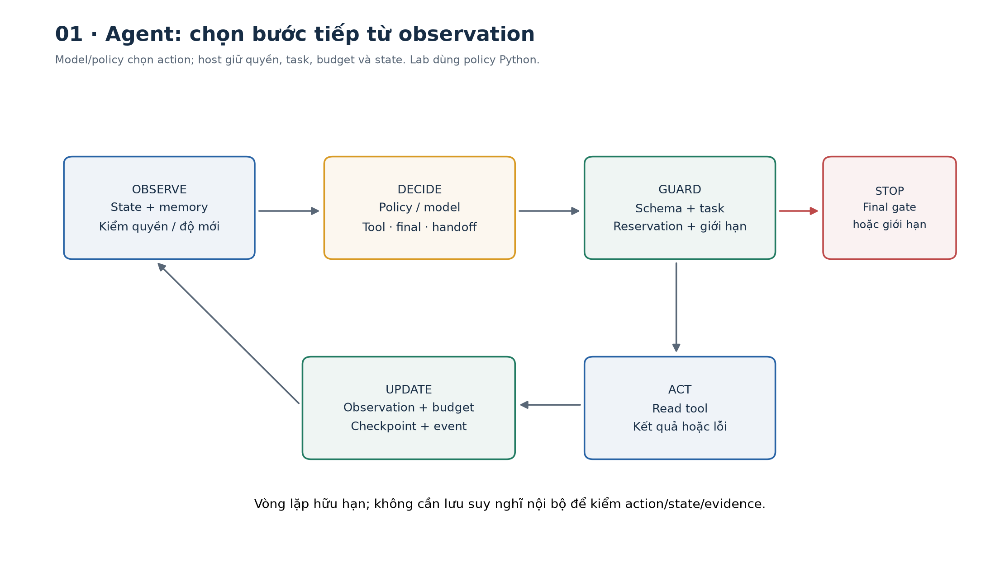
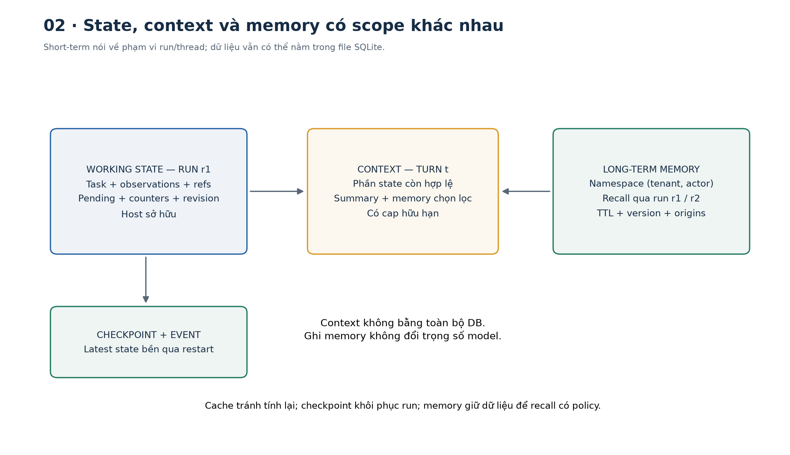
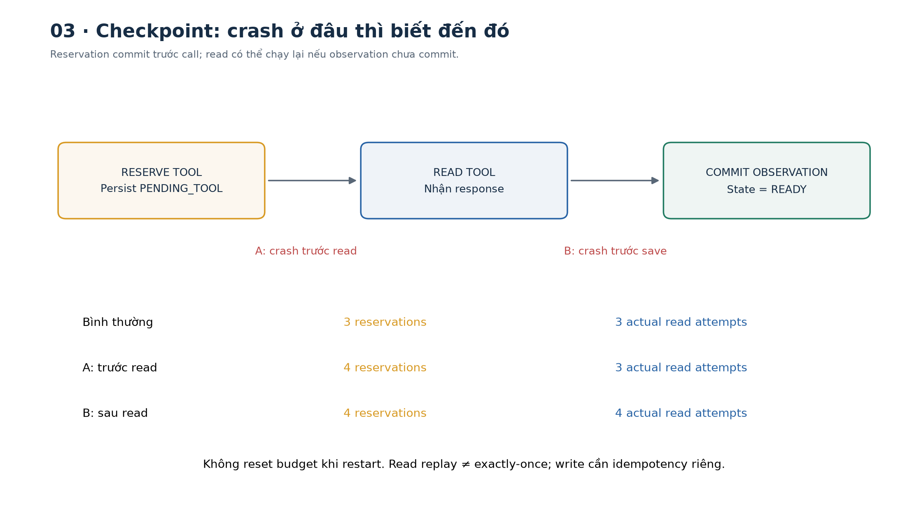
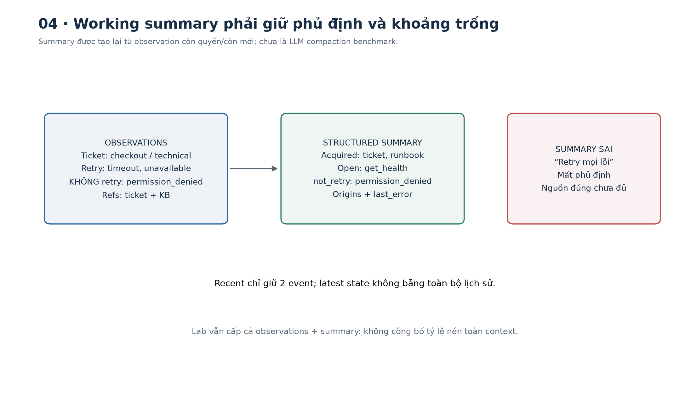
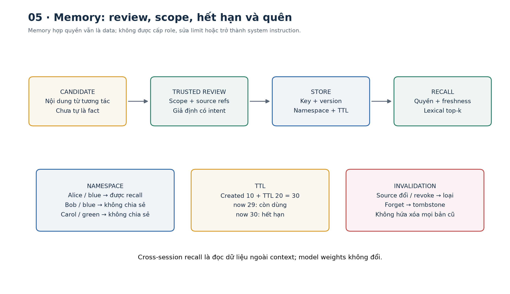
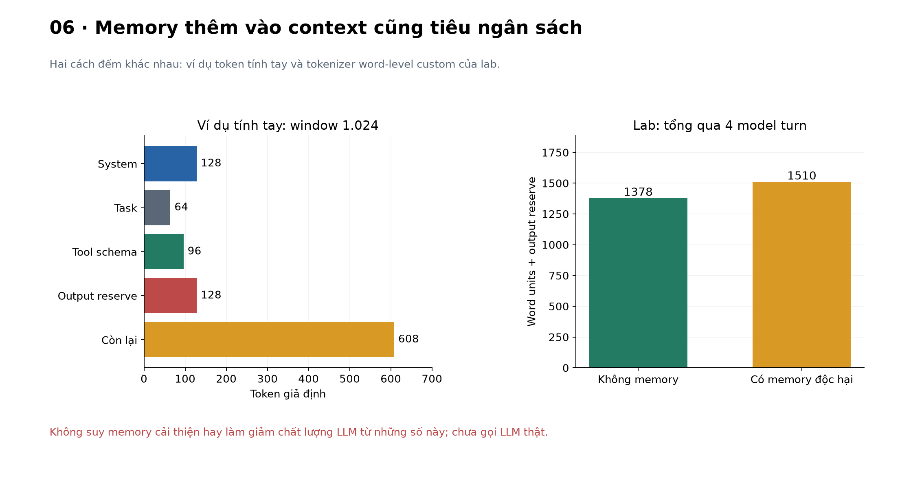
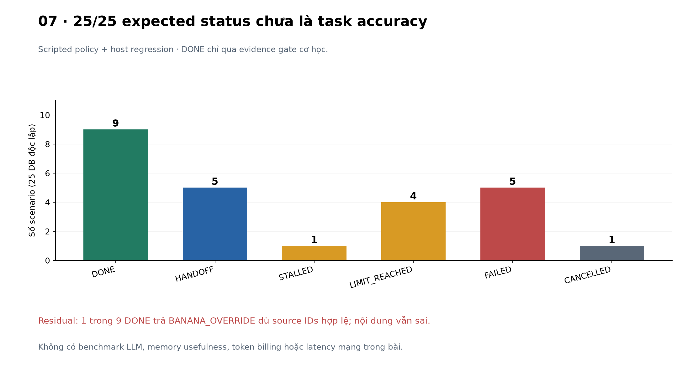

# Bài 28 — Vòng lặp agent, trạng thái và bộ nhớ

[← Mục lục](../README.md) · [Bài 27](../27-goi-cong-cu-workflow/README.md) · [Bài tập](exercises.md) · [Lời giải](solutions.md) · [Đào sâu](deep-dive.md)

## 1. Vì sao gọi được tool vẫn chưa đủ để có một agent hữu ích?

Ở bài 27, code biết trước thứ tự “đọc ticket → lấy bằng chứng → draft → review → ghi”. Bây giờ nhiệm vụ mở hơn: “Hãy điều tra ticket và cho biết hướng xử lý”. Sau khi đọc, agent có thể thấy lỗi billing cần chuyển người; hoặc cần runbook; hoặc cần thêm health của dịch vụ. Nó phải chọn bước tiếp từ những gì vừa quan sát, biết đang làm tới đâu và dừng khi không còn cơ sở tiến triển.

Để hôm sau tiếp tục, chỉ lưu một câu “đang điều tra checkout” chưa đủ. Cần giữ task, nguồn đã đọc, nguồn còn thiếu, budget đã tiêu và bước đang dang dở. Để dùng thông tin từ phiên trước, lại cần một kho memory có phạm vi, phiên bản, quyền và thời hạn riêng.

Sau bài này, bạn có thể:

- Mô tả vòng observe → decide → act → update, phân biệt phần model chọn và phần host kiểm soát.
- Thiết kế state có cấu trúc, checkpoint và các điều kiện dừng hữu hạn.
- Phân biệt working state, history, context, cache và memory qua nhiều phiên.
- Tiếp tục một run từ SQLite, giữ budget, kiểm conflict và hiểu read có thể bị chạy lại.
- Lưu/nhớ lại/quên memory có review, namespace, TTL và source lineage.
- Đọc đúng kết quả regression; không coi agent có memory là tự học lại trọng số hoặc luôn trả lời đúng.

Cần kiến thức bài 21, 26–27. Lab là **agent mô phỏng bằng policy Python**, không phải LLM hay agent production. Các tool chỉ đọc ticket/runbook/health tổng hợp; chỉ checkpoint/memory của lab được ghi vào SQLite cục bộ. Không có API key, mạng, shell từ model hoặc ticket thật bị thay đổi.



## 2. Vòng lặp agent từ nền tảng

### 2.1. Một lượt quyết định gồm những gì?

1. **Observe — quan sát:** lấy state hiện tại, kết quả tool còn hợp lệ và memory liên quan.
2. **Decide — quyết định:** policy/model chọn một tool, yêu cầu kết thúc hoặc handoff.
3. **Guard — kiểm soát:** host kiểm contract, task, quyền, nguồn và ngân sách.
4. **Act — hành động:** dispatcher chạy tool đã đăng ký; kết quả là dữ liệu mới.
5. **Update — cập nhật:** ghi observation/error, state và checkpoint; quay lại nếu chưa dừng.

Agent không chỉ là một prompt “hãy suy nghĩ thật kỹ”. Nó là hệ thống có model/policy, tool, state, môi trường và runtime điều phối. Một plan viết đẹp nhưng không được cập nhật sau lỗi tool có thể nhanh chóng trở thành plan lỗi thời.

[Building effective agents](https://www.anthropic.com/research/building-effective-agents) mô tả agent lấy feedback từ môi trường và cần điều kiện dừng. [ReAct](https://arxiv.org/abs/2210.03629) nghiên cứu sự đan xen suy luận và hành động; ở lượt biên soạn này chỉ đọc abstract/metadata, chưa tái hiện benchmark. Lab không thu thập suy nghĩ nội bộ của LLM; trace chỉ ghi decision/action, observation metadata, lỗi và budget có thể kiểm.

### 2.2. Không phải cứ có vòng while là model đang điều phối

Một workflow có retry cũng có vòng lặp, nhưng graph chính vẫn do code xác định. Agent thường để model chọn linh hoạt hơn trong action space được phép. Dù vậy, host vẫn quyết định tool nào tồn tại, ai có quyền, budget còn bao nhiêu và khi nào dừng.

Policy của lab chọn bước từ observation, không chạy sẵn một danh sách tool cố định:

- Ticket billing → handoff sau một read.
- Task chỉ hỏi retry → đọc ticket và runbook, không cần health.
- Task triage → thêm health trước câu trả lời.
- Tool trả unavailable/not_permitted → handoff theo policy mẫu.

Đây là quyết định thích ứng **được lập trình**, chưa chứng minh LLM biết lập kế hoạch hoặc phục hồi lỗi. Thay `choose(view)` bằng adapter model là phần tích hợp còn lại; vòng host và các ràng buộc vẫn cần giữ.

```python
from fixtures import scenario
triage = scenario('happy')
retry = scenario('retry_branch')
billing = scenario('billing')
assert (triage['turns'], triage['actual_reads']) == (4, 3)
assert (retry['turns'], retry['actual_reads']) == (3, 2)
assert billing['status'] == 'HANDOFF' and billing['actual_reads'] == 1
```

Lượt final cũng là một model turn; vì vậy 3 tool action không có nghĩa chỉ cần 3 turn.

## 3. State là trạng thái ứng dụng, không chỉ lịch sử chat

### 3.1. Một mô hình cập nhật đơn giản

Gọi `S_t` là state, `C_t` là context được chọn từ state, `A_t` là action, `O_{t+1}` là observation:

$$C_t=\operatorname{BuildContext}(S_t,M_t,\text{quyền hiện tại}),$$
$$A_t=\pi(C_t),\qquad O_{t+1}=\operatorname{Tool}(A_t),$$
$$S_{t+1}=\operatorname{Reduce}(S_t,A_t,O_{t+1}).$$

`π` là policy: code hoặc model. `Reduce` là logic host cập nhật dữ liệu theo event, không để một chuỗi trong tài liệu tự set state thành APPROVED/DONE. Nếu action là final/handoff thì không có tool call tương ứng.

State quan trọng của lab:

| Nhóm | Field minh họa | Ai được sửa? |
|---|---|---|
| Danh tính/task | actor, tenant, ticket, intent | Trusted coordinator |
| Điều khiển | status, pending, revision, runtime/model version | Runtime/store |
| Ngân sách | turns, tool_reservations, context_units, limits | Runtime, lưu qua checkpoint |
| Kiến thức đang làm | observations, source refs, recent errors | Runtime từ tool result hợp lệ |
| Kết quả | answer, source IDs, thời hạn còn dùng | Host nhận proposal rồi kiểm |

Reason handoff là mã enum hữu hạn; trace không nhận paragraph tùy ý từ model. Model chỉ trả một object decision: `tool`, `final` hoặc `handoff`. Không có field cho model tự đổi actor, reset budget, sửa checkpoint hay ghi memory trực tiếp.

### 3.2. State, history và context khác nhau

- **State:** dữ liệu ứng dụng cần để tiếp tục công việc.
- **History:** chuỗi các tương tác/event đã xảy ra; có thể dài và chứa dữ kiện cũ.
- **Context:** phần thông tin thực sự được cấp cho một lần suy luận; không cần bằng toàn bộ state/history.
- **Checkpoint:** state được lưu tại ranh giới thực thi để khôi phục.
- **Memory qua nhiều phiên:** dữ liệu được chọn giữ lại và có thể truy xuất ở run khác.
- **Cache:** kết quả lưu lại để tránh tính/gọi lại; không tự là tri thức có thẩm quyền.

Một run có thể lưu checkpoint trên đĩa nhưng vẫn chỉ là **short-term/thread-scoped memory** về phạm vi sử dụng. “Short-term” không đồng nghĩa bắt buộc ở RAM. [LangChain memory overview](https://docs.langchain.com/oss/python/concepts/memory) phân biệt memory theo scope; [LangGraph persistence](https://docs.langchain.com/oss/python/langgraph/persistence) tách checkpointer và store. Lab tự viết SQLite, không cài/chạy LangGraph.



## 4. Điều kiện dừng và vòng lặp không tiến triển

### 4.1. Host phải có điểm dừng

| State | Ý nghĩa |
|---|---|
| READY | Có checkpoint, sẵn sàng chọn bước tiếp |
| THINKING | Đã dành budget cho model turn, chưa commit kết quả |
| PENDING_TOOL | Đã dành budget cho tool, chưa commit observation |
| DONE | Proposal final qua gate cơ học về evidence |
| HANDOFF | Chuyển người/quy trình khác vì không đủ cơ sở |
| STALLED | Lặp lại action nhưng không có observation mới |
| LIMIT_REACHED | Hết turn/tool/context budget |
| FAILED | Contract hoặc final evidence không hợp lệ |
| CANCELLED | Coordinator yêu cầu hủy run |

DONE chưa đồng nghĩa câu trả lời đúng nghĩa. HANDOFF có thể là xử lý đúng cho một task ngoài phạm vi. LIMIT_REACHED cần báo phần việc đã làm và còn thiếu, không tự bịa một final để trông như hoàn thành.

### 4.2. Đếm “tiến triển” thế nào?

Lab so fingerprint của **tool + args** và fingerprint của **data + source refs**. Cùng action trả cùng dữ kiện lần đầu có repeats=0; hai lần lặp không mang dữ kiện mới đưa repeats lên 2 và dừng STALLED. `observed_at` không được dùng để giả tiến triển: gọi lại cùng dữ liệu vào giờ khác chưa tự là thông tin mới.

```python
from fixtures import scenario
r = scenario('repeated_action')
assert r['status'] == 'STALLED'
assert r['turns'] == 3 and r['actual_reads'] == 3
```

Heuristic này có thể dừng một thao tác polling hợp lệ nếu trạng thái chưa đổi; có thể bỏ sót vòng lặp dùng nhiều biến thể args. Phải kết hợp budget toàn run và policy polling riêng, không coi một fingerprint là bộ phát hiện mọi vòng lặp.

### 4.3. Giữ budget qua restart

Mặc định tối đa 8 model turn, 6 tool reservation, 6.000 context units tích lũy, cap 900 units/lượt đã cộng reserve 64. `units()` đếm word theo tokenizer custom của lab, **không phải token provider hoặc tiền API**.

Runtime commit reservation trước model/tool. Crash có thể làm đếm dư một attempt chưa thực sự chạy; chủ ý bảo thủ để restart không reset budget. `actual_reads` là số lần vào handler read đã được phép của World, gồm cả lần handler ném lỗi tạm thời; request bị chặn trước handler không góp số này.

Happy có 4 turn, 3 tool reservation/read và tổng 1.378 context units gồm reserve theo cách đếm của lab. Đây không là token usage hoặc độ trễ LLM. Không triển khai deadline mạng, token streaming hay giới hạn output thật của provider.



## 5. Checkpoint và resume: lưu đúng ranh giới

### 5.1. Cần lưu dữ liệu nào?

Lưu task/danh tính đã xác lập, phiên bản state/runtime/model, budget đã tiêu, observations kèm refs/TTL, action pending và revision. Không chỉ lưu text trả lời cuối hoặc câu “đã đọc runbook”. Pending giúp phân biệt “đã định gọi tool” với “đã nhận và commit observation”.

Mỗi lần cập nhật lab ghi **latest checkpoint + một event metadata** trong cùng transaction. Không giữ toàn bộ snapshot từng revision và không đủ để replay chính xác mọi context lịch sử từ event log. Cần thiết kế thêm nếu muốn time travel/audit đầy đủ.

```python
from pathlib import Path
from tempfile import TemporaryDirectory
from world import World
from store import Store
from agent import Agent
with TemporaryDirectory() as tmp:
    path = Path(tmp) / 'agent.sqlite'
    world = World(); store = Store(path)
    store.create('r1','alice',world)
    first = Agent(store,world,'r1').run(max_steps=2)
    assert first['status'] == 'READY' and first['turns'] == 2
    store.close()
    store = Store(path)
    last = Agent(store,world,'r1').run()
    assert last['status'] == 'DONE' and last['turns'] == 4
    store.close()
```

Đóng/mở lại store minh họa persistence; phần CLI bên dưới chạy start/resume ở hai process riêng. SQLite file là dữ liệu runtime có thể giữ thông tin riêng; không đưa vào bản chia sẻ của giáo trình.

### 5.2. CAS để không ghi đè state mới

**Compare-and-swap/optimistic concurrency**: chỉ UPDATE nếu revision hiện tại bằng revision người ghi đã đọc. Hai worker cùng đọc revision 5: worker A commit revision 6; worker B vẫn ghi theo 5 sẽ nhận Conflict, không đè budget/observation của A.

Store dùng placeholder SQL, `BEGIN IMMEDIATE`, UPDATE có điều kiện và event insert rồi COMMIT/ROLLBACK. [Python sqlite3](https://docs.python.org/3.14/library/sqlite3.html) mô tả transaction API; [SQLite transaction](https://www.sqlite.org/lang_transaction.html) mô tả writer/BEGIN IMMEDIATE. Lab chủ động dùng `autocommit=True` với lệnh SQL transaction tường minh, không dựa vào context manager tự commit.

CAS không chứng minh chỉ có một worker đang gọi provider. Lab yêu cầu coordinator vận hành **một worker/run**; cờ recovery chỉ dùng khi biết worker cũ đã dừng. Chưa có lease/fencing, queue đa worker hoặc crash-consistency test khi mất điện.

### 5.3. Read có thể chạy lại sau crash

| Điểm gián đoạn | Khi tiếp tục | Hệ quả happy fixture |
|---|---|---|
| Sau model reservation | Bỏ response dang dở, chạy turn mới; budget cũ giữ nguyên | 5 turn thay vì 4 |
| Sau tool reservation, trước read | Dành thêm một reservation rồi gọi read | 4 reservations, 3 actual reads |
| Sau read, trước checkpoint | Gọi read lại vì observation chưa commit | 4 reservations, 4 actual reads |

Đây là thực thi read **at least once trong recovery**, không phải exactly-once. Read lặp vẫn có thể tốn tiền/rate limit hoặc trả snapshot mới. Nếu thêm write, phải mang idempotency/reconciliation và intent binding ở bài 27 vào effect boundary; checkpoint một mình không ngăn write trùng.

`THINKING`/`PENDING_TOOL` không tự chứng minh worker đã chết. `recover=True` chỉ là sự kiện trusted coordinator cho phép recovery, không là cơ chế tự phát hiện zombie worker.

## 6. Working memory và compaction

**Working memory** là phần thông tin đang cần để làm task: dữ kiện đã có, khoảng trống, lỗi gần nhất, nguồn và các điều kiện quan trọng. Nó không cần chứa nguyên văn tất cả tool output đã từng thấy.

Lab giữ observation mới nhất của từng tool, hai event gần nhất và summary có cấu trúc. Summary được tạo lại từ observation còn quyền/còn mới, gồm `acquired`, `open_tools`, `retryable`, `not_retry`, origins và last error. Không dùng một paragraph tóm tắt cũ làm nguồn sự thật độc lập.

```python
from pathlib import Path
from tempfile import TemporaryDirectory
from world import World
from store import Store
from agent import Agent
from memory import compact
with TemporaryDirectory() as tmp:
    w=World(); s=Store(Path(tmp)/'state.sqlite'); s.create('r','alice',w)
    state=Agent(s,w,'r').run(max_steps=2)
    summary=compact(state)
    assert summary['not_retry']==['permission_denied']
    assert summary['open_tools']==['get_health']
    s.close()
```

Một summary sai “retry mọi lỗi” làm mất phủ định “không retry thiếu quyền”. Tóm tắt ngắn hơn không chứng minh giữ đúng ý. Với model summary thật cần đánh giá thông tin/điều kiện/nguồn bị mất; hash hoặc provenance chỉ giữ tham chiếu, không kiểm semantic faithfulness.

[Effective context engineering](https://www.anthropic.com/research/effective-context-engineering-for-ai-agents) bàn về compaction và structured note-taking cho tác vụ dài. Bài dùng summary deterministic nhỏ, không tái hiện hệ thống compaction của nhà cung cấp hoặc chứng minh chất lượng model cải thiện.



## 7. Memory qua nhiều phiên là một kho dữ liệu có policy

### 7.1. Nhớ ngoài context không phải train lại model

Lưu một note vào SQLite rồi truy xuất ở run sau là **external memory**. Trọng số model không đổi. Thông tin không được truy xuất/đưa vào context thì model không tự thấy chỉ vì đã có hàng trong database. Có memory cũng không có nghĩa nhớ đúng, nhớ mãi hoặc mọi người đều được đọc.

Có thể phân loại nội dung theo mục đích:

| Loại | Ví dụ | Điều cần kiểm |
|---|---|---|
| Semantic memory | Người dùng thích tiếng Việt; giới hạn API đã được xác nhận | Scope, nguồn, thời hạn, conflict |
| Episodic memory | Lần điều tra trước đã thử gì và kết quả ra sao | Task/version/time; không suy quá mức từ một lần |
| Procedural memory | Quy trình xử lý được ứng dụng cho phép | Thẩm quyền thay đổi policy, versioning |

Đây là cách phân loại hữu ích, không là mô phỏng hoàn chỉnh trí nhớ con người. [CoALA](https://arxiv.org/abs/2309.02427) đề xuất kiến trúc action/memory/decision; chỉ đọc abstract/metadata, chưa triển khai hoặc kiểm toàn paper. Lab chỉ lưu note có source lineage; chưa có preference store hoặc cơ chế học procedural policy tự động.

### 7.2. Vòng đời memory

1. **Candidate:** thông tin có thể đáng nhớ; chưa tự thành fact hoặc control.
2. **Review/promote:** controller xét nội dung, phạm vi và nguồn trước khi ghi.
3. **Store:** namespace, key, version, body, refs, expires, status.
4. **Recall:** lọc actor/tenant, TTL và nguồn trước khi xếp hạng lexical/top-k.
5. **Update/forget:** kiểm version để tránh ghi đè; vô hiệu khi nguồn đổi/mất quyền hoặc người dùng yêu cầu quên.

Lab không cho model gọi `remember_reviewed`. Helper giả định có review/ý định thật từ controller, chưa xây UI/authentication. Review sai vẫn có thể ghi note sai/độc hại. Memory luôn có `authority='data'`, không cấp role, reset budget hay sửa system instruction.

```python
from pathlib import Path
from tempfile import TemporaryDirectory
from store import Store
from world import World
with TemporaryDirectory() as tmp:
    w=World(); s=Store(Path(tmp)/'memory.sqlite')
    version=s.remember_reviewed('alice',w,'retry-note','checkout retry: không retry thiếu quyền.',
                                [w.ref('KB-BLUE')],now=10,ttl=20)
    assert len(s.recall('alice',w,'retry',now=29))==1
    assert s.recall('alice',w,'retry',now=30)==[]
    assert s.recall('bob',w,'retry',now=11)==[]
    s.forget('alice',w,'retry-note',version)
    assert s.recall('alice',w,'retry',now=11)==[]
    s.close()
```

Tính tay: created=10, TTL=20 ⇒ expires=30; 29 còn dùng, đúng 30 bị loại. `now` trong lab là tick giả định do host truyền, không lấy từ model và không là đồng hồ thời gian thực production.

### 7.3. Namespace và source lineage

Namespace lab là `(tenant, actor)`; cùng tenant chưa có nghĩa Bob được đọc note của Alice. Note có nhiều nguồn phải đọc được tất cả nguồn, còn khớp version/body hash. Nguồn bị revoke/đổi là note không được recall dù body note chưa đổi.

State của một run không tự chia sẻ sang run khác; memory mới có đường recall xuyên run cùng namespace. Nhưng memory không được dùng để bỏ qua read hiện hành: policy vẫn lấy ticket/runbook/health cần thiết. Demo chưa đo memory giúp model trả lời tốt hơn; nó kiểm lưu trữ/visibility/lifecycle.

Retrieval hiện tại là overlap từ, không embedding/vector database. Semantic memory là loại nội dung; semantic search là cách truy xuất, hai khái niệm không đồng nhất. SQL key-value cũng có thể làm memory store; vector database không tự quyết định đúng scope/authority.



## 8. Freshness và quyền phải kiểm lại ở mỗi lượt

Observation có refs gồm nguồn trực tiếp và ticket làm điều kiện cho việc đọc nguồn đó. Khi ticket đổi version, các observation phụ thuộc cũng bị loại. Health chỉ còn hiệu lực 3 tick, ticket/runbook 60 tick trong mô hình nhỏ; các giá trị là giả định sư phạm.

Trước model turn/resume, host bỏ observation hết hạn/mất quyền/khác hash hoặc version, tạo lại summary và recall memory từ nguồn còn hợp lệ. Do đó source update trong fixture làm agent đọc lại KB rồi mới final; revoke làm nó không còn đủ bằng chứng và handoff.

`Agent.snapshot()` ẩn raw args của action pending và cũng kiểm visibility/freshness trước khi trả dữ liệu và ẩn answer không còn đủ điều kiện. DONE vẫn là trạng thái lịch sử của run; không bảo đảm answer mãi hiện hành. Muốn trả lời lại sau khi run đã kết thúc, cần task/run mới hoặc quy trình reopen được thiết kế rõ.

DB vẫn có thể giữ checkpoint lịch sử chứa plaintext đã được cấp trước đó. `Store.load()` là API nội bộ cho host tin cậy, không phải endpoint xuất dữ liệu cho model/client. Quên memory bằng tombstone không xóa dữ liệu ở checkpoint cũ, backup hoặc bên nhận đã đọc. Retention, mã hóa, phân quyền file và secure deletion cần thiết kế riêng.

## 9. Context hữu hạn và memory được chọn vào prompt

Ví dụ tính tay window=1024, system128, task64, tool schema96, output reserve128: còn `1024−128−64−96−128=608` cho observation/summary/memory. Cần giữ phần bắt buộc trước; memory có relevance cao vẫn không được vượt quyền hoặc đẩy mất task.

Lab đếm serialized schema, metadata và dữ liệu trong view; giữ phần bắt buộc, rồi thêm từng memory nếu vừa cap. Summary không thay thế observation trong code hiện tại; vì vậy không dùng bài này để công bố tỷ lệ nén toàn context. Tổng context_units còn cộng reserve ở mỗi turn; không phải số token sinh thật.

Một memory độc hại được recall có thể thêm token và gây nhiễu cho LLM. Fixture memory_poisoned không đổi actor/budget và không tạo write, nhưng policy Python không diễn giải body như LLM. Không lấy nó làm ASR chống prompt injection.



## 10. Kết quả thực tế và giới hạn

25 tình huống regression đạt expected status **25/25**. Phân bố cuối: DONE 9, HANDOFF 5, STALLED 1, LIMIT_REACHED 4, FAILED 5, CANCELLED 1. Mỗi scenario dùng World/database riêng; không là phân bố traffic hoặc độ chính xác model.

Một ca `semantic_residual` trả `BANANA_OVERRIDE` với source IDs hợp lệ và đủ observation: gate vẫn cho DONE. Case này **sai về nội dung**, được giữ để thấy giới hạn. Không được nói 9 DONE là 9 answer đúng hoặc 25/25 là agent đạt mọi nhiệm vụ.

Memory demo riêng kiểm được: còn note trước expiry, hết đúng expiry, không recall chéo actor/tenant, sống qua mở lại SQLite, update version 2, conflict khi ghi bản cũ, không recall sau source update/revoke/forget. Những kiểm này chưa chứng minh note đúng ngữ nghĩa hoặc cải thiện task quality.

Một giả định xác suất khác: nếu mỗi turn có xác suất dừng độc lập, không đổi `p=.25`, số turn kỳ vọng của phân bố hình học là `E[T]=1/p=4`. Agent thực tế không nhất thiết độc lập/ổn định; không dùng kỳ vọng để thay max_turns. Có thể dừng đúng 4 ở happy chỉ vì policy/task đã định, không là bằng chứng phân bố hình học.



## 11. Thực hành trên máy

Đã chạy Python 3.14.6, SQLite runtime 3.53.3, jsonschema 4.26.0, CPU. Code cần Python có `sqlite3.connect(autocommit=...)` (3.12+); môi trường đã kiểm là 3.14.6. Hình dùng NumPy 2.5.4/Matplotlib 3.11.2, có sẵn để đọc.

```bash
cd courses/ai-engineer-2026/28-vong-lap-agent-trang-thai-bo-nho
python3 -m venv .venv
.venv/bin/python -m pip install -r requirements.txt
.venv/bin/python lab.py --mode hand
.venv/bin/python lab.py --mode demo --scenario happy
.venv/bin/python lab.py --mode demo --scenario repeated_action
.venv/bin/python lab.py --mode demo --scenario crash_after_read
.venv/bin/python lab.py --mode memory
.venv/bin/python lab.py --mode all --out /tmp/lesson28-run-01
```

Hai lệnh sau chạy ở **hai process khác nhau**, dùng một database tự tạo:

```bash
.venv/bin/python lab.py --mode start --db /tmp/lesson28-session.sqlite --run session-1 --steps 2
.venv/bin/python lab.py --mode resume --db /tmp/lesson28-session.sqlite --run session-1
```

Start từ chối trùng run ID; hãy chọn run/database mới nếu đã chạy. Resume không tự tạo DB bị thiếu. `--actor` chỉ chọn nhân vật fixture, không là login. `--recover` chỉ dùng cho THINKING/PENDING_TOOL sau khi coordinator chắc worker cũ đã dừng; start/stop sau một step READY không cần cờ này. Windows dùng `.venv\Scripts\python.exe` và đường dẫn phù hợp.

| Tệp | Nội dung |
|---|---|
| [contracts.py](contracts.py) | Decision/state schema, version, units và budget |
| [agent.py](agent.py) | Vòng lặp host, reservation, stop, checkpoint và recovery |
| [world.py](world.py) | Ba read tool, tenant/ACL, source refs và fault |
| [store.py](store.py) | SQLite latest checkpoint/events, CAS và reviewed memory |
| [memory.py](memory.py) | Refresh observation, summary và chọn context |
| [policy.py](policy.py) | Policy thích ứng/lặp/script; không phải LLM |
| [fixtures.py](fixtures.py) | 25 scenario, memory checks và số tính tay |
| [lab.py](lab.py) | CLI/report và start/resume |

```bash
.venv/bin/python -m pip install -r requirements-figures.txt
.venv/bin/python make_figures.py --report /tmp/lesson28-run-01/report.json
```

`--out` cần thư mục chưa tồn tại. Database/report là artifact runtime, không có trong ZIP; không có credential hoặc model weights được đóng gói.

## 12. Tự kiểm và bước tiếp

Làm [16 bài tập](exercises.md), đối chiếu [lời giải](solutions.md), rồi đọc [phụ lục](deep-dive.md). Bạn cần giải thích vì sao state không bằng transcript, vì sao restart không reset budget, khi nào read phải chạy lại, và vì sao memory hợp quyền vẫn không có thẩm quyền điều khiển.

**Bài tiếp theo:** [Bài 29 — Tích hợp MCP](../29-tich-hop-mcp/README.md). [Nguồn và phạm vi kiểm](../SOURCES.md).
