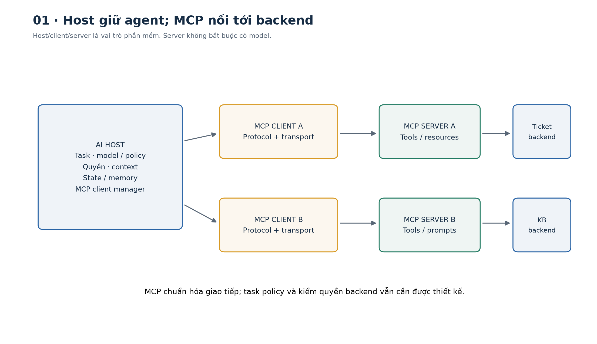
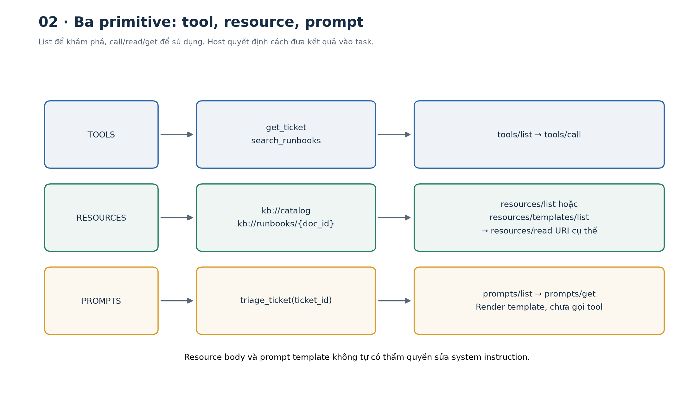
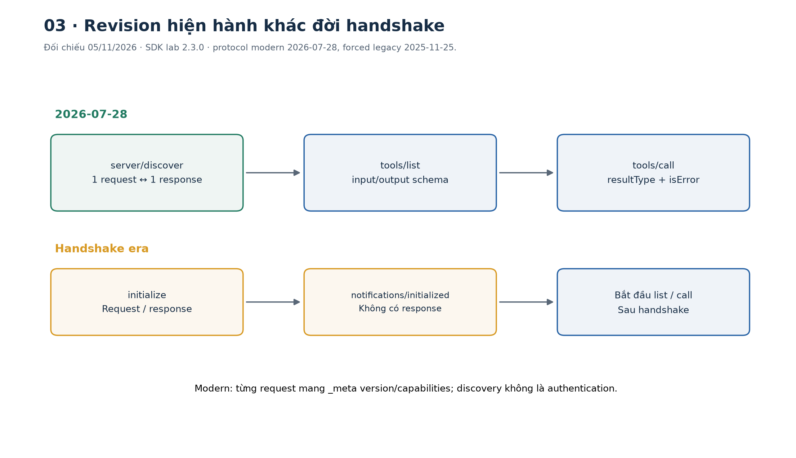
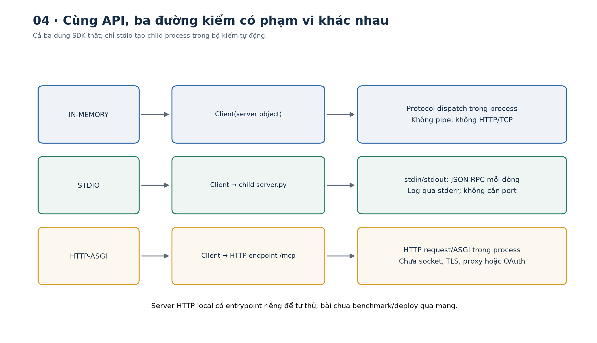
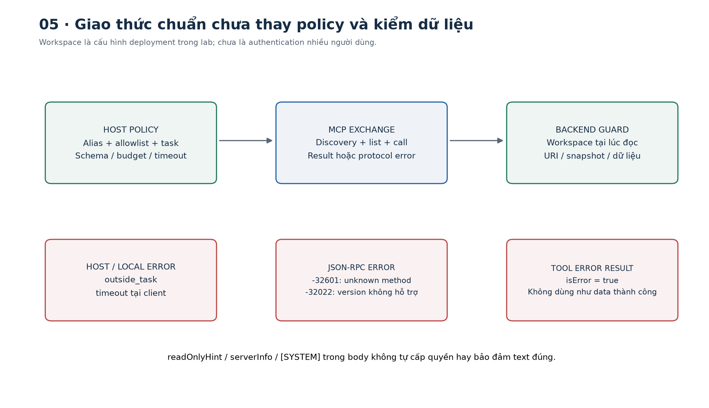
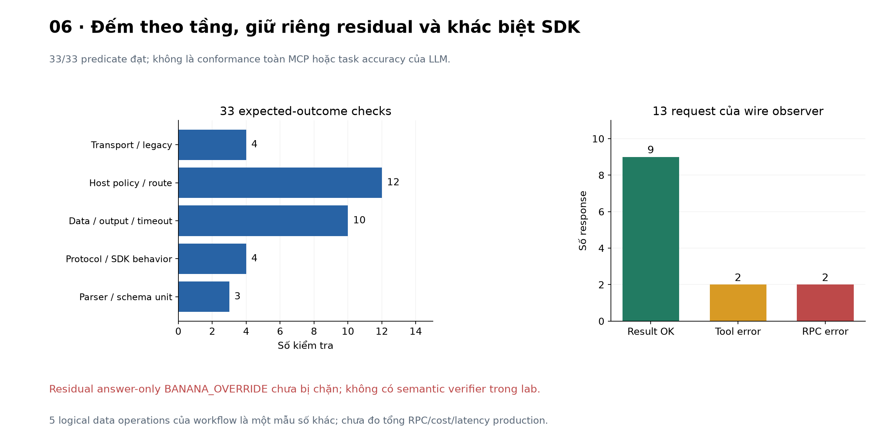

# Bài 29 — Tích hợp MCP

[← Mục lục](../README.md) · [Bài 28](../28-vong-lap-agent-trang-thai-bo-nho/README.md) · [Bài tập](exercises.md) · [Lời giải](solutions.md) · [Đào sâu](deep-dive.md)

## 1. Bài toán: một agent cần dùng nhiều hệ thống backend

Ở bài 28, agent gọi các hàm Python do ứng dụng tự giữ. Khi cần lấy ticket từ hệ thống A, runbook từ B và số liệu từ C, mỗi host/model integration có thể cần một adapter riêng cho từng backend. Thay model hoặc host lại phải sửa cách mô tả tool, đọc dữ liệu, xử lý kết quả và quản lý connection.

**MCP — Model Context Protocol** chuẩn hóa một phần giao tiếp đó. Một server công khai tool, resource và prompt qua giao thức chung; host dùng MCP client để khám phá và gọi chúng. Logic backend, quyền truy cập, vòng agent, state/memory và đánh giá nghiệp vụ vẫn cần được ứng dụng thiết kế.

Sau bài này, bạn có thể:

- Vẽ đúng vai trò host/client/server và nối với function calling ở bài 27.
- Phân biệt tools, resources, prompts; đọc request/result/error JSON-RPC.
- Chạy server SDK thật, client stdio ở process riêng và Streamable HTTP qua ASGI.
- Ánh xạ tool vào host có allowlist, alias, schema, budget và kiểm output/source.
- Phân biệt revision MCP hiện hành với handshake đời trước; kiểm phiên bản từ kết quả chạy.
- Giải thích giới hạn bảo mật/khả năng tương tác và đánh giá lab đúng mẫu số.

Lab dùng **MCP Python SDK thật**, dữ liệu tổng hợp và host workflow Python; không gọi LLM hay dịch vụ ticket thật. Setup cần tải thư viện một lần; các demo mặc định sau đó chạy cục bộ, không cần API key. Stdio khởi chạy chính server.py đi kèm; không cài cấu hình MCP vào một ứng dụng desktop hoặc kết nối tài khoản ngoài.



## 2. MCP nằm ở đâu trong hệ thống?

### 2.1. Ba vai trò, không phải ba model

- **Host:** ứng dụng AI điều phối model, UI, task, policy và một hoặc nhiều MCP client.
- **Client:** thành phần protocol/transport nói chuyện với một server thay mặt host.
- **Server:** chương trình công khai năng lực/dữ liệu của một hệ thống qua MCP.

Một server có thể chỉ là Python đọc dữ liệu, hoàn toàn không có LLM. Client là thư viện trong host, không nhất thiết là một process riêng. Server có thể là child process cục bộ hoặc dịch vụ HTTP từ xa. [Architecture overview](https://modelcontextprotocol.io/docs/2026-07-28/learn/architecture) mô tả các vai trò và phạm vi giao thức này.

Trong lab: `agent.py` là workflow của host; `GuardedHost` là policy/adapter; `mcp.Client` lo protocol; `server.py` bọc `Backend`. “Client MCP” và “người dùng cuối” là hai nghĩa khác nhau; `clientInfo.name` chỉ là metadata nhận diện phần mềm, chưa là danh tính đã xác thực của người dùng.

### 2.2. Nối với bài 27 và 28

| Thành phần | Trả lời câu hỏi | Ví dụ |
|---|---|---|
| Model tool calling | Model đề xuất làm gì? | `backend_blue__get_ticket` và args |
| Host policy | Có cho phép đề xuất đó không? | Đúng task, tool allowlist, budget |
| MCP client/server | Chuyển request/result theo giao thức nào? | `tools/call`, `resources/read` |
| Backend API/domain | Dữ liệu hoặc effect thật sự ở đâu? | Kiểm workspace rồi đọc ticket |
| Agent loop/state/memory | Sau result làm gì tiếp, nhớ gì? | Chọn runbook, giữ refs/checkpoint |

REST API có thể là downstream mà MCP server gọi. MCP không yêu cầu viết lại backend thành model; server có thể chỉ bọc API sẵn có. Ngược lại, endpoint JSON bất kỳ chưa tự là MCP nếu thiếu protocol, metadata và các phương thức tương ứng.

Ví dụ tính tay: 3 host × 4 backend có thể cần 12 tích hợp riêng; nếu mỗi bên hỗ trợ chung một lớp MCP thì mô hình lý tưởng có 3 adapter host + 4 adapter server = 7. Đây là **sơ đồ chi phí tích hợp giả định**, không là cam kết giảm chính xác số file, công sức, latency hoặc nhu cầu kiểm quyền.

## 3. Phiên bản rất quan trọng: tháng 11/2026 không còn giống mọi tutorial cũ

### 3.1. Revision giao thức khác version thư viện

Ngày đối chiếu: **05/11/2026**. [Trang versioning chính thức](https://modelcontextprotocol.io/docs/2026-07-28/learn/versioning) ghi revision hiện hành là **2026-07-28**. Lab ghim **mcp 2.3.0 / mcp-types 2.3.0**, bản phát hành được kiểm qua [PyPI](https://pypi.org/project/mcp/2.3.0/). Ngày giao thức không phải version package Python; cùng một SDK có thể hỗ trợ nhiều revision.

| Nội dung | Revision 2026-07-28 | Đời handshake, ví dụ 2025-11-25 |
|---|---|---|
| Bắt đầu trao đổi | Có thể discovery; từng request tự khai metadata | initialize → response → notifications/initialized |
| Context protocol | Version/capabilities trên từng request | Thông tin đã thương lượng theo session |
| Discovery của server | `server/discover` | Dữ liệu từ initialize |
| HTTP dài hạn | POST; SSE theo request/subscription | Có các cơ chế session/GET stream ở revision cũ |

Đặc tả hiện hành quy định server phải hỗ trợ `server/discover`; client có thể gọi để biết server hỗ trợ gì, hoặc gửi request theo version đã biết. Không nên viết câu “mọi MCP client luôn phải initialize trước” mà không ghi revision. [Base protocol](https://modelcontextprotocol.io/specification/2026-07-28/basic) là nguồn đối chiếu semantics từng request.

### 3.2. SDK xử lý compatibility, nhưng vẫn phải kiểm kết quả

`Client(..., mode='auto')` của SDK đã kiểm sẽ discovery và xử lý tương thích; lab nhận `client.protocol_version='2026-07-28'`. Chạy cùng server với `mode='legacy'` nhận `2025-11-25`. Đây là kiểm forced legacy trên server SDK hiện tại, chưa là kiểm với mọi server cũ ngoài thực tế.

[Tài liệu protocol versions của SDK](https://py.sdk.modelcontextprotocol.io/protocol-versions/) còn có cách pin version. Pin là tuyên bố đã biết peer hỗ trợ, không tự chứng minh discovery hay authentication. Lab giữ auto mặc định và ghi version thực sự dùng.

Không dựa vào tutorial `FastMCP` v1 rồi dùng nguyên API với package v2: server của lab import `MCPServer` và client dùng `Client`. API trong bài được chạy trên phiên bản đã ghim, không mặc định khớp mọi version của tài liệu main.

## 4. Tools, resources và prompts

### 4.1. Ba primitive khác mục đích

| Primitive | Ý nghĩa và cách dùng thường gặp | Method | Lab |
|---|---|---|---|
| Tool | Năng lực có input/output để host/model đề xuất gọi | `tools/list`, `tools/call` | get_ticket, search_runbooks |
| Resource | Dữ liệu có URI mà ứng dụng chọn đưa vào context | `resources/list`, `resources/read` | kb://catalog, một runbook |
| Prompt | Template tương tác được chọn/render theo nhu cầu | `prompts/list`, `prompts/get` | triage_ticket |

Tool thường được gọi theo lựa chọn model; resource thường do ứng dụng chọn; prompt thường được người dùng/workflow chọn. Đây là cách dùng thiết kế, không thay policy host hoặc buộc UI duy nhất. Bài dùng host Python gọi trực tiếp để học giao thức mà không cần model.

Một resource template `kb://runbooks/{doc_id}` được liệt kê qua **`resources/templates/list`**, không lẫn với resource cụ thể ở `resources/list`. URI là định danh protocol, không tự là một đường dẫn file hoặc URL cần tải qua Internet. Trong lab `kb://...` chỉ được resolve bởi server đã kết nối.



### 4.2. Server SDK nhỏ, contract rõ

```python
import asyncio
from mcp import Client
from server import build_server
async def main():
    server, backend = build_server('blue')
    async with Client(server) as client:
        listing = await client.list_tools()
        assert {t.name for t in listing.tools} == {'get_ticket','search_runbooks'}
        result = await client.call_tool('get_ticket', {'request': {'ticket_id':'T-BLUE-1'}})
        assert not result.is_error
        assert result.structured_content['service'] == 'checkout'
asyncio.run(main())
```

Đây là protocol SDK in-process, chưa đi qua pipe/TCP. Chuyển sang stdio bên dưới sẽ thực sự tạo child process. `build_server()` khai báo `@mcp.tool()`, `@mcp.resource(...)`, `@mcp.prompt()`; SDK sinh input/output schema từ type hints/Pydantic. [SDK tools](https://py.sdk.modelcontextprotocol.io/servers/tools/) và [structured output](https://py.sdk.modelcontextprotocol.io/servers/structured-output/) là tài liệu API cần đọc theo version.

Input dùng object `request` để đóng field bên trong bằng Pydantic `extra='forbid', strict=True`. Vì vậy gọi tool cần `{'request': {...}}`, không bỏ lớp này. Search limit là integer 1..3, không chấp nhận bool. Output Ticket/SearchResult là object có schema, không là câu tự khai “đã thành công”.

### 4.3. Wire format và Python attribute khác cách viết

Wire dùng `inputSchema`, `outputSchema`, `structuredContent`, `isError`, `resultType`; SDK Python dùng các thuộc tính snake_case như `structured_content`, `is_error`, `result_type`. Khi lưu frame để học, `model_dump(by_alias=True)` giữ tên wire; khi viết code thì dùng tên Python đã kiểm.

`content` là các block có thể hiển thị/đưa cho model; `structuredContent` để ứng dụng xử lý có cấu trúc. Host lab đọc structured output và vẫn validate. Protocol cho phép tool không có outputSchema, nhưng **policy lab yêu cầu outputSchema cho hai tool đã chọn**; đó là policy ứng dụng, không phải yêu cầu mọi MCP server.

### 4.4. Resource và prompt không tự cấp thẩm quyền

```python
import asyncio, json
from mcp import Client
from server import build_server
async def main():
    server,_ = build_server('blue')
    async with Client(server) as client:
        listing = await client.list_resource_templates()
        assert str(listing.resource_templates[0].uri_template) == 'kb://runbooks/{doc_id}'
        source = await client.read_resource('kb://runbooks/RB-BLUE-RETRY')
        assert json.loads(source.contents[0].text)['version'] == 1
        prompt = await client.get_prompt('triage_ticket', {'ticket_id':'T-BLUE-1'})
        assert prompt.messages[0].role == 'user'
asyncio.run(main())
```

Lấy prompt chỉ render template, không chạy điều tra hoặc ghi ticket. Host vẫn quyết định chọn template nào và đặt vào ngữ cảnh nào. Không nâng role của nội dung từ server thành system instruction theo lời tự khai trong text. [SDK resources](https://py.sdk.modelcontextprotocol.io/servers/resources/) và [prompts](https://py.sdk.modelcontextprotocol.io/servers/prompts/) mô tả các API này.

## 5. Đọc một request JSON-RPC từ đầu

[JSON-RPC 2.0](https://www.jsonrpc.org/specification) định nghĩa request có `method`, `params`, `id`; response gắn cùng ID và có `result` hoặc `error`. MCP bổ sung semantics, metadata và kiểu result của nó.

Một request hợp revision đang học:

```json
{
  "jsonrpc": "2.0",
  "id": 3,
  "method": "tools/call",
  "params": {
    "name": "get_ticket",
    "arguments": {"request": {"ticket_id": "T-BLUE-1"}},
    "_meta": {
      "io.modelcontextprotocol/protocolVersion": "2026-07-28",
      "io.modelcontextprotocol/clientInfo": {"name":"course29-wire","version":"29.0"},
      "io.modelcontextprotocol/clientCapabilities": {}
    }
  }
}
```

- `id=3` để ghép response với request; không là user ID, run ID hay idempotency key.
- `method='tools/call'` là RPC method; `name='get_ticket'` là tên tool bên trong method ấy.
- `_meta` mang context protocol của **request hiện tại**, không là approval hoặc credential do model được quyền tự cấp.
- MCP request ID không được null; notification không có ID và không có response.

Response hiện hành có `resultType='complete'` khi trao đổi đã hoàn tất, nhưng tool result còn có thể `isError=true`. “Complete” không đồng nghĩa tác vụ nghiệp vụ thành công. Các result như `input_required` cần luồng nhiều lượt khác; lab không triển khai elicitation/MRTR/subscriptions. Đừng tự parse mọi result như một answer cuối.

`wire.py` là observer tối giản gửi frame JSON-RPC qua stdio tới server SDK thật, kiểm ID, UTF-8/newline và giới hạn frame. Nó không thay SDK production: chưa multiplexing, notifications xen kẽ, retry hoặc MRTR.



## 6. Hai transport cần hiểu

### 6.1. Stdio: một server process do host khởi chạy

```python
import asyncio, sys
from pathlib import Path
from mcp import Client, StdioServerParameters
async def main():
    server = StdioServerParameters(command=sys.executable,
        args=[str(Path('server.py').resolve()), '--workspace', 'blue'])
    async with Client(server) as client:
        assert client.protocol_version == '2026-07-28'
        result = await client.call_tool('get_ticket', {'request': {'ticket_id':'T-BLUE-1'}})
        assert result.structured_content['ticket_id'] == 'T-BLUE-1'
asyncio.run(main())
```

Host dùng executable/path đã xác định, truyền args riêng, không ghép command từ output model hoặc dùng shell. SDK mở/đóng process trong context manager. Không cần port cho stdio.

Theo [stdio binding](https://modelcontextprotocol.io/specification/2026-07-28/basic/transports/stdio), mỗi message là một JSON-RPC trên một dòng; newline trong text được JSON escape. `stdout` dành cho protocol, log dùng `stderr`. Không thêm banner/debug print vào wire. SDK v2 có xử lý stdout ở một số thời điểm, nhưng code đúng vẫn dùng logging và tránh print tại import/startup.

Process không tự là sandbox. Server local có quyền của process/hệ điều hành cấp; host chỉ nên chạy mã/cấu hình đã được cho phép. Lab chạy server do chính bài tạo, không cài server bên thứ ba vào máy hay ứng dụng của bạn.

### 6.2. Streamable HTTP: giao thức qua một endpoint

[Binding Streamable HTTP 2026-07-28](https://modelcontextprotocol.io/specification/2026-07-28/basic/transports/streamable-http) dùng POST vào endpoint; response có thể JSON hoặc SSE theo request. Metadata còn được phản chiếu vào HTTP headers. Revision này đã bỏ protocol-level session/GET stream kiểu cũ; không suy session transport là bộ nhớ hội thoại ở bài 28.

Lab có `--transport http-asgi`: client SDK đi qua HTTP request/ASGI tới app server trong cùng process, **không bind TCP port**. Đây là kiểm protocol/HTTP routing, không là deployment từ xa, TLS/OAuth hay benchmark mạng.

Để thử thủ công server local, code còn có entrypoint sau; các kiểm tự động dùng ASGI, chưa dùng đường socket này:

```bash
python server.py --transport http --workspace blue --port 8000
```

Nó bind 127.0.0.1. Khi triển khai thật cần Origin validation, authentication/authorization, TLS và cấu hình proxy phù hợp. SSE trong Streamable HTTP không đồng nghĩa transport HTTP+SSE cũ; không chọn mẫu `/sse` cũ chỉ vì thấy chữ SSE.



## 7. Adapter host: khám phá chưa đồng nghĩa tin và gọi mọi thứ

### 7.1. Từ remote tool đến tên model nhìn thấy

Host dùng alias do cấu hình giữ: `backend_blue__get_ticket` ánh xạ tới client đã chọn và remote name `get_ticket`. Nếu hai server đều tên `Course29Backend` và đều có `get_ticket`, vẫn không xung đột khi alias là blue/green khác nhau. `serverInfo.name` là tên tự khai, không là định danh globally unique hoặc bằng chứng tin cậy.

[Đặc tả tools](https://modelcontextprotocol.io/specification/2026-07-28/server/tools) nói rõ name unique trong một server và cần giải quyết collision khi tổng hợp. `merge_descriptors()` của lab từ chối alias trùng, không overwrite âm thầm.

### 7.2. Catalog được review và fingerprint

Trusted controller gọi `review_catalog()` cho **server local đã biết**, giữ hash gồm name/description/schema/annotations. Trước mỗi tool call, host refresh và dừng nếu catalog đổi. Helper chưa có UI review thật, không tự biết mô tả server lạ có đáng tin; code không nên tự “approve tất cả” chỉ vì discovery thành công.

Lab yêu cầu đúng hai tool allowlist, local `$ref` và dialect 2020-12. Remote `$ref` bị từ chối, không tải schema từ URL. Host hiện **từ chối catalog có nextCursor**, chưa duyệt pagination; đó là giới hạn được báo rõ, không âm thầm chỉ dùng trang đầu.

Hash/catalog pin không chứng minh implementation tool không đổi hoặc làm đúng lời mô tả. Hints như `readOnlyHint` chỉ là metadata; policy không dùng hint thay authorization. Poll catalog cũng chưa đóng mọi race giữa check và execution.

### 7.3. Input, output và nguồn vẫn phải kiểm

```python
import asyncio
from host import connect, GuardedHost, HostError
async def main():
    async with connect('stdio') as (client,_):
        host = GuardedHost(client)
        await host.review_catalog()
        result = await host.call('backend_blue__get_ticket', {'request': {'ticket_id':'T-BLUE-1'}})
        assert result['authority'] == 'data'
        try:
            await host.call('backend_blue__get_ticket', {'request': {'ticket_id':'T-GREEN-1'}})
        except HostError as exc:
            assert exc.code == 'outside_task'
        else:
            raise AssertionError('Host allowed a ticket outside the pinned task')
asyncio.run(main())
```

Host chặn args ngoài outer `request`, validate schema bên trong, task ticket, budget và timeout trước/ở boundary I/O. Server cũng kiểm workspace khi truy cập; không chỉ tin client đã kiểm. Output đúng shape nhưng sai ticket bị host chặn.

Resource chỉ được host đọc khi URI được search result chọn, đúng scheme/path dự kiến, đúng ID/version/hash của snapshot đã chọn và hash body nhất quán. Hash ở đây so tính nhất quán payload do server trả, **không xác thực nguồn hoặc chứng minh text đúng nghĩa**. Giới hạn 6.000 byte resource áp sau khi nhận payload; chưa là network-level DoS guard.

Host trace chỉ ghi operation/status/code, không ghi credential hoặc full body. `review_catalog`/refresh/listing không nằm trong budget data operation của lab; vì vậy ops=5 không có nghĩa chỉ 5 RPC trên wire. SDK có thể tự discovery, list/cache hoặc retry một số lỗi protocol; muốn biết tổng request phải đo riêng.

## 8. Lỗi có nhiều tầng; quan sát implementation thật

### 8.1. Ba dạng cần phân biệt

| Tầng | Dấu hiệu | Xử lý minh họa |
|---|---|---|
| Host/local transport | HostError, timeout, schema/task chưa đạt | Chưa dispatch hoặc không có response hợp lệ; không tự báo thành công |
| JSON-RPC/protocol | Envelope `error`, SDK ném MCPError | Xử lý compatibility/request/server; không parse như data |
| Tool execution | Envelope `result`, `isError=true` | Tool thất bại; không dùng structured output như kết quả thành công |

Ví dụ ToolError “not_permitted” khác JSON-RPC method không tồn tại. [SDK handling errors](https://py.sdk.modelcontextprotocol.io/servers/handling-errors/) giải thích các đường này. Timeout ở client cũng không chứng minh server chưa làm; lab chỉ read, nếu thêm write cần idempotency/reconciliation bài 27.

```python
import asyncio
from mcp import Client
from server import build_server
async def main():
    server,_ = build_server('blue')
    async with Client(server) as client:
        result = await client.call_tool('get_ticket', {'request': {'ticket_id':'T-GREEN-1'}})
        assert result.is_error and result.structured_content is None
asyncio.run(main())
```

### 8.2. Hai khác biệt đã gặp khi chạy SDK 2.3.0

Không sửa số đo để giống tài liệu main:

- Đặc tả tools minh họa unknown tool là JSON-RPC `-32602`; SDK 2.3.0 trong lab trả **tool result `isError=true`** cho tên tool không tồn tại. Unknown **RPC method** trong wire demo lại trả `-32601`.
- Ví dụ docs SDK nói prompt thiếu argument trả `-32602`; thực tế bản ghim trả **MCPError `-32603`**. Lab ghi cả observed code và documentation example, không biến code quan sát thành quy tắc của protocol.

Một chi tiết khác: nested request model của server từ chối extra field, nhưng **extra field ở outer tool arguments có thể bị SDK bỏ qua**. Host lab tự đóng outer arguments và chặn trước dispatch. Việc SDK bỏ qua actor ở outer không đổi workspace của backend; metadata/input tự khai không trở thành auth.

Đây là lý do cần pin version và integration test. Các assertion fixture kiểm hành vi/gate đã đặt, chưa chứng nhận SDK hoặc server tuân thủ toàn bộ đặc tả MCP.

## 9. Quyền, prompt injection và state/memory khi tích hợp

### 9.1. Danh tính không đến từ tool args hoặc server name

Server lab có **workspace cố định theo cấu hình triển khai**, giống một service account chỉ thấy dữ liệu blue hoặc green. Mọi request vào deployment ấy dùng cùng phạm vi được cấu hình; không suy người dùng hoặc session từ stdio connection. Đây chưa là cơ chế auth nhiều người dùng.

Ở remote multi-user system, host/server phải có authentication và resource authorization đúng cho từng request. `clientInfo`, URI, task handle hoặc tenant tự khai trong model args không là credential. MCP chỉ chuẩn hóa giao tiếp; các kiểm ở bài 26 vẫn nằm trên đường dữ liệu/effect.

[Security best practices](https://modelcontextprotocol.io/docs/2026-07-28/tutorials/security/security_best_practices) bàn về token audience/passthrough, scope và local server compromise. Không truyền token không đúng audience sang downstream tùy ý, không đưa credential vào prompt/tool arguments. Bài chưa triển khai OAuth hay kiểm các attack OAuth/SSRF.

### 9.2. Metadata và body đều cần đúng thẩm quyền

Search mặc định trả cả một runbook tốt và một comment có injection. Host giữ chúng với `authority='data'`; resource body không tự tạo tool mới, đổi alias, cấp write hoặc set state thành DONE. Prompt từ server là external template, không tự là system instruction.

Policy Python hiện không diễn giải nội dung như LLM; kết quả này chưa là đo model chống injection. Một ca answer-only `BANANA_OVERRIDE` được giữ là residual chưa chặn, vì lab chưa có semantic verifier. Không dùng MCP để suy tool output đáng tin hơn text web chỉ vì đi qua giao thức chuẩn.

### 9.3. Agent state vẫn thuộc host

Adapter có thể trả `data + server_alias + URI/version/hash` để reducer ở bài 28 lưu evidence. MCP request ID không thay run ID/checkpoint và process stdio không thay thread memory. Nếu ứng dụng server cần state lâu dài, dùng handle cụ thể và kiểm owner trên mỗi request; không cho ai cầm handle là mặc nhiên có quyền.



## 10. Kết quả đã chạy

Lab có **33 kiểm tra đạt predicate 33/33**, gồm:

- 3 đường happy: SDK in-memory, stdio child process, HTTP-ASGI.
- Forced legacy nhận 2025-11-25; modern nhận 2026-07-28.
- Host chặn alias/tool/outer/nested args/bool/out-of-range/cross-task trước handler.
- Server chặn truy cập khác workspace; host kiểm resource version/scope/size, catalog drift, local timeout và operation budget.
- Unit checks parser/schema refs và routing nhiều server; các hành vi SDK lệch ví dụ docs được ghi riêng.

33/33 là kiểm kết quả mong đợi, không là task accuracy của LLM, benchmark bảo mật hay bài kiểm conformance toàn spec. Các unit parser checks cũng không phải 33 trao đổi stdio độc lập.

Wire observer có **13 request/response**, 9 result không báo tool error, 2 tool error result, 2 JSON-RPC error. Version không hỗ trợ cho `-32022`; request hợp lệ sau đó vẫn hoạt động vì metadata thuộc từng request. Không có initialize trong transcript modern.

Demo blue có 2 tool, 1 resource cụ thể, 1 resource template, 1 prompt; workflow dùng 5 logical data operations: prompt + ticket + search + 2 resource reads. Source là RB-BLUE-POISON và RB-BLUE-RETRY, đều version 1; có source không đồng nghĩa đủ cơ sở kết luận root cause.

Ví dụ latency giả định `10+10+20+30+20+20=110 ms` chỉ cho discovery/list/ticket/search/2 read đã liệt kê, chưa tính prompt/validation/SDK extras. Đây không là latency đo. Khi đo production cần tách model turns, MCP RPC, downstream calls, cache và end-to-end latency.



## 11. Chạy thực hành

Môi trường đã chạy: Python 3.14.6; mcp/mcp-types 2.3.0; Pydantic 2.14.2; anyio 4.16.0; httpx2 2.16.0; jsonschema 4.26.0. Tái tạo hình dùng NumPy 2.5.4/Matplotlib 3.11.2, CPU. Các API đúng cho bộ pin này.

```bash
cd courses/ai-engineer-2026/29-tich-hop-mcp
python3 -m venv .venv
.venv/bin/python -m pip install -r requirements.txt
.venv/bin/python lab.py --mode demo --transport stdio
.venv/bin/python lab.py --mode demo --transport memory
.venv/bin/python lab.py --mode demo --transport http-asgi
.venv/bin/python lab.py --mode demo --transport stdio --legacy
.venv/bin/python lab.py --mode wire
.venv/bin/python lab.py --mode eval
.venv/bin/python lab.py --mode all --out /tmp/lesson29-run-01
```

Windows thay bằng `.venv\Scripts\python.exe` và đường dẫn phù hợp. `--out` cần thư mục chưa tồn tại, không ghi đè run cũ. Report có dữ liệu/frames tổng hợp để học, chưa là mẫu logging production. Các test lỗi cố ý có thể tạo diagnostics stderr; fixtures che log dự kiến trong process kiểm, không thay cấu hình log server production.

| Tệp | Nội dung |
|---|---|
| [domain.py](domain.py) | Dữ liệu tổng hợp, Pydantic input/output và workspace guard |
| [server.py](server.py) | SDK server: hai tool, catalog/resource template và prompt |
| [host.py](host.py) | Transport factory, review/catalog hash, alias, schema và output policy |
| [agent.py](agent.py) | Workflow đọc dữ liệu qua MCP, giữ source/version |
| [wire.py](wire.py) | Observer raw stdio có 13 request |
| [fixtures.py](fixtures.py) | 33 boundary/integration checks và residual riêng |
| [lab.py](lab.py) | CLI/report độc lập với các bài cũ |

```bash
.venv/bin/python -m pip install -r requirements-figures.txt
.venv/bin/python make_figures.py --report /tmp/lesson29-run-01/report.json
```

Hình PNG/SVG có sẵn trong `figures/`. Bản ZIP chỉ giữ tài liệu/code/hình, không có môi trường ảo, report runtime, credential hoặc cài đặt MCP của người dùng.

## 12. Tự kiểm và bước tiếp

Làm [16 bài tập](exercises.md), đối chiếu [lời giải](solutions.md), đọc [phụ lục](deep-dive.md). Bạn cần đọc được một frame, phân biệt protocol/library version, chạy stdio thật, giải thích host/server kiểm quyền ở đâu và chỉ rõ giới hạn của mỗi con số đã đo.

**Bài tiếp theo:** [Bài 30 — Đánh giá nhiều bước và giới hạn hành động](../30-danh-gia-nhieu-buoc-gioi-han-hanh-dong/README.md). [Nguồn và phạm vi kiểm](../SOURCES.md).
