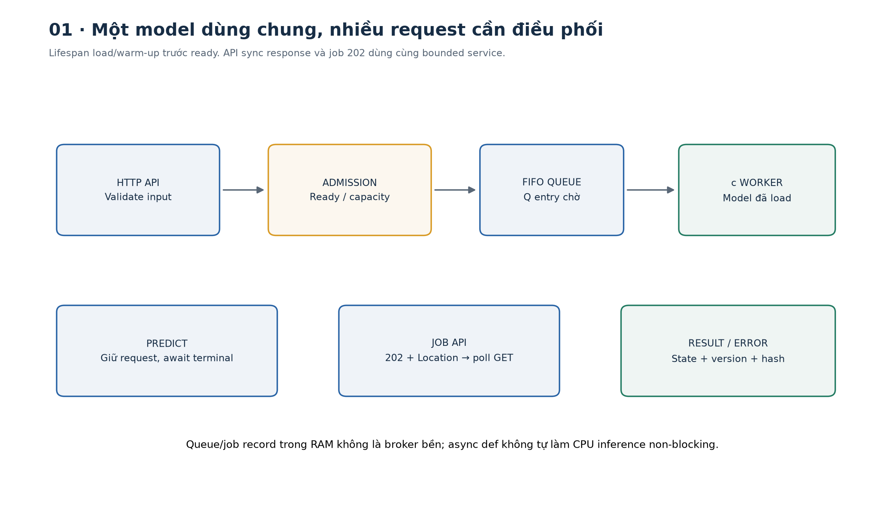
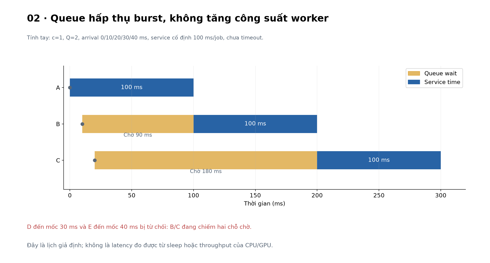
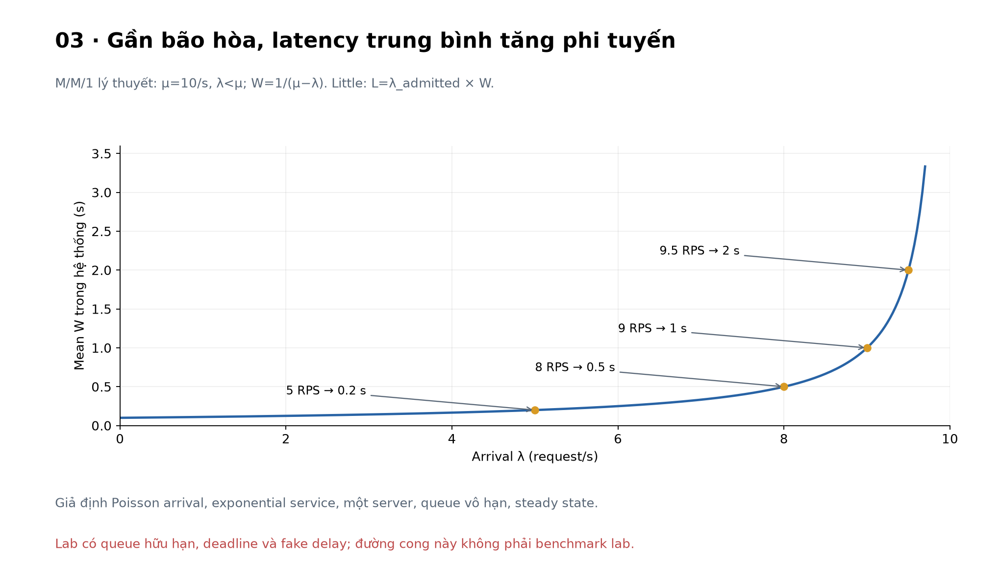
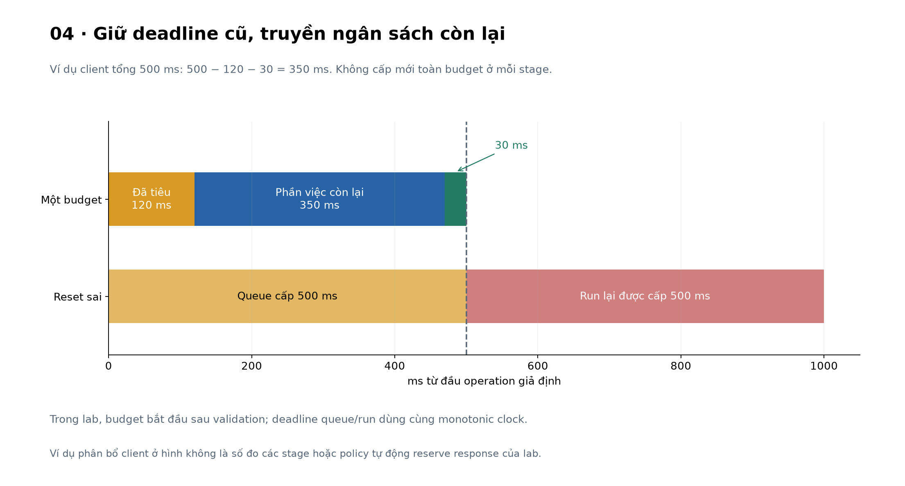
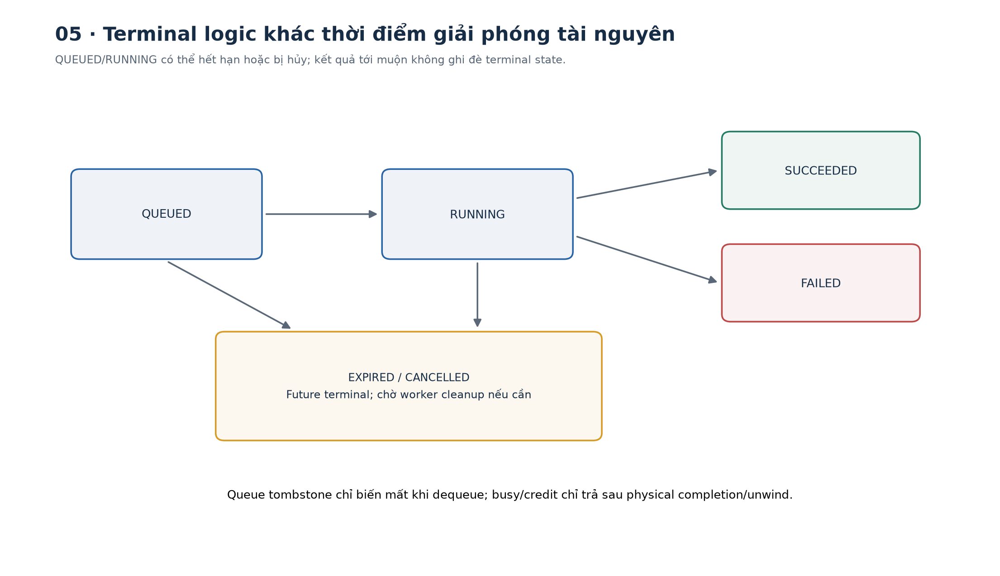
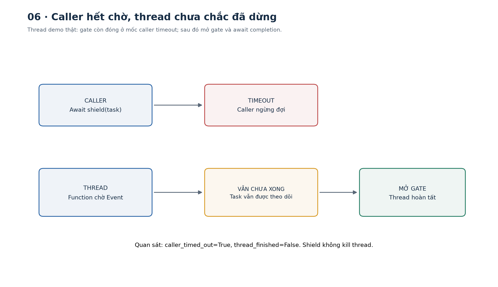
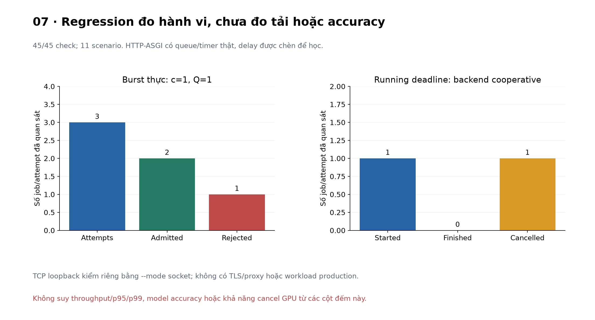

# Bài 31 — API phục vụ mô hình, hàng đợi và timeout

[← Mục lục](../README.md) · [Bài 30](../30-danh-gia-nhieu-buoc-gioi-han-hanh-dong/README.md) · [Bài tập](exercises.md) · [Lời giải](solutions.md) · [Đào sâu](deep-dive.md)

## 1. Từ hàm predict đến một dịch vụ

Trong notebook, bạn gọi `model.predict(x)` rồi chờ. Trong sản phẩm, nhiều client có thể gọi cùng lúc; một request chậm có thể giữ tài nguyên trong lúc request mới tiếp tục đến. Code dự đoán đúng là điều kiện cần, còn hệ thống phải quyết định **nhận bao nhiêu việc, xếp việc ở đâu, chờ đến lúc nào và xử lý thế nào khi client đã bỏ đi**.

Ví dụ xuyên suốt: backend gửi hai đặc trưng tổng hợp của một ticket, nhận score ưu tiên. Có hai cách dùng: chờ dự đoán ngay qua API hoặc nhận job ID để tra kết quả sau. Mô hình logistic nhỏ thực sự tính số; các trọng số được đặt để minh họa, chưa train hay đánh giá accuracy/calibration. Delay mô phỏng phần chờ inference để quan sát concurrency, không đại diện latency CPU/GPU thật.

Sau bài này bạn có thể:

- Vẽ đường request qua validation, admission, queue, worker và model đã load.
- Phân biệt throughput, concurrency, queue capacity và queue wait.
- Dùng một deadline cho cả thời gian chờ lẫn chạy, không reset budget sau dequeue.
- Viết API sync/async job, xử lý quá tải, expiry, cancellation và shutdown.
- Phân biệt timeout ứng dụng, timeout client và việc tính toán thật sự đã dừng hay chưa.
- Chạy ASGI trong process và TCP loopback, đọc kết quả kiểm đúng phạm vi.

Kiến thức cần trước: API/schema bài 22, workflow/retry bài 27, giới hạn và đánh giá bài 30. Lab độc lập, không cần GPU, model download, tài khoản hay LLM.



## 2. Contract của model và contract của API

### 2.1. Model nhận gì và tính gì?

Hai feature có tên rõ ràng, là số hữu hạn trong [0,1]: `latency_ratio` và `error_ratio`. Giá trị là dữ liệu giả định đã chuẩn hóa, không là milliseconds hoặc số lỗi thô.

\[
z=2x_{latency}+3x_{error}-2,\qquad score=\sigma(z)=\frac{1}{1+e^{-z}}.
\]

Với x_latency=x_error=0,5: z=0,5, score≈0,6224593. Ngưỡng 0,5 cho label high. Đây là score từ trọng số minh họa; không được diễn giải là “62,25% ticket thật sự khẩn cấp” khi chưa có dữ liệu kiểm calibration.

```python
from model import Model,Features,ARTIFACT_HASH
from math import isclose,exp
result=Model().predict(Features(.5,.5))
assert isclose(result['priority_score'],1/(1+exp(-.5)))
assert result['label']=='high' and result['artifact_hash']==ARTIFACT_HASH
```

`Model` giữ snapshot artifact gồm feature order, weights, bias, threshold và version; hash được tính trên nội dung ấy. Với model học thật, artifact còn cần preprocessing/vocabulary/scaler đúng phiên bản, dtype/shape, output semantics và điều kiện train/eval như các bài trước. Chỉ chép file weights rồi đổi feature order có thể cho dự đoán sai mà HTTP vẫn 200.

### 2.2. Load và warm-up theo lifecycle

[FastAPI lifespan](https://fastapi.tiangolo.com/advanced/events/) minh họa load model dùng chung trước nhận request, dọn tài nguyên khi tắt. Lab load một lần trong lifespan của **mỗi Service/process**, chạy một forward warm-up nhỏ rồi mới bật accepting. Hai request không load hai model.

Warm-up giúp phát hiện một số lỗi trước khi nhận việc, không chứng minh model đạt accuracy/SLO. Với PyTorch, còn cần `eval()`/inference context phù hợp, device và execution backend; lab này dùng số học Python nên không gọi PyTorch hoặc CUDA.

### 2.3. API không chỉ là hàm model bọc HTTP

| Endpoint | Contract lab |
|---|---|
| POST `/v1/predict` | Nhận việc nếu còn chỗ, chờ terminal state rồi trả kết quả/lỗi |
| POST `/v1/jobs` | Nhận việc vào RAM và trả 202 + job ID + Location |
| GET `/v1/jobs/{id}` | Đọc trạng thái/kết quả còn lưu |
| DELETE `/v1/jobs/{id}` | Yêu cầu hủy; không ghi đè terminal state đã có |
| GET `/livez` | Event loop/route còn trả lời |
| GET `/readyz` | Service đã load và đang nhận việc |

Input Pydantic đóng extra fields, từ chối bool/string thay cho feature, NaN/Infinity, range sai; budget_ms là integer 10..2000. Trường số có thể là JSON integer hoặc float, không ép text thành số. Handler lỗi không phản chiếu raw input.

`budget_ms` là ngân sách xử lý **từ lúc admission sau validation**, gồm queue + inference; chưa bao body upload, validation, serialization, network hoặc response được client nhận. Đây không phải total end-to-end timeout của client.

## 3. Sync, async và asynchronous job là ba nghĩa cần tách

### 3.1. Sync response có thể chạy trên async Python

`POST /v1/predict` có kiểu tương tác request–response: client chờ prediction. Endpoint được viết bằng `async def` để nhường event loop khi đang await. Hai nghĩa “sync API” và “async Python” nói về hai lớp khác nhau.

`async def` không tự biến CPU inference thành non-blocking. Một vòng tính lớn hoặc `time.sleep()` trực tiếp bên trong coroutine vẫn có thể giữ event loop. [Python asyncio tasks](https://docs.python.org/3.14/library/asyncio-task.html) mô tả scheduling/cancellation và `to_thread`; thread không mặc nhiên làm CPU Python chạy song song do GIL, còn extension có thể có hành vi khác.

### 3.2. Job API trả trước, kết quả đến sau

202 có nghĩa đã được nhận xử lý, chưa hoàn tất; [RFC 9110 §15.3.3](https://www.rfc-editor.org/rfc/rfc9110.html#section-15.3.3) không biến nó thành lời hứa thành công. Client giữ Location rồi poll GET với khoảng chờ hợp lý, dừng khi có terminal state hoặc hết budget của mình.

```python
import asyncio
from demos import local_client,PAYLOAD
async def main():
    async with local_client() as (client,_):
        created=await client.post('/v1/jobs',json=PAYLOAD)
        assert created.status_code==202
        async with asyncio.timeout(1):
            while True:
                snapshot=(await client.get(created.headers['Location'])).json()
                if snapshot['state'] in {'SUCCEEDED','EXPIRED','CANCELLED','FAILED'}:break
                await asyncio.sleep(.005)
        assert snapshot['state']=='SUCCEEDED'
asyncio.run(main())
```

GET 200 chỉ nói đã đọc được job record; bên trong record vẫn có thể là FAILED hoặc EXPIRED. 404 có thể là chưa biết ID hoặc record cũ đã bị evict. Bộ nhớ job giới hạn mặc định 16 record; chỉ evict terminal job đã kết thúc vật lý. Đây chưa là durable job service, không có retention SLA hoặc job owner authentication.

### 3.3. Hàng đợi trong process khác broker bền

Một `asyncio.Queue` trong RAM mất khi process chết. Nếu muốn nhận công việc dài và giữ cam kết qua restart, cần thiết kế persisted job/state, queue/broker, retry delivery, idempotency và result store. Chuyển sang Celery/Redis/RabbitMQ chưa tự cho exactly-once effect.

[FastAPI BackgroundTasks](https://fastapi.tiangolo.com/tutorial/background-tasks/) chạy công việc sau response và có caveat cho tính toán nặng cần nhiều process/server. Lab dùng worker lifecycle và queue tường minh để nhìn admission/deadline, không coi BackgroundTasks là durable queue.

## 4. Vì sao phải giới hạn hàng đợi?

### 4.1. Concurrency, capacity và throughput

| Đại lượng | Đơn vị | Nghĩa |
|---|---|---|
| Arrival rate λ | request/giây | Lượng request đến; cần tách attempted/admitted |
| Service rate μ | job/giây/worker | Tốc độ phục vụ trong giả định đang xét |
| Worker concurrency c | job | Số job chạy đồng thời tối đa trong service |
| Queue capacity Q | job chờ | Số entry chờ dequeue tối đa |
| Queue wait Wq | giây | Từ admission đến bắt đầu chạy |
| Response/service latency | giây | Cần ghi rõ hai mốc đo |

Lab có c=1, Q=2 mặc định. Khi một job đang chạy và hai job đang chờ, có tối đa ba job chiếm các vị trí ấy. Registry, connection, request body và log có giới hạn riêng, không được suy đã giới hạn mọi memory chỉ nhờ Queue(maxsize).

Queue maxsize tính entry chưa được `get()`, không tính job đang chạy. Nếu worker chưa kịp được scheduler chạy, entry mới còn nằm trong queue; không cam kết mọi burst tức thời đều nhận đủ c+Q.

### 4.2. Tính tay một burst FIFO

Giả sử một worker, service time cố định 100 ms/job, Q=2; arrival A/B/C/D/E lần lượt 0/10/20/30/40 ms. Worker bắt đầu A ngay ở mốc 0. Chưa có timeout trong ví dụ này:

| Job | Arrival | Start | Finish | Queue wait | Quyết định |
|---|---:|---:|---:|---:|---|
| A | 0 | 0 | 100 | 0 | Nhận |
| B | 10 | 100 | 200 | 90 | Nhận |
| C | 20 | 200 | 300 | 180 | Nhận |
| D | 30 | — | — | — | Từ chối, queue đầy |
| E | 40 | — | — | — | Từ chối, queue đầy |

Nếu tăng queue, có thể nhận D/E nhưng chúng phải chờ lâu hơn; tốc độ worker vẫn là 10 job/giây trong giả định này. Queue hấp thụ burst, không tự tăng công suất model. AWS mô tả nguy cơ backlog làm việc hoàn tất quá muộn trong [Avoiding insurmountable queue backlogs](https://aws.amazon.com/builders-library/avoiding-insurmountable-queue-backlogs/).



### 4.3. Little’s Law và tải gần bão hòa

Trong điều kiện trung bình phù hợp, cùng ranh giới đo:

\[
L=\lambda_{admitted}W,\qquad L_q=\lambda_{admitted}W_q.
\]

Ví dụ lý thuyết riêng: admitted 8 request/s, W=0,5 s thì L=4 request trung bình trong hệ thống. Đó không phải prediction rằng queue lab Q=2 sẽ chứa 4 entry. Với hệ thống từ chối bớt request phải dùng admitted/effective rate, không dùng toàn attempted rate.

Trong mô hình **M/M/1 vô hạn, ổn định**, arrival Poisson, service time exponential, một server, không deadline/batching: W=1/(μ−λ), λ<μ. Với μ=10: λ=5→W=0,2 s; λ=8→0,5 s; λ=9,5→2 s. Trễ tăng phi tuyến gần bão hòa. [MIT, Queuing models, Spring 2026](https://web.mit.edu/1.041/www/lectures/L8-queuing-models-2026sp.pdf), phần Little/M/M/1, là nguồn công thức và giả định.

Lab dùng FIFO hữu hạn, delay cố định/fault và timeout; không fit M/M/1 hoặc lấy đường cong lý thuyết làm benchmark CPU/GPU. Với GPU batching, request token length khác nhau, μ còn phụ thuộc workload và scheduler.



### 4.4. Backpressure và load shedding

Backpressure làm producer biết downstream không theo kịp, ví dụ quota/rate feedback hoặc await có giới hạn. Load shedding từ chối bớt việc để giữ hệ thống hoạt động. Lab dùng `put_nowait()` và trả 503 khi full thay vì giữ vô hạn các coroutine chờ `put()`.

[Python asyncio.Queue](https://docs.python.org/3.14/library/asyncio-queue.html) quy định maxsize≤0 là không giới hạn; lab từ chối config queue_size=0 để không vô tình bỏ cap. Worker gọi task_done trong finally cho mọi entry lấy ra, kể cả entry hết hạn; `join()` là hàng đã được xử lý/skip đầy đủ, không có nghĩa mọi job thành công.

## 5. Deadline và timeout từ nền tảng

### 5.1. Duration khác deadline

Timeout duration là “chờ thêm tối đa bao lâu”; deadline là “không chờ quá mốc nào”. Trong một process, dùng monotonic/event-loop clock:

\[
deadline=loop.time()+budget;\qquad remaining=\max(0,deadline-loop.time()).
\]

Nếu client có tổng 500 ms, đã tốn 120 ms, cần chừa 30 ms cho response thì còn 350 ms cho phần việc kế tiếp. Đây là ví dụ phân bổ budget, không phải điều lab tự đo từ client; API lab chỉ biết budget được nhận tại admission.

Không cho queue 500 ms rồi inference thêm 500 ms nếu yêu cầu chỉ có 500 ms tổng. Queue deadline lab là min(request deadline, admission time + server queue_wait_ms); khi dequeue, timer chuyển sang **request deadline cũ**, không tạo request deadline mới.



### 5.2. Hai loại hết hạn trong service

- `queue_timeout`: vượt queue wait cap của server trước khi model bắt đầu.
- `request_deadline`: hết budget xử lý tổng, có thể khi còn chờ hoặc khi đã chạy.

Job đã expired trong queue có terminal future ngay, nhưng entry còn chiếm queue slot đến khi worker dequeue và skip. Đây là **tombstone**: entry không còn được chạy. Không xóa trực tiếp cấu trúc nội bộ của asyncio.Queue chỉ để giảm qsize.

```python
import asyncio
from demos import queued_timeout_demo
async def main():
    r=await queued_timeout_demo()
    assert r['expired']['state']=='EXPIRED' and r['expired']['code']=='request_deadline'
    assert r['model_calls']==['j0001']
    assert r['retry_before_drain']=='queue_full'
    assert r['after']['queued']==0
asyncio.run(main())
```

Hệ quả: qsize là số entry vật lý chờ dequeue, có thể gồm job đã logically expired/cancelled. Cần ghi rõ nghĩa metric khi vẽ dashboard; depth cao chưa luôn là nhiều việc hữu ích còn có thể chạy.

### 5.3. Client timeout có nhiều lớp

[HTTPX timeouts](https://www.python-httpx.org/advanced/timeouts/) phân biệt connect, read, write và pool. Read timeout là khoảng chờ một chunk dữ liệu, không mặc nhiên là tổng thời gian end-to-end. Với streaming, stream có thể gửi chunk đều đặn và tồn tại lâu hơn một read timeout duration.

```python
import httpx
timeout=httpx.Timeout(connect=.2,read=1.0,write=.5,pool=.1)
assert timeout.connect==.2 and timeout.read==1.0
```

Các số trên chỉ là ví dụ cấu hình, không là khuyến nghị latency production. Nếu cần giới hạn toàn thao tác, bọc client operation bằng deadline tổng và giữ semantics của deadline ở những lớp cần thiết.

`timeout_keep_alive` của Uvicorn đóng connection idle giữa các request, không thay inference deadline. Đã đối chiếu Config và HTTP h11 implementation của Uvicorn 0.54.0 cài tại runtime; trang settings web không tải được trong lượt nghiên cứu. Không gán mọi option có chữ timeout cho cùng một phạm vi.

## 6. Hủy chờ khác dừng tính toán

### 6.1. State machine của job

QUEUED → RUNNING → SUCCEEDED/FAILED; QUEUED hoặc RUNNING có thể → EXPIRED/CANCELLED. Terminal state không bị ghi đè bởi kết quả đến muộn. Record future mô tả kết quả logic, còn `physical_done` đánh dấu worker đã hoàn tất xử lý entry/cleanup.



Worker chỉ giảm busy khi inference task đã unwind. Với backend async cooperative trong bài, cancel vào `await gate/sleep` thực sự làm task dừng, rồi slot worker được giải phóng. Không dùng kết quả này để suy mọi native model, GPU kernel hoặc remote call đều cancel được.

### 6.2. `to_thread` không phải nút kill thread

Thread demo tạo một function chờ Event. Caller hết deadline sau 20 ms, nhưng thread vẫn đang chờ. Code giữ strong reference tới task, dùng shield để không hủy Future đang theo dõi, rồi mở gate và await đến khi thread thật sự xong.

```python
import asyncio
from demos import thread_demo
async def main():
    r=await thread_demo()
    assert r['at_timeout']['caller_timed_out']
    assert not r['at_timeout']['thread_finished'] and not r['at_timeout']['task_done']
    assert r['after']['thread_finished'] and r['after']['task_done']
asyncio.run(main())
```

Đây là demo riêng; thread backend chưa cắm vào Service. Khi tích hợp blocking inference, phải giữ capacity reservation đến physical completion, hoặc dùng ranh giới process/backend có cơ chế hủy phù hợp. Giải phóng semaphore ngay khi caller timeout có thể cho job mới chạy trong lúc job cũ vẫn chiếm CPU/GPU.

### 6.3. Socket disconnect khác cancellation của ASGI task

`Service.wait()` bắt CancelledError, đánh dấu job CANCELLED và cancel inference task. Test `caller_cancel` chủ động hủy coroutine HTTP-ASGI để kiểm đường này. Điều đó chưa chứng minh server sẽ tự hủy endpoint mỗi khi TCP client rời đi.

Kiểm TCP loopback riêng đã quan sát: client nhận **HTTPX ReadTimeout**, nhưng job tương ứng sau đó **SUCCEEDED**. Endpoint này không tự nghe disconnect để hủy job; model chỉ tính score, không có domain write. Với write thật phải giữ idempotency/receipt/reconciliation bài 27, không retry mù vì “client chưa thấy kết quả”.



## 7. Chọn status code và retry đúng phạm vi

| Tình huống lab | HTTP | Nội dung |
|---|---:|---|
| Predict hoàn tất | 200 | SUCCEEDED + score/version/hash |
| Job được nhận vào RAM | 202 | QUEUED lúc admission + Location |
| Validation không đạt | 422 | invalid_input, không admission |
| Queue/record đầy hoặc chưa ready | 503 | queue_full/record_capacity/not_ready + Retry-After |
| Local deadline/cancel khi chờ predict | 503 | Terminal state + code riêng |
| Lỗi inference | 500 | FAILED / inference_failed |
| Job ID không còn/không biết | 404 | Không trả kết quả giả |

[RFC 9110 §15.6.4–15.6.5](https://www.rfc-editor.org/rfc/rfc9110.html#section-15.6.4) phân biệt 503 do unavailable/overload với 504 khi gateway/proxy chờ upstream không kịp. Local inference deadline trong lab dùng 503 + code; không gọi mọi timeout là 504. HTTP 408 cũng không phải tên chung cho “model chạy quá lâu”.

Retry-After=1 trong lab là hint minh họa, không là dự báo queue hết sau đúng một giây. Không có automatic retry ở code client. Khi thêm retry cần giới hạn attempts, còn budget tổng, backoff/jitter, loại lỗi và semantics của operation. [AWS về timeout/retry](https://aws.amazon.com/builders-library/timeouts-retries-and-backoff-with-jitter/) lưu ý retry có thể làm quá tải nặng hơn và timeout chưa chứng minh chưa có side effect.

Ví dụ tính tay: ba lớp đều cho tổng 3 attempt mỗi lớp có thể làm 3³=27 downstream attempt cho một request gốc. Không dùng “3 retries” lẫn “3 attempts”; nếu mỗi lớp là 1 lần đầu + 3 retry thì hệ số có thể là 4³.

## 8. Lifecycle, worker và giới hạn của lab

### 8.1. Startup, readiness và shutdown

Startup load/warm-up xong mới accepting=True. Liveness route có thể trả 200 trước ready, còn admission trả 503. Queue full tạm thời chưa tự tắt readiness: loại hết replica khỏi routing chỉ vì mọi queue đang đầy có thể làm tình hình xấu hơn; chính sách sản phẩm cần thiết kế theo hạ tầng.

Shutdown ngừng nhận việc, chờ queue.join trong grace period; nếu chưa xong thì cancel queued/running job và đợi backend cooperative unwind. Sau đó dừng worker, hủy timer và release model. Code đã kiểm active+queued bị hủy khi grace hết, không để worker/task còn chạy sau close.

Graceful shutdown chưa bảo vệ RAM job khi SIGKILL/process crash. Nếu caller đã nhận 202 trước khi process chết, job có thể mất. Bản này chưa DB/broker/outbox hay durable recovery.

### 8.2. Nhiều async worker khác nhiều server process

Service workers là coroutine trong một process, chia queue và model instance. Uvicorn `--workers` tạo nhiều process như [FastAPI server workers](https://fastapi.tiangolo.com/deployment/server-workers/) mô tả. Mỗi process sẽ có Service/model/queue/job registry riêng; GET job có thể đến process khác và 404 nếu không có shared store/routing.

Không tăng worker process tùy ý để “tăng GPU”: model weights/VRAM có thể nhân lên, cùng GPU có thể tranh chấp. Batching, tokenizer, token budget, KV cache và scheduler của model server là các tầng khác. Bài chưa triển khai GPU/LLM continuous batching hoặc load balancing.

### 8.3. Bounded queue chưa là toàn bộ bảo vệ dịch vụ

Service giới hạn queue, concurrency, record retention và diagnostics ring. Nhưng HTTP request body parser, số connection, auth/quota theo user, proxy, DB pool, fair scheduling và logging có giới hạn riêng. Job ID tuần tự và endpoint GET/DELETE trong bài chưa có ownership/authentication, chỉ dùng dữ liệu tổng hợp trên loopback.

Backend delay là sleep/gate cooperative; numerical model rất nhỏ. Report không đo throughput hay p95/p99 phục vụ thật. Ở bài 32 sẽ tiếp tục tracing và theo dõi chất lượng, rồi bài 34 mới đào sâu đo tải/latency/cost.

## 9. Thực hành và kết quả đã kiểm

### 9.1. Cài và chạy

Môi trường đã chạy: Python **3.14.6**, FastAPI **0.162.0**, Pydantic **2.14.2**, Starlette **1.10.0**, HTTPX **0.28.1**, Uvicorn **0.54.0**, anyio **4.16.0**, CPU. [PyPI FastAPI](https://pypi.org/project/fastapi/) đã được đối chiếu release; API code được chạy trên đúng các pin này.

```bash
cd courses/ai-engineer-2026/31-api-phuc-vu-mo-hinh-hang-doi-timeout
python3 -m venv .venv
.venv/bin/python -m pip install -r requirements.txt
.venv/bin/python lab.py --mode demo
.venv/bin/python lab.py --mode scenarios
.venv/bin/python lab.py --mode check
.venv/bin/python lab.py --mode hand
.venv/bin/python lab.py --mode all --out /tmp/lesson31-run-01
.venv/bin/python lab.py --mode socket
```

Socket mode bind **127.0.0.1 với port tạm**, tự tắt sau kiểm; môi trường cấm bind socket có thể chạy các mode ASGI còn lại. Windows thay executable/đường dẫn output phù hợp. `--out` phải là thư mục mới; report không ghi đè run cũ.

ASGI không tự chạy startup/shutdown; [HTTPX transports](https://www.python-httpx.org/advanced/transports/) nêu phạm vi này. Helper `local_client()` chủ động mở `app.router.lifespan_context(app)` trước request. ASGI không kiểm DNS/TCP/TLS; socket mode bổ sung TCP loopback, chưa TLS/proxy hay dịch vụ Internet.

Nếu muốn giữ API để tự gọi từ terminal khác:

```bash
.venv/bin/python -m uvicorn api:app --host 127.0.0.1 --port 8000 --workers 1
```

```bash
curl -X POST http://127.0.0.1:8000/v1/predict \
  -H 'Content-Type: application/json' \
  -d '{"latency_ratio":0.5,"error_ratio":0.5,"budget_ms":500}'
```

### 9.2. Bằng chứng từ lab

11 scenario chạy actual asyncio queue/worker/timer, HTTP-ASGI và một thread demo riêng. **45/45 regression check** kiểm API/lifecycle và expected outcomes, không là model accuracy hay SLO bảo đảm. Ví dụ:

- Overload có HTTP statuses 200/202/503; một running, một queued, request thứ ba bị chặn; chỉ hai job chạy model.
- Queue expiry và queue_wait cap đều làm job chờ không được inference; tombstone vẫn chiếm slot đến lúc dequeue.
- Running deadline trả 503/EXPIRED, backend cooperative nhận cancellation; worker hồi phục sau một lỗi inference 500 rồi request sau 200.
- Shutdown hủy active/queued, drain queue và release model; record cap có eviction terminal và chặn khi không thể evict.
- Thread còn chạy sau timeout caller; TCP test cũng thấy ReadTimeout ở client rồi job vẫn SUCCEEDED.



| Tệp | Trách nhiệm |
|---|---|
| [model.py](model.py) | Features, artifact snapshot, numerical forward và cooperative backend |
| [service.py](service.py) | Admission, queue, jobs, deadlines, cancellation, retention và shutdown |
| [api.py](api.py) | Lifespan, schema/validation và HTTP endpoints |
| [demos.py](demos.py) | Gate-based scenarios, thread demo và số tính tay |
| [fixtures.py](fixtures.py) | 45 regression checks |
| [socket_demo.py](socket_demo.py) | Uvicorn/HTTPX qua TCP loopback thật |
| [lab.py](lab.py) | Sáu mode CLI và report |

Hình PNG/SVG có sẵn. Tái tạo bằng:

```bash
.venv/bin/python -m pip install -r requirements-figures.txt
.venv/bin/python make_figures.py --report /tmp/lesson31-run-01/report.json
```

Đã chạy NumPy 2.5.4/Matplotlib 3.11.2 để vẽ. ZIP giữ tài liệu/code/hình, không kèm venv/cache/runtime report, credential hay dữ liệu thật.

## 10. Tự kiểm và bước tiếp

Làm [16 bài tập](exercises.md), đối chiếu [lời giải](solutions.md), đọc [phụ lục](deep-dive.md). Bạn cần giải thích ba ranh giới: admission với execution; deadline logic với physical completion; HTTP transport timeout với trạng thái công việc.

**Tiếp theo:** [Bài 32 — Tracing và theo dõi chất lượng](../32-tracing-theo-doi-chat-luong/README.md). [Nguồn và phạm vi kiểm](../SOURCES.md).
