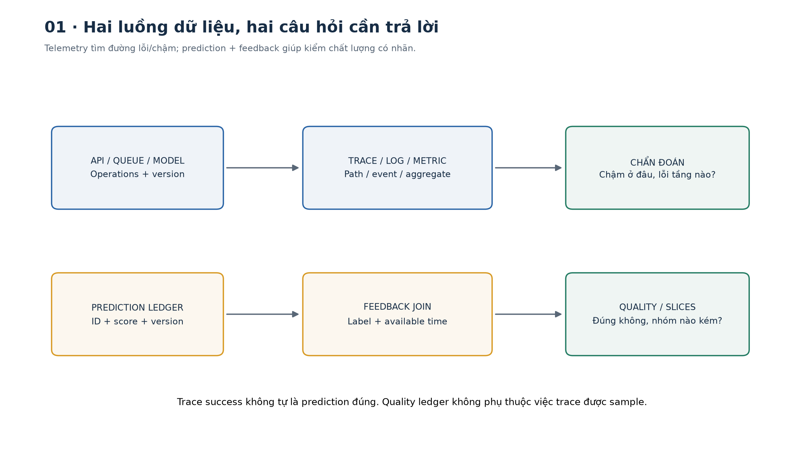
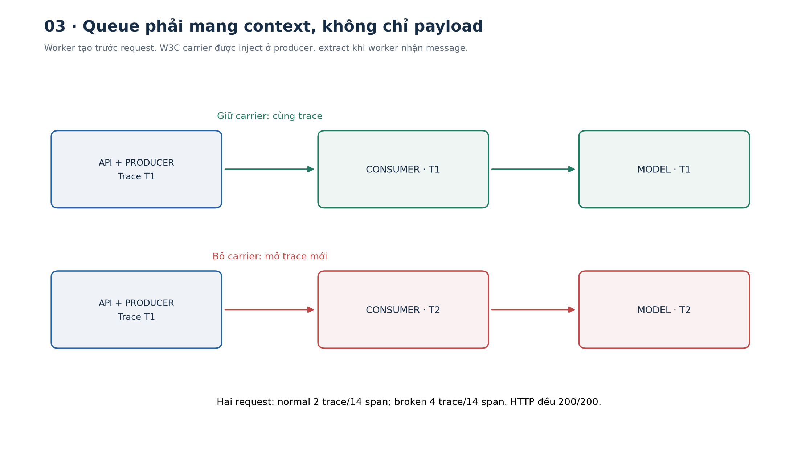
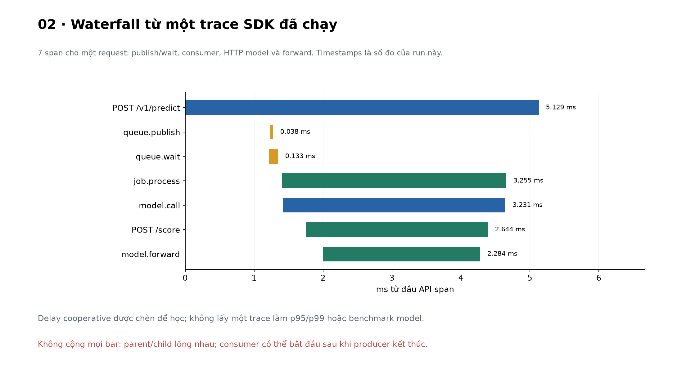
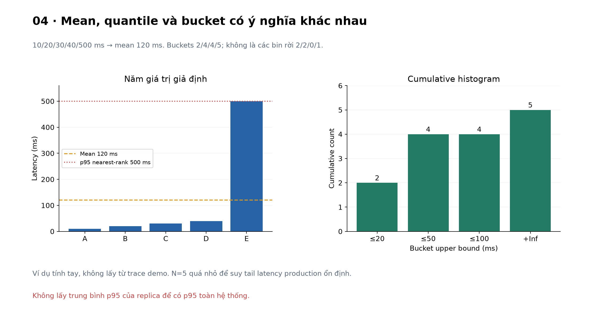
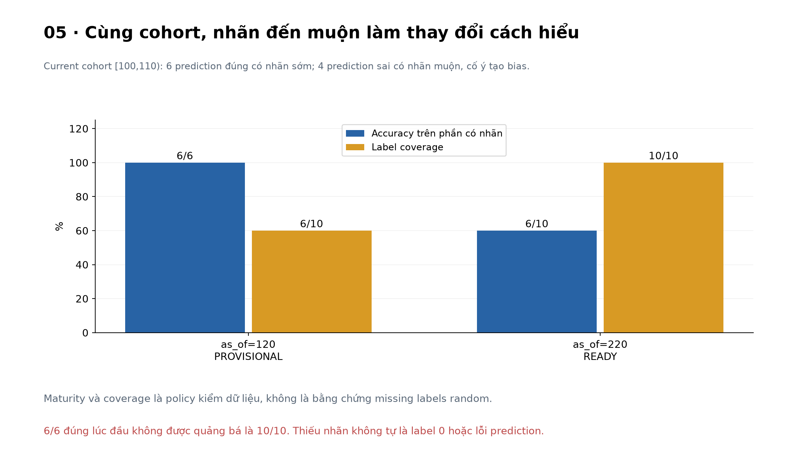
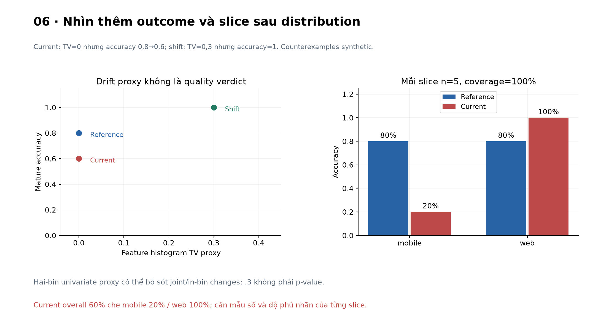
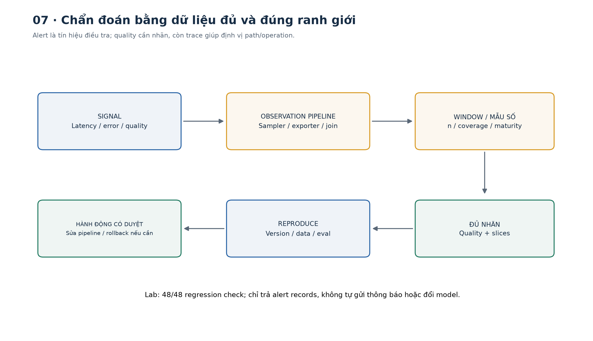

# Bài 32 — Tracing và theo dõi chất lượng

[← Mục lục](../README.md) · [Bài 31](../31-api-phuc-vu-mo-hinh-hang-doi-timeout/README.md) · [Bài tập](exercises.md) · [Lời giải](solutions.md) · [Đào sâu](deep-dive.md)

## 1. API vẫn trả 200, nhưng hệ thống có đang làm tốt?

Trợ lý ưu tiên ticket ở bài 31 đã có API, queue và deadline. Sau triển khai, đội vận hành có thể gặp hai sự cố rất khác:

- Người dùng thấy phản hồi chậm. Model forward chỉ mất ít thời gian; phần lớn độ trễ nằm trong queue.
- API phản hồi nhanh, không lỗi HTTP, nhưng ticket trên mobile bị ưu tiên sai ngày càng nhiều.

Trường hợp đầu cần lần theo đường thực thi. Trường hợp sau cần so dự đoán với kết quả thực tế. HTTP 200, score cao, trace không có Error hoặc histogram input chưa đổi đều chưa đủ chứng minh chất lượng dự đoán.

Bài này xây hai luồng dữ liệu liên quan nhưng khác mục đích: **telemetry vận hành** để chẩn đoán và **prediction/feedback ledger** để đo chất lượng. Cả hai dùng dữ liệu tổng hợp; không thu dữ liệu thật hoặc gửi telemetry ra dịch vụ ngoài.

Sau bài này bạn có thể:

- Đọc trace/span/parent/event/status và phân biệt chúng với log, metric.
- Truyền W3C Trace Context qua queue và HTTP bằng OpenTelemetry SDK thật.
- Đặt mẫu số, đơn vị và metric labels có giới hạn; hiểu vì sao không cộng span duration tùy ý.
- Giữ theo dõi chất lượng độc lập với trace sampling và lỗi exporter.
- Ghép nhãn đến muộn đúng prediction/version và đúng thời điểm quan sát.
- Phân biệt data quality, drift proxy, model quality, slice và business outcome.
- Viết alert có điều kiện nhãn/maturity, đọc ca chưa đủ dữ liệu đúng nghĩa.

Kiến thức cần trước: metrics phân loại bài 7, bất định bài 4/30, API/schema bài 22 và queue/deadline bài 31. Lab độc lập, không cần GPU, LLM, collector, Prometheus hoặc tài khoản cloud.



## 2. Log, metric và trace trả lời những câu hỏi nào?

| Tín hiệu | Câu hỏi thường gặp | Ví dụ trong bài |
|---|---|---|
| Log có cấu trúc | Một sự kiện cụ thể xảy ra ra sao? | request_completed, service, route, status, trace_id |
| Metric | Một quần thể đang có xu hướng gì? | Số request 5xx, histogram queue wait |
| Trace | Một lần thực hiện đi qua những thao tác nào? | API → queue → worker → HTTP model → forward |
| Quality record | Dự đoán cụ thể có đúng sau khi biết outcome không? | prediction_id + version + score, rồi nhãn đến sau |

Trace không thay mọi log và metric; quality record cũng không nên chỉ tồn tại trong trace đã sampling. Một request có thể có trace nhưng chưa có nhãn trong nhiều ngày; một prediction không còn trace vẫn cần ghép feedback để đo chất lượng.

### 2.1. Một span là một operation, không phải một dòng text

Span có tên, trace ID, span ID, parent, thời điểm bắt đầu/kết thúc, attributes, events và status. Nhiều span cùng trace tạo đồ thị công việc có quan hệ nhân quả. [OpenTelemetry Traces](https://opentelemetry.io/docs/concepts/signals/traces/) mô tả các khái niệm và span kinds.

Lab dùng các operation có tên cố định:

| Span | Kind | Parent được quan sát |
|---|---|---|
| POST /v1/predict | SERVER | Parent từ traceparent của client |
| queue.publish | PRODUCER | API SERVER |
| queue.wait | INTERNAL | API SERVER |
| job.process | CONSUMER | queue.publish |
| model.call | CLIENT | job.process |
| POST /score | SERVER | model.call |
| model.forward | INTERNAL | Model SERVER |

queue.wait đo từ enqueue đến dequeue. queue.publish chỉ mô tả publish operation; job.process có thể bắt đầu sau khi publish span đã kết thúc. Quan hệ parent/child mô tả causality, không buộc mọi asynchronous child phải nằm trọn trong thời gian parent đang mở.

### 2.2. Attributes, event và status

Attributes chứa metadata hữu ích như route template, model/feature version, status code hoặc error code đã chuẩn hóa. Event ghi mốc đáng quan tâm; ví dụ `queue.admitted` có queue depth. Không cần mỗi dòng debug đều thành span.

Span status có UNSET, OK, ERROR. Lab để UNSET khi không ghi nhận lỗi; ERROR cho các operation gặp lỗi tương ứng. Status HTTP và span status không phải cùng field. Quan trọng hơn, **UNSET/OK chưa nói dự đoán đúng**: tracing biết operation đã chạy, không tự biết ground truth.

Lab dùng custom keys `app.*`, chưa tuyên bố tuân toàn bộ HTTP/GenAI semantic conventions. Model là forward logistic trọng số đặt như bài 31, không phải một lời gọi LLM hoặc model đã kiểm accuracy trên dữ liệu thực.

## 3. Trace Context: nối nhân quả qua boundary

### 3.1. Ba ID dễ bị lẫn

| ID | Vai trò | Có phải credential không? |
|---|---|---|
| trace_id | Nối span trong một trace | Không |
| span_id | Định danh operation trong trace | Không |
| prediction_id | Ghép prediction với feedback nghiệp vụ | Không |

Một task có retry có thể có nhiều span và prediction; một batch có thể tạo nhiều prediction. Không dùng trace ID thay idempotency key, user ID hoặc prediction ID. Không đưa prediction_id/user_id/trace_id thành metric label cho mỗi request.

### 3.2. W3C traceparent từ đầu

Ví dụ tự tạo:

```text
00-11111111111111111111111111111111-2222222222222222-01
│  │                                │                └ flags: sampled bit
│  │                                └ parent span ID: 16 hex
│  └ trace ID: 32 hex
└ version: 00
```

[W3C Trace Context Recommendation 23/11/2021](https://www.w3.org/TR/trace-context/) quy định format, ID không được toàn zero và semantics của traceparent/tracestate. Lab dùng propagator của SDK để parse/inject, không tự nối chuỗi như parser production.

```python
from telemetry import Telemetry,extract,inject
from serving import API
from opentelemetry.trace import SpanKind
t=Telemetry()
header='00-'+'1'*32+'-'+'2'*16+'-01'
with t.span(API,'example',context=extract({'traceparent':header}),kind=SpanKind.SERVER):
    outbound=inject()
    assert outbound['traceparent'].split('-')[1]=='1'*32
    assert outbound['traceparent'].split('-')[2]!='2'*16
t.close()
```

Trace ID được giữ, parent ID của outgoing header là span hiện tại. Header đi vào là metadata không tin cậy, chưa là authorization. Header invalid phải được xử lý theo propagator; sampled flag cũng không là quyền đọc dữ liệu hay quyền bắt mọi server export trace.

### 3.3. Vì sao queue dễ làm đứt trace?

Một task Python mới tạo có thể kế thừa context tại lúc tạo. Nhưng worker sống từ startup không thể tự kế thừa context của request sẽ đến trong tương lai. Nếu enqueue payload mà quên context, worker thường mở trace mới.

Trong lab:

1. Middleware extract incoming headers và mở API SERVER span.
2. queue.publish inject context vào message carrier riêng.
3. Worker được tạo trước request, extract carrier khi nhận từng message.
4. Worker mở model.call rồi inject vào HTTP headers cho model service.
5. Model app extract và nối SERVER → model.forward.

Hai FastAPI app dùng hai TracerProvider với service.name riêng trong cùng process, gọi qua HTTPX ASGITransport. Đây là header/SDK propagation thật, chưa là deployment hai máy/TCP. Không truyền raw Python context object như một message qua broker.

```python
import asyncio
from demos import trace_demo
async def main():
    good=await trace_demo()
    broken=await trace_demo(preserve_context=False)
    assert good['statuses']==broken['statuses']==[200,200]
    assert good['span_count']==broken['span_count']==14
    assert good['trace_count']==2 and broken['trace_count']==4
asyncio.run(main())
```

Hai request vẫn thành công, số span không giảm nhưng trace bị chia đôi. Đó là lỗi khả năng chẩn đoán, chưa là lỗi prediction. Trường hợp fan-in/batch hoặc job sống dài có thể cần span links thay vì ép mọi việc thành một cây parent duy nhất; lab chưa triển khai links/broker.



## 4. Đọc trace để tìm phần chậm

### 4.1. Waterfall có mốc đo cụ thể

Đọc API duration trước, sau đó queue.wait, job.process, model.call và model.forward. model.call bao gồm overhead HTTP/serialization/model service; model.forward chỉ là block tính/chờ bên trong service. Nếu queue.wait dài nhưng forward ngắn, đổi model có thể chưa giải quyết đúng nút nghẽn.



Hình trên được tạo từ report thật, có delay cooperative để nhìn luồng. ID/timestamp/duration thay đổi theo lần chạy. Đây không phải benchmark throughput hoặc p95/p99 production; một trace chỉ giải thích một lần thực hiện.

### 4.2. Đừng cộng mọi span duration

Ví dụ tính tay: hai tool chạy song song mất 40 và 60 ms, rồi reducer mất 10 ms. Critical path lý tưởng là max(40,60)+10=70 ms, tổng work là 110 ms. Đếm cả parent và child duration còn cộng trùng phần thời gian lồng nhau.

Không lấy tổng span duration làm request latency/cost. Với nhiều process, đồng hồ có thể lệch; thời điểm span và monotonic queue timer phục vụ hai mục đích khác nhau. Lab cùng process nên chưa kiểm clock skew phân tán.

## 5. Metrics vận hành: mẫu số, histogram và cardinality

### 5.1. Chọn boundary trước khi chọn dashboard

Metric trong lab đếm **HTTP completion** theo service, route template và status class. API request, model HTTP request và model forward không cùng population. Một request API hợp lệ gọi model tạo hai HTTP completions; không cộng cả hai rồi gọi là số người dùng.

queue.wait histogram đếm job đã dequeue, không gồm API bị từ chối trước enqueue. Request duration histogram được tách theo service/route để không trộn latency API và latency model. Middleware đo đến lúc ASGI app xử lý xong, chưa bao client thực nhận response qua mạng.

### 5.2. Tính tay histogram và percentile

Giả sử có năm latency: 10,20,30,40,500 ms. Mean=(10+20+30+40+500)/5=120 ms. Theo nearest-rank, p95 là phần tử vị trí ceil(0,95×5)=5, tức 500 ms. Một mẫu năm request quá nhỏ để ước lượng ổn định tail của production.

Với cumulative buckets ≤20/≤50/≤100/+Inf ms, số đếm là **2/4/4/5**, không phải 2/2/0/1. Nếu bucket boundary là đúng ngưỡng SLO thì có thể đếm trực tiếp số request đạt ngưỡng trong population đã chọn.

```python
from demos import hand_demo
h=hand_demo()
assert h['histogram']['cumulative']==[2,4,4,5]
assert h['p95_nearest_rank']==.5
assert abs(h['mean_seconds']-.12)<1e-12
```

[Prometheus histograms/summaries](https://prometheus.io/docs/practices/histograms/) giải thích histogram aggregation và vì sao không lấy trung bình percentile của nhiều replica. Lab tự viết cumulative Histogram nhỏ để học phép đếm, **chưa dùng OTel Metrics SDK, Prometheus exporter, PromQL hoặc native histogram**. Trang docs hiện ưu tiên native histograms khi khả dụng; histogram nhỏ ở đây không là khuyến nghị stack production.



### 5.3. Metric label phải có miền hữu hạn

Ví dụ 3 routes × 2 model versions × 3 status classes tạo tối đa 18 tổ hợp đang xét. Thêm 10.000 prediction ID có thể thành 180.000 tổ hợp; mỗi histogram classic còn có nhiều bucket series. Không phải mọi tổ hợp đều xuất hiện, nhưng cardinality có thể tăng rất nhanh.

[Prometheus naming](https://prometheus.io/docs/practices/naming/) lưu ý mỗi tổ hợp labels là một series mới. Dùng route template, không raw URL/path/query; không dùng user/email/prompt/trace_id làm labels. Model version cũng cần retention/rollup phù hợp, không giả một dimension luôn hữu hạn nếu cứ deploy mãi.

Lab ghi timestamp và trace/span ID vào structured log records trong ring, xuất cùng report JSON; chưa OTel Logs SDK hoặc logging backend. ID không gắn vào metric labels. Log/trace backend vẫn có chi phí index/retention riêng; bỏ ID khỏi metrics không làm telemetry miễn phí.

## 6. Sampling, lỗi exporter và dữ liệu nhạy cảm

### 6.1. Trace chỉ là mẫu quan sát

Head sampling quyết định sớm, tail sampling có thể dùng thông tin sau khi nhiều span đã đến. [OpenTelemetry Sampling](https://opentelemetry.io/docs/concepts/sampling/) nêu khác biệt và chi phí. Tail sampler không khôi phục span đã bị head sampler drop trước đó; trace chỉ giữ lỗi/chậm không tự là mẫu đại diện để tính tỷ lệ toàn traffic.

Lab có cấu hình drop toàn bộ trace. Hai request vẫn thành công, ledger vẫn có hai prediction, metrics vẫn có bốn HTTP completions (hai API, hai model). Không tính error rate/quality chỉ từ số trace đang được giữ.

```python
import asyncio
from demos import trace_demo
async def main():
    r=await trace_demo(sampled=False)
    assert r['span_count']==0 and len(r['predictions'])==2
    assert sum(x['count'] for x in r['metrics']['requests'])==4
asyncio.run(main())
```

ParentBased sampler mặc định của lab tôn trọng sampled context từ parent; cấu hình sampled=False dùng ALWAYS_OFF cho demo drop toàn bộ. Đây là kiểm hai chính sách, chưa là triển khai tail sampler hoặc đo overhead sampling.

### 6.2. Quan sát cũng có thể bị lỗi

Exporter fixture trả failure cho 14 span: API vẫn 200, predictions/counters vẫn có, exporter.failed_spans tăng. Local exporter giữ tối đa 256 span, evict có đếm; log ring giữ 128 event. Không lấy “không thấy Error trace” làm “không có lỗi” khi export/drop pipeline đang mất dữ liệu.

Lab dùng SimpleSpanProcessor và exporter local đồng bộ rất nhỏ, chưa collector/OTLP/network exporter, retry/batch buffer hoặc durable telemetry. Code fail-open đối với failure result đã kiểm, chưa bảo đảm mọi exporter chặn/hỏng đều không ảnh hưởng latency.

### 6.3. Thu ít dữ liệu ngay tại nguồn

[OpenTelemetry sensitive data](https://opentelemetry.io/docs/security/handling-sensitive-data/) nhấn mạnh data minimization; hash user ID dễ đoán chưa tự là anonymization. Lab không ghi raw feature/body, Authorization, baggage, query hoặc exception message vào telemetry; tắt auto exception recording ở các span scope và dùng code lỗi cố định.

Attribute keys có allowlist, các category do code chọn; không có bộ lọc ngữ nghĩa biết mọi giá trị nào là bí mật. Canary test đưa chuỗi giả SECRET32 vào body/header/query/path và exception rồi kiểm không xuất hiện trong span/log/metric. Đó là regression cho các đường đã kiểm, chưa chứng nhận không rò rỉ mọi loại dữ liệu hoặc có production auth/retention policy.

## 7. Theo dõi chất lượng: phải đợi biết đáp án

### 7.1. Tách data quality, proxy, model quality và business outcome

| Lớp theo dõi | Ví dụ | Chưa đủ để kết luận |
|---|---|---|
| Data quality | Missing/range/schema/version sai | Dữ liệu hợp schema chưa chắc phù hợp nhiệm vụ |
| Distribution/proxy | Feature histogram, positive rate, mean score | Không đổi chưa chắc accuracy không giảm |
| Model quality | Accuracy/precision/recall/Brier sau ghép nhãn | Chưa tự đo giá trị kinh doanh hoặc quan hệ nhân quả |
| Business outcome | Ticket được xử lý đúng hạn, utility, phản hồi người dùng | Cần denominator, attribution và thiết kế đo phù hợp |

[Google MLCC Monitoring](https://developers.google.com/machine-learning/crash-course/production-ml-systems/monitoring) thảo luận schema/feature checks, slices, training-serving skew và real-world metrics. Trong AI generative/agent còn cần task success, nguồn dẫn, vi phạm quyền, false refusal và human rubric như bài 25/30; một span model.call không tự chấm được các khía cạnh ấy.

### 7.2. Prediction ledger và feedback join

Prediction record giữ prediction_id, model_version, feature_version, predicted_at, segment, feature_value và score. Nó **không chứa nhãn**. Feedback record đến sau có feedback_id, prediction_id, model_version, label_event_at và available_at.

- `predicted_at`: prediction xảy ra lúc nào, dùng xác định cohort.
- `label_event_at`: outcome/nhãn thuộc thời điểm nào theo fixture.
- `available_at`: monitoring pipeline biết record này từ lúc nào.
- `as_of`: đang tính báo cáo bằng những thông tin đã có đến mốc nào.

Ghép key `(prediction_id, model_version)`; cùng ID nhưng version khác không được nối nhầm. Trùng feedback giống hệt được dedup; label conflict bị quarantine, không chọn tùy tiện label cuối. Thiếu nhãn giữ là thiếu, không biến thành label0 hoặc prediction sai.

[AWS Ground Truth merge](https://docs.aws.amazon.com/sagemaker/latest/dg/model-monitor-model-quality-merge.html) minh họa cần ID khớp giữa inference và actual label. Bài chỉ mượn nguyên lý, không triển khai SageMaker/S3. Tài liệu dịch vụ hiện có thông báo Model Monitor không mở cho khách hàng mới; đây không phải đề xuất dùng dịch vụ ấy.

### 7.3. Replay fixture khác workload trace

HTTP tracing demo có hai prediction thực sự chạy forward số học. Quality replay riêng có **30 prediction synthetic**, ba cohort ×10, để kiểm delayed labels và slice. Chúng dùng schema/khái niệm join tương tự nhưng không phải 30 request đã được model phục vụ trong trace demo. Không lấy mẫu số của hai phần thay nhau.

Registry/live predictions và replay đều ở RAM để học; chưa store bền, privacy workflow, event stream, labeler hay business feedback thật. Production cần một ledger phù hợp độc lập với sampled traces, có ownership/access/retention và chất lượng nhãn được kiểm.

## 8. Ví dụ nhãn đến muộn: tại sao 100% ban đầu gây hiểu nhầm?

### 8.1. Hai mốc quan sát cùng một cohort

Cohort current có predicted_at trong **[100,110)**, đúng 10 prediction. Sáu prediction đúng có feedback đến sớm; bốn prediction sai đến muộn. Đây là thiết kế synthetic cố ý để tạo selection bias, không là kết luận mọi hệ thống đều nhận nhãn lỗi chậm.

| Snapshot | Nhãn đã về | Coverage | Accuracy trên phần có nhãn | Diễn giải |
|---|---:|---:|---:|---|
| as_of=120 | 6/10 | 60% | 6/6=100% | Provisional; chưa đại diện cả cohort |
| as_of=220 | 10/10 | 100% | 6/10=60% | Có thể tính theo policy maturity |

Lab yêu cầu as_of≥window_end+100, ít nhất 8 nhãn và coverage≥80% cho overall quality alert. Đây là **policy minh họa**, không là guarantee nhãn đã hết trễ hoặc không bias. Thiếu nhãn vẫn có thể cần alert riêng cho feedback pipeline.

```python
from quality import quality_demo
q=quality_demo()
assert q['early']['observed_metrics']['accuracy']==1
assert q['early']['status']=='PROVISIONAL' and q['early']['label_coverage']==.6
assert q['mature']['observed_metrics']['accuracy']==.6 and q['mature']['status']=='READY'
```



### 8.2. Tính tay confusion matrix của current

Score≥0,5 là positive; current có 5 predicted positive nhưng chỉ 1 true positive. Có 5 true negative, 4 false positive, không có false negative:

\[
TP=1,FP=4,FN=0,TN=5;\quad accuracy=6/10=0{,}6.
\]
\[
precision=1/5=0{,}2;\quad recall=1/1=1;\quad F1=2/(2+4)=1/3.
\]

Recall 100% không phủ định việc precision rất kém. Brier trung bình \((score-label)^2\) là 0,3005, so với reference 0,1205; đó là scoring rule đã học, không tự chứng minh calibration từng nhóm đã ổn.

Reference có 8/10 đúng. Current mobile có 1/5 đúng (20%), web 5/5 đúng (100%). Overall 60% che mức độ tệ hơn ở một slice. Alert slice còn cần n và coverage của chính slice; lab dùng n≥4 và coverage≥80%, chỉ là guard minh họa cho dữ liệu rất nhỏ.

## 9. Drift không phải bản án chất lượng

Lab dùng histogram một feature với hai bins `[0, 0.5)` và `[0.5, 1]`, tính **total variation proxy**:

\[
TV=\tfrac12\sum_b |p_b-q_b|.
\]

Reference và current đều có phân bố [0,5;0,5], TV=0, positive prediction rate vẫn 0,5; accuracy giảm 0,8→0,6. Không có proxy alert chưa chứng minh quality giữ nguyên.

Cohort shift có histogram [0,2;0,8], TV=(|0,5−0,2|+|0,5−0,8|)/2=0,3; labels synthetic cho accuracy=1. Distribution đổi chưa tự là model degradation. Cần đọc data pipeline/version, label quality và outcome, không tự retrain/rollback chỉ từ một drift score.



Feature drift thường nói P(X) đổi; concept drift nói quan hệ P(Y|X) đổi; training-serving skew so train với serve. Một histogram đơn biến không kiểm mọi feature/joint distribution và không tự chẩn đoán nguyên nhân concept drift. Fixture current cố ý đổi nhãn khi giữ feature/score, nhưng thực tế cần bằng chứng khác để xác định nguyên nhân.

## 10. Alert để điều tra, không tự động sửa mọi thứ

Luồng chẩn đoán trong bài:

1. Xác định tín hiệu và mẫu số: API errors, queue wait hay labeled-cohort metric?
2. Kiểm telemetry/feedback có thiếu, duplicate, conflict hoặc version mismatch không.
3. Kiểm window, maturity, n và coverage, kể cả slice.
4. Đối chiếu trace/model/feature version và data change.
5. Reproduce bằng test/eval; quyết định giảm tải, sửa pipeline, rollback hay đánh giá model tiếp theo dựa trên bằng chứng.

Lab trả alert record trong report, không gửi thông báo cho ai và không tự retrain/rollback. Quality alert overall accuracy<0,75 và mobile slice tương ứng xuất hiện khi cohort mature. Drift proxy TV>0,2 với ít nhất 8 mẫu mỗi bên chỉ trả REVIEW_SHIFT. Các ngưỡng này không là chuẩn chung hoặc kiểm định thống kê; nhiều slice/window có thể tạo false alarm, cần thiết kế riêng.



## 11. Chạy thực hành và đọc kết quả

Môi trường đã chạy: Python **3.14.6**, OpenTelemetry API/SDK **1.45.2**, semantic-conventions **0.66b2**, FastAPI **0.162.0**, Pydantic **2.14.2**, Starlette **1.10.0**, HTTPX **0.28.1**, anyio **4.16.0**, CPU. [PyPI SDK](https://pypi.org/project/opentelemetry-sdk/) xác nhận bản ghim; instrumentation được đối chiếu [Python OTel docs](https://opentelemetry.io/docs/languages/python/instrumentation/).

```bash
cd courses/ai-engineer-2026/32-tracing-theo-doi-chat-luong
python3 -m venv .venv
.venv/bin/python -m pip install -r requirements.txt
.venv/bin/python lab.py --mode trace
.venv/bin/python lab.py --mode trace --drop-context
.venv/bin/python lab.py --mode trace --no-sampling
.venv/bin/python lab.py --mode trace --export-fail
.venv/bin/python lab.py --mode incident
.venv/bin/python lab.py --mode quality
.venv/bin/python lab.py --mode check
.venv/bin/python lab.py --mode hand
.venv/bin/python lab.py --mode all --out /tmp/lesson32-run-01
```

Các flag tracing chỉ áp dụng `--mode trace`. `--out` cần thư mục mới, không ghi đè run cũ. Windows thay executable/đường dẫn phù hợp. Setup tải thư viện một lần; các mode chạy local qua ASGI, không bind socket hoặc gửi telemetry ra network.

Sáu tracing scenario và **48/48 regression checks** đã chạy: đúng parent/trace ID qua queue và HTTP, context isolation, sampling, exporter failure, lỗi model/overload, privacy canary, histogram, feedback dedup/conflict/version/time, maturity và slices. Đây là kiểm pipeline, không là 48 model task thành công.

Normal có 2 trace/14 span, broken 4 trace/14 span; unsampled 0 span nhưng prediction/metric vẫn có; exporter failure mất 14 span và không làm hai API prediction lỗi. Model-failure có hai API 503; overload có 200/200/503 và chỉ hai forward. Giữ cả lỗi có chủ đích trong kết quả.

ID, timestamp và timing histogram có thể khác giữa các lần chạy; `stable_facts()` so relationship/count/prediction/quality, không xóa dữ liệu timing khỏi report gốc để giả hoàn toàn deterministic. TracerProvider local được shutdown, worker và HTTP client đóng theo lifecycle.

| Tệp | Nội dung |
|---|---|
| [telemetry.py](telemetry.py) | SDK providers/exporter, propagation, JSON logs và manual metrics |
| [serving.py](serving.py) | Hai ASGI app, queue worker và manual instrumentation |
| [data.py](data.py) | Prediction/Feedback và 30-row synthetic replay |
| [quality.py](quality.py) | Point-in-time join, cohort/slice metrics và drift proxy |
| [demos.py](demos.py) | Tracing scenarios, tính tay và stable facts |
| [fixtures.py](fixtures.py) | 48 regression checks |
| [lab.py](lab.py) | Sáu mode CLI và report |

Hình PNG/SVG có sẵn; muốn tái tạo:

```bash
.venv/bin/python -m pip install -r requirements-figures.txt
.venv/bin/python make_figures.py --report /tmp/lesson32-run-01/report.json
```

Đã dùng NumPy 2.5.4/Matplotlib 3.11.2 cho hình. ZIP không có runtime report chứa IDs/timestamps, venv/cache, tài khoản hoặc dữ liệu riêng. Chưa triển khai collector/OTLP, Prometheus/Grafana, metric scrape, TCP/service từ xa, persisted ledger, labeler/alert service, LLM judge hoặc production monitoring/SLO.

## 12. Tự kiểm và bước tiếp

Làm [16 bài tập](exercises.md), đối chiếu [lời giải](solutions.md), đọc [phụ lục](deep-dive.md). Bạn cần phân biệt ba nhận định: request hoàn tất, trace quan sát đủ và prediction đúng khi đã biết outcome. Ba việc đó không tự suy ra nhau.

**Tiếp theo:** [Bài 33 — Phiên bản dữ liệu/mô hình, CI và rollback](../33-phien-ban-du-lieu-mo-hinh-ci-rollback/README.md). [Nguồn và phạm vi kiểm](../SOURCES.md).
