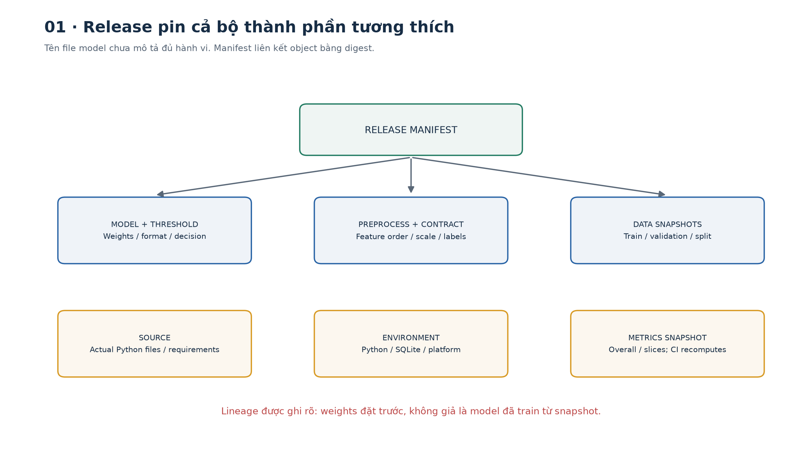
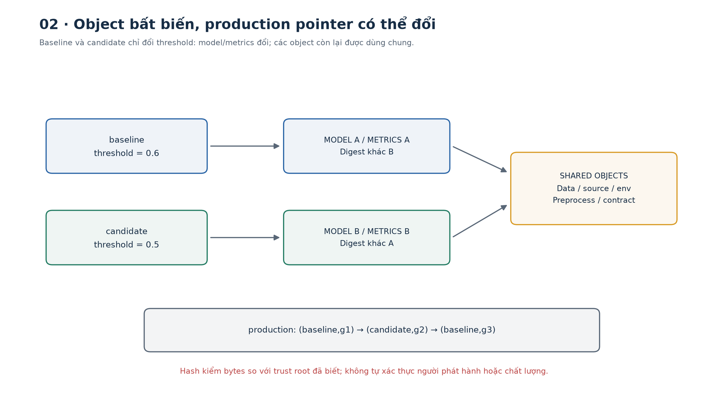
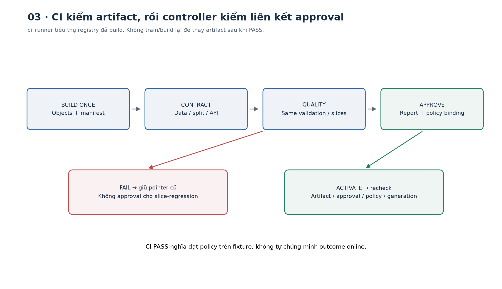
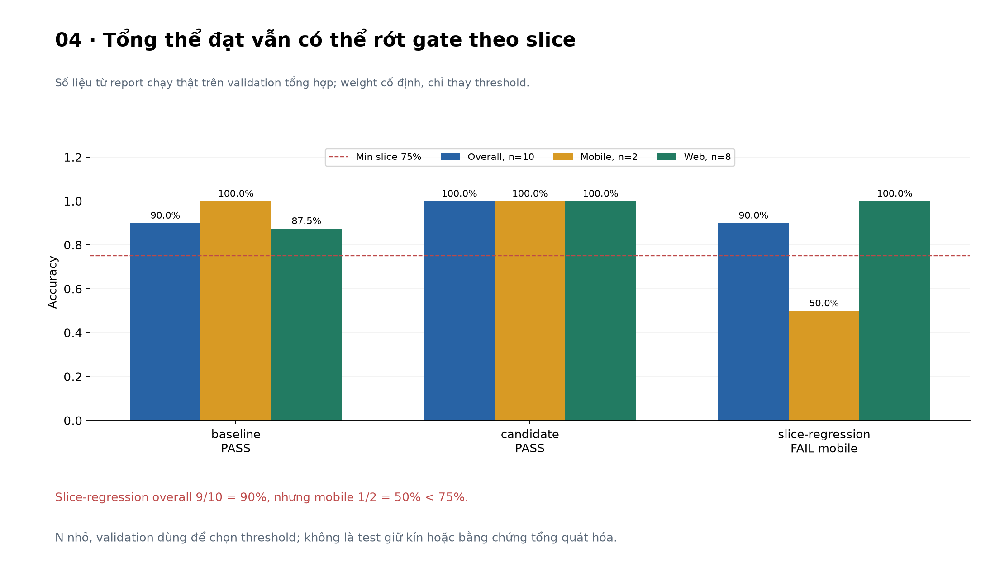
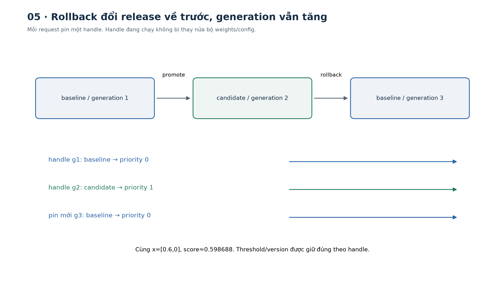
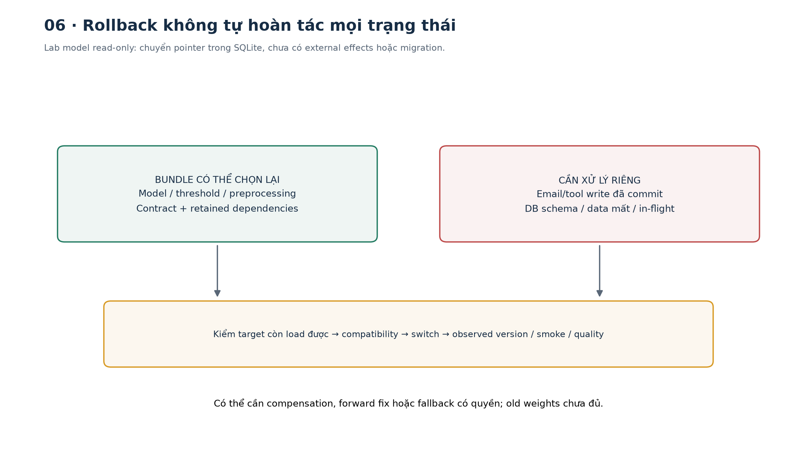
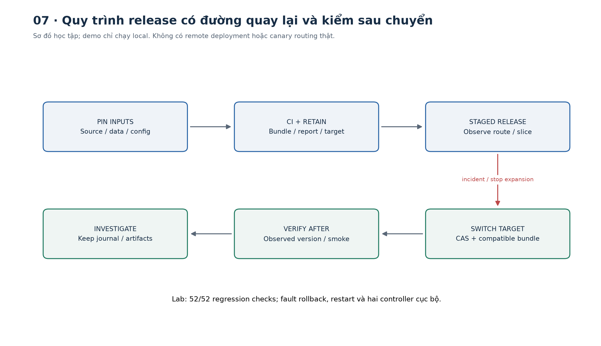

# Bài 33 — Phiên bản dữ liệu/mô hình, CI và rollback

[← Mục lục](../README.md) · [Bài 32](../32-tracing-theo-doi-chat-luong/README.md) · [Bài tập](exercises.md) · [Lời giải](solutions.md) · [Đào sâu](deep-dive.md)

## 1. “Chỉ đổi model thôi” vẫn có thể làm hệ thống sai

Bạn vận hành API ưu tiên ticket. Hôm qua ticket A nhận `normal`; hôm nay cùng payload nhận `urgent`. Team nói đã đưa model tốt hơn lên, nhưng không ai chắc:

- Weight nào đang chạy? File `best-final-v2.json` đã bị ghi đè chưa?
- Dataset dùng để đánh giá có phải bản hôm qua? Nhãn có được sửa sau đó?
- Feature thứ nhất là latency hay error rate? Đơn vị millisecond hay second?
- Threshold và label mapping có đi cùng model?
- CI đã kiểm đúng artifact đang chạy, hay kiểm một bản rồi build lại bản khác?
- Nếu trở lại weight cũ, preprocessing mới còn đọc được không?

Một prediction là kết quả của **nhiều thành phần cùng làm việc**. Bài 32 giúp nhìn thấy release nào gây vấn đề; bài này giúp biết release ấy gồm những gì, cho phép phát hành bằng tiêu chí rõ và trở lại một bộ đã biết khi cần.

Sau bài này bạn có thể:

1. Phân biệt code revision, data snapshot, model artifact, environment và release.
2. Tạo manifest liên kết artifact bằng content digest, kiểm nội dung khi đọc.
3. Xây CI gate cho schema, split, tương thích và chất lượng tổng thể/theo nhóm.
4. Giữ liên kết giữa artifact được kiểm và artifact được kích hoạt.
5. Chuyển release bằng transaction và generation để chặn cập nhật cũ.
6. Pin một release cho từng request, thực hành rollback và kiểm tra sau khôi phục.
7. Giải thích phần rollback không thể tự sửa: side effect, nhãn sai, DB migration hoặc phụ thuộc đã mất.

Kiến thức trước: split/leakage bài 5, metrics bài 7, checkpoint bài 12, contract bài 22 và vận hành bài 31–32. Lab chỉ cần Python có sqlite3; không cần Docker, Kubernetes, Git server, cloud, LLM hoặc GPU. Mọi thao tác phát hành ở đây diễn ra trong database cục bộ do lab tạo.



## 2. Từ phiên bản file đến phiên bản hành vi

### 2.1. Sáu khái niệm nền tảng

| Khái niệm | Ý nghĩa | Ví dụ riêng của bài |
|---|---|---|
| Revision | Một trạng thái của source code | Nội dung chính xác các file Python |
| Snapshot | Nội dung dữ liệu tại một mốc, được giữ để đọc lại | Train/validation và nhãn trong object store |
| Artifact | Sản phẩm cụ thể được pipeline tạo/lưu | Weight, scaler, vocabulary, metric report |
| Run | Một lần thực thi với input/config/environment | Lần train hoặc lần CI; không đồng nghĩa model version |
| Model version | Một artifact model được định danh | Weight + kiến trúc/format; cần thêm preprocessing để dùng đúng |
| Release | Bộ thành phần đã chọn để phục vụ một contract | Model + preprocessing + schema + threshold + source/environment/lineage |

Tên như `v2` thuận tiện cho giao tiếp; chưa cho biết nội dung. Hai file cùng tên có thể khác byte. Hai run có thể cho artifact giống nhau. Cùng weight nhưng threshold khác cũng có thể đổi quyết định API.

`train_data_version` trả lời “dựa vào dữ liệu nào?”. `model_version` trả lời “artifact nào?”. `release_id` trả lời “bộ nào đang phục vụ?”. Nên ghi cả lineage cần thiết thay vì cố nhét mọi ý nghĩa vào một chuỗi tên.

### 2.2. Phiên bản dữ liệu gồm những gì?

Một snapshot dùng được thường cần:

- Nội dung hoặc địa chỉ bất biến truy cập lại được; hash riêng không khôi phục dữ liệu.
- Query/extraction logic, nguồn, thời điểm và timezone/cutoff khi có tính thời gian.
- Schema, đơn vị, feature definition/order, label definition và annotation revision.
- Split membership theo ID/group/time; preprocessing chỉ fit train.
- Quyền sử dụng, retention và cách xử lý dữ liệu phải xóa.

Ví dụ thực tế giả định: “ticket tháng 10” chưa rõ là ticket tạo trong tháng hay đóng trong tháng; cùng query chạy hôm nay có thể có thêm nhãn. Bạn cần snapshot/transaction boundary hoặc cách truy xuất lịch sử phù hợp với nguồn dữ liệu. Một bảng production đang thay đổi không tự trở thành snapshot chỉ vì đã đặt tên `data-v1`.

Lab lưu **10 train row và 10 validation row tổng hợp**, có ID/group tách nhau. Weight được đặt trước; train snapshot ở đây để học lineage/split checking, **không dùng để fit model**. Không gọi manifest này là bằng chứng đã huấn luyện.

### 2.3. Code hash và seed chưa đủ để tái lập mọi thứ

Một lệnh train còn phụ thuộc dữ liệu, package, compiler/kernel, phần cứng, thứ tự xử lý và các nguồn ngẫu nhiên. Có ít nhất ba mức kiểm khác nhau:

- **Cùng input identity:** code/data/config đúng bản đã ghi.
- **Cùng artifact byte:** output có cùng digest.
- **Cùng hành vi trong dung sai:** prediction/metric gần nhau theo tiêu chí định trước.

Không đồng nhất ba mức ấy. Lab số học nhỏ không có training ngẫu nhiên, nên report có thể tái tạo đầy đủ trong cùng source/environment. Điều này chưa chứng minh training GPU sẽ cho bitwise-identical weights.

## 3. Manifest và content digest từ đầu

### 3.1. Hash giống dấu kiểm nội dung, không phải nhãn “tốt”

SHA-256 biến một dãy byte thành digest 256 bit, thường viết thành 64 ký tự hex. Trong phạm vi bài, cùng byte cho cùng digest; thay nội dung tạo digest khác. Rủi ro collision không được coi là cơ chế versioning thường ngày.

Hash giúp phát hiện nội dung khác với digest **đã tin cậy**. Nó không chứng minh ai tạo artifact, dữ liệu đúng nghĩa, model an toàn hay artifact còn tải được. Nếu attacker thay cả object và manifest/root digest được bạn tin, chỉ kiểm hash nội bộ chưa đủ. Production còn cần phân quyền, provenance/signature và trust root phù hợp.

Lab chuẩn hóa JSON theo quy ước riêng: UTF-8, sort keys, bỏ khoảng trắng thừa, cấm NaN/Infinity. Đây không là triển khai một chuẩn canonical JSON liên ngôn ngữ; `1` và `1.0`, hoặc Unicode biểu diễn khác nhau, vẫn có thể khác byte.

```python
from artifacts import canonical,digest
assert canonical({'b':2,'a':1}) == canonical({'a':1,'b':2})
assert digest({'threshold':.5}) != digest({'threshold':.6})
assert len(digest({'threshold':.5})) == 64
print(digest({'threshold':.5}))
```

### 3.2. Manifest là danh sách phụ thuộc có định danh

Thay vì nhét mọi byte vào release name, manifest trỏ tới từng object:

```text
release candidate → manifest digest
  format: ticket-release-v1
  origin: fixed-weights-synthetic-not-trained
  objects:
    model        → SHA256(model JSON)
    preprocessing→ SHA256(feature order + scale)
    contract     → SHA256(schema + labels)
    train        → SHA256(train snapshot)
    validation   → SHA256(validation snapshot)
    metrics      → SHA256(metrics recomputed by CI)
    source       → SHA256(actual Python files + requirements.txt)
    environment  → SHA256(Python/SQLite/platform metadata)
```

Trong lab, SQLite lưu cả bytes lẫn digest. API `put` không ghi đè object khác dưới cùng digest; `register` không cho tên release trỏ sang manifest khác. `get` tính lại SHA-256 trước khi parse. Hash của manifest được tính từ nội dung manifest, không chứa chính nó.

Source snapshot chứa nội dung thật của mọi `.py` trong thư mục bài và `requirements.txt`, không phải một commit ID giả. Bài không tự tạo Git repository hay commit. Environment là metadata của runtime đã dùng; chưa là container image hoặc lockfile đầy đủ cho hệ thống có dependency ngoài.

```python
from tempfile import TemporaryDirectory
from pathlib import Path
from artifacts import Registry
from build import seed
with TemporaryDirectory() as tmp, Registry(Path(tmp)/'registry.db') as r:
    seed(r)
    a=r.manifest('baseline')['objects'];b=r.manifest('candidate')['objects']
    assert a['model']!=b['model']
    assert a['preprocessing']==b['preprocessing']
    print('model đổi; preprocessing được dùng lại đúng digest')
```

### 3.3. Version cố định và alias động

`release=candidate` trong lab được đăng ký bất biến. Slot `production` là con trỏ có thể đổi, kèm generation. Cần resolve con trỏ ở thời điểm thích hợp rồi pin phiên bản cụ thể cho request/job.

[MLflow Model Registry](https://mlflow.org/docs/latest/ml/model-registry/workflow/) có model versions và alias có thể chuyển sang version khác. Bài dùng nguyên lý định danh cố định/con trỏ động, chưa cài hay gọi MLflow. Một alias đổi không có nghĩa mọi process đang cache model tự reload ngay.

Ở mức container, [Docker image digests](https://docs.docker.com/dhi/explore/security-concepts/digests/) cho phép tham chiếu nội dung thay vì chỉ tag có thể đổi. Pin digest vẫn cần đúng kiến trúc/platform và artifact còn tồn tại; digest chưa tự kiểm được chất lượng model.



## 4. Ví dụ hành vi: đổi threshold cũng là đổi release

Model toy nhận `x=[latency_ratio,error_ratio]`, mỗi feature trong [0,1]:

\[
z=4x_1+x_2-2,\qquad p=\sigma(z)=\frac{1}{1+e^{-z}},\qquad \hat y=\mathbf1[p\ge t].
\]

Mapping cố định: 0=normal, 1=urgent. Validation dùng `x₂=0`; đây là fixture để tính dễ, chưa bao phủ miền hai feature.

Với `x=[0.6,0]`:

1. `z=4×0.6+1×0−2=0.4`.
2. `p≈0.5986876601`.
3. Baseline `t=0.6`: `p<t` → normal.
4. Candidate `t=0.5`: `p≥t` → urgent.

Weight giống nhau nhưng quyết định khác. Vì thế threshold nằm trong model object của release; không đọc một giá trị `THRESHOLD` không được version ở nơi khác.

Một lỗi khác: nếu input `[latency,error]` bị đổi thành `[error,latency]`, `x=[0.6,0]` trở thành `[0,0.6]`; z từ .4 thành −1.4, p≈.197816. Shape vẫn là hai phần tử nên chỉ check shape sẽ bỏ sót lỗi nghĩa.

```python
import math
correct=1/(1+math.exp(-.4));swapped=1/(1+math.exp(1.4))
assert correct>.5 and swapped<.5
print(round(correct,6),round(swapped,6))
```

**Tính số tổ hợp:** nếu có sáu thành phần, mỗi thành phần có hai phiên bản, việc chọn độc lập tạo `2⁶=64` bộ khả dĩ. Giả sử mới chỉ kiểm hai bundle hoàn chỉnh, chưa có bằng chứng 62 tổ hợp còn lại tương thích. Đó là lý do pin theo bundle, không phải chứng minh mọi tổ hợp khác đều sai.

## 5. CI cho AI kiểm cái gì?

### 5.1. CI, delivery, deployment và training

**Continuous Integration (CI)** thường tự chạy build/kiểm tra khi tích hợp thay đổi. Continuous delivery giữ sản phẩm sẵn sàng phát hành; continuous deployment đưa thay đổi qua cổng đã định vào môi trường tự động. Trong ML còn có continuous training: pipeline tạo model mới từ dữ liệu. Một tổ chức có thể tự động CI nhưng vẫn cần quyết định phát hành riêng.

[Google Cloud MLOps](https://docs.cloud.google.com/architecture/mlops-continuous-delivery-and-automation-pipelines-in-machine-learning) mở rộng phạm vi kiểm sang data/schema/model và tương thích phục vụ. Bài dùng các nguyên lý đó, không triển khai pipeline cloud hay tự retrain khi có drift.

### 5.2. Các lớp gate trong lab

| Lớp | Câu hỏi kiểm | Ca lỗi cụ thể |
|---|---|---|
| Source/syntax | Đúng source, compile được? | Đổi model.py nhưng giữ approval cũ |
| Integrity | Object còn đúng digest? | Sửa bytes model trực tiếp trong DB |
| Data contract | Shape/range/type/label đúng? | bool được coi nhầm là số; train/validation chung group |
| Compatibility | Model, preprocess, API/label mapping khớp? | Feature order đảo, scale đổi, label mapping đảo |
| Evaluation | Metric report có tính lại từ artifact? | Ghi tay accuracy tốt vào report |
| Population | Baseline/candidate cùng validation snapshot? | Đổi validation cho candidate dễ hơn |
| Quality | Đủ mẫu và đạt tổng thể/theo slice? | Tổng thể đạt nhưng mobile rớt |
| Integration | Load/pin/predict/switch/restart hoạt động? | Fault giữa update pointer và audit |

Policy minh họa được giữ trong `ci.py`, nằm ngoài candidate manifest:

- Accuracy tổng thể ≥0.9 và không thấp hơn baseline.
- Mỗi slice mobile/web có ít nhất 2 row, accuracy ≥0.75.
- Cùng validation digest, golden score `p([.5,0])=.5`.
- Stored metrics phải bằng metrics được CI tính lại; source/environment phải khớp chính xác.

Các ngưỡng này để học cơ chế cổng, không là ngưỡng chất lượng nên dùng cho sản phẩm thật. Một golden case chỉ kiểm một điểm; fixture nhỏ có thể bỏ sót phần lớn lỗi. Lab không dùng statistical non-inferiority test.

### 5.3. Tính tay kết quả gate

| Release | Threshold | Tổng thể | Mobile, n=2 | Web, n=8 | CI |
|---|---:|---:|---:|---:|---|
| baseline | .6 | 9/10=.9 | 2/2=1 | 7/8=.875 | PASS |
| candidate | .5 | 10/10=1 | 2/2=1 | 8/8=1 | PASS |
| slice-regression | .3 | 9/10=.9 | 1/2=.5 | 8/8=1 | FAIL: mobile |

Candidate tăng `1.0−0.9=0.1`, tức **10 điểm phần trăm**. Với slice-regression, accuracy toàn bộ là `(1+8)/(2+8)=.9`; trung bình không trọng số `(0.5+1)/2=.75` là một đại lượng khác. CI kiểm từng slice để tránh nhóm lớn che nhóm nhỏ.

N=10 rất nhỏ, mobile n=2 càng nhỏ. PASS nghĩa đạt policy trên fixture này, chưa chứng minh ưu thế tổng quát. Trong sản phẩm, cần dữ liệu đại diện, time/group split đúng, uncertainty, chi phí lỗi, missing labels và các regression suite. Một tập liên tục dùng để chọn threshold là validation, không được quảng bá là test giữ kín; bài gọi nó đúng là validation.

```python
from pathlib import Path
from tempfile import TemporaryDirectory
from artifacts import Registry
from build import seed
from ci import gate
with TemporaryDirectory() as tmp, Registry(Path(tmp)/'r.db') as r:
    seed(r)
    good=gate(r,'candidate');bad=gate(r,'slice-regression')
    assert good['passed'] and not bad['passed']
    assert bad['observed']['overall']['accuracy']==.9
    assert bad['observed']['slices']['mobile']['accuracy']==.5
    print([x['name'] for x in bad['checks'] if not x['passed']])
```




## 6. Build một lần, kiểm và phát hành đúng bản đó

Luồng mong muốn là source/data/config → build artifact → kiểm artifact → lưu approval gắn artifact/policy → đưa chính artifact ấy vào phục vụ. Nếu sau khi CI PASS bạn train/build lại, output mới chưa được kiểm chỉ vì dùng cùng tên branch.

`approve()` trong lab lưu release, baseline, policy digest và CI report digest vào registry. `activate()` tải lại target, tính lại gate và so với approval trước khi đổi pointer. Nếu source/policy/environment hoặc artifact đổi, approval cũ không còn đủ điều kiện. Đây là kiểm trong trust boundary của lab; bất kỳ ai có toàn quyền sửa SQLite hoặc Python vẫn có thể đổi policy/approval/controller. Chưa là chữ ký, ACL hay hệ thống CI có runner cô lập.

Hai lệnh dưới thật sự dùng cùng registry/artifact đã build:

```bash
# Chạy từ thư mục bài, chọn tên output chưa tồn tại.
python3 lab.py --mode build --out /tmp/lesson33-build-01
python3 ci_runner.py --registry /tmp/lesson33-build-01/registry.db --release candidate --approve
python3 ci_runner.py --registry /tmp/lesson33-build-01/registry.db --release slice-regression
```

Lệnh cuối dự kiến trả **exit code 2**, biểu thị CI gate thất bại; không phải lỗi setup. `ci_runner.py` compile source, chạy 52 pipeline regression checks, đánh giá artifact có sẵn và chỉ lưu approval nếu được yêu cầu và PASS. Không build lại release trong registry đầu vào, không chuyển production slot.

[GitHub Actions workflows](https://docs.github.com/en/actions/concepts/workflows-and-actions/workflows) tổ chức event → jobs → steps bằng YAML. Bạn có thể đặt các lệnh này thành CI steps sau checkout/setup Python, upload report/artifact theo retention phù hợp và để job thất bại khi exit code khác0. Bài chưa tạo workflow đang hoạt động, chưa kiểm trên GitHub runner; không cần repository hay token. Xem [phụ lục CI](deep-dive.md) để thiết kế job có dependency và tránh duyệt artifact của một run khác.

## 7. Chuyển release: transaction, generation và request pinning

### 7.1. Tại sao chỉ đổi một biến global chưa đủ?

Giả sử request đang đọc weight cũ thì thread khác thay preprocessing, rồi thay threshold. Request có thể dùng một tổ hợp chưa được kiểm. Với nhiều controller, hai người còn có thể cùng đọc production=A và lần lượt ghi B/C; một thao tác cũ ghi đè kết quả mới.

Lab có bảng `deployment(slot,generation,release)`. Bắt đầu generation0, release=NULL. Chuyển sang baseline thành1; candidate thành2; rollback baseline thành3. **Generation đếm lần chuyển, không phải số phiên bản model**. Rollback không giảm generation, tránh vấn đề A→B→A khiến người đọc chỉ so tên tưởng không có thay đổi.

### 7.2. Compare-and-swap bằng transaction

`activate(registry,target,expected_generation)` thực hiện:

1. `BEGIN IMMEDIATE`: vào write transaction của SQLite cục bộ.
2. Đọc generation hiện tại, so với expected; lệch thì từ chối.
3. Kiểm approval/integrity/policy và load/probe target.
4. Cập nhật pointer/generation và ghi audit event trong cùng transaction.
5. COMMIT; nếu có exception trước commit, ROLLBACK toàn transaction.

[SQLite transactions](https://www.sqlite.org/lang_transaction.html) giải thích write transaction và giới hạn writer đồng thời. Lab mở một connection riêng cho mỗi controller thread. Kết quả race check: hai controller cùng expected generation1 thì chỉ một commit được, controller còn lại nhận generation_conflict. Đây không là distributed consensus hay bài đo concurrency quy mô lớn.

Fault injection trước switch và sau UPDATE nhưng trước COMMIT đều giữ nguyên pointer/audit. Đã kiểm exception rollback, **chưa mô phỏng mất điện, disk corruption hoặc network partition**. Đọc [Python sqlite3](https://docs.python.org/3.14/library/sqlite3.html#how-to-use-the-connection-context-manager) khi quản lý transaction/connection; `with connection` không tự đóng connection. Registry của bài có context manager đóng tường minh.

### 7.3. Pin release một lần cho mỗi request

`pin()` đọc một state rồi nạp model/config tương ứng thành `Handle` bất biến, chứa weights tuple, threshold, release và generation. Các bước của request dùng handle ấy; không resolve production alias lại giữa chừng. Bài chỉ hỗ trợ đúng preprocessing identity đã kiểm, nên handle không thực hiện hot reload hoặc tự suy đoán adapter.

| Thời điểm | Request mới | Request đã pin từ trước |
|---|---|---|
| Production baseline, g1 | baseline | baseline |
| Promote candidate, g2 | candidate | handle baseline vẫn baseline |
| Rollback baseline, g3 | baseline | handle candidate vẫn candidate |

Một request cũ tiếp tục dùng candidate sau rollback là hành vi drain có chủ đích trong lab. Production có thể cần cancel/kill theo mức nghiêm trọng, timeout và loại side effect. Không hứa rằng rollback tức thì làm mọi request đang chạy đổi sang bản cũ.



## 8. Rollback vận hành như một thay đổi có kiểm tra

### 8.1. Luồng thao tác trong demo

CI trên validation cho candidate10/10 và baseline9/10. Sau khi kích hoạt candidate, demo dùng **một cohort tổng hợp khác**, gồm năm `x=[.6,0],y=0` và năm `x=[.9,0],y=1`. Nhãn của cohort này không dùng để chọn threshold offline.

Candidate dự đoán urgent cho cả hai nhóm, đúng5/10; baseline dự đoán normal cho .6 và urgent cho .9, đúng10/10. Demo chuyển về baseline trong registry. Đây là ví dụ phân phối/nhãn sau release có thể khác validation; không là traffic thật, canary ngẫu nhiên hay bằng chứng thống kê. Năm bản sao mỗi điểm không phải mười nguồn độc lập.

Sau rollback:

- State là baseline/generation3; lịch sử giữ cả ba lần chuyển.
- Request mới với `[.6,0]` trở lại priority0, score vẫn≈.59868766.
- Handle candidate đã pin từ generation2 vẫn trả priority1 và báo release/generation cũ.
- Registry đóng/mở lại vẫn tải baseline/g3 và audit; artifact candidate còn để điều tra.

```python
from pathlib import Path
from tempfile import TemporaryDirectory
from artifacts import Registry
from build import seed
from demos import rollback_demo
with TemporaryDirectory() as tmp, Registry(Path(tmp)/'r.db') as r:
    seed(r);result=rollback_demo(r)
    assert result['rolled_back']=={'generation':3,'release':'baseline'}
    assert result['request_after_rollback']['priority']==0
    assert result['request_pinned_before_rollback']['priority']==1
    print(result['canary'])
```

### 8.2. Runbook thực tế cần quyết định gì?

Trước release: xác định last-known-good, giữ đủ artifact/environment/dependency, thử load/probe, rollback rehearsal và tương thích DB/feature pipeline. Cổng CI cần gắn chính xác với artifact/policy/baseline được duyệt.

Khi có sự cố: đối chiếu release/route/slice và nguồn tín hiệu bài 32; dừng mở rộng rollout khi phù hợp; xác định target còn sử dụng được. Nếu chỉ thiếu nhãn, không tự kết luận quality xấu. Nếu lỗi do data pipeline đang sai, model cũ có thể cũng sai.

Khi chuyển: dùng controller có quyền, so state hiện tại, chuyển routing/pointer với transaction phù hợp; cân nhắc request/job đang chạy, queue retry và cache.

Sau chuyển: kiểm **observed** release ở process phục vụ, readiness, smoke/golden prediction, error/latency và quality có nhãn/maturity. Không chỉ nhìn desired pointer. Giữ audit và điều tra nguyên nhân trước khi phát hành lại.

Lab tự chạy trình tự này trong SQLite để bạn học. Chưa có review UI, RBAC, service replicas, traffic router, cache invalidation hay trạng thái observed riêng của fleet.

### 8.3. Rollback không phải “hoàn tác tất cả”

Model read-only của bài không gửi email, đóng ticket hoặc ghi giao dịch. Nếu agent đã ghi sai, đổi model không hoàn tác effect; cần journal, idempotency và compensation có điều kiện như bài 27–30. Với schema migration đã xóa cột hoặc feature store không còn dữ liệu cũ, target có thể không chạy được.

Chiến lược expand–migrate–contract: thêm khả năng mới tương thích, chuyển đọc/ghi có quan sát, chỉ bỏ khả năng cũ sau rollback window phù hợp. Có lúc forward fix hoặc tắt tính năng/fallback khả thi hơn rollback. Target từng tốt cũng cần kiểm trong môi trường hiện tại; policy mới có thể khiến approval cũ bị từ chối. Lab giữ cách từ chối, chưa có đường “emergency bypass”.

[Kubernetes Deployment](https://kubernetes.io/docs/concepts/workloads/controllers/deployment/) chỉ khôi phục phần Pod template khi undo revision; external DB/data/alias chưa tự được khôi phục. `ProgressDeadlineExceeded` là status, chưa tự kích hoạt rollback. Bài không chạy cluster hoặc lệnh kubectl.



## 9. Canary, shadow và giới hạn mức phơi nhiễm

Canary cho một phần traffic dùng candidate để quan sát trước khi mở rộng; cần cách phân cohort ổn định, mẫu số, slice, horizon và điều kiện dừng. Shadow gửi bản sao input cho candidate để so output, nhưng tránh lặp side effect; không tự đo được tác động lên người dùng khi output không được dùng. Blue/green giữ hai môi trường để chuyển routing, đổi lại cần tài nguyên và kiểm dependency/state dùng chung.

Ví dụ tính tay **giả định**: 10.000 request trong một cửa sổ, canary 5% → kỳ vọng500 request nếu random routing phù hợp. Nếu lỗi của candidate2%, kỳ vọng10 lỗi trong phần đó. Đây không đảm bảo tối đa10 lỗi; vẫn có biến động, clustering hoặc canary mất đại diện. Lab không triển khai routing phần trăm.

Ước lượng thô khác: traffic120 request/giây ×15 giây từ phát hiện đến hoàn tất chuyển ≈1.800 request có thể đi vào giai đoạn sự cố. Không coi đó là bound: thời gian chẩn đoán, queue, in-flight, retry và switch của fleet có thể dài hơn. Cần đo thực tế ở bài 34.



## 10. Thực hành và kết quả đã kiểm

### 10.1. Chạy độc lập

```bash
cd courses/ai-engineer-2026/33-phien-ban-du-lieu-mo-hinh-ci-rollback
python3 --version
python3 lab.py --mode hand
python3 lab.py --mode ci --candidate candidate
python3 lab.py --mode ci --candidate slice-regression
# Dòng trên dự kiến exit 2. Chạy từng lệnh để quan sát.
python3 lab.py --mode rollback
python3 lab.py --mode check
python3 lab.py --mode all --out /tmp/lesson33-run-01
```

`--out` yêu cầu thư mục mới và tạo `registry.db`/`report.json`; không có `--out` thì dùng thư mục tạm, tự dọn khi xong. Không đưa runtime DB/report chứa source snapshot vào thư mục bài để đóng gói. Windows thay đường dẫn/executable phù hợp. Không cần pip cho lab; sqlite3 cần có trong bản Python.

Môi trường đã chạy: Python3.14.6, SQLite3.53.3, macOS arm64. Chưa kiểm mọi Python3.11+ hoặc Windows/Linux. `environment_exact` cố ý nghiêm: chuyển máy/Python sẽ cần build và CI lại trong môi trường đó, không giữ approval từ máy khác. Cùng source/environment của bài cho manifest/report tái tạo nhất quán; sửa `.py` sẽ đổi source object nên cần build lại.

### 10.2. Những gì các check chứng minh

52/52 regression predicates kiểm canonicalization/digest/reuse, immutability, contracts/split, forged metrics, source/environment, validation identity, slice failure, unapproved/stale activation, fault rollback, request pinning, restart và hai controller thật chạy bằng thread với connection riêng. Đây là kiểm pipeline cục bộ, không là 52 mẫu chấm model hay tỷ lệ production reliability.

Các negative controls gồm model bytes bị sửa qua SQL trực tiếp, feature order/scale sai, nhãn đảo, cùng group train/validation và report metric giả. Controller chặn target rồi giữ pointer cũ; không chỉ gắn nhãn “FAIL” mà vẫn chuyển.

Chưa kiểm lost process/power/disk, nhiều máy, object storage/garbage collection, CI provider, container/Kubernetes, auth/signature, DB migration thật, external writes, production canary, load/latency hay retraining. Không dùng seed để giả chứng minh mọi môi trường tái lập bitwise.

### 10.3. Tệp trong bài

| Tệp | Vai trò |
|---|---|
| [data.py](data.py) | Snapshot tổng hợp và kiểm ID/group/schema |
| [model.py](model.py) | Numeric forward, contract, metric/slice |
| [artifacts.py](artifacts.py) | Canonical JSON, SHA-256, SQLite object store/registry |
| [build.py](build.py) | Bundle, source/environment snapshot |
| [ci.py](ci.py) | Policy, recompute gate, approval binding |
| [ci_runner.py](ci_runner.py) | CI thực thi trên registry đã build; exit code |
| [deploy.py](deploy.py) | Transactional switch, generation và pinned handle |
| [demos.py](demos.py) | Tính tay, CI và rollback scenarios |
| [fixtures.py](fixtures.py) | 52 regression predicates |
| [lab.py](lab.py) | Sáu mode CLI và report |

### 10.4. Tái tạo hình

Hình có PNG/SVG sẵn. Chỉ khi muốn vẽ lại mới cần NumPy/Matplotlib:

```bash
python3 -m venv .venv-figures
.venv-figures/bin/python -m pip install -r requirements-figures.txt
.venv-figures/bin/python make_figures.py --report /tmp/lesson33-run-01/report.json
```

Hình số liệu lấy từ report đã chạy; sơ đồ là cơ chế của lab và ví dụ minh họa có ghi phạm vi. Không dùng biểu đồ làm benchmark production.

## 11. Tự đánh giá

Bạn cần tự giải thích được: vì sao hash chưa là authenticity; vì sao threshold/preprocess phải đi cùng model; vì sao CI PASS chưa bảo đảm online tốt; vì sao generation tăng khi rollback; và vì sao request cũ có thể tiếp tục dùng release vừa rút khỏi routing.

Làm [16 bài tập](exercises.md), đối chiếu [lời giải](solutions.md) rồi đọc [phụ lục](deep-dive.md). Trạng thái biên soạn/kiểm code không suy ra bạn đã thành thạo; hãy dự đoán kết quả trước khi chạy các ca lỗi.

**Tiếp theo:** [Bài 34 — Đo tải, độ trễ và chi phí](../34-do-tai-do-tre-chi-phi/README.md). [Nguồn và phạm vi kiểm](../SOURCES.md).
