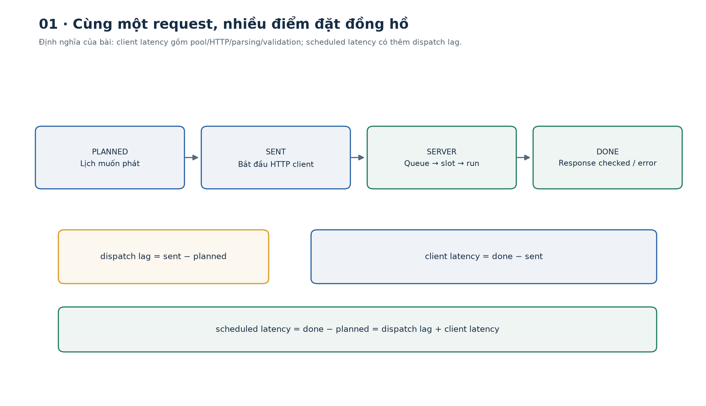
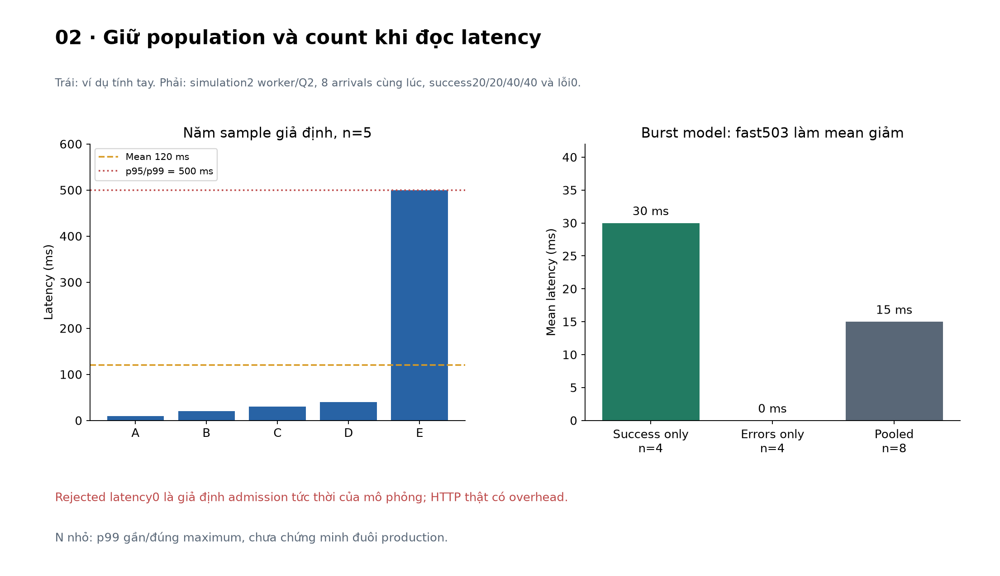
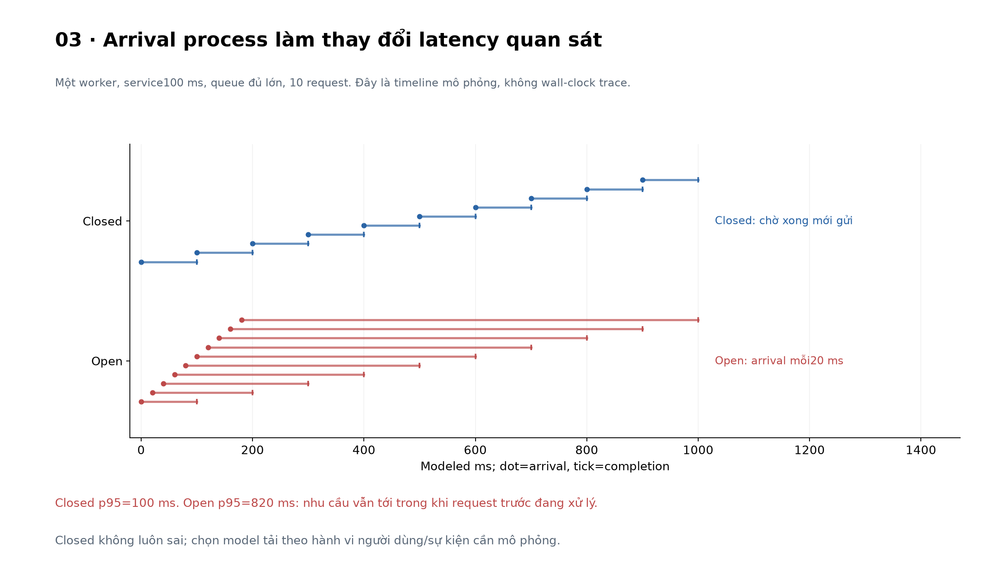
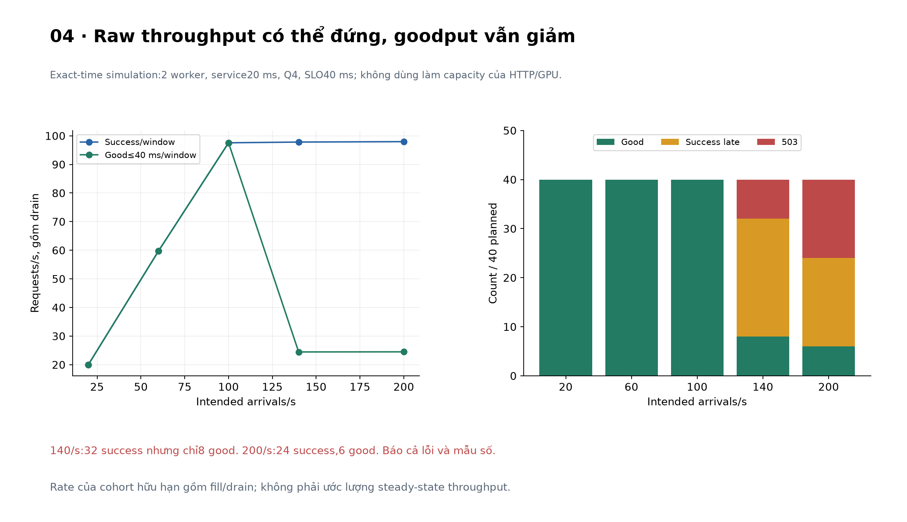
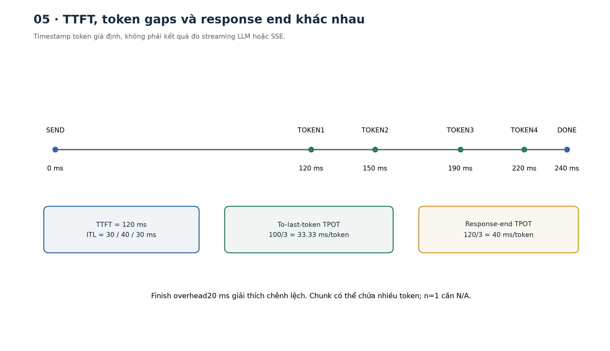
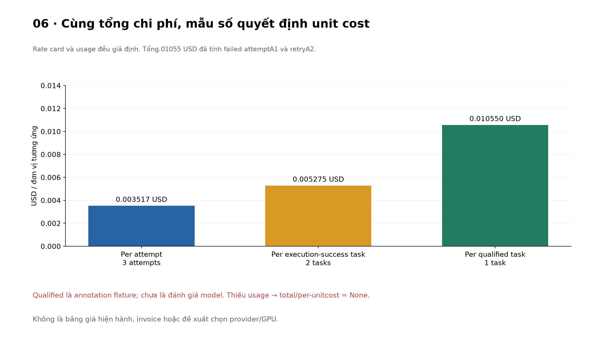
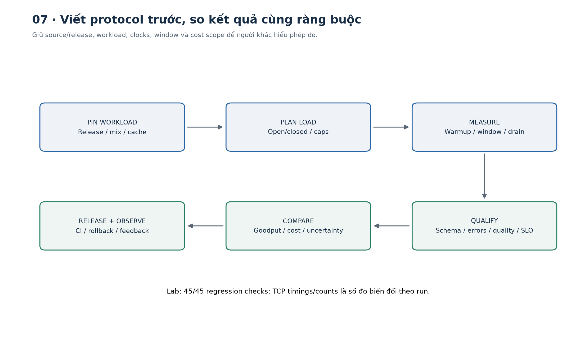

# Bài 34 — Đo tải, độ trễ và chi phí

[← Mục lục](../README.md) · [Bài 33](../33-phien-ban-du-lieu-mo-hinh-ci-rollback/README.md) · [Bài tập](exercises.md) · [Lời giải](solutions.md) · [Đào sâu](deep-dive.md)

## 1. “API nhanh” cần một câu hỏi cụ thể hơn

Bạn đã có API, tracing và release có rollback. Khi định đưa trợ lý ưu tiên ticket vào vận hành, team hỏi: “Một replica chịu được bao nhiêu request? p95 bao nhiêu? Một ticket xử lý xong tốn bao nhiêu tiền?”

Chạy tuần tự mười request rồi lấy trung bình chưa đủ trả lời. Có thể mỗi request mất20 ms lúc rảnh, nhưng khi burst vào cùng lúc, phần chờ tăng rất nhanh. Một cấu hình trả nhiều503 rất nhanh còn có thể có mean latency thấp hơn cấu hình xử lý thành công. Một model rẻ mỗi lần gọi nhưng cần ba retry có thể đắt hơn cho mỗi task hoàn tất.

Bài này học cách **đặt phép đo trước khi đọc con số**: workload nào, thời điểm nào, mẫu số nào, thế nào là request tốt và chi phí bao gồm gì.

Sau bài này bạn có thể:

- Phân biệt offered load, attempt rate, throughput, concurrency và goodput.
- Đo latency từ planned arrival, lúc gửi và lúc nhận kết quả; tách queue, run và overhead.
- Đọc mean/p50/p95/p99 đúng population, không bỏ quên lỗi/timeout/generator drops.
- Tạo open/closed workload có giới hạn, nhận ra coordinated omission và generator bottleneck.
- Thiết kế warmup, window, drain, workload mix và các lượt lặp.
- Tính chi phí trên attempt, logical task thành công và task đạt tiêu chí; xử lý usage chưa biết.
- Phân biệt mô phỏng, phép đo HTTP cục bộ và bằng chứng cần thêm cho production/GPU/LLM.

Kiến thức trước: thống kê bài4, metrics bài7, inference bài21 và vận hành bài31–33. Mọi payload đều tổng hợp. Lab không nhận URL đích ngoài; chỉ tự mở server trên `127.0.0.1` với cổng tạm rồi đóng.



## 2. Đơn vị và mẫu số: nền tảng của mọi kết luận

### 2.1. Rate khác concurrency

**Rate** là số sự kiện trên một đơn vị thời gian: request/giây, token/giây. **Concurrency** là số công việc cùng đang tồn tại tại một thời điểm: đang chờ connection, trong queue hoặc đang chạy, tùy boundary.

Ví dụ giả định: liên tục có5 request/giây và mỗi request ở trong hệ thống trung bình .2 giây. Trong điều kiện ổn định, cùng boundary/population và đủ thời gian quan sát, Little's Law cho số request trung bình trong hệ thống là `L=λW=5×.2=1`. Không suy rằng cần đúng một worker, hoặc burst sẽ không tạo queue. Không áp công thức bằng cách ghép offered rate gồm request bị từ chối với latency chỉ của accepted request.

### 2.2. Các rate phải được gọi đúng tên

| Đại lượng | Tử số | Câu hỏi |
|---|---|---|
| Intended/offered load | Arrival dự kiến trong lịch | Muốn tạo bao nhiêu nhu cầu? |
| Attempt rate | Request thực sự bắt đầu gửi | Generator có tạo đủ nhu cầu không? |
| Response/completion rate | Request đạt một terminal outcome đã định | Server/client kết thúc bao nhiêu, gồm lỗi? |
| Successful throughput | Response hợp lệ được chấp nhận là thành công | Có bao nhiêu kết quả dùng được về mặt contract? |
| Goodput | Thành công và đồng thời đạt mọi mục tiêu đã đặt | Có bao nhiêu kết quả đúng hạn? |

Trong lab, status200 chỉ được tính successful nếu response đúng schema/release và forward số học mong đợi. **Đó là numerical/contract correctness, chưa là task quality trên dữ liệu người dùng.** Good còn phải có `done−planned≤40 ms`. Task/business quality thật cần outcome/eval như bài32.

Lab dùng cửa sổ **từ planned instant đầu tiên tới max(horizon kế hoạch, client terminal cuối)**, bao gồm drain, loại warmup. Tất cả rate báo trong summary dùng cửa sổ ấy. Với open mode, intended rate vẫn là cấu hình `rate`; đừng thay tên `sent/window` thành “offered rate thực đạt” mà quên lịch định trước.

### 2.3. Có bao nhiêu request đã biến mất khỏi mẫu số?

Mỗi planned arrival phải có một record. Lab phân loại:

```text
planned = sent + generator_drop
sent = successful + errors
good <= successful <= sent <= planned
```

`errors` gồm HTTP lỗi, response200 không hợp lệ, transport/HTTPX timeout và total timeout. Generator drop là arrival chưa gửi được do cap in-flight hoặc dispatch quá trễ, chưa phải503 từ server. Báo riêng hai loại để biết lỗi thuộc bộ phát tải hay dịch vụ.

Attainment của bài là `good/planned`: planned arrival bị drop vẫn nằm trong mẫu số và không đạt. Quy tắc này được chọn để phản ánh đủ nhu cầu dự kiến; các công cụ khác có thể có population/window khác. [GuideLLM metrics](https://vllm-project.github.io/guidellm/main/guides/metrics/) định nghĩa request goodput theo request đáp ứng SLO; khi so công cụ, phải đối chiếu cả denominator và cửa sổ.

## 3. Latency bắt đầu và kết thúc ở đâu?

### 3.1. Ba timestamp ở client

Với một request:

- `planned`: lịch muốn phát request.
- `sent`: ngay trước khi gọi HTTP client; trong bài, vẫn bao gồm thời gian chờ connection pool sau đó.
- `done`: đã nhận và kiểm response, hoặc quan sát terminal error/timeout.

\[
L_{dispatch}=t_{sent}-t_{planned},\quad
L_{client}=t_{done}-t_{sent},\quad
L_{scheduled}=t_{done}-t_{planned}=L_{dispatch}+L_{client}.
\]

Nếu generator định gửi ở0 ms nhưng tới100 ms mới gửi, response về120 ms: client latency20 ms, scheduled latency120 ms. Bỏ dispatch lag có thể làm test trông đẹp dù generator không tạo tải như kế hoạch.

```python
from measurements import summarize
row=dict(id=0,planned_ms=0,sent_ms=100,done_ms=120,status=200)
s=summarize([row],window_ms=200,slo_ms=40)
assert s['latency_success_ms']['mean']==20
assert s['scheduled_latency_success_ms']['mean']==120
assert s['good']==0
print(s['dispatch_lag_ms'])
```

### 3.2. Tách queue, execution và end-to-end

Server đo queue từ lúc vào service sau input validation đến lúc được semaphore; run đo từ khi lấy slot đến sau cooperative delay và numeric forward. Client đo từ trước lời gọi HTTP đến sau kiểm response. Chênh lệch còn có serialization, validation, pool/network/event-loop/HTTP overhead.

Không trừ timestamps có gốc đồng hồ độc lập trên hai máy rồi coi là network latency. Ưu tiên duration trong từng clock domain, trace context/correlation và phương pháp đồng bộ khi thật sự cần. Lab dùng một process nên có đồng hồ chung, nhưng vẫn báo duration theo boundary thay vì gọi residual là “thời gian mạng thuần”.

Lab dùng [Python perf_counter](https://docs.python.org/3.14/library/time.html#time.perf_counter) để đo elapsed duration, có tính thời gian sleep; đây không phải CPU time hay đồng hồ wall-calendar. Số đo với độ phân giải nanosecond cũng không tự có độ chính xác nanosecond.

### 3.3. Critical path khác tổng work

Hai nhánh song song40/60 ms rồi reduce10 ms: nếu không có overhead/resource contention thì latency critical path70 ms, tổng work110 ms. Không cộng các span parent/child lồng nhau để suy end-to-end. Nối lại waterfall ở bài32 để định vị phần nào có thể tối ưu.

## 4. Mean, percentile và lỗi đuôi

Với năm latency giả định `[10,20,30,40,500]` ms, mean=(600/5)=120 ms. Bài dùng **nearest rank**, `p(q)=sorted_values[ceil(q×n)−1]`: p50=30 ms, p95=p99=500 ms. Một thư viện dùng interpolation có thể cho số khác; phải ghi estimator.

```python
from measurements import distribution,quantile
d=distribution([10,20,30,40,500])
assert d['mean']==120 and d['p50']==30 and d['p95']==500
assert quantile([],.95) is None
print(d)
```

p95 không có nghĩa mọi request mất đúng thời gian ấy hoặc “95% latency trung bình”. Với nearest rank, ít nhất95% sample quan sát không lớn hơn p95. N nhỏ khiến p99 gần/đúng maximum, rất thiếu ổn định. Một vài chục request không chứng minh production p99.

Báo riêng latency success, latency error và count/rate từng status. Timeout là thời điểm client ngừng chờ, không biết server đã hoàn tất khi nào; không ghi timeout thành success với latency bằng threshold hoặc tự cho là service time thật.

Không lấy mean của p95 ở hai replica để có global p95. Muốn tổng hợp cần raw samples hoặc histogram có schema/units/population tương thích như bài32. Cũng không cộng p95 queue với p95 compute để có p95 tổng: các quantile có thể thuộc request khác nhau.



## 5. Open load, closed load và coordinated omission

### 5.1. Closed model: người gửi chờ kết quả

Một virtual user gửi một request, chờ terminal, rồi gửi tiếp. Với N user không think time, arrival rate bị ảnh hưởng bởi latency. Nếu server chậm, generator cũng tự gửi ít đi. Đây có thể đúng khi mô hình hóa số người dùng đồng thời, nhưng chưa tái tạo được nhu cầu độc lập vẫn tiếp tục đến.

### 5.2. Open model: lịch arrival độc lập completion

Với rate r, arrival thứ i được đặt tại `origin+i/r`. Generator chờ theo timestamp tuyệt đối, tạo task mà không chờ request trước hoàn tất. Bài có cap in-flight và max dispatch lag; không đủ khả năng phát đúng lịch thì tạo `generator_drop` record, không âm thầm bỏ qua.

[k6 open/closed models](https://grafana.com/docs/k6/latest/using-k6/scenarios/concepts/open-vs-closed/) giải thích việc closed workload tự giảm arrival khi hệ thống chậm. Coordinated omission liên quan việc những nhu cầu đáng lẽ xuất hiện trong lúc server chậm không được quan sát đầy đủ. Closed model không luôn sai; nó cần phù hợp câu hỏi và workload thực.

Ví dụ mô phỏng một worker, mỗi job100 ms, không lỗi:

| Lịch arrival | Latency quan sát | p95 |
|---|---|---:|
| Một user chờ xong mới gửi:0,100,…900 ms | 10 request đều100 ms | 100 ms |
| Nhu cầu đến độc lập mỗi20 ms:0,20,…180 ms | 100,180,…820 ms | 820 ms |

Không “sửa số liệu” của closed run bằng cách bịa thêm request rồi gọi đó là đo thật. Hãy chọn workload đúng, ghi dispatch lag/drops và nếu dùng phép hiệu chỉnh thống kê thì nêu rõ giả định. Lab không triển khai histogram correction.

```python
from simulation import scenarios
s=scenarios()
assert s['closed_one']['summary']['latency_success_ms']['p95']==100
assert s['open_same_demand']['summary']['latency_success_ms']['p95']==820
print('Hai lịch arrival trả lời hai câu hỏi khác nhau')
```

[k6 built-in metrics](https://grafana.com/docs/k6/latest/using-k6/metrics/reference/) có dropped_iterations cho iteration chưa bắt đầu. `generator_drop` của bài là record riêng theo cap/lag đã định, không tuyên bố là cùng implementation hay đã chạy k6.



## 6. Saturation, queue và vùng hoạt động hữu ích

### 6.1. Một mô phỏng có thể tính lại

`simulation.py` dùng discrete events, FIFO và thời gian mô hình theo ms. Nếu completion trùng timestamp arrival thì xử lý completion trước. Cấu hình mặc định:2 worker, mỗi job20 ms, tối đa4 job chờ, good latency≤40 ms. Đây không phải thời gian thực hay quy luật của một GPU.

Trong mô hình service cố định, công suất xử lý khi luôn có việc là2/0.02=100 job/giây. Một đợt hữu hạn còn có fill/drain; successful throughput cả cửa sổ có thể dưới100. `worker_utilization` ở đây là modeled slot-busy time chia worker×window, không phải CPU/GPU utilization.

| Intended arrival/giây | Thành công / planned40 | 503 | Good≤40 ms | p95 success | Goodput cả cửa sổ |
|---:|---:|---:|---:|---:|---:|
| 20 | 40 | 0 | 40 | 20 ms | 20.00/s |
| 60 | 40 | 0 | 40 | 20 ms | ≈59.70/s |
| 100 | 40 | 0 | 40 | 20 ms | ≈97.56/s |
| 140 | 32 | 8 | 8 | 60 ms | ≈24.45/s |
| 200 | 24 | 16 | 6 | 60 ms | ≈24.49/s |

Tăng arrival không bảo đảm tăng kết quả tốt. Khi queue đầy,503 tăng; accepted request còn có thể trễ SLO. Chọn công suất phục vụ cần cùng các điều kiện error/latency/quality/workload, không chỉ chọn run có RPS lớn nhất.

Burst8 request đồng thời với2 worker/Q2/service20 ms:2 chạy ngay,2 chờ,4 bị503;4 hoàn tất nhưng chỉ2 xong≤30 ms. Trong mô phỏng, rejected latency bằng0 do giả định admission tức thời; server HTTP thật vẫn có overhead để trả lỗi.

### 6.2. Những tín hiệu nên quan sát cùng nhau

[Google SRE](https://sre.google/sre-book/monitoring-distributed-systems/) dùng bốn nhóm latency, traffic, errors và saturation. Trong AI cần thêm input/output length, batch/queue, memory/KV cache, quality và cost. GPU utilization cao chưa tự chứng minh tốt; request nhỏ có thể đang chờ memory, queue hoặc downstream tool.

Đổi batch/concurrency có thể tăng throughput nhưng làm từng request chờ lâu hơn hoặc tăng memory. Headroom không nên lấy một phần trăm tùy ý cho mọi workload; cần burst/failure envelope, target SLO và phép đo phù hợp.



## 7. Đo thật qua HTTP/TCP loopback

### 7.1. Dịch vụ và bộ phát tải của bài

`benchmark.py` tự bind cổng tạm `127.0.0.1`, chạy Uvicorn/FastAPI rồi dùng HTTPX. Service có2 execution slot và4 vị trí chờ bằng admission counter + semaphore. Numeric forward `sigmoid(4×latency_ratio+error_ratio−2)`, weights đặt trước. Thêm `asyncio.sleep(.015)` để tạo service time cooperative, **không đại diện GPU/kernel hoặc model latency thực**.

Mỗi run warmup3 request tuần tự rồi drain/reset counters. Bốn profile:

- closed-1:24 request,1 user chờ kết quả.
- closed-4:24 request,4 user.
- open-40:24 planned arrival,40/giây.
- open-250:48 planned arrival,250/giây.

Mặc định lặp2 lần →8 lượt đo. Client tối đa32 connection; open generator cap16 in-flight, max dispatch lag25 ms. Mỗi request có outer deadline500 ms; HTTPX còn có timeout riêng cho pool/connect/read/write. [HTTPX timeouts](https://www.python-httpx.org/advanced/timeouts/) phân biệt các phase; read timeout không tự là deadline toàn request.

Load generator và server dùng chung process/event loop; test ngắn, payload đồng nhất, keep-alive được dùng và profile chạy theo thứ tự cố định. Vì vậy đây là **phép đo đường HTTP cục bộ**, chưa tách giới hạn load generator/server, chưa công nhận capacity hoặc performance của model thật. Máy bận có thể làm dispatch drops tăng; báo số đó thay vì mặc định server chậm.

### 7.2. Đọc report như thế nào?

Đọc `tcp.runs` theo từng profile/repetition:

1. `config`, warmup và window rule có đúng thí nghiệm muốn chạy?
2. `planned/sent/generator_dropped`: generator có tạo được nhu cầu?
3. `statuses/errors/successful`: lỗi nhanh có đang che latency?
4. `latency_success_ms` và `scheduled_latency_success_ms`: dispatch lag có đáng kể?
5. `good/attainment_of_planned/goodput_rps`: bao nhiêu kết quả hợp lệ đúng hạn?
6. `server.queue_ms/run_ms/peak_active/peak_waiting`: bottleneck có dấu hiệu ở đâu?

Số RPS/latency/status counts thực tế có thể đổi theo máy/run. Không có assertion buộc p95 phải nhỏ hơn một con số để ép máy chạy đúng ví dụ. `tcp_validation` kiểm các quan hệ cấu trúc; với2 repeat có49 predicate, **không là49 kiểm thử độc lập về performance**.

Report không suy thời gian server thực từ client timeout. Service có thể tiếp tục sau disconnect; harness đợi service idle trước reset/shutdown. Kiểm total timeout deterministic trong fixtures dùng mock transport, không được gọi là test TCP timeout của bài này.

## 8. Thí nghiệm đáng tin cần workload và cửa sổ rõ

### 8.1. Viết câu hỏi trước khi chạy

Ví dụ: “Với releaseR, mix input dài/ngắn theo snapshotD, fixed output policy, một replica và cùng quality gate, throughput cao nhất nào còn đạt latency/error mục tiêu?” Cần giữ config để người khác hiểu điều kiện.

Tách cold start khỏi warm steady behavior. Warmup có thể nạp weights/cache/JIT/connection, nhưng ba call chưa chứng minh steady state; lab chỉ dùng warmup đơn giản. Nếu production thường cold, không được loại cold khỏi trải nghiệm cần đảm bảo.

Định nghĩa rõ startup, warmup, measurement, arrival stop, drain và teardown. Với finite cohort, số completion chia thời gian đã drain khác completion trong fixed wall window; không đổi mẫu số giữa hai cấu hình. Tool khác có thể tính request lifetime overlap/window khác bài.

### 8.2. Workload mix trong AI

Input/output lengths, cache hit, prompt prefixes, retrieval top-k, tool latency, retry/routing và batch policy đều có thể thay kết quả. Không so modelA output32 token với modelB output512 token rồi chỉ lấy request/giây để kết luận.

Cache warm/cold cần ghi điều kiện. Token hit rate khác request hit rate; hit nhiều prompt ngắn không giống hit một prompt dài. Giữ cả đường no-cache/cache có workload đại diện, không coi benchmark lặp cùng input là tổng quát.

Lặp nhiều lượt, ghi count/distribution từng run, luân phiên/randomize thứ tự khi cần giảm ảnh hưởng drift/thermal/cache. Không lấy mean các p95 thành percentile toàn mẫu. Lab có2 repeat cố định để thực hành đọc run variance, chưa confidence interval hay randomized experiment.

### 8.3. Timing GPU cần boundary riêng

Kernel GPU thường thực thi bất đồng bộ. Đo một lời gọi enqueue bằng CPU timer chưa tự đo kernel đã xong; cần synchronization hoặc GPU events đúng scope khi microbenchmark. Với end-to-end service, đo client terminal vẫn cần nhưng không thay kernel profiling. Xem [PyTorch CUDA asynchronous execution](https://docs.pytorch.org/docs/2.15/notes/cuda.html#asynchronous-execution); bài chưa chạy CUDA hoặc đưa số GPU.

## 9. Độ trễ của ứng dụng sinh chuỗi

Với streaming, người dùng quan tâm thời gian thấy output đầu, nhịp ra tiếp và thời gian hoàn tất. Cần ghi sự kiện thật: token, chunk SSE hay content hiển thị; một chunk có thể chứa nhiều token hoặc chỉ metadata.

Ví dụ **giả định**, gửi ở0 ms, bốn token tại120/150/190/220 ms, response hoàn tất240 ms:

- TTFT=120 ms.
- ITL giữa token=[30,40,30] ms.
- Trung bình khoảng token sau token đầu=(220−120)/(4−1)≈33.33 ms/token.
- Nếu công cụ tính TPOT từ response end: `(240−120)/(4−1)=40` ms/token, có thêm finish overhead20 ms.
- E2E=240 ms; output một token thì mẫu số n−1=0, cần N/A thay vì chia0.

[vLLM latency metrics](https://docs.vllm.ai/en/latest/benchmarking/cli/) định nghĩa TPOT bằng `(E2E−TTFT)/(output_tokens−1)` và lưu ý thuật ngữ khác giữa công cụ. Speculative decoding có nhiều token trong một streamed output làm ITL/TPOT khác nhau; không tự coi chunk là token. Lab chỉ tính timestamp giả định, không sinh/stream LLM thật.

```python
from measurements import streaming_example
s=streaming_example()
assert s['ttft_ms']==120 and s['e2e_ms']==240
assert s['itl_ms']==[30,40,30]
assert s['tpot_using_response_end_ms']==40
print(s['tpot_to_last_token_ms'])
```



## 10. Chi phí theo đơn vị công việc có ích

### 10.1. Bảng giá giả định và usage ledger

Bài dùng USD cho dễ tính, **không là giá của nhà cung cấp hoặc báo giá hiện hành**. Rate giả định trên một triệu token: uncached input2 USD, cached input0.5 USD, output8 USD. Cached input là **tập con** của input tổng, không cộng trùng:

\[
C=\frac{(I-I_c)P_i+I_cP_c+OP_o}{10^6}.
\]

Không dùng số từ tokenizer ước lượng thay usage đã đối soát rồi gọi đó là invoice. Thực tế còn rate tier, loại token, round/minimum, cache storage, tools, taxes/credits và quy tắc billing cụ thể. Bài chỉ thực thi quy tắc giả định với usage được cung cấp.

| Task/attempt | Outcome | Input tổng | Cached input | Output | Cost giả định |
|---|---|---:|---:|---:|---:|
| A/1 | failed, usage vẫn có | 1000 | 0 | 100 | .0028 USD |
| A/2 | succeeded, qualified | 1000 | 500 | 200 | .00285 USD |
| B/1 | succeeded, chưa đạt quality | 2000 | 1000 | 300 | .0049 USD |

Tổng=.01055 USD,3 attempt,2 logical task,2 task thành công về execution, chỉ1 task qualified. Trong ledger này, qualified là annotation fixture có sẵn, **không do lab tự chấm LLM**.

- Cost/attempt≈.00351667 USD.
- Cost/successful task=.01055/2=.005275 USD.
- Cost/qualified task=.01055/1=.01055 USD.

Nếu loại failed attemptA/1 khỏi tổng, bạn sẽ đánh giá thấp chi phí. Không suy rằng mọi request lỗi của mọi provider đều tính phí; ở đây usage đã được cho và quy tắc cost được nêu rõ. Missing usage được giữ là unknown; `total_cost_usd=None`, chỉ báo known subtotal, không tự đặt0. Duplicate attempt ID phải được reconcile trước, không cộng hai lần.

```python
from decimal import Decimal
from costs import ledger,attempt_cost,account
assert sum(attempt_cost(r['usage']) for r in ledger())==Decimal('.01055')
c=account(ledger())
assert c['tasks']==2 and c['attempts']==3
assert c['cost_per_qualified_task_usd']=='0.01055'
print(c)
```

### 10.2. Self-hosting: idle time vẫn là phần tài nguyên đã cấp

Giả định cấp một replica trọn một giờ với giá3 USD/giờ; trong giờ có60.000 request,54.000 success,45.000 qualified. Cost/request=.00005 USD, cost/success≈.00005556, cost/qualified≈.00006667. Dù kernel chỉ bận một phần giờ, nếu tài nguyên vẫn được cấp và quy tắc charge theo giờ thì không chỉ lấy busy milliseconds để tính tổng.

Cần thêm CPU/RAM/storage/network, idle replicas, cache/index, observability, retry và vận hành theo scope quyết định. So self-host/API phải cùng workload, quality, SLO, độ sẵn sàng và cách phân bổ chi phí. Bài không đề xuất mua GPU hoặc chọn provider, không đo resource billing thực.

### 10.3. Tối ưu là bài toán có ràng buộc

Model nhỏ, cache, giảm output, batching, routing hoặc cap retry có thể giảm chi phí, nhưng cần kiểm quality/security/freshness/latency và sample mix. Không đổi tiêu chí qualified sau khi thấy cost; không chỉ tối ưu cost/request nếu người dùng phải thử lại nhiều hơn. Liên hệ CI gates/rollback bài33 trước khi phát hành cấu hình mới.



## 11. Thực hành và cách kiểm kết quả

### 11.1. Chạy lab

```bash
cd courses/ai-engineer-2026/34-do-tai-do-tre-chi-phi
python3 -m venv .venv
.venv/bin/python -m pip install -r requirements.txt
.venv/bin/python lab.py --mode hand
.venv/bin/python lab.py --mode simulate
.venv/bin/python lab.py --mode cost
.venv/bin/python lab.py --mode check
.venv/bin/python lab.py --mode tcp --repeats 2
.venv/bin/python lab.py --mode all --repeats 2 --out /tmp/lesson34-run-01
```

Setup tải dependency. Mode tcp/all mở cổng local tạm, không gọi dịch vụ ngoài. Nếu môi trường cấm bind socket, các mode hand/simulate/cost/check vẫn dùng được; không gọi ASGI mock là TCP thay thế. Windows đổi executable/path phù hợp. `--out` phải là thư mục mới, report runtime không nằm trong ZIP.

Môi trường đã chạy: Python3.14.6, FastAPI0.162.0, Pydantic2.14.2, HTTPX0.28.1, Uvicorn0.54.0, Starlette1.10.0, anyio4.16.0, macOS arm64. Chưa kiểm mọi nền tảng. Các pin là môi trường đã thử, không mặc định latest. Không cần GPU hoặc tài khoản AI.

### 11.2. Các kiểm tra có ý nghĩa gì?

45 regression predicates kiểm nearest-rank/empty/type, FIFO/admission/window, scheduled-vs-client latency, drops, stream arithmetic, Decimal cost/missing/duplicate, ASGI overload/validation/numeric response và mock total timeout. Benchmark2 repeat còn có49 structural predicates trên8 lượt TCP: conservation, goodput subset, concurrency/queue bounds, time order và population count.

Các kiểm tra này chưa xác nhận production p95/SLO hoặc task accuracy. Raw timings, success/error/drop counts của TCP biến đổi theo run; `stable_facts()` chỉ so metadata/source/config và phần deterministic. Không ép full raw report phải giống bitwise để “tái tạo” phép đo thời gian thực.

### 11.3. Mã nguồn và hình

| Tệp | Vai trò |
|---|---|
| [measurements.py](measurements.py) | Percentile/population, rate/window và streaming arithmetic |
| [simulation.py](simulation.py) | FIFO discrete events, sweep và open/closed timelines |
| [serving.py](serving.py) | Toy forward, bounded admission/semaphore và response validation |
| [loadgen.py](loadgen.py) | Open/closed generator, cap/lag/drop/deadline |
| [benchmark.py](benchmark.py) | Uvicorn/HTTPX TCP loopback, warmup/drain/repeats |
| [costs.py](costs.py) | Rate card giả định, attempt ledger và unit economics |
| [fixtures.py](fixtures.py) | Regression và TCP structural checks |
| [lab.py](lab.py) | Sáu mode CLI, metadata/source hash và report |

Hình PNG/SVG đã có sẵn. Muốn tái tạo:

```bash
.venv/bin/python -m pip install -r requirements-figures.txt
.venv/bin/python make_figures.py --report /tmp/lesson34-run-01/report.json
```

Hình sweep lấy từ mô phỏng, các sơ đồ/timestamp/chi phí được ghi là giả định. Phần TCP giữ trong report để bạn đọc từng run, không biến con số của máy tác giả thành đường chuẩn production.



## 12. Tự đánh giá và bước tiếp

Bạn cần giải thích được: vì sao closed run có thể che backlog; vì sao fast503 làm mean đẹp; vì sao timeout/drops không được bỏ; vì sao p95 của run nhỏ chưa đáng tin; và vì sao cost/qualified task khác cost/attempt.

Làm [16 bài tập](exercises.md), đối chiếu [lời giải](solutions.md) và đọc [phụ lục](deep-dive.md). Bài này khép phần vận hành cơ bản31–34. Tiếp theo là [Bài 35 — SFT, LoRA và QLoRA](../35-sft-lora-qlora/README.md). Các phần nâng cao còn lại và dự án tổng hợp trong [đề cương](../ROADMAP.md) vẫn mới là định hướng; chưa coi việc có tài liệu là người học đã hoàn thành năng lực. [Nguồn và phạm vi kiểm](../SOURCES.md).
