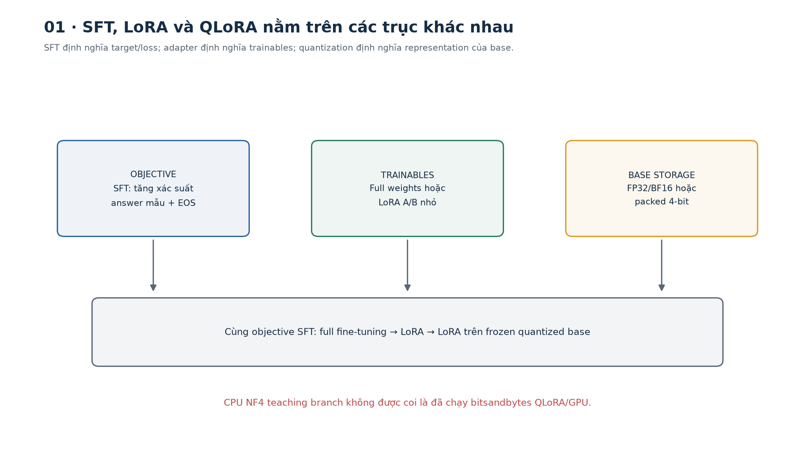
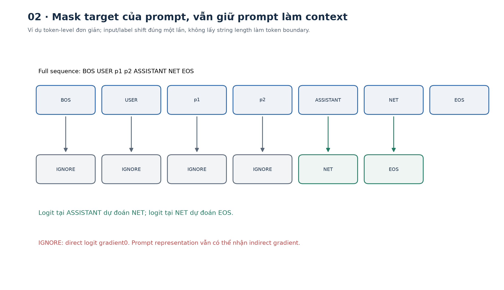
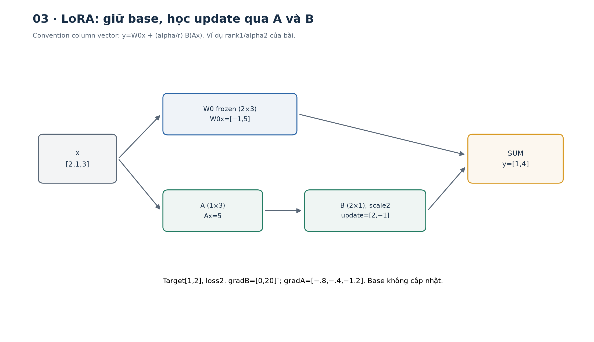
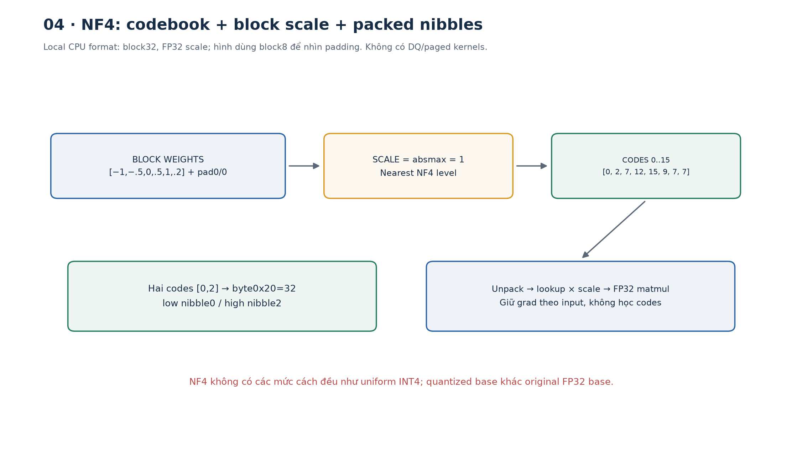
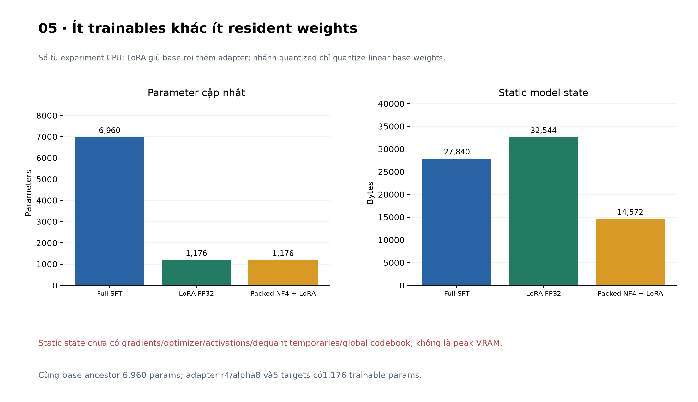
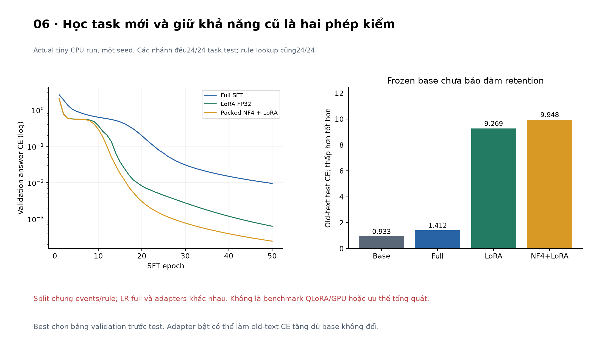

# Bài 35 — SFT, LoRA và QLoRA

[← Mục lục](../README.md) · [Bài 20](../20-tien-huan-luyen-tinh-chinh/README.md) · [Bài tập](exercises.md) · [Lời giải](solutions.md) · [Đào sâu](deep-dive.md)

## 1. Từ model biết ngôn ngữ đến model làm đúng công việc

Bạn có một model và muốn nó đọc ticket backend rồi trả đúng một trong ba team `NET`, `AUTH`, `DATA`. Prompt thử nghiệm đã giúp model hiểu yêu cầu, nhưng format chưa ổn định và có quá nhiều ví dụ lặp trong prompt. Bạn cân nhắc tinh chỉnh bằng các cặp ticket/câu trả lời đã được duyệt.

Có ba câu hỏi khác nhau:

1. **Muốn model học điều gì?** Ví dụ: tăng xác suất câu trả lời mẫu đúng format/đúng hành vi. Đây là câu hỏi về objective và dữ liệu của SFT.
2. **Tham số nào được phép đổi?** Tất cả weights, chỉ head, hay các nhánh low-rank? Đây là câu hỏi full fine-tuning/LoRA.
3. **Base weights được lưu và tính toán ở độ chính xác nào?** FP32/BF16 hay quantized 4-bit? Đây là phần quan trọng của QLoRA.

Vì vậy **SFT và LoRA không phải hai lựa chọn loại trừ nhau**. Bạn có thể làm SFT bằng full fine-tuning, bằng LoRA, hoặc bằng LoRA trên base đã quantize theo cách QLoRA.

Sau bài này bạn có thể:

- Tạo batch SFT với role/template, shift, answer mask, EOS và padding đúng.
- Giải thích loss theo supervised token và gradient accumulation khi độ dài khác nhau.
- Tính tay forward/backward LoRA, số parameter và ảnh hưởng của initialization/scaling.
- Phân biệt NF4 storage, compute dtype, double quantization, optimizer/activation memory.
- Chạy full SFT, LoRA và adapter trên base NF4 đóng gói trong thí nghiệm CPU nhỏ.
- Kiểm trainables, frozen weights, adapter identity, save/load và merge parity.
- Đọc kết quả có đối chứng, nhận ra forgetting dù base không bị cập nhật.
- Chuẩn bị một recipe QLoRA dùng thư viện, biết phần nào đã kiểm và phần nào cần GPU xác minh.

Kiến thức trước: Transformer/LM bài18–19, fine-tuning bài20, optimizer bài13, release/eval/measurement bài32–34. Bài này mở nhánh nâng cao về tinh chỉnh; không lặp lại toàn bộ bài20.



## 2. SFT từ đầu: model học từ câu trả lời mẫu như thế nào?

### 2.1. Objective vẫn là dự đoán token kế tiếp

Với prompt x và câu trả lời mẫu y, supervised fine-tuning — tinh chỉnh có giám sát — tối thiểu hóa:

\[
\mathcal L=-\frac{1}{N_{sup}}\sum_{t\in\mathcal S}\log p_\theta(y_t\mid x,y_{<t}).
\]

`S` là tập vị trí được giám sát, `N_sup` là số token của chúng. Teacher forcing cung cấp các token trước của câu trả lời đúng trong lúc train; khi generate, model phải tự dùng token nó đã sinh. CE thấp chưa tự bảo đảm greedy generation đúng toàn câu hoặc hành vi an toàn.

Ví dụ thực tế **giả định**: ticket “kết nối database bị timeout” có nhãn team theo quy trình công ty. Nhãn không chỉ là tên kỹ thuật: có thể phải xét quyền sở hữu service, ưu tiên, thiếu thông tin và điều kiện chuyển người. Dữ liệu sạch cần phản ánh policy thật, không tự gom mọi từ `timeout` thành `NET` như fixture đơn giản của bài.

SFT có thể giúp format, phong cách và hành vi theo ví dụ. Nó không tạo nguồn dẫn đáng kiểm chứng cho mọi fact, không cập nhật chắc chắn policy mới và không thay authorization ở backend. Nếu vấn đề là kiến thức thay đổi cần truy nguyên, RAG/tool hoặc rule có thể phù hợp hơn; tinh chỉnh phải được so với baseline ấy.

### 2.2. Prompt là context, không nhất thiết là target

Lab dùng tokenizer word-level tự tạo với role token riêng, không phải tokenizer của LLM thương mại:

```text
sequence = BOS USER prompt ASSISTANT answer EOS
inputs   = sequence bỏ token cuối
labels   = sequence bỏ token đầu
labels của prompt/header → IGNORE (-100)
labels của answer + EOS  → được chấm loss
padding labels          → IGNORE
```

Nếu prefix có m token, target answer đầu tiên nằm ở label index `m−1`: **vị trí token cuối của prefix dự đoán token đầu của answer**. Mask nhầm tới index m sẽ mất supervision token answer đầu tiên; shift hai lần làm model học sai alignment.

```python
from data import records,Tokenizer,batch,IGNORE,EOS
r=records();tok=Tokenizer.fit(r['train']);x,y=batch(r['train'][:2],tok)
assert y.ne(IGNORE).sum(1).tolist()==[2,2]  # team và EOS
assert y[:,-1].eq(EOS).all()
assert y[0,-2].item()==tok.encode(r['train'][0]['answer'])[0]
print(x.shape,y.shape)
```

`IGNORE` có nghĩa loss không chấm trực tiếp logit tại vị trí ấy. Nó **không xóa prompt khỏi attention**. Answer logits vẫn phụ thuộc prompt; gradient có thể đi ngược vào prompt representation và embedding nếu chúng trainable. Đóng băng parameter cũng khác cắt autograd graph.

### 2.3. Chat template là một phần của contract

LLM thật thường dùng token đánh dấu role/end-of-turn riêng. [Hugging Face chat templates](https://huggingface.co/docs/transformers/chat_templating) giải thích việc format message thành token và nguy cơ thêm special token trùng. Đừng coi chuỗi `User:`/`Assistant:` viết tùy ý là tương đương template model đã được train.

Trong GPU recipe, full conversation và prefix được tokenize bằng cùng template, rồi kiểm prefix token IDs khớp. Nếu không khớp thì dừng để kiểm boundary; không lấy độ dài string làm số token. Khi pad token trùng EOS, mask padding bằng attention/độ dài thật, không mask mọi token có ID=EOS.

[TRL SFT Trainer](https://huggingface.co/docs/trl/sft_trainer) có completion-only/assistant-only loss với điều kiện về dataset và chat template. Bài dùng vòng train tự viết để nhìn rõ mask; chưa chạy TRL. Nếu dùng trainer, vẫn cần xem batch/labels thực tế thay vì tin một flag đã giải quyết mọi format.



## 3. Dữ liệu, split và vòng train SFT

### 3.1. Dữ liệu tốt bắt đầu bằng định nghĩa đúng

Mỗi example cần instruction/context, target được duyệt và metadata đủ để kiểm nguồn/split. Giữ ví dụ khó, thiếu thông tin, abstention/escalation nếu thuộc nhiệm vụ. Nhãn mâu thuẫn và response sai không tự được “sửa” vì tăng số lượng mẫu.

Chia theo nguồn/group/time **trước** augmentation/template variants khi cần. Không để một ticket xuất hiện ở train dưới dạng tóm tắt rồi xuất hiện ở test dưới dạng gốc. Giữ prompt/template/tokenizer/data version với checkpoint như bài33.

Trong lab có24 group service–operation, split16/4/4. Mỗi group có6 event →96/24/24 record. Tokenizer chỉ fit text/prompt/answer của train. Các split khác group nhưng **cùng sáu event và cùng rule routing**, nên đây là kiểm recombination nhỏ, chưa unseen policy/event hoặc production generalization.

### 3.2. Chuẩn hóa theo token, không vô tình theo microbatch

Nếu microbatch1 có2 supervised token, microbatch2 có6, global token-average loss là `(sum_loss₁+sum_loss₂)/8`. Trung bình hai microbatch mean sẽ cho mỗi microbatch trọng số ngang nhau, dù số token khác nhau.

Một cách accumulation chính xác là tính tổng supervised tokens của accumulation group trước, rồi backward từng `loss_sum/N_total`. Điều này không tự bao gồm distributed world-size scaling hoặc packing của trainer khác. Cần xem loss reduction cụ thể khi chuyển framework.

Không silently truncate làm mất answer/EOS; một sample chỉ còn prompt tạo loss vô nghĩa hoặc NaN. Lab từ chối sequence quá max_len và batch không có supervised target. Packing nhiều conversation cần segment/loss/attention boundary đúng; bài chưa packing.

### 3.3. Chọn checkpoint bằng validation rồi mới chấm test

Một base nhỏ được pretrain LM trên train corpus tổng hợp, sau đó clone thành các nhánh adaptation. Mỗi nhánh chọn checkpoint CE thấp nhất trên validation; test chỉ được đọc sau khi tất cả nhánh đã chọn xong. Learning rate/target modules/rank/epoch là cấu hình đã ghi, không sửa theo test.

Đánh giá gồm answer CE, greedy exact team+EOS và CE trên kiểu văn bản cũ để nhìn forgetting. Dữ liệu có rule đơn giản giải100%, nên model không được coi cần thiết chỉ vì đạt100% trên toy task.

## 4. Full fine-tuning và cái giá của việc cập nhật mọi weight

Full SFT cho phép mọi parameter đổi theo gradient. Nó linh hoạt nhưng thường phải giữ weights, gradients, optimizer states và activations. Lưu một checkpoint inference có thể chỉ cần model weights/config; resume chính xác còn cần optimizer/scheduler/RNG/data cursor như bài12.

LoRA giảm trainable state bằng cách giữ base và thêm nhánh nhỏ. Tuy nhiên base vẫn phải có trong bộ nhớ/phép forward, và activations cho backward vẫn có thể lớn. Frozen không có nghĩa miễn phí hoặc có thể bọc toàn base trong `no_grad()`.

Với một phép matmul frozen `y=W₀x`, bạn không cần `∂L/∂W₀`, nhưng có thể vẫn cần `∂L/∂x=W₀ᵀg` để học adapter ở lớp trước. Cắt graph tại frozen layer sẽ làm adapter phía trước không nhận gradient.

## 5. LoRA: viết update lớn bằng hai ma trận nhỏ

### 5.1. Shape và forward

Với input column vector x∈Rⁿ, base W₀∈Rᵐˣⁿ:

\[
W=W_0+sBA,\quad A\in\mathbb R^{r\times n},\quad B\in\mathbb R^{m\times r},\quad s=\alpha/r.
\]

\[
y=W_0x+sB(Ax).
\]

W₀ frozen; A/B trainable. `r` là adapter rank và `α` điều chỉnh scale. Với batch row X, code dùng `XW₀ᵀ+s(XAᵀ)Bᵀ`, đúng convention `nn.Linear` của PyTorch.

[LoRA, Hu và cộng sự](https://arxiv.org/html/2106.09685v2) trình bày update low-rank và initialization A ngẫu nhiên/B zero. Đây là ràng buộc trên **update của từng weight matrix**: rank(BA)≤r, chưa nói W₀+BA hoặc toàn network chỉ có rank r.

### 5.2. Tính tay số parameter

Full matrix có mn parameter; adapter có `r(n+m)` nếu không thêm bias/trainables khác. Với m=n=4096,r=8: full16.777.216, adapter65.536, tức256 lần ít hơn cho **matrix đó**. Chưa là mức giảm256 lần cho toàn model hoặc VRAM.

Với matrix2×3,r=1, full6 so adapter5: ví dụ nhỏ không tiết kiệm nhiều. Nếu r lớn, adapter còn có thể tốn nhiều parameter hơn matrix gốc. Chọn rank bằng validation/resource budget, không có một rank tốt nhất cho mọi task/layer.

### 5.3. Forward và backward tính từng bước

Cho:

```text
W0 = [[1,0,-1], [0,2,1]]
A  = [[1,0,1]]
B  = [[0.2],[-0.1]]
x  = [2,1,3]
r=1, alpha=2 → scale=2
target=[1,2], L=1/2 ||y-target||²
```

1. W₀x=[−1,5]. Ax=[5].
2. BAx=[1,−.5], scaled update=[2,−1].
3. y=[1,4]; error g=y−target=[0,2]; L=2.
4. `∂L/∂B=s·g·(Ax)ᵀ=[[0],[20]]`.
5. `∂L/∂A=s·Bᵀg·xᵀ=[[-.8,-.4,-1.2]]`.

W₀ không được optimizer cập nhật. Điều đó không ngăn gradients theo input hoặc A/B.

```python
from demos import hand
h=hand()
assert h['output']==[1.,4.] and h['loss']==2
assert h['grad_B']==[[0.],[20.]]
print(h['grad_A'])
```

### 5.4. Vì sao B thường bắt đầu bằng0?

A ngẫu nhiên/B zero làm update ban đầu=0, giữ nguyên hành vi base FP32. Lúc backward đầu tiên, gradA chứaB nên bằng0; gradB có thể khác0. Sau bước đầu, B không còn0 nên A có thể bắt đầu học. Nếu A và B cùng0, cả hai gradient có thể0 và nhánh bị đứng.

```python
import torch
from torch import nn
from model import LoRALinear
torch.manual_seed(35);m=LoRALinear(nn.Linear(3,2,bias=False),rank=1,alpha=2)
x=torch.tensor([[2.,1.,3.]])
assert torch.equal(m(x),m.base(x))
m(x).square().sum().backward()
assert m.A.grad.eq(0).all() and m.B.grad.abs().sum()>0
assert m.base.weight.grad is None
```

Alpha/r và learning rate đều ảnh hưởng update nhưng không thay thế nhau một cách tổng quát, nhất là khi có optimizer state, clipping và initialization. Các biến thể như rank-stabilized scaling có convention khác; bài chỉ dùng LoRA chuẩnα/r, dropout0, bias frozen.



## 6. Target modules, optimizer và kiểm trainables

Tên q_proj/v_proj không phải chuẩn chung của mọi architecture; có model gộp QKV thành một matrix. Không tìm thấy target hoặc target sai có thể khiến số trainable khác dự kiến.

TinyLM có một block causal với q/k/v/o, MLP up/down và lm head không tied embedding. Adapter được gắn vào **q_proj, v_proj, up_proj, down_proj, head**; k/o giữ frozen. Đây là lựa chọn cho toy task, không phải khuyến nghị mặc định cho mọi LLM. Base6.960 parameter; adapter r4/α8 có1.176 trainable, khá lớn theo tỷ lệ vì model rất nhỏ.

Các bước kiểm bắt buộc trong lab:

- In tên/shape/count của parameter có `requires_grad=True`.
- Optimizer chỉ nhận trainable parameters; không đưa nhầm frozen base vào nhóm cập nhật.
- Kiểm A/B thực nhận grad, optimizer có step và frozen state giữ nguyên sau train.
- So output khi adapter zero, sau cập nhật, sau save/load và sau merge.

Giảm trainable parameter không đảm bảo training nhanh tương ứng: base forward/backward-input, activation, dequantization và communication còn tốn tài nguyên. Đo throughput/latency theo protocol bài34 thay vì suy từ r.

## 7. QLoRA: base lưu 4-bit, adapter vẫn học được

### 7.1. Storage dtype khác compute dtype

QLoRA giữ pretrained base ở dạng quantized thấp bit, dequantize khi cần tính toán và backprop vào LoRA adapter. Không phải cập nhật trực tiếp integer4-bit bằng gradient descent, và không phải mọi tensor/activation/gradient đều4-bit.

[QLoRA, Dettmers và cộng sự](https://arxiv.org/html/2305.14314v1) mô tả NF4, double quantization và paged optimizers, cùng việc phân biệt storage/compute dtype. Kết quả hardware/benchmark trong paper thuộc setup của tác giả; bài không lặp lại hay lấy đó làm cam kết model bất kỳ sẽ vừa VRAM.

Viết ngắn:

\[
\widehat W_0=D(Q(W_0)),\qquad y=\widehat W_0x+sBAx.
\]

Q là encode/quantize; D giải mã. Base quantized frozen. Backward vẫn có thể đi qua matmul theo input, trong khi A/B có gradient và thường ở floating point. Không cần lấy derivative qua việc chọn code integer của base frozen.

### 7.2. NF4 và block scale

NF4 dùng16 giá trị codebook không cách đều, tập trung nhiều mức quanh0, phù hợp giả định weight gần phân phối chuẩn hơn một uniform integer grid trong bối cảnh paper. Nó không là INT4 và chưa bảo đảm ít lỗi nhất cho mọi distribution/outlier.

CPU teaching quantizer của bài:

1. Chia flattened weight thành block32, pad block cuối nếu cần.
2. Scale=absmax của từng block; chuẩn hóa vào[−1,1].
3. Chọn mức codebook NF4 gần nhất; code trong0..15.
4. Đóng hai code vào một uint8: code0 ở4 bit thấp, code1 ở4 bit cao.
5. Khi forward, unpack → codebook lookup × scale, rồi matmul FP32.

Block toàn0 được xử lý để dequantize đúng0, không chia0. Scale là FP32; bias/embedding/position/LayerNorm không quantize trong implementation này. Không có kernel fused, double quantization hay paged optimizer.

```python
import torch
from quantization import pack,unpack,quantize,dequantize
codes=torch.arange(16,dtype=torch.uint8)
assert torch.equal(unpack(pack(codes)),codes) and pack(codes).numel()==8
w=torch.tensor([[-1.,-.5,0.,.5,1.,.2]])
p,s=quantize(w,8);restored=dequantize(p,s,w.shape,8)
assert restored.shape==w.shape and torch.isfinite(restored).all()
print(p.tolist(),s.tolist(),restored.tolist())
```

Nhánh `packed-nf4-lora` thực sự lưu packed uint8 và train adapters trên weight đã dequantize. **Đây là implementation CPU để học cơ chế, không phải một lần chạy QLoRA bằng bitsandbytes và không tương đương mọi chi tiết QLoRA gốc.** Nó dequantize dense weight mỗi forward, nên có temporary FP32 allocation và chưa chứng minh speed/memory của GPU kernel.



### 7.3. Double quantization giảm phần scale overhead

Giả định4 bit/weight và một FP32 scale mỗi64 weight: scale overhead32/64=.5 bit/weight, tổng xấp xỉ4.5 bit/weight trước metadata/padding khác.

Nếu scale được lưu8-bit và có một second-level FP32 scale cho256 scale đầu, phép tính lý tưởng là:

\[
4+\frac8{64}+\frac{32}{64\times256}\approx4.126953125\ \text{bit/weight}.
\]

Tiết kiệm≈.37305 bit/weight theo giả định này. Bài chỉ tính arithmetic, chưa triển khai DQ; không dùng công thức này thay việc đo checkpoint/VRAM thực tế. CPU quantizer block32/F32 scale của bài có overhead khác.

### 7.4. Paged optimizer và gradient checkpointing giải quyết phần khác

Paged optimizer hướng tới quản lý memory spikes bằng cơ chế paging của nền tảng, không làm mọi tensor nhỏ đi và không đảm bảo throughput cao. Gradient checkpointing giữ ít activations, đổi lại recomputation và cần graph/input gradients đúng khi dùng frozen backbone. Hai cơ chế không đồng nghĩa quantize optimizer states.

BF16 có exponent range rộng hơn FP16 nhưng vẫn cần phần cứng/kernels hỗ trợ; không bật theo thói quen rồi giả đã tương thích. GPU recipe của bài đòi CUDA/BF16, NF4+DQ nhưng dùng **AdamW chuẩn**, chưa paged optimizer. Machine hiện có CUDA=False nên GPU training recipe chưa chạy.

## 8. Tính memory đúng scope

Với7 tỷ parameter: BF16 weights lý tưởng14 tỷ byte≈13.04 GiB;4-bit payload lý tưởng3.5 tỷ byte≈3.26 GiB. Chưa có scales/metadata, unquantized layers, adapters, gradients, optimizer moments, activations, temporary dequant/workspace hoặc allocator overhead.

Một giả định đơn giản cho full FP32 Adam training: weight4 + gradient4 + hai moments8 =16 byte/trainable parameter, chưa activations. Mixed precision có thể thêm master weights hoặc layout khác; không áp một hằng số universal cho mọi optimizer/sharding.

```python
from demos import memory
m=memory()
assert m['bf16_weights_bytes']==14_000_000_000
assert m['ideal_4bit_weights_bytes']==3_500_000_000
assert m['ideal_nf4_with_scales_bits']==4.5
print(m['ideal_nested_bits'])
```

Với toy model, `resident_state_bytes` chỉ đếm parameter + registered buffers trong state_dict: full27.840 byte, LoRA32.544, packed NF4+LoRA14.572. LoRA FP32 lớn hơn base vì giữ base rồi thêm adapter; phần giảm nằm ở trainable gradients/optimizer state. Những số này **không là peak RAM/VRAM, checkpoint file size hoặc profiling training**; chưa đếm global codebook64 byte, temporary tensors, gradients, optimizer state và activations.



## 9. Thí nghiệm CPU đã chạy

### 9.1. Setup và đối chứng

- TinyLM:1 block, d24/h4/FF48/context32, vocab30,6.960 parameter; no dropout.
- Pretrain tối đa40 epoch, chọn best LM validation epoch10;6 batch/update mỗi epoch →240 update được thực hiện.
- Clone cùng base cho full SFT, LoRA r4/α8 và packed NF4+LoRA;50 epoch/nhánh,300 update/nhánh.
- Full SFT LR.001, adapter LR.01, AdamW weight_decay0, clip norm1, batch16; checkpoint chọn bằng SFT validation CE.
- Chỉ linear weights được quantize ở nhánh CPU NF4; embeddings/norms/positions giữFP32 frozen.

Không cùng LR/hyperparameter search budget cho mọi nhánh, một seed và fixture dễ. So sánh này chứng minh pipeline/cơ chế chạy được, chưa là benchmark phương pháp nào tốt hơn.

### 9.2. Kết quả và điều bất ngờ đáng giữ lại

| Nhánh | Trainable khi adaptation | SFT validation CE | Test exact team+EOS | CE văn bản cũ trên test |
|---|---:|---:|---:|---:|
| base chưa SFT | — | ≈3.57693 | 0/24 | ≈.93294 |
| full SFT | 6960 | ≈.009527 | 24/24 | ≈1.41178 |
| LoRA | 1176 | ≈.000633 | 24/24 | ≈9.26943 |
| packed NF4+LoRA CPU | 1176 | ≈.000245 | 24/24 | ≈9.94769 |

Rule theo event cũng đạt24/24. Các group test mới vẫn dùng event/rule đã thấy. CE thấp hơn của quant branch không chứng minh quantization cải thiện model; một setup nhỏ, khác representation/loss trajectory và cùng exact metric đã bão hòa.

**Frozen base không có nghĩa không forgetting.** Khi adapter bật, effective function thay đổi, nên khả năng trên văn bản cũ có thể suy giảm mạnh. Với LoRA FP32, disable adapter về nguyên tắc phục hồi base nếu các phần khác thực sự frozen. Với quantized branch, disable adapter trở về quantized base, chưa hẳn đúng original FP32 base. Lab chưa triển khai serving adapter switch API.



## 10. Save/load, merge và release

Adapter nhỏ thường chưa chứa base weights. Cần base identity/revision/hash, tokenizer, template, target modules, rank/alpha, dtype/quantization, policy và eval lineage để load đúng. [PEFT checkpoint format](https://huggingface.co/docs/peft/developer_guides/checkpoint) mô tả adapter tensors/config và metadata về base; một tên base không thay digest bất biến khi phát hành.

Lab lưu adapter-only .pt với metadata, frozen hash và A/B; loader từ chối base/tokenizer/data/template/config không khớp, key/shape sai hoặc tensor nonfinite. Dùng `weights_only=True` với checkpoint tự tạo; chưa là sandbox cho mọi file untrusted.

Với LoRA thuần ở eval/dropout0, có thể merge `W_eff=W_base+sBA` để bỏ nhánh adapter khỏi forward. So logits trước/sau merge trong dung sai; không giả mọi backend bitwise-identical. Với quantized base, merge phải dùng **dequantized base thực sự đang phục vụ**, không nhầm original W0; requantization sau merge tạo sai số mới cần eval lại.

`merged()` trong lab tạo dense weights cho các layer có adapter, kiểm parity≈1e−5; một số layer quantized không có adapter vẫn giữ quantized module. Đây chưa là exporter chuẩn của LLM production, chưa benchmark inference speed.

Checkpoint inference của bài không có optimizer/RNG/sampler state để resume chính xác. Khi phát hành, dùng release/eval/rollback của bài33 và đo actual throughput/cost như bài34; đừng đưa adapter lên chỉ vì train loss giảm.

## 11. Thực hành dùng thư viện và recipe GPU

### 11.1. PEFT thật trên CPU, không tải pretrained model

`library_demo.py` dùng PEFT gắn LoRA vào một nn.Linear3→2, đối chiếu hand forward/gradient, chạy một SGD step rồi save/load/merge qua API thật. Nó còn tạo `BitsAndBytesConfig(nf4,double_quant,BF16)` để kiểm configuration; **tạo config chưa chứng minh GPU quantize/train được**.

```bash
.venv/bin/python -m pip install -r requirements-optional.txt
HF_HUB_OFFLINE=1 .venv/bin/python lab.py --mode library
.venv/bin/python gpu_recipe.py --mode preflight
```

Đã chạy: PEFT0.21.0, Transformers5.22.1, bitsandbytes0.50.2, Accelerate1.15.0, safetensors0.8.0. PEFT adapter files có adapter_model.safetensors/config và README; temporary output được dọn sau demo. Không gọi model hub/API hoặc dùng pretrained LLM trong kiểm này.

### 11.2. GPU recipe là bước chuyển tiếp, chưa được xác nhận training

[PEFT quantization guide](https://huggingface.co/docs/peft/developer_guides/quantization) trình bày k-bit preparation và target modules cho QLoRA-style training. [Transformers bitsandbytes](https://huggingface.co/docs/transformers/quantization/bitsandbytes) mô tả backend/hardware support; cần kiểm đúng platform/version/kernels, không chỉ nhìn package cài được.

Recipe targets một CUDA device có BF16 và một base causal LM **đã tải sẵn trong thư mục local**, có chat template/EOS; không tự chọn hay tải một model ngoài:

```bash
# Chỉ ở môi trường CUDA/BF16 phù hợp, với BASE_DIR là base local của bạn.
.venv/bin/python gpu_recipe.py --mode preflight
.venv/bin/python gpu_recipe.py --mode train --base-dir "$BASE_DIR" --out /tmp/lesson35-gpu-smoke-01 --updates 2
```

Đường train load4bit NF4+DQ, prepare_model_for_kbit_training, LoRA all-linear, checkpointing/use_cache=False và accumulation theo số target token. Chỉ2 update mặc định trên8 train row để smoke integration; chưa validation/test/quality claim, chưa paged optimizer hoặc exact resume. Metadata ghi hash file base local, loss và phiên bản.

Trên máy biên soạn **CUDA=False**: chỉ preflight, syntax/config và helper mask/collate đã kiểm; load4bit/model backward/GPU memory chưa được chạy. Các tên module/template/base architecture khác nhau có thể cần chỉnh và xác minh trên GPU thật. Không dùng CPU toy hoặc config object thay bằng chứng GPU.

## 12. Chạy toàn bộ lab và tự đánh giá

```bash
cd courses/ai-engineer-2026/35-sft-lora-qlora
python3 -m venv .venv
.venv/bin/python -m pip install -r requirements.txt
.venv/bin/python lab.py --mode hand
.venv/bin/python lab.py --mode mask
.venv/bin/python lab.py --mode quant
.venv/bin/python lab.py --mode check
.venv/bin/python lab.py --mode all --out /tmp/lesson35-run-01
```

Không có --out thì dùng workspace tạm cho training và tự dọn. --out yêu cầu thư mục mới, chứa base/adapters/full checkpoint, data/tokenizer/report runtime; ZIP không chứa chúng. Core chỉ cần torch/NumPy; optional library/GPU recipe cần requirements-optional. Windows đổi executable/path tương ứng.

Môi trường core đã chạy: Python3.14.6, torch2.15.0, NumPy2.5.4, CPU một thread trên macOS arm64. Các pin là môi trường đã kiểm, không mặc định latest. 49 regression predicates kiểm mask/shift/gradient, split, causal/padding, LoRA init/freeze, NF4 packing/zero/codebook/input gradient, token-weighted accumulation, adapter roundtrip/mismatch/merge và GPU recipe helper; chưa large-model task accuracy/security hay QLoRA GPU conformance.

| Tệp | Vai trò |
|---|---|
| [data.py](data.py) | Group split, tokenizer/template và SFT batch |
| [model.py](model.py) | TinyLM, LoRALinear, target injection và merge |
| [quantization.py](quantization.py) | NF4 levels, block scale, packed nibbles và matmul |
| [training.py](training.py) | Pretrain/adaptation/eval và adapter checkpoint |
| [demos.py](demos.py) | Tính tay/mask/quant/memory arithmetic |
| [fixtures.py](fixtures.py) | 49 regression predicates |
| [library_demo.py](library_demo.py) | PEFT CPU integration thật |
| [gpu_recipe.py](gpu_recipe.py) | Preflight và QLoRA-style GPU smoke chưa chạy GPU |
| [lab.py](lab.py) | Bảy CLI modes và report |

Hình có PNG/SVG sẵn; muốn tái tạo thì cài thêm requirements-figures và chạy:

```bash
.venv/bin/python -m pip install -r requirements-figures.txt
.venv/bin/python make_figures.py --report /tmp/lesson35-run-01/report.json
```

Làm [16 bài tập](exercises.md), đối chiếu [lời giải](solutions.md) và đọc [phụ lục](deep-dive.md). Hãy tự giải thích vì sao SFT+LoRA đi cùng nhau, vì sao prompt masked vẫn ảnh hưởng gradient, vì sao base4bit chưa là mọi tensor4bit và vì sao frozen base chưa bảo đảm retention. [Nguồn và phạm vi kiểm](../SOURCES.md).

Tiếp theo: [bài 36 — Dữ liệu ưu tiên, RLHF và DPO](../36-du-lieu-uu-tien-rlhf-dpo/README.md), nối SFT với học từ so sánh. Các nhánh nâng cao khác trong [đề cương](../ROADMAP.md) vẫn được ghi theo trạng thái thực tế; không mặc định đã học xong chúng khi hoàn thành bài này.
