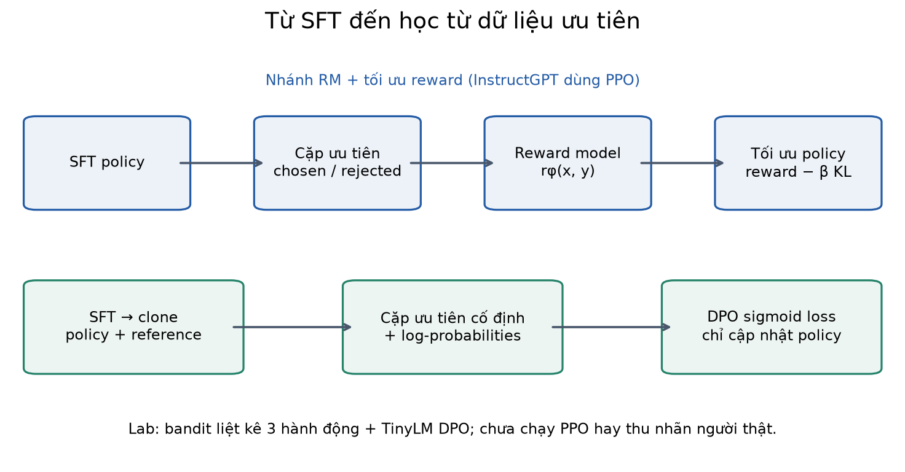
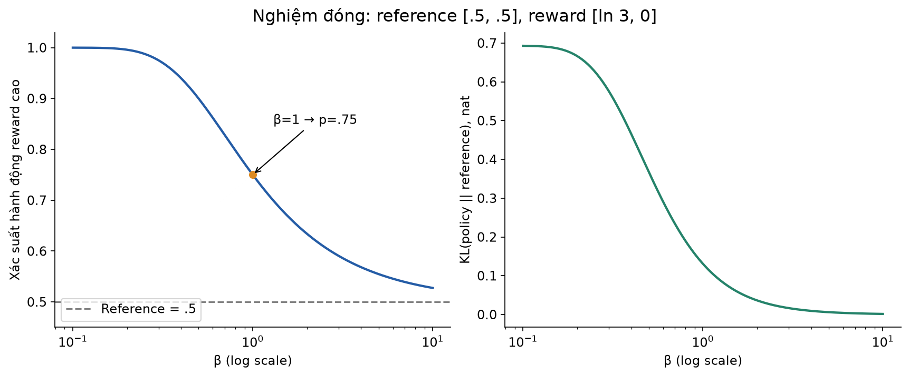
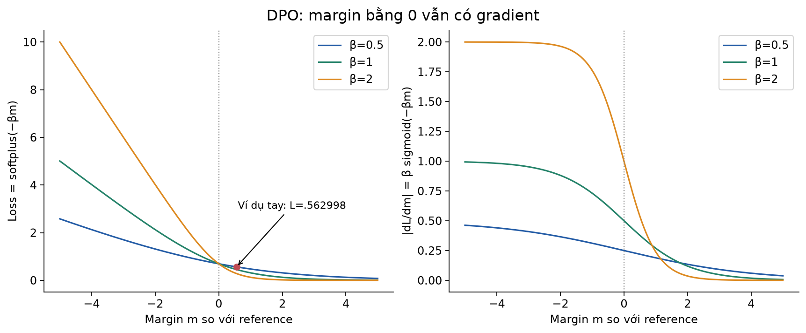
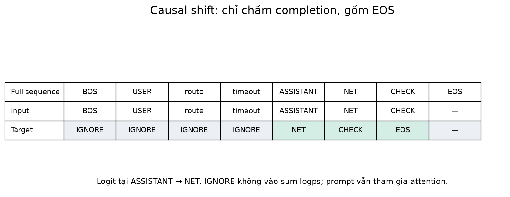
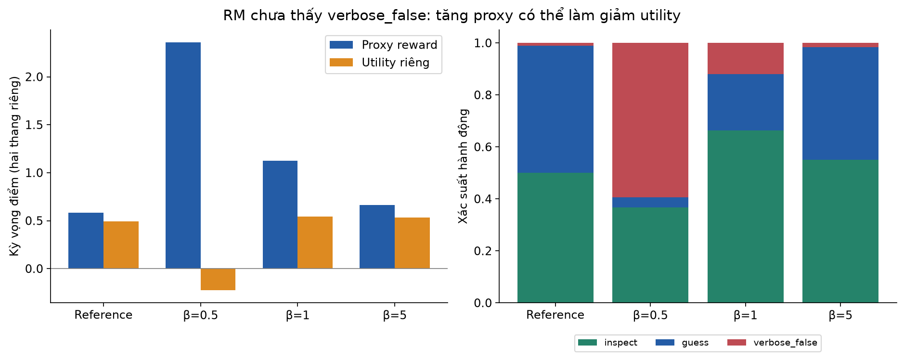
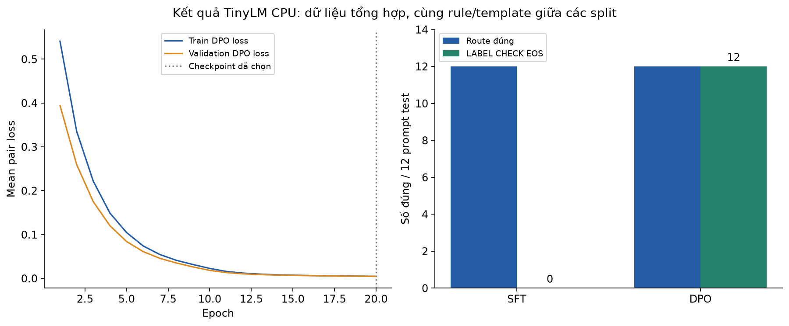
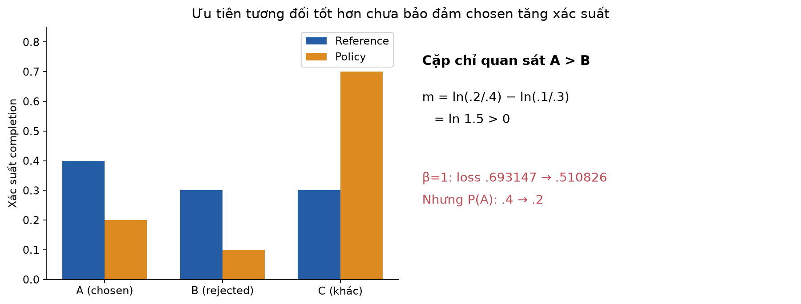

# Bài 36 — Dữ liệu ưu tiên, RLHF và DPO

[← Mục lục](../README.md) · [Bài 35: SFT, LoRA và QLoRA](../35-sft-lora-qlora/README.md) · [Phụ lục](deep-dive.md) · [Bài tập](exercises.md) · [Lời giải](solutions.md)

Bài 35 dạy mô hình bắt chước câu trả lời mẫu bằng SFT. Bài này đi thêm một bước: với cùng câu hỏi, nếu có hai câu trả lời, làm sao dùng nhận xét “tôi thích câu này hơn” để huấn luyện? Ta đi từ dữ liệu so sánh đến reward model, mục tiêu RLHF có KL, rồi suy ra loss DPO. Các ví dụ backend, phiếu đánh giá và dữ liệu lab đều **do bài học tự tạo**, không phải phản hồi người dùng thật.

Sau bài này, bạn cần tự làm được bốn việc: thiết kế một cặp ưu tiên có ngữ cảnh và tiêu chí rõ; tính loss/gradient nhỏ; triển khai log-probability của completion đúng shift/mask; đọc kết quả huấn luyện cùng giới hạn của phép đánh giá. Biên soạn xong bài chưa là bằng chứng người học đã thành thạo.

**Kiến thức cần trước:** sigmoid và cross-entropy (bài 6), gradient/backprop (bài 10), PyTorch (11–13), causal LM/tokenizer (18–21), đánh giá (22, 30), SFT (35). Nếu quên, nhớ rằng mô hình ngôn ngữ xuất phân bố token kế tiếp; xác suất một câu là tích xác suất các token có điều kiện.

## 1. Từ “làm theo mẫu” đến “chọn cách trả lời tốt hơn”

Giả sử bạn xây trợ lý giải thích incident cho backend. Câu hỏi: “Checkout timeout tăng sau deploy; tôi nên làm gì trước?”

- A: “Chắc chắn database quá tải. Tăng connection pool lên ngay.”
- B: “Chưa đủ bằng chứng kết luận. Kiểm tra latency theo dependency, thay đổi sau deploy và mức dùng pool trước; chọn biện pháp dựa trên kết quả.”

Trong tình huống giả định này, nhóm đánh giá ưu tiên B vì thể hiện mức chắc chắn phù hợp và đề xuất bước kiểm tra. B dài hơn A, nhưng tiêu chí ưu tiên là chất lượng chẩn đoán. Muốn kiểm tra người gán nhãn có chỉ thích độ dài không, hãy bổ sung các cặp cùng độ dài, cặp ngắn nhưng đúng và dài nhưng sai.

SFT lưu `(prompt, câu trả lời mẫu)` và tăng log-probability của mẫu. Dữ liệu ưu tiên lưu `(prompt, chosen, rejected)` và nói chosen được chọn **trong phép so sánh này**. Rejected có thể vẫn đúng nhưng thiếu bước kiểm tra; chosen có thể vẫn có lỗi. So sánh tương đối không tự tạo một chuẩn đúng tuyệt đối.

| Khái niệm | Nghĩa trong bài |
|---|---|
| Preference | Nhận xét ưu tiên một đầu ra hơn đầu ra khác |
| Policy, ký hiệu πθ | Mô hình đang học; tạo phân bố câu trả lời theo prompt |
| Reference, πref | Mô hình tham chiếu cố định trong thí nghiệm DPO này |
| Reward model, rφ | Hàm cho điểm một cặp prompt–câu trả lời |
| RLHF | Reinforcement Learning from Human Feedback: học tăng cường từ phản hồi con người |
| DPO | Direct Preference Optimization: tối ưu trực tiếp từ cặp ưu tiên |
| Rollout | Một lần sinh chuỗi bằng policy để thu dữ liệu cho cập nhật |

Một pipeline RLHF có ảnh hưởng lớn là InstructGPT: SFT → huấn luyện reward model từ so sánh → tối ưu policy bằng PPO. Đây là một cấu hình lịch sử cụ thể; RLHF là tên một họ cách học, PPO là một thuật toán tối ưu trong họ đó. [Ouyang và cộng sự, mục 3.1](https://arxiv.org/html/2203.02155v1).



## 2. Dữ liệu ưu tiên bắt đầu từ hợp đồng đánh giá

Một record thực tế nên cho phép khôi phục câu hỏi, hai ứng viên và lý do so sánh:

```text
prompt_id: incident-017
conversation_group: checkout-incident-2026-11-01
prompt: Checkout timeout tăng sau deploy; kiểm tra gì trước?
chosen: Kiểm tra dependency latency và thay đổi sau deploy...
rejected: Chắc chắn database quá tải; tăng pool ngay...
rubric_version: incident-assistant-v3
reason: mức chắc chắn phù hợp, bước kiểm tra có căn cứ
candidate_model_revision: model-A@revision-X
annotation: reviewer-opaque-id, timestamp, confidence
```

Đây là thiết kế minh họa, không yêu cầu lưu định danh cá nhân của reviewer. Chỉ giữ dữ liệu được phép sử dụng; loại secret, token truy cập và thông tin không cần thiết trước khi đưa vào tập học.

Một rubric cho trợ lý incident có thể đánh giá: bám bằng chứng, bước kiểm tra thực hiện được, đúng phạm vi quyền hạn, diễn đạt rõ và mức chắc chắn phù hợp. Nếu hai câu đều sai, ghi **both bad** và sửa dữ liệu; nếu hòa, ghi **tie**; nếu reviewer không đủ chuyên môn, ghi **abstain**. Không ép mọi trường hợp thành một chiến thắng. Binary DPO trong lab chỉ nhận các cặp đã quyết định hướng ưu tiên; lab không triển khai mô hình riêng cho tie.

Quy trình tự đề xuất cho ví dụ backend:

1. Ẩn tên model, đảo vị trí A/B để giảm tín hiệu vị trí/thương hiệu.
2. Cho reviewer cùng ngữ cảnh, phiên bản rubric và tài liệu kiểm chứng khi cần.
3. Giữ bất đồng, phân loại nguyên nhân; dùng review bổ sung khi tiêu chí mâu thuẫn.
4. Gom phiên hội thoại/incident/nguồn gốc thành group trước khi chia train/validation/test.
5. Kiểm exact/near duplicate, cặp đảo chiều do lỗi, dữ liệu đã xuất hiện trong SFT và tính nhất quán tokenizer/template.

Ví dụ 10 đoạn hội thoại cùng incident dù khác wording vẫn nên cùng split. Chia theo từng cặp có thể đưa cùng ngữ cảnh hoặc ứng viên gần như y hệt sang test. Có K ứng viên thì có K(K−1)/2 cặp khác nhau; chúng dùng chung prompt và ứng viên, nên không phải từng ấy quan sát độc lập.

Trong lab, `validate()` kiểm trường rỗng, chosen trùng rejected, cặp trùng/đảo chiều và group/prompt giao nhau giữa split. Nó chưa làm near-dedup hay phân tích mâu thuẫn ngữ nghĩa. Dữ liệu lab là rule minh bạch nên không cần reviewer thật; cách này chỉ kiểm cơ chế học.

## 3. Reward model: từ so sánh sang một số thực

Reward model nhận cả prompt lẫn câu trả lời và trả một scalar, ví dụ `rφ(x,y)=2.3`. Điểm này không phải xác suất câu đúng. Một giả định phổ biến là **Bradley–Terry**:

\[
P(y^+\succ y^-\mid x)=\sigma(r_\phi(x,y^+)-r_\phi(x,y^-)),\qquad
\sigma(z)=\frac1{1+e^{-z}}.
\]

Loss trên một cặp:

\[
L_{RM}=-\log\sigma(\Delta r),\quad\Delta r=r_\phi(x,y^+)-r_\phi(x,y^-).
\]

Đây là bài học phân biệt hai ứng viên bằng chênh lệch điểm. Tài liệu Reward Modeling mô tả cùng loss; cộng cùng một hằng số vào mọi điểm trong cùng prompt không đổi xác suất ưu tiên. [TRL Reward Modeling, Computing the loss](https://huggingface.co/docs/trl/reward_trainer).

**Tính tay:** đặt `r+=ln(3)=1.098612`, `r−=0`. Khi đó:

\[
P(+\succ-)=\frac{3}{3+1}=0.75,\qquad L_{RM}=-\ln0.75=0.287682.
\]

Đạo hàm theo chênh lệch là `σ(Δr)−1=−0.25`. Gradient descent muốn tăng chênh lệch của cặp có nhãn chosen thắng. Nếu thêm 100 vào cả hai reward, xác suất vẫn 0.75.

Nếu có **3 phiếu thuận, 1 phiếu ngược** cho cùng hai ứng viên, viết `p=σ(w)`:

\[
\bar L(w)=-\tfrac14[3\log p+\log(1-p)].
\]

Đạo hàm `p−3/4`; tối ưu ở `p=.75`, `w=ln3`. Loss trung bình là **0.562335**, khác 0.287682 của một phiếu thuận riêng lẻ. Đừng xóa phiếu ngược chỉ vì nó làm accuracy thấp hơn; bất đồng có thể có ý nghĩa.

```python
import math
w = math.log(3)
p = 1 / (1 + math.exp(-w))
loss = -(3*math.log(p) + math.log(1-p)) / 4
assert abs(p - .75) < 1e-12
assert abs(loss - .5623351446188083) < 1e-12
print(p, loss)
```

Với cặp nhất quán hoàn toàn và dữ liệu tách được, tăng chênh lệch vô hạn có thể tiếp tục giảm loss. Vì vậy reward margin lớn không tự chứng minh model calibrated; cần giữ validation, xem phân bố điểm và kiểm định trên các kiểu phản hồi mới.

## 4. Tối ưu policy bằng reward: mục tiêu RLHF có KL

Nếu chỉ tối đa reward dự đoán, policy có thể tìm đầu ra được RM cho điểm cao nhưng con người không thích. Một mục tiêu thường dùng đặt chi phí cho việc lệch khỏi reference:

\[
J(\pi)=\mathbb E_{x}\left[
\mathbb E_{y\sim\pi(\cdot|x)}r_\phi(x,y)
-\beta D_{KL}\big(\pi(\cdot|x)\|\pi_{ref}(\cdot|x)\big)\right],\quad\beta>0.
\]

Với một prompt và tập câu trả lời hữu hạn:

\[
D_{KL}(\pi\|\pi_{ref})=\sum_y\pi(y)\log\frac{\pi(y)}{\pi_{ref}(y)}.
\]

Log tự nhiên được dùng suốt bài; đơn vị KL là nat. KL có hướng, không là khoảng cách đối xứng. Chênh lệch log-probability của **một mẫu** có thể âm, còn kỳ vọng đúng phân bố policy tạo ra KL không âm. Mục tiêu này và liên hệ với DPO được trình bày ở mục 3–4 của [bài báo DPO](https://arxiv.org/pdf/2305.18290).

**Ví dụ tính tay có hai hành động**: reference `[.5,.5]`, reward `[ln3,0]`, `β=1`. Nghiệm tối ưu là `[.75,.25]` (suy ra ở phần 6):

\[
\mathbb E[r]=.75\ln3=.823959,
\]
\[
KL=.75\ln1.5+.25\ln.5=.130812,
\]
\[
J=.823959-.130812=.693147=\ln2.
\]

Reference cho `J=.5ln3=.549306`, nên chuyển sang phân bố trên cải thiện mục tiêu có penalty. Tối ưu không chọn hành động tốt với xác suất 1 khi β hữu hạn và reference hỗ trợ cả hai.

Giữ reward cố định, tăng β làm độ lệch đắt hơn. Nhưng reward scale và β đi cùng nhau: nhân reward và β cùng hệ số dương không đổi nghiệm tối ưu. Không bê nguyên β từ một reward model sang model khác mà bỏ qua scale và dữ liệu.



## 5. PPO đứng ở đâu trong RLHF?

Trong mô hình ngôn ngữ, có thể xem state là prompt cộng prefix đã sinh, action là token tiếp theo, episode kết thúc ở EOS hoặc budget. Terminal reward đánh giá toàn câu; token-level KL penalty có thể phân bố chi phí lệch reference trong quá trình sinh. Cần xác định rõ cách xử lý chuỗi bị cắt vì hết budget.

Không thể backprop trực tiếp xuyên qua phép chọn token rời rạc như qua một layer affine. Policy gradient dùng mẫu và đạo hàm log-probability để ước lượng hướng cập nhật. Một baseline/value model ước lượng kết quả kỳ vọng; advantage đo mức tốt hơn hoặc kém hơn baseline.

PPO-Clip dùng tỷ số `ρt=πθ(at|st)/πold(at|st)` và tối đa hóa:

\[
\mathbb E_t\min\left(\rho_t\hat A_t,
\operatorname{clip}(\rho_t,1-\epsilon,1+\epsilon)\hat A_t\right).
\]

`πold` là snapshot thu rollout, có thể thay giữa các vòng; `πref` là mốc của KL. Hai vai trò khác nhau. Clipping hạn chế động lực tăng mục tiêu surrogate khi cập nhật quá xa; không là bảo đảm cứng mọi xác suất nằm trong khoảng đó. [Schulman và cộng sự, mục 2–3](https://arxiv.org/pdf/1707.06347).

**Tính tay:** với `ε=.2`, `A=2`, `ρ=1.5`: lấy `min(3,2.4)=2.4`. Với `A=−2`, `ρ=.5`: lấy `min(−1,−1.6)=−1.6`. Dấu advantage làm phía bị chặn khác nhau; clipping không chỉ đơn giản “luôn lấy số gần 1 hơn”.

Lab bài này **không triển khai PPO, critic hoặc rollout của LLM**. Nhánh RM tối ưu kỳ vọng bằng cách liệt kê cả ba hành động của một bandit một bước. Nhờ tập nhỏ, ta có thể tính gradient chính xác và đối chiếu nghiệm đóng, trước khi học các hệ RL phức tạp hơn. Phiếu tổng hợp cũng có nghĩa nhánh này chưa là một thí nghiệm RLHF với con người.

## 6. Từ nghiệm RLHF đến loss DPO

Giữ x cố định, viết `p(y)` cho policy, `q(y)` cho reference. Giả sử β dương, `q(y)>0` trên tập ta xét, reward hữu hạn và tổng chuẩn hóa tồn tại. Tối đa hóa:

\[
\sum_y p(y)r(y)-\beta\sum_y p(y)\log\frac{p(y)}{q(y)},\quad\sum_y p(y)=1.
\]

Thêm nhân tử Lagrange λ cho ràng buộc tổng; đạo hàm theo `p(y)`:

\[
r(y)-\beta\left[\log\frac{p(y)}{q(y)}+1\right]+\lambda=0.
\]

Hạng không phụ thuộc y được hấp thụ vào hằng số chuẩn hóa:

\[
p^*(y)=\frac{q(y)e^{r(y)/\beta}}{Z},\qquad Z=\sum_yq(y)e^{r(y)/\beta}.
\]

Đảo lại:

\[
r(y)=\beta\log\frac{p^*(y)}{q(y)}+\beta\log Z.
\]

Trong cùng prompt, hiệu reward của hai completion làm `βlogZ` triệt tiêu. Đưa hiệu đó vào Bradley–Terry, thay policy tối ưu bằng policy tham số hóa để fit dữ liệu, ta có:

\[
m_\theta=\left[\log\pi_\theta(y^+|x)-\log\pi_{ref}(y^+|x)\right]
-\left[\log\pi_\theta(y^-|x)-\log\pi_{ref}(y^-|x)\right],
\]
\[
\boxed{L_{DPO}=-\log\sigma(\beta m_\theta)}.
\]

Trình tự trên diễn giải phép đổi biến ở mục 4 và Appendix A của [Rafailov và cộng sự](https://arxiv.org/pdf/2305.18290). DPO gốc dùng cặp offline, không cần một RM độc lập và vòng lấy mẫu RL trong mỗi bước tối ưu.

Cần giữ điều kiện của phép suy ra: giả định mô hình ưu tiên, support của reference, khả năng biểu diễn của policy và dữ liệu đủ bao phủ. Loss trên tập hữu hạn thấp không xác nhận ta đã tìm policy tối ưu cho mọi prompt hoặc mọi người dùng. Trong lab, các giả định được đơn giản hóa để quan sát cơ chế.

**Implicit reward**, `r̂θ=β(logπθ−logπref)`, là cách biểu diễn reward qua policy/reference. Nó không thêm một mạng reward vào lúc inference. DPO vẫn là huấn luyện thay đổi trọng số; đây không phải một phương pháp chọn token thay temperature/top-p ở bài 21.

### So sánh tín hiệu học và công việc trong mỗi nhánh

| Cách học | Dữ liệu chính | Cập nhật gì? | Cần chú ý |
|---|---|---|---|
| SFT | Prompt và câu trả lời mẫu | Policy qua next-token loss | Chất lượng mẫu, coverage và quên năng lực cũ |
| RM + tối ưu reward | Cặp ưu tiên để fit RM; output của policy để tối ưu reward | RM ở giai đoạn đầu; policy ở giai đoạn sau | RM ngoại suy, rollout/value/advantage nếu dùng PPO, KL |
| DPO sigmoid trong bài | Cặp prompt/chosen/rejected cố định | Policy; reference giữ nguyên | Identity reference, completion logps, dữ liệu offline và đánh giá output mới |

DPO bỏ một số thành phần huấn luyện so với pipeline RM+PPO vừa mô tả, nhưng không bỏ chi phí thu nhãn hoặc forward chấm điểm hai completion. Reference score có thể được tính trước khi cấu hình cố định. Bảng mô tả cấu trúc tính toán, chưa là phép đo tốc độ hay chất lượng.

## 7. Tính một bước DPO bằng tay

Có ba completion A, B, C cho một prompt; nhãn chọn A thay vì B. Đặt:

| Completion | Reference | Policy hiện tại |
|---|---:|---:|
| A, chosen | .6 | .7 |
| B, rejected | .3 | .2 |
| C, chưa gán nhãn trong cặp | .1 | .1 |

Với `β=.5`:

\[
m=\ln(.7/.6)-\ln(.2/.3)=\ln1.75=.559616,
\]
\[
z=\beta m=.279808,\quad\sigma(z)=.569499,
\]
\[
L=-\ln\sigma(z)=.562998.
\]

Gọi `a=logπθ(A|x)` và `b=logπθ(B|x)`:

\[
\frac{\partial L}{\partial m}=-\beta\sigma(-\beta m)=-.215250,
\qquad\frac{\partial L}{\partial a}=-.215250,
\qquad\frac{\partial L}{\partial b}=+.215250.
\]

Đây là đạo hàm trung gian theo hai log-probability. Các log-probability cùng phụ thuộc trọng số và softmax; không thể tự cập nhật hai xác suất độc lập rồi bỏ điều kiện tổng bằng 1. PyTorch nối tiếp chain rule qua mọi token của cả hai completion.

Khi policy bắt đầu đúng bằng reference, `m=0`, loss `ln2≈.693147` cho mọi cặp. **Gradient vẫn khác 0**: hệ số theo m là `−β/2`. Reference cố định còn policy có gradient, nên hai đường tính không triệt tiêu gradient.

```python
import math
import torch
from objectives import dpo_loss
pc = torch.tensor([math.log(.7)], dtype=torch.float64, requires_grad=True)
pr = torch.tensor([math.log(.2)], dtype=torch.float64, requires_grad=True)
rc, rr = [torch.tensor([math.log(v)], dtype=torch.float64) for v in [.6,.3]]
loss, margin = dpo_loss(pc, pr, rc, rr, beta=.5)
loss.backward()
assert abs(loss.item() - .5629980308512323) < 1e-12
print(margin.item(), pc.grad.item(), pr.grad.item())
```



Trong mục tiêu RLHF, β lớn tăng giá lệch reference. Trong loss DPO, β còn nhân trực tiếp vào margin và gradient. Ở m=0, β lớn cho gradient trung gian lớn hơn; điều này không mâu thuẫn với ý nghĩa regularization của nghiệm tối ưu. Với số bước, learning rate và dữ liệu hữu hạn, không suy ra KL thực tế chỉ từ giá trị β. Đo KL hoặc chỉ số drift phù hợp thay vì đọc β như một cam kết.

## 8. Log-probability của completion: chỗ dễ sai nhất trong code

Với câu trả lời `y1,…,yT`, định nghĩa:

\[
\log\pi(y|x)=\sum_{t=1}^T\log\pi(y_t\mid x,y_{<t}).
\]

Lab tính cả EOS trong T. Cả policy và reference dùng **cùng tokenizer, cùng role template, cùng mask và completion**. DPO sigmoid gốc trong bài dùng **sum log-probability theo token**, sau đó mean loss theo cặp. Thay sum bằng mean token làm thay đổi mục tiêu; nếu muốn một biến thể chuẩn hóa độ dài, cần gọi đúng tên và đánh giá lại.

Ví dụ token riêng của lab:

```text
full:    BOS USER route timeout ASSISTANT NET CHECK EOS
input:   BOS USER route timeout ASSISTANT NET CHECK
target:  IGN IGN  IGN   IGN      NET       CHECK EOS
```

Logit ở vị trí ASSISTANT dự đoán NET. Không shift lần hai trong loss. Target của prompt và PAD dùng IGNORE; EOS vẫn là target thật. Chosen/rejected ghép với cùng prefix, teacher forcing toàn completion ở cả hai nhánh.



Phần cốt lõi trong [objectives.py](objectives.py): `log_softmax` theo vocabulary → `gather` target token → bỏ vị trí IGNORE → sum theo chiều sequence. `logsigmoid` giúp tránh tính `log(sigmoid(z))` một cách kém ổn định với z rất âm. Không nhân tích xác suất dài trực tiếp vì dễ underflow.

```python
import torch
from data import Tokenizer, records, batch, IGNORE
from objectives import sequence_logps
tok = Tokenizer(records()['train'])
x, y = batch(tok, [('route timeout', 'NET CHECK'), ('route', 'AUTH')])
logits = torch.zeros(*x.shape, tok.size, dtype=torch.float64)
scores = sequence_logps(logits, y)
expected = -torch.log(torch.tensor(float(tok.size))) * y.ne(IGNORE).sum(1)
assert torch.allclose(scores, expected.double())
print(y.ne(IGNORE).sum(1).tolist(), scores.tolist())  # [3, 2]: có EOS
```

Tokenizer lab chỉ tách whitespace, có các ID đặc biệt riêng, right padding và từ vựng fit trên train. Với tokenizer subword thực, nối chuỗi có thể thay biên token; cần kiểm prefix token của prompt trong chuỗi hoàn chỉnh, không suy mask từ số ký tự. Nếu phải truncation, chọn chính sách rõ, kiểm cả hai ứng viên và không để một completion bị cắt mất phần quyết định ưu tiên. Lab từ chối vượt context thay vì cắt ngầm.

## 9. Lab CPU: hai thí nghiệm có thể tự kiểm chứng

Chạy từ thư mục chứa README này. Python đã kiểm: **3.14.6**, PyTorch **2.15.0**, NumPy **2.5.4**, macOS arm64, CPU một thread. Hình dùng Matplotlib **3.11.2**. Các phiên bản này là môi trường thực sự đã chạy, không phải yêu cầu về một GPU cụ thể.

```bash
python3 -m venv .venv
.venv/bin/python -m pip install -r requirements.txt
.venv/bin/python lab.py --mode hand
.venv/bin/python lab.py --mode mask
.venv/bin/python lab.py --mode check
.venv/bin/python lab.py --mode bandit
.venv/bin/python lab.py --mode all --out /tmp/lesson36-run-01
```

`all` tạo `report.json` và `checkpoint.pt` trong thư mục output **mới**. Nếu đường dẫn đã tồn tại, chương trình từ chối để không ghi đè thí nghiệm. Chọn tên khác khi chạy lại. Mode `train` chỉ chạy SFT+DPO và cũng cần `--out` mới. Toàn bộ lab không cần tài khoản, model download hoặc mạng sau khi cài dependency.

### 9.1. Reward model học một tín hiệu thiếu coverage

Ba hành động là `inspect`, `guess`, `verbose_false`. Feature tương ứng là `[1,0,3]`: tưởng tượng một tín hiệu hình thức mà RM dùng thay chất lượng. Dữ liệu RM chỉ có so sánh inspect/guess: ba phiếu thuận, một phiếu ngược. Mạng reward chỉ là một tham số `r(y)=w×feature(y)`; Adam fit 500 bước và cho `w≈ln3`.

Reference là `[.50,.49,.01]`. Policy được tối ưu trên **cả ba hành động**, nên có thể chọn `verbose_false`, dù RM chưa từng được gán nhãn cho nó. Evaluator riêng đặt utility `[1,0,−1]`; utility này chỉ được dùng để báo cáo, không tham gia fit reward hoặc policy. Đây là tình huống do ta thiết kế để quan sát lỗi ngoại suy.

Với mỗi β, [bandit.py](bandit.py) tối ưu logits bằng Adam 2.000 bước, kỳ vọng tính bằng liệt kê; đồng thời tính `softmax(log reference + reward/β)` để đối chiếu. “Liệt kê chính xác” nói về kỳ vọng, nghiệm từ optimizer vẫn là nghiệm số cần đo sai số.

### 9.2. Mô hình ngôn ngữ nhỏ học DPO thật

Dữ liệu gồm 24 group service–operation, split **16/4/4**, shuffle group với seed35; seed khởi tạo model là36. Mỗi group có ba event: timeout→NET, denied→AUTH, deadlock→DATA. Mỗi prompt có hai cặp:

- Ưu tiên style: `NET CHECK` hơn `NET GUESS`.
- Ưu tiên route: `NET CHECK` hơn một route sai kèm CHECK.

Tương tự cho các event khác. Tổng **96/24/24 cặp**, tương ứng **48/12/12 prompt**. Mọi từ của held-out prompt có trong vocabulary train; tổ hợp service–operation được giữ riêng theo group. Các split vẫn chung event, quy tắc và template; không phải kiểm khả năng hiểu incident chưa từng gặp.

Tiny causal LM có một block, dimension24, bốn attention head, FF48, context32, vocabulary29, **6.912 tham số**. Mô hình khởi tạo ngẫu nhiên. Giai đoạn SFT học route đúng với hai style CHECK/GUESS tần suất bằng nhau, 35 epoch/210 update; chọn checkpoint theo token CE validation. SFT này cố tình giữ hai style để DPO có một lựa chọn cần điều chỉnh, khác cách tạo baseline tối ưu cho sản phẩm.

Sau đó clone SFT thành reference, `eval()` và `requires_grad_(False)`. Policy khởi tạo từ cùng checkpoint. DPO dùng β=.5, AdamW learning rate .002, weight decay0, gradient clipping1, batch16 cặp, 20 epoch/120 update. Tham số policy được cập nhật toàn bộ; bài này chưa ghép LoRA/QLoRA.

Một minibatch trong code thực hiện tuần tự:

```text
Ghép prompt + chosen và prompt + rejected bằng cùng template.
Forward policy → sum logps từng completion, giữ graph.
Lấy reference logps cố định tương ứng từng hàng, không có graph.
Tính m → mean softplus(−βm) → backward → clip → optimizer.step.
Đánh giá validation, chọn checkpoint; chỉ sau đó mới mở test.
```

Reference log-probability train được cache theo thứ tự hàng. Validation tính loss mỗi epoch, chọn thấp nhất; test chỉ được đánh giá sau khi chọn xong checkpoint. Lưu hash reference, tokenizer, dữ liệu, template, β và reduction để biết score cache thuộc cấu hình nào. Reference hash/gradient được kiểm, checkpoint được lưu/tải rồi đối chiếu tensor. Đây là bundle phục vụ kiểm tra/tải trọng số, **chưa là checkpoint resume đầy đủ optimizer/RNG** như bài 12.

## 10. Kết quả đã chạy và cách đọc

### 10.1. Bandit: đối chiếu nghiệm số với nghiệm đóng

| Policy | E[proxy reward] | E[utility riêng] | P(verbose_false) | KL đến reference |
|---|---:|---:|---:|---:|
| Reference | .582265 | .490000 | .010000 | 0 |
| β=.5 | 2.359154 | −.227199 | .593648 | 2.210335 |
| β=1 | 1.122918 | .544248 | .119469 | .307553 |
| β=5 | .660664 | .533064 | .017075 | .007973 |

Sai số xác suất lớn nhất giữa optimizer và nghiệm đóng trong ba cấu hình khoảng `6.25×10⁻¹⁷`. Với β=.5, policy tối ưu proxy ưu ái hành động dài nhưng sai, khiến utility giảm từ .49 xuống −.227199. Với β=1 hoặc5 trong ví dụ này, utility lại cao hơn reference. Kết quả không nói β càng cao càng tốt; nó cho thấy đánh giá một proxy duy nhất có thể bỏ sót điều ta quan tâm.



Vấn đề proxy overoptimization còn được nghiên cứu bằng thiết lập gold/proxy tổng hợp trong [Gao và cộng sự](https://arxiv.org/abs/2210.10760). Phần nguồn đã đọc cho bài này là abstract; các số trong bảng hoàn toàn từ code của bài, không lấy từ nghiên cứu đó.

### 10.2. TinyLM: loss, ordering và output sinh là các phép đo khác nhau

SFT chọn epoch33, token CE validation **.232386**. DPO chọn epoch20, pair loss validation **.004615**. Hai loss có đơn vị tổng hợp khác nhau, không lấy chúng so trực tiếp để kết luận model nào tốt hơn.

| Đo trên test | SFT baseline | Sau DPO |
|---|---:|---:|
| Mean pair DPO loss với cùng reference | .693147 | .004619 |
| Raw chosen logp > rejected logp | 12/24 | 24/24 |
| Relative reward margin > 10⁻⁶ | 0/24; **24 tie** | 24/24 |
| Route đúng khi sinh greedy | 12/12 | 12/12 |
| Exact `LABEL CHECK EOS` khi sinh greedy | 0/12 | 12/12 |
| Mean chosen completion logp | −.717510 | −.575020 |
| Mean rejected completion logp | −4.778752 | −17.288816 |

SFT bằng reference nên relative margin bằng 0 theo định nghĩa; không gọi 0/24 relative wins là “SFT không hiểu gì”. Raw ordering đo một câu hỏi khác: xác suất chosen trong chính model có cao hơn rejected không. Generation lại hỏi argmax từng token tạo ra chuỗi gì.

Ở SFT, CHECK và GUESS có tần suất bằng nhau; chênh lệch xác suất nhỏ khiến greedy chọn GUESS trong 12 prompt test của seed này. Kết quả 0/12 exact style không có nghĩa baseline luôn sinh GUESS nếu sampling; ta chưa đo tỷ lệ sampling. Sau DPO, cả hai mean logps thay đổi, đặc biệt rejected giảm mạnh. Cần xem phân bố theo từng cặp nếu dùng để chẩn đoán sâu.



Rule lookup event→label cộng CHECK giải được 12/12 prompt này. Nó là baseline đơn giản đạt mục tiêu mà không train. Mô hình nhỏ ở đây phục vụ hiểu DPO, chưa chứng minh lợi ích sản phẩm hơn rule, hơn SFT chosen-only, hoặc hơn PPO. SFT chosen-only chưa được chạy làm nhánh so sánh trong lab này.

## 11. Ba hiểu nhầm cần tự phản biện

**“DPO làm chosen tăng xác suất tuyệt đối.”** Không được bảo đảm. Lấy reference `[.4,.3,.3]`, policy `[.2,.1,.7]`, chosen=A, rejected=B. Margin `ln(.2/.4)−ln(.1/.3)=ln1.5>0`, nhưng P(A) giảm từ .4 xuống .2. Loss β=1 giảm từ ln2 xuống .510826; phần xác suất chuyển vào C không được cặp này trực tiếp kiểm soát.



**“Preference accuracy cao chứng minh tính đúng.”** Người gán nhãn hoặc judge có thể ưu tiên câu tự tin, dài hoặc thuận ý mình. Cần tách correctness, usefulness, mức chắc chắn và tác động thật. Reward margin chỉ kiểm ưu tiên theo dữ liệu/model đã định nghĩa.

**“Huấn luyện ưu tiên thay thế phân quyền và giới hạn hành động.”** Một model được ưu tiên trả lời cẩn thận vẫn có thể đề xuất thao tác sai. Quyền thực thi, review, deadline và audit ở bài 26–33 vẫn là trách nhiệm hệ thống. Preference learning không thay thế policy gateway.

## 12. Đọc code, kiểm lại và học tiếp

| Tệp | Vai trò |
|---|---|
| [data.py](data.py) | Group split, validator, tokenizer, shift/mask |
| [model.py](model.py) | Tiny causal LM độc lập, kế thừa cấu trúc từ bài 35 |
| [objectives.py](objectives.py) | Sum logps, sigmoid DPO, tính tay |
| [bandit.py](bandit.py) | Fit RM một tham số, tối ưu policy, nghiệm đóng và utility riêng |
| [training.py](training.py) | SFT → frozen reference → DPO, validation và bundle |
| [checks.py](checks.py) | 34 kiểm tra arithmetic, finite difference, dữ liệu và masking |
| [lab.py](lab.py) | Sáu mode CLI, report và output guard |
| [make_figures.py](make_figures.py) | Tái tạo bảy cặp hình PNG/SVG từ công thức/report |

Các kiểm tra đã chạy gồm: đạo hàm DPO đối chiếu sai phân số độc lập; sum logps đối chiếu vòng lặp NumPy; mask prompt/PAD, EOS, completion khác độ dài; score bất biến khi right-pad; cặp rỗng/trùng/đảo chiều và rò rỉ group; reference không đổi/không có gradient; lưu/tải trọng số. Bản đóng gói được giải nén và chạy lại để kiểm code, kết quả và liên kết. Sai số float hoặc lựa chọn argmax gần hòa có thể thay đổi trên môi trường khác; không cam kết tái lập bitwise trên mọi device.

Muốn vẽ lại hình sau một lần chạy `all`:

```bash
.venv/bin/python -m pip install -r requirements-figures.txt
.venv/bin/python make_figures.py --report /tmp/lesson36-run-01/report.json
```

Làm [16 bài tập](exercises.md), đối chiếu [lời giải](solutions.md), rồi đọc [phụ lục 12 chủ đề](deep-dive.md). Trước khi coi mình hiểu phần cốt lõi, hãy tự giải thích: vì sao lnZ mất đi; vì sao loss ln2 lúc đầu vẫn có gradient; vì sao sum khác mean; và vì sao một policy thắng các cặp offline vẫn cần đánh giá output mới.

Tiếp theo: [bài 37 — Batching, KV cache và tối ưu inference](../37-batching-kv-cache-toi-uu-inference/README.md), từ trọng số đã học sang cơ chế phục vụ hiệu quả. [Nguồn đã đọc và phạm vi kiểm](../SOURCES.md) · [Đề cương các nhánh nâng cao](../ROADMAP.md). Các nhánh chưa có bài viết vẫn là định hướng; bài này chưa cung cấp trainer PPO/LLM quy mô lớn.
