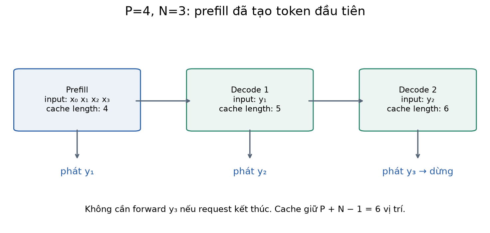
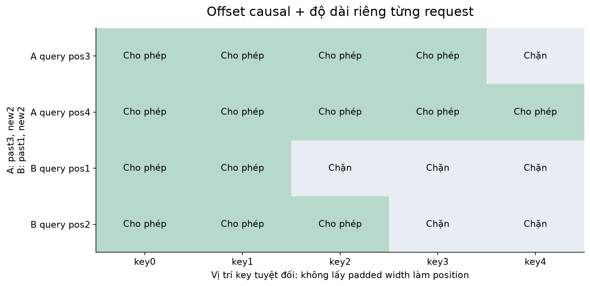
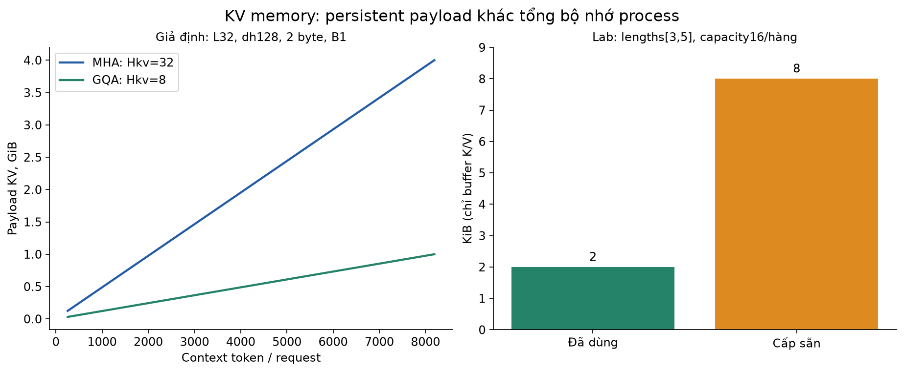
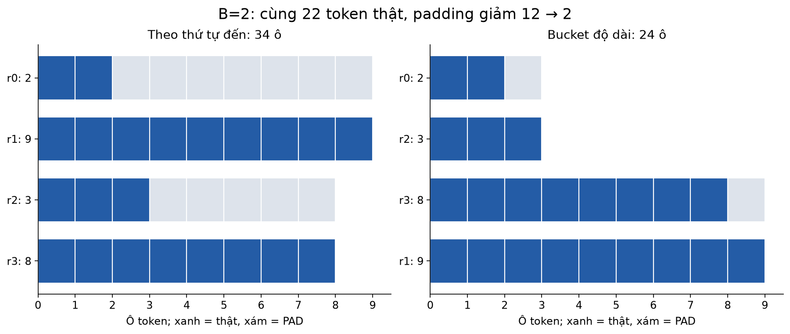
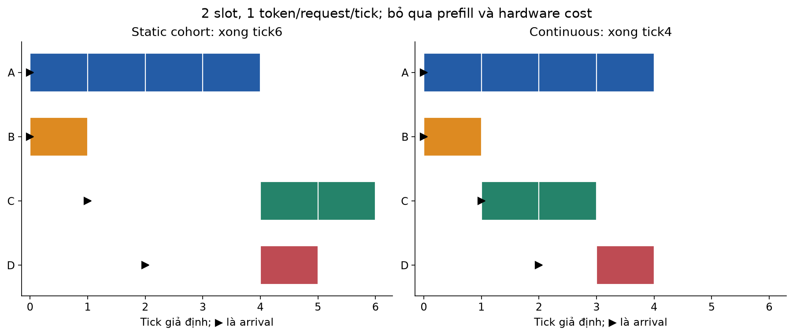
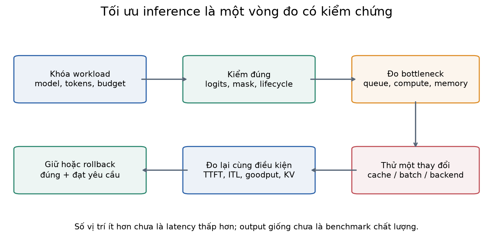
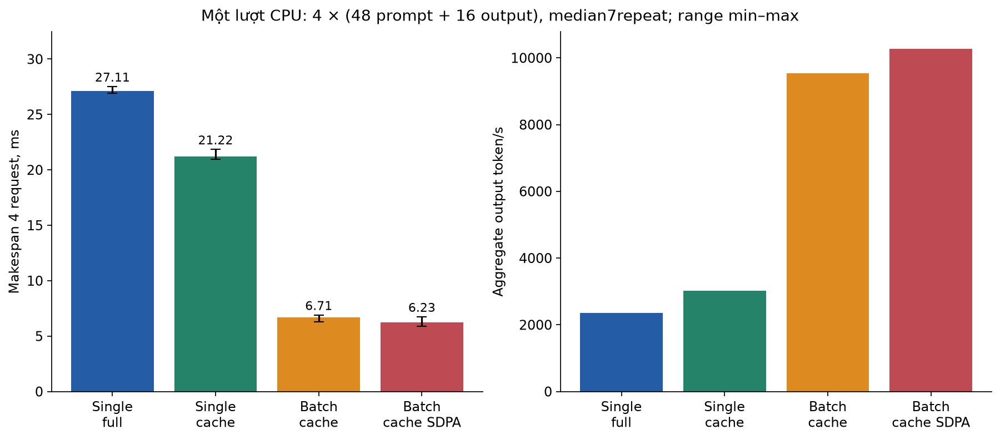

# Bài 37 — Batching, KV cache và tối ưu inference

[← Mục lục](../README.md) · [Bài 36](../36-du-lieu-uu-tien-rlhf-dpo/README.md) · [Phụ lục](deep-dive.md) · [Bài tập](exercises.md) · [Lời giải](solutions.md)

Sau SFT và DPO, ta có trọng số mô hình cần phục vụ. Một câu trả lời đúng nhưng bắt người dùng chờ quá lâu, hoặc chỉ xử lý được vài request cùng lúc, vẫn khó dùng trong sản phẩm. Bài này giải thích cách giảm công việc lặp và chia sẻ một lượt tính giữa nhiều request, đồng thời kiểm chứng rằng tối ưu không làm sai đầu ra.

Bài 21 đã giới thiệu cache một chuỗi; bài này mở rộng sang **nhiều layer, nhiều request, độ dài khác nhau, GQA, cấp phát bộ nhớ và đo hiệu năng**. Kiến thức cần trước: attention/Transformer (17–18), autoregressive decoding (21), queue/deadline (31), đo tải/độ trễ (34). Bài 35–36 giúp nối với vòng đời model, nhưng không bắt buộc để chạy lab.

Mục tiêu: tự giải thích prefill/decode; tính payload KV và số vị trí được xử lý; viết đúng position/mask khi cache; phân biệt static/dynamic/continuous batching; thiết kế phép đo cùng workload có kiểm đầu ra. Tài liệu không suy mức hiểu của bạn chỉ từ việc đọc xong.

**Phạm vi lab:** decoder nhỏ chưa huấn luyện, token ID tổng hợp, PyTorch CPU; không tải model hay gọi API. Ta đo tính đúng của phép tối ưu và thời gian cục bộ, chưa đo chất lượng ngôn ngữ. Mô phỏng lịch batching được ghi riêng với thời gian đo thật.

## 1. Ví dụ backend: ba request cùng gọi một model

Giả sử API trợ lý incident nhận: A hỏi ý nghĩa một mã lỗi, B gửi một đoạn log dài, C yêu cầu tóm tắt một bản postmortem. Chúng dùng cùng trọng số model nhưng khác prompt và số token đầu ra.

Một worker có thể xử lý từng request đến hết. Khi A hoàn tất mới đến B, C phải đợi. Ta có ba hướng cải thiện có tác dụng khác nhau:

- **KV cache:** trong một request, tái sử dụng K/V của prefix đã xử lý.
- **Batching:** cho nhiều request dùng chung một lượt forward với cùng model.
- **Scheduling:** quyết định request nào vào lượt tính tiếp theo, dưới giới hạn token, bộ nhớ và deadline.

KV cache không lưu một câu trả lời đã sinh để trả lại nguyên văn. Nó cũng không phải lịch sử hội thoại dạng văn bản ở bài 28. Cache này chứa tensor trung gian của attention, phụ thuộc prefix token, model và vị trí.

Nếu CPU/GPU đã đầy hoặc KV không còn chỗ, cứ tăng concurrency ở HTTP layer có thể chỉ làm queue dài hơn. Kết nối lại bài 31 và34: admission, deadline, lượng công việc trong hệ thống và goodput vẫn cần được đo.

## 2. Một lượt sinh có hai giai đoạn

Cho prompt gồm P token và cần sinh N token mới:

1. **Prefill:** chạy toàn prompt, tạo K/V theo từng layer. Logit tại token cuối prompt dự đoán **token đầu ra đầu tiên**.
2. **Decode:** đưa token vừa sinh vào model, dùng cache prefix để dự đoán token tiếp theo. Lặp đến EOS hoặc output budget.

Trong một chuỗi, token kế tiếp phụ thuộc token trước nên các bước decode có phụ thuộc tuần tự. Trong prefill, toàn prompt đã biết nên có thể tính nhiều vị trí trong cùng forward với causal mask. Phân tách này được dùng trong mô tả generation của [PagedAttention, mục2.2](https://arxiv.org/pdf/2309.06180).



Lỗi đếm thường gặp: để phát ra N token, cần một prefill và **N−1** lượt forward token đơn tiếp theo. Token cuối đã phát ra không cần được đưa lại vào model nếu request kết thúc ngay. Đây là quy ước generation trong lab, không phải lý do bỏ tính token cuối trong loss huấn luyện.

Độ trễ nên tách:

\[
TTFT=t_{\text{token đầu}}-t_{\text{request đến}},\quad
ITL_i=t_i-t_{i-1}\;(i\ge2).
\]

TTFT thường gồm chờ admission/queue, tiền xử lý và prefill; các thành phần chính xác phụ thuộc điểm đo. Với N≥2, `TPOT=(tcuối−tđầu)/(N−1)` là thời gian trung bình giữa token sau token đầu. Với N=1, TPOT không xác định, không ghi0 như một phép đo hợp lệ. End-to-end latency tính đến khi client nhận kết quả cuối, còn throughput tổng hợp là số token hoặc request hoàn tất trên cửa sổ đo. Chúng không thay thế nhau.

## 3. KV cache tái sử dụng gì và vì sao hợp lệ?

Trong một attention head tại vị trí t:

\[
q_t=h_tW_Q,\quad k_t=h_tW_K,\quad v_t=h_tW_V,
\]
\[
o_t=\operatorname{softmax}\left(\frac{q_tK_{\le t}^{\top}}{\sqrt{d_h}}\right)V_{\le t}.
\]

Với causal attention, thêm token tương lai không làm đổi biểu diễn những vị trí cũ. Giữ weights, prefix, position và chế độ inference như cũ, K/V ở từng layer có thể được tái sử dụng. Mỗi bước chỉ tính Q/K/V và FFN của vị trí mới, rồi cho query mới nhìn các key/value được phép. [Transformers: How caching works](https://huggingface.co/docs/transformers/cache_explanation).

Không cần cache toàn bộ Q cũ để tính output ở vị trí mới. K/V lại phải giữ **theo từng layer**: hidden state đi qua các layer, nên cache chỉ một K/V đầu mạng không thay được cache của các layer sau.

**Ví dụ tính tay một head, dh=1.** Query mới `q=1`; hai key cũ `[1,0]`, key mới `[1]`. Value tương ứng `[2,4,8]`. Query mới nhìn cả ba:

\[
s=[1,0,1],\quad
\alpha=\frac{[e,1,e]}{2e+1}\approx[.422319,.155362,.422319],
\]
\[
o=2\alpha_1+4\alpha_2+8\alpha_3\approx4.844638.
\]

Tính lại toàn prefix và lấy hàng query cuối cho cùng kết quả; cache chỉ giúp không tính lại các trạng thái cũ. Nếu key/value cũ không đúng prefix hoặc thiếu một vị trí, attention có thể vẫn chạy và cho một con số, nhưng đó là con số của một context khác.

```python
import math
import torch
from torch.nn import functional as F
q=torch.tensor([[[[1.]]]],dtype=torch.float64)
k=torch.tensor([[[[1.],[0.],[1.]]]],dtype=torch.float64)
v=torch.tensor([[[[2.],[4.],[8.]]]],dtype=torch.float64)
allowed=torch.ones(1,1,1,3,dtype=torch.bool)
out=F.scaled_dot_product_attention(q,k,v,attn_mask=allowed,dropout_p=0.)
expected=(10*math.e+4)/(2*math.e+1)
assert abs(out.item()-expected)<1e-12
print(out.item())  # 4.8446375965
```

KV cache không làm attention của decode có chi phí hằng số: query mới vẫn đọc K/V của context được phép. Khi context tăng, lượng trạng thái cần đọc cũng tăng. Với mô hình sliding-window hoặc attention khác, phạm vi tăng trưởng phải tính theo kiến trúc đó; lab chỉ dùng full causal attention.

## 4. Đếm công việc: P=4, N=3

Cách ngây thơ tính lại các prefix dài4,5,6 để sinh ba token. Tổng vị trí đi qua projection/FFN là:

\[
4+5+6=15.
\]

Có cache: prefill4, rồi hai vị trí mới, tổng `4+1+1=6`. Tổng quát:

\[
W_{\text{full}}=NP+\frac{N(N-1)}2,\qquad W_{\text{cache}}=P+N-1.
\]

Đếm **cặp query–key hợp lệ theo causal mask trên mỗi head/layer**:

\[
A_{\text{full}}=\sum_{i=0}^{N-1}\frac{(P+i)(P+i+1)}2,
\]
\[
A_{\text{cache}}=\frac{P(P+1)}2+\sum_{i=1}^{N-1}(P+i).
\]

Ví dụ cho `46` so với `21`. Đây là số cặp hợp lệ về mặt logic, **không phải** FLOPs thực của phép nhân ma trận đặc có cả ô bị mask. Kernel, padding, head dimension, dtype và cách cấp phát quyết định thời gian thật. Không lấy 15/6=2.5 rồi hứa inference nhanh2.5lần.

```python
from arithmetic import work
r=work(4,3)
assert r==dict(uncached_positions=15,cached_positions=6,
               uncached_causal_pairs=46,cached_causal_pairs=21)
print(r)
```

## 5. Position và causal mask khi đã có prefix cache

Đánh số vị trí từ0. Nếu cache đã có p token, token mới thứ j trong chunk có vị trí tuyệt đối `p+j`, và được nhìn key thứ k khi:

\[
\text{allowed}(j,k)=(k\le p+j)\land(k<\text{length mới của request}).
\]

Ví dụ p=3, chunk mới dài2, keys tổng dài5:

```text
                   key0 key1 key2 key3 key4
query mới ở pos3     1    1    1    1    0
query mới ở pos4     1    1    1    1    1
```

Một `tril(2,5)` không có offset sẽ sai. Với query dài1 và keys dài3, `is_causal=True` của SDPA dùng căn chỉnh causal phía trên trái theo tài liệu phiên bản đã kiểm; nó không tự biết query này ở cuối một prefix cache. Lab dùng mask boolean tường minh và `is_causal=False`. Trong SDPA, **True nghĩa là được tham gia attention**, khác quy ước `key_padding_mask` của MultiheadAttention. Luôn truyền `dropout_p=0` ở nhánh inference này. [PyTorch2.15 SDPA](https://docs.pytorch.org/docs/2.15/generated/torch.nn.functional.scaled_dot_product_attention.html).



Với batch có lengths `[3,5]`, token decode tiếp theo nằm ở vị trí `[3,5]`, không phải cùng vị trí5. **Độ rộng tensor sau padding khác độ dài logic** của từng request. Lab dùng learned absolute position embedding; ở model dùng RoPE, quy ước position vẫn phải đúng nhưng implementation khác.

Khi right-pad prompt, lấy logit tại `lengths−1` của từng hàng để chọn token đầu. Dùng `logits[:,-1]` chung có thể lấy logit PAD của hàng ngắn. Generic generation wrapper của một thư viện có thể yêu cầu left padding; điều đó không mâu thuẫn với lab tự quản lý right padding, mask và gather. Cần theo đúng hợp đồng của API đang dùng.

## 6. Tính bộ nhớ KV: MHA, GQA và phần đã cấp phát

Cho L layer, Hkv key/value head, dh chiều mỗi head, b byte mỗi phần tử; request i có Ti token đã đưa vào cache:

\[
M_{KV,\text{used}}=2LH_{kv}d_hb\sum_i T_i.
\]

Hệ số2 là K và V. Giả sử mọi layer có cùng cấu hình, không quantization metadata, không sliding window và không sharing. Đây là **payload tensor**, chưa là toàn bộ RAM/VRAM của process.

Với MHA, Hkv=Hq. GQA cho nhiều query head dùng chung một KV head; MQA là trường hợp chỉ một KV head. GQA dùng số KV head trung gian giữa hai cách đó. [Ainslie và cộng sự, abstract](https://arxiv.org/abs/2305.13245). Không tùy ý bỏ head của checkpoint MHA rồi coi đầu ra được bảo toàn; đây là cấu trúc model, khác một phép tối ưu giữ nguyên kiến trúc.

**Ví dụ giả định**, L=32, Hq=32, dh=128, T=4096, b=2:

- MHA, Hkv=32: `2×32×32×128×4096×2=2,147,483,648 byte=2GiB` cho một request.
- GQA, Hkv=8: `536,870,912 byte=512MiB` cho một request.
- Tăng batch lên8 request cùng độ dài làm payload GQA thành4GiB nếu không sharing.

`GiB=2³⁰ byte`, khác `GB=10⁹ byte`. Weight quantization 4-bit không tự làm KV thành4-bit: dtype của hai thành phần có thể khác nhau.

Trong lab L=2, Hkv=2, dh=8, FP32, lengths `[3,5]`:

\[
M_{used}=2\times2\times2\times8\times4\times8=2048\text{ byte}.
\]

Cấp sẵn capacity16 cho mỗi hàng giữ `8192byte`, dù mới dùng2048. `reserved_bytes` trong report chỉ là số byte của **buffer KV được cấp**, không phải metric reserved của CUDA allocator. Các tensor tạm do repeat KV head, attention score, hidden state và model weights không được cộng vào đây.



## 7. Batching: ghép nhiều request mà không trộn context

Batch thêm trục B vào tensor; cùng weights áp dụng cho từng request. Attention trong lab không trao đổi token giữa hai hàng batch. Việc triển khai sai row mapping sau compaction lại có thể trộn lịch sử, nên phải kiểm request ID đi cùng cache.

Một mô hình chi phí **giả định** giúp hiểu ý nghĩa batching: weights đọc14GB mỗi step, băng thông hiệu dụng700GB/s, bỏ qua mọi chi phí khác. Cận dưới do đọc weights là `14/700=.02s=20ms` mỗi step. Nếu một step phát một token thì aggregate50token/s. Nếu cùng lần đọc weights phục vụ8request, lý tưởng phát8token/20ms=400token/s.

Điều đó không nói mỗi request có ITL2.5ms: ở giả định này mỗi request vẫn đợi khoảng20ms cho token kế tiếp. `20/8=2.5ms/token` là thời gian khấu hao trên token tổng hợp. Trong thực tế, thêm request tăng compute, đọc KV và dùng bộ nhớ, nên cần đo lại. Số14GB/700GB/s không phải đặc tả một GPU được benchmark trong bài.

### Ba kiểu batching cần phân biệt

| Kiểu | Thời điểm ghép/thay thành viên | Đổi lại điều gì? |
|---|---|---|
| Static cohort | Chọn một nhóm, đợi cả nhóm hoàn tất trước nhóm mới | Dễ điều phối nhưng request ngắn để trống slot khi request dài còn chạy |
| Dynamic batching ở admission | Gom request đến gần nhau, có max wait/max size | Giảm số lượt gọi, đổi thêm thời gian chờ; chưa tự có lịch decode linh hoạt |
| Continuous/iteration-level | Sau mỗi bước sinh, bỏ request xong và có thể nhận request mới | Dùng slot linh hoạt hơn, cần quản lý state, bộ nhớ và prefill/decode |

Trang [Transformers Continuous batching](https://huggingface.co/docs/transformers/continuous_batching) mô tả việc cập nhật batch theo generation step và vòng đời manager. Lab chưa chạy manager đó. Cần phân biệt cơ chế lập lịch với một con số throughput: nếu thiếu request hoặc chi phí prefill lớn, lịch linh hoạt chưa tự bảo đảm tài nguyên luôn đầy.

### Padding và length bucketing

Bốn prompt có lengths `[2,9,3,8]`, batch size2. Ghép theo thứ tự đến: `2×9+2×8=34` ô token, chỉ22ô thật. Ghép theo độ dài `[2,3]`, `[8,9]`: `2×3+2×9=24` ô. Padding giảm từ12 xuống2, hiệu suất ô token tăng từ22/34≈64.7% lên22/24≈91.7%.



Đây là tính theo kích thước tensor, không là phần trăm GPU utilization. Sort/bucket cho workload offline dễ hơn request online có deadline; không nên chờ mãi một request cùng độ dài. Khi phục vụ thực tế, còn cần giới hạn tổng token prefill, tổng KV và batch wait, không chỉ số request.

## 8. Tính tay một lịch continuous batching

Có2slot, mỗi tick giả định tạo một token cho mỗi request đang active. Không tính prefill, network hay biến động chi phí theo context. A đến0 cần4token; B đến0 cần1; C đến1 cần2; D đến2 cần1. Scheduler chỉ dùng trạng thái đã hoàn tất để giải phóng slot; độ dài đầu ra là dữ liệu của world mô phỏng.

| Khoảng tick | Static cohort | Continuous |
|---|---|---|
| [0,1) | A, B | A, B |
| [1,2) | A | A, C |
| [2,3) | A | A, C |
| [3,4) | A | A, D |
| [4,5) | C, D | Đã xong |
| [5,6) | C | Đã xong |

Static hoàn tất ởtick6, continuous ởtick4. Có8token công việc trong cả hai; active-slot fraction là `8/(2×6)=2/3` và `8/(2×4)=1`. TTFT của C giảm4→1tick, D giảm3→2tick. Không gọi6/4 là tốc độ của engine/GPU thật; mô hình đã cố định thời gian mỗi iteration và bỏ qua prefill.



Trong engine thật, prefill một prompt dài có thể làm decode các request đang stream chậm lại. Chunked prefill chia prompt thành nhiều phần để điều phối linh hoạt hơn; chunk size đổi TTFT, ITL và hiệu quả kernel. Nó không đơn giản là cắt bỏ context. Lab kiểm tương đương logits cho chunked prefill, nhưng chưa triển khai lịch mixed prefill/decode trên GPU.

## 9. Dynamic, static, paged và prefix cache

Những tên này mô tả các lựa chọn khác nhau; một hệ có thể kết hợp nhiều cách.

- **Dynamic KV storage:** tăng tensor khi chuỗi dài thêm; viết bằng `cat` dễ hiểu nhưng có thể tốn cấp phát/copy.
- **Static KV storage:** cấp trước một capacity, ghi thêm vào vị trí đã dành. Đổi ít cấp phát hơn lấy dung lượng chưa dùng.
- **Paged KV:** chia trạng thái thành block, ánh xạ vị trí logic sang block vật lý để không cần một dải liên tục cho toàn request.
- **Prefix reuse:** tái sử dụng K/V của một prefix giống nhau giữa các lượt sinh đủ điều kiện, thay vì tính prefill lại.

Tài liệu [Transformers Cache strategies](https://huggingface.co/docs/transformers/kv_cache) mô tả các trade-off dynamic/static, offloading và quantized cache. Buffer cố định là một yếu tố giúp compiler, nhưng bản lab có shape mask/key-length thay đổi và vòng lặp Python; **chưa chạy torch.compile** hay chứng minh graph shape tĩnh.

PagedAttention dùng ánh xạ block KV và kernel phù hợp để xử lý KV không liên tục. [PagedAttention, mục3–4](https://arxiv.org/pdf/2309.06180). Ví dụ tính dung lượng riêng của bài: block4token, hai request dài5và9 cần `ceil(5/4)+ceil(9/4)=5block`, tức20slot cho14token. Có6slot trống ở hai block cuối. Paging giảm một số kiểu lãng phí, nhưng không làm metadata, block cuối hoặc memory budget biến mất. Lab chưa cài paged allocator/kernel.

Prefix reuse đòi hỏi **prefix token chính xác**, model/revision/adapter, position/attention convention và cách biểu diễn KV tương thích. Cùng một từ ở vị trí khác hoặc sau context khác chưa có cùng K/V. Sampling temperature khác không tự làm K/V của cùng prefix thay đổi; các token đã sinh khác nhau thì prefix khác. Khi dùng cross-request cache, còn cần đúng namespace/tenant và quyền truy cập dữ liệu ở bài26–28. Cache không được trở thành một đường đưa context của request khác vào câu trả lời.

Response cache lưu kết quả trả lời, nên identity còn phụ thuộc những yếu tố liên quan đến kết quả/decoding. Đừng dùng hợp đồng của response cache thay hợp đồng KV hoặc ngược lại.

## 10. Tối ưu inference theo bottleneck

Hãy bắt đầu từ workload và phép đo của bài34, rồi chọn thay đổi có thể kiểm chứng:

| Quan sát | Hướng thử | Kiểm lại |
|---|---|---|
| Recompute prefix ở mọi token | KV cache | Logits/greedy parity, position, mask, memory |
| Nhiều prompt khác độ dài | Bucketing, token budget | Số PAD, batch wait, p95 TTFT |
| Request ngắn bị giữ theo nhóm dài | Iteration-level scheduling | ITL/TTFT, fairness, KV admission |
| KV chiếm phần lớn bộ nhớ | Giới hạn context/output, paging; cân nhắc KV quantization/offload | Capacity thực, chất lượng và latency; không âm thầm cắt context |
| Attention tốn tensor score/I/O | Backend attention phù hợp | Kernel thực dùng, dtype/mask, sai số số học |
| Python/launch overhead đáng kể | Vectorization, compile/graph khi shape phù hợp | Warm-up/compile cost và steady state riêng |
| Weight payload quá lớn | Dtype/weight quantization hoặc phân tán phù hợp | Chất lượng, KV vẫn còn, giao tiếp và latency |

FlashAttention là hướng tổ chức attention chính xác bằng tiling để giảm I/O giữa các mức bộ nhớ GPU; nó giải một lớp chi phí khác với KV cache. Bài này chỉ đọc abstract nghiên cứu gốc và không benchmark FlashAttention. [Dao và cộng sự](https://arxiv.org/abs/2205.14135). Gọi SDPA trên CPU trong lab chưa chứng minh FlashAttention GPU đã được dùng.

`model.eval()` chuyển chế độ layer như dropout; `torch.inference_mode()` tắt theo dõi autograd trong vùng tính. Hai việc khác nhau. Lab yêu cầu eval, dùng inference_mode, không dropout, không cập nhật weights. DPO/SFT đổi weights làm cache cũ mất hiệu lực; không mang cache inference xuyên qua lần cập nhật model.

Một thay đổi dtype, quantization hoặc kernel có thể cho sai số float và làm đổi argmax khi hai token gần hòa. Phải xác định tolerance logits phù hợp và kiểm tác động đầu ra. Giữ model/prompt/decoding/budget giống nhau khi đo tối ưu bảo toàn tính toán; thay model nhỏ hơn là một so sánh chất lượng–chi phí khác.



## 11. Lab CPU: cách chạy và cách đọc code

Môi trường đã chạy: Python **3.14.6**, PyTorch **2.15.0**, NumPy **2.5.4**, macOS arm64; CPU một thread, CUDA=False. Matplotlib **3.11.2** chỉ cần khi muốn tái tạo hình. Các dependency đã cài xong thì lab chạy offline.

Từ thư mục chứa README này:

```bash
python3 -m venv .venv
.venv/bin/python -m pip install -r requirements.txt
.venv/bin/python lab.py --mode hand
.venv/bin/python lab.py --mode cache
.venv/bin/python lab.py --mode schedule
.venv/bin/python lab.py --mode check
.venv/bin/python lab.py --mode all --out /tmp/lesson37-run-01
```

`all` ghi report vào output mới. Nếu thư mục đã tồn tại, chọn tên khác; chương trình từ chối ghi đè. Mode `bench` chỉ đo CPU, cũng cần `--out`; mặc định7repeat, đổi bằng `--repeats` với giá trị≥3. Model không được lưu/download và không có bước training.

### Decoder có gì?

`Config`: vocabulary32, dimension32, bốn query head, hai KV head, hai layer, FF64, context128; **20.992 tham số** khởi tạo seed37. Token0=PAD,1=BOS,2=EOS; token3–31 là ID tổng hợp, không đại diện một tokenizer ngôn ngữ. Các cấu hình Hkv=1/2/4 chỉ dùng kiểm cơ chế MQA/GQA/MHA, không so chất lượng ba model.

[model.py](model.py) có hai nhánh attention: công thức manual và `scaled_dot_product_attention` với cùng mask. GQA được cài bằng `repeat_interleave` K/V tạm thời lên số query head, còn buffer cache lưu Hkvhead. Vì vậy giảm persistent KV không có nghĩa mọi tensor attention tạm cũng giảm theo cùng tỷ lệ.

Cache chứa K/V từng layer, lengths từng hàng, request IDs, capacity và identity của model. Code kiểm owner/row mapping, shape/dtype, capacity và phiên bản tham số trước khi ghi. Mutation thông thường của weights hoặc `load_state_dict` làm cache bị từ chối. Đây là guard trong process cho lab, chưa thay cho revision/digest/namespace của một dịch vụ phân tán.

### Batching generation làm gì?

[generation.py](generation.py) right-pad các prompt, gather logit cuối thật và decode từng token. Nó loại request đã EOS khỏi active batch, copy các hàng còn lại khi cần compaction và giữ thứ tự trả kết quả theo request gốc. Khi mọi hàng vẫn active, code giữ nguyên cache thay vì copy lại. Compaction ở đây copy dense buffer; không phải giải pháp page allocator cho production.

Các token PAD/BOS bị cấm khi sinh, áp dụng đồng nhất cho baseline và cache. EOS vẫn được phép trong demo thông thường. Để kiểm nhánh EOS chắc chắn, bộ kiểm thử có selector **cưỡng bức** cho ba request dừng sau1,3,4token; đó là fixture lifecycle, không phải model học cách dừng đúng.

Đây là batch đã có từ đầu và có compaction khi kết thúc, **chưa nhận thêm request mới giữa vòng sinh**. Continuous admission chỉ được mô phỏng riêng trong [scheduling.py](scheduling.py). Không gọi hai phần ghép lại là một serving engine continuous batching thật.

### Thử cache một request bằng code ngắn

```python
import torch
from model import make_model, pack
m=make_model()
c=m.new_cache(['A'],16)
x,n=pack([[1,7,9]])
m(x,n,c,['A'])                       # prefill, positions0..2
x,n=pack([[6]])
cached=m(x,n,c,['A'])                # chỉ đưa token mới, position3
full=m(*pack([[1,7,9,6]]))
assert torch.allclose(cached[0,0],full[0,-1],atol=2e-6)
assert c.lengths.tolist()==[4]
print(c.used_bytes,c.reserved_bytes)  # 1024, 4096
```

Không đưa toàn prefix vào cache đã có prefix mà không reset; code sẽ coi đó là token mới nối thêm. Nếu cần đổi prompt, tạo cache mới hoặc thiết kế một cơ chế prefix reuse được kiểm chứng. Payload KV không tự chứa đủ văn bản để phát hiện mọi lần người gọi đưa nhầm input.

## 12. Kết quả đã chạy

### Tính đúng trước tốc độ

**70 kiểm tra** đã chạy gồm: tính tay attention; lỗi causal non-square; manual/SDPA; full/cached logits qua nhiều layer với Hkv=1/2/4; padded/chunked/ragged prefill; compaction/history mapping; overflow/identity/weight mutation; stop EOS/budget và công thức bộ nhớ/công việc. Sai khác logits lớn nhất trong lượt kiểm đã ghi là **3.5763×10⁻⁷**, dưới tolerance2×10⁻⁶ của lab FP32 này. Tolerance đó không là chuẩn chung cho mọi model/dtype.

Kiểm tra độc lập thêm bằng NumPy đã tính lại LayerNorm, GQA, causal attention, GELU và logits/greedy cho cả ba cấu hình KV head; sai khác lớn nhất khoảng2.643×10⁻⁷. Lịch tick còn được đối chiếu với calendar oracle trên36workload/72lịch. Đây là kiểm chứng bổ sung cho lab, chưa là benchmark chất lượng model.

Demo có ba prompt dài `[3,5,2]`, sinh8token/request, tất cả dừng vì budget trong seed này:

| Đại lượng | Tính lại prefix | Có cache |
|---|---:|---:|
| Output token | 24 | 24 |
| Vị trí logic xử lý qua model | 164 | 31 |
| Ô token dense xử lý, gồm PAD | 204 | 36 |
| Các chuỗi greedy | Giống nhau | Giống nhau |

31=`3+5+2+3×7`. Với baseline, từng chuỗi xử lý P,P+1,…,P+7; cộng cả ba cho164. Dense count tính B×T từng forward; attention score và các phép nhân khác còn có kích thước riêng. Không lấy204/36 làm speedup dự đoán.

### Phép đo wall time CPU

Workload: **4request**, mỗi prompt48token, output cố định16token/request; tổng64output token. Benchmark cấm EOS cùng PAD/BOS ở cả bốn nhánh để công việc không đổi do dừng sớm. Đây là decoding cố định độ dài cho microbenchmark, chưa là phân bố output thực tế. Hai lượt warm-up mỗi cấu hình,7lượt đo, xoay thứ tự cấu hình giữa các lượt.

Thời gian bảng bao gồm generation Python, cache allocation, prefill và decode; chưa gồm tokenizer/network/HTTP queue. Với `single_*`, bốn request được chạy tuần tự; với `batch_*`, bốn request chạy trong một batch. Thời gian là **makespan của cùng64token**, không phải p95 latency của từng request.

| Cấu hình | Median ms | Min–max ms | Aggregate output token/s |
|---|---:|---:|---:|
| single_full | 27.112 | 26.897–27.519 | 2360.6 |
| single_cache | 21.217 | 20.936–21.850 | 3016.4 |
| batch_cache | 6.707 | 6.270–6.904 | 9542.9 |
| batch_cache_sdpa | 6.230 | 5.882–6.743 | 10272.4 |



Đây là kết quả **một lần chạy trên máy và môi trường trên**, không phải cam kết hệ số tăng tốc hay GPU capacity. CPU nhỏ làm Python overhead đáng kể; GQA tạm repeat, cache ghi bằng loop và compaction copy đều là lựa chọn sư phạm. Cache xử lý ít vị trí hơn nhưng có thêm quản lý trạng thái; lợi ích wall time phụ thuộc workload.

Một probe riêng đã đo local first-token khoảng.463ms và15khoảng ITL khoảng.293–.346ms cho một request dùng cache. Probe bắt đầu sau khi tạo tensor prompt và cấp cache, nên không gọi nó là TTFT end-to-end của API. Nó gồm forward/selection, và packing token ở các bước decode; số liệu này chưa có queue/network hoặc nhiều request tranh tài nguyên. Mỗi lần chạy sẽ khác; report giữ từng mẫu thời gian để tránh chỉ báo một số đẹp nhất. [recorded_measurements.py](recorded_measurements.py) giữ các mẫu của lượt đã trích trong bài để tái tạo đúng chart được xuất bản.

## 13. Bộ tệp và bài tự kiểm

| Tệp | Nội dung |
|---|---|
| [model.py](model.py) | Decoder GQA, mask/position và cache dense cấp trước |
| [generation.py](generation.py) | Baseline/cache generation, right padding và compaction |
| [arithmetic.py](arithmetic.py) | Attention tính tay, memory, work và bucketing |
| [scheduling.py](scheduling.py) | Mô phỏng static/continuous theo tick |
| [checks.py](checks.py) | 70 predicate tính đúng và lifecycle |
| [benchmark.py](benchmark.py) | Workload cố định, warm-up, repeat và local token probe |
| [lab.py](lab.py) | Sáu mode CLI và report |
| [recorded_measurements.py](recorded_measurements.py) | Các mẫu wall time đã trích trong bài, dữ liệu xuất bản tĩnh |
| [make_figures.py](make_figures.py) | Tái tạo bảy hình từ công thức/mẫu đã ghi hoặc report mới |

Muốn tái tạo các hình đã xuất bản, chạy không có `--report`; muốn chart theo lượt đo mới của bạn, truyền report:

```bash
.venv/bin/python -m pip install -r requirements-figures.txt
.venv/bin/python make_figures.py
.venv/bin/python make_figures.py --report /tmp/lesson37-run-01/report.json --out /tmp/lesson37-my-figures
```

Làm [16 bài tập](exercises.md), đối chiếu [lời giải](solutions.md), rồi đọc [phụ lục](deep-dive.md). Bản ZIP đã được giải nén mới để chạy CLI, snippet, kiểm tra và tái tạo hình. Timing được kiểm về cấu trúc/đơn vị/workload, không yêu cầu khớp bitwise giữa hai lần đo.

Điểm cần tự giải thích trước khi chuyển tiếp: vì sao token đầu đến từ prefill; vì sao mask cần offset theo từng hàng; vì sao cache dùng ít hơn phần cấp trước; vì sao batching tăng aggregate throughput chưa tự giảm TTFT; và vì sao KV cache không bỏ được chi phí đọc context ở decode.

Tiếp theo: [bài 38 — Quantization và tối ưu bộ nhớ](../38-quantization-toi-uu-bo-nho/README.md), đi sâu biểu diễn số, calibration, weights/activations/KV và byte accounting. [Nguồn và phạm vi đối chiếu](../SOURCES.md) · [Đề cương](../ROADMAP.md). Paged kernels, compiler/GPU và phục vụ phân tán chưa được benchmark/triển khai trong lab bài37.
