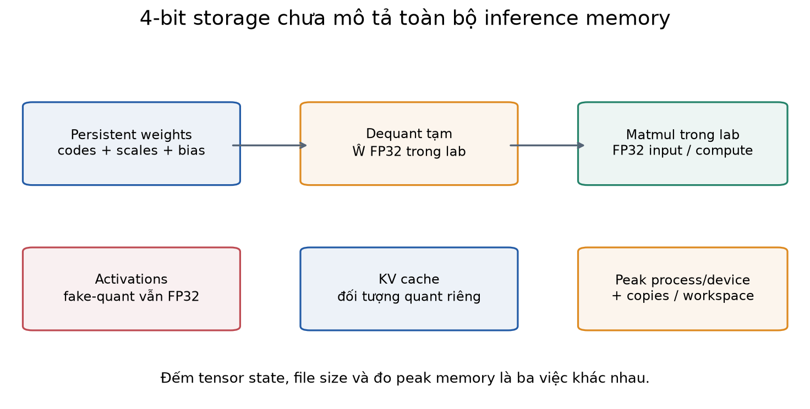
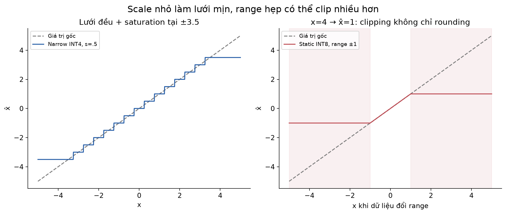
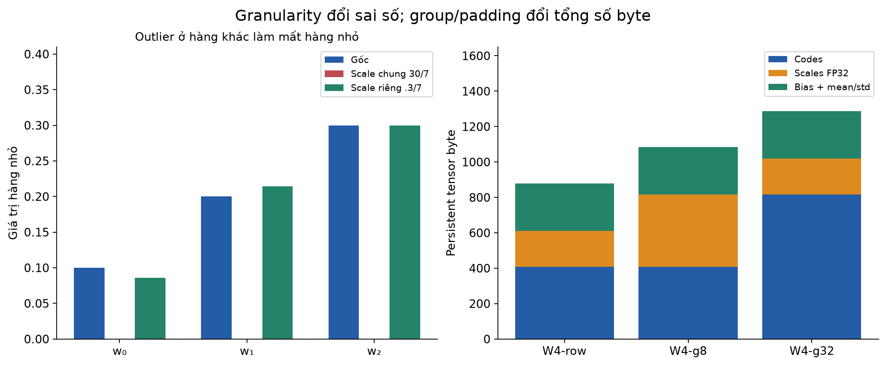
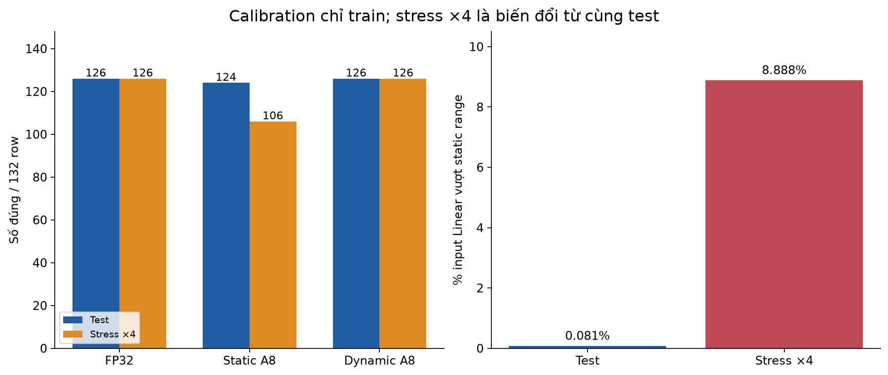
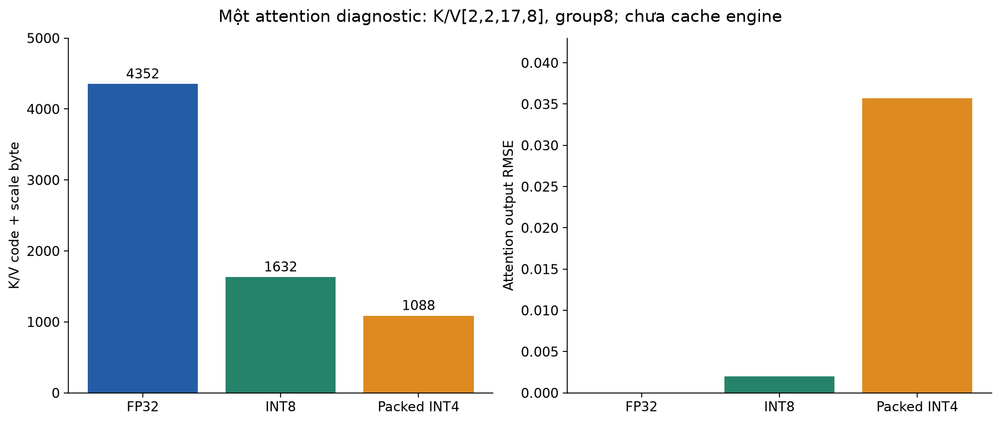
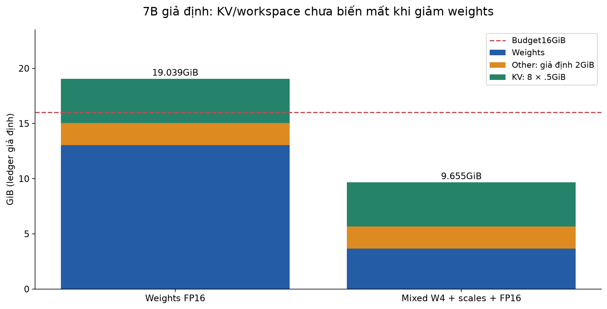
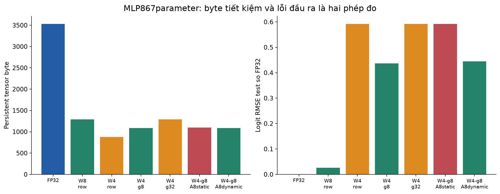

# Bài 38 — Quantization và tối ưu bộ nhớ

[← Mục lục](../README.md) · [Bài 37: batching và KV cache](../37-batching-kv-cache-toi-uu-inference/README.md) · [Phụ lục](deep-dive.md) · [Bài tập](exercises.md) · [Lời giải](solutions.md)

Bài 37 đã tách weights, KV cache và lượng công việc của inference. Bài này đi sâu câu hỏi: **có thể dùng ít byte hơn để biểu diễn các tensor mà vẫn đạt yêu cầu đầu ra không?** Muốn trả lời, cần hiểu quantization làm mất gì, metadata tốn bao nhiêu, phần nào của model còn ở độ chính xác cao và runtime có thật sự tính bằng số thấp bit hay không.

Bài 35 đã có NF4 như một thành phần của QLoRA. Ở đây ta học lại nền tảng tổng quát: scale/zero-point, làm tròn và clipping; per-tensor/per-channel/per-group; PTQ/QAT; calibration; weights/activations/KV; persistent memory và peak memory. Hai bài liên quan nhưng INT4 tuyến tính ở đây **khác codebook NF4** ở bài 35.

Sau bài này, bạn cần tính được một phép quantize/dequantize, kiểm packed bytes, đọc bảng chất lượng–dung lượng và lập một memory ledger có giả định rõ. Kiến thức cần trước: ma trận (3), loss/thống kê/đánh giá (4–7), PyTorch (11), attention (17), SFT/QLoRA (35) và inference memory (37). Chưa học sâu QLoRA vẫn có thể bắt đầu từ phần1.

**Phạm vi thực hành:** CPU, một MLP phân loại dữ liệu tổng hợp được train thật, packed INT4/INT8 weights và fake-quant activations, cộng một phép attention với K/V lượng tử hóa. Matmul thực hành vẫn dùng FP32 sau dequantization. Không chạy GPTQ/AWQ/SmoothQuant/KIVI, QAT trainer, fused low-bit kernel hoặc benchmark GPU. Không cần model download/API/tài khoản.

## 1. Ví dụ thực tế: model đã chạy được nhưng không vừa memory budget

Giả sử nhóm backend muốn đưa model hỗ trợ incident lên máy có16GiB bộ nhớ dành cho inference. Tải weights xong vẫn còn cần KV cho các request, workspace của kernel, tensor tạm và runtime. Mốc “model7B, 4-bit” chưa đủ để quyết định máy đó phục vụ được bao nhiêu người.

Ta phải trả lời riêng:

- **Biểu diễn lưu trữ:** weights chiếm bao nhiêu byte, có scale, zero-point, padding và tensor không quantize không?
- **Tính toán:** phép nhân dùng INT8/INT4 thực hay giải mã sang FP16/FP32 trước? Accumulator dùng dtype nào?
- **Chất lượng:** sai số weights làm logits, lựa chọn token hoặc metric công việc đổi ra sao?
- **Vòng đời bộ nhớ:** cần giữ bản FP32 lúc chuyển đổi không, có dequant buffer lớn hoặc thêm bản copy khi load không?

Quantization có thể giúp đáp ứng một ràng buộc dung lượng; speedup còn phụ thuộc kernel, dtype, shape và phần cứng. Lab ưu tiên kiểm phép biểu diễn, chất lượng và byte đếm được; không lấy dung lượng giảm làm bằng chứng tốc độ tăng.



## 2. Bit, float và số nguyên: cần phân biệt điều gì?

Một byte có8bit. Với N phần tử lưu đặc, payload lý tưởng là `N×bits/8`. FP32 thường cần4byte/phần tử; FP16 và BF16 cần2byte. Chúng đều là số chấm động, có dải giá trị và độ phân giải khác nhau. Đổi FP32 sang BF16 không phải cùng phép ánh xạ tuyến tính sang integer với scale/zero-point.

INT8 có256mẫu bit;4bit có16mẫu bit. **Mẫu bit không tự mang ý nghĩa số thực.** Ta cần hợp đồng giải mã. Ví dụ code integer7 có thể biểu diễn.7 nếu scale.1, hoặc3.5 nếu scale.5. Cùng byte packed còn có thể là hai code4bit theo quy tắc thứ tự nibble.

| Tên thường gặp | Điều nó cho biết | Điều chưa cho biết |
|---|---|---|
| FP16/BF16 | Loại số chấm động16bit | Accumulator, kernel, KV dtype và mọi tensor khác |
| W8A8 | Weights8bit, activations8bit theo recipe | Granularity, scale, clipping, bias/output và kernel cụ thể |
| W4A16 | Weights4bit, activations16bit theo recipe | Packing overhead, phần không quantize, workspace |
| Weight-only | Trọng tâm giảm biểu diễn weights | Activations/KV có giảm hay không, matmul dùng dtype nào |
| KV quantization | Giảm biểu diễn key/value cache | Weights, chất lượng long context và chi phí dequant |

Trong thư viện thực, compute dtype có thể được cấu hình riêng với4bit storage; các module khác cũng có thể giữ dtype khác. [Transformers bitsandbytes: Compute data type và module dtype](https://huggingface.co/docs/transformers/quantization/bitsandbytes). Bài này không chạy thư viện đó; tên `PackedLinear` là implementation riêng để nhìn rõ các bước.

## 3. Lượng tử hóa tuyến tính từ số thực sang code

Với scale dương s, zero-point nguyên z và miền code `[qmin,qmax]`:

\[
q=\operatorname{clip}\left(\operatorname{round}(x/s)+z,q_{min},q_{max}\right),
\qquad \hat x=s(q-z).
\]

`x` là giá trị gốc, `q` là code lưu trữ, `x̂` là giá trị giải mã. Dequantization tạo một xấp xỉ, không khôi phục những thông tin đã mất. `round` chọn mức gần nhất; `clip` giữ code trong miền biểu diễn. Tài liệu operator [ONNX QuantizeLinear](https://onnx.ai/onnx/operators/onnx__QuantizeLinear.html) mô tả linear quantization, saturation và round-to-nearest-even. Lab dùng `torch.round`; định dạng packed weights của lab không phải ONNX artifact.

**Round-to-nearest-even:** khi giá trị đúng giữa hai integer, chọn integer chẵn: .5→0,1.5→2,2.5→2,−1.5→−2. Sai số float có thể làm một giá trị tưởng là nửa không nằm chính xác ở nửa; ví dụ tính tay phía dưới tránh các điểm hòa đó.

### 3.1. Symmetric: zero-point bằng0

Lab dùng **narrow symmetric**:4bit lấy q từ−7đến7, INT8 từ−127đến127; để dư một code thay vì dùng−8 hoặc−128. Đây là một quy ước của bài, không là định nghĩa duy nhất của INT4/INT8. Với `a=max|x|`, chọn `s=a/qmax`. Tensor toàn0 dùng scale1 và q0 để tránh chia0; số1 ở đây là quy ước cho trường hợp không có dải.

Cho weights:

\[
w=[-3.5,-1.2,0,.7,2.4,3.5],\quad s=3.5/7=.5.
\]

| w | w/s | q sau round | ŵ=sq | ŵ−w |
|---:|---:|---:|---:|---:|
| −3.5 | −7 | −7 | −3.5 | 0 |
| −1.2 | −2.4 | −2 | −1 | .2 |
| 0 | 0 | 0 | 0 | 0 |
| .7 | 1.4 | 1 | .5 | −.2 |
| 2.4 | 4.8 | 5 | 2.5 | .1 |
| 3.5 | 7 | 7 | 3.5 | 0 |

MSE=`(.2²+.2²+.1²)/6=.015`; sai số tuyệt đối lớn nhất.2. Nếu không bị clipping, làm tròn gần nhất cho sai số từng phần tử không quá s/2; điều kiện đó không áp dụng cho giá trị vượt range và bị saturate.

### 3.2. Affine/asymmetric: zero-point có thể khác0

Giả sử muốn dùng UINT4 codes0…15 cho range `[−1,2]`:

\[
s=\frac{2-(-1)}{15-0}=.2,\qquad z=\operatorname{round}(0-(-1)/.2)=5.
\]

Với x=`[−1,−.35,0,.65,2]`, code=`[0,3,5,8,15]`, dequant=`[−1,−.4,0,.6,2]`. Code5 biểu diễn0chính xác. Việc biểu diễn0rõ ràng hữu ích cho zero padding; asymmetric có thể dùng range hiệu quả hơn khi phân bố lệch, nhưng thêm zero-point và cách xử lý nó. [ONNX Runtime: Quantization overview](https://onnxruntime.ai/docs/performance/model-optimizations/quantization.html).

```python
import torch
from quantization import affine
x=torch.tensor([-1.,-.35,0.,.65,2.])
q,restored,meta=affine(x,-1.,2.,bits=4)
assert q.tolist()==[0,3,5,8,15]
assert meta['zero_point']==5 and abs(meta['scale']-.2)<1e-12
assert torch.allclose(restored,torch.tensor([-1.,-.4,0.,.6,2.]),atol=1e-6)
print(q.tolist(),restored.tolist())
```

## 4. Clipping, outlier và granularity

Nếu range calibration chỉ đến1 mà inference gặp4, với symmetric INT8 scale1/127, code4×127bị clip về127 và giải mã thành1. **Lỗi làm tròn** là chọn lưới gần nhất trong range; **lỗi clipping** là mất phần vượt range. Giảm scale làm lưới mịn hơn nhưng có thể clip nhiều hơn. Tăng scale chứa outlier tốt hơn nhưng làm các giá trị nhỏ dùng ít mức hiệu quả hơn.

Ví dụ một tensor có hàng nhỏ `[.1,.2,.3]` và hàng lớn `[10,20,30]`. Dùng một scale chung `30/7≈4.286` khiến hàng nhỏ thành toàn0. Dùng scale riêng từng hàng, hàng nhỏ có scale`.3/7≈.042857`, giữ được xấp xỉ tốt hơn trong ví dụ này.



| Granularity | Một scale áp dụng cho | Trade-off |
|---|---|---|
| Per-tensor | Toàn tensor | Ít metadata, outlier có thể ảnh hưởng nhiều phần tử |
| Per-channel/per-row | Một trục xác định; lab weights dùng hàng output | Tách range, thêm scale theo hàng |
| Per-group | Nhóm phần tử trên một trục | Điều chỉnh cục bộ hơn, thêm metadata/padding |
| Per-token | Các feature của một token/row activation | Scale theo từng đầu vào, có chi phí tính/giữ scale |

“Channel” phải gắn với axis/shape. Với `Linear` của PyTorch, W có shape `[out_features,in_features]`; group của lab đi dọc **in_features trong từng hàng output**. Nó khác việc gom một feature qua nhiều token của K/V.

Group nhỏ thường giảm ảnh hưởng outlier cục bộ nhưng không bảo đảm metric công việc luôn tốt hơn. Group còn phải hợp kernel và alignment. Không gọi mọi group size là cùng một format nhị phân chỉ vì cùng4bit.

## 5. Nén code4bit thành byte thật

Tensor `torch.int8` chứa các giá trị trong miền−7…7 vẫn chiếm **1byte mỗi phần tử**, chưa phải packed4bit. Lab ánh xạ `unsigned_code=q+8`, nên zero-point của **format lưu nibble** là8. Đây là offset encoding để lưu signed code, khác zero-point affine của phép quantization ở phần3.

Dãy signed code ở ví dụ là `[-7,-2,0,1,5,7]`; codes để pack là `[1,6,8,9,13,15]`. Code đầu ở nibble thấp, code sau ở nibble cao:

```text
byte0 = 1  | (6  << 4) = 0x61 = 97
byte1 = 8  | (9  << 4) = 0x98 = 152
byte2 = 13 | (15 << 4) = 0xFD = 253
```

Dữ liệu codes cần3byte; scale FP32 của một hàng cần4byte; tổng7byte cho6weights. Payload FP32 ban đầu24byte. Vì scale overhead, tỷ lệ này không phải8lần. Đây còn chưa gồm bias, header, shape và allocator. Nibble code0 được để dư trong narrow range; loader của lab từ chối dùng code đó cho một weight hợp lệ.

Nếu số nibble lẻ, thêm một nibble0ở cuối cho đủ byte và lưu số phần tử logic trong metadata. Ngoài tail nibble, grouping còn có thể pad mỗi hàng đến bội group_size; những code padding đó cũng tốn chỗ. Không được bỏ thông tin shape/group rồi đoán cách unpack.

```python
import torch
from quantization import quantize_weight,dequantize_weight
w=torch.tensor([[-3.5,-1.2,0.,.7,2.4,3.5]])
data,scales,spec=quantize_weight(w,bits=4)
assert data.tolist()==[0x61,0x98,0xfd]
assert data.numel()*data.element_size()+scales.numel()*scales.element_size()==7
restored=dequantize_weight(data,scales,spec)
assert torch.allclose(restored,torch.tensor([[-3.5,-1.,0.,.5,2.5,3.5]]))
print(data.tolist(),spec)
```



## 6. Số dùng để lưu khác số dùng để tính

Một dot product symmetric có `x≈sx qx`, `w≈sw qw`, nên:

\[
x^Tw\approx s_xs_w\sum_jq_{x,j}q_{w,j}.
\]

Ví dụ x=`[1,−2,3]`, w=`[.5,.25,−1]`, sx=.5,sw=.25. Khi đó qx=`[2,−4,6]`, qw=`[2,1,−4]`, integer accumulator=`4−4−24=−24`; giải scale cho `−24×.5×.25=−3`, bằng dot gốc vì các giá trị nằm trên lưới.

Trong một đường tính integer thật, accumulator thường cần độ rộng lớn hơn phần tử; bias/requantization/output cũng phải có quy ước rõ. Nếu affine có z khác0, dot sử dụng `(qx−zx)(qw−zw)` và có thêm các hạng hiệu chỉnh. Không nhân code unsigned thô rồi coi đó là dot số thực.

**Đường tính của lab:** lưu packed code → dequant thành ŴFP32 → `F.linear(x,Ŵ,bias)` bằng FP32. Nó kiểm biểu diễn và lỗi, **chưa dùng INT4 matmul**. Activation fake-quant cũng trả lại tensor FP32 sau mô phỏng lưới/clipping. Vì thế không tuyên bố giảm peak activation memory hoặc tăng tốc từ những nhánh này.

Ngược lại, runtime có kernel phù hợp có thể giải mã theo tile hoặc dùng integer/low-bit operation mà không materialize toàn bộ Ŵ cùng lúc. Có chạy được, có nhanh hơn và dùng bao nhiêu workspace là câu hỏi cần kiểm trên đúng backend như bài37; tên checkpoint không trả lời thay kernel.

## 7. PTQ, calibration và QAT

**PTQ — post-training quantization:** bắt đầu từ model đã train, chọn cách biểu diễn/scale và chuyển đổi. Weight-only absmax cơ bản trong lab chỉ cần weights; static activation quantization cần thêm dữ liệu calibration để ước lượng range. **Dynamic activation quantization** tính range từ input tại runtime, đổi thêm công việc lấy scale.

Tài liệu [ONNX Runtime: Dynamic/Static quantization](https://onnxruntime.ai/docs/performance/model-optimizations/quantization.html) mô tả sự khác nhau ở thời điểm tính activation parameters. Tên dynamic trong phần này không nói model weights tự học mới, cũng không liên quan dynamic batching ở bài37.

**QAT — quantization-aware training:** trong lúc train, mô phỏng tác động quantization để weights thích nghi. Vì round có đạo hàm bằng0hầu khắp và không liên tục ở biên, một cách thực dụng dùng straight-through estimator (STE) xấp xỉ gradient. STE là một quy ước gradient, không phải đạo hàm thật của round. Bài chỉ giải thích và có snippet minh họa trong lời giải, chưa train một nhánh QAT.

Calibration cần đại diện dữ liệu dự kiến: ngôn ngữ, context length, kiểu nhiệm vụ, những kênh có outlier và tiền xử lý. Tập test phải giữ riêng. Với lab này,128row calibration lấy từ **train**, không từ validation/test. Validation chọn checkpoint FP32; bảy cấu hình quantization được định trước để khảo sát, không chọn bằng test.

Static range có thể lỗi khi dữ liệu đổi phân bố. Dynamic range có thể tránh một số clipping nhưng vẫn có rounding, sensitivity và chi phí runtime. Nó không tự sửa input sai ngữ nghĩa hoặc bảo đảm độ chính xác trên mọi domain.



## 8. Từ PTQ cơ bản đến các phương pháp LLM

Bảng này để đọc tài liệu có bản đồ khái niệm, không là xếp hạng phương pháp. Mỗi nguồn nghiên cứu phía dưới chỉ được đọc **abstract** cho bài này; các số benchmark của tác giả không được dùng làm kết quả lab.

| Hướng | Ý tưởng được đối chiếu | Điều cần tránh suy diễn |
|---|---|---|
| GPTQ | Weight PTQ dùng thông tin xấp xỉ bậc hai để chọn lượng tử hóa | Round-to-nearest absmax trong lab chưa là GPTQ |
| AWQ | Dùng thống kê activation để xác định/bảo vệ kênh weight quan trọng | Có tên activation-aware chưa có nghĩa activation cũng được lưu8bit |
| SmoothQuant | Biến đổi tương đương để chuyển một phần khó lượng tử hóa từ activation sang weights | Không chỉ clip outlier rồi bỏ sai số |
| NF4/QLoRA ở bài35 | Codebook4bit và adapter training với base thấp bit | NF4 khác uniform INT4; LoRA nói tham số học, không là định dạng số |

Nguồn: [GPTQ](https://arxiv.org/abs/2210.17323), [AWQ](https://arxiv.org/abs/2306.00978), [SmoothQuant](https://arxiv.org/abs/2211.10438); xem [bài35](../35-sft-lora-qlora/README.md) cho phạm vi NF4 đã thực hành.

Một phép đại số tự kiểm cho trực giác “chuyển range” là `XWᵀ=(XD⁻¹)(WD)ᵀ` với D đường chéo dương trên input channel. Tăng D của channel lớn có thể làm activation nhỏ hơn và weight lớn hơn mà kết quả float lý tưởng không đổi. Sau lượng tử hóa, sai số hai vế có thể khác nhau; chọn D là bài toán riêng. Phép đẳng thức này chưa đủ để gọi code là một implementation đầy đủ SmoothQuant hoặc AWQ.

## 9. KV quantization: giảm weights chưa giảm cache

Bài37 tính payload KV cho full-attention model:

\[
M_{KV}=2LH_{kv}d_hb\sum_iT_i.
\]

Nếu chỉ quantize weights, b của KV chưa đổi. Batch/context lớn có thể khiến KV trở thành phần chi phối. Quantize K và V lại có ảnh hưởng khác: lỗi K đổi attention score/softmax, lỗi V đổi vector được trộn. Chọn axis/group, scale, residual buffer và cách giải mã vì vậy cần được thiết kế riêng.

Nghiên cứu [KIVI](https://arxiv.org/abs/2402.02750) khảo sát phân bố K/V và dùng cách lượng tử hóa khác trục cho keys/values. Ở bài này chỉ đọc abstract, không cài KIVI hoặc mượn kết quả memory/throughput của nghiên cứu.

**Diagnostic trong lab:** Q shape`[2,2,3,8]`, K/V shape`[2,2,17,8]` được tạo bằng seed cố định. Lượng tử hóa mỗi row token/head theo group8 cho cả K lẫn V, giải FP32 rồi tính một attention nhìn toàn17key. Kết quả:

| K/V | Payload code+scale | Output RMSE so FP32 | Max absolute error |
|---|---:|---:|---:|
| FP32 | 4352byte | 0 | 0 |
| INT8 | 1632byte | .001968 | .005169 |
| Packed INT4 | 1088byte | .035675 | .111992 |

INT4 payload ở đây giảm4lần so FP32, không phải8lần vì scale FP32 cho mỗi nhóm8 phần tử. Attention vẫn giải mã cả K/V sang float. Đây là chẩn đoán **một phép attention**, không là cache của vòng autoregressive nhiều layer, không đo long-context quality hoặc tốc độ. Phép kiểm này giúp thấy KV quantization có lỗi riêng bên cạnh weight quantization.



## 10. Memory ledger: tránh đếm thiếu và nhầm peak

Phân biệt bốn đại lượng:

1. **Logical payload:** byte của các giá trị code/scale/bias/tensor theo format.
2. **File size:** thêm metadata/container/alignment của checkpoint; có thể không giảm theo cùng tỷ lệ ở model nhỏ.
3. **Persistent tensors đang resident:** phần module giữ giữa các forward, kể cả phần không quantize.
4. **Peak process/device memory:** thêm workspace, activation, tensor tạm, bản sao lúc load/chuyển đổi và allocator/runtime.

Bài chỉ đếm tensor state riêng của module và file đã ghi; **chưa đo RSS/peak VRAM**. Trong thí nghiệm có thể đồng thời giữ FP32 reference và một quantized model. Không lấy byte của quantized module đơn lẻ gọi là tổng RAM của tiến trình.

Nếu một phần f của N parameter dùng r-bit, group G có scale a-byte và zero-point c-byte, ước tính khi không padding:

\[
M_W\approx fN\left(\frac r8+\frac{a+c}{G}\right)+(1-f)Nb_{high}.
\]

Group cuối, shape, packing tail và alignment có thể tăng số byte. Tên4bit nói phần code, chưa nói effective bits/parameter sau metadata và tensor giữ precision cao.

### Ví dụ giả định7B, không là cấu hình model có thật đã benchmark

N=7tỷ,98%parameter INT4 theo group64, scale FP16 mỗi group, không zero-point lưu riêng;2%còn lạiFP16. Giả sử không row padding:

| Thành phần | Byte |
|---|---:|
| Codes4bit cho6.86tỷ parameter | 3,430,000,000 |
| Scale2byte/group64 | 214,375,000 |
| .14tỷ parameter còn lạiFP16 | 280,000,000 |
| Tổng weights giả định | **3,924,375,000** |

Effective bits/parameter=`8×M/N=4.485`, lớn hơn4. FP16 weights toàn bộ là14,000,000,000byte; đừng nhầm GB thập phân với GiB nhị phân.

Giả sử budget16GiB, đã dành2GiB cho các thành phần khác **theo giả định**, KV mỗi request4096token của cấu hình L32/Hkv8/dh128/FP16 cần512MiB. Chỉ xét ledger:

\[
B_{ceiling}=\max\left(0,\left\lfloor\frac{M_{budget}-M_{other}-M_W}{M_{KV/request}}\right\rfloor\right).
\]

Cho weightsFP16 ra1request, mixed4 ra20request. Đây là **trần theo mô hình payload đơn giản**, chưa là concurrent capacity được xác nhận. Workspace có thể phụ thuộc batch, output còn tăng KV, lúc load có thể cần bản copy, latency/SLO có thể chạm ngưỡng trước memory. Không dùng số20 để cấu hình admission production.



### Những cách tối ưu bộ nhớ bên cạnh quantization

Bỏ autograd ở inference, không giữ output/hidden state không cần thiết; giới hạn context/output và in-flight tokens có chủ đích; dùng cache/batching đúng như bài37; cân nhắc chunking/offload hoặc phân tán khi phù hợp. Offload chuyển áp lực sang RAM/băng thông và có thể tăng latency. Với training, gradient/optimizer/activation checkpointing là bài toán khác; không lấy ledger inference áp nguyên vào train Adam.

## 11. Lab CPU: train → calibration → quantize → evaluate

Môi trường đã chạy: Python **3.14.6**, PyTorch **2.15.0**, NumPy **2.5.4**, macOSarm64, CPU một thread, CUDA=False. Matplotlib **3.11.2** chỉ để tái tạo hình. Từ thư mục bài này:

```bash
python3 -m venv .venv
.venv/bin/python -m pip install -r requirements.txt
.venv/bin/python lab.py --mode hand
.venv/bin/python lab.py --mode memory
.venv/bin/python lab.py --mode attention
.venv/bin/python lab.py --mode check
.venv/bin/python lab.py --mode all --out /tmp/lesson38-run-01
```

Mode `all` ghi `report.json`, `fp32.pt`, `quantized.pt` vào thư mục output **mới**; nếu tồn tại, chọn tên khác. Mode `train` chỉ chạy thí nghiệm MLP, cũng cần `--out` mới. Các tệp runtime này không nằm trong ZIP giáo trình. Sau khi cài dependency, toàn bộ lab chạy offline.

### Dữ liệu, baseline và calibration

64group tổng hợp, mỗi group12row/8feature. Các feature là vector số kiểu latency/error/queue/cpu/io/retry/cache-miss/change đã chuẩn hóa giả định; không phải log đo thật. Nhãn ba lớp được tạo bằng `argmax(x @ TEACHER.T)` với một ma trận cố định trong [data.py](data.py). Có thể gọi lớp0/1/2 là nhóm xử lý triage, nhưng rule này chưa là kiến thức chẩn đoán incident thật.

Split group42/11/11 → **504/132/132row** cho train/validation/test. Mean/std fit chỉ train; calibration128row chọn cố định từ train. Bản stress nhân4 từng feature của chính test, tính nhãn lại bằng teacher; đây là **một biến đổi chẩn đoán từ cùng test**, không phải một tập thu thập độc lập hoặc một benchmark OOD rộng.

MLP8→32→16→3, hai ReLU, **867parameter**. Train60epoch/480update, AdamW lr.01, weight decay.001; seed38. Chọn checkpoint FP32 có validation CE thấp nhất: epoch24, CE≈.070083. Sau khi khóa checkpoint, thu input activation ở ba Linear trên calibration, lấy absmax/127; các scale là khoảng`.023095,.035994,.137470`.

Bảy cấu hình khảo sát đã định trước: FP32, W8-row, W4-row, W4-g8, W4-g32, W4-g8 với static activation8 và với dynamic activation8. `row` là một scale/hàng; `g8/g32` là nhóm theo cột trong mỗi hàng. Tên A8 mô tả **mô phỏng sai số activation8**, không là đường tính INT8 hoặc cam kết giảm byte activation.

### PackedLinear và artifact

[quantization.py](quantization.py) lưu buffers code và scales; bias giữFP32. Không giấu bản weightFP32 của cùng layer trong `PackedLinear`. Khi forward, nó **tạo ŴFP32 tạm**, nên persistent weight payload nhỏ hơn chưa đồng nghĩa peak memory giảm cùng tỷ lệ. Module gốc còn mean/std preprocessingFP32. Static activation thêm3scaleFP32; dynamic lấy scale theo row ở runtime.

Artifact có format version, kiến trúc, bit/group/activation mode, feature order, hash weights nguồn/dataset/calibration/payload và state. Loader tái tạo model mới rồi nạp buffers, không cần weightsFP32 đã train để suy luận model quantized. Lưu/tải đã kiểm logits giống nhau. Metadata/dữ liệu bị đổi không khớp expected identity sẽ bị từ chối. Hash là phép kiểm integrity theo identity đã tin cậy, không là chữ ký xác nhận nguồn gốc.

```python
import torch
from model import MLP,QuantMLP
from quantization import tensor_bytes,PackedLinear
torch.manual_seed(38)
base=MLP();small=QuantMLP(base,bits=4,group_size=8)
assert tensor_bytes(base)==3532
assert tensor_bytes(small)==1084
assert all(not list(layer.parameters()) for layer in small.layers)
assert all(isinstance(layer,PackedLinear) for layer in small.layers)
print(tensor_bytes(base),tensor_bytes(small))  # persistent tensors, chưa peak RAM
```

## 12. Kết quả đã chạy và cách tự phản biện

### 12.1. Dung lượng cùng metric công việc

Accuracy là số đúng theo nhãn teacher; agreement là tỷ lệ dự đoán giống FP32. Hai số trả lời hai câu hỏi khác nhau. Logit RMSE đo chênh lệch vector trước softmax, không đủ một mình quyết định chất lượng.

| Cấu hình | Persistent tensor byte | Đúng test/132 | Logit RMSE test | Đúng stress4×/132 |
|---|---:|---:|---:|---:|
| FP32 | 3532 | 126 | 0 | 126 |
| W8-row | 1288 | 125 | .025971 | 127 |
| W4-row | 880 | 125 | .591692 | 126 |
| W4-g8 | 1084 | 126 | .436954 | 126 |
| W4-g32 | 1288 | 125 | .591692 | 126 |
| W4-g8-A8static | 1096 | 124 | .592335 | 106 |
| W4-g8-A8dynamic | 1084 | 126 | .445106 | 126 |



W4-g8 giữ cùng số đúng126như FP32 nhưng agreement chỉ130/132: có điểm FP32 đúng mà quantized sai và ngược lại. Không được nói dự đoán hay xác suất không đổi chỉ vì accuracy bằng nhau. W8-row ở stress đúng thêm một điểm cũng chưa chứng minh quantization luôn cải thiện; mẫu nhỏ và nhãn tổng hợp có thể cho dao động như vậy.

W4-g32 có cùng quantized values như W4-row ở model này, vì mỗi hàng đều có≤32cột, nhưng buffer bị pad lên32mỗi hàng. Nó chiếm1288byte, bằng W8-row, dù codes chỉ4bit. W4-g8 có nhiều scale hơn W4-row nhưng ít rounding error hơn trong lượt này. Đó là trade-off shape/metadata/precision có thể tính và kiểm, không phải khẩu hiệu “cứ ít bit là tốt”.

Rule dùng chính teacher đạt132/132vì đó là cách tạo nhãn. Nó là baseline giải được toy task không cần train; lab không chứng minh cần MLP hoặc những tỷ lệ accuracy này sẽ giữ trên dữ liệu incident thật/LLM.

### 12.2. Calibration shift và fake-quant activations

Static activation ở test có6/7392phần tử input Linear vượt range≈.081%; ở stress4× có657/7392≈8.888%. Số7392=`132×(8+32+16)`. Độ chính xác static giảm124/132→106/132, trong khi FP32 ở lượt này giữ126/132. Đây là bằng chứng cụ thể cho lỗi calibration range trong **thí nghiệm này**.

Dynamic activation tính range từng row nên không clip theo range vừa chọn, nhưng vẫn có rounding. Trong stress này nó giữ126/132; không suy ra dynamic luôn tốt hơn static, hoặc model đã robust mọi thay đổi phân bố. Việc giải fake-quant về FP32 nghĩa là cả hai nhánh vẫn giữ activations float trong phép tính, chưa đo lợi ích memory của kernel A8 thật.

### 12.3. File nhỏ không giảm cùng tỷ lệ payload

Report giữ cả file size để đối chiếu. Checkpoint nhỏ có container/metadata, nên tỷ lệ file size có thể rất khác tỷ lệ3532/1096của tensor state. Tệp FP32 và quantized cũng có metadata khác nhau; không dùng so sánh file của toy model làm dự báo storage của model7B.

**50 kiểm tra** đã chạy: tính tay scale/zero-point/accumulator, ties-to-even, pack/unpack kể cả số phần tử lẻ, quantizer đối chiếu vòng lặp NumPy, zero/outlier/clipping, format/metadata và footprint. Thí nghiệm đầy đủ còn lưu/tải model và kiểm payload identity. Đối chiếu bổ sung dùng NumPy tự giải mã nibble và tính MLP/fake-quant để kiểm cả bảy cấu hình trên test/stress; số đúng, agreement, clipping và byte khớp, sai khác logits lớn nhất khoảng2.242×10⁻⁵ so với phép tính FP32. Đây là kiểm khác cách tính, không là yêu cầu mọi backend có cùng tolerance. Không có phép đo latency hay peak RAM/GPU ở bài này; các số byte ở trên là đếm tensor theo format.

## 13. Bộ tệp và bài tự kiểm

| Tệp | Vai trò |
|---|---|
| [quantization.py](quantization.py) | Affine/symmetric quantizer, nibble packing, PackedLinear, fake activation |
| [data.py](data.py) | Dataset/rule/split group và calibration chỉ train |
| [model.py](model.py) | MLPFP32 và quantized variant |
| [training.py](training.py) | Train, validation, evaluation, bundle save/load |
| [attention.py](attention.py) | Diagnostic K/V quantization cho một attention |
| [arithmetic.py](arithmetic.py) | Phép tính tay và memory ledger giả định |
| [checks.py](checks.py) | 50predicate cơ chế/format/byte accounting |
| [lab.py](lab.py) | Sáu mode CLI và report |
| [make_figures.py](make_figures.py) | Tái tạo bảy cặp PNG/SVG từ công thức/report |

```bash
.venv/bin/python -m pip install -r requirements-figures.txt
.venv/bin/python make_figures.py --report /tmp/lesson38-run-01/report.json
```

Làm [16 bài tập](exercises.md), rồi đối chiếu [lời giải](solutions.md) và [phụ lục](deep-dive.md). Hãy tự giải thích: tại sao dequant không khôi phục chính xác weights; vì sao cần scale/shape khi unpack; vì sao W4 có thể bằng W8 về tổng byte; vì sao fake quant chưa chứng minh giảm activation memory; và vì sao weights nhỏ chưa là hệ thống inference vừa budget/SLO.

Bản ZIP được giải nén mới để chạy lại full experiment, CLI/snippet, kiểm identity/byte/metric và tái tạo hình. Các kết quả tái lập trong môi trường đã nêu; không hứa training bitwise trên mọi device. [Nguồn và phạm vi đọc](../SOURCES.md) · [Đề cương](../ROADMAP.md). Tiếp tục [bài 39 — Phục vụ mô hình phân tán](../39-phuc-vu-mo-hinh-phan-tan/README.md). Các kernel thấp bit thực tế chưa được benchmark trong bài này.
