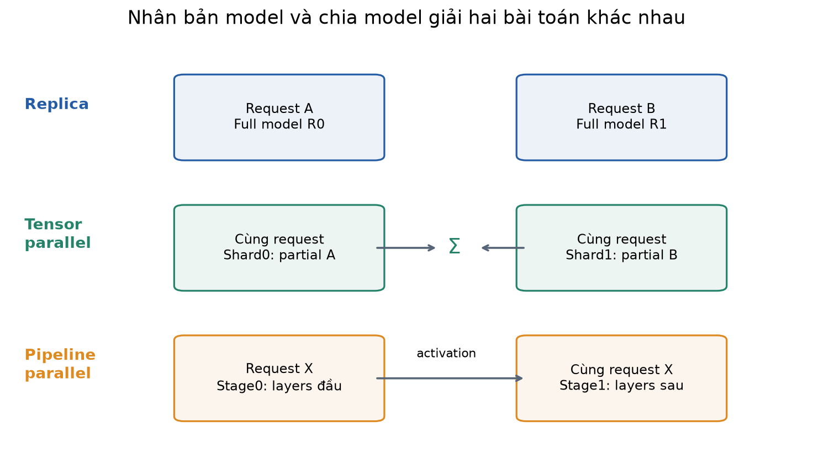
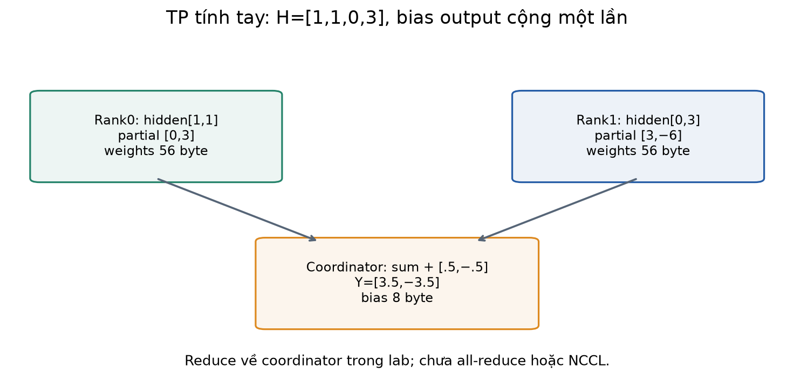
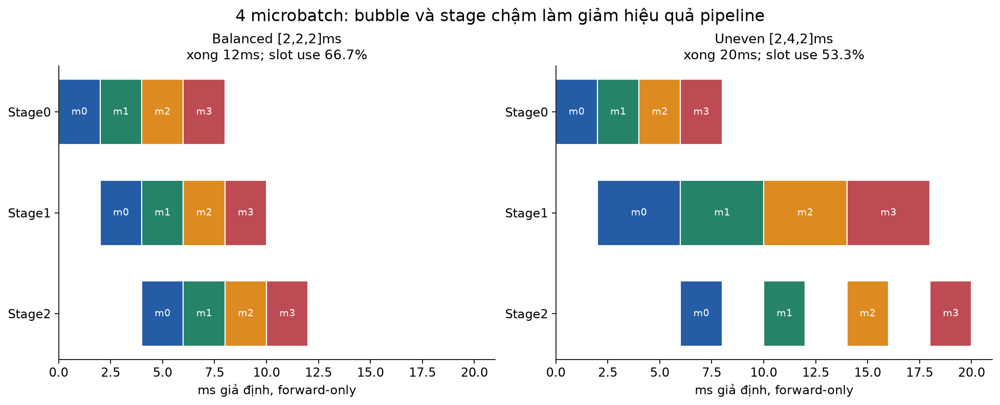
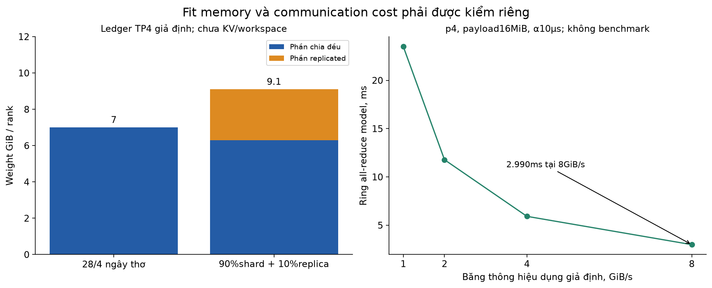
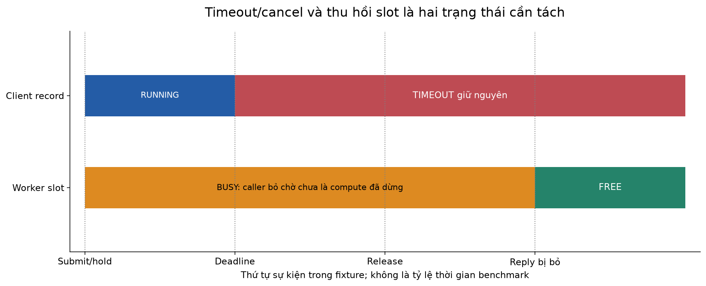
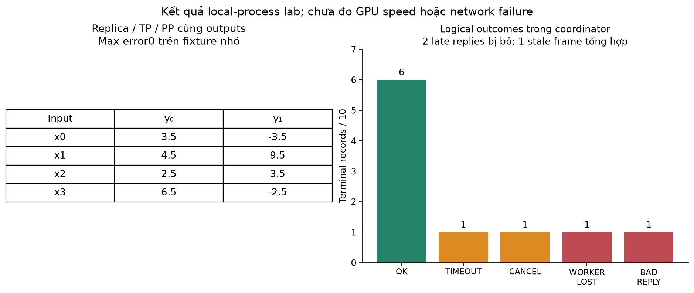
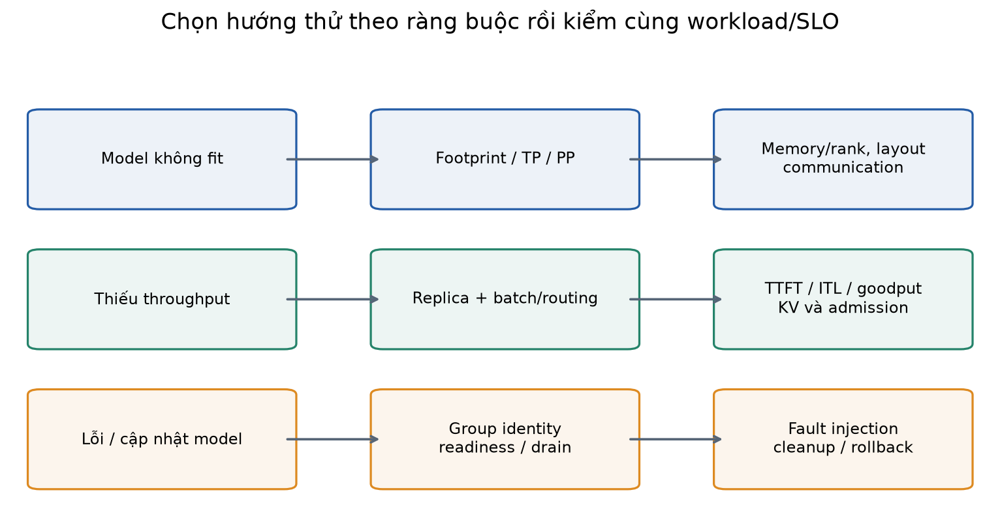

# Bài 39 — Phục vụ mô hình phân tán

[← Mục lục](../README.md) · [Bài 38: quantization và bộ nhớ](../38-quantization-toi-uu-bo-nho/README.md) · [Phụ lục](deep-dive.md) · [Bài tập](exercises.md) · [Lời giải](solutions.md)

Bài 37–38 giúp chạy inference hiệu quả hơn trên tài nguyên hữu hạn. Bài này hỏi tiếp: khi một model không vừa một thiết bị, hoặc một bản model không đáp ứng đủ request, ta phân phối công việc như thế nào? Hai bài toán đó dẫn tới các cách thiết kế khác nhau: **nhân bản model để xử lý các request độc lập** và **chia model để nhiều worker cùng xử lý một request**.

Mục tiêu: phân biệt replica, rank, tensor/pipeline parallelism; tính một phép chia model bằng tay; ước lượng memory/communication với giả định rõ; hiểu routing, deadline, readiness và failure domain. Sau bài, bạn cần biết vì sao “thêm GPU” chưa tự làm mọi request nhanh hơn hoặc hệ thống chịu lỗi tốt hơn.

Kiến thức cần trước: ma trận/mạng nhiều lớp (3,9), attention/inference (17–21), queue/deadline (31), version/rollback (33), workload/latency (34), batching/KV và quantization (37–38). Các thuật ngữ backend quen thuộc được dùng lại, nhưng model có state và phụ thuộc tính toán riêng.

**Lab:** NumPy CPU, nhiều tiến trình `spawn` thật trên **một máy**, giao tiếp bằng Pipe cục bộ. Có replica model đầy đủ, tensor-sharded MLP và pipeline chuyển activation giữa tiến trình; có router với các lỗi được chủ động tạo. Model rất nhỏ, weights đặt sẵn để kiểm phép tính, không phải LLM đã train. Chưa chạy nhiều host, GPU/NCCL/Gloo, Ray/vLLM hoặc benchmark tốc độ/khả năng chịu tải production.

## 1. Hai lý do khác nhau để phân tán

Ví dụ giả định: API trợ lý incident đang phục vụ nhiều nhóm backend.

- Model **đã vừa một GPU**, nhưng lượng request vượt khả năng một worker: tạo thêm replica có thể tăng tổng thông lượng nếu các tài nguyên khác đủ và routing phù hợp.
- Model **không vừa một GPU**: thêm hai replica của cùng model không giải quyết việc mỗi bản vẫn quá lớn. Cần xem quantization/offload, thiết bị lớn hơn hoặc model parallelism để chia một bản model.
- Một máy/GPU có thể hỏng: cần replica/group đủ độc lập, routing nhận biết trạng thái và chính sách xử lý request đang dở. Việc chia model ra nhiều worker tự nó còn có thể tăng số thành phần mà một request phải phụ thuộc.

Đừng đồng nhất số HTTP worker, số process, số model replica và số GPU. Một HTTP process có thể điều phối nhiều model worker; một model replica có thể trải trên nhiều rank. Tăng process trên cùng một GPU không tự tăng memory hoặc năng lực tính toán của GPU đó.

## 2. Bức tranh hệ thống: control plane và data plane

Một đường đi điển hình:

```text
Client → API/proxy → admission/router → model replica hoặc model group → response/stream
                       ↑
        controller: desired state, readiness, placement, update, restart
```

**Data plane** xử lý request và tensor. **Control plane** quản lý cấu hình và vòng đời worker/group. Artifact/model registry ở bài33 cung cấp identity của trọng số, tokenizer/template và cấu hình cần phục vụ. Router không nên chọn một process chỉ vì process đó vừa sống; nó cần biết đã load đúng revision, warm-up và đủ khả năng nhận việc.

Ray Serve mô tả controller, proxy và replicas như các thành phần riêng, đồng thời giới hạn số request đang đi tới replicas. [Ray Serve Architecture](https://docs.ray.io/en/latest/serve/architecture.html). Lab tự viết một coordinator nhỏ để nhìn rõ cơ chế; không triển khai Ray Serve.



| Thuật ngữ | Nghĩa trong bài |
|---|---|
| Replica | Một bản model đầy đủ về mặt logic, xử lý một request mà không cần replica khác |
| Rank | Một thành viên được đánh số trong một nhóm tính toán phân tán |
| Tensor parallel, TP | Chia tensor/phép toán trong layer cho nhiều rank |
| Pipeline parallel, PP | Chia các phần/layer nối tiếp thành các stage |
| Model group | Các rank cùng hợp tác để chạy một replica logic |
| Data parallel serving, DP | Nhiều replica/group xử lý dữ liệu/request độc lập |

DP inference ở đây **không phải DDP training đồng bộ gradient**. Khi chỉ serving các model dense giống nhau, các replica thường không cần all-reduce logits/gradient để trả từng request độc lập.

## 3. Replica: nhân bản để chia lượng request

Giả sử hai replica R0/R1 cùng giữ model revision V1. Router có thể gửi request A tới R0 và B tới R1. Mỗi replica có weights đầy đủ, trạng thái đang xử lý riêng và có thể tự batching như bài37.

Nếu mỗi replica đạt tối đa giả định50request/s ở cùng workload, hai replica có tổng trần lý tưởng100request/s. Đây chưa là throughput đạt SLO: router, shared storage, CPU/tokenizer, mạng và phân bố kích thước request có thể trở thành nút thắt. Một request vẫn được chạy bởi một replica, nên latency của nó không tự giảm một nửa.

### Request count chưa là lượng công việc

Bốn request có chi phí giả định `[1,9,1,9]`, tất cả đến cùng lúc. Round-robin hai worker cho tổng tải `[2,18]`. Nếu có ước lượng chi phí và luôn chọn tổng tải thấp hơn, thứ tự đó cho `[11,9]`. Makespan tính theo mô hình tuần tự này giảm18→11đơn vị.

Với LLM, output length chưa biết trước; số token dự kiến, prompt length, KV occupancy và số sequence active là các tín hiệu có thể dùng. Ước lượng có thể sai. Ví dụ trên là phép tính cân tải, không phải policy router thực hành đã dự đoán chính xác độ dài sinh.

### Session/KV affinity

Weights giống nhau không có nghĩa KV của một request có sẵn ở mọi replica. Có thể giữ một mapping:

```text
session / generation → (replica hoặc group, epoch, model revision, cache identity)
```

Nếu chuyển request đang decode sang group khác, phải có một cơ chế tái tạo hoặc chuyển state hợp lệ; không chỉ đổi địa chỉ upstream. Round-robin mỗi token có thể mất context/cache hoặc tính lại prefill rất tốn. Lab dùng MLP stateless và chưa cài KV/session affinity; phần này nối với cache ownership ở bài37.

## 4. Tensor parallelism: nhiều rank cùng tính một layer

Ta dùng quy ước row-vector trong lab:

\[
H=\operatorname{ReLU}(XW_1+b_1),\qquad Y=HW_2+b_2.
\]

W1 có shape`[input,hidden]`, W2 có shape`[hidden,output]`. Quy ước này là transpose cách lưu `nn.Linear.weight` của PyTorch; luôn kiểm shape thay vì chỉ nhìn tên “row/column”.

Chia hidden dimension thành hai phần:

\[
W_1=[W_{1a}\;W_{1b}],\quad b_1=[b_{1a}\;b_{1b}],\quad
W_2=\begin{bmatrix}W_{2a}\\W_{2b}\end{bmatrix}.
\]

Mỗi rank nhận cùng X nhưng chỉ cần shard weights tương ứng:

\[
H_a=\operatorname{ReLU}(XW_{1a}+b_{1a}),\quad P_a=H_aW_{2a},
\]
\[
H_b=\operatorname{ReLU}(XW_{1b}+b_{1b}),\quad P_b=H_bW_{2b},
\]
\[
Y=P_a+P_b+b_2.
\]

ReLU áp riêng được vì nó tác động từng phần tử. Bias output b2 chỉ được cộng **một lần** sau sum trong implementation này. Cộng b2 ở mỗi partial rồi sum sẽ nhân bias theo số rank.

PyTorch TP tutorial giải thích sharded computation, layout và các collective cần để chuyển giữa layouts; các primitive `ColwiseParallel`/`RowwiseParallel` là một cách biểu diễn việc chia đó. [PyTorch TP tutorial, How Tensor Parallel works](https://docs.pytorch.org/tutorials/intermediate/TP_tutorial.html). Nguồn là tutorial training; bài chỉ dùng cơ chế forward/layout, chưa chạy các API đó hoặc backward.

### Tính tay một MLP nhỏ

Với x=`[1,2,0,−1]` và weights trong [model.py](model.py):

```text
W1 = [[ 1, 0,-1, 2],       b1 = [0,1,0,0]
      [ 0, 1, 1, 0],
      [ 1,-1, 0, 1],
      [ 0, 2, 1,-1]]

W2 = [[ 1, 2],             b2 = [.5,-.5]
      [-1, 1],
      [ 2, 0],
      [ 1,-2]]
```

`xW1=[1,0,0,3]`, thêm b1 rồi ReLU cho H=`[1,1,0,3]`. Rank0 giữ hai hidden đầu, partial=`[1,1] @ [[1,2],[-1,1]]=[0,3]`. Rank1 giữ hai hidden cuối, partial=`[0,3] @ [[2,0],[1,-2]]=[3,−6]`. Sum và cộng b2 cho **Y=`[3.5,−3.5]`**.

```python
import numpy as np
from model import weights,tp_parts,forward
w=weights();x=np.array([[1,2,0,-1]],dtype=np.float32)
parts=tp_parts(w)
partial=[np.maximum(x@p['w1']+p['b1'],0)@p['w2'] for p in parts]
y=partial[0]+partial[1]+w['b2']
assert [v.tolist()[0] for v in partial]==[[0.,3.],[3.,-6.]]
assert np.array_equal(y,forward(x,w))
print(y.tolist())
```



TP giữ một phần weights trên mỗi rank nhưng phải trao đổi tensor ở những điểm phụ thuộc. Với Transformer còn có attention heads, embeddings, residual/norm và các layout khác. Không mặc định mọi tensor đều chia đều hay mọi layer cần cùng collective.

## 5. Pipeline parallelism: chia các stage nối tiếp

Trong cùng MLP, stage0 tính H, stage1 nhận H rồi tính Y. Không thể lấy output stage1 của một microbatch trước khi stage0 tạo H. Tuy nhiên có thể cho stage0 xử lý microbatch tiếp theo trong khi stage1 xử lý microbatch trước, nếu dữ liệu/workload và lịch cho phép.

Microbatch là một phần nhỏ của batch/công việc; không phải tự ý cắt một request thành các output độc lập. Một token autoregressive của cùng chuỗi còn phụ thuộc token trước. Để lấp pipeline trong serving, thường cần đủ nhiều request/sequence hoặc công việc có thể chồng lấp.

PyTorch pipeline tutorial mô tả partition, stage và lịch microbatch. [Introduction to Distributed Pipeline Parallelism](https://docs.pytorch.org/tutorials/intermediate/pipelining_tutorial.html). Lab chỉ thực hiện forward qua hai stage NumPy, không train GPipe hoặc chạy scheduler của PyTorch.

### Phép tính thời gian forward-only giả định

Ba stage cùng tốn2ms/microbatch, có4microbatch, bỏ communication và overhead. Microbatch đầu hoàn tất sau6ms. Khi pipeline đầy, mỗi2ms có thêm một microbatch xong:

\[
T_{makespan}=(m+p-1)t=(4+3-1)\times2=12\text{ ms}.
\]

Tổng công việc24stage-ms trên36stage-slot-ms cho utilization giả định2/3; phần trống do warm-up/drain là bubble. Đây là lịch **forward-only**, không phải công thức tổng thời gian train có backward.

Nếu stage times là`[2,4,2]ms`, microbatch đầu mất8ms, các microbatch tiếp theo bị stage4msgiới hạn; bốn microbatch xong ở20ms. Utilization=`32/(3×20)=8/15≈53.3%`. Chia số layer bằng nhau chưa chắc chia chi phí bằng nhau.

```python
from arithmetic import pipeline
balanced=pipeline([2.,2.,2.],4)
unbalanced=pipeline([2.,4.,2.],4)
assert balanced['makespan']==12 and unbalanced['makespan']==20
assert balanced['first_latency']==6 and unbalanced['first_latency']==8
print(balanced['finish'],unbalanced['finish'])
```



PP có thể giúp model vừa nhiều thiết bị và tăng throughput khi có đủ công việc; latency một request còn phải đi qua các stage cùng communication. Với một request đơn, ít microbatch hoặc stage mất cân bằng, nhiều tài nguyên có thể để trống.

## 6. Kết hợp DP×TP×PP và dự toán memory

Ví dụ cấu hình **giả định** D=2replica logic, T=4rank/stage, P=2stage:

\[
N_{rank}=D\times T\times P=16.
\]

Có2model group độc lập, mỗi group8rank. Một cách đánh số là `rank=((dp×P)+pp)×T+tp`. Group0gồm0…7, group1gồm8…15. Trong mỗi group, request đi qua hai PPstage; mỗi stage có bốn TPrank hợp tác. Không được gọi16rank là16bản model độc lập.

Tài liệu [vLLM Parallelism and Scaling](https://docs.vllm.ai/en/latest/serving/parallelism_scaling/) mô tả TP/PP cho một replica, kết hợp nhiều node và trade-off liên kết giữa GPU. Các cấu hình trong bài là ví dụ thiết kế; không cài/chạy vLLM/Ray/container. TP trong liên kết nhanh và PP qua biên node là một cách đặt thường gặp, nhưng cần đo theo topology/model/runtime, không là quy tắc tối ưu bất biến.

### Không chia mọi byte cho số rank

Một ledger **TP4 riêng**, không thêm PP vào cùng phép tính: tổng weights28GiB;90%weights chia đều theo TP,10%replicated trên mỗi rank. Khi đó:

\[
M_{W/rank}=.9\times28/4+.1\times28=6.3+2.8=9.1\text{ GiB}.
\]

Nó khác28/4=7GiB. Nếu budget16GiB/rank và các phần khác giả định3GiB/rank thì còn3.9GiB, trước các khoản chưa dự toán. KV có thể shard hoặc replicate tùy model/head/layout; quantization scale, activation và collective buffer có alignment/overhead riêng.

Tổng memory nhiều GPU không phải một vùng RAM chung mà mọi phép toán tự dùng được. Cần placement, shard layout và đường truyền hợp lệ. Quantization ở bài38 có thể giảm weights nhưng cũng đổi kernel/format và trade-off với degree TP; phải đánh giá lại thay vì cộng các hệ số tiết kiệm một cách cơ học.

## 7. Communication có thể quyết định TP nhanh hay chậm

Một vài thao tác cơ bản:

| Thao tác | Ý nghĩa |
|---|---|
| Send/recv | Truyền một tensor giữa bên gửi và bên nhận |
| All-gather | Gom các shard để mỗi rank có tensor đã ghép |
| Reduce | Gộp theo một phép toán, ví dụ sum, trả về một rank đích |
| All-reduce | Reduce rồi mọi rank nhận kết quả đã gộp |
| Reduce-scatter | Gộp rồi chia các phần kết quả cho các rank |

All-reduce sum không tự chia trung bình. NCCL mô tả mỗi rank tham gia collective với count/dtype tương ứng; sai hợp đồng có thể gây hang hoặc hỏng tính toán. [NCCL Collective Operations](https://docs.nvidia.com/deeplearning/nccl/user-guide/docs/usage/collectives.html). Nếu một rank đi vào collective khác thứ tự hoặc chết giữa chừng, các rank còn lại có thể đợi; serving cần phát hiện lỗi/timeout ở cấp group.

**Lab TP chỉ reduce về coordinator rồi cộng bias**, không triển khai all-reduce và không chạy NCCL. Phân biệt đúng thao tác quan trọng hơn việc gọi mọi trao đổi tensor là “all-reduce”.

Một mô hình ring all-reduce đơn giản với p rank, payload n byte/rank, băng thông hiệu dụng B byte/s và latency mỗi phase α giây:

\[
T_{ring}\approx2(p-1)\alpha+\frac{2(p-1)}p\frac nB.
\]

Đây là mô hình α–β lý tưởng tự dùng để tính, giả sử chia đều và không có contention/overlap/chi phí khác; nó không khẳng định NCCL sẽ chọn ring cho mọi shape/topology. Ví dụ p4,n16MiB,B8GiB/s,α10µs:

\[
T\approx6\times10\mu s+1.5\times\frac{16MiB}{8GiB/s}
=2.9896875\text{ ms}.
\]

Nếu mỗi decode step có nhiều điểm communication, chi phí có thể cộng đáng kể vào ITL. Nếu compute shard nhỏ nhưng liên kết chậm, TP tăng degree có thể làm request chậm hơn. Cần đo kernel/collective/serialization/transfer và các rank bị chờ, không chỉ tổng GPU utilization.



## 8. Routing, readiness và giới hạn công việc thực sự còn chạy

Một worker **alive** chưa chắc **ready**. Readiness có thể yêu cầu đúng artifact/revision, weights shard, warm-up, tài nguyên và thành viên group. Với TP/PP, chỉ nhận request khi đủ các rank cần thiết; không đẩy vào một group đang thiếu stage rồi hy vọng request sẽ đợi vô hạn.

Router thực hành có một slot vật lý mỗi replica, tối đa hai request đang nằm trên hai worker, **không có waiting queue**. Khi các slot đều bận, nó trả `OVERLOADED` ngay. Đây là lựa chọn đơn giản để quan sát backpressure; một dịch vụ có queue phải giới hạn queue cả số request và lượng token/byte/cost phù hợp.

Trong lab, một record request có `(request_id, model_revision, worker_epoch, deadline, status)`. Process restart làm epoch tăng; frame của epoch cũ không được dùng để hoàn tất công việc của epoch mới. Request ID được giữ duy nhất trong history tối đa64record; khi đầy, lab từ chối request mới. Đây là dedup/history **trong RAM của một coordinator**, không là exactly-once hoặc registry phân tán bền vững.

### Timeout client chưa giải phóng compute

Nếu request hết deadline, coordinator có thể công bố `TIMEOUT` nhưng worker vẫn đang giữ input/cache hoặc đang tính. Nếu coi slot đã rảnh ngay, hệ có thể nhận thêm việc vào một worker thực tế còn bận, làm vượt giới hạn đã đặt.

Lab giữ `busy` đến khi nhận RESULT/EXPIRED hoặc xác nhận worker mất. Cancel cũng có hai việc riêng: kết thúc trạng thái client và dừng công việc thực tế. Với kernel/collective không thể ngắt ngay, phải quan sát đến khi công việc ngừng hoặc process/group được loại khỏi phục vụ.



Deadline của lab dùng monotonic clock chung trên **cùng host**. Không gửi nguyên giá trị monotonic đó tới một máy khác và so như đồng hồ toàn cục. Khi gọi qua host, cần cơ chế deadline propagation theo remaining budget/timeout và tính thời gian đã tiêu. gRPC mô tả cách trừ elapsed time và tránh vấn đề clock skew khi truyền deadline. [gRPC Deadlines](https://grpc.io/docs/guides/deadlines/).

Router lab chỉ thay đổi trạng thái khi caller gọi `tick()` hoặc `until()`, không có timer/background event loop riêng. Mốc30ms trong fixture không là cam kết gửi timeout chính xác từng millisecond của một API server.

## 9. Lỗi replica, lỗi model group và cập nhật phiên bản

Với hai replica độc lập, mất R0 vẫn có thể phục vụ request mới trên R1 nếu R1 đủ dung lượng. Với một replica logic gồm nhiều TP/PP rank, mất một rank có thể làm cả group không hoàn tất được request. Một rank sống chưa chứng minh model group healthy.

Giả sử các thành phần độc lập có availability giả định a=.99. Một group cần cả4rank có availability`.99⁴≈.960596`; hai replica đầy đủ mà chỉ cần một sống cho`1−(.01)²=.9999`. Đây là phép tính minh họa, không dự báo một cluster thật: lỗi nguồn điện/network/driver/control plane có thể tương quan và phá giả định độc lập.

### Drain và rollout

Drain ngừng nhận request mới nhưng cho công việc đang chạy hoàn tất trong budget. Trong lab, R0đang drain vẫn hoàn tất request cũ; request mới đi tới R1. Restart sau khi slot trống tạo process/epoch mới và phải qua readiness trước khi lại nhận việc.

Trong model group, cần giữ thống nhất checkpoint, shard layout, quantization format, tokenizer/template và revision contract. Không ghép stage0củaV1với stage1củaV2chỉ vì cả hai trả tensor cùng shape. Rollout/rollback nên gắn với group/artifact identity như bài33; cần dự trù memory tạm khi phiên bản cũ và mới cùng resident.

Ray Serve mô tả thay replica lỗi, đồng thời lưu ý trạng thái transient trong router/replica có thể mất khi actor/máy lỗi. [Ray Serve: Fault tolerance](https://docs.ray.io/en/latest/serve/architecture.html). Lab không có controller HA hoặc khôi phục coordinator; restart worker chỉ xử lý một fault domain nhỏ.

### Retry không được giả thành tiếp tục stream

Với inference stateless và chưa phát output, có thể thiết kế retry có giới hạn sau lỗi, cùng revision/input identity và deadline còn lại. Sau khi client đã nhận một phần stream, sinh lại có thể tạo output khác do sampling hoặc state khác; không tự nối đoạn mới vào stream cũ mà bỏ kiểm sequence/attempt.

Lab không tự retry, không replay stream và không có KV migration. Nó công bố `WORKER_LOST` cho request đang chạy lúc process fail-stop; request tiếp theo có thể đến replica còn sống. “Có thể tính lại” không đồng nghĩa “đã hủy hết attempt cũ” hoặc “không tốn thêm compute”.

## 10. Tách prefill và decode: phân tán còn có thể chia theo giai đoạn

Bài37đã chỉ ra prefill/decode có đặc tính workload khác nhau. Một hướng nâng cao đặt chúng lên các nhóm tài nguyên khác nhau, đổi khả năng điều phối riêng lấy việc phải đưa state từ prefill sang decode.

DistServe nghiên cứu việc disaggregate hai giai đoạn và lựa chọn resource/parallelism theo TTFT/TPOT cùng băng thông. [DistServe, abstract](https://arxiv.org/abs/2401.09670). Bài này chỉ đọc abstract, chưa triển khai hệ đó hoặc mượn con số benchmark của tác giả.

**Tính tay riêng của bài:** nếu cần chuyển512MiB KV qua liên kết hiệu dụng giả định8GiB/s, riêng thời gian truyền có cận dưới`512MiB/(8GiB/s)=.0625s=62.5ms`. Chưa có handshake, serialization, layout conversion, queue hoặc contention. So với một budget TTFT nhỏ, khoản đó có thể đáng kể; cần cân đối với lợi ích tránh prefill–decode interference.

KV nhận được phải đúng prefix/model/positions/dtype/layout và quyền truy cập; chuyển byte xong chưa đủ để tuyên bố request có thể decode đúng. Lab chưa thực hiện chuyển KV: PP truyền activation của một MLP là **loại state khác**, không là minh chứng KV disaggregation hoạt động.

## 11. Thực hành CPU: chạy chương trình nhiều tiến trình

Môi trường đã chạy: Python **3.14.6**, NumPy **2.5.4**, macOS arm64; CPU, không PyTorch/GPU cho core. Hình dùng Matplotlib **3.11.2**. Chạy từ thư mục chứa README này:

```bash
python3 -m venv .venv
.venv/bin/python -m pip install -r requirements.txt
.venv/bin/python lab.py --mode hand
.venv/bin/python lab.py --mode shards
.venv/bin/python lab.py --mode router
.venv/bin/python lab.py --mode check
.venv/bin/python lab.py --mode all --out /tmp/lesson39-run-01
```

Có năm mode CLI. `all` tạo output mới chứa `report.json`; nếu đường dẫn tồn tại thì chọn tên khác. Report runtime không nằm trong ZIP giáo trình. Process IDs thay đổi qua mỗi lượt và không phải giá trị kỳ vọng cố định.

### Thực sự chạy gì?

- **Replica mode:** hai process giữ model đầy đủ, nhận các hàng input khác nhau. Coordinator ghép kết quả về đúng thứ tự.
- **Tensor mode:** hai process nhận cùng X nhưng chỉ shard weights của mình, trả partial. Coordinator sum và cộng b2một lần.
- **Pipeline mode:** stage0và stage1là hai process. Stage0gửi activation H trực tiếp qua Pipe tới stage1; bốn microbatch mỗi cái một hàng được đưa qua đường này.
- **Router mode:** worker full model thật, có warm-up/readiness, admission, deadline, cancel, drain, crash/restart và revision guard. Không đợi chậm bằng một “GPU giả”; các hold/release barrier chỉ giúp đưa lỗi/timing vào thứ tự kiểm được.

`model.py` không giữ sẵn NumPy full weights ở global module: factory chỉ tạo full weights khi gọi; child nhận payload đã chọn. Byte trong report là **payload array weights của từng worker**, không phải RSS/peak process. Coordinator vẫn có bản weights nguồn để tạo demo/đối chiếu, và Python/NumPy/runtime chiếm bộ nhớ riêng.

Pipe chỉ dùng trong nhóm process do chương trình tạo, trên cùng host; đây không là giao thức cho endpoint công khai hoặc đường truyền tensor zero-copy/GPU. Không cài cluster, mở cổng, gọi cloud hoặc tải model.

### Một request tới replica, có entry-point guard

Khi dùng spawn, để phần tạo process trong `if __name__=='__main__'` của script. Snippet dưới chạy độc lập từ thư mục bài:

```python
from router import Router

def main():
    with Router(replicas=1) as r:
        record=r.submit('demo',[[1,2,0,-1]])
        r.until(lambda:record['status']!='RUNNING')
        assert record['status']=='OK' and record['y']==[[3.5,-3.5]]
        assert record['publications']==1
        print(record['status'],record['y'])

if __name__=='__main__':
    main()
```

Context manager join/close child khi kết thúc. Shutdown trong lúc request còn pending làm record thành `CANCELLED`; đây là cleanup của lab, không là graceful cluster rollout hoàn chỉnh.

## 12. Kết quả đã chạy và giới hạn

Bốn input minh họa cho cả ba mode cho cùng outputs:

```text
[[3.5,-3.5], [4.5,9.5], [2.5,3.5], [6.5,-2.5]]
```

Max absolute error so với full model là0trên fixture số nhỏ này. Kiểm khác với batch input ngẫu nhiên dùng scalar-loop oracle và `np.allclose(atol=2e-6, rtol=1e-5)`; không suy bitwise parity trên mọi kernel/device/dtype.

| Cách chạy | Payload weights ở worker0/1 | Phần thêm ở coordinator |
|---|---:|---:|
| Hai replica | 120 / 120byte | Model nguồn/đối chiếu vẫn có ở parent |
| TP hai shard | 56 / 56byte | 8byte b2cho phép cộng output; parent còn model nguồn |
| PP hai stage | 80 / 40byte | Parent giữ model nguồn; H truyền16byte/microbatch |

Tổng weights model là30FP32value=120byte. Với TP,56+56+8=120; với PP,80+40=120; với replica có hai bản đầy đủ240byteởchild. Đây là **đếm array payload**, không phải benchmark tiết kiệm tổng RAM của chương trình nhiều process.

### Những đường lỗi đã được kiểm

| Fixture | Kết quả quan sát |
|---|---|
| Cả hai worker bị giữ busy | Request thứ ba bị từ chối`OVERLOADED` |
| Deadline30ms khi worker còn hold | Client record`TIMEOUT`, slot vẫn busy đến lúc release/reply |
| Cancel khi còn hold | `CANCELLED`; kết quả đến sau bị bỏ |
| Drain R0 | Việc cũ xong; việc mới đi R1; restart tăng epoch |
| Process cố ý `os._exit(17)` | Request`WORKER_LOST`; request mới vẫn chạy ở R1; replacement ready |
| Worker trả revision sai | `BAD_REPLY`, không công bố y thành công; worker bị loại khỏi admission |

Trong snapshot coordinator chính có10request:6`OK`,1`TIMEOUT`,1`CANCELLED`,1`WORKER_LOST`,1`BAD_REPLY`; mỗi record công bố đúng một terminal outcome trong vòng đời đó. Có2late results bị bỏ và1frame epoch cũ **được tiêm tổng hợp** để kiểm fencing. Frame cũ không thực sự được truyền qua một kết nối đã thay; test này kiểm hợp đồng `accept()`.



Chương trình có **63predicate**:32kiểm toán học/shape/payload và31kiểm process/router/lifecycle. Đã kiểm cleanup child, giới hạn history, revision pin, overflow và restart khi slot còn bận. Nó chưa có network partition, packet loss, consensus/leader election, persistent dedupe, autoscaling, Kubernetes hoặc restart coordinator. Không có phép đo latency/throughput GPU hoặc khẳng định scale-out nhanh hơn trên model120byte.

## 13. Đọc code và dùng kết quả để thiết kế hệ thật

| Tệp | Vai trò |
|---|---|
| [model.py](model.py) | Weights, full forward, shard partition và identity |
| [transport.py](transport.py) | Spawn/Pipe worker, readiness, nhận/kết thúc process |
| [shards.py](shards.py) | Replica/TP/PP thực qua nhiều process |
| [router.py](router.py) | Bounded coordinator, slot, deadline, drain và epoch |
| [fixtures.py](fixtures.py) | Sáu nhóm scenario lỗi cùng kiểm cleanup/history/shutdown |
| [arithmetic.py](arithmetic.py) | TP tính tay, pipeline schedule, ring/transfer/memory giả định |
| [checks.py](checks.py) | Scalar oracle, phân rã toán học, shape và byte accounting |
| [lab.py](lab.py) | Năm CLI mode và report |
| [make_figures.py](make_figures.py) | Bảy cặp PNG/SVG từ công thức/report |

Tái tạo hình sau khi chạy `all`:

```bash
.venv/bin/python -m pip install -r requirements-figures.txt
.venv/bin/python make_figures.py --report /tmp/lesson39-run-01/report.json
```

Trong một dịch vụ thật, nối các phép đo bài32–34: queue/admission, model group revision/epoch, in-flight tokens/KV, TTFT/ITL/end-to-end, collective wait và lỗi theo rank/group. Tăng replica có thể giảm thời gian chờ nhưng tốn weights/cold-start; tăng TP/PP có thể giúp fit nhưng tăng communication và độ phụ thuộc. Cần quality/correctness gate cùng SLO, không chỉ GPU utilization hoặc token/s.



Làm [16 bài tập](exercises.md), đối chiếu [lời giải](solutions.md) và [phụ lục](deep-dive.md). Bản ZIP được giải nén mới để chạy lại mode/process/snippet, kiểm số liệu và tái tạo hình. Đừng coi đã hiểu chỉ vì chạy xong: hãy tự giải thích bias TP cộng ở đâu, bubble PP từ đâu, vì sao timeout chưa giải phóng slot và vì sao rank failure khác replica failure.

[Nguồn đã đọc và phạm vi kiểm](../SOURCES.md) · [Đề cương](../ROADMAP.md). Các nhánh khác chưa có bài trong đề cương vẫn là định hướng; lab này chưa là một deployment nhiều host/LLM production.

Tiếp tục [bài 40 — Kernel chuyên dụng và tối ưu tính toán](../40-kernel-chuyen-dung-toi-uu-tinh-toan/README.md) để đi vào fusion, tiling và cách đo compute trong mỗi worker.
