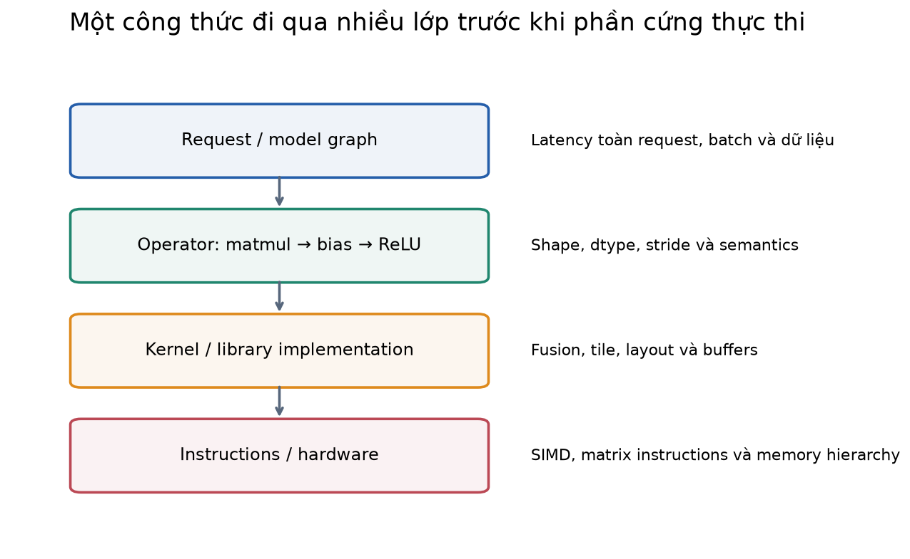
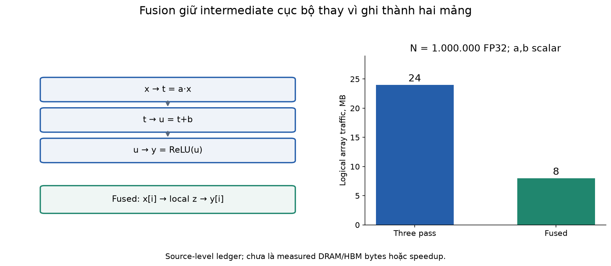
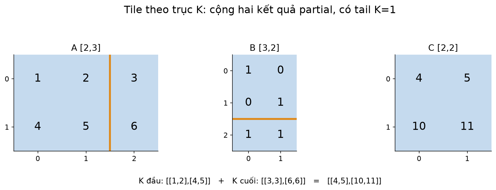
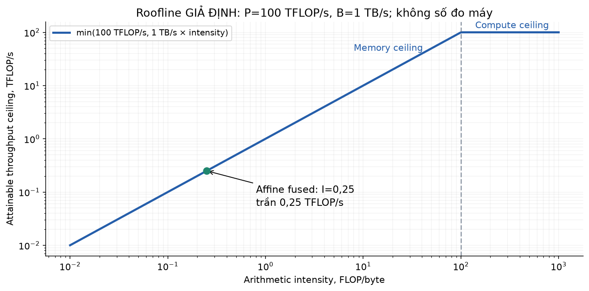
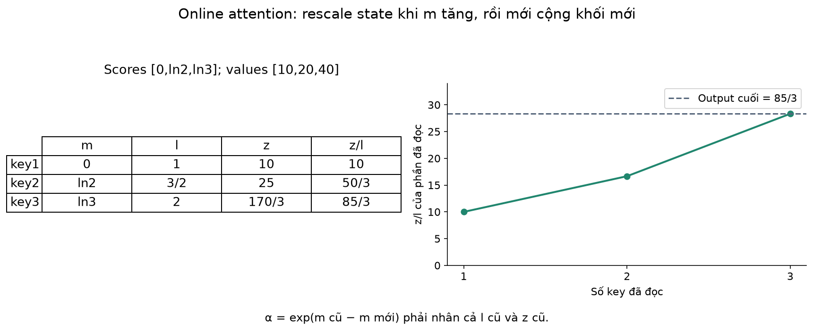
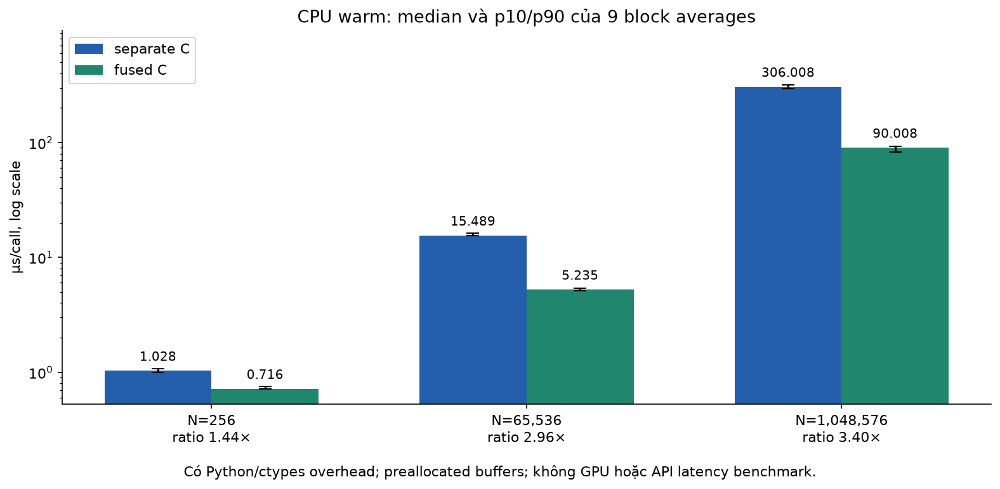
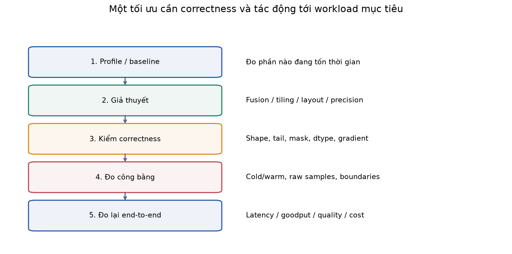

# Bài 40 — Kernel chuyên dụng và tối ưu tính toán

[← Mục lục](../README.md) · [Bài 39: phục vụ phân tán](../39-phuc-vu-mo-hinh-phan-tan/README.md) · [Phụ lục](deep-dive.md) · [Bài tập](exercises.md) · [Lời giải](solutions.md)

Bài 37–39 thay đổi cách tổ chức request, bộ nhớ và worker. Bài này đi vào bên trong một phép toán: **dữ liệu được đọc ở đâu, được dùng lại bao nhiêu lần và được tính bằng cách nào?** Đây là lớp nối công thức ma trận với phần cứng thực thi.

Sau bài này, bạn cần tự làm được bốn việc: mô tả một kernel và hợp đồng đầu vào của nó; tính một ledger FLOP/byte đơn giản; giải thích tiling, fusion và online reduction; thiết kế phép đo đủ để quyết định có giữ một tối ưu hay không. Kiến thức cần trước: ma trận (3), forward/backprop (9–10), attention (17), inference và đo tải (21,34), KV/quantization/phân tán (37–39).

**Phạm vi thực hành:** tự biên dịch kernel **C chạy trên CPU** qua `ctypes`, đối chiếu ba vòng lặp với một vòng lặp fused; viết tiled matmul và online attention bằng NumPy. Code NumPy giúp thấy thuật toán, chưa là GPU kernel tối ưu. Không cần model pretrained, tài khoản API hoặc GPU. Chưa chạy CUDA/Triton, Tensor Core, `torch.compile`, profiler phần cứng hoặc benchmark LLM; phần đó có nguồn và cách khảo sát tiếp, không gán số đo CPU thành tốc độ GPU.

## 1. Kernel là gì? Một dòng Python chưa là một lệnh máy

Trong bài này, **compute kernel** là đoạn chương trình thực hiện một phần tính toán trên dữ liệu: cộng vector, nhân ma trận, chuẩn hóa hoặc attention. Nó không mang nghĩa kernel của hệ điều hành. Một kernel có thể chạy trên CPU; trong ngữ cảnh GPU, kernel thường được host khởi chạy để nhiều thread cùng thực hiện.

Ví dụ backend: API phân loại ticket nhận request, tokenize rồi chạy model. Một tầng xử lý vector có công thức:

\[
y_i=\max(a x_i+b,0).
\]

Đây là nhân scalar, cộng bias và ReLU. Viết `y = maximum(a*x+b, 0)` mô tả kết quả cần có, nhưng chưa cho biết có bao nhiêu vòng lặp, buffer trung gian, kernel launch hay lần đọc bộ nhớ. Một compiler có thể gộp; eager runtime có thể thực thi nhiều bước. Cần nhìn implementation và profile thực tế.

```text
API/request → model graph → operators → kernel/library → instructions → hardware
```

| Lớp | Ví dụ | Câu hỏi cần trả lời |
|---|---|---|
| Model graph | Matmul → bias → activation | Có phụ thuộc nào cho phép gộp không? |
| Operator | `matmul`, `softmax` | Shape, dtype, stride và semantics là gì? |
| Kernel/library | GEMM của thư viện, fused kernel | Tile, layout, intermediate nằm ở đâu? |
| Instructions | Scalar, SIMD, matrix instructions | Phần cứng thực hiện loại toán nào? |
| Hệ thống | Queue, CPU/GPU, nhiều rank | Tối ưu cục bộ có giảm latency toàn request? |

Một operator không luôn tương ứng đúng một kernel: reduction có thể cần nhiều lần launch, còn nhiều operator có thể được fusion vào một kernel. CPU lab không có GPU launch; lời gọi Python→C cũng có chi phí riêng.



## 2. Vì sao “ít FLOP hơn” chưa chắc chạy nhanh hơn?

**FLOP** là một phép toán dấu phẩy động; **FLOP/s** là tốc độ thực hiện. Ta dùng quy ước matmul `C[M,N]=A[M,K]B[K,N]` có khoảng `2MNK` FLOP: một nhân và một cộng cho mỗi bước tích lũy. FMA thực hiện nhân–cộng bằng một instruction nhưng thường vẫn được đếm là hai FLOP. Với K nhỏ, đây là quy ước xấp xỉ, không phải đếm chính xác mọi instruction.

Thời gian còn gồm đọc/ghi dữ liệu, chờ phụ thuộc, dispatch/launch, đồng bộ và cấp phát. Dữ liệu ở gần đơn vị tính thường nhỏ hơn nhưng truy cập nhanh hơn dữ liệu ở xa. CPU có registers/cache/DRAM; GPU có registers, shared memory và các cache, rồi device memory. **Shared memory trên GPU là vùng do chương trình quản lý trong một block; không đồng nhất nó với CPU cache hoặc toàn bộ GPU RAM.**

Ví dụ thực tế giả định: bước chuẩn hóa embedding chỉ làm vài phép toán trên mỗi phần tử nhưng phải duyệt hàng triệu phần tử. Bước này có thể bị giới hạn bởi dữ liệu di chuyển. Trong khi đó một GEMM lớn dùng lại cùng phần tử nhiều lần có thể chịu giới hạn bởi năng lực tính toán. Shape, cache, dtype và implementation có thể thay đổi kết luận.

## 3. Fusion: làm nhiều bước trong cùng một lượt dữ liệu

Với `y=max(a*x+b,0)`, implementation ba pass có thể là:

```text
pass 1: x → t = a*x
pass 2: t → u = t+b
pass 3: u → y = max(u,0)
```

Nếu mỗi buffer chứa N giá trị FP32, mỗi pass đọc 4N byte và ghi 4N byte. Ledger logic là **24N byte**. Fused giữ giá trị trung gian trong biến cục bộ rồi ghi y:

```text
x[i] → scalar z=a*x[i]+b → max(z,0) → y[i]
```

Ledger còn **8N byte**, ratio 3. Coi a,b là scalar và bỏ qua overhead hằng số. Ta đếm mul+add là 2N FLOP; phép so sánh ReLU không cộng vào số FLOP trong ledger này.

N=1.000.000: ba pass 24 MB, fused 8 MB, dùng MB thập phân. Đây là **logical array traffic theo source**, chưa là số byte thực sự qua DRAM/HBM. Cache, write allocation, vectorization và compiler có thể thay đổi traffic vật lý. Ratio traffic 3 cũng chưa là cam kết speedup 3.

### Tính tay

x=`[-1,0,1,2]`, a=2, b=1:

| Bước | Kết quả |
|---|---|
| a*x | `[-2,0,2,4]` |
| +b | `[-1,1,3,5]` |
| ReLU | `[0,1,3,5]` |

Kernel fused phải giữ đúng thứ tự toán học. Đổi thành `a*ReLU(x)+b` cho phần tử đầu bằng 1, khác 0. Fusion hợp lệ không có nghĩa được đổi tùy ý thứ tự các operator.

Trong [kernels.c](kernels.c), ba pass được đặt trong ba helper `noinline`; fused dùng một loop. Biên dịch `-O2 -ffp-contract=off -fno-fast-math` giúp giữ phép nhân và cộng riêng trong bài so sánh FP32 này. Không bật LTO. Compiler vẫn có quyền tối ưu/vector hóa bên trong loop; bài không cố định assembly hay chứng minh số memory transaction bằng source.

```python
import tempfile
import numpy as np
from native import Native
with tempfile.TemporaryDirectory() as build:
    native=Native(build)
    x=np.array([-1,0,1,2],dtype=np.float32)
    y=np.empty_like(x)
    native.bind(x,y,2.,1.)()
    assert y.tolist()==[0.,1.,3.,5.]
    print(y)
```



**Khi fusion có thể bất lợi:** intermediate quá nhiều làm tăng register pressure; reduction cần đồng bộ; một fused implementation làm mất GEMM kernel tốt; hoặc backward cần lưu/tính lại dữ liệu. Hãy đặt câu hỏi “gộp những bước nào, cho shape nào, giữ semantics gì?”. [Triton Fused Softmax](https://triton-lang.org/main/getting-started/tutorials/02-fused-softmax.html) minh họa fusion với reduction và giới hạn row phải phù hợp tài nguyên on-chip. Bài này không chạy kernel của tutorial đó.

## 4. Tiling: chia nhỏ để dùng lại dữ liệu

Với matmul, một giá trị A[i,k] góp vào nhiều cột C; một giá trị B[k,j] góp vào nhiều hàng C. Nếu tính từng phần tử C độc lập rồi đọc lại mọi toán hạng, ta bỏ lỡ reuse. **Tile** là một khối nhỏ của tensor được xử lý cùng nhau để tận dụng dữ liệu đã đưa vào vùng nhớ gần phép tính.

```text
C_tile = 0
với mỗi khối trên trục K:
    lấy A_tile và B_tile
    C_tile += A_tile @ B_tile
ghi C_tile
```

### Tính tay với trục K bị chia

\[
A=\begin{bmatrix}1&2&3\\4&5&6\end{bmatrix},\quad
B=\begin{bmatrix}1&0\\0&1\\1&1\end{bmatrix}.
\]

Dùng tile size 2. Khối K đầu cho `[[1,2],[4,5]]`. Khối K cuối chỉ còn một phần tử theo trục K, cho `[[3,3],[6,6]]`. Cộng lại:

\[
AB=\begin{bmatrix}4&5\\10&11\end{bmatrix}.
\]

Tile cuối không đủ kích thước không được đọc vượt buffer. CPU NumPy dùng slice ngắn; GPU có thể dùng masked load hoặc padding với giá trị trung tính. Trong matmul, giá trị pad thường là 0; trong max/softmax, pad không hợp lệ thường phải là −∞ trước reduction.

```python
from algorithms import tiled_matmul
c,stats=tiled_matmul([[1,2,3],[4,5,6]],[[1,0],[0,1],[1,1]],tile=2)
assert c.tolist()==[[4.,5.],[10.,11.]]
assert stats['tile_products']==2
print(c,stats)
```

### Ledger reuse đơn giản

Matmul vuông 4×4, FP32. Cách scalar độc lập đọc hai operand cho mỗi cặp `(i,j,k)`: `2×4³=128` value =512 byte. Với tile 2×2 và không reuse giữa các tile C: có 8 lượt tile product; mỗi lượt đọc hai tile 4 phần tử, tổng 64 value =256 byte. Nếu C_tile tích lũy cục bộ rồi ghi một lần, cả hai còn ghi 16 value =64 byte. Tổng ledger là **576 vs 320 byte**, ratio 1,8; không lấy ratio 2 của operand rồi gán cho toàn bộ traffic.

Đây là mô hình load từ một tầng nhớ giả định, chưa cache simulation. Một phần tử có thể đã nằm trong cache, và C_tile trên implementation thật có thể spill. Tile lớn tăng reuse nhưng cần nhiều registers/shared memory hơn; tile nhỏ tăng overhead và có thể không dùng hiệu quả matrix instructions.



[Hướng dẫn matmul của Triton](https://triton-lang.org/main/getting-started/tutorials/03-matrix-multiplication.html) trình bày tile, stride, thứ tự program và autotuning. `tiled_matmul` trong bài dùng Python loops và gọi NumPy matmul ở mỗi khối; nó dùng để kiểm công thức, **không có kết luận nhanh hơn `A@B`**. Baseline thực tế nên là thư viện tối ưu cùng dtype/layout.

## 5. Roofline: giới hạn từ compute và memory

Đặt F là FLOP, D là byte di chuyển **qua tầng nhớ đang xét**, P là FLOP/s khả dụng và B là byte/s khả dụng. Arithmetic intensity `I=F/D` có đơn vị FLOP/byte. Mô hình đơn giản:

\[
T\geq\max(F/P, D/B),\qquad P_{attainable}\leq\min(P,BI).
\]

Điểm giao hai trần là `I*=P/B`. Cùng một kernel có thể có intensity khác khi xét DRAM, L2 hoặc shared memory; phải nêu tầng nhớ và cách đếm byte. [Berkeley Lab: Roofline](https://amcr.lbl.gov/departments/computer-science-department/ppan/roofline-performance-model/) giải thích cách kết hợp locality, bandwidth và throughput; đây là công cụ chẩn đoán, không bảo đảm đạt trần.

Ví dụ **giả định**, không là thông số máy đã đo: P=100 TFLOP/s, B=1 TB/s, đều thập phân. Với fused affine/ReLU N=1.000.000:

- F=2.000.000, D=8.000.000 ⇒ I=0,25 FLOP/byte.
- `F/P=0,02µs`, `D/B=8µs` ⇒ lower bound 8µs.
- Ridge=100 FLOP/byte; trần tại I=0,25 là 250 GFLOP/s.

Chưa tính launch, phụ thuộc, instruction hỗ trợ hoặc mức song song. Đặc biệt kernel nhỏ có thể **launch/dispatch-bound**: thời gian khởi chạy lớn hơn phần tính toán, nên roofline chỉ có compute/memory không giải thích đủ.

```python
from arithmetic import roofline
r=roofline(2_000_000,8_000_000,100e12,1e12)
assert abs(r['lower_bound_s']-8e-6)<1e-15
print(r)
```



## 6. Layout, stride và coalescing

Tensor shape chỉ cho biết kích thước logic. **Stride** cho biết đi thêm một chỉ số thì địa chỉ tăng bao nhiêu phần tử/byte. Với row-major FP32 A[3,4], địa chỉ A[i,j] là `base + 4*(4*i+j)` byte. Transpose view có thể giữ cùng storage nhưng đổi stride; không thể mặc định mọi tensor là contiguous.

**Coalescing** trong GPU: các lane truy cập các địa chỉ phù hợp để gộp thành ít transaction hơn. Không phải “mọi thread phải đọc cùng một phần tử”. Mô hình minh họa: 32 lane, mỗi lane đọc một FP32, base căn 32 byte, chia địa chỉ thành sector 32 byte:

| Mẫu chỉ số theo lane l | Số sector khác nhau |
|---|---:|
| l | 4 |
| l+1 | 5 |
| 8l | 32 |

Đếm tập sector không mô phỏng cache, broadcast, số wavefront hay đo instruction thực. [CUDA Best Practices, Coalesced Access](https://docs.nvidia.com/cuda/cuda-c-best-practices-guide/#coalesced-access-to-global-memory) giải thích cơ chế theo compute capability. Quy tắc của CUDA không tự áp nguyên cho mọi accelerator.

Native wrapper của lab **từ chối** input noncontiguous, sai dtype/shape, NaN/Inf, output readonly, alias giữa các buffer và affine FP32 overflow. Không âm thầm copy trước benchmark: copy có thể là một phần chi phí cần đo trong ứng dụng. `restrict` trong C dựa vào cam kết buffer rời nhau này; bỏ kiểm tra mà vẫn cho overlap sẽ vi phạm hợp đồng.

## 7. Reduction và attention: không được softmax riêng từng khối rồi nối

Với softmax, mỗi cột chia cho cùng tổng trên cả hàng. Chia một hàng thành hai khối, softmax riêng mỗi khối rồi nối sẽ có tổng bằng 2, sai phân phối. Attention còn cần dùng đúng trọng số để nhân V.

Ta giữ ba đại lượng sau khi đã đọc một phần các key của một query:

\[
m=\max_j s_j,\quad l=\sum_j e^{s_j-m},\quad z=\sum_j e^{s_j-m}v_j.
\]

Kết quả cuối là `z/l`. Với khối điểm mới t và value V_block:

\[
m'=\max(m,\max t),\quad \alpha=e^{m-m'},\quad p=e^{t-m'},
\]
\[
l'=\alpha l+\sum p,\qquad z'=\alpha z+pV_{block}.
\]

Hệ số α đưa trạng thái cũ về cùng mốc mới; không có bước này thì khi max tăng, trọng số cũ bị sai. Ban đầu `m=-∞,l=0,z=0`; code xử lý trường hợp này riêng, không tính `exp(-∞-(-∞))` gây NaN.

### Ví dụ tính tay có mốc log để dễ kiểm

Scores=`[0,ln2,ln3]`, values=`[10,20,40]`, mỗi khối một key:

| Đọc đến | m | l | z | z/l |
|---|---:|---:|---:|---:|
| key1 | 0 | 1 | 10 | 10 |
| key2 | ln2 | 1/2+1=3/2 | 5+20=25 | 50/3 |
| key3 | ln3 | (2/3)(3/2)+1=2 | (2/3)25+40=170/3 | 85/3 |

Kiểm độc lập: trọng số `[1,2,3]/6`, nên output=`(10+40+120)/6=85/3≈28,3333`. Các khối đầu chỉ là trạng thái chưa hoàn tất, không phải output mà có thể gửi cho client như token generation.

```python
import math
import numpy as np
from algorithms import online_attention,dense_attention
q=np.array([[1.]])
k=np.array([[0.],[math.log(2)],[math.log(3)]])
v=np.array([[10.],[20.],[40.]])
y,stats=online_attention(q,k,v,query_tile=1,key_tile=1)
assert abs(y.item()-85/3)<1e-12
assert np.allclose(y,dense_attention(q,k,v),rtol=1e-12,atol=1e-12)
print(y,stats)
```



Trong scaled dot-product attention, scores là `QKᵀ/√d`. Code xử lý query tile và key tile, không tạo toàn bộ score matrix M×N. Max score tile trong fixture M=7,N=11,query_tile=3,key_tile=4 là 12 phần tử, so với 77 của một score matrix dense. Có thể tồn tại nhiều tile-sized temporary cùng lúc; **12 chưa là tổng peak allocation**. Nếu caller cung cấp mask M×N, mask đó vẫn tồn tại đầy đủ. All-masked row được định nghĩa trả vector 0 trong lab, không coi đó là xác suất softmax hợp lệ hay hợp đồng của mọi thư viện.

[FlashAttention, §2–3.1 và Algorithm 1](https://arxiv.org/html/2205.14135v2#S3.SS1) kết nối tiling, thống kê chuẩn hóa và recomputation để tránh intermediate attention lớn trên HBM. NumPy lab minh họa forward với unnormalized z, chưa là implementation FlashAttention GPU hoặc backward của paper. “Exact attention” nói đến cùng phép toán toán học; thứ tự cộng/round khác vẫn có thể làm kết quả floating point khác chút ít. Attention dense vẫn có công việc bậc hai theo sequence, không biến thành linear attention nhờ bỏ score matrix.

## 8. Từ CPU lab đến GPU kernel chuyên dụng

GPU kernel thường ánh xạ một bài toán thành grid/block/thread. Một block có thể hợp tác qua shared memory và barrier; scheduling giữa các block không nên được giả định là cùng lúc hoặc theo thứ tự cố định. Register, shared memory và giới hạn resident block cùng quyết định tài nguyên sử dụng.

| Kỹ thuật | Ý tưởng | Đánh đổi cần kiểm |
|---|---|---|
| SIMD/vectorization | Một instruction xử lý nhiều lane dữ liệu | Alignment, tail, phụ thuộc và dtype |
| Coalesced loads | Lane truy cập địa chỉ để giảm transaction | Stride, base alignment, layout conversion |
| Tiling | Giữ khối và tái sử dụng | Tile lớn tăng tài nguyên/làm giảm số block resident |
| Fusion | Giảm intermediate và launch | Register pressure, backward, mất library path tốt |
| Matrix instructions/Tensor Core | Tăng throughput cho toán ma trận phù hợp | Dtype, accumulation, shape/layout và phần cứng hỗ trợ |
| Specialization/autotuning | Chọn code/config theo workload | Compile time, nhiều biến thể, kích thước ngoài bộ tune |

**Occupancy** là tỷ lệ active warp trên mức tối đa của SM trong định nghĩa CUDA, không là phần trăm GPU compute utilization, cũng không là mục tiêu cần tối đa bằng mọi giá. [CUDA Best Practices, Occupancy](https://docs.nvidia.com/cuda/cuda-c-best-practices-guide/#occupancy) nêu register/shared-memory limits và việc occupancy cao hơn chưa bảo đảm nhanh hơn. Lab không đo occupancy.

Triton cung cấp cách mô tả program/tile; một Triton program không tương đương một CUDA thread. Học tiếp từ hai tutorial đã dẫn: fused softmax để hiểu reduction/mask, matmul để hiểu block/stride/autotune. Không lấy benchmark của tutorial làm kết quả trên máy mình.

## 9. Compiler, specialization và chi phí ban đầu

Có thể đi theo thứ tự: dùng operator/library tốt → dùng compiler của framework → cân nhắc kernel riêng khi profile và workload cho thấy cần. Kernel chuyên dụng thường có hợp đồng hẹp hơn: dtype/shape/stride/mask cụ thể. Cần fallback hoặc từ chối input nằm ngoài hợp đồng, kể cả tail không chia hết tile.

Compiler có thể fuse/chọn kernel theo graph và các điều kiện bảo vệ (guards). Shape/control flow thay đổi có thể gây graph break hoặc compile biến thể mới. [PyTorch Dealing with Recompilations](https://docs.pytorch.org/docs/2.15/user_guide/torch_compiler/compile/programming_model.recompilation.html) mô tả guard/shape và chi phí recompile; bài chưa chạy `torch.compile` nên không suy các tối ưu cụ thể đã xảy ra.

Ví dụ **giả định** compile tốn 2s, mỗi call tiết kiệm 0,1ms: hòa vốn sau 20.000 call; muốn tổng thời gian nhỏ hơn phải vượt 20.000 call. Nếu traffic ngắn hoặc mỗi request lại compile một shape, steady-state nhanh chưa đủ. Tuning trên một shape rồi báo là tốt cho mọi shape cũng không đủ.

## 10. Đo thế nào để không tự đánh lừa mình?

Một phép đo tối ưu cần **đúng trước, so sánh công bằng sau**:

1. Cùng input, dtype, shape, layout, semantics, số thread và output cần có. Giữ cả baseline thư viện tốt; không chỉ so với Python scalar loop.
2. Kiểm nhiều shape/tail, dữ liệu âm/dương, mask và numerical tolerance. Nếu model có backward, kiểm gradient riêng. Đúng forward của một vector chưa chứng minh đúng training.
3. Tách compile/cold-start khỏi warm steady-state. Preallocate có thể phù hợp kernel benchmark; end-to-end phải đo cả các khoản ứng dụng thực trả.
4. Warm-up, lặp nhiều mẫu, đảo thứ tự các biến thể và lưu raw samples. Report median cùng độ phân tán, không chọn lượt nhanh nhất.
5. GPU thường chạy bất đồng bộ: đo thời gian enqueue ở CPU có thể chưa đo xong compute. Dùng event/synchronization phù hợp mục tiêu. Không thêm sync mọi chỗ rồi coi đó là production throughput.
6. Xác định bottleneck bằng profiler/counter khi cần: tên kernel, timeline, memory, occupancy; sau đó đo lại request-level latency/goodput.

[PyTorch benchmark README](https://github.com/pytorch/pytorch/blob/main/torch/utils/benchmark/README.md) nêu warm-up, quản lý thread và synchronize khi cần; lab tự dùng `perf_counter_ns` cho hàm C CPU **đồng bộ**, không dùng Timer/PyTorch hoặc GPU event.

### Amdahl: kernel nhanh chưa bằng request nhanh

Một kernel chiếm 40% latency request, phần còn lại giữ nguyên. Kernel nhanh 3 lần thì:

\[
S_{request}=\frac{1}{(1-.4)+.4/3}=\frac{15}{11}\approx1,364.
\]

Đây là mô hình tuần tự giả định, chưa gồm overlap/queue. Ngay cả xóa hoàn toàn kernel đó cũng chỉ cho trần `1/.6≈1,667`. Liên kết với bài34: đo lại cùng workload và SLO; khi latency giảm, bottleneck có thể chuyển sang queue, tokenizer hoặc communication bài39.

## 11. Chạy lab từ đầu

Mở terminal **trong thư mục bài 40**. Cần Python và C compiler kiểu Clang/GCC có lệnh `cc` trên PATH. Đã kiểm trên macOS arm64 với Python3.14.6, NumPy2.5.4, Apple clang21.0.0. Linux có nhánh build `.so` nhưng chưa được chạy trong phiên này; Windows chưa hỗ trợ wrapper build. Nếu chưa có compiler, vẫn chạy được mode `hand` và `algorithms`; mode `all/check/bench` sẽ báo lỗi rõ.

```bash
python3 -m venv .venv
.venv/bin/python -m pip install -r requirements.txt
cc --version
.venv/bin/python lab.py --mode all --out /tmp/lesson40-run-01
```

Dùng thư mục output **chưa tồn tại**. Lab biên dịch duy nhất source `kernels.c` đi kèm vào thư mục build tạm rồi dọn build khi xong. `report.json` là output runtime, không nằm trong bộ tài liệu chia sẻ. Không tải/gọi service ngoài, không train model.

| Mode | Nội dung |
|---|---|
| `hand` | Fusion/roofline/tile/sector/Amdahl giả định, không cần compiler |
| `algorithms` | NumPy tiled matmul và online attention |
| `check` | Compile native và kiểm correctness/contract |
| `bench` | Compile và đo warm CPU, có raw samples |
| `all --out ...` | Gộp và lưu report, yêu cầu output mới |

```bash
.venv/bin/python lab.py --mode hand
.venv/bin/python lab.py --mode algorithms
.venv/bin/python lab.py --mode check
.venv/bin/python lab.py --mode bench
```

### Hợp đồng đo của benchmark đi kèm

Ba vector N=256,65.536,1.048.576; x ngẫu nhiên seed400, a=1,25,b=−0,5. Cả hai biến thể là C native, dùng output/buffer preallocated rời nhau. Có correctness call rồi 5 warm-up call/mode; 9 mẫu/mode, thứ tự xen kẽ. Mỗi mẫu chạy 200/30/5 call tương ứng và chia tổng thời gian cho số call.

**Vùng timed:** Python loop, dispatch `ctypes` và C compute đồng bộ. **Ngoài timed:** input validation, random generation, cấp phát, build/load library và correctness. C code không tạo thread; CPU affinity/frequency và process khác trên máy chưa kiểm soát. Buffer lặp lại và có thể ở cache; không gọi đây là cold DRAM benchmark hoặc bandwidth phần cứng. `compile_ns` đo subprocess compiler trong lần chạy, không bao gồm toàn bộ cold-start ứng dụng.

## 12. Kết quả đã chạy và cách đọc

[Bản ghi lượt đo và raw samples](benchmark-results.md) lưu môi trường, flags/source hash và số liệu ngày07/11/2026. Median µs/call làm tròn:

| N | Ba pass C | Fused C | Ratio median separate/fused |
|---:|---:|---:|---:|
| 256 | 1,028 | 0,716 | 1,44 |
| 65.536 | 15,489 | 5,235 | 2,96 |
| 1.048.576 | 306,008 | 90,008 | 3,40 |

Build subprocess trong lượt đó khoảng 2,715s. Đây là một lượt **warm CPU microbenchmark**, số đo sẽ thay đổi; không dùng các giá trị này làm assertion. Ratio lớn hơn 3 ở N lớn không mâu thuẫn ledger: ledger logic chưa mô hình cache, function overhead, vectorization và thứ tự thực thi. Muốn xác định nguyên nhân phải có profiler/counter thích hợp; số đo hiện tại không chứng minh đã đạt DRAM bandwidth.



Đã chạy **80 kiểm tra**: native so scalar oracle/two-rounding FP32, tail canary, three-pass parity; dtype/stride/alias/readonly/finite/overflow rejection; matmul với kích thước lẻ; dense/online attention với mask, all-masked, large scores; ledger và đơn vị. Native fixtures cho output exact với reference trên môi trường này. Online attention fixture 7×11 cho max absolute error khoảng `1,11e−16` với FP64 NumPy; kiểm parity dùng `rtol=atol=1e-12`. Không suy precision FP16/BF16 hoặc gradient từ đó.

### Đọc code theo thứ tự

| Tệp | Vai trò |
|---|---|
| [arithmetic.py](arithmetic.py) | Các ledger giả định và công thức |
| [kernels.c](kernels.c) | Native three-pass/fused CPU |
| [native.py](native.py) | Build, ABI và kiểm hợp đồng buffer |
| [algorithms.py](algorithms.py) | Tiled matmul, dense/online attention |
| [benchmark.py](benchmark.py) | Preallocation, warm-up, raw samples và scope |
| [checks.py](checks.py) | 80 kiểm tra cơ chế/correctness |
| [lab.py](lab.py) | Năm mode CLI/report |
| [make_figures.py](make_figures.py) | Tái tạo bảy cặp PNG/SVG |

```bash
.venv/bin/python -m pip install -r requirements-figures.txt
.venv/bin/python make_figures.py --report /tmp/lesson40-run-01/report.json
```

Hình timing lấy từ report, nên report khác có thể cho hình timing khác. Các hình khác dùng công thức/fixture; PNG/SVG sẵn để đọc mà không cần cài Matplotlib.

## 13. Từ profile đến quyết định kỹ thuật

Ví dụ giả định: endpoint embeddings có p95 tăng. Đừng bắt đầu bằng viết lại matmul ngay. Xác định population/queue ở bài34, span ở bài32, rồi xem phần nào chiếm thời gian. Nếu tokenize/queue chiếm phần lớn, kernel tối ưu có trần lợi ích nhỏ. Nếu matmul chiếm phần lớn, kiểm shape/batch/dtype/library path trước. Nếu nhiều operator elementwise nhỏ có intermediate lớn, xem compiler/fusion. Nếu thay layout để kernel nhanh nhưng phải copy qua lại, đo luôn các copy đó.



Một bản thay thế chỉ nên giữ khi có hợp đồng và kết quả review được: baseline nào, workload nào, correctness/error nào, timed region nào, cold/warm thế nào, và request-level metric thay đổi ra sao. Với quantization bài38, cần kernel hiểu format low-bit để giảm compute/traffic; file weights nhỏ chưa tự tạo kernel nhanh. Với phân tán bài39, local GEMM nhanh có thể làm communication lộ rõ hơn.

Làm [16 bài tập](exercises.md), rồi đối chiếu [lời giải](solutions.md) và [phụ lục](deep-dive.md). Tự giải thích được vì sao fusion giảm byte, vì sao tile cần mask, vì sao online attention phải rescale, và vì sao warm kernel speedup chưa là SLO improvement là điều kiện học tiếp. [Nguồn và phạm vi đã đọc](../SOURCES.md) · [Đề cương](../ROADMAP.md).

Tiếp tục [bài 41 — AI đa phương thức: văn bản, hình ảnh và âm thanh](../41-ai-da-phuong-thuc-van-ban-hinh-anh-am-thanh/README.md) để học cách biểu diễn và liên kết nhiều loại dữ liệu.
