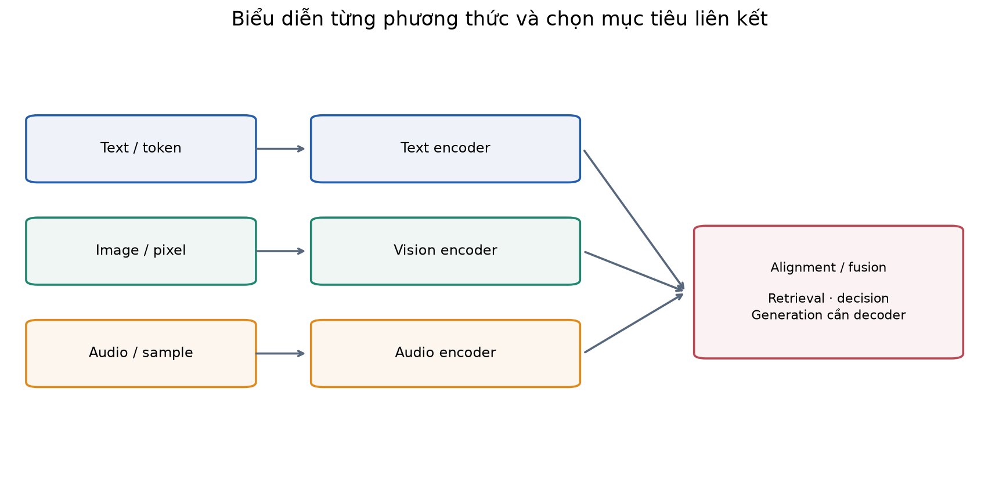
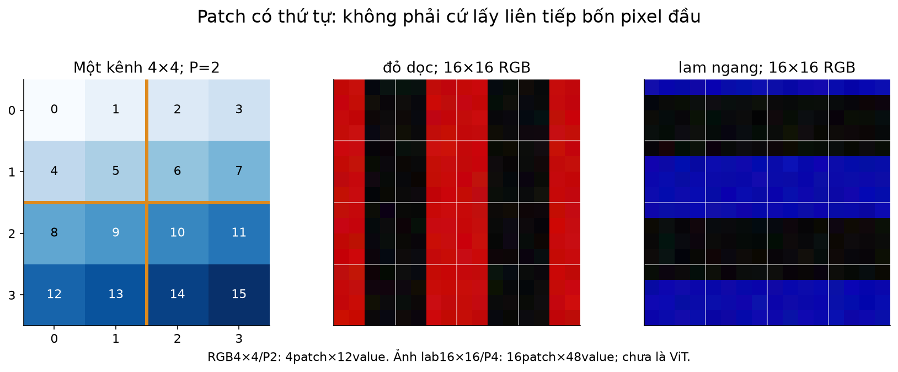
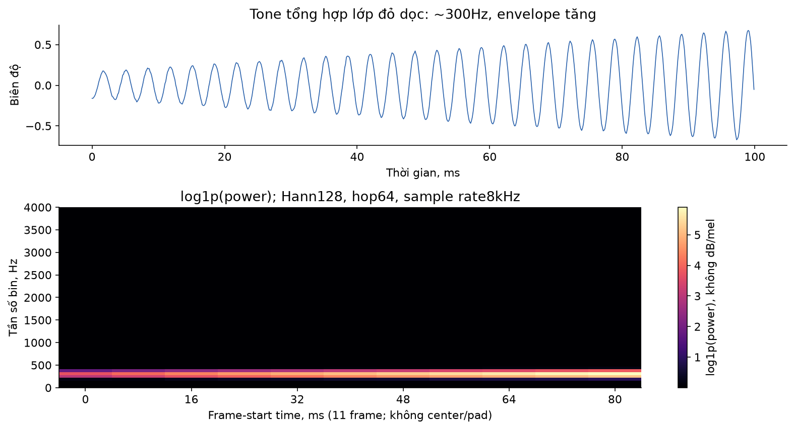
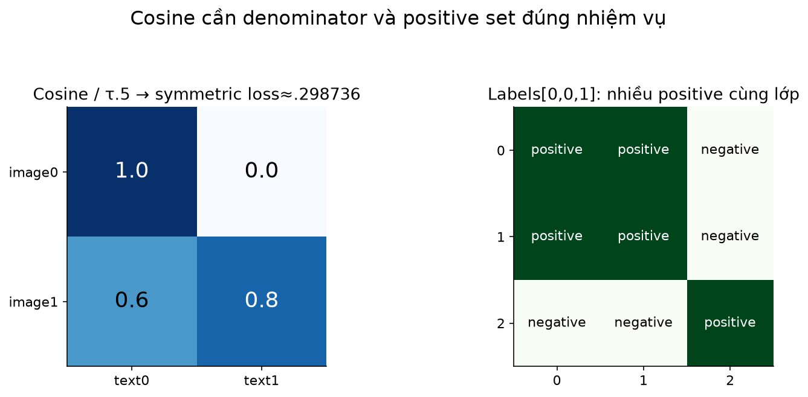
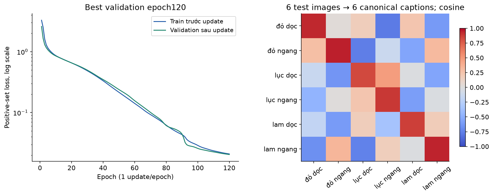
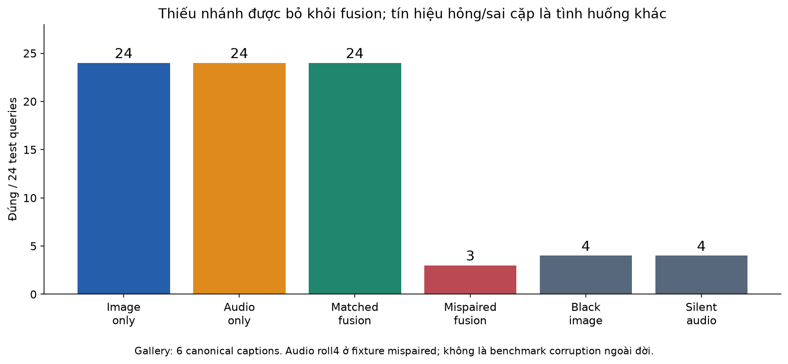
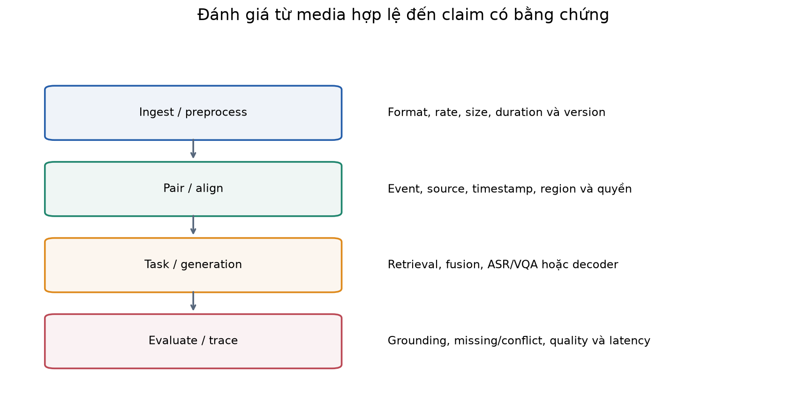

# Bài 41 — AI đa phương thức: văn bản, hình ảnh và âm thanh

[← Mục lục](../README.md) · [Bài 40: kernel và tối ưu tính toán](../40-kernel-chuyen-dung-toi-uu-tinh-toan/README.md) · [Phụ lục](deep-dive.md) · [Bài tập](exercises.md) · [Lời giải](solutions.md)

Một ticket hỗ trợ có mô tả lỗi, ảnh màn hình và đoạn ghi âm hiện tượng. Văn bản cho biết người dùng muốn gì; ảnh cho biết màn hình hiển thị gì; âm thanh có thể chứa lời nói hoặc tiếng thiết bị. **AI đa phương thức** xử lý hoặc liên kết thông tin từ nhiều loại dữ liệu như vậy. Điểm khó không chỉ là nhận thêm tệp: hệ thống phải biểu diễn từng loại đúng cách, ghép đúng sự kiện và học quan hệ giữa chúng.

Sau bài này, bạn cần mô tả được đường đi từ text/pixel/waveform đến embedding; tính patch, frame và cosine/loss đơn giản; phân biệt retrieval, fusion và sinh câu trả lời; chạy một thí nghiệm căn chỉnh ba phương thức và đọc đúng giới hạn. Kiến thức cần trước: tensor/CNN (3,14), chuỗi/embedding (15–16), attention/Transformer/tokenizer (17–19), train/eval (12), retrieval (23–24), đánh giá/vận hành (32–34), KV và kernel (37–40).

**Lab đã chạy:** PyTorch CPU học từ đầu trên ảnh vạch màu và âm sin do code tạo, kèm nhãn văn bản ngắn. Có đọc/ghi PNG/WAV thật, patchify, STFT/log-power, ba encoder nhỏ, contrastive learning có nhiều positive cùng lớp, tìm kiếm sáu chiều và late fusion khi thiếu/mâu thuẫn dữ liệu. Không tải model/data ngoài; chưa chạy CLIP/CLAP/LLaVA/Whisper pretrained, OCR, ASR, sinh ảnh/giọng nói hoặc benchmark multimodal LLM. Ví dụ nguyên lý được tách rõ khỏi khả năng của các mô hình lớn.

## 1. Modality là gì? Nhiều định dạng tệp chưa là nhiều thông tin

**Modality — phương thức** là loại tín hiệu/cách quan sát: ngôn ngữ, thị giác, âm thanh… PNG/JPEG là định dạng ảnh, không phải hai phương thức khác nhau. WAV/MP3 đều có thể chứa âm thanh. Văn bản transcript và audio gốc có liên hệ nhưng không chứa hoàn toàn cùng thông tin.

| Dữ liệu | Đơn vị đầu vào thường gặp | Thông tin có thể giữ | Điều dễ mất khi chuyển đổi |
|---|---|---|---|
| Văn bản | Ký tự → token | Nội dung ngôn ngữ | Ngữ điệu, âm sắc; layout nếu chỉ plain text |
| Hình ảnh | Pixel → patch/feature map | Màu, vật thể, chữ, vị trí | Chi tiết nhỏ khi resize/crop; quan hệ layout khi chỉ OCR |
| Âm thanh | Sample → frame/feature/token | Lời nói, âm sắc, nhịp, tiếng môi trường | Non-speech và prosody khi chỉ giữ transcript |

Ví dụ giả định: transcript “máy lại kêu thế này” không mô tả được âm mà người nói muốn chỉ ra. OCR đọc “503” có thể giúp tìm mã lỗi, nhưng không giữ đầy đủ vị trí nút hoặc biểu đồ. Chọn representation theo câu hỏi sản phẩm; không có một bản chuyển đổi duy nhất phù hợp mọi nhiệm vụ.

**Multimodal input không bảo đảm output đa phương thức.** Mô hình nhận ảnh+text có thể chỉ trả text; mô hình sinh ảnh từ text có output image. Một encoder dùng cho tìm kiếm không tự biết trò chuyện hoặc tạo ảnh.

## 2. Bản đồ hệ thống: biểu diễn riêng, liên kết có mục tiêu

```text
Text → tokenizer/text encoder ─────────┐
Image → decode/preprocess/vision encoder ├→ alignment/fusion/task → scores, text hoặc media
Audio → decode/sample-rate/audio encoder┘
```

**Encoder** biến đầu vào thành vector/chuỗi vector. **Projection** đưa feature sang không gian có kích thước mong muốn. **Alignment — căn chỉnh** làm cho những biểu diễn có quan hệ được so sánh/kết hợp có nghĩa. Cùng chiều d chưa đồng nghĩa cùng hệ tọa độ: hai encoder random cùng output12chiều chưa biết ảnh nào tương ứng với câu nào.



Có ba câu hỏi thiết kế riêng:

- **Retrieval:** câu này khớp ảnh hoặc audio nào? Cần embedding và hàm similarity/metric phù hợp.
- **Fusion/ra quyết định:** các nguồn cùng cho biết gì, thiếu nguồn thì làm sao? Có thể trộn feature, cross-attention hoặc trộn score.
- **Generation:** viết câu trả lời dựa trên ảnh/audio, hoặc sinh media theo điều kiện. Cần decoder/objective và dữ liệu huấn luyện tương ứng.

Một API gọi OCR rồi đưa text vào LLM là pipeline đa phương thức ở cấp hệ thống; nó khác mô hình nhận visual features trực tiếp. Cả hai đều có thể hữu ích, nhưng thông tin, lỗi và chi phí khác nhau.

## 3. Văn bản: token giữ nội dung, metadata giữ xuất xứ

Bài19 đã giải thích tokenizer. Với model pretrained, phải dùng tokenizer/template đúng model; không tự thay bằng split theo khoảng trắng. Embedding có thể là chuỗi token `[L,d]` hoặc một vector pooled `[d]`. Pooling dễ phục vụ retrieval nhưng có thể mất chi tiết thứ tự.

Lab dùng văn bản rất nhỏ: `đỏ dọc`, `đỏ ngang`, `lục dọc`, `lục ngang`, `lam dọc`, `lam ngang`. Tokenizer chỉ là Unicode NFC + lowercase + tách từ, vocabulary fit trên train, BoW chuẩn hóa tổng về1. BoW **bỏ thứ tự từ**, không là tokenizer/encoder ngôn ngữ của CLIP hoặc LLM.

```python
from preprocess import words,bow
vocab=['dọc','lam','lục','ngang','đỏ']
assert words('ĐỎ DỌC')==['đỏ','dọc']
x=bow('đỏ dọc',vocab)
assert x.tolist()==[.5,0.,0.,0.,.5]
print(x)
```

Từ lạ bị bỏ; nếu cả câu không còn token đã biết, lab từ chối thay vì tạo zero-vector rồi gán ý nghĩa. Text trong file hoặc transcript còn cần id nguồn, ngôn ngữ, timestamp/region và quyền truy cập ở hệ thống thật; model embedding không tự giữ những metadata này.

## 4. Hình ảnh: từ pixel đến patch và visual token

Ảnh RGB decoded có thể là `[H,W,3]` uint8. Trong code deep learning thường đổi sang float, chuẩn hóa rồi chuyển layout, ví dụ `[B,3,H,W]`. Không trộn HWC với CHW hoặc RGB với BGR. Scale/mean/std phải theo model; chia255 không phải preprocessing đầy đủ của mọi model pretrained.

Chia ảnh thành patch vuông P×P không chồng lấp, khi H/W chia hết P:

\[
N_{patch}=\frac{H}{P}\frac{W}{P},\qquad x_{patch}\in\mathbb R^{P^2C}.
\]

Ví dụ ảnh4×4RGB, P=2:4patch, mỗi patch12giá trị. Nếu projection có W[12,3], ta được4vector3chiều; cộng positional embedding để giữ vị trí trước khi đi qua Transformer trong kiến trúc kiểu ViT. [Vision Transformer, §3.1](https://arxiv.org/html/2010.11929v2#S3.SS1) trình bày patch projection và position; lab chỉ patchify rồi flatten cho MLP, **chưa chạy ViT/visual attention**.

### Tính tay patch đầu

Để dễ nhìn, dùng ba channel cùng giá trị của pixel. Kênh đầu ảnh4×4 lần lượt là0…15 theo hàng. Patch góc trái trên chứa pixel0,1,4,5; thứ tự flatten HWC là `[0,0,0,1,1,1,4,4,4,5,5,5]`, không là bốn pixel đầu của toàn ảnh.

```python
import numpy as np
from media import patchify
image=np.repeat(np.arange(16).reshape(4,4,1),3,axis=2)
patches=patchify(image,2)
assert patches.shape==(4,12)
assert patches[0].tolist()==[0,0,0,1,1,1,4,4,4,5,5,5]
print(patches)
```



Ảnh lab16×16RGB/P4 cho16patch48chiều, flatten thành768feature giữ thứ tự không gian cố định. Không mean-pool trước MLP: với vạch dọc/ngang, global mean màu có thể giống nhau và làm mất tín hiệu hướng.

Với hình thực tế: decode/EXIF orientation, alpha, aspect ratio, crop/resize và độ phân giải quyết định model nhìn thấy gì. Chữ nhỏ sau resize có thể không còn đọc được; nhiều crop/tiling tăng số visual token và chi phí. Lab chỉ chấp nhận PNG RGB16×16 và từ chối kiểu/size khác; chưa có bộ tiền xử lý tài liệu/ảnh chụp tổng quát. [Pillow Image API](https://pillow.readthedocs.io/en/stable/reference/Image.html) là nguồn cho thao tác I/O đã dùng.

## 5. Âm thanh: sample rate không phải một nhãn có thể đổi tùy ý

Waveform mono có shape `[S]`: các biên độ được lấy mẫu đều theo thời gian. Nếu sample rate f_s=8000Hz và S=800 thì thời lượng `S/f_s=0,1s`. Hai kênh stereo không phải hai sample liên tiếp của một kênh.

Âm sin đơn giản:

\[
x[n]=A\sin(2\pi f n/f_s+\phi).
\]

f là tần số âm; A là biên độ; φ là phase. Các con số này không phải nội dung từ ngữ. Hai lần phát cùng tần số có thể khác phase/amplitude. Một tiếng động thực tế thường có nhiều thành phần và thay đổi theo thời gian.

### Ví dụ sai sample rate

Giữ nguyên800sample nhưng ghi/diễn giải thành16000Hz sẽ làm thời lượng còn0,05s và phát nhanh hơn; đó **không phải resampling đúng** để bảo toàn tín hiệu theo thời gian. Resampling cần xử lý tín hiệu và anti-alias phù hợp khi giảm sample rate. Lab từ chối WAV khác sample rate mong đợi, chưa cài resampler.

`media.py` dùng WAV mono PCM16 little-endian: giá trị integer chuẩn hóa về float bằng32767 trong hợp đồng riêng của writer/reader. WAV thật có nhiều kiểu sample width/channel; không mở mọi `.wav` bằng một dtype cố định mà bỏ metadata. [Python wave](https://docs.python.org/3.14/library/wave.html) hỗ trợ PCM và cho đọc metadata; wrapper của bài giới hạn hẹp hơn thư viện.

## 6. Từ waveform đến phổ và spectrogram

Waveform cho thấy biên độ theo thời gian. Fourier transform cho biết thành phần tần số. **STFT — Short-Time Fourier Transform** lấy những frame ngắn, nhân cửa sổ rồi FFT từng frame để giữ cả thông tin thời gian và tần số.

Với frame F, hop H, không center/pad, S≥F:

\[
N_{frame}=1+\left\lfloor\frac{S-F}{H}\right\rfloor,\quad
N_{bin}=F/2+1\ (F\text{ chẵn}),\quad \Delta f=f_s/F.
\]

Lab S800,F128,H64,f_s8000:11frame,65bin, khoảng cách62,5Hz/bin. Frame đầu bao phủ `[0,16ms)`, frame tiếp theo `[8,24ms)`. Frame cuối bắt đầu ởsample640, kết thúc ở768;32sample cuối bị bỏ trong quy ước này. Thay center/pad hoặc window có thể đổi số frame và giá trị; cần giữ đúng preprocessing của model.

### Tính tay DFT bốn điểm

x=`[0,1,0,−1]`, DFT quy ước không chuẩn hóa forward cho `X=[0,−2i,0,+2i]`. Vì input thực, rFFT giữ `[0,−2i,0]`; power=`|X|²=[0,4,0]`. Đây là ví dụ DFT **không nhân Hann**, tách khỏi STFT lab. Nếu sample rate giả định8Hz, bin1 tương ứng2Hz; cùng vector ở8kHz tương ứng2kHz.

```python
import numpy as np
from media import stft_power
x=np.array([0.,1.,0.,-1.])
spectrum=np.fft.rfft(x)
assert np.allclose(spectrum,[0,-2j,0])
power,freq=stft_power(np.zeros(800),8000,128,64)
assert power.shape==(11,65) and freq[1]==62.5
assert np.array_equal(power,np.zeros_like(power))
```



Bài dùng **power spectrogram + `log1p`**, không phải mel spectrogram, dB, MFCC, PSD đã hiệu chuẩn hay tokenizer âm thanh pretrained. Cửa sổ là Hann đối xứng `np.hanning(128)`. Audio feature flatten11×65=715, giữ trục thời gian để phân biệt envelope tăng/giảm. Một FFT duy nhất cho cả clip có thể làm mất thông tin diễn tiến.

[NumPy rFFT](https://numpy.org/doc/stable/reference/generated/numpy.fft.rfft.html) và [rfftfreq](https://numpy.org/doc/stable/reference/generated/numpy.fft.rfftfreq.html) xác định quy ước output/bins. Một model lớn có thể dùng log-mel, convolution, waveform encoder hoặc audio codec tokens; chúng không phải các representation thay thế tùy ý cho cùng checkpoint.

## 7. Căn chỉnh embedding: cùng chiều chưa đủ, cần mục tiêu học

Cho encoder của từng phương thức và projection:

\[
z_I=\operatorname{norm}(f_I(I)),\quad
z_T=\operatorname{norm}(f_T(T)),\quad
z_A=\operatorname{norm}(f_A(A)).
\]

Norm ở đây là L2. Cosine giữa hai vector unit bằng dot product, nằm trong[−1,1]. **Cosine không là xác suất đúng.** Alignment học một quan hệ cụ thể từ dữ liệu: ảnh–caption mô tả cùng cảnh, audio–text mô tả cùng sự kiện… Pair sai hoặc label thiếu chi tiết làm quan hệ học sai.

### Contrastive learning cho cặp duy nhất

Giả sử hai image embeddings `u0=[1,0]`, `u1=[.6,.8]`; text embeddings `v0=[1,0]`, `v1=[0,1]`. Ma trận cosine:

\[
C=\begin{bmatrix}1&0\\.6&.8\end{bmatrix}.
\]

Chia temperature τ=0,5 cho logits `[[2,0],[1.2,1.6]]`. Với diagonal là positive, row0 loss=`−ln(e²/(e²+1))≈0,126928`; row1 loss=`−ln(e^1.6/(e^1.2+e^1.6))≈0,513015`. Đổi chiều text→image có denominator theo cột. Trung bình hai chiều khoảng **0,298736**, không chỉ lấy trung bình hai row loss.

```python
from arithmetic import hand
r=hand()['contrastive']
assert abs(r['symmetric_loss']-.29873616756976046)<1e-12
print(r)
```

[CLIP, §2.3](https://arxiv.org/html/2103.00020v1#S2.SS3) học image/text encoders bằng cosine scores và symmetric cross entropy trên batch. [CLAP](https://arxiv.org/abs/2206.04769) trình bày liên kết audio–text trong shared space; phần CLAP ở bài này chỉ đối chiếu abstract. Lab học mô hình nhỏ riêng, không tái tạo hai pretrained model này.

### Nhiều positive: caption trùng không được tự biến thành negative

Trong batch lab có16record mỗi lớp, nhiều câu `đỏ dọc` giống hệt nhau. Nếu chỉ coi diagonal là đúng, các caption hợp lệ cùng lớp ở cột khác bị phạt như negative. Ta định nghĩa `P(i)={j: label_j=label_i}` và dùng:

\[
\mathcal L_{A\to B}=-\frac1N\sum_i\log
\frac{\sum_{j\in P(i)}\exp(s_{ij})}{\sum_j\exp(s_{ij})}.
\]

Đây là **negative log probability mass của positive set**, không phải average log-probability từng positive, và khác diagonal CE khi có positive lặp. Khi chỉ có một positive, nó trở về CE tương ứng. Code dùng logsumexp để ổn định. Lấy trung bình hai chiều mỗi cặp; train ba cặp I–T,A–T,I–A rồi trung bình tiếp. Cả ba encoder nhận gradient.

Ý nghĩa supervision của lab là **cùng lớp màu/hướng**, không phải cùng instance/audio recording. Dùng class label để xây positive-set là giám sát; không gọi thí nghiệm này là tự giám sát không nhãn. Align I–T và A–T cũng không tự bảo đảm I–A tốt với mọi dataset; lab train trực tiếp cặp I–A.



## 8. Fusion: kết hợp gì, ở đâu và khi nào?

| Kiểu | Cách hiểu | Ví dụ |
|---|---|---|
| Early/feature fusion | Ghép raw feature hoặc feature đã trích rồi học phần chung | Ghép embedding ảnh+audio cho classifier |
| Cross-attention | Query của nguồn này chú ý token của nguồn khác | Text query nhìn vùng ảnh/frame audio |
| Late fusion | Trộn output/score của các nhánh | Trung bình score image–text và audio–text |

Đây là cách phân loại để thiết kế, không là ranh giới cứng cho mọi model. Model có thể kết hợp nhiều cách. Feature concatenation không tự căn chỉnh representation; cross-attention vẫn cần dữ liệu/objective; late fusion cần score có thang đo phù hợp.

Lab có sáu text candidate, mỗi candidate là một lớp. Với query gồm ảnh+audio:

\[
s_{fused}=w\,s_{image,text}+(1-w)\,s_{audio,text}.
\]

Tính tay scores ảnh `[.9,.4]`, audio `[.2,.8]`, w=.75 ⇒ `[.725,.5]`, chọn candidate0. Nếu ảnh bị thiếu, chỉ dùng audio `[.2,.8]`, chọn candidate1. Không thay ảnh thiếu bằng zero image rồi giả vờ có bằng chứng thị giác. Nếu cả hai thiếu, lab từ chối.

```python
import numpy as np
from metrics import late_fuse
i=np.array([[.9,.4]]);a=np.array([[.2,.8]])
assert np.allclose(late_fuse(i,a,.75),[[.725,.5]])
assert late_fuse(None,a).argmax(axis=1).item()==1
```

Lab dùng w=.5 cố định, không tune trên test, không học gating/reliability. Cosine cùng range chưa đủ chứng minh đã calibration đồng đều. Nếu hai nguồn mâu thuẫn, trung bình có thể tệ hơn từng nhánh đúng; cần kiểm pairing, thời gian, chất lượng nguồn và policy xử lý conflict.

## 9. Từ retrieval đến mô hình sinh đa phương thức

Một hướng nhận ảnh để trả text:

```text
Ảnh → vision encoder → projector/connector → visual tokens ─┐
Text → text tokens/embeddings ───────────────────────────────┴→ LLM → answer tokens
```

Projector đổi feature dimension/representation; **không tạo nghĩa chỉ vì nối shape vừa vặn**. Phải học liên kết qua objective/dữ liệu và giữ đúng interface model. Có kiến trúc ghép prefix/token sequence, kiến trúc dùng cross-attention, hoặc connector nén token. Nhiều visual/audio token làm tăng context/work; không mặc định một ảnh bằng một text token.

[LLaVA gốc, §4](https://arxiv.org/html/2304.08485v2#S4) dùng vision encoder và projection nối sang LLM, cùng các giai đoạn alignment/instruction tuning; đây là một ví dụ kiến trúc, không là mô tả mọi VLM hiện hành. Lab không có LLM decoder hoặc visual instruction tuning.

Với audio, phân biệt **ASR** (nhận dạng lời nói thành text), **audio caption/event retrieval** (mô tả/tìm theo âm) và **speech/audio generation**. [Whisper, abstract PMLR2023](https://proceedings.mlr.press/v202/radford23a.html) là ví dụ nghiên cứu speech recognition bằng giám sát transcript; bài chưa đọc/triển khai toàn bộ hệ thống đó. Audio sin lab không có từ ngữ để ASR, cũng chưa là âm thanh sinh bởi model.

Một pipeline ASR→LLM thuận lợi khi câu hỏi chủ yếu về nội dung lời nói, nhưng thông tin như tiếng máy hoặc nhạc/giọng điệu có thể không được giữ đầy đủ trong transcript. Mô hình sinh ảnh/audio còn cần decoder chuyên biệt, chẳng hạn representation/codec và cơ chế sinh phù hợp; training retrieval embeddings chưa cho khả năng đó.

## 10. Ghép dữ liệu, timestamp, context và nguồn dẫn

Trong sản phẩm, một record có thể gồm source_id, event/session_id, text, image region, audio interval, sample rate và model/preprocess version. Ghép nhầm hai lần ghi cùng thiết bị có thể tạo hai nguồn đều “đúng riêng” nhưng sai khi tổng hợp.

Ví dụ giả định: ảnh chụp trước khi khởi động lại, audio ghi sau khi máy đã chạy ổn. Nếu hỏi “lỗi đang xảy ra là gì?”, cần xử lý thời gian chứ không chỉ cosine. Frame STFT bắt đầu sample640 ở8kHz nằm0,08s sau đầu clip; nếu clip bắt đầu lúc2,5s trong recording, offset tuyệt đối là2,58s. Không gán timecode chính xác hơn độ phân giải/annotation thực có.

Context ledger giả định:40text token+16visual patch+11audio frame+3special=70token, dense self-attention có70²=4900cặp vị trí trước mask. Đây chỉ là ví dụ concatenation; model thật có thể pool/downsample/chunk, visual tokens khác patch count, và API billing có quy tắc riêng. Quay lại bài37/40 để phân tích KV/compute, không dùng70 để dự báo chi phí một API chưa đo.

Nguồn dẫn đa phương thức nên chỉ ra vùng ảnh hoặc đoạn thời gian hỗ trợ claim, cùng artifact hash/version khi cần. Một timestamp có thật chưa chứng minh nội dung claim đúng. OCR/transcript chứa văn bản vẫn là dữ liệu từ nguồn, không tự thành chỉ dẫn có quyền gọi tool; xem bài26 về trust boundary. Lab chưa cài multimodal RAG/prompt-injection defense hoặc annotation grounding tự động.

## 11. Dữ liệu thực hành và cách chạy

Sáu lớp =3màu `{đỏ,lục,lam}`×2hướng `{dọc,ngang}`. Mỗi record có:

- RGB16×16 có vạch màu/hướng tương ứng, offset/brightness/noise thay đổi.
- Mono800sample ở8kHz. **Quy ước nhân tạo:** đỏ/lục/lam↔300/600/1200Hz; dọc↔envelope tăng, ngang↔giảm. Không có quan hệ tự nhiên “màu đỏ phát âm300Hz”.
- Caption hai từ. ID chỉ dùng split/lineage, không đưa vào feature encoder.

24group/lớp, mỗi group chứa cả ba phương thức. Index0…15train,16…19validation,20…23test ⇒ **96/24/24record**, không trộn modality của một group qua split. Test có biến thể mới của cùng sáu lớp và cùng generator; chưa unseen concept, speaker, device, scene thực hoặc zero-shot generalization. Mean/std ảnh/audio và vocabulary chỉ fit train.

Ảnh:768→32→12/Tanh; audio:715→32→12/Tanh; text:5→12 linear; L2normalize. Tổng48.384parameter. Đây là ba encoder MLP/linear, chưa CNN/ViT/speech transformer. AdamW lr.005/weight_decay0, full-batch96, τ.15,120epoch/120update; checkpoint theo validation positive-set loss. Random-init baseline định trước; không dùng test để chọn checkpoint/hyperparameter.

### Chạy trong thư mục bài 41

Đã kiểm Python3.14.6,torch2.15.0,NumPy2.5.4,Pillow13.0.0,macOSarm64,CPU1thread. Không cần GPU/model download/API key. Môi trường khác có thể cho khác số rounding/training.

```bash
python3 -m venv .venv
.venv/bin/python -m pip install -r requirements.txt
.venv/bin/python lab.py --mode all --out /tmp/lesson41-run-01
```

Output phải **chưa tồn tại**. Có `report.json`, inference bundle `training/alignment.pt`, examples PNG/WAV và file kiểm thử. Bundle giữ encoder weights, preprocess/vocab/spec, data/state/preprocess digest; load lại inference cho cùng kết quả trên fixture. Digest kiểm tính nhất quán, không là chữ ký xác thực; bundle chưa optimizer/RNG để exact resume training.

| Mode | Nội dung |
|---|---|
| `hand` | Patch/frame/DFT/cosine/fusion/context tính tay |
| `check` | Kiểm preprocessing, loss, media I/O, gradient và bundle |
| `train --out ...` | Train/validation/test, save/load |
| `media --out ...` | Tạo hai PNG và hai WAV tổng hợp |
| `all --out ...` | Gộp và lưu report |

Có sẵn [ảnh đỏ dọc](assets/red-vertical.png), [âm tương ứng](assets/red-vertical.wav), [ảnh lam ngang](assets/blue-horizontal.png) và [âm tương ứng](assets/blue-horizontal.wav). WAV dài0,1s, là tone tổng hợp, không phải lời nói. Có thể tạo lại bằng mode media vào thư mục mới. Reader giới hạn file/shape/rate cho mục tiêu lab, chưa là public upload gateway an toàn cho mọi tệp không tin cậy.

## 12. Kết quả đã chạy và các phép kiểm quan trọng

Best epoch120, validation loss≈0,020487; test loss≈0,0265635. Retrieval dùng24query và24candidate của test trong từng modality; top1 tính **cùng lớp**, không đòi trúng chính xác recording ID. Candidate có nhiều positive cùng lớp. Sáu chiều dưới đây không là sáu benchmark độc lập ngoài dataset này.

| Hướng retrieval | Random init đúng/24 | Sau train đúng/24 |
|---|---:|---:|
| Image→audio | 0 | 24 |
| Image→text | 2 | 24 |
| Audio→image | 0 | 24 |
| Audio→text | 0 | 24 |
| Text→image | 0 | 24 |
| Text→audio | 4 | 24 |

Rule baseline biết generator — chọn channel/hướng vạch hoặc FFT peak/envelope — cũng đạt24/24 trên test. Vì vậy không kết luận neural model cần thiết cho bài toán tổng hợp này. Model giúp học cơ chế representation/alignment; baseline cho biết nhiệm vụ dễ đến mức nào.



### Thiếu nguồn khác với nguồn bị hỏng/ghép sai

Phần này dùng6canonical text candidate. Missing branch được bỏ khỏi fusion; black image/silent audio vẫn đi qua encoder như một input hiện hữu.

| Tình huống sau train | Đúng/24 | Diễn giải |
|---|---:|---|
| Image only / audio only | 24 / 24 | Mỗi nhánh đủ tín hiệu trong generator |
| Fusion đúng cặp, w=.5 | 24 | Không cải thiện accuracy đã bão hòa |
| Audio scores xoay4hàng rồi ghép với image | 3 | Cố ý sai pairing,24hàng argmax hai nhánh bất đồng |
| Ảnh đen hoàn toàn → image only | 4 | Input hỏng, không là thiếu nguồn |
| Audio im lặng hoàn toàn → audio only | 4 | Không có tone/envelope, closed-set vẫn buộc chọn |

Xoay4hàng trên test được sắp theo lớp làm audio thuộc lớp khác; đây là fault fixture, không noise tự nhiên hoặc adversarial benchmark. Không chọn lại w trên test để cứu kết quả. Việc cùng mỗi phương thức đạt100% nhưng fusion sai cặp chỉ12,5% cho thấy integrity của pairing quan trọng.



Code có **64 kiểm tra**: patch order/reconstruction; STFT so DFT tính trực tiếp; Unicode/vocab/train-only normalization/split; multi-positive loss so tính tay, permutation/symmetry/unique-positive CE; gradient thật tới ba encoder; checkpoint/metadata mismatch; PNG/WAV I/O; missing/fusion/metric contract. Kiểm save/load embedding exact trong môi trường này. Loss/metric không chứng minh khả năng hiểu ngôn ngữ, âm thanh đời thực, grounding hoặc fairness.

## 13. Đánh giá và vận hành hệ thống đa phương thức

Với sản phẩm, xây evaluation theo tác vụ: retrieval relevance/Recall@k, OCR field accuracy, ASR word/character error, caption/VQA factuality, grounding theo vùng/time và chất lượng media sinh. Không dùng một metric thay cho tất cả. Cần annotation phù hợp; nhiều đáp án đúng có thể cần rubric thay vì exact string.

Thêm các slice: ngôn ngữ/giọng, noise, ảnh mờ/chữ nhỏ, nguồn bị thiếu, conflict, timestamp lệch, thiết bị mới và nội dung ngoài miền. Split theo recording/session/document/source trước augmentation/chunk để tránh leakage. Kiểm model có dùng đúng nguồn bằng swap/ablation, nhưng một phép swap gây lỗi chưa đủ giải thích toàn bộ cơ chế nội bộ.



Backend cần kiểm format/rate/size/duration, preprocessing version, source permissions và budget; đo decode/resample/encode/fusion/generation riêng trước khi tối ưu. Giữ raw media và derivative theo policy dữ liệu đã có; transcript/ảnh có thể chứa thông tin riêng. Chọn lưu metadata cần thiết cho audit, không coi embedding là bản thay thế đầy đủ cho bằng chứng gốc.

### Đọc code và tự học tiếp

| Tệp | Vai trò |
|---|---|
| [media.py](media.py) | Patchify, STFT, PNG/WAV contract |
| [data.py](data.py) | Generator, split, fingerprint, examples và rule baseline |
| [preprocess.py](preprocess.py) | Unicode/BoW, train-only normalizer |
| [model.py](model.py) | Ba encoder và positive-set objective |
| [metrics.py](metrics.py) | Semantic top1 và late fusion |
| [training.py](training.py) | Train/validation/test và inference bundle |
| [arithmetic.py](arithmetic.py) | Phép tính tay |
| [checks.py](checks.py) · [lab.py](lab.py) | 64 kiểm tra và CLI/report |
| [make_figures.py](make_figures.py) | Tái tạo bảy cặp PNG/SVG |

```bash
.venv/bin/python -m pip install -r requirements-figures.txt
.venv/bin/python make_figures.py --report /tmp/lesson41-run-01/report.json
```

Làm [16 bài tập](exercises.md), rồi xem [lời giải](solutions.md) và [phụ lục](deep-dive.md). Tiêu chí tự kiểm: giải thích được vì sao same dimension chưa là alignment; vì sao đổi WAV rate không là resample; vì sao diagonal loss sai với positive lặp; và vì sao thiếu modality khác với modality sai cặp. [Nguồn và phạm vi đã đọc](../SOURCES.md) · [Đề cương](../ROADMAP.md).

Tiếp tục [bài 42 — Hệ gợi ý](../42-he-goi-y/README.md) để kết hợp biểu diễn nội dung với lịch sử tương tác và đánh giá ranking theo thời gian.
