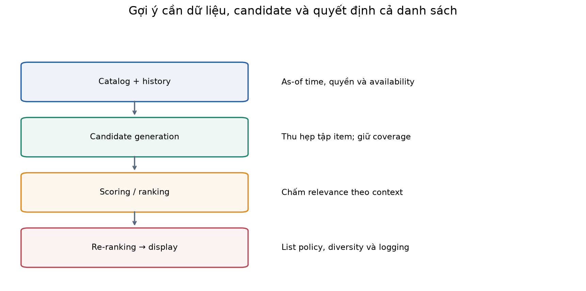
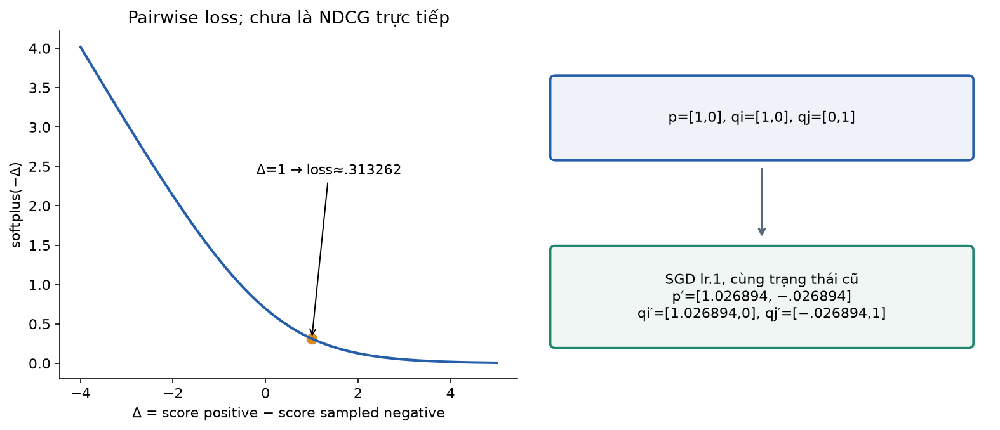
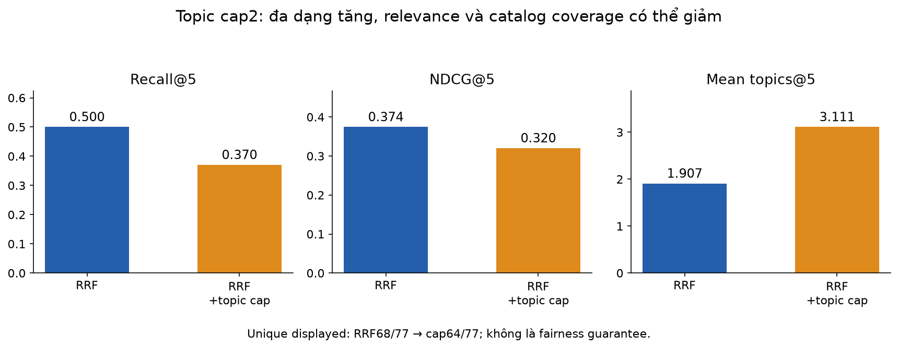
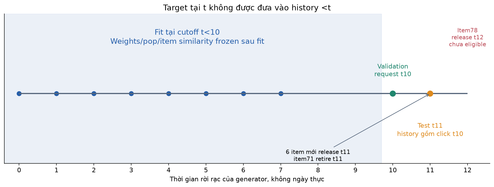
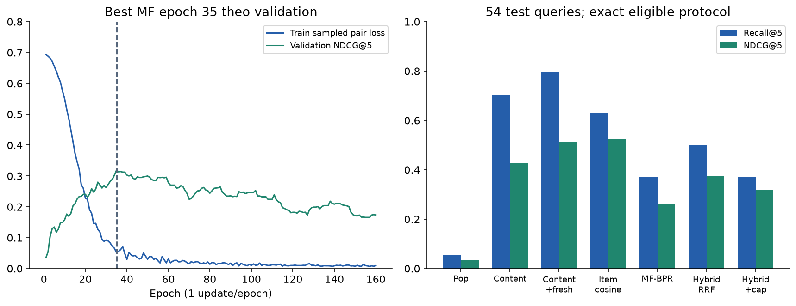
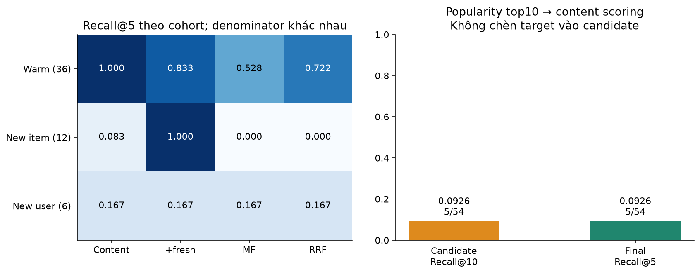
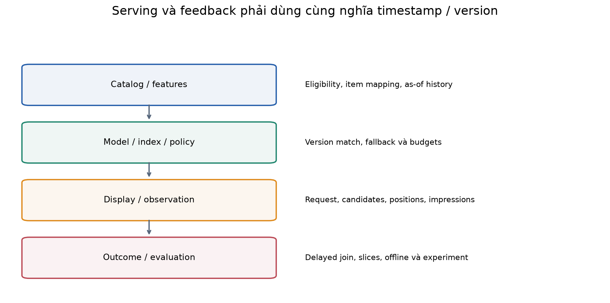

# Bài 42 — Hệ gợi ý

[← Mục lục](../README.md) · [Bài 41: AI đa phương thức](../41-ai-da-phuong-thuc-van-ban-hinh-anh-am-thanh/README.md) · [Phụ lục](deep-dive.md) · [Bài tập](exercises.md) · [Lời giải](solutions.md)

Một thư viện tài liệu có hàng nghìn bài về backend và AI. Hai người mở cùng trang chủ nhưng có lịch sử học khác nhau: người đang làm API cần tài liệu phục vụ mô hình; người vừa học attention muốn bài Transformer. **Hệ gợi ý — recommender system** chọn và sắp xếp item phù hợp với người dùng hoặc ngữ cảnh, thường khi người dùng chưa nhập một truy vấn cụ thể.

Bài này nối embedding/retrieval ở bài16/23/41 với học từ tương tác và vận hành ở bài31–34. Sau bài, bạn cần: xây baseline hợp lệ; giải thích content-based/collaborative filtering và matrix factorization; tính một bước BPR; thiết kế candidate set/split theo thời gian; đọc Recall/NDCG cùng cold-start, coverage và giới hạn của dữ liệu click.

**Lab:** PyTorch CPU train MF bằng pairwise BPR trên click tổng hợp; so popularity, content, item cosine, hybrid RRF và greedy diversity. Có thời điểm item phát hành/ngừng hoạt động, lịch sử chỉ trước request, user/item mới, giới hạn candidate và inference bundle save/load. Không tải dữ liệu/model, không impression log thật, ANN/vector database, neural ranker, sequential Transformer, bandit, A/B test hay dịch vụ production. Kết quả không được biến thành tuyên bố tăng CTR của người dùng thật.

## 1. Gợi ý khác tìm kiếm như thế nào?

Search thường có truy vấn rõ: “PyTorch DataLoader”. Recommendation có thể dùng lịch sử/context để đề xuất “bài tiếp theo nên đọc”. Hai hệ chia sẻ embedding, candidate retrieval và ranking, nhưng supervision/candidate eligibility và cách đo có thể khác. “Related items” theo một tài liệu và “For you” theo người dùng cũng chưa là cùng nhiệm vụ.

**Item** có thể là bài viết, video, sản phẩm hoặc bài nhạc. **User/context** có thể gồm tài khoản, session, lịch sử gần đây, thiết bị và thời điểm. Chọn đơn vị này trước khi chọn model. Một người có thể đổi nhu cầu theo phiên; một user ID không mô tả đủ mọi ý định.

| Mục tiêu sản phẩm | Tín hiệu gần có thể đo | Rủi ro khi tối ưu quá hẹp |
|---|---|---|
| Học được bài phù hợp | Đọc sâu, hoàn thành, phản hồi hữu ích | Click cao nhưng nội dung không giúp học |
| Mua sản phẩm phù hợp | Purchase, return, satisfaction | Chỉ tối đa click hoặc doanh thu ngắn hạn |
| Khám phá nội dung | Relevance, novelty, diversity | Chỉ lặp lại nội dung rất giống lịch sử |

Không có một loss hoặc metric duy nhất đại diện tất cả mục tiêu. [Google Scoring](https://developers.google.com/machine-learning/recommendation/dnn/scoring) bàn về việc objective có thể khuyến khích clickbait hoặc nội dung quá dài; bài dùng đó để đặt đúng câu hỏi, chưa đo tác động sản phẩm.

## 2. Dữ liệu: rating, click và impression nói những điều khác nhau

**Explicit feedback** là đánh giá chủ động như rating1–5 hoặc dislike. **Implicit feedback** là hành vi như click, đọc, mua, bỏ qua. Một click là observation, không phải nhãn chắc chắn “thích”. Click có thể do tò mò hoặc tiêu đề gây hiểu lầm.

Một schema sự kiện minh họa:

```text
request_id, user/session_id, item_id, event_time,
exposure/position, action, dwell_time,
candidate_source, model_version, feature_snapshot
```

Impression cho biết item được hiển thị theo định nghĩa logging của hệ thống; click cho biết một hành động xảy ra. Không thấy click có thể vì chưa hiển thị, không nhìn thấy vị trí đó, không quan tâm lúc đó hoặc chưa có đủ thời gian. **Missing interaction không tự bằng dislike.**

Ma trận user–item thường rất thưa: observed entry có dữ liệu, phần lớn ô còn lại chưa biết. Nếu điền mọi ô trống thành rating0 rồi fit MSE không phân biệt confidence, ta đổi bài toán. Weighted implicit MF/ALS và BPR là các cách đặt objective khác nhau; chúng vẫn dựa vào giả định về observation/negative, không giải quyết mọi bias chỉ bằng tên thuật toán.

Trong lab chỉ có sự kiện click được tạo theo quy tắc. Không có exposure, position hay propensity, nên không ước lượng CTR calibrated hoặc nhân quả. Metadata topic sẵn có tại release time; không đọc topic tương lai để tạo candidate trước khi item phát hành.



## 3. Bắt đầu từ baseline và điều kiện được gợi ý

Trước model, xác định **eligible items** tại thời điểm request: đã phát hành, còn hoạt động, người dùng có quyền, không bị chặn và có thể áp chính sách loại item đã tiêu thụ. Với thư viện bài học, lab loại bài đã click trước request để học bài toán khám phá mới. Với nghe nhạc hoặc mua hàng định kỳ, repeat recommendation có thể hợp lý; không mặc định loại seen cho mọi sản phẩm.

Baseline thường gồm popularity, recent/fresh hoặc content-based đơn giản. Popularity cần nêu thời gian, population và loại event dùng để đếm. Lab đếm số user có click item trong **train window**; không lấy toàn bộ log có cả test để tính “popular”. Dùng popularity giúp phát hiện một model phức tạp chưa tốt hơn quy tắc rẻ.

Tie score cũng cần hợp đồng: lab sort score giảm dần, rồi item ID tăng dần. Không để thứ tự hash/container quyết định metric âm thầm. Nếu không có candidate đủ điều kiện, trả danh sách ngắn/rỗng đúng policy; đừng chèn item không hợp lệ để đủ K.

## 4. Content-based: gợi ý dựa trên nội dung và hồ sơ quan tâm

Biểu diễn item bằng feature như topic, text/image/audio embedding hoặc thuộc tính sản phẩm. Hồ sơ user có thể lấy trung bình các feature đã tương tác, có trọng số theo recency/loại action. Sau đó so feature query–item. Bài41 giúp tạo representation nội dung, nhưng embedding đa phương thức chưa tự thành recommender tốt.

### Tính tay

Hai topic: backend=`[1,0]`, AI=`[0,1]`. User đã đọc backend, backend, AI ⇒ profile=`[2/3,1/3]`. Dot với một bài backend là2/3, với bài AI là1/3. Đây là dot score, không xác suất click. Nếu chuẩn hóa L2 và dùng cosine thì giá trị số thay đổi; không trộn hai công thức.

```python
import numpy as np
items=np.eye(2)
profile=items[[0,0,1]].mean(axis=0)
assert np.allclose(profile,[2/3,1/3])
assert np.allclose(items@profile,[2/3,1/3])
```

Content-based có thể chấm một item mới nếu feature đã có và tương thích. User mới chưa có history cần fallback hoặc context/onboarding hợp lệ, không được biết sở thích ẩn chỉ vì generator biết. Nó cũng có thể đề xuất quá giống lịch sử, và metadata yếu làm nhiều item cùng score.

Lab dùng topic one-hot6chiều, profile là phân bố topic trong history trước request. `content_fresh` cộng `.001 × released_time` khi history có sẵn: một bonus nhỏ **định trước**, không tune trên test. Cold user không history dùng popularity; chưa có learned onboarding encoder.

## 5. Collaborative filtering và item similarity

**Collaborative filtering — lọc cộng tác** dùng mẫu tương tác giữa nhiều user/item. Hai bài khác mô tả nhưng thường được cùng nhóm người đọc có thể liên quan; không cần cùng từ khóa. User-based tìm người có lịch sử tương tự; item-based tìm item có tập user tương tự.

Với binary matrix X[user,item], cosine giữa hai cột item:

\[
S_{ij}=\frac{\sum_u X_{ui}X_{uj}}{\sqrt{\sum_u X_{ui}^2}\sqrt{\sum_u X_{uj}^2}}.
\]

Nếu item i có2user, j có2user, giao1user thì cosine=.5. Lab đặt diagonal0 rồi chấm candidate bằng tổng `S[h,candidate]` trên history h. Đây là heuristic item cosine toàn bộ history, chưa kNN học được, graph model hoặc ANN index.

```python
import numpy as np
x=np.array([[1,0,1],[1,1,0],[0,1,1]],dtype=float)
norm=np.sqrt((x*x).sum(axis=0))
s=x.T@x/(norm[:,None]*norm[None,:])
np.fill_diagonal(s,0)
assert np.allclose(s,[[0,.5,.5],[.5,0,.5],[.5,.5,0]])
```

Co-click không chứng minh causal similarity: layout cũ, bundle, item phổ biến hoặc exposure giống nhau có thể tạo pattern. Item mới chưa có tương tác không có cột informative; content và collaborative bổ sung cho nhau. Trong lab, S/popularity chỉ fit train; đến test, user history có thể gồm click validation đã xảy ra trước request, nhưng S không được refit bằng future log.

## 6. Matrix factorization: học latent embedding

Thay vì lưu similarity item–item lớn, học `P[U,d]`, `Q[I,d]`:

\[
s(u,i)=p_u^\top q_i+b_i.
\]

Một dạng dự đoán rating explicit còn có `μ+b_u+b_i+p_uᵀq_i`. Ví dụ μ3,5, b_u.2, b_i−.1, dot.8 ⇒rating4,4. Lab implicit ranking **không dùng công thức rating đó**, không clip vào1–5 và không coi score là probability.

p=`[.8,.2]`, q_A=`[1,0]`, q_B=`[0,1]`, bias0 ⇒scores.8/.2, xếp A trước B. d là chiều latent; một chiều không nhất thiết có tên topic dễ hiểu. Các embedding ID học từ tương tác khác feature one-hot topic của content baseline.

[Google Matrix Factorization](https://developers.google.com/machine-learning/recommendation/collaborative/matrix) giải thích user/item embeddings và weighted objectives. MF cho missing data không đồng nhất với gọi SVD lên một ma trận điền0; objective, weighting và regularization quyết định model học gì.

```python
import torch
from model import MF
m=MF(users=1,items=2,dim=2)
with torch.no_grad():
    m.user.weight.copy_(torch.tensor([[.8,.2]]))
    m.item.weight.copy_(torch.eye(2));m.bias.weight.zero_()
s=m(torch.tensor([0,0]),torch.tensor([0,1]))
assert torch.allclose(s,torch.tensor([.8,.2]))
```

MF chỉ dùng ID cần user/item mapping có embedding đã học. Item mới không thể được chấm đúng chỉ bằng cấp số ID mới cho một hàng random. Lab MF loại các item chưa có mapping khỏi nguồn đề xuất và fallback popularity cho user mới; evaluation vẫn tính miss nếu ground truth là item mới hợp lệ. Hạn chế coverage này không được che bằng cách bỏ cohort đó khỏi metric.

## 7. BPR: học ưu tiên tương đối từ implicit feedback

Cho triple `(u,i,j)`: i là positive observed trong train, j lấy từ pool chưa observed ở snapshot train. Đặt:

\[
\Delta=s(u,i)-s(u,j),\qquad
\mathcal L_{pair}=-\log\sigma(\Delta)=\operatorname{softplus}(-\Delta).
\]

Muốn Δ lớn hơn để i đứng trước j. Chưa có ý nghĩa calibrated click probability; j có thể là item user sẽ thích nhưng chưa thấy. [BPR, §3–4](https://arxiv.org/pdf/1205.2618) phân tích implicit missingness và pairwise objective. Lab dùng MF+bias, Adam và một batch gồm toàn positive mỗi epoch với negative mới; không tái hiện nguyên bootstrap-SGD LearnBPR của paper.

### Tính tay gradient và cập nhật đồng thời

Không bias/regularization trong ví dụ này: p=`[1,0]`, q_i=`[1,0]`, q_j=`[0,1]`. Δ=1, loss≈.3132617. Gọi g=`σ(−Δ)≈.2689414`:

\[
\nabla_pL=-g(q_i-q_j)=[-.2689414,.2689414],
\]
\[
\nabla_{q_i}L=-gp=[-.2689414,0],\quad
\nabla_{q_j}L=gp=[.2689414,0].
\]

SGD lr=.1, **tất cả gradient lấy từ trạng thái cũ**:

```text
p'  = [1.02689414, -.02689414]
qi' = [1.02689414, 0]
qj' = [-.02689414, 1]
```

Nếu cập nhật p trước rồi dùng p mới tính gradient qi/qj, đó là thuật toán khác. User bias hằng theo item triệt tiêu trong pair difference nên lab không thêm b_u. Bias item vẫn có tác dụng. Training có regularization mean L2 trên p/q_i/q_j/b_i/b_j của **sampled triple**, λ.001; các ID lặp được tính lặp theo batch, khác full-table L2 đếm mỗi ID một lần.

```python
from arithmetic import hand
h=hand()['bpr']
assert abs(h['loss']-.31326168751822286)<1e-12
assert h['after_p'][0]>1 and h['after_p'][1]<0
print(h)
```



### Negative sampling phải ghi rõ phân phối

Lab: mỗi positive có một j uniform từ catalog đã available ởt9 trừ **train positives** của user; lấy lại mỗi epoch. Không dùng validation/test target để loại j — làm vậy dùng tương lai thay đổi training. Sau khi lấy mẫu, một audit riêng đếm số lần j về sau xuất hiện như positive; audit không đưa lại vào sampler hoặc model.

Uniform/popularity/hard-negative sampling thay phân bố nhiệm vụ và gradient. Hard negative hữu ích khi đúng mục tiêu nhưng có thể tăng false negatives. In-batch negatives cũng cần xem positive lặp, như bài41. Loss giảm không chứng minh top-K hoặc chất lượng sản phẩm chắc chắn tăng.

## 8. Candidate generation → scoring → re-ranking

Catalog lớn thường không chạy model đắt cho mọi user×item. Một kiến trúc thường gặp: retrieval lấy ứng viên, ranker chấm chính xác hơn, re-ranker áp điều kiện danh sách. [Google overview](https://developers.google.com/machine-learning/recommendation/overview/types) mô tả ba bước; [YouTube2016, abstract](https://research.google/pubs/deep-neural-networks-for-youtube-recommendations/) là ví dụ nghiên cứu hai mô hình candidate/ranking, không là mô tả toàn bộ YouTube hiện tại.

Two-tower có encoder user/context và encoder item, dùng dot/cosine để retrieval; item vectors có thể tính trước và ANN phục vụ gần đúng. Ranker có thể dùng cross-features, context, giá/chất lượng và dự đoán nhiều outcome. Sequence models thêm thứ tự/time của history; [SASRec, abstract](https://arxiv.org/abs/1808.09781) minh họa self-attention cho next-item. Lab chưa train các model này hoặc đo ANN recall/latency.

**Candidate recall là trần của bước sau.** Nếu target không lọt top10 từ popularity, ranker nội dung không thể đưa target vào top5 bằng cách chỉ sắp lại10item. Không chèn ground-truth target vào candidate rồi gọi đó là pipeline tự retrieve.

Lab có fault demo: popularity top10, content_fresh re-score, không thêm target. CandidateRecall@10=5/54≈.092593; finalRecall@5 cũng5/54. Đó là metric trên candidate thực sự sinh được, không sampled-negative benchmark có target được bảo đảm xuất hiện.

## 9. Hybrid và diversity: score cao chưa quyết định cả danh sách

Điểm MF và content có scale khác; không cộng tùy ý rồi coi cùng probability. Lab dùng RRF theo **rank**:

\[
s_{RRF}(i)=\sum_{source}\frac{1}{60+rank_{source}(i)}.
\]

Hai nguồn là toàn ranking eligible từ MF và content_fresh; item không được một nguồn đề xuất không có contribution ở nguồn đó. Đây là heuristic, chưa trained ranker. Item mới chỉ xuất hiện ở content source có thể thiệt so với item có contribution cả hai nguồn: “thêm source cold-start” chưa bảo đảm item mới vào top-K.

Sau RRF, greedy cap tối đa2item/topic trong top5 giúp tăng số topic. Ví dụ ranking topic `[A,A,A,B,B,C]` chọn vị trí `[1,2,4,5,6]`. Nó có thể hạ Recall/NDCG; topic diversity cũng khác catalog coverage và không chứng minh fairness giữa nhóm người dùng/nhà cung cấp.

```python
from metrics import reciprocal_fusion,diversify
ranking,score=reciprocal_fusion([[1,2],[2,3]],60)
assert ranking==[2,1,3]
catalog=[{'id':i,'topic':i//3} for i in range(9)]
assert diversify(list(range(9)),catalog,5,2)==[0,1,3,4,6]
```



## 10. Offline evaluation: thời điểm, candidate và metric

Một protocol cần nêu: lúc dự đoán, training cutoff, item availability, history, target, repeat rule và cách xử lý cold/OOV. Lab dùng thời gian chung toàn hệ thống: train events t0…7, validation request t10, test request t11; fit chỉ events t<10. Các click validation ởt10 đã là history tại testt11, nên được dùng làm context/exclude-seen; **weights/popularity/co-occurrence vẫn frozen train**. Target đang dự đoán tại chính t không nằm trong history `<t`.



Không random-split event rồi dùng future activity làm quá khứ; không dùng catalog tương lai trước release; không tính popularity từ toàn log. Per-user leave-last-out cũng cần xem timeline toàn cục: “last” của user này có thể sớm hơn train event của user khác, tùy mục tiêu backtest.

### Tính tay top-K

Ranking `[A,B,C,D,E]`, relevant `{B,E,F}`, K5:

- Precision@5=2/5=.4; Recall@5=2/3.
- MRR@5=1/2=.5, vì B là relevant đầu ởrank2.
- Binary DCG=`1/log2(3)+1/log2(6)`.
- IDCG=`1+1/log2(3)+1/log2(4)` vì có3relevant và K≥3.
- NDCG@5≈**.4776237**.

```python
from metrics import ranking_metrics
m=ranking_metrics(['A','B','C','D','E'],['B','E','F'],5)
assert m['precision']==.4 and m['recall']==2/3 and m['mrr']==.5
assert abs(m['ndcg']-.4776237035032179)<1e-12
```

Lab binary relevance, một observed target/request nên Recall@K bằng hit rate; Precision bằnghit/K. Average theo query/user vì mỗi user có một test request. Danh sách ngắn vẫn chia precision cho K; empty ranking cho0; relevance rỗng bị từ chối trong helper, không bỏ query âm thầm. NDCG graded có thể dùng gain`2^rel−1`, nhưng chưa dùng trong code.

Full eligible-catalog protocol không có nghĩa mọi item chưa click là thật sự không relevant. Ta chỉ có observed target; các item khác có thể hữu ích nhưng chưa có nhãn. Không có sampled negatives trong metric: các policy scan tập eligible của mình; MF chỉ nominate item có ID mapping, nhưng target cold vẫn nằm trong population và tính miss.

[On Sampled Metrics, abstract](https://research.google/pubs/on-sampled-metrics-for-item-recommendation/) chỉ ra sampled metrics có thể không giữ thứ tự so sánh hệ thống như exact metric. Ví dụ riêng: target rank20/100 làmHit@5=0; một subset target+5negative có thể cho target rank2/6 vàHit@5=1. Đây là một subset có thể xảy ra, không là ước lượng unbiased hay kỳ vọng.

## 11. Dữ liệu tổng hợp và cách chạy

Catalog79item:72warmitem,12item/topic×6topic;6item mới phát hànht11;1item tương lai phát hànht12. Item71 retiredt11. Có48warmuser: mỗi user8train click gồm6primary-topic+2secondary-topic;1validationclick;1testclick. Thêm6newuser không history tại test. Test54query:36warm user/item,12new-item target,6new-user target. Chỉ generator biết preference rule; policy lấy history/metadata hợp lệ, không nhận sở thích ẩn.

Đây là dữ liệu **tổng hợp có topic structure cố định**, không impression log, MovieLens hoặc traffic thực. Content feature topic rất phù hợp generator nên có lợi thế; đánh giá không cho biết model nào tốt nhất cho mọi catalog. Một target click/request chưa là tập đầy đủ mọi thứ user thích.

Môi trường đã kiểm: Python3.14.6,torch2.15.0,NumPy2.5.4,macOSarm64,CPU1thread. Mở terminal trong thư mục bài42:

```bash
python3 -m venv .venv
.venv/bin/python -m pip install -r requirements.txt
.venv/bin/python lab.py --mode all --out /tmp/lesson42-run-01
```

Output phải chưa tồn tại. Không cần GPU/API key/tải dataset. Các mode:

| Mode | Nội dung |
|---|---|
| `hand` | Dot/rating, BPR gradient, top-K metric và ví dụ sampled |
| `data` | Catalog, counts, cohorts và dataset hash |
| `check` | Kiểm temporal/negative/metric/policy/gradient/bundle |
| `train --out ...` | Train, chọn validation checkpoint, test bảy policy |
| `all --out ...` | Gộp và lưu report |

Train seed42, MF12dim/1.512parameter, user/item initNormal(.05), itembias0; Adam lr.03, λ.001,160epoch/160update. Mỗi update có384positive và384negative sampled. Checkpoint theo validationNDCG@5 lớn nhất, giữ lần đầu khi bằng nhau; bestepoch35, valNDCG≈.318610. Random-init test baseline định trước, không dùng chọn checkpoint. Không tune lại để neural model thắng baseline.

## 12. Kết quả đã chạy và cách đọc

| Policy | Hit/Recall@5 | NDCG@5 | Mean topics@5 | Unique displayed /77available |
|---|---:|---:|---:|---:|
| Popularity | 3/54=.05556 | .03494 | 3.222 | 9 |
| Content | 38/54=.70370 | .42524 | 1.222 | 72 |
| Content+fresh | 43/54=.79630 | .51231 | 1.222 | 71 |
| Item cosine | 34/54=.62963 | .52341 | 2.037 | 68 |
| MF-BPR | 20/54=.37037 | .26044 | 2.278 | 66 |
| Hybrid RRF | 27/54=.50000 | .37431 | 1.907 | 68 |
| Hybrid+topic cap | 20/54=.37037 | .32010 | 3.111 | 64 |

Available denominator77=79trừ future78và retired71tại test; coverage là số item distinct từng xuất hiện trong danh sách /77, không là tỷ lệ target được retrieve. MF random-init recall3/54, NDCG≈.03818; sau train cải thiện, nhưng **MF vẫn thua item cosine/content trên metric này**. Content+fresh recall cao hơn item cosine, nhưng NDCG thấp hơn: không tuyên bố một cấu hình thắng mọi mặt.

Pair loss tiếp tục giảm sau epoch35, trong khi validation NDCG giảm ở nhiều đoạn sau đó. Vì thế không chọn checkpoint cuối hoặc chỉ nhìn train loss để kết luận ranking tốt hơn.



### Tách cold-start khỏi điểm tổng

| Cohort | Query | Content recall | Content+fresh | MF-BPR | Hybrid RRF |
|---|---:|---:|---:|---:|---:|
| Warm user/item | 36 | 36/36 | 30/36 | 19/36 | 26/36 |
| New item target | 12 | 1/12 | 12/12 | 0/12 | 0/12 |
| New user target | 6 | 1/6 | 1/6 | 1/6 | 1/6 |

Metadata giúp chấm item mới nhưng score/tie rule còn ảnh hưởng top-K. Fresh bonus đưa item mới lên, đồng thời có thể đẩy warm target khỏi top5. Hybrid RRF vẫn0/12newitem vì contribution hai nguồn ưu tiên nhiều warm item. Đây là điều đã quan sát với cấu hình hiện tại; chưa có learned gate, calibrated hybrid hoặc chứng minh nguyên nhân ngoài kiểm code/rank của fixture.



Audit ghi1.698negative draws là positive về sau, trên61.440draw trong160epoch. Sampler không dùng tương lai để tránh chúng; điều này minh họa unobserved có thể là future positive. Không suy tất cả những draw khác là negative thật. Không biến observed hit thành CTR hoặc user satisfaction.

**63 kiểm tra** chạy gồm: cutoff/history/availability/block/no-seen; future mutation không đổi train/negative/pop/co-occurrence; metric và tie; RRF/diversity; MF fallback; BPR gradient tính tay/finite differences/update; inference bundle roundtrip và mismatch guards. Bundle giữ weights/spec/ID mapping/data snapshot hash/state hash; load đúng model cho ranking exact trong môi trường đã kiểm. Full data hash mô tả teaching snapshot, không đưa test target làm feature. Bundle chưa chứa service catalog/history store hoặc optimizer/RNG để exact resume; digest không xác thực người gửi.

## 13. Từ offline đến sản phẩm: feedback loop và exposure bias

Hệ cũ quyết định item nào được thấy; những item đó có cơ hội nhận click và trở thành training data cho hệ mới. Nếu chỉ học cái được click, popularity/exposure có thể tự củng cố. Position cũng ảnh hưởng click. Ngẫu nhiên một vài item trong exploration có kiểm soát có thể giúp thu bằng chứng, nhưng thiết kế experiment cần phù hợp sản phẩm; lab chưa thực hiện.

[Recommendations as Treatments](https://proceedings.mlr.press/v48/schnabel16.html) nghiên cứu selection bias và propensity weighting. Minh họa riêng: hai observed reward1/0 có propensity.5/.25, trung bình contribution `r/p` là1, khác mean reward.5. Chưa là kết luận expected CTR hoặc uplift; cần estimand, population, support, propensities đúng và uncertainty. **Click log không có exposure không đủ để tự tính propensity rồi gọi kết quả unbiased.** Xem phụ lục để phân biệt observation weighting với policy-value evaluation.

Offline tốt là một bước sàng lọc, chưa chứng minh tác động nhân quả. Online evaluation cần phân nhóm phù hợp, kiểm guardrails như complaint/return/latency, theo dõi outcome dài hơn click khi nhiệm vụ cần, và xác định thời gian/cỡ mẫu theo câu hỏi. Không lấy “tăngNDCG” đổi trực tiếp thành “tăngdoanhthu”.

## 14. Backend và hướng hiện đại để học tiếp

Serving có thể tách catalog/eligibility, feature store, user-history updates, retrieval index, ranker và cache. Cần version item/user mapping, feature timestamp, embedding/index và policy; request log lưu danh sách đã hiển thị, nguồn candidate/model/version, position và outcome join key. Cache phải phản ánh history/policy/availability đủ mới; lọc lại item hết quyền hoặc hết hoạt động trước trả kết quả.

Nhánh tiếp theo có thể dùng two-tower với feature encoder để giảm ID cold-start; sequential model để học thứ tự; multi-task ranker dự đoán nhiều outcome; hoặc exploration/OPE có logging phù hợp. Mỗi nhánh cần baseline/split/metric mới. Bài hiện tại chưa có ANN speed/recall benchmark, learned ranker, drift monitor, online updates hoặc distributed serving load test.



| Tệp | Vai trò |
|---|---|
| [data.py](data.py) | Generator, timeline, eligibility, negative snapshot |
| [model.py](model.py) | MF và BPR/regularization |
| [metrics.py](metrics.py) | Top-K, tie, RRF và diversity cap |
| [policies.py](policies.py) | Bảy policy và candidate demo |
| [training.py](training.py) | Train/validation/test và inference bundle |
| [arithmetic.py](arithmetic.py) | Tính tay |
| [checks.py](checks.py) · [lab.py](lab.py) | 63kiểm tra, CLI/report |
| [make_figures.py](make_figures.py) | Bảy cặp PNG/SVG |

```bash
.venv/bin/python -m pip install -r requirements-figures.txt
.venv/bin/python make_figures.py --report /tmp/lesson42-run-01/report.json
```

Làm [16 bài tập](exercises.md), rồi xem [lời giải](solutions.md) và [phụ lục](deep-dive.md). Tự kiểm: giải thích được ô trống user–item nghĩa gì; tính gradient BPR; chứng minh candidate recall là trần của re-ranker; và chỉ ra temporal/cold-start/coverage population của một bảng metric trước khi chọn model. [Nguồn và phạm vi đã đọc](../SOURCES.md) · [Đề cương](../ROADMAP.md).

Tiếp theo: [Bài 43 — Dự báo chuỗi thời gian](../43-du-bao-chuoi-thoi-gian/README.md).
