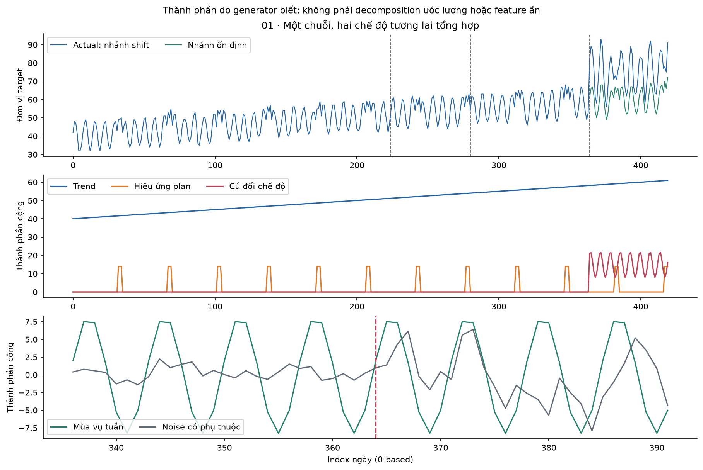
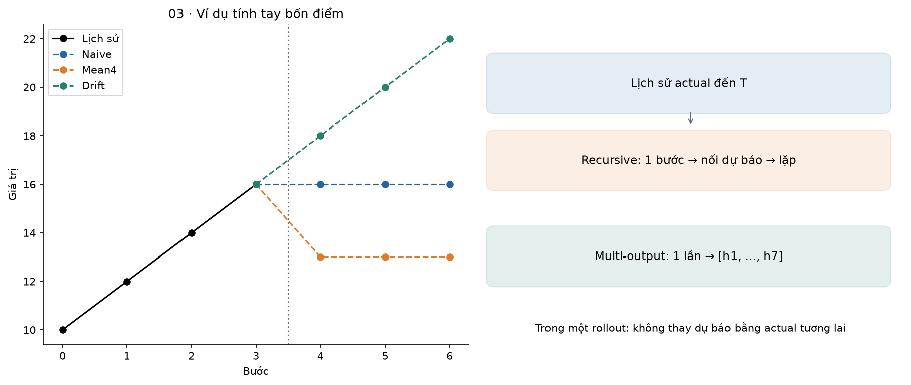
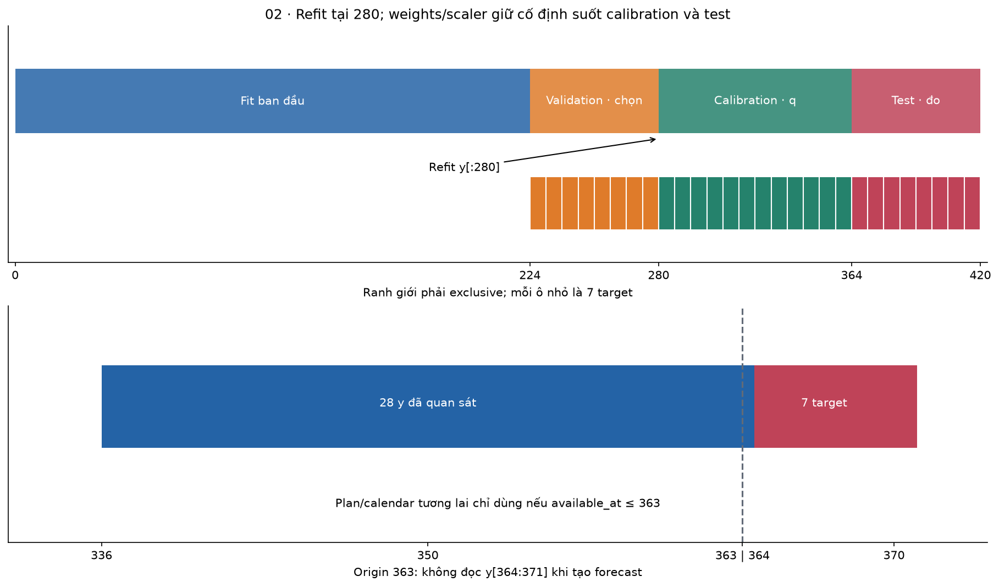
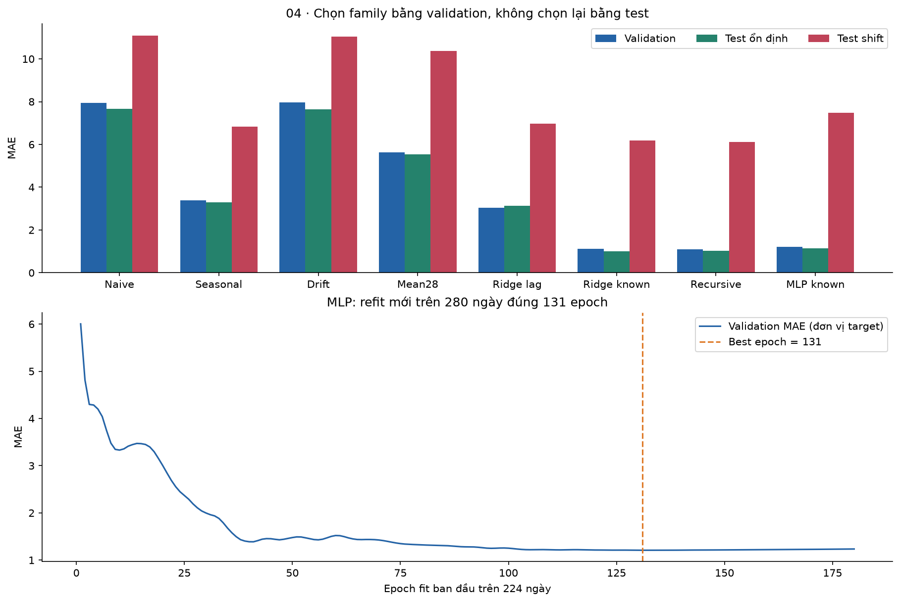
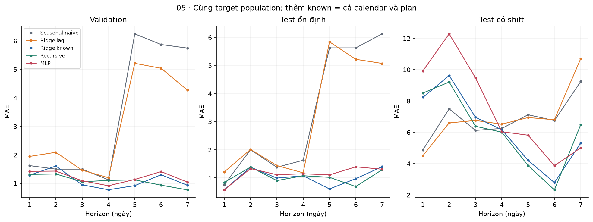
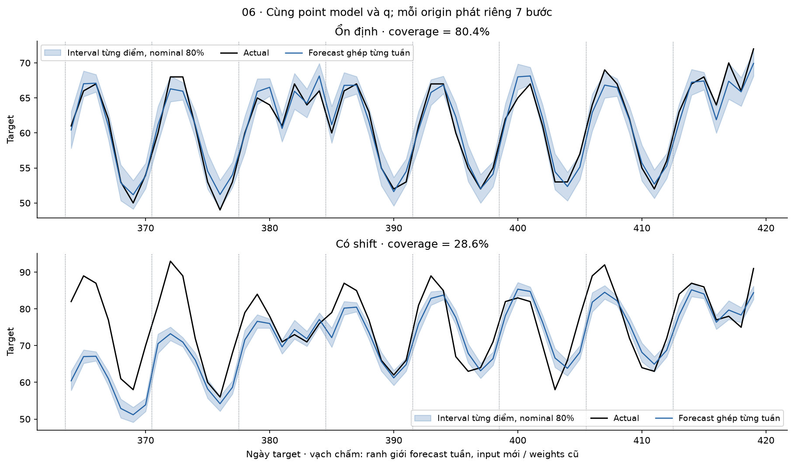
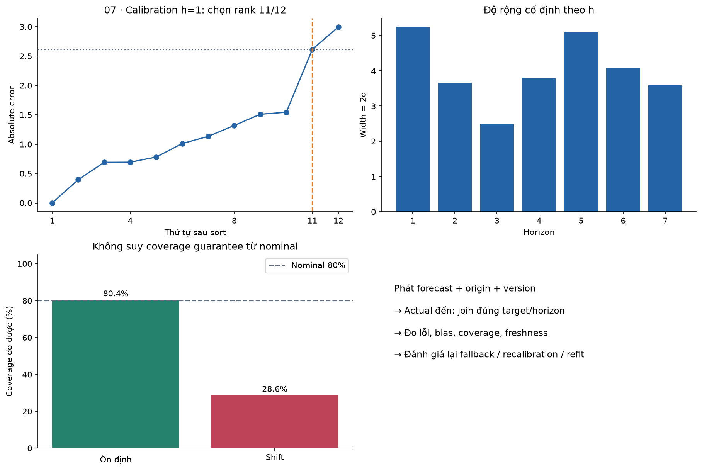

# Bài 43 — Dự báo chuỗi thời gian

[← Mục lục](../README.md) · [Bài 42: Hệ gợi ý](../42-he-goi-y/README.md) · [Phụ lục](deep-dive.md) · [Bài tập](exercises.md) · [Lời giải](solutions.md)

Một backend nhận khoảng 50 nghìn request mỗi ngày. Bạn muốn chuẩn bị tài nguyên cho tuần tới: thứ Hai khác Chủ nhật, chiến dịch đã lên lịch có thể làm tải tăng, sự cố mới lại chưa có trong lịch sử. **Dự báo chuỗi thời gian — time series forecasting** dùng thông tin có tại một thời điểm để dự đoán đại lượng trong tương lai. Kết quả hữu ích cần có thời điểm phát hành, chân trời dự báo và mức bất định, ngoài một con số.

Bài này nối hồi quy ở bài 6/8, mạng neuron và train/eval ở bài 9–13, dữ liệu chuỗi ở bài 15 và vận hành ở bài 31–34. Bạn sẽ xây được baseline; tạo cửa sổ không rò rỉ; so direct/recursive forecasting; đọc MAE, MASE và khoảng dự báo; giải thích vì sao test phải nằm trong tương lai.

**Phạm vi lab:** một chuỗi tổng hợp 420 ngày, bốn baseline, ridge NumPy và MLP PyTorch CPU; dự báo 7 ngày từ 28 ngày lịch sử. Có lịch/kế hoạch biết trước, validation riêng, calibration riêng, test ổn định và test có thay đổi chế độ; lưu/tải inference bundle. Không tải dữ liệu/model; không chạy thư viện ARIMA/ETS, Transformer, mô hình nền tảng, adaptive conformal hay dịch vụ production. Số liệu là thí nghiệm giảng dạy, không chứng minh hiệu quả trên tải hệ thống thật.

## 1. Xác định câu hỏi trước khi chọn model

Gọi y_t là giá trị quan sát ở mốc t. T là **forecast origin**: thời điểm chốt thông tin. h là **horizon**: số bước vào tương lai. Dự báo viết là ŷ_(T+h|T), nhấn mạnh ta chỉ biết thông tin đến T. **Lookback L** là độ dài lịch sử đưa vào model, khác horizon H là số bước cần trả ra.

Ví dụ: cuối ngày Chủ nhật, đã có đủ số request đến ngày đó, dùng 28 ngày gần nhất để dự báo 7 ngày tiếp theo. L=28, H=7, một bước là một ngày. Đổi sang dự báo từng giờ làm thay đổi mùa vụ, chất lượng log và chi phí; không chỉ đổi nhãn trục.

| Tình huống thực tế | Target | Horizon và quyết định |
|---|---|---|
| Lập kế hoạch hạ tầng | Request/ngày hoặc peak request/giây | 7 ngày để đặt capacity; hai target này khác nhau |
| Quản lý tồn kho | Nhu cầu thực, không chỉ số đã bán | Lead time nhập hàng; hết hàng làm sales bị kiểm duyệt |
| Nhân sự hỗ trợ | Ticket/giờ | Các ca sắp tới; thiếu người và thừa người có giá khác nhau |

Một điểm dự báo có thể tối ưu loss khác quyết định kinh doanh. MSE hướng đến conditional mean, MAE hướng đến conditional median; quantile cao có thể phù hợp khi thiếu capacity đắt hơn dư capacity. Chưa có mô hình chi phí thì không tự suy ra nên lấy quantile nào.

**Dự báo không phải phát hiện bất thường:** dự báo đưa ra giá trị/khoảng trước khi quan sát tương lai; anomaly detection đánh giá một observation đã đến có khác kỳ vọng không. **Dự báo cũng không tự là nhân quả:** model thấy khuyến mãi đi cùng doanh số cao chưa đủ trả lời “nếu đổi chiến dịch thì doanh số tăng bao nhiêu”.

## 2. Chuỗi thời gian khác một bảng dữ liệu ngẫu nhiên ở đâu?

Các hàng có thứ tự và thường phụ thuộc: tải hôm nay liên quan hôm qua; thứ Hai tuần này liên quan thứ Hai tuần trước. Random split có thể đặt tương lai của cùng chế độ vào train rồi đo quá khứ ở test. Kết quả đó thường không mô phỏng bài toán triển khai tương lai.

Trước modeling, viết **hợp đồng thời gian**:

- Target là count, tổng, trung bình, rate hay peak? Tổng request/ngày không so trực tiếp với trung bình request/giây.
- Múi giờ và ranh giới ngày là gì? Một ngày theo giờ địa phương có thể dài 23/25 giờ ở vùng có DST. Lưu UTC chưa giải quyết hết ý nghĩa “ngày làm việc”.
- Thiếu một dòng nghĩa là chưa nhận log, thiết bị hỏng hay thực sự bằng 0? Không tự điền 0 cho missing.
- Dữ liệu có đến trễ hoặc bị sửa không? `event_time` là lúc sự kiện xảy ra, `available_at` là lúc hệ dự báo thực sự biết nó.
- Giá trị target có được chốt ngay ở origin không? Lab giả định có; nếu doanh thu chốt sau hai ngày, cần lùi cutoff hoặc nowcast riêng.

Lab dùng lưới ngày hoàn chỉnh, thứ tự tăng, không trùng, y hữu hạn. `validate_grid()` từ chối lưới sai/NaN; không có bước impute, resample hoặc xử lý DST âm thầm. Không lấy việc generator sạch làm giả định cho dữ liệu thật.

## 3. Xu hướng, mùa vụ và nhiễu: nhìn cấu trúc trước

Một mô hình cộng đơn giản để suy nghĩ:

\[
y_t = \text{trend}_t + \text{season}_t + \text{planned}_t + \text{remainder}_t.
\]

**Trend** là xu hướng dài hơn: lượng khách tăng dần. **Seasonality** là mẫu lặp gắn với chu kỳ lịch tương đối cố định: giờ trong ngày, ngày trong tuần. **Cycle** là dao động không nhất thiết có chu kỳ cố định như lịch. **Remainder** chứa phần còn lại; nó có thể còn cấu trúc, không tự là nhiễu trắng. [FPP3, chương decomposition](https://otexts.com/fpp3/decomposition.html) phân biệt các thành phần này.

Trong generator, trend là `40 + .05*t`; mùa vụ tuần là `8*sin(2πt/7) + 2*cos(2πt/7)`; kế hoạch tạo thêm 14 đơn vị trong một số ngày. Nhiễu có phụ thuộc bậc một. Từ ngày 364, nhánh shift có thêm cú tăng mức, thay đổi mẫu tuần và noise lớn hơn. Nhánh ổn định giữ quy luật cũ. Các thành phần ẩn trong hình là **quy tắc sinh dữ liệu đã biết**, không phải kết quả model tự tách ra và không làm feature.



**Stationarity — tính dừng** (dạng yếu) nói đến mean không đổi theo thời gian và covariance phụ thuộc độ trễ thay vì thời điểm tuyệt đối, với phương sai hữu hạn. Chuỗi trend rõ thường không thỏa. Không phải mọi model đều yêu cầu cùng một kiểu dừng; cũng không được coi chuỗi “nhìn phẳng” là đã kiểm định dừng.

Sai phân thường: Δy_t=y_t−y_(t−1). Sai phân mùa vụ: Δ₇y_t=y_t−y_(t−7). Với `[10,12,14,16]`, sai phân là `[2,2,2]`. Dự báo sai phân 2 thì mức tiếp theo là 18. Muốn quay về mức phải tích lũy từ mốc cuối đã biết; không đánh giá sai phân rồi so với target mức. Sai phân quá mức cũng có thể làm vấn đề khó hơn. Xem [phụ lục](deep-dive.md) để nối với ARIMA.

## 4. Baseline: một mức tối thiểu có ý nghĩa

Các công thức dưới là chuẩn so sánh, không cần neural network. Với lịch sử dài n kết thúc tại T:

\[
\begin{aligned}
\text{Naive: }&\hat y_{T+h|T}=y_T,\\
\text{Seasonal naive: }&\text{lặp lại mùa gần nhất},\\
\text{Drift: }&\hat y_{T+h|T}=y_T+h\frac{y_T-y_0}{n-1},\\
\text{Mean: }&\hat y_{T+h|T}=\frac{1}{k}\sum_{j=0}^{k-1}y_{T-j}.
\end{aligned}
\]

**Tính tay:** lịch sử `[10,12,14,16]`, dự báo ba bước. Naive cho `[16,16,16]`; mean bốn điểm là 13 nên cho `[13,13,13]`; drift có độ dốc `(16−10)/3=2`, cho `[18,20,22]`. Nếu hai tuần là `[10,20,…,70]`, `[11,21,…,71]`, seasonal naive cho tuần tiếp `[11,21,…,71]`. Chưa thể tính baseline mùa vụ 7 bằng lịch sử chỉ bốn điểm.

Trong lab, mean lấy **28 ngày**; drift dùng **toàn bộ prefix đã quan sát**, không chỉ 28 ngày. Helper yêu cầu ít nhất 28 điểm cho hợp đồng chung; ví dụ bốn điểm phía trên minh họa công thức riêng. Phân biệt mean, drift và seasonal naive để biết model đang đánh bại quy tắc nào. Không gọi ridge là tốt chỉ vì thắng naive trên chuỗi mùa vụ. Công thức đối chiếu tại [FPP3 §5.2](https://otexts.com/fpp3/toolbox.html).



## 5. Biến chuỗi thành bài toán supervised learning

Với lookback L và horizon H:

\[
X_T=[y_{T-L+1},\ldots,y_T],\qquad
Y_T=[y_{T+1},\ldots,y_{T+H}].
\]

Ví dụ chuỗi `[1,2,…,9]`, L=3, H=2. Origin theo index 0-based là 6, tức quan sát cuối là y₆=7: X=`[5,6,7]`, Y=`[8,9]`. Không đưa một target vào chính cửa sổ input.

```python
import numpy as np
y=np.arange(1,10,dtype=float)
origin,L,H=6,3,2
x=y[origin-L+1:origin+1]
target=y[origin+1:origin+H+1]
assert x.tolist()==[5,6,7] and target.tolist()==[8,9]
```

Với prefix train dài N, các origin từ L−1 đến N−H−1, có **N−L−H+1** hàng. Lab N=224, L=28, H=7 ⇒ 190 hàng; origin cuối 216, label cuối 223. Một cửa sổ bắt đầu trong train nhưng label vươn sang validation vẫn phải loại khỏi fit ban đầu. Các hàng chồng lấn rất nhiều, nên 190 hàng không tương đương 190 quan sát độc lập.

Input lab dùng 28 độ lệch `y_(T−27:T) − y_T`; output direct là 7 độ lệch `y_(T+1:T+7) − y_T`. Khi trả forecast phải cộng y_T trở lại. Đây là **anchoring theo mốc cuối**, không phải phép sai phân từng cặp liên tiếp.

Có thêm sin/cos thứ trong tuần và plan cho origin cùng các ngày target. H=7 ⇒ 28+3×8=52 feature; chỉ lag ⇒28. Chuẩn hóa X và residual Y bằng mean/std **fit trên các training window hợp lệ**; std được chặn tối thiểu 1, nên không phải mọi cột có variance 1. Validation/test không tham gia fit scaler.

## 6. Biến biết trước tương lai: hợp lệ khi nào?

Lịch thứ trong tuần đã biết. Lịch chiến dịch được công bố trước 14 ngày có thể biết cho 7 ngày tới. Ngược lại, lượng truy cập thực tế ngày mai hoặc nhiệt độ **đo được** ngày mai chưa biết ở origin. Nếu dùng dự báo thời tiết, phải dùng bản forecast được phát hành trước origin, không thay bằng observation hoàn hảo sau này.

Lab lưu `plan_available_at[t]=t−14`, và kiểm `available_at ≤ origin` cho các feature kế hoạch được đọc. Không phải cứ một cột mang tên “future covariate” là được dùng mọi giá trị tương lai. Phân biệt ex-ante/ex-post trong [FPP3 §7.6](https://otexts.com/fpp3/regression.html): đánh giá bằng predictor tương lai thực đã xảy ra có thể trả lời câu hỏi khác triển khai.

```python
from data import dataset
from features import row
from models import fit_ridge,predict
import numpy as np
d=dataset()
assert row(d,223,7,True).shape==(52,)
m=fit_ridge(d,224,True,7,.1)
p=predict(m,d,223)
d['y'][224:]+=10000  # tương lai chưa có: không được đổi forecast này
assert np.array_equal(p,predict(m,d,223))
d['plan_available_at'][224]=224
try:
    row(d,223,7,True)
except ValueError:
    pass
else:
    raise AssertionError('đã dùng kế hoạch chưa công bố')
```

Guard này áp vào timestamp mà dữ liệu khai báo; nó không chứng minh timestamp đúng trong hệ thật. Cần logging snapshot/as-of join tại nguồn. `data_hash` đầy đủ chỉ định danh teaching snapshot, **không dùng hash/target tương lai làm model input**.

## 7. Dự báo nhiều bước: recursive, direct và multi-output

**Recursive:** train model một bước, dự báo bước đầu rồi đưa chính dự báo đó vào lịch sử để dự báo bước tiếp. Model nhỏ, tái sử dụng được; lỗi và lệch input có thể tích lũy. Nếu dùng y thật của ngày mai khi đang dự báo cả tuần tại T thì đã đổi bài toán.

Ví dụ `ŷ_(t+1)=1+.8*y_t`, y_T=10 ⇒ bước 1:9; bước 2:8,2; bước 3:7,56. Không lấy actual tương lai thay vào giữa vòng này.

```python
y=10.;pred=[]
for _ in range(3):
    y=1+.8*y
    pred.append(y)
assert all(abs(a-b)<1e-12 for a,b in zip(pred,[9,8.2,7.56]))
```

**Direct:** thường chỉ nhiều model riêng, một model cho mỗi h. **Multi-output:** một model trả cả H giá trị. Hai thuật ngữ đôi khi được dùng rộng; bài gọi ridge/MLP trả 7 giá trị là **direct multi-output**, để rõ không rollout y dự đoán. Chúng không tự bắt quan hệ uncertainty giữa bảy target.

Ridge direct giải bình phương tối thiểu có regularization trên feature chuẩn hóa; intercept không bị phạt. MLP lab `52→32 Tanh→7`, 1.927 parameter, Float 64, Adam lr=.01, loss MSE residual chuẩn hóa. MLP không mặc nhiên hơn tuyến tính khi chỉ có vài trăm cửa sổ chồng lấn.

`ridge_recursive` fit một bước, λ=1 định trước, 34 feature. Khi rollout, calendar/plan vẫn được kiểm **as-of origin ban đầu**, còn buffer y chứa dự báo sinh ra. Cuối tuần thực tế mới đến thì origin tuần sau được đọc chúng: đây là cập nhật **input**, không refit weights. So nhiều bước phải giữ cùng lịch phát hành cho mọi model.

## 8. Train, validation, calibration và test theo thời gian

Không chia ngẫu nhiên. Lab dùng index ngày bắt đầu 0, ranh giới phải **exclusive**:

| Giai đoạn | Target index | Vai trò | Origin phát hành |
|---|---|---|---|
| Initial fit | 0…223 | Fit scaler/weights ban đầu | Training windows hợp lệ |
| Validation | 224…279 | Chọn λ, epoch và family theo MAE | 223,230,…,272: 8 tuần |
| Calibration | 280…363 | Lấy sai số để cố định độ rộng interval | 279,286,…,356: 12 tuần |
| Test | 364…419 | Đo sau khi quyết định đã chốt | 363,370,…,412: 8 tuần |

Sau chọn configuration, **refit đúng một lần trên y[:280]**, rồi giữ weights/scaler đến cuối test. Direct refit có 246 hàng. MLP ban đầu chạy 180 epoch; epoch có validation MAE nhỏ nhất đầu tiên là **131**, nên refit mới trên prefix 280 đúng 131 epoch. Không chọn epoch bằng calibration/test.

Mỗi origin phát bảy dự báo. Các tuần target ở cùng giai đoạn không chồng nhau, có 56/84/56 target để tổng hợp; input mỗi origin được cập nhật bằng actual đã đến. Không phải một forecast 56 bước phát ngay đầu test, cũng không phải retrain sau mỗi tuần. Các origin vẫn phụ thuộc thời gian; tách tuần không biến lỗi thành IID. [FPP3 §5.10](https://otexts.com/fpp3/toolbox.html) trình bày rolling-origin evaluation và đánh giá nhiều bước.



Trong thực tế, backtest nhiều fold giúp biết model ổn định qua các giai đoạn nào. Retrain ở từng fold phải fit lại scaler bằng quá khứ của fold đó. Nếu liên tục xem test rồi chỉnh model, test đã thành development set; cần một tương lai chưa dùng khác. Một holdout ngắn không đủ đại diện mọi mùa, sự cố hoặc thay đổi sản phẩm.

## 9. Đọc metric đúng đơn vị và population

Đặt e=ŷ−y (bias dương là dự báo thừa), n là tổng số cặp origin/horizon đang chấm:

\[
\mathrm{MAE}=\frac1n\sum|e|,\quad
\mathrm{RMSE}=\sqrt{\frac1n\sum e^2},\quad
\mathrm{Bias}=\frac1n\sum e.
\]

MAE cùng đơn vị với target, RMSE nhạy hơn với lỗi lớn. MAPE dùng `|e|/|y|` không xác định khi y=0 và có thể rất lớn gần 0. Không tự thay zero bằng epsilon rồi gọi metric có ý nghĩa kinh doanh như cũ.

\[
\mathrm{WAPE}=\frac{\sum|e|}{\sum|y|},\qquad
s=\frac1{N-7}\sum_{t=7}^{N-1}|y_t-y_{t-7}|,\qquad
\mathrm{MASE}=\frac{\mathrm{MAE}}s.
\]

s là sai số seasonal-naive **trong train prefix**, cùng denominator cho mọi model ở một phase. MASE<1 nghĩa là MAE nhỏ hơn mức scale lịch sử đó, không bảo đảm thắng seasonal-naive trên test. WAPE không phải mean của phần trăm lỗi từng điểm; denominator bằng 0 ⇒ lab trả `None`. s=0 ⇒ lab từ chối MASE, không âm thầm chia epsilon.

Tính tay y=`[0,10,20]`, ŷ=`[2,8,25]`: errors `[2,−2,5]`; MAE=3; RMSE=√11≈3,3166; bias=5/3; WAPE=9/30=.3; với s=2 thì MASE=1,5.

```python
from metrics import point
import math
r=point([0,10,20],[2,8,25],2)
assert r['mae']==3 and abs(r['rmse']-math.sqrt(11))<1e-12
assert r['mase']==1.5 and r['wape']==.3
```

Báo cáo thêm **theo horizon**: một model tốt ở h=1 có thể yếu ở h=7. Nếu các forecast origin chồng target, một ngày có thể được chấm nhiều lần tại các h khác nhau; phải nói rõ đang lấy trung bình theo forecast pair hay ngày duy nhất. Lab tổng hợp đều 8×7 cặp; có cùng target population giữa các model.

## 10. Khoảng dự báo: bất định có thể sai

Point forecast không nói khoảng biến động của y tương lai. **Prediction interval** nhắm vào observation tương lai, khác confidence interval của một tham số/mean. Một interval danh nghĩa 80% không có nghĩa “80% model chắc chắn đúng”, và không mặc nhiên có coverage 80% trong mọi chế độ dữ liệu.

Một cách học quantile trực tiếp là **pinball loss**. Đặt u=y−q, mức τ∈(0,1): `max(τu,(τ−1)u)`. Với τ=.9, y=10: q=8 cho loss 1,8; q=12 cho loss.2. Nó phạt dự báo thiếu mạnh hơn dự báo thừa. Muốn quantile .1/.9 cần huấn luyện/kiểm tra calibration và quantile crossing riêng; lab không train quantile network.

```python
import numpy as np
def pinball(y,q,tau):
    u=np.asarray(y)-np.asarray(q)
    return np.maximum(tau*u,(tau-1)*u)
assert np.allclose(pinball(10,[8,12],.9),[1.8,.2])
```

**Cách lab thực hiện:** giữ point model cố định, lấy |y−ŷ| trên calibration, riêng từng h. Với m=12 origin và α=.2, chọn phần tử thứ `ceil((m+1)*(1−α))=11` sau sort, gọi q_h; interval là `[ŷ−q_h, ŷ+q_h]`. Nếu rank vượt m, helper báo thiếu dữ liệu thay vì thay một quantile khác âm thầm. Ví dụ tay m=9, errors 1…9 ⇒rank 8, q=8; point 20 ⇒[12,28].

```python
import numpy as np
from metrics import residual_quantiles,interval
q,rank=residual_quantiles(np.arange(1,10,dtype=float)[:,None],.2)
assert rank==8 and q.tolist()==[8.]
r=interval([5],[0],[4],.2)
assert r['coverage']==0 and r['mean_width']==4 and r['interval_score']==14
```

Coverage là tỷ lệ actual nằm trong interval; width là độ rộng trung bình. Nới vô hạn dễ có coverage cao nhưng vô dụng. **Interval score** tại mức α là `width + (2/α)*(lo−y)` nếu y<lo, hoặc `width + (2/α)*(y−hi)` nếu y>hi; nếu nằm trong thì chỉ width. Ví dụ y 5, [0,4], α.2 ⇒4+10×1=14. Giá trị nhỏ hơn tốt hơn cho cùng level/population.

Công thức rank có liên hệ với split conformal, nhưng chuỗi có phụ thuộc và distribution shift **không được tự nhận bảo đảm coverage hữu hạn mẫu từ giả định exchangeability**. Trong bài đây là calibration thực nghiệm cố định, không phải adaptive conformal. [Gibbs & Candès](https://arxiv.org/abs/2106.00170) nghiên cứu một cách thích nghi online riêng; bài chỉ đọc abstract để định hướng, không triển khai hay kiểm chứng các định lý của họ.

Các q_h tạo interval **từng điểm**, không phải xác suất đồng thời cả bảy ngày nằm trong dải là 80%. Độ rộng không bắt buộc tăng đơn điệu theo h trong mẫu calibration nhỏ này.

## 11. Chạy thí nghiệm và đọc kết quả thật

Từ terminal ở thư mục bài này, dùng Python trong một môi trường ảo. Các output directory phải mới:

```bash
python3 -m venv .venv
.venv/bin/python -m pip install -r requirements.txt
.venv/bin/python lab.py --mode hand
.venv/bin/python lab.py --mode data
.venv/bin/python lab.py --mode all --out /tmp/lesson43-run-01
.venv/bin/python lab.py --mode check
.venv/bin/python lab.py --mode experiment --out /tmp/lesson43-experiment-01
```

`all` ghi `report.json`, `experiment/forecast.pt` và fixture kiểm tra. `experiment` in JSON và lưu bundle; không tạo full report cho công cụ vẽ. Muốn chạy lại hãy dùng tên output mới. Không cần GPU/API key/network sau cài dependencies. Môi trường đã chạy: Python 3.14.6, NumPy 2.5.4, PyTorch 2.15.0, CPU arm 64, một thread; Matplotlib 3.11.2 để vẽ. Phiên bản khác có thể khác sai số số học/serialization; so metric với tolerance phù hợp.

MAE dưới đây, làm tròn 4 chữ số, lấy từ run seed 43:

| Family | Validation | Test có shift | Test ổn định |
|---|---:|---:|---:|
| Naive | 7.9464 | 11.0893 | 7.6607 |
| Seasonal naive | 3.3750 | 6.8393 | 3.3036 |
| Drift | 7.9608 | 11.0481 | 7.6488 |
| Mean 28 | 5.6314 | 10.3788 | 5.5287 |
| Ridge chỉ lag | 3.0327 | 6.9783 | 3.1375 |
| Ridge direct + lịch/plan | 1.1114 | 6.1858 | 0.9970 |
| **Ridge recursive + lịch/plan** | **1.0917** | **6.1170** | **1.0264** |
| MLP direct + lịch/plan | 1.2088 | 7.4903 | 1.1360 |

Chọn **ridge_recursive bằng validation**, không bằng test. Ridge direct chỉ lag/known chọn λ=.1 trong grid [.1,1,10]; recursive λ=1 cố định. Giảm MAE khi thêm calendar/plan là một ablation của **cả nhóm feature**, chưa cô lập tác dụng riêng từng cột. MLP chưa thắng ridge trong cấu hình này; không suy ra neural network luôn thua trên mọi chuỗi.



Test ổn định và shift có lịch sử giống nhau trước ngày 364. Dùng cùng model, q, lịch phát hành và scale; chỉ quy luật test thay đổi. Đây là đối chứng tổng hợp để thấy ảnh hưởng của shift, không phải hai tương lai quan sát được của một doanh nghiệp. Từ origin thứ hai trở đi, input có actual của từng kịch bản đã xảy ra; không dùng cùng prefix input giả tạo cho cả hai.



Khoảng danh nghĩa 80% của model đã chọn:

| Kịch bản test | Coverage | Mean width | Interval score |
|---|---:|---:|---:|
| Ổn định | 45/56 = 80.36% | 3.9961 | 4.9105 |
| Có shift | 16/56 = 28.57% | 3.9961 | 47.4291 |

Cùng q cố định nhưng coverage sụt mạnh. Không thể nhìn mức gần 80% của nhánh ổn định rồi tuyên bố calibration luôn đúng. Chỉ có 8 test origin; 56 điểm còn phụ thuộc, chưa đủ kết luận định lượng ngoài thí nghiệm. Cũng không lấy test để nới q rồi báo lại là đánh giá độc lập.



## 12. Từ baseline đến ARIMA, RNN và Transformer

Chọn theo data/problem, không theo độ mới của tên model:

| Nhóm | Ý tưởng | Câu hỏi cần kiểm tra |
|---|---|---|
| Exponential smoothing/ETS | Cập nhật level/trend/season bằng trọng số quá khứ | Mùa vụ và dạng lỗi có phù hợp? |
| AR/ARIMA/SARIMA | Dùng autocorrelation, differencing và innovation quá khứ | Dừng sau biến đổi? Residual còn cấu trúc? |
| Ridge/boosting với lag | Supervised trên window/calendar/covariate | Feature có đúng thời điểm? Có vượt baseline? |
| RNN/TCN/MLP | Học ánh xạ từ lịch sử, có thể dùng nhiều chuỗi | Đủ dữ liệu/regularization và split hợp lệ? |
| Transformer cho chuỗi | Attention giữa token thời gian/patch, thêm vị trí | Encoding, lookback, horizon và chi phí so baseline? |

Xem [FPP3 exponential smoothing](https://otexts.com/fpp3/exponential-smoothing.html) và [ARIMA](https://otexts.com/fpp3/arima.html) cho hai hướng cổ điển. **MA(q) trong ARIMA là moving average của innovation**, không đồng nghĩa lọc trung bình y trong k ngày. Lab chưa fit các nhóm này; không xếp hạng chúng bằng bảng ridge/MLP.

[PatchTST](https://arxiv.org/abs/2211.14730) dùng đoạn con liên tiếp làm token và chia sẻ weights giữa các channel theo thiết kế channel-independent. Đây là ví dụ nối bài 18/40 với forecasting, không phải tuyên bố model tốt nhất năm 2026. [LTSF-Linear](https://arxiv.org/abs/2205.13504) là ví dụ nghiên cứu nhấn mạnh đối chiếu model tuyến tính trong benchmark của họ; abstract không cho phép kết luận “Transformer không thể dự báo”. Bài chỉ đọc abstract hai paper và không tái lập benchmark.

**Local model** fit riêng một chuỗi; **global model** học chung nhiều chuỗi, thường có feature phân biệt thực thể và scale. “Multivariate” có nhiều biến không làm tương lai các biến đó tự biết trước. Mô hình tiền huấn luyện cho time series vẫn cần kiểm data overlap, tần suất, domain, horizon và chi phí trên holdout của mình. Tài liệu này không đưa bảng xếp hạng hay khuyến nghị một model nền tảng cụ thể.

## 13. Đưa forecast vào một backend có thể kiểm chứng

Một forecast record nên mang `series_id`, `issued_at`, `data_as_of`, `target_time`, `horizon`, `point`, `lower/upper`, `nominal_level`, `model/feature/calendar_version`. Đừng chỉ ghi đè “forecast ngày mai”: muốn backtest đúng cần biết bản nào đã phát hành khi nào.

Khi actual đến, join theo target và origin/horizon; đo MAE/bias/coverage theo h, series/cohort và thời gian. Theo dõi freshness/missing/revision trước khi đổ lỗi cho model. Một alarm có thể dẫn đến fallback, recalibration hoặc retraining, nhưng mỗi thao tác phải có đánh giá với dữ liệu đến thời điểm đó. Lab chưa có alert, retraining online hay rollback service.

Bundle lab giữ spec, normalization, ridge coefficients hoặc MLP state, calibration q, calibration origins, snapshot hash và digest. Load dùng `weights_only=True`, kiểm spec/shape/finite/digest/hash mong đợi; roundtrip point/q exact trong môi trường đã chạy. Digest giúp phát hiện thay đổi byte/trạng thái, **không xác thực người gửi**. Bundle không có optimizer/RNG cho resume training, không có history store hoặc timestamp pipeline production. Chỉ load artifact từ nguồn đáng tin trong quy trình thực tế.



## 14. Cách tự học và bản đồ mã nguồn

Đọc mục 1–6, tự tính baseline/window; đọc 7–10, chạy hand; chạy all và giải thích bảng kết quả trước khi mở lời giải. [16 bài tập](exercises.md) kiểm cả lập luận thời gian, tính tay và sửa thí nghiệm; [lời giải](solutions.md) có code độc lập; [phụ lục](deep-dive.md) đào sâu loss, normal equation, calibration và chiến lược đánh giá.

| Tệp | Trách nhiệm |
|---|---|
| [data.py](data.py) | Generator, lưới ngày, origin và fingerprint |
| [features.py](features.py) | Window, as-of covariate, scaler chỉ fit train |
| [models.py](models.py) | Baseline, ridge, MLP và recursive rollout |
| [metrics.py](metrics.py) | MAE/RMSE/MASE/WAPE, calibration và interval score |
| [experiment.py](experiment.py) | Chọn/refit/calibrate/test, inference bundle |
| [arithmetic.py](arithmetic.py) | Các ví dụ tính tay |
| [checks.py](checks.py) · [lab.py](lab.py) | 59 kiểm tra và CLI/report |
| [make_figures.py](make_figures.py) | Bảy cặp hình PNG/SVG từ report |

```bash
.venv/bin/python -m pip install -r requirements-figures.txt
.venv/bin/python make_figures.py --report /tmp/lesson43-run-01/report.json
```

59 kiểm tra bao gồm ranh giới target/scaler, future-target mutation, covariate availability, ridge/intercept, MLP gradient, recursive buffer, metric/case không xác định, rank/interval score và checkpoint mismatch/roundtrip. Tài liệu không đánh giá mức thành thạo của người đọc chỉ vì các kiểm tra đã pass.

Tự kiểm cuối bài: giải thích được forecast tại origin 223 dùng gì; vì sao label đến 230 không được fit ban đầu; vì sao dùng actual tuần trước ở origin 230 hợp lệ nhưng teacher forcing trong tuần đang dự báo thì sai; và vì sao coverage gần 80% của một nhánh chưa là bảo đảm. [Nguồn và phạm vi đã đọc](../SOURCES.md) · [Đề cương](../ROADMAP.md).

Tiếp theo: [Bài 44 — Phát hiện bất thường](../44-phat-hien-bat-thuong/README.md).
