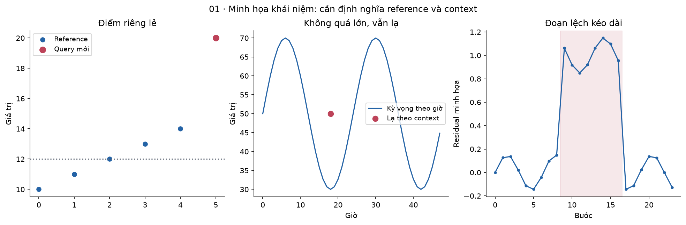
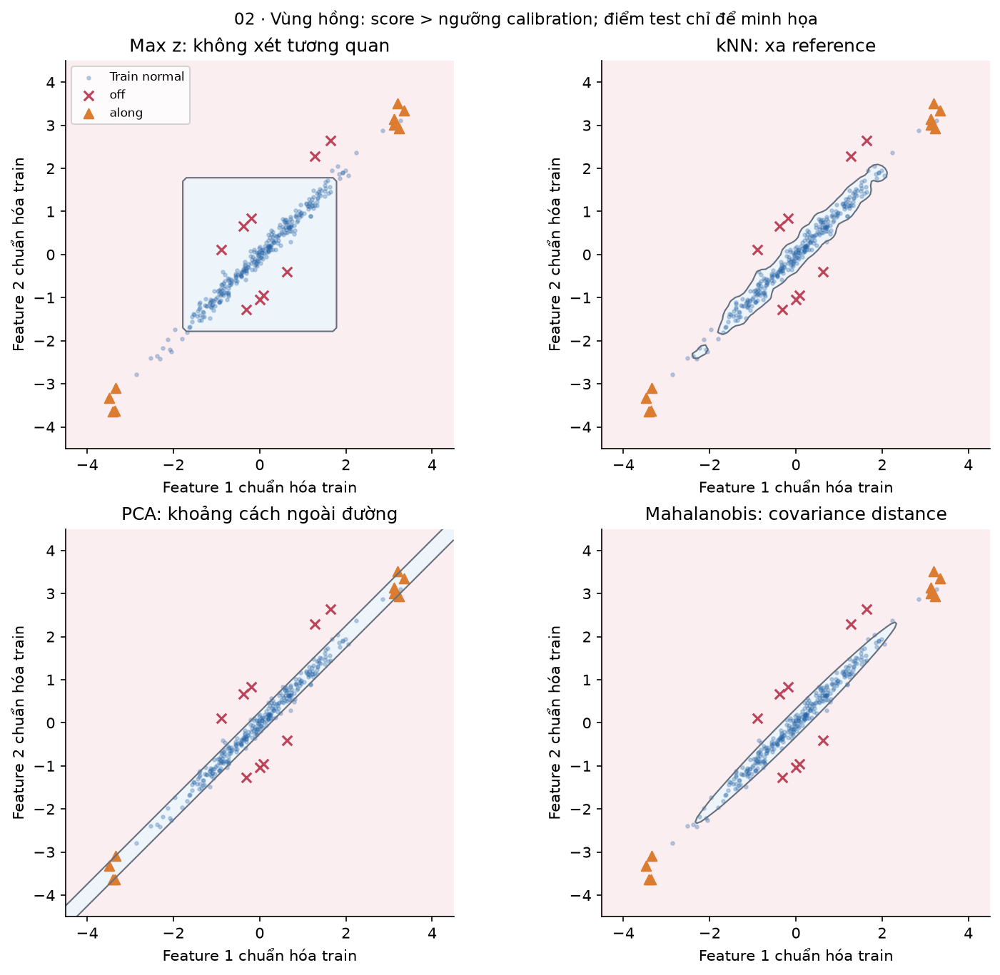
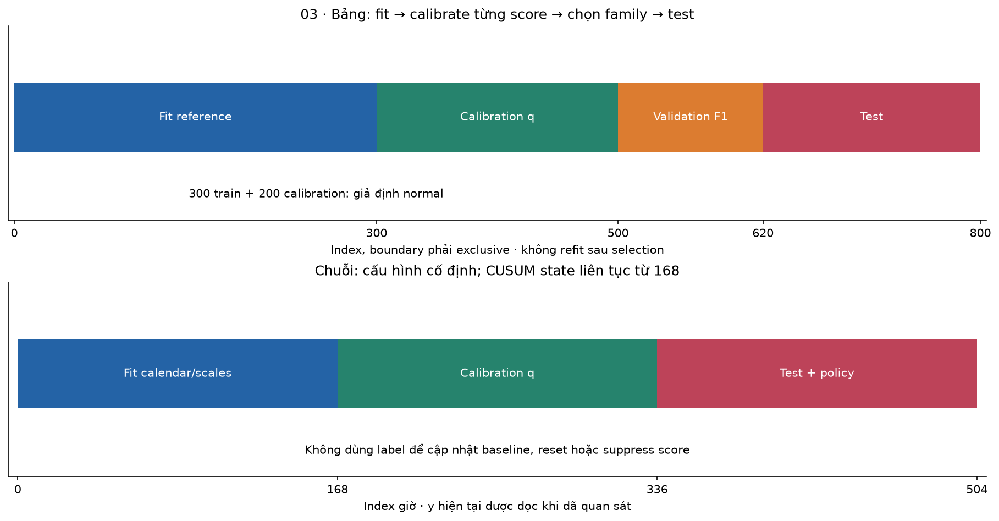
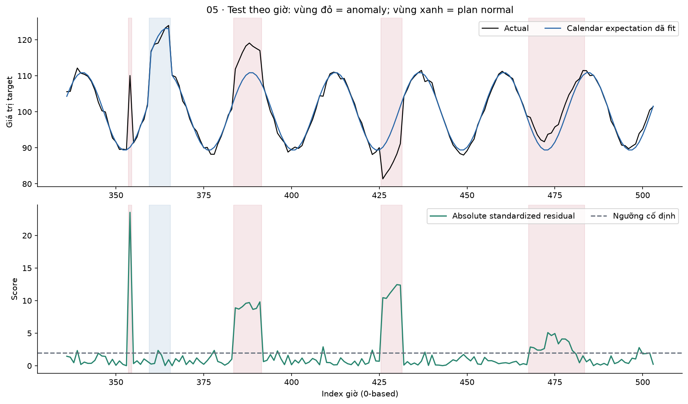
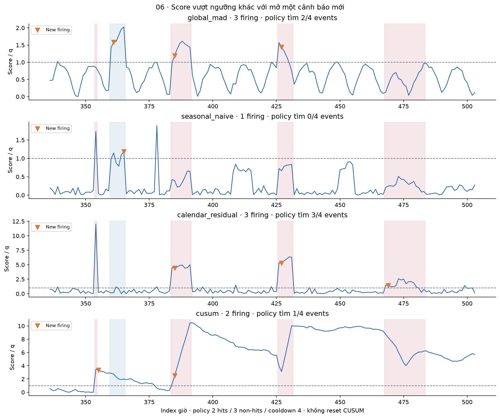
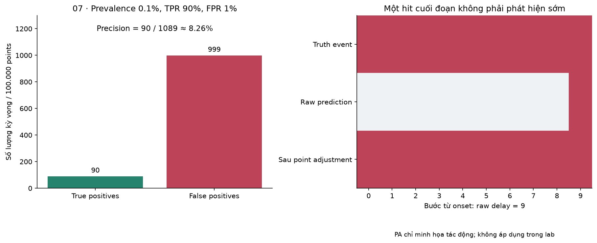
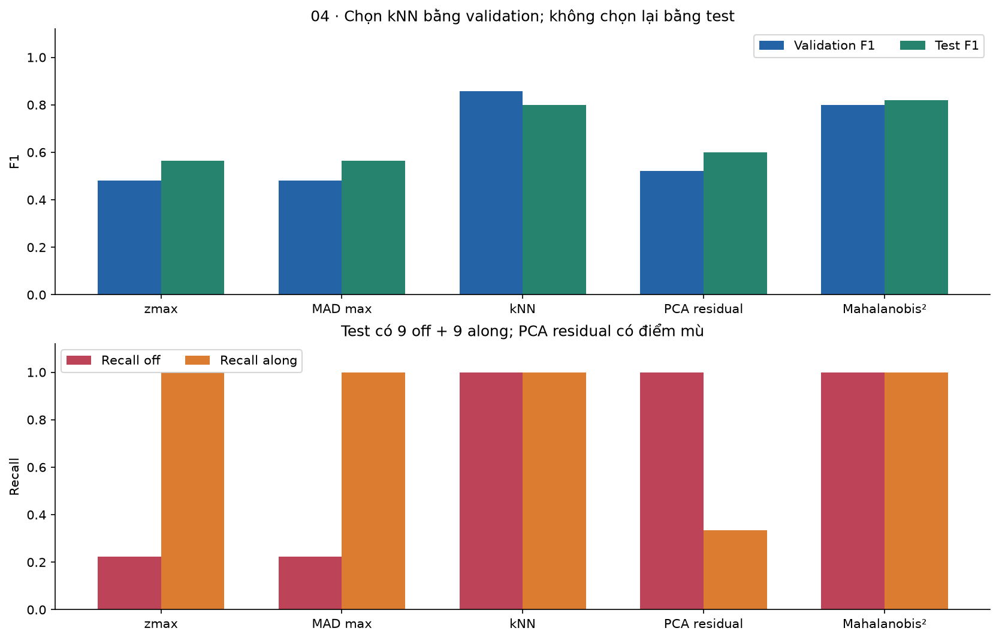

# Bài 44 — Phát hiện bất thường

[← Mục lục](../README.md) · [Bài 43: Dự báo chuỗi thời gian](../43-du-bao-chuoi-thoi-gian/README.md) · [Phụ lục](deep-dive.md) · [Bài tập](exercises.md) · [Lời giải](solutions.md)

Một API có latency tăng từ 100 lên 180 ms. Đó có phải sự cố? Nếu vừa có chiến dịch tăng tải đã lên lịch, có thể đây là điều đã dự kiến. Ngược lại, latency 100 ms lúc hệ thống gần như rảnh có thể đáng điều tra. **Phát hiện bất thường — anomaly detection** tìm những observation hoặc mẫu hành vi khác kỳ vọng theo dữ liệu, ngữ cảnh và mục tiêu cụ thể.

Bài 43 dự báo y tương lai trước khi nó đến; bài này chấm mức khác thường khi observation đã đến. Bạn sẽ phân biệt score/ngưỡng/cảnh báo; tính z-score, MAD, kNN, Mahalanobis và reconstruction error; thiết kế calibration không dùng test; đánh giá cả từng điểm lẫn sự kiện; giải thích tác động của persistence và trạng thái streaming.

**Cần trước:** bài 3–7 về vector, thống kê, split và precision/recall; bài 16 về representation; bài 32/43 về monitoring và thời gian. Không cần thành thạo Deep Learning để chạy lab.

**Lab:** NumPy CPU, hai bộ dữ liệu tổng hợp: năm detector cho bảng hai feature tương quan; bốn detector cho chuỗi 504 giờ, gồm calendar residual và CUSUM. Có reference/calibration riêng, labeled validation để chọn family ở bài toán bảng, test giữ lại để báo cáo, JSON bundle, replay state theo chunk và policy cảnh báo. Không gọi API, tải dữ liệu/model, dùng scikit-learn, huấn luyện deep model hay chạy dịch vụ alert production. Số liệu chỉ minh họa cơ chế, không là benchmark sự cố backend thật.

## 1. “Bất thường” phải so với điều gì?

Một anomaly score cao nghĩa là khác với reference theo tiêu chí model, chưa có nghĩa chắc chắn gian lận, lỗi hay nguy hiểm. Một khách hàng hợp lệ mua rất nhiều có thể hiếm; một cuộc tấn công lặp đều có thể không hiếm trong log bị nhiễm. Nhãn nghiệp vụ và thống kê khác nhau.

| Dạng | Trực giác | Ví dụ giả định |
|---|---|---|
| Point anomaly | Một điểm riêng lẻ khác reference | Cảm biến đột ngột báo 300°C |
| Contextual anomaly | Chỉ lạ khi xét ngữ cảnh | 1.000 request/giây lúc bảo trì ban đêm |
| Collective anomaly | Một đoạn/mẫu chung khác thường | Mỗi phút chỉ tăng nhẹ nhưng kéo dài một giờ |
| Multivariate anomaly | Từng feature có vẻ bình thường, quan hệ giữa chúng lạ | CPU cao khi request thấp và không có batch job |

Các nhóm có thể giao nhau: một đoạn đa biến cũng có thể bất thường theo ngữ cảnh. Định nghĩa đơn vị cần đánh giá trước: request, giao dịch, một giờ, thiết bị hay cả incident? Trong lab bảng, hai feature là request rate và latency **giả định**, không phải mô hình vật lý của queueing; lab chuỗi có bốn đoạn effect được generator gắn nhãn là anomaly.

**Không tự xóa outlier.** Cần phân biệt lỗi đo, sự kiện thật hiếm và điều mới hợp lệ. [NIST, Detection of Outliers](https://itl.nist.gov/div898/handbook/eda/section3/eda35h.htm) nhấn mạnh một điểm khác thường có thể cần điều tra hoặc xử lý robust thay vì bỏ khỏi dữ liệu ngay.



## 2. Ba bài toán học thường bị trộn

**Supervised detection:** có nhãn normal/anomaly đủ đáng tin để train classifier. Bài 6/7 áp dụng, nhưng anomaly mới có thể khác các loại đã được gắn nhãn. Nhãn đến muộn, feedback chỉ từ các alert đã xem và class imbalance đều ảnh hưởng đánh giá.

**Novelty detection:** có một tập reference được giả định normal, học vùng bình thường rồi chấm observation mới. Hai track của lab dùng giả định này. Generator cho biết reference sạch; production cần bằng chứng từ logging/điều tra, không thể nhìn tên file `normal.csv` rồi coi là sạch.

**Outlier detection trên tập bị trộn:** reference cũng chứa bất thường. Mean/covariance có thể bị kéo lệch; nhiều outlier có thể che nhau (**masking**) hoặc làm điểm normal bị đánh nhầm (**swamping**). Robust median/MAD giúp trong một số cấu trúc, không miễn nhiễm mọi contamination.

Cách gọi “semi-supervised” khác nhau giữa tài liệu; ở đây novelty normal-only không có nghĩa train một classifier từ nhiều nhãn positive/negative. Đối chiếu thuật ngữ tại [scikit-learn, Novelty and Outlier Detection](https://scikit-learn.org/stable/modules/outlier_detection.html). Thư viện chưa được dùng trong lab NumPy này.

## 3. Từ score tới quyết định và cảnh báo

Viết pipeline rõ ràng:

`dữ liệu hợp lệ → feature → anomaly score s(x) → hit = [s > q] → policy cảnh báo → điều tra/feedback`.

Bài quy ước **score càng lớn càng bất thường**, threshold so **strict `>`**. Score không tự là probability hoặc p-value. Không được gắn `% confidence` chỉ bằng cách đưa score qua sigmoid. Một số API thư viện dùng score có hướng ngược; đọc hợp đồng trước khi nối vào metric/threshold. Trong user guide scikit-learn đã đọc, `decision_function` âm biểu thị outlier; không đưa trực tiếp vào hàm AP giả định điểm cao là positive mà quên đổi hướng.

**Hit** là kết quả tại một điểm. **Alert firing** là lúc policy mở một cảnh báo mới. Một incident 20 giờ có thể gây 20 hits nhưng chỉ một firing. Tắt lặp notification không làm detector hết false positive; nó chỉ đổi hành vi hệ cảnh báo.

Kiểm dữ liệu trước score: đơn vị, schema, duplicate, NaN, missing, timestamp, log trễ và feature version. Lab từ chối input không hữu hạn/lưới giờ sai; không biến missing thành 0. Nếu agent/LLM hỗ trợ điều tra log, lời giải thích của nó cũng không tự xác nhận nguyên nhân gốc.

## 4. Baseline một biến: z-score, IQR và MAD

### 4.1 Z-score

Với mean μ và standard deviation σ của **reference**:

\[
z(x)=\frac{x-\mu}{\sigma},\qquad s(x)=|z(x)|.
\]

Reference có μ=100 ms, σ=10 ms; observation 140 ms ⇒z=4. Đây là khoảng cách theo đơn vị standard deviation. Không tự suy `|z|>3` có false-alarm rate cố định nếu dữ liệu lệch, có đuôi dày, phụ thuộc hoặc model context sai. Lab dùng std `ddof=0` của train; công thức descriptive z-score này không phải một kiểm định nhỏ mẫu được hiệu chỉnh.

### 4.2 IQR

`IQR=Q3−Q1`; một quy tắc khám phá thường dùng fence `[Q1−1.5IQR, Q3+1.5IQR]`. Ví dụ Q1=10, Q3=14 ⇒IQR 4, fence [4,20];21 ở ngoài. Phải ghi quy ước nội suy quantile khi tính từ sample nhỏ. Fence không tự là confidence interval 95% hay threshold tối ưu sản phẩm. IQR không được triển khai thành một family trong bảng metric của lab.

### 4.3 Median absolute deviation

\[
m=\operatorname{median}(x_i),\quad
\mathrm{MAD}=\operatorname{median}(|x_i-m|),\quad
s_{rob}(x)=\frac{0.6745|x-m|}{\mathrm{MAD}}.
\]

MAD ở đây là **median**, không phải mean absolute deviation. Chia MAD cho .6745 tạo scale gần σ khi dữ liệu normal; không chứng minh dữ liệu đang normal. Với reference `[10,11,12,13,14]`, median 12; absolute deviations 2/1/0/1/2; MAD 1. Điểm 20 có modified absolute z=.6745 × 8=**5.396**. Một outlier rất lớn kéo mean/std nhiều hơn median/MAD trong ví dụ này. Xem [NIST modified z-score](https://itl.nist.gov/div898/handbook/eda/section3/eda35h.htm) để đối chiếu cách chuẩn hóa; không coi threshold kinh nghiệm là bảo đảm.

```python
import numpy as np
from detectors import robust
m,scale=robust([10,11,12,13,14])
assert m==12 and abs(scale-1/.6745)<1e-12
assert abs(abs(20-m)/scale-5.396)<1e-12
```

Nếu σ/MAD=0 hoặc gần 0, lab **từ chối** thay vì âm thầm chia epsilon. Một cảm biến gần như hằng số cần tolerance theo độ phân giải thiết bị, fallback hoặc data-quality policy. Không có một epsilon chung làm mọi đơn vị có ý nghĩa như nhau.

## 5. Nhiều feature: khoảng cách và tương quan

Với X∈R^(n×d), kiểm từng feature riêng có thể bỏ lỡ quan hệ. Sau khi chuẩn hóa train, `zmax=max_j |z_j|` có vùng chấp nhận kiểu hình chữ nhật. Hai điểm cùng độ lớn từng coordinate vẫn có thể khác nhau về tính hợp lý chung.

**Mahalanobis squared distance**:

\[
s_M(x)=(x-\mu)^\top\Sigma^{-1}(x-\mu).
\]

Giả sử μ=0, covariance `[[1,.9],[.9,1]]`. Điểm `[1,−1]` chỉ cách mean 1 σ ở mỗi trục, nhưng phá tương quan dương. Nghịch đảo là `(1/.19)*[[1,−.9],[−.9,1]]`; score=`3.8/.19=20`. Điểm `[1,1]` có score`(.2/.19)≈1.0526`. Quan hệ giữa feature quan trọng hơn việc mỗi coordinate có vượt 3 hay không.

Lab fit mean/std trên 300 train rows, tính covariance của standardized X với denominator n, rồi thêm **.001 I** trước khi nghịch đảo. Score là khoảng cách bình phương theo covariance regularized, không phải p-value χ² đã được kiểm chứng. Đây là empirical covariance, **không phải robust covariance estimator** như Minimum Covariance Determinant. Outlier trong train vẫn có thể làm lệch nó.



Cần chọn feature meaningful, cùng schema/đơn vị/scale. Thêm hàng trăm feature nhiễu có thể làm khoảng cách và covariance kém tin cậy. Normalization dùng test hoặc fit riêng scaler mới ở mỗi request đều đổi model mà không được đánh giá đúng.

## 6. kNN, density và Isolation Forest

**kNN novelty score:** với query mới, tìm k điểm reference gần nhất sau chuẩn hóa, lấy trung bình khoảng cách Euclidean. Reference một chiều `[0,1,2,10]`, query 3, k 2: distances 3/2/1/7 ⇒mean nearest=(1+2)/2=**1.5**. Lưu ý đây là ví dụ công thức riêng; helper lab dùng hai feature và k 5.

kNN phát hiện vùng xa reference, nhưng nhạy scale/representation, k và mật độ không đều. Một cụm normal thưa có thể bị chấm cao hơn cụm normal dày. Lab giữ **train reference cố định**; không thêm test point vừa đến vào bộ hàng xóm. Chấm một training point chứa chính nó sẽ có self-distance 0, khác novelty scoring trên dữ liệu mới.

**LOF — Local Outlier Factor** so mức density cục bộ với hàng xóm, không đồng nhất với mean distance kNN. **Isolation Forest** dùng các phép chia ngẫu nhiên; một điểm được cô lập sau ít split có thể khác thường. Đây là ý tưởng khác cây supervised học split để dự đoán nhãn. **One-Class SVM** học boundary quanh reference theo kernel/regularization.

Các phương pháp đó có giả định và hyperparameter riêng. Lab không gọi LOF/IsolationForest/OneClassSVM, không tái lập công thức path normalization hay benchmark thư viện. [User guide scikit-learn](https://scikit-learn.org/stable/modules/outlier_detection.html) là nguồn đọc tiếp; đặc biệt LOF novelty phải chấm dữ liệu mới, không dùng các hàm novelty như một thay thế tùy ý cho score train. `contamination` điều khiển cách đặt ngưỡng trong API tương ứng, không phải một oracle biết tỷ lệ lỗi tương lai.

## 7. Reconstruction error: PCA và autoencoder

PCA giữ các hướng variance lớn của train. Gọi v là principal direction có norm 1 trong ví dụ hai chiều, z đã centered/scaled:

\[
\hat z=(z^\top v)v,\qquad s_{rec}=\|z-\hat z\|_2^2.
\]

Tính tay v=`[1,1]/√2`, z=`[2,0]`: projection=`[1,1]`; residual=`[1,−1]`; score 2. Nhưng z=`[10,10]` nằm đúng đường này ⇒reconstruction error 0, dù rất xa mean. **Tái tạo tốt không đủ kết luận normal.**

```python
import numpy as np
v=np.array([1.,1.])/np.sqrt(2)
z=np.array([2.,0.]);reconstructed=(z@v)*v
assert np.allclose(reconstructed,[1,1])
assert abs(np.sum((z-reconstructed)**2)-2)<1e-12
far=np.array([10.,10.])
assert np.sum((far-(far@v)*v)**2)<1e-25
```

Lab fit PCA rank 1 bằng eigenvectors covariance, chấm **sum squared residual**, không chia số feature. Generator có anomaly **off** phá tương quan và **along** cực đoan dọc hướng thường biến thiên. PCA có thể bắt off tốt nhưng bỏ along; kNN/Mahalanobis có tiêu chí khác. Không cần ép neural model vào để thấy điểm yếu này.

**Autoencoder:** encoder f biến x thành latent z, decoder g tái tạo x; loss thường `||x−g(f(x))||²`. Nếu network quá linh hoạt, train reference nhiễm anomaly hoặc anomaly cũng dễ tái tạo, reconstruction error có thể thấp. Sequence autoencoder, forecasting residual và contrastive representation là những hướng mở, cần protocol mới. **Deep SVDD** học representation theo objective one-class riêng; [Ruff et al., abstract](https://proceedings.mlr.press/v80/ruff18a.html) giới thiệu hướng này. Bài chưa đọc toàn văn/tái lập và không khẳng định ưu thế deep learning trên dữ liệu lab.

## 8. Ngưỡng: calibration, validation và test

Unsupervised score không làm việc chọn q tự biến mất. Lab bảng dùng bốn tập **không refit sau selection**:

| Index, phải exclusive | Vai trò | Thông tin dùng |
|---|---|---|
| 0…299 | Fit model/scaler/reference | 300 rows giả định normal |
| 300…499 | Calibration | 200 rows giả định normal, cố định q mỗi detector |
| 500…619 | Validation | 120 rows,12 anomaly, chọn family bằng F1 |
| 620…799 | Test | 180 rows,18 anomaly, báo cáo sau khi chốt |

Đây là thứ tự reference→calibration→validation→test, khác thứ tự bài 43 vì không refit sau khi chọn family. Nếu refit, distribution score thay đổi; q cũ không tự còn phù hợp. Các rows track bảng là các sample tổng hợp, không mô hình một stream có causal lag.

Ngưỡng empirical dùng α=.05:

`rank = ceil((n_cal+1)*(1−α))`, q là phần tử thứ rank sau sort. n 200 ⇒rank 191; so `s>q` nên tối đa 9/200 calibration points vượt q nếu không có tie. Không kết luận FPR test chắc chắn 5%. Với rank vượt n, helper từ chối vì thiếu calibration. α là setting mục tiêu danh nghĩa cho reference score, chưa là xác suất incident hoặc family-wise false-alarm rate của hệ.

```python
import numpy as np
from detectors import threshold
q,rank=threshold(np.arange(1,20),alpha=.1)
assert rank==18 and q==18
assert not (18>q) and 19>q
```

Validation có nhãn giúp chọn giữa năm family theo F1, first-max theo thứ tự cố định khi tie. Đây không còn là toàn bộ pipeline “không dùng nhãn”; chỉ bước fit score normal-only. Không chọn threshold tối ưu F1 trên test. Nếu không có labeled validation, cần criterion khác như alert budget, review hoặc setting đã định, và nói rõ hạn chế.



## 9. Anomaly theo thời gian: xét phần dư theo ngữ cảnh

Track chuỗi có 504 mốc giờ, seasonality 24 giờ và lịch plan tuần. Reference 0…167 để fit; calibration 168…335; test 336…503. Hai đoạn đầu **giả định sạch**. Bốn phương pháp định trước, không chọn winner/hyperparameter bằng test của track này:

1. `global_mad`: khoảng cách robust với raw level của train, chưa model mùa vụ.
2. `seasonal_naive`: chấm `y_t−y_(t−24)` sau center/scale residual train. Có thể bị “echo”: spike tại t ảnh hưởng score ngày sau khi trở thành lag.
3. `calendar_residual`: fit least squares bằng intercept/sin 24/cos 24/plan trên train; chấm độ lệch robust của `y_t−ŷ_t`. Không có trend feature trong lab này.
4. `cusum`: tích lũy signed standardized residual của calendar model, mô tả ở mục 10.

Y_t hiện tại được đọc vì đang **phát hiện sau khi quan sát**, không dự báo trước. Calendar/plan để xây expectation phải có trước observation, lab kiểm `plan_available_at[t]≤t−1`. Không dùng label/effect/hidden expectation của generator làm feature. Plan giúp mô tả một thay đổi mức đã biết; lịch tương lai vẫn không biết sự cố ngẫu nhiên.

Một spike tại 354; tăng 8 đơn vị ở 384…391; giảm 10 ở 426…431; tăng nhẹ 2.5 ở 468…483. Tổng 31 positive points/4 events trong 168 test giờ. Plan hợp lệ tại 360…365 là **normal**, dù raw level cao. Generator cố ý có các loại khác nhau để minh họa, chưa đại diện tỷ lệ/sự cố thực tế.

```python
import copy
import numpy as np
from data import temporal
from detectors import fit_temporal,temporal_scores
d=temporal();m=fit_temporal(d)
a,state=temporal_scores(d,m,168,400)
b=copy.deepcopy(d);b['y'][400:]+=10000
again,state2=temporal_scores(b,m,168,400)
assert all(np.array_equal(a[k],again[k]) for k in a) and state==state2
```

Ở đây không được dùng centered smoothing nhìn y_(t+1), fit scaler toàn chuỗi hay sửa baseline bằng nhãn test. Nếu residual còn bias/mùa vụ, detector sẽ chấm lỗi của forecasting model thành anomaly. Đó là điểm cần chẩn đoán, chưa đủ chứng cứ lỗi hệ thống.



## 10. CUSUM và policy có trạng thái

Đặt r_t là **signed** residual đã center/scale. CUSUM hai phía:

\[
G_t^+=\max(0,G_{t-1}^++r_t-k),\quad
G_t^-=\max(0,G_{t-1}^--r_t-k),\quad
s_t=\max(G_t^+,G_t^-).
\]

k=.5 trong lab. Bắt đầu 0, r=`[1,1,1,1]` ⇒G⁺=`[.5,1,1.5,2]`, G⁻=0. Từng điểm chỉ lệch 1 scale nhưng bằng chứng một phía tích lũy. Đối chiếu dạng tabular tại [NIST CUSUM](https://www.itl.nist.gov/div898/handbook/pmc/section3/pmc323.htm). Giá trị h/q ảnh hưởng thời gian phát hiện và báo giả; lab không thiết kế theo ARL hoặc khẳng định các điều kiện thống kê của NIST đã thỏa.

```python
import numpy as np
from detectors import cusum
s,state=cusum([1,1,1,1],k=.5)
assert np.allclose(s,[.5,1,1.5,2]) and state==[2.,0.]
```

CUSUM chạy liên tục từ 168, giữ state qua calibration/test, **không reset khi alarm hoặc bằng nhãn sự cố**. Spike lớn có thể tích lũy nhiều, khiến score giữ cao sau khi sự cố hết. Reset, clipping residual, windowed sum hoặc adaptive mean là các biến thể cần định nghĩa/đánh giá riêng; không sửa chúng sau khi xem test rồi gọi là cùng hệ.

Policy độc lập: cần **2 hits liên tiếp** để mở; khi active, cần **3 non-hits liên tiếp** để đóng; sau khi đóng ởtick c, bỏ qua 4 ticks tiếp `c+1…c+4`, sớm nhất mở lại ở `c+5`. Counter vẫn cập nhật trong cooldown, nên có thể mở ngay khi hết cooldown nếu chuỗi hits đã đủ. Không reset score model bằng policy.

Ví dụ hits `[0,1,1,1,0,0,0,1,1,1,1,1]` ⇒firingsở 2 và 11. Spike đơn ở 1 không đủ nếu chỉ có `[0,1,0]`. Điều này giảm notification nhưng có thể bỏ sự cố ngắn hoặc gây trễ. CUSUM lại có thể biến một spike thành nhiều hits sau spike, khiến firing diễn ra sau lúc incident đã kết thúc.

State gồm CUSUM G⁺/G⁻, policy counters/active/cooldown/last_tick; lag detector còn cần 24 actual trước chunk mới. Lab checkpoint JSON ởtick 430 và replay exact trong cùng môi trường, nhưng đọc history từ fixture offline. File state không là durable event processor: chưa xử lý crash atomicity, duplicate/out-of-order, late correction hoặc distributed ownership.



## 11. Đánh giá: đừng để accuracy và point adjustment đánh lừa

Giữ anomaly là positive class. TP/FP/FN/TN có cùng nghĩa bài 7. Precision phản ánh tỷ lệ hit/alert được xác nhận trong population đã chấm; recall phản ánh tỷ lệ anomaly được tìm. **FPR=FP/(FP+TN)** khác `1−precision`. Lab trả `None` khi denominator tương ứng bằng 0; AP không xác định nếu không có positive.

Tính tay labels=`[0,1,0,1,0]`, scores=`[.1,.9,.8,.7,.2]`, q=.75: TP=1, FP=1, FN=1, TN=2; precision=.5, recall=.5, F1=.5, FPR=1/3. **Average Precision — AP** là tổng Δrecall×precision tại các mức score khác nhau; không đồng nhất diện tích PR bằng quy tắc hình thang. Positive đứng rank 1 và 3⇒AP=`(1+2/3)/2=5/6`. Ties được gộp thành cùng nhóm threshold để không phụ thuộc thứ tự rows.

```python
import numpy as np
from metrics import confusion,average_precision
y=[0,1,0,1,0];s=np.array([.1,.9,.8,.7,.2])
r=confusion(y,s>.75)
assert r['tp']==r['fp']==r['fn']==1 and r['tn']==2 and r['f1']==.5
assert abs(average_precision(y,s)-5/6)<1e-12
```

**Base rate:** prevalence.1%, TPR 90%, FPR 1%. Trên 100.000 điểm kỳ vọng 90 TP và 999 FP, precision=`90/1089≈8.26%`. Accuracy cao có thể đi cùng review queue gần như toàn false alerts. Với 1.000 series, mỗi series chấm 24 lần/ngày, FPR 1% tạo kỳ vọng khoảng 240 false hits/ngày nếu các điểm đều normal và cùng marginal FPR; không cần độc lập để tính expectation, nhưng dependence ảnh hưởng burst và uncertainty.

**Event/incident:** lab dùng các đoạn positive liên tiếp `[start,end)`. Event được phát hiện nếu có timestamp hit/firing nằm **trong đoạn**, không thêm tolerance. Delay là timestamp đầu tiên trong đoạn trừstart, báo riêng missed events. Không lấy mean delay chỉ trên detected events rồi che phần missed. Raw events chấm mọi threshold hit; policy events chấm **new firing**, không coi một alert mở trước event là một firing mới bên trong. Đây là hợp đồng nhỏ tự viết, không phải chuẩn metric event phổ quát.

**Point adjustment (PA)** có thể đổi toàn bộ đoạn thành detected nếu model chạm được một điểm. Ví dụ incident 10 points, model chỉ hit điểm cuối: point recall 10%, delay 9 bước; nếu tô lại cả 10 points thì recall thành 100% và che độ trễ. [Kim et al., abstract](https://arxiv.org/abs/2109.05257) cảnh báo PA có thể làm đánh giá bị thổi phồng. Lab giữ nguyên predictions, không dùng PA hoặc nhãn test để sửa output. Event recall 100% cũng chưa nói ít alert giả/độ trễ tốt.



## 12. Chạy code và giải thích kết quả đã kiểm

Trong terminal ở thư mục bài 44, dùng Python trong virtualenv. Output phải là đường dẫn mới:

```bash
python3 -m venv .venv
.venv/bin/python -m pip install -r requirements.txt
.venv/bin/python lab.py --mode hand
.venv/bin/python lab.py --mode data
.venv/bin/python lab.py --mode all --out /tmp/lesson44-run-01
.venv/bin/python lab.py --mode check
.venv/bin/python lab.py --mode experiment --out /tmp/lesson44-experiment-01
```

`all` tạo `report.json`, bundle `experiment/detector.json`, checkpoint minh họa `experiment/stream-state.json` và check fixtures. `experiment` in JSON kết quả, không tạo full report dùng cho vẽ hình. Sau khi cài dependency không cần network/GPU/API key. Môi trường đã chạy: Python 3.14.6, NumPy 2.5.4, CPU arm64; Matplotlib 3.11.2 cho hình. Kết quả số học có thể khác nhẹ trên nền tảng khác.

**Bảng hai feature:** test 180 rows,18 positive,9 off/9 along. F1/AP làm tròn 4 chữ số:

| Family | Validation F1 | Test precision | Test recall | Test F1 | Test AP |
|---|---:|---:|---:|---:|---:|
| zmax | .4800 | .5238 | .6111 | .5641 | .6106 |
| madmax | .4800 | .5238 | .6111 | .5641 | .6129 |
| **kNN mean 5** | **.8571** | **.6667** | **1.0000** | **.8000** | **.8791** |
| PCA residual | .5217 | .5455 | .6667 | .6000 | .6914 |
| Mahalanobis² | .8000 | .6923 | 1.0000 | .8182 | .9563 |

Chọn **kNN bằng validation F1**. Mahalanobis có test F1/AP cao hơn nhưng không được đổi winner bằng test. zmax/madmax cùng binary predictions trong run này không chứng minh hai phương pháp tương đương. PCA bắt 9/9 off nhưng chỉ 3/9 along; kNN/Mahalanobis bắt 18/18 ở ngưỡng đang dùng nhưng vẫn có 9/8 FP. Tất cả đều có thể sai trên anomaly khác hoặc reference nhiễm.



**Chuỗi thời gian:** 31 positive/137 normal test points,4 events; phương pháp đều cố định trước đánh giá. Bảng raw là pointwise:

| Detector | TP/FP/FN | Point F1 | AP | Policy firing | Firing nằm ngoài event | Event được policy tìm |
|---|---:|---:|---:|---:|---:|---:|
| Global MAD | 12/8/19 | .4706 | .3482 | 3 | 1 | 2/4 |
| Seasonal naive | 1/4/30 | .0556 | .3965 | 1 | 1 | 0/4 |
| Calendar residual | 28/9/3 | .8235 | .9382 | 3 | 0 | 3/4 |
| CUSUM không reset | 31/113/0 | .3543 | .1982 | 2 | 1 | 1/4 |

Calendar residual có 9 false hits, nhưng policy không mở false firing trong sample này. Nó bỏ spike 354 vì cần 2 hits; các firing 385/427/469 đều trễ 1 giờ so onset. Không được báo “không false alarm” mà bỏ raw false hits và event bị miss.

CUSUM raw tìm cả 4 events nhưng có 113 false hits; policy firing 355 nằm ngay sau spike 354, theo strict event contract bị tính ngoài event. Sau firing 385, CUSUM giữ score cao lâu nên không mở firing mới cho các event sau. Đây là ví dụ trạng thái/latch và metric-definition ảnh hưởng kết luận, không phải tuyên bố CUSUM vô dụng. Seasonal residual bị plan thay đổi theo tuần và lag của sự cố làm nhiễu reference/score; so lại expectation phù hợp trước khi tăng độ phức tạp.

Không diễn giải các tỷ lệ 10% anomaly bảng hay 18.45% positive chuỗi thành prevalence production. Generator đã chủ động xây case để học, chưa là đánh giá độc lập trên domain thật hoặc bằng chứng chọn algorithm tổng quát.

## 13. Vận hành: normal mới, feedback và giới hạn tự động hóa

Một release hợp lệ có thể đổi latency baseline lâu dài. Detector sẽ coi khác reference là lạ; cần phân biệt **incident**, **data drift** và **model baseline cũ** bằng telemetry/feedback. Không tự học lại mọi điểm đang đến: một incident kéo dài có thể bị hấp thụ thành “normal mới”. Cũng không loại mọi hit khỏi retraining một cách vô hạn rồi tự củng cố điểm mù. Đặt review/retention/update policy rõ ràng.

Alert record nên có series/entity, event/data availability time, score/threshold, feature/model/policy version, first_hit/fired_at, current state, và evidence. Ghép actual/incident labels đến muộn theo timestamp đúng; lưu cả những hit bị suppress để đánh giá alert policy. Nhãn chỉ từ alert được xem không đại diện mọi dữ liệu; cần đánh giá vùng chưa được detector đưa lên.

Rule chất lượng dữ liệu và SLO violation vẫn hữu ích bên cạnh anomaly model. “Chưa lạ thống kê” không có nghĩa request latency đáp ứng SLA; “lạ thống kê” không luôn cần gọi người trực. Với hành động như khóa tài khoản hoặc rollback, score chỉ là một đầu vào, cần quy trình quyền và xác minh phù hợp; lab không thực hiện các hành động này.

JSON bundle của track bảng giữ spec, train reference/scaler/projection/covariance theo model, threshold/comparison, snapshot hash và digest. Load kiểm shape/finite/scale/positive-definite và hash mong đợi; score roundtrip exact trong môi trường đã chạy. Digest không có chữ ký nên không xác thực tác giả. Full teaching snapshot hash có labels/test để provenance, không làm feature hoặc quyết định fit.

## 14. Tự thực hành và đọc mã

| Tệp | Vai trò |
|---|---|
| [data.py](data.py) | Hai generator, calendar, timeline và fingerprint |
| [detectors.py](detectors.py) | Robust scale, năm score bảng, empirical threshold, temporal residual và CUSUM |
| [alerts.py](alerts.py) | Persistence/recovery/cooldown, state và continuity |
| [metrics.py](metrics.py) | Confusion/AP có tie, đoạn event và delay/miss |
| [experiment.py](experiment.py) | Calibration/selection/test, JSON bundle và replay |
| [arithmetic.py](arithmetic.py) | Các phép tính tay |
| [checks.py](checks.py) · [lab.py](lab.py) | 65 kiểm tra, CLI và report |
| [make_figures.py](make_figures.py) | Bảy cặp PNG/SVG từ report |

```bash
.venv/bin/python -m pip install -r requirements-figures.txt
.venv/bin/python make_figures.py --report /tmp/lesson44-run-01/report.json
```

65 kiểm tra bao gồm oracle khoảng cách/projection/metric, train-future/label invariance, causal time guard, quantile/ties/undefined cases, CUSUM và alert chunk replay, JSON roundtrip và artifact mismatch. Các đoạn code trong tài liệu được chạy độc lập; có audit score/metric/state bằng NumPy riêng. Những kiểm tra này không thay thế kiểm chứng incident thật hoặc chứng minh performance trên mọi distribution.

Làm [16 bài tập](exercises.md), đối chiếu [lời giải](solutions.md), rồi đọc [phụ lục](deep-dive.md). Tự kiểm: giải thích vì sao reconstruction error 0 vẫn có thể lạ; tính precision khi anomaly hiếm; chỉ ra dữ liệu được dùng ở mỗi phase; phân biệt một detector bắt 4/4 events với policy chỉ firing 1/4; và nêu state cần giữ khi chia stream thành nhiều chunk. [Nguồn/phạm vi đã đọc](../SOURCES.md) · [Đề cương](../ROADMAP.md).

Tiếp theo: [Bài 45 — Thiết kế dự án AI end-to-end](../45-thiet-ke-du-an-ai-end-to-end/README.md).
