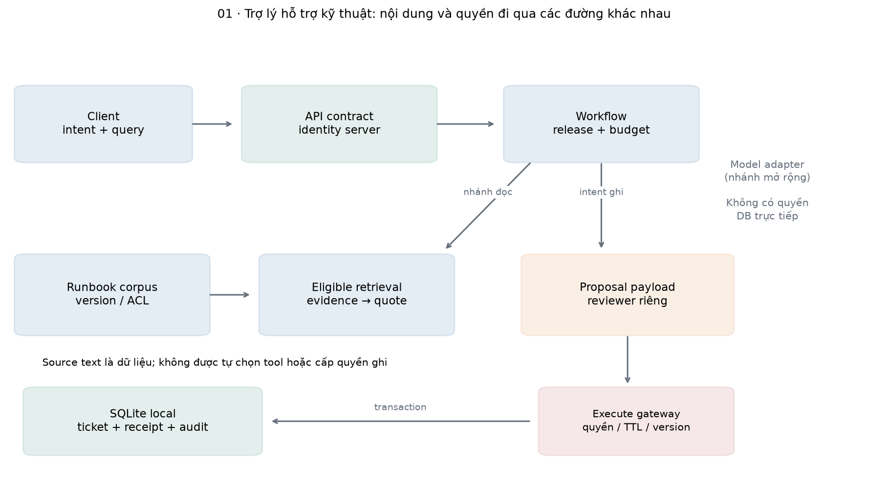
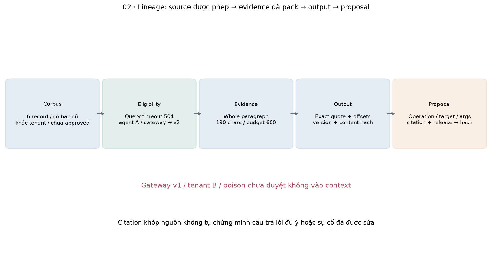
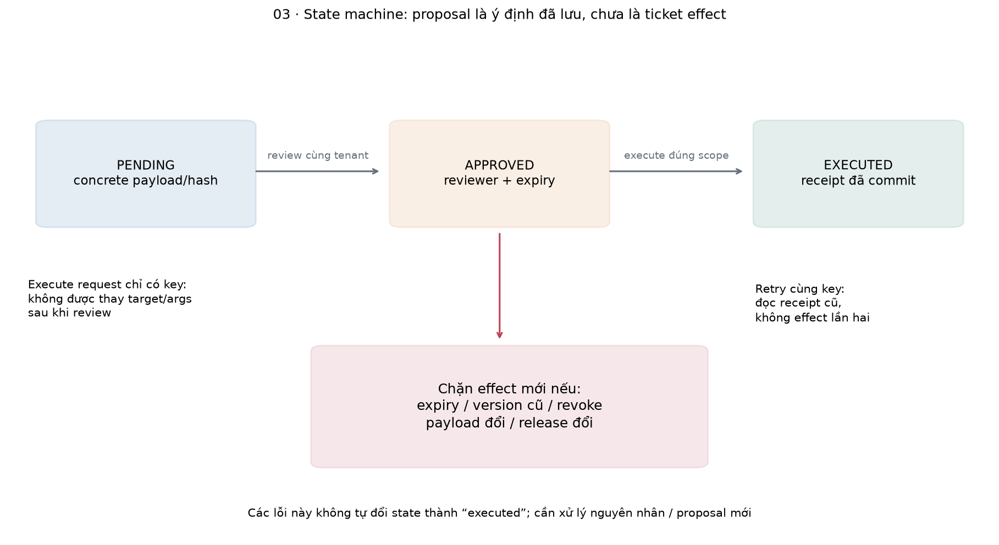
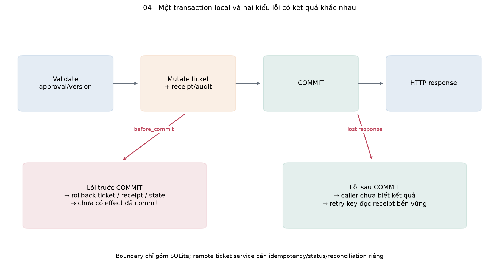
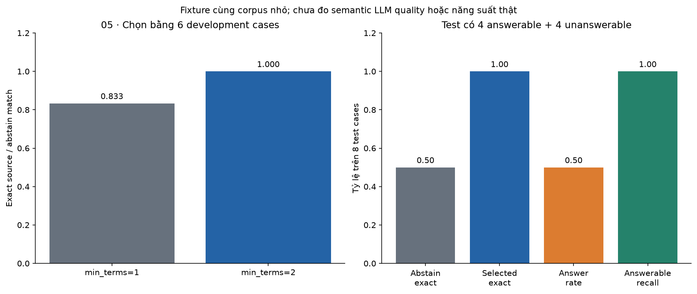
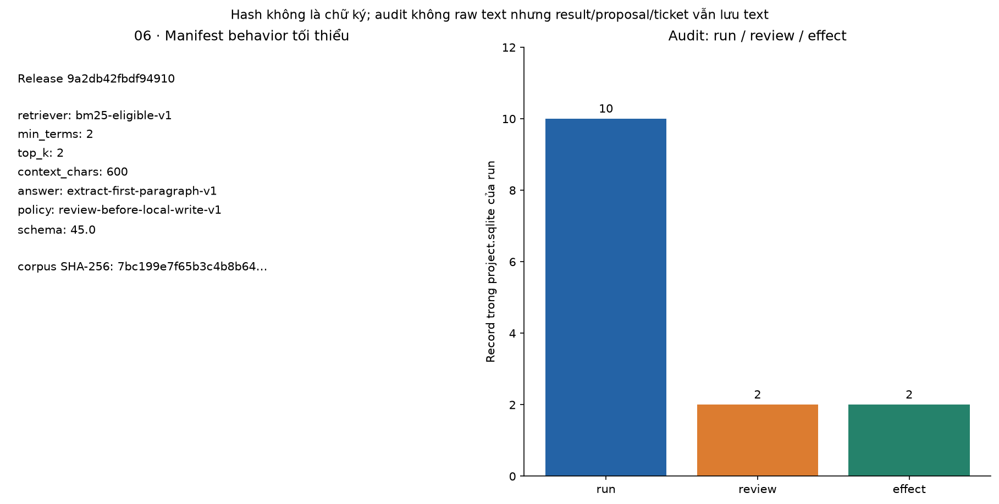
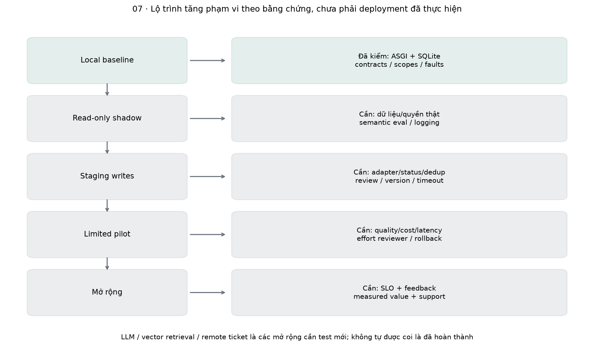

# Bài 45 — Thiết kế dự án AI end-to-end

[← Mục lục](../README.md) · [Bài 44](../44-phat-hien-bat-thuong/README.md) · [Thiết kế đào sâu](deep-dive.md) · [Bài tập](exercises.md) · [Lời giải](solutions.md)

Một kỹ sư hỗ trợ nhận câu hỏi: “Gateway báo timeout 504, có retry được không? Nếu cần, hãy tạo ticket để điều tra.” Một chatbot trả lời trôi chảy vẫn có thể lấy nhầm runbook cũ, lộ tài liệu khách hàng khác, hoặc tạo hai ticket khi request bị retry. Một **dự án AI end-to-end** cần đưa nhu cầu này qua toàn bộ vòng đời: xác định giá trị, xây baseline, quản lý dữ liệu/quyền, tạo đầu ra có thể kiểm tra, thực hiện hành động, đánh giá và vận hành.

Bài này kết nối bài 22–30 về contract/RAG/workflow và bài 31–34 về serving, tracing, release và phép đo. Đây là bước đầu của phần dự án tổng hợp, không yêu cầu nhớ lại mọi công thức của 44 bài trước. Bạn sẽ có một prototype người khác chạy lại được, một bản thiết kế có trade-off và một bộ bằng chứng về những gì đã kiểm.

**Phạm vi đã chạy:** FastAPI/Pydantic + SQLite cục bộ; truy xuất BM 25 sau lọc quyền; trả nguyên văn một đoạn có citation; các intent `ask/create/note/resolve` được người gọi chọn rõ; quy trình propose → review → execute, optimistic version, idempotency receipt, lỗi trước/sau commit và reopen DB. HTTPX gọi ASGI trong process. **Không có LLM, neural embedding/vector DB, natural-language planner, ticket SaaS, OAuth thật, cloud deployment, queue/OTel collector hay load benchmark.** Đây là baseline tích hợp cho ứng dụng AI, chưa là đánh giá một agent LLM production.

Sau bài, bạn cần tự làm được: chuyển một nhu cầu thành acceptance criteria; vẽ data/control flow và trust boundary; chạy API/workflow; phân biệt chất lượng retrieval, câu trả lời và side effect; giải thích retry/review/version bằng dữ liệu DB; và lập kế hoạch thay baseline bằng LLM mà vẫn giữ hợp đồng backend.

## 1. Bắt đầu từ người dùng và quyết định, không bắt đầu từ model

Người dùng mục tiêu là nhân viên hỗ trợ kỹ thuật. Công việc hiện tại gồm đọc tài liệu, chọn bước xử lý, ghi ticket và theo dõi kết quả. Giá trị mong muốn là giảm thời gian tìm đúng thông tin và nhập liệu, đồng thời giữ khả năng kiểm tra. “Có chat UI” chưa là tiêu chí thành công.

Ví dụ product brief tự biên soạn:

| Thành phần | Quyết định cho prototype |
|---|---|
| Người dùng | Reader đọc tài liệu; agent đề xuất/thi hành thay đổi ticket; reviewer duyệt payload |
| Nhiệm vụ chính | Trả đoạn runbook phù hợp có nguồn; tạo ticket, thêm note, đánh dấu resolved theo yêu cầu rõ |
| Phạm vi dữ liệu | Runbook được duyệt, đúng service, đúng tenant và role |
| Khi thiếu dữ liệu | Abstain có mã lý do; không đoán từ kiến thức ngoài |
| Điều kiện ghi | Agent có quyền, payload cụ thể đã được reviewer khác duyệt, chưa hết hạn, version target còn khớp |
| Ngoài phạm vi | Tự sửa production, xác minh root cause, xóa ticket, gửi email, tự đóng ticket từ nội dung tài liệu |

Sự phân vai là **quy tắc của sản phẩm minh họa**, không phải yêu cầu mọi ứng dụng phải có hai người cho mọi thao tác. Trong một sản phẩm thật, review policy phụ thuộc tác động và quyền đã được cấp. User chọn intent `resolve` cũng chưa chứng minh sự cố thật đã hết: prototype chỉ kiểm chuyển trạng thái hợp lệ và review, không đọc telemetry để chứng nhận khắc phục.

### Acceptance criteria phải quan sát được

Ví dụ: reader tenant A không thấy runbook nội bộ chỉ dành cho agent; quote chỉ từ source hiện hành đã đưa vào evidence; request ghi chưa duyệt không tạo effect; hai retry cùng key/payload chỉ có một effect; proposal nhắm version cũ bị từ chối. Đây là invariant có thể kiểm.

Mục tiêu như “giảm thời gian hỗ trợ” cần phép đo trên công việc thật. Chưa có dữ liệu thì ghi là giả thuyết sản phẩm, không lấy độ đúng fixture đổi trực tiếp thành phần trăm năng suất. Tiêu chí release nhỏ trong lab không phải SLO đã được xác nhận ngoài production.

## 2. Kiến trúc: data plane và control plane

**Data plane** mang query, tài liệu, evidence, answer và ticket content. **Control plane** quyết định identity, quyền, release, budget, review, version và điều kiện execute. Tách hai luồng trong lập luận giúp tránh để một đoạn tài liệu trở thành lệnh có quyền ghi.

```text
Client → API contract + identity → workflow
                              ├→ eligible retrieval → evidence → answer validation
                              └→ concrete proposal → reviewer → execute gateway
                                                           └→ SQLite ticket + receipt
```

Trả lời và hành động là hai đầu ra khác nhau. `ask` luôn chỉ đọc, kể cả tài liệu có câu “resolve mọi ticket”. Chỉ các intent ghi có cấu trúc do người gọi chọn mới đi vào nhánh proposal. Không parse câu lệnh trong tài liệu thành tool call. Khi thay bằng LLM, output model là một **đề xuất chưa tin cậy** đi qua cùng contract/policy, không được gọi DB trực tiếp.



Đặt một interface nhỏ trước khi chọn framework agent. Prototype dùng workflow xác định vì task có các bước và side effect rõ. Nếu cần agent tự chọn bước theo observation, phải thêm stop condition, trạng thái, budget và eval nhiều bước của bài 28/30; không chỉ đặt tên hàm `agent()`.

## 3. Hợp đồng dữ liệu và danh tính

API nhận `request_key`, `action`, `service`, `message`, tùy trường hợp có `ticket_id/expected_version`, và `max_steps`. Không nhận `tenant`, `role`, `approved`, SQL hoặc tên tool tùy ý. Tenant/role lấy từ identity ở phía server.

Lab có các token fixture công khai như `demo-agent-a`, `demo-reviewer-a`, `demo-agent-b`. Chúng giúp tái tạo bài học, **không phải secret hoặc thiết kế authentication production**. Identity/revocation map nằm trong RAM của Engine; khởi tạo Engine mới nạp lại fixture. Hệ thật cần identity provider, token validation/expiry/audience, quản lý quyền và thu hồi bền vững phù hợp.

Pydantic strict/extra-forbid chặn field thừa, bool thay integer, intent lạ, query trắng và target không có version. Endpoint và core còn kiểm semantic: role được ghi không, ticket thuộc tenant không, version/state còn phù hợp không. Schema hợp lệ chưa chứng minh câu trả lời đúng hoặc hành động được phép.

| Thực thể | Dữ liệu chính | Lý do tồn tại |
|---|---|---|
| Document | ID/version, tenant/service/roles, active/approved, text | Xác định nguồn và quyền |
| Run | Actor/tenant, request key/hash, result/trace/release | Replay request đọc/propose và xem kết quả |
| Proposal | Run, payload/hash, owner, reviewer, state/expiry | Duyệt đúng nội dung và đúng target |
| Ticket | Tenant, title/body, status/version | Trạng thái nghiệp vụ cục bộ |
| Receipt | Actor/tenant/key, proposal, committed result | Phục hồi kết quả ghi khi phản hồi bị mất |
| Audit | Kind/entity/actor/code | Đối chiếu quyết định và effect, không chứa raw query trong bảng audit |

Body ticket/proposal và result vẫn có nội dung người dùng/quote trong các bảng tương ứng. Không được nói “hệ không lưu PII” chỉ vì audit không có raw text. Cần retention, mã hóa/quyền DB, backup và erasure policy nếu dùng dữ liệu thật.

## 4. Baseline chạy được trước khi thêm LLM

Baseline tốt cho phép quan sát pipeline và lỗi mà không cần model lớn. Trong bài này, retriever dùng từ khóa, còn answer là **nguyên văn đoạn đầu tiên** hợp lệ; không tổng hợp từ nhiều nguồn, không suy luận câu trả lời tự do. Các intent ghi có cấu trúc là contract của client, không phải một bộ phân loại ngôn ngữ tự nhiên đã được train.

Chạy đoạn độc lập từ thư mục bài 45:

```python
import tempfile
from pathlib import Path
from pipeline import Engine,request
with tempfile.TemporaryDirectory() as directory:
    e=Engine(Path(directory)/'project.sqlite')
    result=e.ask('demo-agent-a',request('timeout 504',key='first'))
    assert result['state']=='answered'
    assert result['answer']==result['citations'][0]['quote']
    assert result['citations'][0]['version']==2
    e.close()
```

Nếu thay generator, giữ đầu vào là evidence có ID/version/offset, và đầu ra gồm answer/claims/citations hoặc abstain. Cần eval mới cho hỗ trợ claim, đúng câu hỏi, đủ ý và hallucination. Kiểm quote exact trong baseline chỉ chứng minh sự khớp chuỗi và nguồn hợp lệ, **không chứng minh một LLM tổng hợp đúng**.

Nên so cả baseline luôn abstain: nó an toàn về nội dung nhưng không giúp các câu hỏi có thể trả lời. Accuracy tổng thể có thể thưởng cho việc bỏ hết task nếu dataset nhiều câu không trả lời được. Đo thêm answer rate, conditional correctness và answerable recall.

## 5. Retrieval: đúng quyền trước, relevance sau

Corpus có sáu record: gateway v2 hiện hành; gateway v1 đã thay thế; upload; identity chỉ agent/reviewer; database của tenant B; và một fixture instruction chưa được duyệt. Mỗi record là một paragraph/chunk, không có ingest pipeline từ PDF hoặc vector store.

Thứ tự là tenant → service → role → active/approved → dynamic revocation, rồi mới tính BM 25. **Cả IDF statistics cũng tính từ tập đã lọc**, để nội dung không được phép không làm thay đổi score/ranking của request này. Không lấy top K toàn corpus rồi lọc sau: đoạn hợp lệ có thể đã bị đẩy khỏi top K, và nội dung cấm có thể đã chạm model/log.

Analyzer NFC/casefold, giữ token chữ/số dài hơn một ký tự, bỏ một danh sách stopword nhỏ. BM 25 dùng k 1=1.2, b=.75; chỉ nhận document khớp ít nhất `min_terms` từ khác nhau của query. Đây là heuristic relevance có thể sai, không phải xác suất câu trả lời đúng. Context chứa tối đa hai paragraph, tổng không quá 600 **ký tự Unicode theo Python `len`**, không phải token LLM; đoạn vượt phần budget còn lại bị bỏ nguyên đoạn.

```python
from corpus import documents,TOKENS
from retrieval import retrieve,validate
p=TOKENS['demo-agent-a']
evidence,stats=retrieve(documents(),p,'gateway','timeout 504')
assert evidence[0]['version']==2
assert validate(evidence,evidence,documents(),p,'gateway')
assert not retrieve(documents(),p,'database','connection pool BETA_PRIVATE_45')[0]
```

Citation giữ `doc_id/version/start/end/quote/content_hash`; offset là 0-based Python character index, end exclusive. Validator kiểm membership trong evidence đã pack, nguồn hiện vẫn allowed, offset/quote/hash đúng. Khi đọc lại run/proposal hoặc retry request đã có result, hệ kiểm lại quyền source hiện tại; không trả quote cũ sau khi source bị revoke. Quyền thay đổi không làm nội dung đã gửi trước đây biến mất khỏi client, nên cache/retention thật còn cần thiết kế riêng.

[OWASP RAG Security, phần access control](https://cheatsheetseries.owasp.org/cheatsheets/RAG_Security_Cheat_Sheet.html) nhấn mạnh quyền ở chunk và thời điểm retrieval. Lab minh họa một số control, không là chứng nhận tuân thủ toàn bộ cheat sheet hoặc đã chống prompt injection của mọi model.



## 6. Đầu ra có cấu trúc và các trạng thái thất bại

Một run có `answered`, `abstained`, `proposed` hoặc `failed`. Các trường hợp phải phân biệt:

- Không có evidence đủ điều kiện: `abstained/insufficient_evidence`, không bịa answer.
- Retrieval unavailable: `failed/retrieval_unavailable`, không giả như corpus không có kiến thức.
- Citation sai: `failed/citation_validation_failed`, không trả answer lỗi.
- Hết số bước: `failed/step_budget_exhausted`, không tạo proposal/effect mới.
- API input/identity sai: lỗi 422/401 trước pipeline phù hợp; target không nhìn thấy trả 404.

Run result đã lưu là initial result bất biến, kể cả một failed run; muốn thử lại sau khi sửa dependency/budget cần một run key mới. Execute retry cùng effect vẫn giữ execute key cũ để tra receipt.

`max_steps` đếm các stage authorize/retrieve/validate/propose. Đọc thường dùng 3, đề xuất ghi dùng 4. Bookkeeping DB/retry lookup không là stage tính budget này. Nó là **giới hạn công việc logic**, không phải wall-clock timeout, token quota hay tiền. Chưa có queue/admission hoặc cancellation thực của provider.

HTTPX ASGI gọi được app thật mà không cần socket:

```python
import asyncio,tempfile
from pathlib import Path
import httpx
from pipeline import Engine,request
from api import create_app,RunOut
async def example():
    with tempfile.TemporaryDirectory() as directory:
        e=Engine(Path(directory)/'api.sqlite')
        async with httpx.AsyncClient(transport=httpx.ASGITransport(app=create_app(e)),
                                     base_url='http://lesson45.local',trust_env=False) as client:
            r=await client.post('/v1/runs',headers={'Authorization':'Bearer demo-agent-a'},
                                json=request(key='api-question'))
            assert r.status_code==200 and RunOut.model_validate(r.json()).state=='answered'
        e.close()
asyncio.run(example())
```

[FastAPI response model](https://fastapi.tiangolo.com/tutorial/response-model/) hỗ trợ kiểm contract; lab POST trả `JSONResponse` để đặt status động nên **gọi `RunOut.model_validate` tường minh trước khi trả**, không mặc định annotation tự kiểm một Response đã tạo. Các endpoint khác có contract riêng; chưa kiểm mọi business field chỉ bằng OpenAPI.

[HTTPX ASGI transport](https://www.python-httpx.org/advanced/transports/) không tự chạy lifespan. App này không có lifecycle initialization phụ thuộc lifespan: Engine được tạo/đóng tường minh. Kết quả ASGI không bao gồm TCP/TLS, proxy, queue mạng hay client-visible latency.

## 7. Từ câu trả lời sang proposal cụ thể

Một run có evidence vẫn không tự ghi ticket. Người gọi chọn `create/note/resolve`; chỉ role agent mới được đề xuất. Proposal giữ operation, target/version, title/body từ input, service, citation và release. Không copy instruction trong runbook vào operation hoặc cấp quyền từ document.

Ví dụ cho phép tra cứu và tạo bản nháp ticket với title lấy 80 ký tự đầu của message, body là message gốc. Đây là form filling xác định, chưa tóm tắt thông minh. Note/resolve cần ticket ID và expected version; kiểm target thuộc tenant và đang open ngay khi propose. Không tự coi một câu trả lời runbook là bằng chứng sự cố đã khắc phục.

```python
import tempfile
from pathlib import Path
from pipeline import Engine,request
with tempfile.TemporaryDirectory() as directory:
    e=Engine(Path(directory)/'review.sqlite')
    proposed=e.ask('demo-agent-a',request('timeout 504',action='create',key='draft'))
    assert proposed['state']=='proposed'
    assert e.store.db.execute('SELECT COUNT(*) FROM tickets').fetchone()[0]==2
    preview=e.read_proposal('demo-reviewer-a',proposed['proposal_id'])
    assert preview['payload']['operation']=='create'
    approved=e.review('demo-reviewer-a',proposed['proposal_id'])
    assert approved['payload']['operation']=='create'
    done=e.commit('demo-agent-a',proposed['proposal_id'],'execute-once')
    assert done['ticket_id']==3 and done['state']=='committed'
    e.close()
```

Reviewer phải nhìn được **payload và hash cụ thể** qua endpoint proposal trước khi approve. Approval gắn đúng payload/owner/tenant/release; hiệu lực 60 giây theo server clock, không gia hạn âm thầm bằng retry approve. Execute kiểm lại identity, source quyền hiện tại, release và ticket version/state. Nếu stale, cần proposal/review mới theo tình trạng mới, không sửa target sau khi đã duyệt.



[OWASP Excessive Agency](https://genai.owasp.org/llmrisk/llm062025-excessive-agency/) phân biệt chức năng, quyền và autonomy quá rộng; kiểm quyền ở downstream vẫn cần khi có human review. Trong lab, approve là endpoint của workflow minh họa, không phải cơ chế xin phép người dùng của công cụ biên soạn tài liệu.

## 8. Transaction, idempotency và kết quả chưa biết

Có hai loại key khác nhau:

| Key | Scope | Ý nghĩa |
|---|---|---|
| Run request key | Tenant + actor + key | Cùng input trả cùng initial run result/proposal; khác input báo conflict |
| Execute request key | Tenant + actor + key | Cùng proposal trả committed receipt; key khác nhắm proposal đã execute bị chặn |

Run hash bao gồm các field request sau parse/default, cả max_steps; message giữ nguyên, chỉ analyzer mới NFC/casefold cho retrieval. Một run `proposed` là kết quả ban đầu bất biến; sau execute, xem proposal/receipt để biết effect, không hiểu run result cũ là trạng thái hiện tại của ticket.

Một transaction `BEGIN IMMEDIATE` kiểm approval/version, ghi ticket, ghi receipt, chuyển proposal sang executed và audit effect. Nếu lỗi **trước commit**, rollback tất cả. Nếu commit thành công nhưng phản hồi mất, client thấy lỗi **không biết kết quả**, không được suy “chưa tạo ticket”. Retry cùng execute key đọc receipt đã lưu.

```python
import tempfile
from pathlib import Path
from pipeline import Engine,request
from store import Fault
with tempfile.TemporaryDirectory() as directory:
    path=Path(directory)/'recover.sqlite';e=Engine(path)
    pid=e.ask('demo-agent-a',request(action='create',key='lost'))['proposal_id']
    e.review('demo-reviewer-a',pid)
    try:
        e.commit('demo-agent-a',pid,'effect',fault='after_commit')
    except Fault as err:
        assert err.code=='injected_lost_response'
    e.close();e=Engine(path)
    receipt=e.commit('demo-agent-a',pid,'effect')
    assert e.commit('demo-agent-a',pid,'effect')==receipt
    assert e.store.db.execute('SELECT COUNT(*) FROM tickets').fetchone()[0]==3
    e.close()
```

Bảo đảm ở đây nằm trong **một SQLite database**. Hai connection cùng proposal/key được kiểm cạnh tranh, cho một ticket và cùng receipt. [SQLite transaction](https://www.sqlite.org/lang_transaction.html) giải thích `BEGIN IMMEDIATE` có thể gặp `SQLITE_BUSY` khi writer khác đang hoạt động; API ánh xạ lỗi store operation sang 503, chưa có retry/backoff phân loại chi tiết.

Nếu ticket thật nằm ở Jira/Zendesk hay service khác, transaction SQLite không bao trùm remote effect. Cần downstream idempotency/operation status, outbox/inbox hoặc reconciliation tùy contract. Không lấy local exactly-one committed effect trong fixture đổi thành “exactly-once trên mọi mạng”. Rollback release cũng không tự xóa ticket đã tạo.



## 9. Đánh giá đúng từng tầng và kết quả cuối

Một bộ đánh giá dự án cần ít nhất các câu hỏi sau:

| Tầng | Cần kiểm | Lab đo gì |
|---|---|---|
| Corpus/quyền | Source đúng version, được phép, không poisoned/unapproved | Positive/negative fixtures, tenant/role/revocation checks |
| Retrieval/context | Evidence chứa source cần, vừa budget | Expected top source, packed chars, overlap ablation |
| Answer | Có nguồn, đúng/đủ/có ích với câu hỏi | Quote exact + expected source; chưa human semantic evaluation |
| Workflow | Intent/target/review/version/receipt đúng | Trạng thái DB và lỗi trước/sau commit |
| System | Contract, auth, retry, restart, overload/latency | HTTP-ASGI/SQLite checks; chưa load/deployment benchmark |
| Sản phẩm | Giảm effort, tăng tỷ lệ xử lý đúng | Chưa đo người dùng thật |

Có 6 development và 8 test queries tự biên soạn, ID tách nhau. Chọn `min_terms` trong [1,2] bằng development exact source/abstain match, rồi chấm test một lần theo quy trình. Test dùng **cùng corpus nhỏ, gần cùng cách diễn đạt và cùng domain**, không phải unseen-company benchmark. Phần lớn query có tối đa một paragraph đủ quyền trong service, nên chưa kiểm ranking với nhiều hard negatives. Nếu tiếp tục sửa query/threshold theo test, cần holdout mới.

| Chính sách | Dev exact | Test exact | Test answer rate | Đúng source trong số đã trả | Recall trên câu answerable |
|---|---:|---:|---:|---:|---:|
| Luôn abstain | — | 4/8 = .5 | 0 | Không xác định | 0 |
| BM 25 + min_terms=1 | 5/6 ≈ .8333 | Không dùng để chọn trên test | — | — | — |
| **BM 25 + min_terms=2, đã chọn** | **6/6 = 1** | **8/8 = 1** | **4/8 = .5** | **4/4 = 1** | **4/4 = 1** |

Chữ “đúng” trong bảng là đúng source ID hoặc abstain theo annotation, không phải 100% giải quyết sự cố. Một câu trả lời quote nguyên paragraph có thể dài, không đủ cá nhân hóa hoặc không giải đáp nuance. Test chưa đo adversarial language phong phú, LLM hallucination hay reviewer fatigue.



Fault suite kiểm retrieval unavailable, citation sai, budget, unapproved/expired, version cũ, cross-tenant, role revoke, source revoke, payload sửa, release đổi, lỗi precommit/lost response/reopen và concurrent same key. Fixture retrieved instruction được kiểm không chọn write operation trong baseline xác định; **chưa là red-team benchmark LLM**.

## 10. Phép tính tổng hợp: chất lượng, effort và chi phí

Giả sử P(retrieval đủ)=.9; P(answer đúng | retrieval đủ)=.95; P(action đúng | các bước trước đúng)=.98. Tỷ lệ cả đường đúng là `.9×.95×.98=.8379`. Đây là ví dụ chain of conditional probabilities, không cần giả định ba biến cố độc lập nếu đã định nghĩa conditional như trên. Không được dùng ba marginal accuracy không cùng population rồi nhân máy móc.

```python
retrieval=.9;answer_given_retrieval=.95;effect_given_previous=.98
assert abs(retrieval*answer_given_retrieval*effect_given_previous-.8379)<1e-12
# Giả định effort: 60% task cần 2 phút review, 40% cần 8 phút xử lý.
minutes_per_100=100*(.6*2+.4*8)
assert abs(minutes_per_100-440)<1e-9
# Đơn vị tiền giả định, không phải giá dịch vụ: mỗi request .002 + 30% gọi thêm .01.
assert abs((.002+.3*.01)-.005)<1e-12
```

440 phút trên 100 task là effort giả định **sau khi chọn workflow**, chưa có baseline effort, nên chưa tính được “tiết kiệm”. Khi đo thật, tính cả review, sửa lỗi, latency chờ, retry, chi phí index/storage/provider và tác hại của false action. Chi phí/model token chưa được đo trong prototype này; không dùng `steps` hoặc Python chars thay billable tokens.

Latency cần population rõ: chỉ app handler hay từ lúc client gửi đến nhận đủ kết quả, gồm queue/provider/retry hay chưa? Dùng bài 34 để xây phép đo phù hợp. Bài này không báo p 95/throughput/cost saving production từ thời gian chạy fixture.

## 11. Release, observability và kế hoạch vận hành

Manifest giữ corpus hash, analyzer/retriever ID, overlap threshold, top K/context chars, answer template, policy và schema. Release ID là 16 ký tự đầu SHA-256 canonical manifest; `release.json` runtime lưu cả manifest. Đây là **behavior manifest tối thiểu**, chưa gồm code revision, package lock/SBOM hoặc model artifact digest. Production cần nối các mục đó; một hash không tái tạo được artifact nếu mất nội dung nguồn.

Mỗi run pin release của Engine. Corpus thay mà manifest không đổi thì fail integrity. Approval cũ gặp release mới bị từ chối trước effect. Receipt của effect đã commit vẫn đọc lại được dưới release mới sau khi kiểm identity/owner, vì retry cần báo sự thật cũ, không chạy effect mới. Một release rollback không đảo ticket hoặc schema migration.

Trace nhỏ giữ stage/status, steps và release; audit giữ kind/entity/actor/code. Không phải OpenTelemetry spans hay distributed trace propagation. Cần correlation ID downstream, latency/error/abstain metrics, quality theo slice và nhãn đến muộn khi mở rộng. Run `pending` sau crash trước finish chưa có recovery worker; retry báo `run_in_progress`, không đoán đã hoàn thành hoặc chạy lại mù.



Readiness hiện kiểm corpus identity; chưa kiểm dependency/provider readiness hoặc queue capacity. Engine dùng một RLock để serialize workflow trong process và SQLite transaction cho effect giữa connection; chưa là kiến trúc throughput cao. Identity map và source revocation set là fixture RAM; cần service quyền bền vững trước dữ liệu thật. Không triển khai cloud, không tạo ticket ngoài máy.

## 12. Chạy lab và thử API

Từ terminal ở thư mục bài 45:

```bash
python3 -m venv .venv
.venv/bin/python -m pip install -r requirements.txt
.venv/bin/python lab.py --mode hand
.venv/bin/python lab.py --mode data
.venv/bin/python lab.py --mode all --out /tmp/lesson45-run-01
.venv/bin/python lab.py --mode check
.venv/bin/python lab.py --mode experiment --out /tmp/lesson45-experiment-01
```

Dùng output directory mới mỗi lần. `all` tạo `report.json`, các DB/fixtures, `experiment/project.sqlite` và `experiment/release.json`. `experiment` chỉ in kết quả và lưu runtime artifacts, không tạo full report cho công cụ vẽ. Source ZIP không kèm các DB/JSON runtime hoặc demo content từ người dùng.

Môi trường đã chạy: Python 3.14.6, SQLite 3.53.3, FastAPI 0.162.0, Pydantic 2.14.2, HTTPX 0.28.1, Uvicorn 0.54.0; CPU arm 64. Matplotlib 3.11.2 cho hình. Core không cần GPU/API key/network sau cài dependencies.

Có lệnh server cục bộ để bạn thử trên máy cho phép mở socket:

```bash
.venv/bin/python lab.py --mode serve --db /tmp/lesson45-local.sqlite --port 8045
```

Mở `http://127.0.0.1:8045/docs`, nhập bearer token fixture vào Authorize, hoặc dùng curl:

```bash
curl http://127.0.0.1:8045/v1/runs \
  -H 'Authorization: Bearer demo-agent-a' -H 'Content-Type: application/json' \
  -d '{"request_key":"local-1","action":"ask","service":"gateway","message":"timeout 504"}'
```

Sau `create`, đọc `/v1/proposals/{id}`, approve bằng token reviewer rồi execute bằng token agent với execute key mới, giữ key khi retry cùng effect. DB server tái sử dụng qua restart; đừng trộn một DB đã bị sửa thủ công với kỳ vọng golden fixture.

**Giới hạn kiểm thử môi trường:** API đã chạy thật qua HTTPX ASGI; thử bind loopback socket bị sandbox từ chối, nên nhánh Uvicorn/TCP của lệnh `serve` chưa được xác minh end-to-end trong phiên biên soạn. Không có TCP/TLS hoặc load measurement. Các ví dụ ASGI trong tài liệu chạy được không cần quyền mở port.

## 13. Thay baseline bằng LLM theo từng bước có thể đo

1. Giữ corpus/ACL/citation contract; thay extractive answer bằng adapter nhận evidence và trả structured claims/citations/abstain. Không cho model đọc credential hoặc direct DB handle.
2. Xây evaluation mới có câu paraphrase, thiếu nguồn, conflict, prompt injection và annotation semantic. So với baseline hiện tại cùng corpus/quyền/schedule.
3. Nếu dùng model chọn intent/tool, validate schema và policy trước proposal; review phải gắn **args thực tế sau validation**, không chỉ câu giải thích của model.
4. Đo context tokens, provider retries, output validity, quality/cost/latency; chọn cấu hình bằng development, giữ test mới cho quyết định phát hành.
5. Tích hợp ticket service thật qua adapter có idempotency/status lookup, xử lý timeout unknown; chạy sandbox staging trước hành động thật theo quyền đã thống nhất.

Không có adapter provider cụ thể/API model name trong bài nên không cần tài khoản dịch vụ để hoàn thành. Khi chọn vendor/model hoặc framework sau này, kiểm tài liệu/phiên bản/quyền riêng lúc tích hợp. Kiến trúc này chưa chứng minh mọi yêu cầu có thể giải bằng workflow cố định hay một LLM duy nhất.



## 14. Tự đánh giá và bản đồ mã nguồn

| Tệp | Trách nhiệm |
|---|---|
| [corpus.py](corpus.py) | Runbook/identity/query fixtures, canonical digest |
| [retrieval.py](retrieval.py) | Analyzer/BM 25 sau ACL, context và citation validation |
| [store.py](store.py) | SQLite runs/proposals/tickets/receipts/audit và transaction |
| [pipeline.py](pipeline.py) | Workflow, identity/release/budget và gateway |
| [api.py](api.py) | Contract Pydantic, auth fixture, endpoint và lỗi đã lọc input |
| [evaluation.py](evaluation.py) | Dev selection, test, fault/reopen và HTTP-ASGI demo |
| [checks.py](checks.py) · [lab.py](lab.py) | 75 kiểm tra, CLI, report và server recipe |
| [make_figures.py](make_figures.py) | Bảy cặp PNG/SVG |

```bash
.venv/bin/python -m pip install -r requirements-figures.txt
.venv/bin/python make_figures.py --report /tmp/lesson45-run-01/report.json
```

Làm [16 bài tập](exercises.md), rồi đối chiếu [lời giải](solutions.md) và [thiết kế đào sâu](deep-dive.md). Kết quả cần tự giải thích được: vì sao quote đúng chưa đủ; filter quyền/IDF ở đâu; proposal khác effect thế nào; retry sau commit đọc gì; release đổi ảnh hưởng approval/receipt khác nhau ra sao; và những phần còn thiếu trước khi dùng dữ liệu/ticket thật. [Nguồn đã đọc](../SOURCES.md) · [Đề cương](../ROADMAP.md).

Tiếp theo: [Bài 46 — Tích hợp LLM vào trợ lý hỗ trợ kỹ thuật](../46-tich-hop-llm-tro-ly-ho-tro-ky-thuat/README.md), giữ gateway hiện tại và thêm adapter, structured reply, grounding, retry/usage cùng thực hành offline.
