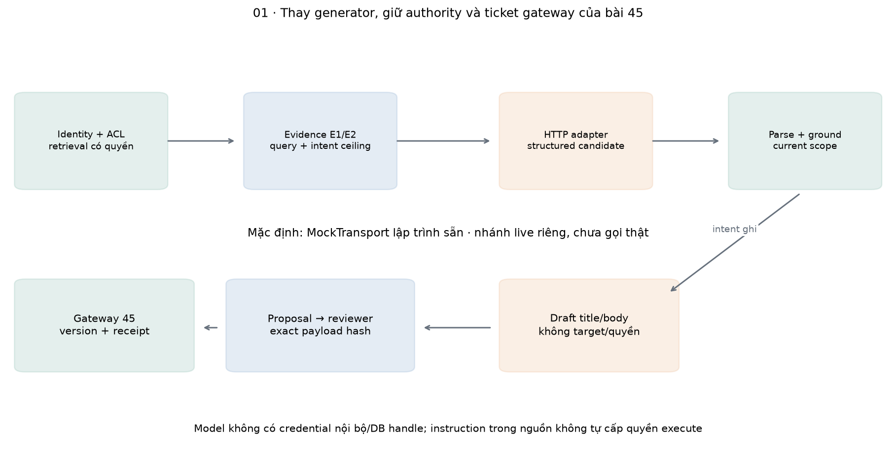
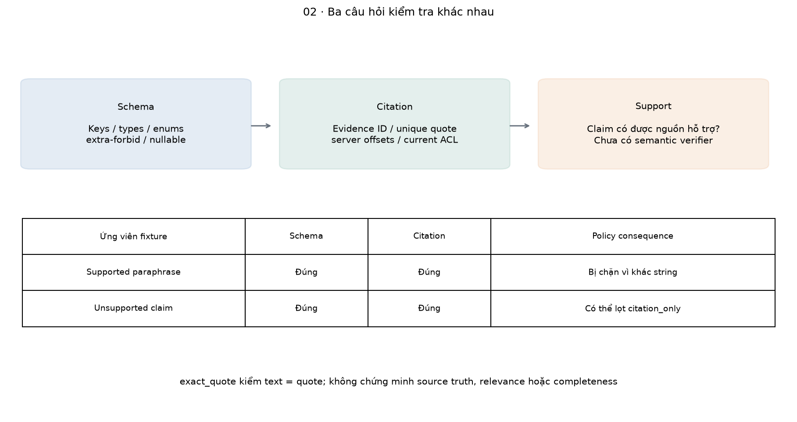
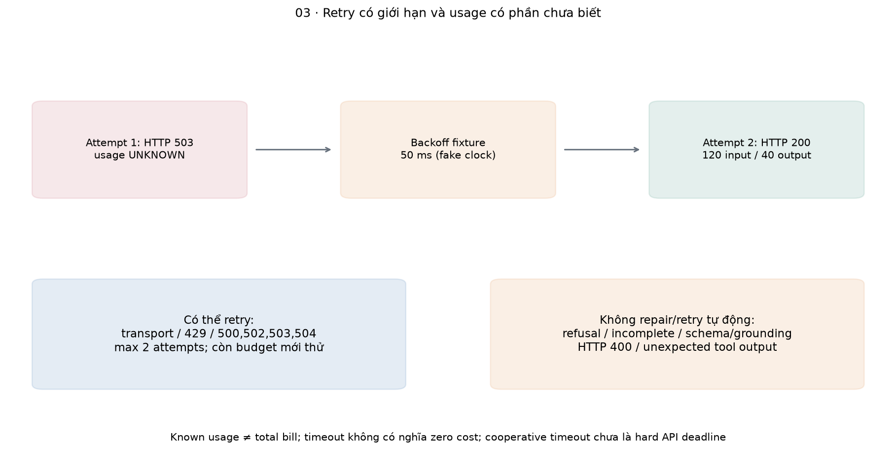
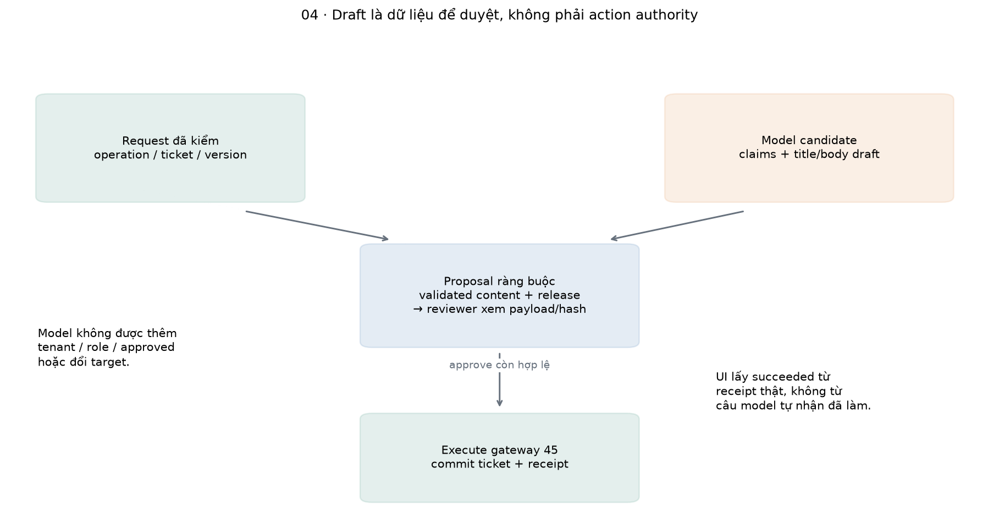
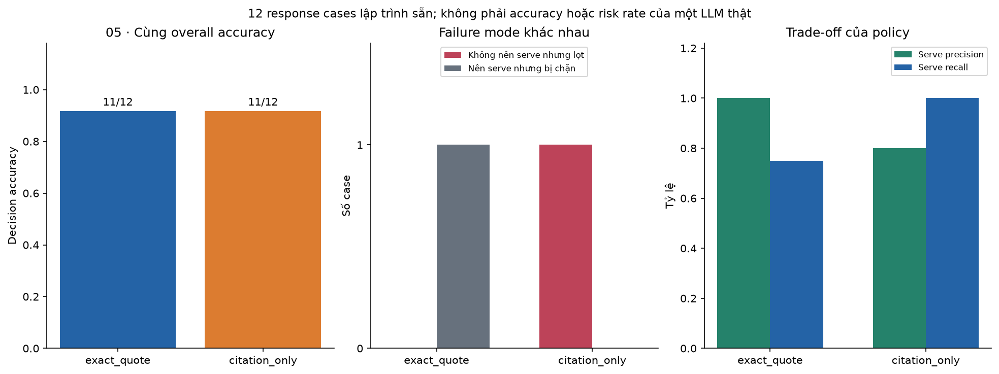
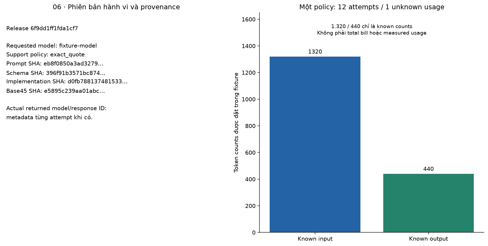

# Bài 46 — Tích hợp LLM vào trợ lý hỗ trợ kỹ thuật

[← Mục lục](../README.md) · [Bài 45: Thiết kế end-to-end](../45-thiet-ke-du-an-ai-end-to-end/README.md) · [Đào sâu](deep-dive.md) · [Bài tập](exercises.md) · [Lời giải](solutions.md)

Ở bài 45, trợ lý tìm runbook rồi trả nguyên paragraph; operation/target do client chọn, ticket được ghi sau review và transaction. Bây giờ ta muốn LLM chọn thông tin liên quan, diễn đạt câu trả lời hoặc soạn bản nháp ticket. Phần khó không chỉ là gọi một API: cần biết dữ liệu nào gửi ra ngoài, hiểu trạng thái phản hồi, chặn output sai và giữ quyền ghi ở backend.

**Mục tiêu:** nối adapter LLM vào chính workflow bài 45; xây structured reply có evidence và draft; xử lý refusal/incomplete/timeout/retry/usage; kiểm nguồn và giới hạn của kiểm factuality; giữ review/version/idempotency khi model tạo nội dung; phân biệt kiểm integration với đo chất lượng một model.

**Phạm vi đã chạy:** HTTPX adapter theo Responses API, kiểm bằng `MockTransport` có response lập trình sẵn; FastAPI-ASGI, SQLite ticket gateway của bài 45, 12 contract cases × 2 policies, replay qua reopen DB. Có lệnh `live` gọi OpenAI khi bạn cấu hình credential/model, nhưng **chưa gọi API/model thật trong phiên biên soạn**. Không train model, không benchmark accuracy/latency/giá provider, không remote ticket, không autonomous tool-calling loop hoặc streaming UI.

Bài 46 **phụ thuộc source bài 45** qua [bridge45.py](bridge45.py), không sửa hoặc chép lại gateway cũ. Giữ hai thư mục cạnh nhau trong bộ giáo trình; chạy từng bài bằng process Python riêng. Kiến thức trước: bài 19–22/25–30 và bài 45; xem lại khái niệm token/context nếu chưa rõ.

## 1. LLM thay phần nào, giữ phần nào?

| Thành phần bài 45 | Bài 46 thay đổi gì? | Backend vẫn quyết định gì? |
|---|---|---|
| Retrieval/ACL | Tái sử dụng | Tenant, role, service, source hiện hành/quyền |
| Extractive answer | Thay bằng adapter trả claims có citation | Schema, evidence membership, quote/scope, render |
| Title/body từ input | Có thể là draft do model viết | Độ dài/schema, đưa đúng draft vào proposal/review |
| Intent/target/version | Giữ từ request có cấu trúc | Operation allowlist, ticket ID, expected_version |
| Review/execute | Tái sử dụng nguyên gateway | Reviewer, expiry, permission hiện tại, receipt và transaction |

Model không nhận DB handle, API credential nội bộ, tenant/role authority hoặc endpoint execute. Nó không tự cấp quyền bằng câu “người dùng đã đồng ý”. Một draft là văn bản để duyệt, chưa phải lệnh đã thực hiện. Khi backend commit, UI nên lấy kết quả từ receipt thật; không lấy câu model nói “đã tạo ticket” làm bằng chứng.

`SupportEngine` kế thừa engine bài 45 và thay nhánh ask/generate/propose. API cũ vẫn nhận cùng input/output envelope; metadata LLM nằm trong `stats.llm`. Đây là integration vào app hiện có, không phải chatbot khác đứng cạnh nó.



### Thuật ngữ dùng xuyên suốt

| Thuật ngữ | Hiểu trong bài này |
|---|---|
| Adapter | Lớp chuyển lời gọi của ứng dụng thành HTTP request và đọc phản hồi của nhà cung cấp |
| Evidence / claim | Evidence là đoạn nguồn đã chọn; claim là một phát biểu model muốn đưa vào câu trả lời |
| Grounding / citation | Grounding là nối phát biểu với bằng chứng; citation là thông tin chỉ về nguồn. Có citation chưa bảo đảm claim được nguồn hỗ trợ |
| Schema / validation | Schema mô tả cấu trúc dữ liệu; validation kiểm dữ liệu có thỏa cấu trúc và quy tắc nghiệp vụ hay không |
| Draft / proposal / receipt | Draft là nội dung nháp; proposal giữ hành động cụ thể chờ duyệt; receipt là kết quả backend đã ghi nhận sau thực thi |
| Abstain / refusal / incomplete | Abstain: hệ không trả lời vì thiếu cơ sở; refusal: model từ chối; incomplete: phản hồi chưa hoàn thành. Cần xử lý riêng |
| Fixture / mock / smoke | Fixture là dữ liệu kiểm đặt trước; mock thay một thành phần bằng phản hồi có kiểm soát; smoke là phép thử nhỏ đường tích hợp thật |
| Provider / attempt / replay | Provider là nhà cung cấp model; attempt là một lần thử gửi; replay là đọc lại kết quả đã lưu, không sinh lại |

### Ví dụ xuyên suốt: gateway báo lỗi 504

Một kỹ sư gửi “timeout 504 tại gateway, cần kiểm tra gì?” với `action=ask`. Backend xác thực người gọi thuộc tenant A rồi lấy runbook gateway phiên bản 2 đang hiệu lực. Model chỉ nhận query và đoạn evidence đủ quyền. Credential nội bộ, role và ticket target không nằm trong prompt payload do server xây.

Nguồn giả định của lab nói: “Lỗi timeout 504 tại gateway: kiểm tra thời gian chờ upstream và trace_id trước khi retry. Chỉ retry request đọc hoặc request ghi có idempotency key; không retry mù khi chưa biết kết quả ghi.” Với fixture `good`, claim text và quote đều lấy nguyên đoạn này; đó là đáp án lập trình sẵn để kiểm đường tích hợp, chưa là model thật chọn câu.

Backend tìm lại quote trong nguồn, tính offset và kiểm phiên bản/hash/quyền, rồi mới render câu trả lời kèm `[gateway@v2]`. Nếu output đổi thành “retry mọi request ghi vô hạn” nhưng vẫn gắn nguồn ấy, schema và citation có thể còn đúng trong khi khuyến nghị đã trái nội dung. Policy mặc định chặn vì claim text khác quote. Đây là lý do bài không dừng ở bước “nhận JSON thành công”.

Nếu người dùng chọn `action=create`, model còn soạn title/body. Workflow tạo proposal chứa **bản nháp cụ thể** cùng operation/target/version từ request, để reviewer xem và duyệt. Tới lúc đó DB vẫn chưa có ticket mới. Chỉ gateway execute sau review mới ghi ticket và receipt; retry execute đọc receipt thay vì nhờ model tạo lại. Ngược lại, câu hỏi không tìm được nguồn đủ quyền sẽ abstain trước provider call.

## 2. Ba mức bằng chứng khi nói “đã tích hợp LLM”

1. **Fixture/replay:** response do người biên soạn lập trình. Kiểm được branch, contract, data flow, retry và side effect; chưa đo năng lực model.
2. **Live smoke:** gọi model thật với vài câu, kiểm credential/model/schema và đường API. Chưa là benchmark chất lượng hoặc độ tin cậy.
3. **Evaluation trên population phù hợp:** nhiều câu/task, annotation, repeats và policy đã chốt, có chi phí/latency/error slices. Mới bắt đầu hỗ trợ quyết định model/release.

Lab mặc định ở mức 1. Tuy nhiên request đi qua chính HTTP adapter, JSON parser, validator và ticket gateway thật trong process. Không thay cả pipeline bằng một hàm giả luôn trả “pass”. Nhánh live có mã gửi request thật và đã được kiểm contract bằng transport giả; **server-side schema compatibility, account/model access và chất lượng generation chưa được xác minh live**.

```python
import tempfile
from pathlib import Path
from bridge45 import request
from fixtures import mock_adapter
from support import SupportEngine
with tempfile.TemporaryDirectory() as directory:
    adapter,script=mock_adapter()
    engine=SupportEngine(Path(directory)/'assistant.sqlite',adapter)
    result=engine.ask('demo-agent-a',request('timeout 504',key='first'))
    assert result['state']=='answered' and len(script.calls)==1
    assert result['stats']['llm']['usage_source']=='scripted_fixture'
    engine.close()
```

Tên `fixture-model` chỉ là nhãn của test double; không có model có trọng số được chạy với tên đó. Các con số token trong fixture cũng được đặt sẵn để kiểm kế toán, không phải kết quả tokenizer hoặc hóa đơn.

## 3. Input cho model: vừa đủ và không mang authority

Sau auth và retrieval có quyền, prompt gồm system instruction và một user message chứa JSON:

`query, intent_ceiling, service, support_policy, evidence[{id,text}]`.

Evidence được đánh nhãn `E1/E2` theo context của request. Không đưa token bearer của app, owner/tenant/role, ticket ID hoặc expected_version cho model để nó “quyết định”. Target vẫn nằm ở workflow backend. User message có thể có dữ liệu nhạy cảm; việc không gửi principal không đồng nghĩa có bộ lọc PII tổng quát.

System prompt yêu cầu dùng evidence, giữ quote chính xác, abstain khi thiếu/còn bất định, không tự thay authority và không tuyên bố đã execute. JSON serialization giúp text không chèn thêm một message role vào **cấu trúc request**, nhưng không chứng minh model sẽ bỏ qua mọi prompt injection trong nội dung. Source approved cũng có thể sai hoặc bị poison; ACL không thay đánh giá nội dung.

```python
import json
from bridge45 import documents,TOKENS,retrieve,request
from contracts import prompt_input,WIRE_SCHEMA
req=request('timeout 504')
evidence,_=retrieve(documents(),TOKENS['demo-agent-a'],'gateway',req['message'])
messages=prompt_input(req,evidence,'exact_quote')
data=json.loads(messages[1]['content'])
assert set(data)=={'query','intent_ceiling','service','support_policy','evidence'}
assert set(data['evidence'][0])=={'id','text'}
assert WIRE_SCHEMA['additionalProperties'] is False
```

Không có evidence đủ quyền/relevance thì backend abstain **trước khi gọi provider**. Một câu hỏi tenant A về tài liệu database tenant B không được gửi nội dung tenant B sang model rồi mới lọc ở output. Điều này cũng tiết kiệm call trên case không có evidence, nhưng không đo được tiết kiệm tiền thật trong fixture.

## 4. Structured output: shape khác factuality

Reply có bốn field bắt buộc:

| Field | Ý nghĩa |
|---|---|
| `decision` | `answer` hoặc `abstain` |
| `claims` | Tối đa ba claim: `text`, `evidence_id`, `quote` |
| `ticket_draft` | `null` cho ask/abstain; object title/body cho intent ghi khi answer |
| `reason` | `none` cho answer; `insufficient_evidence` hoặc `uncertain` cho abstain |

Provider schema dùng object/enum/array/nullable và `additionalProperties:false`. Mọi field là required; nullable draft vẫn phải xuất hiện với giá trị `null` khi không dùng. Local Pydantic strict bổ sung min/max length, số claims và extra-forbid; parser còn chặn duplicate JSON keys/NaN/coercion. Giữ validation local vì error/refusal/incomplete không tự thành một business reply hợp lệ.

Theo [OpenAI Docs về structured outputs](https://developers.openai.com/api/docs/guides/structured-outputs?api-mode=responses), Responses dùng `text.format` với `type=json_schema` và `strict=true`, trên model/schema được hỗ trợ. JSON mode chỉ bảo đảm dạng JSON trong phạm vi của nó, không đồng nhất với schema adherence. Kể cả schema đã đúng, câu trong `text` vẫn có thể sai, thiếu hoặc không liên quan.

Không đưa field `tenant/role/operation/ticket_id/approved` vào draft. Model muốn tự thêm chúng sẽ bị schema chặn. Title/body vẫn có thể chứa claim chưa được kiểm về incident, nên reviewer phải đọc **draft thật**, không chỉ một summary khác của model.

## 5. Citation và hai policy hỗ trợ nội dung

Model chỉ được chỉ evidence ID của context, kèm một quote là substring chính xác và **xuất hiện duy nhất** trong parent evidence. Backend tự tìm offset, doc ID/version và content hash; model không tự tạo URL hoặc offset. Validator kiểm lại source với quyền hiện tại trước khi trả output.

**`exact_quote` — mặc định:** claim text phải bằng quote. Nó chặn claim tổng hợp khác quote, nhưng chỉ chứng minh đồng nhất chuỗi với source, không chứng minh source đúng, câu trả lời đủ ý hoặc đúng câu hỏi.

**`citation_only` — nhánh so sánh/nâng cao:** cho phép text khác quote nếu citation vẫn hợp lệ. Nó cho phép paraphrase, đồng thời có thể để lọt claim không được quote hỗ trợ. Metadata ghi `semantic_check=not_established`; không nên diễn giải nhãn này thành “đã kiểm factuality”. Nhánh này chưa có semantic verifier hoặc human answer-review gate.

```python
import json
from bridge45 import documents,TOKENS,retrieve,request,Fault
from contracts import prompt_input,parse,ground
from fixtures import reply_for
req=request();docs=documents();p=TOKENS['demo-agent-a']
evidence,_=retrieve(docs,p,'gateway',req['message'])
reply=reply_for(json.loads(prompt_input(req,evidence,'exact_quote')[1]['content']))
reply['claims'][0]['text']='Retry mọi request ghi vô hạn.'
parsed=parse(json.dumps(reply))
try:
    ground(parsed,evidence,docs,p,req,set(),'exact_quote')
except Fault as err:
    assert err.code=='unsupported_synthesis'
else:
    raise AssertionError('unsupported claim accepted')
assert ground(parsed,evidence,docs,p,req,set(),'citation_only')['semantic']=='not_established'
```

Cũng có false rejection: một paraphrase đúng ngữ nghĩa nhưng khác ký tự sẽ bị exact_quote chặn. Nếu muốn vừa diễn đạt tự do vừa đáng tin, cần rubric/annotation hoặc verifier/human review với bằng chứng riêng. Không đổi tên phép so string thành “entailment model”. NLI/LLM judge cũng cần calibration và eval; bài này chưa triển khai chúng.



## 6. Adapter HTTP và Responses envelope

[llm_adapter.py](llm_adapter.py) xây request `POST https://api.openai.com/v1/responses` bằng HTTPX. Payload có model, input messages, `max_output_tokens=768` mặc định và strict text schema. Không dùng SDK OpenAI, không cấu hình built-in tools, không có temperature/seed giả định dùng được cho mọi model.

Adapter phân biệt:

- HTTP non-200: auth/bad request không retry; một số lỗi tạm thời có retry có giới hạn.
- Body JSON/provider envelope sai: không sửa bằng cách đoán một field.
- `status != completed`: incomplete/failed chưa là structured reply hoàn chỉnh.
- Content refusal: trả trạng thái abstained riêng, không giả là output JSON sai cần repair.
- Một output_text: parse JSON thành business reply; không nối tùy ý nhiều block.
- Output item reasoning: không render thành answer; unexpected function/tool item bị chặn.

[Structured outputs guide](https://developers.openai.com/api/docs/guides/structured-outputs?api-mode=responses) có nhánh refusal/incomplete cần xử lý. Tài liệu có thể chứa ví dụ SDK; adapter bài học kiểm REST envelope tương ứng. Account/model/live response thật vẫn cần smoke test riêng; không lấy một mock HTTP 200 làm bằng chứng provider đã chấp nhận schema.

`response_id` và model trả về được giữ khi có dạng ID phù hợp; model được request nằm trong release. Alias có thể trỏ khác snapshot theo thời gian, nên ghi cả requested model và returned model khi chạy thật. Không cam kết bitwise generation bằng cùng prompt/model name.

## 7. Retry, timeout, budget và usage chưa biết

Adapter mặc định tối đa 2 attempts, total provider budget 10 giây, per-attempt HTTPX timeout tối đa 5 giây. Chỉ retry transport errors và HTTP 429/500/502/503/504; dùng exponential delay nhỏ và số Retry-After hữu hạn được cap. Không retry refusal, incomplete, malformed output hoặc semantic rejection để tránh vòng sửa lỗi tốn tiền không có giới hạn.

```python
from fixtures import mock_adapter
from contracts import prompt_input
from bridge45 import documents,TOKENS,retrieve,request
req=request();evidence,_=retrieve(documents(),TOKENS['demo-agent-a'],'gateway',req['message'])
adapter,script=mock_adapter([503,'good'])
text,meta=adapter.generate(prompt_input(req,evidence,'exact_quote'))
assert len(script.calls)==2 and meta['elapsed_ms']==50.
assert meta['unknown_usage_attempts']==1
assert meta['known_input_tokens']==120 and meta['known_output_tokens']==40
adapter.close()
```

50 ms ở đây do fake clock/backoff của fixture, không phải network latency. HTTPX timeouts và kiểm clock giữa các đoạn I/O là **cooperative budget**, chưa bảo đảm preemption wall-clock tuyệt đối của cả API. Một blocking operation/stream decoder có thể vượt thời gian trước lúc control quay lại để kiểm. Chưa có cancellation hoặc queue admission của server.

Input messages giới hạn 6.000 Python characters; response body tích lũy sau decode giới hạn 16.384 bytes; output model tối đa 768 tokens theo request. Ba đơn vị khác nhau. Token limit có thể bao gồm budget reasoning tùy model/API; output thiếu vì budget thì phải nhận diện incomplete, không execute partial JSON. Body buffer cap chưa là phép đo peak memory của transport/decompressor.

Mỗi attempt giữ status và usage nếu provider trả số nguyên không âm hợp lệ. Timeout/HTTP 503 có thể đã tốn tài nguyên hoặc tiền dù app chưa nhận usage, nên ghi **unknown**, không ghi 0. Field `known_*_tokens` chỉ là tổng đã biết; khi unknown_usage_attempts>0, chưa có bill toàn request. Result replay trả lại ledger ban đầu, không có nghĩa mỗi lần đọc lại đã phát sinh các tokens ấy lần nữa.

Schema/grounding lỗi sau một response completed vẫn có thể đã bị tính phí. Error output không echo raw provider body, credential hoặc model text bị chặn. Trace/log tối giản không đồng nghĩa provider không lưu dữ liệu; retention/provider-side storage chưa được cấu hình/kiểm chứng trong bài.



## 8. Model draft không phải function call có quyền execute

Bài 46 dùng structured output để soạn answer/draft. `ticket_draft` chỉ là data; operation, ticket ID và expected_version vẫn lấy từ request server đã kiểm. `ask` mà model trả draft sẽ bị chặn; intent ghi mà thiếu draft cũng bị chặn. Draft không được có authority fields.

**Provider function calling là protocol khác:** model trả function_call; application kiểm tên/args/quyền, thực thi nếu được phép, gửi tool result gắn `call_id`, rồi có thể hỏi model tiếp. [OpenAI Docs function calling](https://developers.openai.com/api/docs/guides/function-calling) mô tả luồng nhiều bước đó. Lab **không triển khai vòng này**; function_call bất ngờ bị reject, không tự dispatch nó. Có schema chứa field action không có nghĩa đã dùng API function calling.

Với workflow này, backend chuyển draft đã validate thành proposal và reuse gateway 45. Review gắn hash của title/body **do model thực sự tạo**, cùng target/version/citation/release. Duyệt “tạo một ticket” chung chung không thay được việc duyệt nội dung cụ thể. Sau approve, local receipt/version/idempotency không đổi chỉ vì nội dung do LLM viết.



Khi thay bằng tool-calling planner, cần allowlist/nested args, per-user scope, stop/step/call budget, xử lý nhiều call và correlation/retry của từng call. Xem lại bài 27–30; không cho model sửa SQL hoặc tự tăng quyền nếu bị từ chối.

## 9. Gắn vào FastAPI và database của bài 45

Ứng dụng dùng lại API factory và Store 45; `app_for` đổi title/version của app. Envelope input/output giữ tương thích, stats có thêm metadata. Ask có evidence dùng 4 stage: authorize/retrieve/generate/validate; write proposal dùng 5 stage; không có evidence bypass provider và dùng 3 stage. Engine dự trù đủ stage trước khi gọi model để tránh hết budget ngay trước validate/propose.

```python
import asyncio,tempfile
from pathlib import Path
import httpx
from bridge45 import request
from fixtures import mock_adapter
from support import SupportEngine,app_for
async def example():
    with tempfile.TemporaryDirectory() as directory:
        adapter,script=mock_adapter();engine=SupportEngine(Path(directory)/'api.sqlite',adapter)
        async with httpx.AsyncClient(transport=httpx.ASGITransport(app=app_for(engine)),
                                     base_url='http://lesson46.local',trust_env=False) as client:
            headers={'Authorization':'Bearer demo-agent-a'}
            first=await client.post('/v1/runs',headers=headers,json=request(key='question'))
            again=await client.post('/v1/runs',headers=headers,json=request(key='question'))
            assert first.status_code==200 and first.json()==again.json() and len(script.calls)==1
        engine.close()
asyncio.run(example())
```

Run request hash của 46 gồm request **và release**. Dùng cùng key của run 45 trong DB cũ sẽ conflict thay vì giả kết quả baseline là kết quả LLM mới. Ticket và committed receipt 45 vẫn còn; tests mở đúng DB 45 rồi dùng LLM draft thêm note vào ticket đã có.

Completed initial run result bất biến, kể cả failed/refusal. Retry cùng run key đọc result cũ, không gọi model lại; muốn thử generation mới dùng key mới. Nhưng những key mới không tự dedup cùng ý định nghiệp vụ. Execute retry cùng proposal/effect phải giữ execute key, không tạo operation mới vì model nói nên thử lại.

Reopen DB đọc generated run/receipt không cần gọi model. Quyền source/current identity/release vẫn được kiểm theo gateway 45. Approval cũ không tự hợp lệ cho release 46; receipt đã commit là sự thật cũ được đọc lại sau kiểm owner/quyền. Identity/revocation vẫn là fixture RAM như bài 45, chưa auth production.

## 10. So sánh policy trên contract suite đã chạy

Mỗi policy chạy 12 cases: answer đúng fixture, paraphrase được người biên soạn gắn nhãn supported, claim unsupported, evidence ID lạ, JSON hỏng, authority field thừa, refusal, incomplete, transient retry, cross-tenant, write draft và draft bất ngờ trong ask. Output được lập trình sẵn; **không có samples từ LLM**.

| Metric trên 12 cases | exact_quote | citation_only |
|---|---:|---:|
| Khớp quyết định serve/block theo annotation | 11/12 | 11/12 |
| Serve answer/proposal | 3 | 5 |
| Case không nên serve nhưng đã serve | 0 | 1 |
| Case nên serve nhưng bị chặn | 1 | 0 |
| Precision của quyết định serve | 1.0 | .8 |
| Recall của các case nên serve | .75 | 1.0 |

Exact_quote chặn supported paraphrase vì khác chuỗi. Citation_only phục vụ được paraphrase, nhưng cũng chấp nhận claim “retry mọi request ghi vô hạn” gắn với quote thực ra yêu cầu điều kiện idempotency. **Cùng overall accuracy không có nghĩa cùng rủi ro.** Default exact_quote được chọn trước theo contract bảo thủ, không tune một model bằng 12 cases.

Cả hai policy có 12 HTTP attempts, gồm 1 attempt 503 có usage unknown. Tổng known input 1.320/known output 440 là số token fixture; không phải chi phí hoặc tokenizer của model thật. Case cross-tenant không gọi provider. Một case transient retry dùng 2 attempts nhưng vẫn chỉ tạo một run result; write draft không tạo effect trước review.



API-ASGI demo hỏi/propose/review/execute/replay chỉ gọi provider fixture một lần cho run đó. Durable demo reopen DB cho run/receipt exact với 0 call provider sau reopen. Các kiểm này hỗ trợ kết luận về integration/idempotency, không chứng minh factuality hay độ tin cậy của một model trên traffic thật.

## 11. Chạy offline và tùy chọn live

Giữ nguyên cấu trúc `45-...` và `46-...`, mở terminal tại thư mục bài 46:

```bash
python3 -m venv .venv
.venv/bin/python -m pip install -r requirements.txt
.venv/bin/python lab.py --mode hand
.venv/bin/python lab.py --mode data
.venv/bin/python lab.py --mode all --out /tmp/lesson46-run-01
.venv/bin/python lab.py --mode check
.venv/bin/python lab.py --mode experiment --out /tmp/lesson46-experiment-01
```

Output directory phải mới. `all` ghi report, DB của từng case/policy, API/durable project DB và release JSON; `experiment` in JSON kết quả nhưng không tạo full report cho công cụ vẽ. Không cần API key hoặc network sau cài package cho các mode offline. Môi trường đã chạy: Python 3.14.6, Pydantic 2.14.2, HTTPX 0.28.1, FastAPI 0.162.0, CPU arm64; dependencies backend kế thừa bài 45. Matplotlib 3.11.2 cho hình.

**Live — chỉ khi bạn chủ động chạy:** thiết lập `OPENAI_API_KEY` bằng môi trường/secret manager trên máy của bạn, và `LLM_MODEL` là model tài khoản có quyền dùng, hỗ trợ Responses + strict JSON schema. Không có model default hoặc giá cố định trong code. Không đưa credential vào tài liệu/chat/command argument, không commit file chứa key.

```bash
# OPENAI_API_KEY và LLM_MODEL đã được thiết lập bên ngoài shell history.
.venv/bin/python lab.py --mode live --out /tmp/lesson46-live-01 \
  --message 'timeout 504 tại gateway, cần kiểm tra gì?' --service gateway
```

Có thể dùng `--model` thay LLM_MODEL; `--action create` chỉ lưu proposal trong DB runtime, **không tự approve hoặc execute**. Lệnh live gửi query và evidence đủ quyền tới provider, có thể phát sinh phí. `citation_only` là option riêng nếu muốn nghiên cứu synthesis; nó không thêm semantic guarantee. Kiểm policy/data handling của provider và model/account phù hợp trước dữ liệu thật.

Nhánh live chưa được gọi trong phiên này: không xác nhận account access, model cụ thể, server-side schema acceptance, bill hoặc latency. MockTransport kiểm payload/parser/guards của client. Lỗi model/schema unsupported có thể trả 400 và không được retry; phải đối chiếu [OpenAI Docs](https://developers.openai.com/api/docs/guides/structured-outputs?api-mode=responses) cho model đang dùng. Không có TCP-serving benchmark; ASGI integration không đo network path của ứng dụng.

## 12. Phiên bản, đo usage và vận hành

Manifest 46 giữ source hash của năm module 45 đang reuse; implementation hash của bridge/contracts/adapter/support; prompt/schema hash; validator ID; requested model/adapter config; support policy; và corpus/retrieval/policy cũ. Đổi prompt, schema, model, policy hoặc generation config cần release mới. Các byte source được kiểm, nhưng hash không là chữ ký hoặc nơi khôi phục artifact.

Requested model và provider-returned model/response ID hữu ích khi truy vết alias/snapshot. Cùng request/hash không bảo đảm model sinh cùng output; run receipt giữ output đã chấp nhận để replay mà không sample lại. Không gửi hoặc lưu chain-of-thought làm phần giải thích công khai; adapter chỉ bỏ qua reasoning item, dùng structured final text.

Trace có stage/status, release và metadata an toàn; không log raw rejected model text/provider error body hoặc key. Nó chưa là distributed trace/observability service. Generated answer, source quote và proposal text vẫn được lưu trong DB; masking log không thay retention/quyền DB hay provider data policy. Một hash prompt cũng có thể có giá trị nhạy cảm theo threat model.

Engine vẫn serialize workflow bằng RLock của bài 45, và HTTP call synchronous có thể giữ lock. Prototype chưa phù hợp high concurrency nếu chưa thiết kế admission, async worker/connection ownership, deadlines/cancellation và đo tải. Live retries có thể làm provider xử lý/bill nhiều lần dù local ticket effect vẫn một lần.



## 13. Tính tay và bài học về chi phí

Giả sử 1.000 input tokens/200 output tokens, giá **giả định** .5/2 đơn vị tiền trên một triệu token:

`cost = 1000*.5/1e6 + 200*2/1e6 = .0009`.

Nếu xác suất cần attempt thứ hai là .1 và max 2 attempts, expected attempts=`1+.1=1.1`. Chưa thể nhân .0009 × 1.1 làm bill thực nếu failed attempts có usage khác hoặc chưa biết, model có cached/reasoning rates khác hay còn embedding/storage/review effort.

```python
input_tokens,output_tokens=1000,200
hypothetical_cost=input_tokens*.5/1_000_000+output_tokens*2/1_000_000
assert abs(hypothetical_cost-.0009)<1e-12
expected_attempts=1+.1
assert abs(expected_attempts-1.1)<1e-12
known_input,known_output,unknown_attempts=1320,440,1
assert unknown_attempts>0  # known counts không đủ xác định bill toàn request
```

Đo live cần request/attempt ID, usage từng attempt khi có, price version đúng lúc tính và latency theo population. Output bị chặn vẫn có cost; retry/reading a saved result là hai thao tác khác nhau. Không biến token fixture thành báo cáo “LLM rẻ hơn” một model khác.

## 14. Tự học và bản đồ mã nguồn

| Tệp | Vai trò |
|---|---|
| [bridge45.py](bridge45.py) | Nạp source 45 cố định, chặn module collision, source hash |
| [contracts.py](contracts.py) | Prompt/schema, strict parser, claim/draft và grounding policies |
| [llm_adapter.py](llm_adapter.py) | HTTP Responses, budgets/retry/envelope/usage |
| [fixtures.py](fixtures.py) | Scripted transport, fake clock và 12 contract cases |
| [support.py](support.py) | Engine 46 + API factory, nối vào gateway 45 |
| [evaluation.py](evaluation.py) | So policy, ASGI/durable replay, manifest |
| [checks.py](checks.py) · [lab.py](lab.py) | 78 kiểm tra mới, 75 hồi quy 45, CLI offline/live |
| [make_figures.py](make_figures.py) | Bảy cặp PNG/SVG từ report |

```bash
.venv/bin/python -m pip install -r requirements-figures.txt
.venv/bin/python make_figures.py --report /tmp/lesson46-run-01/report.json
```

Làm [16 bài tập](exercises.md), rồi đọc [lời giải](solutions.md) và [đào sâu](deep-dive.md). Tự kiểm: phân biệt mock/live/eval; chỉ ra điều schema/citation không chứng minh; giải thích unknown usage sau timeout; xác định model được soạn field nào; và chứng minh draft/receipt replay không tạo ticket hoặc model call lặp. [Nguồn/phạm vi đã đọc](../SOURCES.md) · [Đề cương](../ROADMAP.md).

Tiếp theo: [Bài 47 — Đánh giá chất lượng LLM trong trợ lý hỗ trợ kỹ thuật](../47-danh-gia-chat-luong-llm-tro-ly-ho-tro/README.md), xây rubric cho answer/draft và kiểm chất lượng thước đo trước khi chọn cấu hình.
