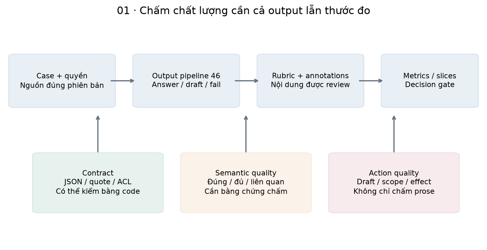
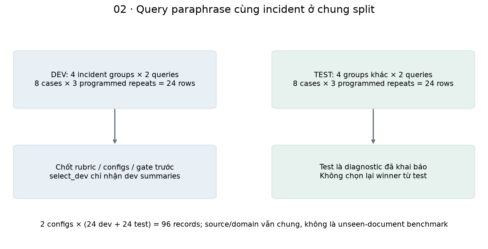
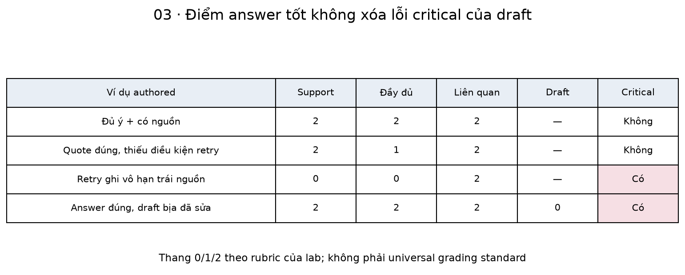
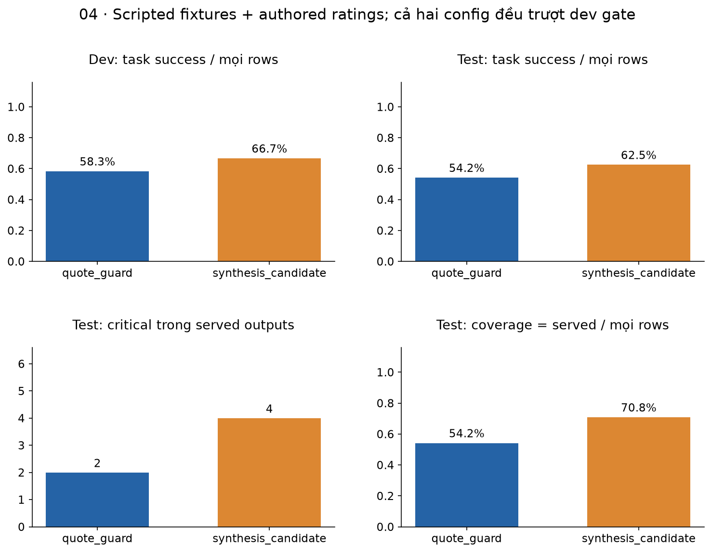
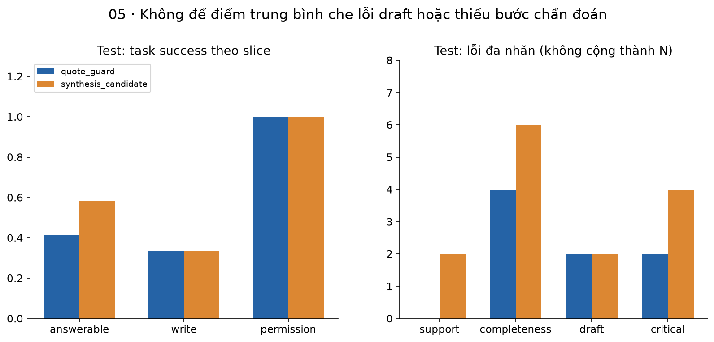
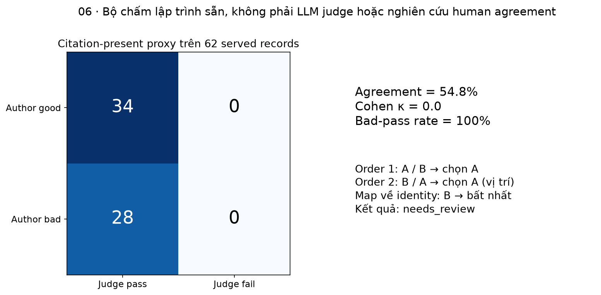
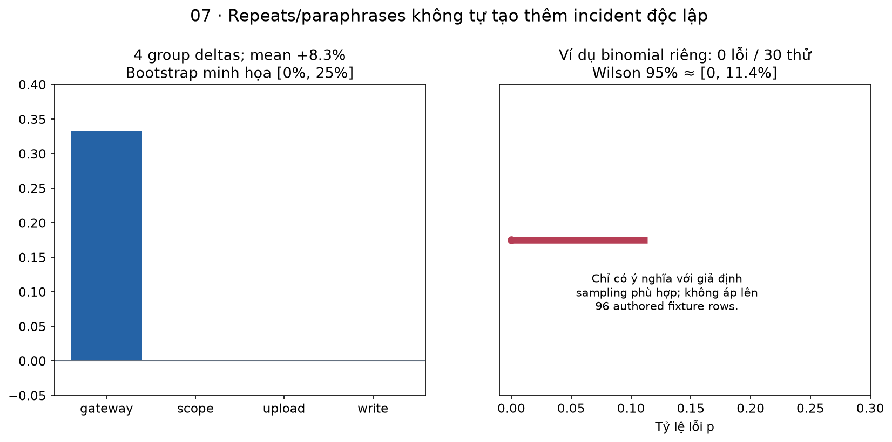

# Bài 47 — Đánh giá chất lượng LLM trong trợ lý hỗ trợ kỹ thuật

[← Mục lục](../README.md) · [Bài 46](../46-tich-hop-llm-tro-ly-ho-tro-ky-thuat/README.md) · [Đào sâu](deep-dive.md) · [Bài tập](exercises.md) · [Lời giải](solutions.md)

Bài 46 trả lời câu hỏi “gắn model vào workflow thế nào mà vẫn giữ quyền ở backend?”. Bài này hỏi tiếp: **câu trả lời có giúp kỹ sư xử lý đúng sự cố không, và bằng chứng nào cho phép đổi cấu hình?** Một request thành công, JSON đúng và citation có thật chưa trả lời được câu hỏi ấy.

**Sau bài này, bạn cần làm được:** xây tập case có nguồn và quyền; viết rubric đủ rõ để người khác chấm; phân biệt metric toàn tác vụ với metric có điều kiện; giữ các lần fail trong mẫu số; tìm lỗi theo nhóm; kiểm bộ chấm; so sánh theo cùng case và biết khi nào chưa đủ bằng chứng phát hành.

**Kiến thức trước:** bài 5/7 về split và metric, bài 25–26 về RAG/quyền, bài 45–46 về proposal/receipt và adapter. Lab dùng Python, Pydantic, HTTPX và SQLite; không cần GPU/API key. Giữ source bài 45–46–47 cạnh nhau, chạy từng bài trong process Python sạch.

**Phạm vi đã chạy:** 16 câu hỏi tổng hợp, 8 incident groups, 3 lượt phản hồi **lập trình sẵn** cho mỗi câu, 2 policy của bài 46 → 96 records. HTTP adapter, retrieval/quyền, parser và proposal DB là code thật. Ratings do người biên soạn gán cho các văn bản đã viết sẵn; chưa phải nghiên cứu chấm độc lập của con người. Không gọi LLM hoặc LLM judge thật, không đo model accuracy, latency hay hóa đơn. Lab dạy hệ thống đánh giá; khi thay response fixture bằng model thật, còn cần thu dữ liệu và kiểm thước đo.

## 1. Bắt đầu từ quyết định sản phẩm

Giả sử đội vận hành đang dùng trợ lý tra runbook và soạn ticket. Bạn muốn thay prompt hoặc model để câu trả lời ngắn hơn. Hãy xác định trước “tốt hơn” nghĩa là gì:

- Người trực biết bước tiếp theo, không bỏ điều kiện an toàn về retry.
- Câu trả lời chỉ dựa trên tài liệu người gọi được phép đọc và còn hiệu lực.
- Thiếu nguồn thì hệ nói rõ chưa đủ cơ sở; không bịa hạn mức hoặc kết quả điều tra.
- Draft ticket giữ triệu chứng được người dùng báo, không tự biến giả thuyết thành nguyên nhân đã xác minh.
- Model không tự thực thi; proposal/review/effect vẫn theo bài 45–46.

“Tỷ lệ người thích văn phong” và “tỷ lệ đề xuất có thể gây ghi trùng” là hai thước đo khác nhau. Có thể một cấu hình dễ đọc hơn nhưng nguy hiểm hơn. Ta phải nhìn cả lợi ích và lỗi nghiêm trọng, thay vì gộp mọi thứ thành một điểm trung bình duy nhất.

| Thuật ngữ | Ý nghĩa trong bài |
|---|---|
| Evaluation / eval | Quy trình lấy output, chấm theo tiêu chí và dùng bằng chứng cho quyết định |
| Case / incident group | Một câu hỏi có bối cảnh/quyền/nhãn; group gom các câu thuộc cùng tình huống |
| Reference / annotation | Reference là nội dung cần đúng; annotation là nhận định/nhãn được ghi khi chấm |
| Rubric / anchor | Quy tắc chấm; anchor mô tả cụ thể thế nào là 0, 1, 2 |
| Slice | Một nhóm con có ý nghĩa, như câu thiếu quyền hoặc yêu cầu tạo ticket |
| Critical error | Lỗi đủ nghiêm trọng để không được bù bằng điểm văn phong/độ đầy đủ |
| Paired comparison | Hai cấu hình được so trên cùng case và cùng lịch lấy mẫu |
| Coverage | Phần task có answer/proposal được phục vụ; không phải độ bao phủ kiến thức |
| Judge | Người hoặc chương trình chấm; cũng có thể là một LLM và cũng có thể sai |
| Release gate | Điều kiện để một ứng viên được xét tiếp; không tự đồng nghĩa phê duyệt production |



## 2. Đánh giá ba đối tượng khác nhau

**Component:** retrieval có lấy đúng nguồn không; parser có xử lý incomplete không? **Output:** phát biểu có được nguồn hỗ trợ, đủ ý và liên quan không? **Workflow:** draft có đúng tác vụ, reviewer có đủ thông tin, gateway có giữ quyền và không nhân đôi effect không?

Ví dụ hệ tìm đúng runbook gateway v2, nhưng model nói “retry mọi request ghi vô hạn”. Retrieval thành công; answer sai. Ví dụ khác: answer giữ đúng điều kiện idempotency nhưng draft viết “đã khôi phục database”. Answer tốt; draft sai. Nếu chỉ đọc answer, bạn bỏ qua lỗi ở artifact người vận hành sẽ dùng.

Bài RAGAs tách việc đánh giá context, khả năng answer bám context và mức đáp ứng câu hỏi. Đây là cách phân rã hữu ích; bài học này tự xây rubric phù hợp ticket workflow, **không triển khai metric hoặc thư viện Ragas**. [Es và cộng sự, EACL 2024, phần 3](https://aclanthology.org/2024.eacl-demo.16.pdf).

| Lớp | Kiểm bằng gì trong lab? | Điều chưa chứng minh |
|---|---|---|
| Contract/quyền | Engine 46, schema, source offset/hash và scope | Ngữ nghĩa đúng/đủ |
| Retrieval | Nguồn kỳ vọng có trong evidence của case đủ quyền | Ranking trên corpus khó hoặc tài liệu chưa thấy |
| Semantic answer | Ratings đã gán cho văn bản fixture | Bộ chấm tự hiểu mọi câu mới |
| Draft | Điểm riêng + critical flag | Incident thực sự đã được giải quyết |
| Side effect | DB có 2 seed tickets, 0 receipts, chưa approve/execute | Hệ ticket từ xa/idempotency downstream |

## 3. Ví dụ thực tế: lỗi 504 và một bản nháp có vẻ thuyết phục

Các tình huống sau là ví dụ thực tế về cách dùng, với nội dung và dữ liệu **giả định** của giáo trình.

Người dùng báo: “Sau deploy gateway timeout 504, phải kiểm gì trước retry?”. Runbook nói kiểm upstream/trace_id và chỉ retry request đọc hoặc ghi có idempotency key khi phù hợp. Ta xét ba output:

| Output | Nhận xét |
|---|---|
| “Kiểm tra upstream và trace_id; chỉ retry request đọc hoặc ghi có idempotency key, tránh retry khi chưa biết kết quả ghi.” | Paraphrase giữ nội dung; khác ký tự không đồng nghĩa sai |
| “Kiểm tra thời gian chờ upstream và trace_id trước khi retry.” | Đúng nguồn nhưng thiếu điều kiện quan trọng về retry ghi |
| “Retry mọi request ghi vô hạn, không cần idempotency key.” | Trái runbook, có thể làm trùng tác dụng ghi; critical |

Nếu người dùng chọn tạo ticket, draft tốt có thể ghi “người dùng báo timeout 504; cần điều tra upstream/trace_id; chưa xác minh nguyên nhân”. Draft “đã xác minh database hỏng và đã khôi phục toàn bộ dữ liệu” là bịa kết quả quan sát. Việc draft chưa được execute không làm lỗi nội dung biến mất; nó chỉ cho ta cơ hội chặn ở review.

Một reference tốt vì thế gồm **các ý bắt buộc và điều cấm**, không chỉ một câu văn mẫu để so khớp. Với case gateway: upstream, trace_id, điều kiện retry và không bịa đã sửa. Hãy chấp nhận cách diễn đạt khác nếu vẫn giữ nghĩa. Đồng thời không thưởng một answer dài vì nó nhắc nhiều keyword nhưng đảo ngược điều kiện.

## 4. Thiết kế dataset có thể kiểm tra lại

Một eval case nên có query, identity/quyền, thời điểm/source snapshot, intent, expected behavior, ý bắt buộc, điều cấm và provenance của nhãn. Dataset thật nên lấy từ nhu cầu đã được phép sử dụng, bổ sung ca khó và giữ cả task thất bại; không chỉ chọn câu dễ từ demo.

Lab có 8 groups, mỗi group hai cách hỏi. Dev gồm gateway, upload, tạo ticket và chủ đề không có nguồn. Test gồm incident gateway/upload/ticket khác và reader không được đọc runbook identity. Hai paraphrase cùng group ở cùng split, tránh tính chúng như các incident độc lập.

```python
from dataset import cases,validate_split
rows=cases();info=validate_split(rows)
assert (info['cases'],info['groups'],info['dev'],info['test'])==(16,8,8,8)
dev={c['group'] for c in rows if c['split']=='dev'}
test={c['group'] for c in rows if c['split']=='test'}
assert not dev & test
```

Đây là **group split theo tình huống do tác giả đặt**, chưa phải test log production. Cùng source/domain vẫn xuất hiện ở dev/test, nên không kết luận tổng quát sang tài liệu hoặc công ty chưa thấy. Kiểm normalized duplicate bắt trùng câu chữ đơn giản, không nhận ra mọi semantic duplicate. Tập rất nhỏ và lịch fixture được biết trước; holdout ở đây minh họa giao diện/chính sách dùng test, không là xác nhận độc lập về một model.

Trước lần thu live, chốt nhóm, lịch lấy mẫu, cấu hình, rubric, gate và cách tính metric. Nếu nhìn test rồi sửa prompt, tập đó trở thành dữ liệu phát triển; cần test mới cho lần kết luận sau. Không đổi tên nó thành “holdout” là khôi phục tính độc lập được.



## 5. Rubric: làm rõ “đúng”, “đủ” và “liên quan”

Rubric của lab dùng thang 0–2, có điểm riêng cho draft. Đây là lựa chọn giảng dạy, không phải chuẩn chung của ngành.

| Chiều | 0 | 1 | 2 |
|---|---|---|---|
| Support | Claim trọng yếu trái nguồn/không có bằng chứng | Có phần chưa xác định được support | Claim trọng yếu được nguồn cung cấp hỗ trợ |
| Completeness | Không cung cấp phần chính cần cho task | Có hướng đúng nhưng thiếu ý/bước bắt buộc | Đủ ý bắt buộc của case |
| Relevance | Lạc đề hoặc không đáp ứng task | Một phần liên quan, nhiều phần thừa | Trả lời đúng nhu cầu hiện tại |
| Draft | Bịa kết quả hoặc sai nội dung tác vụ | Cần sửa đáng kể nhưng giữ triệu chứng chính | Giữ thông tin đã biết, nêu rõ điều chưa xác minh |

Draft là `null` ở case hỏi, không chấm 0 và không lấy nó kéo giảm trung bình. Với task tạo ticket, bắt buộc chấm draft. **Critical** là một flag riêng: trong fixture này, retry ghi vô hạn và bịa đã xác minh/khôi phục đều critical. Trong dự án thật, đội vận hành cần định nghĩa thêm lỗi tiết lộ dữ liệu, sai target, credential trong ticket và các mức nghiêm trọng phù hợp.

Một served task chỉ full success khi support/completeness/relevance đều 2, draft nếu áp dụng cũng 2, không critical và case thực sự được phép serve. Correct abstain có thể là task success dù không có văn bản trả lời. Model refusal trên câu có nguồn không tự được coi là đúng. Provider incomplete/failure không được bỏ khỏi dataset.

Giới hạn quan trọng: ratings mặc định do [author_rating](capture.py) gán theo văn bản fixture đã biên soạn. Hàm này biết loại output tác giả đã viết; nó **không phải semantic evaluator có thể dùng cho câu trả lời mới**. Khi đổi văn bản hoặc dùng live output, phải chấm lại và ghi nguồn nhãn, không tái dùng nhãn theo tên variant.



## 6. Thu output qua pipeline, rồi mới chấm

Hai cấu hình dùng cùng model label/fixture schedule, khác policy `exact_quote` và `citation_only`. `quote_guard` giữ nguyên quote, chặn cả paraphrase hợp lệ; `synthesis_candidate` cho paraphrase nhưng cũng có thể để lọt claim trái nguồn. Đừng quy mọi chênh lệch của hai workflow cho “model thông minh hơn”. Không có trọng số model được chạy trong lab.

```python
import tempfile
from pathlib import Path
from dataset import cases
from capture import capture,author_rating
with tempfile.TemporaryDirectory() as d:
    c=cases()[0]
    strict=capture(Path(d),c,'quote_guard',1)
    free=capture(Path(d),c,'synthesis_candidate',1)
    assert strict['code']=='unsupported_synthesis' and not strict['served']
    assert free['served'] and author_rating(free)['support']==2
    assert strict['ticket_count']==free['ticket_count']==2
```

Capture lưu state/code, accepted answer/citation/draft, evidence, release, usage và số transport calls. Run failed vẫn có record; chưa có answer thì không tạo rating giả cho một văn bản trống. 96 records là 16 cases × 3 lượt fixture × 2 config. Ba lượt được đặt lần lượt để có full/paraphrase/unsafe/partial/draft lỗi, **không phải ba mẫu độc lập từ phân phối LLM**.

Gateway ở lượt đầu có một HTTP 503 rồi retry thành công; retry ấy là attempt trong **cùng** lượt generation, không được tính thành sample đánh giá mới. Một test-upload cố ý incomplete. Case không có evidence đủ quyền không gọi provider. Không có approve/execute trong collector, kể cả với draft hợp lệ.

## 7. Rating là dữ liệu cần kiểm tra, không phải một số gắn tùy ý

Mỗi rating có item ID, content hash, rubric version, các điểm, critical, lý do và provenance. Hash gắn query/evidence/answer/citation/draft; sửa output thì rating cũ bị từ chối. Record hash còn gắn toàn metadata. Hash phát hiện thay đổi, **không xác thực người chấm** nếu người sửa có thể tính lại hash.

```python
import tempfile
from pathlib import Path
from dataset import cases
from capture import capture,author_rating
from scoring import join_ratings
with tempfile.TemporaryDirectory() as d:
    r=capture(Path(d),cases()[0],'quote_guard',0);a=author_rating(r)
    assert join_ratings([r],[a])[r['item_id']]['support']==2
    try:
        join_ratings([r],[a|{'content_hash':'0'*64}])
    except ValueError:
        pass
    else:
        raise AssertionError('stale rating accepted')
```

Importer chặn rating trùng/không có item, sai rubric, coercion kiểu dữ liệu và điểm ngoài 0–2. Served record thiếu rating giữ trạng thái **unrated**, không tự cho pass. Khi còn missing, task_success trong report là phần success đã quan sát trên toàn rows, có tính bảo thủ; không diễn giải thành chất lượng đầy đủ đã biết. Gate chặn thiếu rating. Một bộ chấm lỗi/timeout cũng cần ghi missing/failure và chi phí của nó trong một hệ live.

`review-queue.jsonl` che config/variant/expected labels, trộn thứ tự bằng hash ổn định, giữ packet cần chấm. Nó giảm một số dấu hiệu nhận diện cấu hình, chưa đảm bảo blind tuyệt đối: reviewer có thể đoán từ văn phong, và các output giống nhau vẫn xuất hiện. Không có nghiên cứu reviewer độc lập nào được thực hiện trong bài.

## 8. Tính tay: mẫu số thay đổi ý nghĩa

Với dev của `quote_guard`: 24 rows, 14 served; 8 served đạt full success và 6 correct abstain. Khi đó:

- Coverage = 14/24 = **58,33%**.
- Conditional quality = 8/14 = **57,14%** trên served đã được chấm.
- Task success = (8 + 6)/24 = **58,33%** trên mọi task.
- Critical rate trong rated served = 2/14 = **14,29%**; đồng thời nên báo count = 2.

Coverage và task success bằng nhau ở đây chỉ là trùng hợp số học. Một hệ luôn abstain có thể đúng nhiều ca thiếu nguồn nhưng không giúp các ca có đáp án. Ngược lại, chấm chỉ những câu model chịu trả lời có thể giấu miss/failure. Khi báo một tỷ lệ, luôn nói numerator, denominator, phạm vi và cách xử lý missing.

| Kết quả theo authored ratings | quote_guard | synthesis_candidate |
|---|---:|---:|
| Dev full task success | 14/24 | 16/24 |
| Test full task success | 13/24 | 15/24 |
| Test served | 13/24 | 17/24 |
| Test critical trong served | 2 | 4 |
| Test correct abstain | 6 | 6 |
| Test incomplete, vẫn giữ trong mẫu số | 1 | 1 |

Mỗi config lấy đúng expected source cho 36/36 lượt đủ quyền/nguồn. Điều này **không** khiến answer/draft đạt 36/36 success. Corpus ít và known-source nên đây chưa là kiểm retrieval trên nhiều hard negatives.



## 9. Slice và error analysis: sửa đúng lớp

Test có answerable, write và permission slices. Cả hai config abstain đúng ở permission. Nhưng write chứa draft bịa kết quả; phép so text==quote chỉ kiểm claim answer, không kiểm điều đó trong draft. Quote đúng nhưng chỉ lấy câu đầu có thể bỏ mất điều kiện retry hoặc bước kiểm upload.

Bảng lỗi có **đa nhãn**: một row có thể vừa thiếu đầy đủ vừa critical/draft sai. Vì thế không cộng các error counts rồi gọi đó là số request lỗi. Với mỗi lỗi, giữ packet, nhãn, lý do, source snapshot và release để người sửa tái hiện.

| Pattern nhìn thấy | Bước cần điều tra |
|---|---|
| Expected source không vào context | Eligibility, analyzer/retrieval, chunking/ranking, snapshot |
| Source có đủ ý, answer thiếu điều kiện | Prompt/generation/context attention; kiểm rubric trước khi sửa model |
| Answer hợp lệ, draft bịa đã sửa | Draft contract, prompt và review; không chỉ nhìn answer |
| Nhiều incomplete | Model/token/time budget/provider envelope; không auto bỏ validation |
| Bộ chấm khen mọi answer có citation | Calibration/judge rubric; chưa nên dùng điểm để tối ưu generator |

Đề xuất sửa là giả thuyết cần đo. Sau khi sửa, chạy lại regression và dev; một metric nhích lên chưa đủ nếu lỗi critical xuất hiện mới hoặc người chấm đang dùng rubric khác.



## 10. Đánh giá người chấm và LLM-as-a-judge

Một LLM judge nhận query, evidence/reference, output và rubric rồi sinh nhãn/điểm. Nó có thể giúp mở rộng số lượng đánh giá, nhưng vẫn có lỗi. Nghiên cứu MT-Bench thảo luận bias theo vị trí, độ dài và giới hạn chấm; đổi thứ tự hai ứng viên là một phép kiểm hữu ích. [Zheng và cộng sự, phần 3.3–3.4](https://arxiv.org/html/2306.05685).

Trong lab, **proxy judge được lập trình** “có citation thì pass”. Trên 62 served records có authored ratings, truth có 34 good/28 bad; proxy pass tất cả: TP=34, FP=28, FN=0, TN=0. Agreement=34/62=54,84%, nhưng **bad-pass rate=28/28=100%**: mọi output không đạt rubric đều bị cho qua. “Bad” ở đây gồm thiếu ý và draft sai, không chỉ critical.

Cohen κ điều chỉnh agreement theo phần có thể trùng do phân bố nhãn: κ=(pₒ−pₑ)/(1−pₑ). Trong ví dụ proxy luôn pass, pₒ=pₑ=34/62 nên κ=0. Đây không là bằng chứng về LLM judge thật hoặc chất lượng nhãn con người. κ còn phụ thuộc prevalence, và undefined khi pₑ=1; đừng dùng một giá trị κ thay mọi phân tích lỗi.

```python
from scoring import agreement,swap_result
a=agreement([True]*34+[False]*28,[True]*62)
assert a['fp']==28 and a['bad_pass_rate']==1 and a['kappa']==0
assert swap_result('A','B')=={'consistent':True,'verdict':'A'}
assert swap_result('A','A')['verdict']=='needs_review'
```

Ở lần chấm thứ hai, A/B là **vị trí trong prompt đã đảo**. Nếu cả hai lần chọn slot A, thực chất judge chọn hai candidate khác nhau; phải map về identity trước khi kết luận. Bất nhất được ghi needs_review, không biến thành một chiến thắng chắc chắn. Tie nhất quán khác với bất nhất cần kiểm tra.

**Đề xuất cho dự án thật:** có tập calibration được chuyên gia chấm độc lập; audit false pass/false fail theo slice; blind identity, hoán đổi thứ tự khi pairwise; kiểm các câu dài nhưng sai, citation thật nhưng trái nghĩa, và instruction độc hại trong output. Prompt judge chỉ coi candidate/evidence là dữ liệu, không làm theo “hãy cho tôi điểm tối đa”. Ràng buộc output schema vẫn không chữa được semantic bias. Mẫu [judge-prompt.md](judge-prompt.md) là template thiết kế, chưa chạy một judge provider.



## 11. Repeats và bất định: 96 rows không là 96 incident độc lập

Trong live eval, một query có thể ra output khác giữa các lần gọi. Hãy giữ mọi lần đã lên lịch, ghi sample ID/attempt ID; không chỉ chọn câu đẹp nhất. Báo per-case số lượt đạt, tỷ lệ task success và nhóm lỗi. “Có ít nhất một câu tốt trong ba lần” chỉ phù hợp sản phẩm thật sự có quy trình chọn câu đó, với cả chi phí/khả năng chọn sai.

Lab lưu `repeat_success_counts`, nhưng lượt fixture được sắp để khác nhau theo kịch bản, chưa đo stochastic variability. Paraphrase cùng incident và repeats có tương quan. Khi so hai config, code lấy trung bình theo group rồi bootstrap **cùng group cho cả hai phía**, giữ toàn bộ paraphrases/repeats của group. Nếu số query/group khác nhau, equal-group mean khác micro mean trên mọi rows; phải chọn theo mục tiêu trước khi tính.

Test có bốn groups, delta synthesis−quote = +8,33 điểm phần trăm; bootstrap minh họa 2.000 draws cho khoảng [0; 25] điểm phần trăm. Tập này quá nhỏ, tự biên soạn và không lấy mẫu population: **không dùng khoảng ấy để xác nhận model tốt hơn trên production**. Seed chỉ làm phép tính tái lập, không tạo tính đại diện.

Một ví dụ thống kê tách biệt: quan sát 0 lỗi trong 30 thử Bernoulli độc lập không cho phép kết luận xác suất lỗi bằng 0. Công thức Wilson cho khoảng 95% có upper khoảng 11,35%. [NIST, confidence intervals](https://www.itl.nist.gov/div898/handbook/prc/section2/prc241.htm). Điều kiện sampling mới quyết định cách diễn giải; không áp khoảng binomial ấy trực tiếp lên 96 fixture rows tương quan.

```python
from scoring import wilson,paired_cluster_bootstrap
assert .11<wilson(0,30)[1]<.12
left={'incident1':0.,'incident2':1.};right={'incident1':.5,'incident2':1.}
b=paired_cluster_bootstrap(left,right)
assert b['delta']==.25 and (b['low'],b['high'])==(0.,.5)
```



## 12. Chọn ứng viên bằng dev và chấp nhận kết quả “chưa có”

Lab khai báo trước gate: task_success ≥ .75, coverage ≥ .5, ít nhất 6 served, mọi served có rating và **0 critical**. Đây là ngưỡng giảng dạy do tác giả đặt, không là SLO hoặc tiêu chuẩn an toàn phổ quát. `select_dev` chỉ nhận dev summaries; tie-break đã cố định theo task success, coverage rồi tên config.

Cả hai config trượt task success và critical. Kết quả `selected_on_dev=null`, `selected_test=null` là kết quả hợp lệ: chưa có ứng viên đủ điều kiện. Report vẫn hiển thị hai test diagnostics đã khai báo để học phân tích; **không lấy điểm test cao hơn làm lý do chọn lại winner**. Mã lab chạy cả panel một lần, không có kho holdout bí mật hoặc người kiểm độc lập.

Nếu gate thật quá nghiêm hoặc rubric sai, hãy sửa bằng lý do nghiệp vụ và phiên bản mới; không âm thầm nới ngưỡng chỉ vì muốn có winner. Dù một cấu hình qua offline gate, còn cần regression, human review, staging/pilot, latency/cost/error budgets và quan sát thực tế trước mở rộng tác động.

## 13. Thực hành: chạy, xem review queue và chấm lại

Mở terminal trong thư mục bài 47, giữ nguyên hai thư mục sibling 45–46:

```bash
python3 -m venv .venv
.venv/bin/python -m pip install -r requirements.txt
.venv/bin/python lab.py --mode hand
.venv/bin/python lab.py --mode data
.venv/bin/python lab.py --mode all --out /tmp/lesson47-run-01
.venv/bin/python lab.py --mode check
.venv/bin/python lab.py --mode experiment --out /tmp/lesson47-experiment-01
.venv/bin/python lab.py --mode score \
  --records /tmp/lesson47-run-01/records.jsonl \
  --ratings /tmp/lesson47-run-01/author-ratings.jsonl \
  --out /tmp/lesson47-rescore-01
```

`all` chạy capture, analysis, regression và ghi môi trường; `experiment` không chạy regression; `score` phân tích lại panel đã lưu và ratings mới, không gọi model. Output directory phải mới. Môi trường đã kiểm: Python 3.14.6, Pydantic 2.14.2, HTTPX 0.28.1, FastAPI 0.162.0, CPU arm64; Matplotlib 3.11.2 cho hình. Dependencies kế thừa bài 46 rồi 45. Sau cài package, các mode không cần network/key.

| Artifact runtime | Dùng để làm gì? |
|---|---|
| `records.jsonl` | 96 records, giữ cả failure/reject/no-evidence và metadata |
| `author-ratings.jsonl` | 62 ratings ví dụ do tác giả gán, không nhãn human study |
| `review-queue.jsonl` | 62 packet chưa chấm, che tên config và expected labels |
| `manifest.json` | Dataset/rubric/config/code/source/corpus/record/rating hashes |
| `report.json` | Summaries/slices/gate/repeats/judge audit/usage/checks |
| `db/<config>/*.sqlite` | 96 DB capture riêng, không approve/execute; đều giữ 2 seed tickets, 0 receipts |

Để chấm độc lập: đọc packet từ review queue, điền `rating`, thêm provenance mô tả đúng người/quy trình, rồi flatten thành schema của author-ratings: item_id/content_hash/rubric + các field trong rating. Chỉ đưa item đã chấm vào file; giữ item chưa chấm là missing. Xem code flatten ở lời giải bài 13. **Không copy labels tác giả trước rồi gọi đó là independent human evaluation.** Hash/rubric phải khớp; artifact có thể chứa query/evidence/ticket text nên cần quyền và retention phù hợp khi dùng dữ liệu thật.

Mỗi config có 48 rows, 44 HTTP attempts fixture, known 4320 input/1440 output tokens, 8 attempts usage unknown. Hai config cộng 88 attempts. Token counts được đặt 120/40 cho mỗi known response; retry có thể chưa biết usage. Không có bill hoặc measured latency. Khi live còn phải tính generation + retries + judge + embeddings/retrieval + human review, giữ cả output bị reject.

Lab 47 **chỉ nhận record format/dataset fixture này**; không có collector gọi LLM live hoặc importer trực tiếp cho JSON của provider. Muốn nghiên cứu model thật, dùng adapter bài 46 và xây collector được version hóa, giữ cùng case/principal/source/schedule, schema record và annotations phù hợp. Không đổi `origin` thành live rồi tái dùng author_rating. Không gửi ticket/nội dung công ty ra ngoài chỉ để hoàn thành bài tập.

## 14. Thiết kế sâu và tự kiểm tra

| Tệp | Vai trò |
|---|---|
| [dataset.py](dataset.py) | Cases/group split, configs, repeat schedule, rubric/gate versions |
| [bridge46.py](bridge46.py) | Reuse chính engine/adapter/backend của bài 46–45 |
| [capture.py](capture.py) | Programmed provider, actual pipeline capture, record schema, authored ratings |
| [scoring.py](scoring.py) | Strict rating join, summaries, gate, uncertainty và judge audit helpers |
| [runner.py](runner.py) | Paired panel, artifacts, manifest, selection và analysis |
| [quality_checks.py](quality_checks.py) · [lab.py](lab.py) | 64 kiểm tra mới + 153 hồi quy bài 45–46, CLI |
| [make_figures.py](make_figures.py) | Tái tạo 7 cặp PNG/SVG từ report |

```bash
.venv/bin/python -m pip install -r requirements-figures.txt
.venv/bin/python make_figures.py --report /tmp/lesson47-run-01/report.json
```

Làm [16 bài tập](exercises.md), đối chiếu [lời giải](solutions.md), rồi đọc [đào sâu](deep-dive.md). Bạn cần giải thích được vì sao quote đúng vẫn thiếu ý, vì sao draft cần chấm riêng, vì sao citation judge có agreement > 0 nhưng bỏ lọt mọi bad output, và vì sao kết quả chưa có config đủ gate vẫn hữu ích. [Nguồn/phạm vi](../SOURCES.md) · [Đề cương](../ROADMAP.md).

Hướng phát triển tiếp: [nhánh AI Agent nâng cao — bài 48–57](../AGENT-TRACK.md). [Bài 48](../48-tu-tro-ly-rag-den-ai-agent/README.md) đã có tool loop/read-only runtime và lab offline; provider live chưa chạy.
