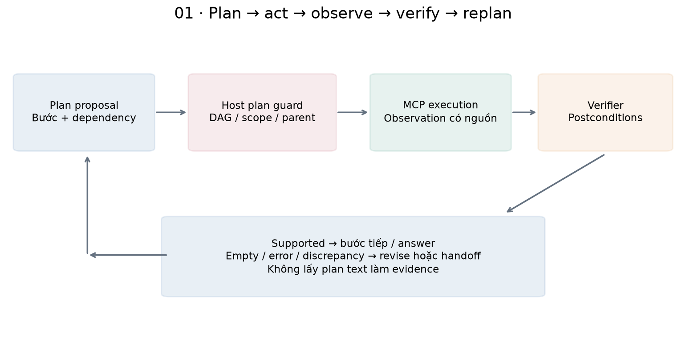
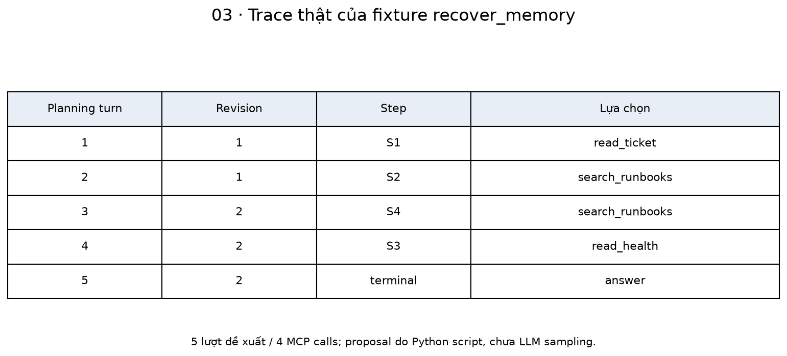
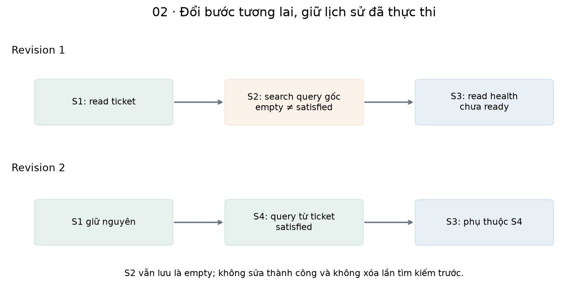
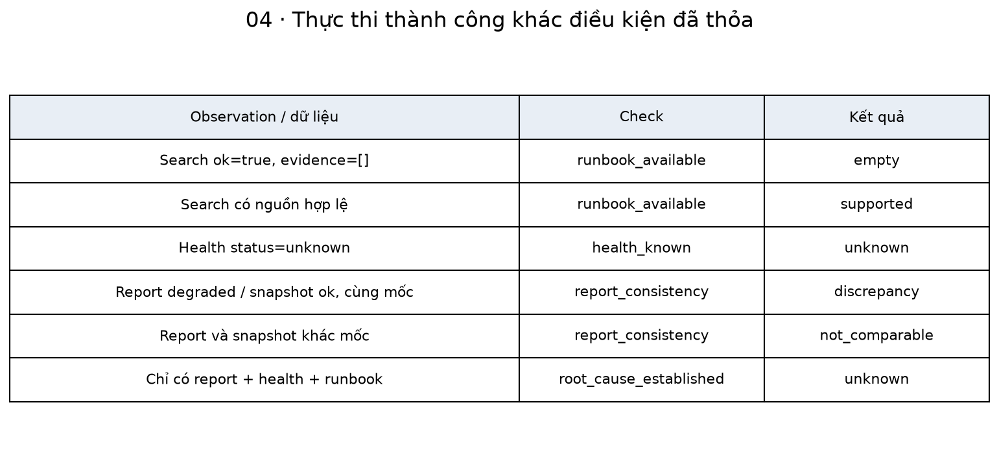
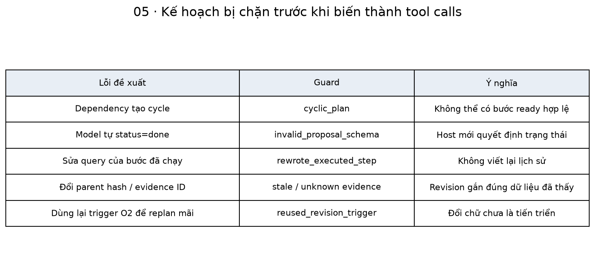
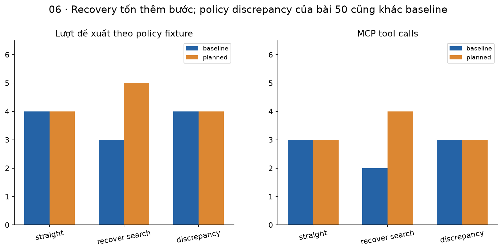
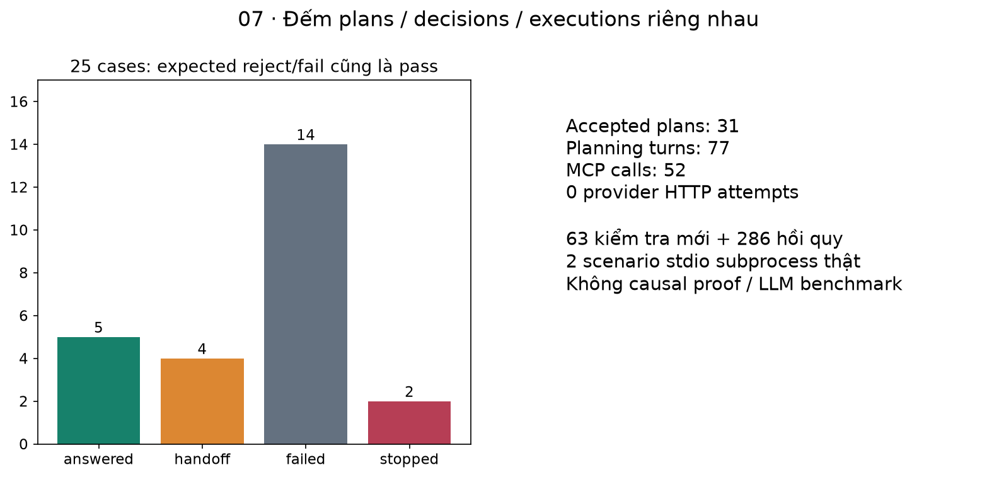

# Bài 50 — Lập kế hoạch, kiểm chứng và đổi kế hoạch cho agent

[← Mục lục](../README.md) · [Bài 49](../49-thiet-ke-tool-tich-hop-mcp/README.md) · [Nhánh AI Agent](../AGENT-TRACK.md) · [Đào sâu](deep-dive.md) · [Bài tập](exercises.md) · [Lời giải](solutions.md)

Agent bài 48–49 đã chọn và gọi tool có kiểm soát. Tuy nhiên “đã gọi tool” chưa có nghĩa “đã thu được bằng chứng cần thiết”. Search có thể trả rỗng; health có thể unknown; snapshot có thể khác lời báo sự cố. Bài này thêm kế hoạch có cấu trúc và bộ kiểm điều kiện để agent biết khi nào đi tiếp, đổi cách tìm dữ liệu hoặc chuyển người xử lý.

**Sau bài này, bạn cần làm được:** viết plan ngắn có dependency/postcondition; tách plan khỏi evidence và authority; tính trạng thái bước từ observation; sửa bước tương lai mà giữ lịch sử; kiểm parent/evidence của revision; phân biệt discrepancy với nguyên nhân đã xác minh; đặt ngân sách chống replan vô hạn; đọc kết quả so baseline đúng phạm vi.

**Kiến thức trước:** bài 28–30, 45–49. Source chạy phụ thuộc 45–46–48–49–50, giữ các thư mục cạnh nhau và dùng process Python sạch. Runtime/tool/final gate và MCP của bài 49 được tái sử dụng, không sửa code các bài cũ.

**Đã chạy:** 25 kịch bản, 63 kiểm tra mới + 286 hồi quy; MCP client/server thật, trong đó 2 scenario `stdio` subprocess. Planner là **Python script tạo structured proposals**, verifier là code cho các điều kiện fixture; không gọi LLM/provider, không model/judge benchmark. Không phải formal planner, causal verifier hoặc agent production. Lớp 50 dùng planning port/prompt riêng; chưa có live adapter cho schema plan+action này.

## 1. Kế hoạch khác lời kể “tôi sẽ làm gì” thế nào?

Một plan hữu ích cho runtime cần mô tả bước, args, điều kiện trước và kết quả quan sát mong đợi. Văn bản “đọc ticket, điều tra nguyên nhân rồi sửa lỗi” chưa chỉ ra dữ liệu nào chứng minh từng phần hoàn thành. Nếu model tự gắn chữ “done”, ta vẫn chưa có evidence.

| Thuật ngữ | Ý nghĩa trong bài |
|---|---|
| Plan / revision | Phương án thực hiện tạm thời; phiên bản thay đổi có lineage |
| Step / dependency | Một bước; những bước phải thỏa điều kiện trước nó |
| Postcondition | Điều kiện có thể kiểm từ observation sau khi chạy bước |
| Hypothesis | Giả thuyết cần kiểm, chưa là sự thật đã biết |
| Verifier / guard | Code kiểm điều kiện; guard chặn đề xuất không hợp lệ |
| Discrepancy | Hai nguồn/báo cáo khác nhau, cần làm rõ, chưa tự chỉ ra bên nào sai |
| Replanning | Thay phương án theo dữ liệu mới, không viết lại lịch sử |
| Progress / handoff | Tiến triển có căn cứ; chuyển người khi chưa đủ cơ sở/khả năng |

ReAct nghiên cứu việc đan xen suy luận và hành động để lấy thông tin từ môi trường. Ở lượt biên soạn này chỉ đọc [abstract/metadata của ReAct](https://arxiv.org/abs/2210.03629), không tái hiện benchmark. Lab tự thiết kế plan/guard cho tình huống ticket, không triển khai nguyên bài báo hoặc thu chain-of-thought của model.



## 2. Ví dụ thực tế: hỏi mơ hồ, ticket có triệu chứng cụ thể

Tình huống giả định: câu hỏi ban đầu là “mã XQ7 ở cổng khách hàng”. Query này không khớp runbook hiện có. Ticket được cấp quyền đọc chứa report có symptom “gateway timeout 504 upstream trace_id”. Đó là dữ kiện người dùng báo, đủ để đề xuất query tìm kiếm khác; chưa chứng minh nguyên nhân gốc.

Kế hoạch ban đầu:

| Step | Action | Dependency | Postcondition |
|---|---|---|---|
| S1 | read_ticket(1) | Không | ticket_observed |
| S2 | search_runbooks(query ban đầu) | S1 | runbook_available |
| S3 | read_health() | S2 | health_known |

Nếu S2 trả ok=true nhưng evidence=[], tool **đã thực thi** còn runbook_available **chưa thỏa**. S3 chưa ready theo dependency của plan đó. Agent có thể replan: giữ S1/S2 đã chạy, thêm S4 search theo symptom thực sự thấy ở ticket, rồi cho S3 phụ thuộc S4.

```python
from bridge50 import task
from policy50 import initial_plan
from plan_guard import PlanGuard
p=initial_plan(task());g=PlanGuard();g.accept(p,[],task())
assert g.states([])=={'S1':'ready','S2':'pending','S3':'pending'}
assert p['steps'][1]['postcondition']=='runbook_available'
```

Plan này là DAG nhỏ có thứ tự phụ thuộc, không “lệnh cho model phải trả lời được bằng mọi giá”. Một plan có thể dẫn đến handoff đúng khi không còn cách lấy dữ liệu hữu ích trong scope/budget.

## 3. Plan là ứng viên; runtime giữ state và quyền

Plan schema gồm revision, parent_hash, trigger, based_on, intent và steps. Step có id/tool/args/depends_on/postcondition. Không có status=done hoặc budget=999 để model tự đánh dấu tiến độ/tăng quyền.

| Nhóm | Model/script đề xuất | Host quyết định |
|---|---|---|
| Kế hoạch | Các bước và dependency | Schema, DAG, scope, tool/args hợp lệ |
| Tiến độ | Đề nghị bước tiếp | Trạng thái tính từ observations, bước có ready không |
| Revision | Lý do và evidence IDs | Parent đúng, trigger có căn cứ, còn ngân sách |
| Kết luận | Guidance/handoff | Đủ postconditions/current permission/source để accept |
| Thực thi | Tool name/args trong plan | Runtime 48/MCP 49 vẫn kiểm allowlist/role/target/budget |

Intent của plan chỉ là `investigate` hoặc `request_clarification`. Nó không đổi task goal, principal, target hoặc authorization. Handoff để cần thêm dữ liệu không đồng nghĩa agent được tự gửi tin cho người khác; lab chỉ trả trạng thái cho caller.

## 4. DAG và điều kiện sẵn sàng

Một DAG là đồ thị có hướng không có chu trình. Nếu S2 chờ S1 và S1 lại chờ S2, không bước nào có thể được hoàn tất theo các prerequisite ấy. Guard kiểm ID duy nhất, dependency tồn tại, không trùng, không cycle và các bước khác phải có read_ticket trong ancestor chain.

Trạng thái host tính cho từng step:

- pending: chưa chạy và chưa đủ dependency.
- ready: chưa chạy, mọi dependency đã satisfied.
- satisfied: có observation tương ứng và postcondition của bước đạt.
- empty: search chạy được nhưng không có evidence.
- unknown: health trả unknown; chưa đủ cho guidance triage.
- tool_error: tool không cung cấp được dữ liệu.

```python
from verification import postcondition
empty={'tool':'search_runbooks','ok':True,'data':{'evidence':[]}}
unknown={'tool':'read_health','ok':True,'data':{'status':'unknown'}}
assert postcondition(empty)=='empty'
assert postcondition(unknown)=='unknown'
assert postcondition({'tool':'read_health','ok':False,'data':None})=='tool_error'
```

Đây là code kiểm điều kiện hữu hạn, không semantic verifier tổng quát. Nó biết rule của 3 tool fixture, không tự đọc văn bản runbook để suy ra mọi điều kiện nghiệp vụ. Dependency phù hợp hay không về domain vẫn cần người thiết kế và evaluation.

## 5. Chạy nhánh sửa query qua MCP thật

```python
import tempfile
from pathlib import Path
from experiment50 import CASES,execute
with tempfile.TemporaryDirectory() as d:
    c=next(c for c in CASES if c['id']=='recover_memory')
    r=execute(Path(d),c)['result']
    assert (r['state'],r['planning_turns'],r['mcp']['tools_calls_sent'])==('answered',5,4)
    assert len(r['plans'])==2
    assert r['step_states']['S2']=='empty' and r['step_states']['S4']=='satisfied'
```

Trace trong case này:

| Planning turn | Revision dùng cho action | Lựa chọn / observation kế tiếp |
|---|---:|---|
| 1 | 1 | S1 ticket → O1 có report symptom |
| 2 | 1 | S2 query gốc → O2 evidence rỗng |
| 3 | 2 | S4 query từ O1, revision dựa O2 → O3 có runbook |
| 4 | 2 | S3 health → O4 snapshot có trạng thái |
| 5 | 2 | Answer dùng nguồn từ O3 và health O4 |

Plan layer không dispatch tool trực tiếp; nó trả action đã qua guard cho runtime 48/MCP49. Call IDs, scope/current source và final quote gate vẫn dùng cơ chế trước. Nhánh stdio tương ứng cũng được kiểm; planner vẫn scripted, không phải LLM thật suy ra query mới.



## 6. Giữ lịch sử, thay phương án tương lai

Revision 2 giữ S1/S2 cùng args/dependency/postcondition như đã được chấp nhận. S2 vẫn empty. Thêm S4 để tìm nguồn thay thế và sửa dependency **chưa thực thi** của S3 là hợp lệ. Sửa query của S2 đã chạy rồi nói “lúc trước tôi tìm query mới” là viết lại lịch sử và bị chặn.

```python
import tempfile
from pathlib import Path
from experiment50 import execute,CASES
from bridge50 import digest
with tempfile.TemporaryDirectory() as d:
    r=execute(Path(d),next(c for c in CASES if c['id']=='recover_memory'))['result']
    first,second=r['plans']
    assert first['hash']==digest(first['plan'])
    assert second['plan']['parent_hash']==first['hash']
    assert second['plan']['based_on']==['O2']
    assert first['plan']['steps'][1]==second['plan']['steps'][1]
```

Plan cần có parent hash đúng và revision tăng liên tiếp. based_on chỉ nhận IDs đã quan sát; trigger missing_evidence/tool_failure/discrepancy phải khớp dữ liệu liên quan. Không chỉ đổi một paragraph “tôi sẽ cố lại” rồi gọi đó là progress.

Guard không cho dùng lại cùng cặp trigger/evidence để replan mãi, chặn revision không đổi steps/intent, và giới hạn tổng revisions. Điều đó chưa phát hiện mọi semantic no-op: hai query khác chuỗi có thể vẫn vô ích. Cần metric/evaluation và budget cho phần chưa kiểm được bằng code.



## 7. Verification ledger: điều đã biết và chưa biết

Ledger của lab có ticket_observed, runbook_available, health_known, report_consistency và root_cause_established, mỗi check có status và observation refs. Model không tự cấp status cho ledger.

| Điều kiểm | Ví dụ | Ý nghĩa đúng |
|---|---|---|
| runbook_available=empty | Search thành công nhưng không có nguồn | Chưa có runbook, chưa kết luận nguồn không tồn tại ở mọi nơi |
| health_known=supported | Snapshot ok/degraded | Đã có status theo snapshot, chưa biết root cause |
| report_consistency=discrepancy | Report degraded, snapshot ok, cùng mốc fixture | Cần làm rõ khác biệt, chưa xác định bên nào đúng |
| report_consistency=not_comparable | Hai mốc thời gian khác nhau | Không được coi là mâu thuẫn trực tiếp chỉ từ hai status |
| root_cause_established=unknown | Không có causal diagnostic tool | Không được khẳng định đã xác minh nguyên nhân |

Report trong ticket chỉ là lời báo có cấu trúc do fixture tạo. Health cùng/khác status không biến report thành chân lý hoặc làm snapshot thành nguyên nhân. Case discrepancy chọn revision intent=request_clarification rồi handoff uncertain. Case khác thời điểm có thể trả guidance hiện tại, kèm snapshot time, vì không có câu kết luận nhân quả tự do.

Trường conclusion=root_cause_confirmed trong proposal luôn bị guard từ chối: lab không có tool nào cung cấp bằng chứng nhân quả ấy. Nếu sau này thêm diagnostic tool, cần định nghĩa lại tiêu chí/provenance, không chỉ đổi enum để model tự cho confirmed.



## 8. Tự phê bình không tự tạo bằng chứng mới

Hỏi model “hãy kiểm tra lại kế hoạch” có thể hữu ích để tìm lỗi, nhưng câu trả lời thứ hai vẫn là một ứng viên. Source observations, schema checks hoặc domain verifier độc lập mới giúp kiểm một số điều cụ thể. Việc đổi lời giải thích mà không thêm evidence chưa chứng minh correctness tăng.

Một nghiên cứu về self-verification khảo sát GPT-4 trên ba domain reasoning/planning và báo hạn chế của self-critique so với verifier ngoài. Ở đây chỉ đọc [abstract/metadata của Stechly và cộng sự](https://arxiv.org/abs/2402.08115), không đọc bảng thí nghiệm hoặc suy kết quả sang mọi model năm 2026.

Bài position về LLM-Modulo đề xuất kết hợp LLM với model-based verifier. Đây là góc nhìn nghiên cứu, không chứng nhận verifier của lab là sound planner tổng quát. Chỉ đọc [abstract/metadata của Kambhampati và cộng sự](https://arxiv.org/abs/2402.01817). Checker của ta chỉ kiểm DAG/postconditions cho môi trường nhỏ; không formal proof chẩn đoán vận hành.

## 9. Stop, handoff và điều kiện không nên replan

Plan ban đầu có thể sai hoặc thiếu. Không phải lúc nào cũng nên tạo một plan mới: khi query mới trùng query đã thử, tool không có dữ liệu, scope không cho phép hoặc budget cạn thì handoff/stop có thể đúng hơn.

Ví dụ no_new_hint: query đầu rỗng, symptom trong ticket là quantum cooling; agent thử symptom ấy, vẫn không có nguồn. Nó giữ cả hai lần empty và chuyển intent sang clarification thay vì đổi chữ để tìm mãi. Tool failure/unknown health cũng không tự cho phép invent observation hoặc bỏ required postcondition.

Mặc định guard chấp nhận tối đa 3 revisions, mỗi plan ≤ 5 steps; runtime ≤ 8 planning turns/5 tool reservations, MCP op/time budgets của bài 49 tiếp tục giữ. Action đề xuất sau revision mới vẫn có thể bị runtime chặn vì tool budget đã hết. **Revision không reset counters.**

Handoff không có nghĩa sản phẩm tự thực hiện liên lạc hoặc sửa ticket. Lab chỉ xuất terminal reason. Current host chưa chứng minh mọi handoff là tối ưu; cần task rubric về early handoff/unnecessary calls như bài 47/54 dự kiến.



## 10. So baseline đúng phạm vi

Baseline là reactive MCPAgent 49 với AdaptiveScript cũ; planned branch dùng policy và verifier 50. Cả hai là scripted proposals, cùng task/corpus/ticket setup/MCP, nhưng **chính sách chấp nhận discrepancy của 50 cũng thay đổi**. Đây không một controlled LLM benchmark chỉ đổi prompt planning.

| Case | Baseline 49 | Planned 50 | Turns / MCP calls baseline→planned |
|---|---|---|---|
| straight | answered | answered | 4/3 → 4/3 |
| recover search | handoff need_info | answered sau query mới | 3/2 → 5/4 |
| discrepancy | guidance theo gate 49 | handoff uncertain theo policy 50 | 4/3 → 4/3 |

Recovery cần thêm 2 tool calls/2 lượt đề xuất so baseline. Discrepancy outcome khác vì thêm policy kiểm report/snapshot, không chứng minh model mới thông minh hơn hoặc baseline đã khẳng định root cause sai. Muốn đo planning có lợi trên population cần model samples thật, cùng rubric/gates, paired tasks và thông tin chi phí/latency/critical errors.



## 11. Tính tay: giá trị thông tin và chi phí

Giả sử một bước đọc thêm có xác suất .6 giúp làm rõ quyết định, giá trị khi hữu ích là 10 đơn vị và cost 2. Expected net value giả định=.6×10−2=4. Đây là bài tập số học cho tư duy “tool này có thể đổi quyết định không?”, không xác suất đã hiệu chuẩn hoặc giá dịch vụ thực.

```python
probability,gain,cost=.6,10,2
assert probability*gain-cost==4
baseline_tools,repaired_tools=2,4
assert repaired_tools-baseline_tools==2
```

Nếu bước mới không thể phân biệt giả thuyết, cùng dữ liệu đã đọc hoặc không còn quyền, expected value có thể thấp dù tool có output dài. Trong hệ thật còn chi phí model context, retries, latency, review và rủi ro quyết định sai; một scalar minh họa chưa đủ tối ưu policy.

Lab có 77 planning-port turns, 52 MCP calls, 31 accepted plan versions trong 25 cases; 0 provider HTTP attempts. Các trường model_calls/known_tokens kế thừa runtime không được hiểu là tokens hay bill đã đo: port scripted ghi usage_source=not_applicable_scripted_port, không thực thi model. Baseline 49 vẫn dùng MockTransport, cũng chưa provider billing.

## 12. Kiến trúc và giới hạn của planning port

PlanningPort dựng view 50 từ task, observations, accepted plan/hash, step states và verification ledger. PlannerScript trả proposal plan+action; PlanGuard kiểm rồi port chuyển action thành quyết định tool/terminal mà runtime 48 hiểu. Không sửa global tool catalog hoặc giả adapter 48 đã hỗ trợ một schema planning mới.

View dùng prompt 50 riêng; system prompt cũ của 48 có rule handoff ngay khi search rỗng, không được âm thầm dùng như prompt của policy repair 50. Trong implementation, port chọn explicit view 50 từ history; chưa có HTTP request hoặc LLM adapter tương ứng. Muốn live cần version hóa prompt/schema/serialization/usage và kiểm decisions mới.

Khi result bị blocked, kế hoạch và planning trace cũng không được export; chúng có thể chứa query từ ticket. Điều này chưa xóa context đã lưu trong RAM hoặc bytes đã gửi provider ở một phiên bản tương lai. Rights/source/backend/final gate của 48–49 vẫn phải kiểm hiện hành, không để plan authority thay thế chúng.

Seed ticket của 50 được trusted setup ghi report JSON synthetic **trước run**, vẫn hai tickets/version 1. Đó là tạo dataset, không action model. Trong run không có tool ghi, approval/execute, checkpoint/resume, long-term memory hoặc service deployment. DB chưa là durable agent state; bài 51 sẽ học phần đó.

## 13. Chạy lab và đọc artifacts

Từ thư mục bài 50:

```bash
python3 -m venv .venv
.venv/bin/python -m pip install -r requirements.txt
.venv/bin/python lab.py --mode hand
.venv/bin/python lab.py --mode data
.venv/bin/python lab.py --mode all --out /tmp/lesson50-run-01
.venv/bin/python lab.py --mode check
.venv/bin/python lab.py --mode experiment --out /tmp/lesson50-experiment-01
```

Out directory phải mới. all gồm regression/environment, experiment chỉ thu suite/comparison, check dùng thư mục tạm. Sau cài package không cần Internet/API key; không có mode live của bài 50. Môi trường đã kiểm: Python 3.14.6, MCP/mcp-types 2.3.0, Pydantic 2.14.2, AnyIO 4.16.0, jsonschema 4.26.0, HTTPX 0.28.1, FastAPI 0.162.0, CPU arm64; Matplotlib 3.11.2 cho hình. Dependency kế thừa bài 49.

report.json giữ task/seed hash, plan chain/accepted_after, planning trace, states/ledger, MCP provenance/audit và comparison. Suite có 25 case DB + 3 baseline DB. Setup có ghi body seed synthetic; sau setup trong run, tickets không đổi và không tạo runs/proposals/receipts/audit ghi mới. Planning state vẫn RAM, không lưu checkpoint vào các bảng đó.

25/25 khớp contract gồm 5 answered/4 handoff/14 failed/2 stopped. Expected reject/failure cũng là test pass, không 100% model success. Trong suite có 2 stdio cases (straight/recovery), faults khác qua actual in-process MCP. Ngoài suite có test revoke/export, parent/dependency/schema và inherited regression.



## 14. Bản đồ code và tự kiểm

| Tệp | Vai trò |
|---|---|
| [bridge50.py](bridge50.py) | Reuse MCP/runtime 45–49 và source lineage |
| [plan_contract.py](plan_contract.py) | Plan/step/action/proposal schemas, prompt 50 |
| [verification.py](verification.py) | Fixture report parser, postconditions và verification ledger |
| [plan_guard.py](plan_guard.py) | DAG/scope/ready/parent/trigger/executed-prefix guards |
| [policy 50.py](policy50.py) | Scripted planner/replanner, không LLM |
| [planning.py](planning.py) | Port view 50 → guarded execution, final verifier/export boundary |
| [experiment50.py](experiment50.py) | Seed fixtures, 25 cases và baseline 49 |
| [plan_checks.py](plan_checks.py) · [lab.py](lab.py) | 63 kiểm tra mới + 286 hồi quy, CLI |
| [make_figures.py](make_figures.py) | Bảy cặp PNG/SVG |

```bash
.venv/bin/python -m pip install -r requirements-figures.txt
.venv/bin/python make_figures.py --report /tmp/lesson50-run-01/report.json
```

Làm [16 bài tập](exercises.md), đối chiếu [lời giải](solutions.md) và [đào sâu](deep-dive.md). Tự giải thích: search ok mà plan chưa tiến triển nghĩa gì; revision được phép đổi phần nào; discrepancy khác causal proof thế nào; và khi nào stop/handoff hợp lý hơn thêm một plan. Tiếp theo: [Bài 51 — Trạng thái bền vững, checkpoint và khôi phục cho agent](../51-trang-thai-ben-vung-checkpoint-khoi-phuc/README.md), với SQLite journal và crash/resume qua process thật; planner vẫn scripted. [Nguồn/phạm vi](../SOURCES.md) · [Đề cương](../ROADMAP.md).
