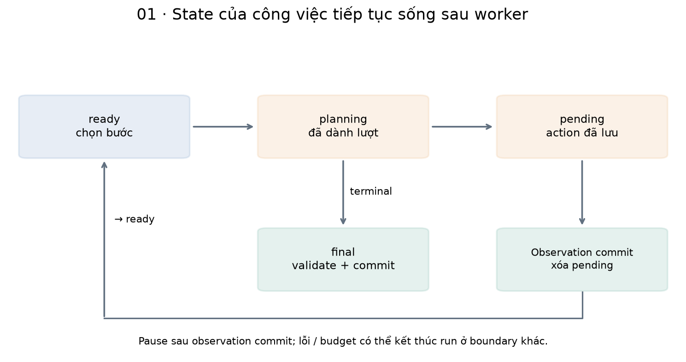
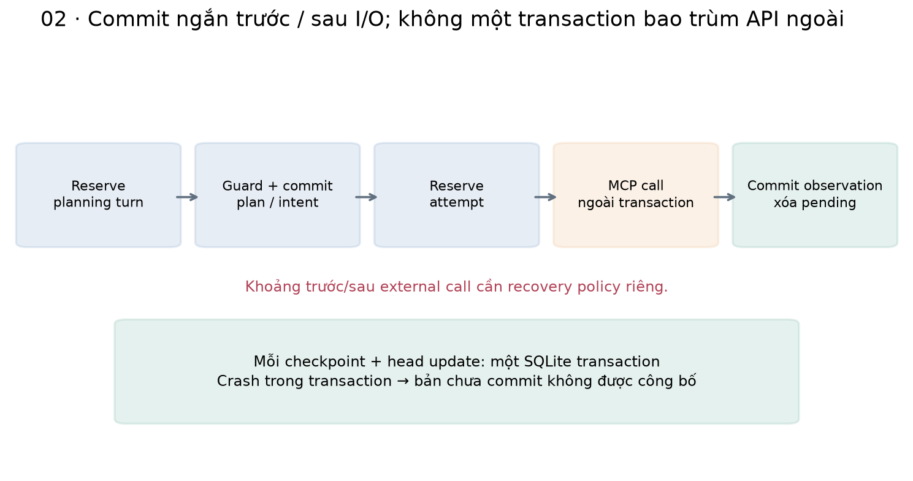
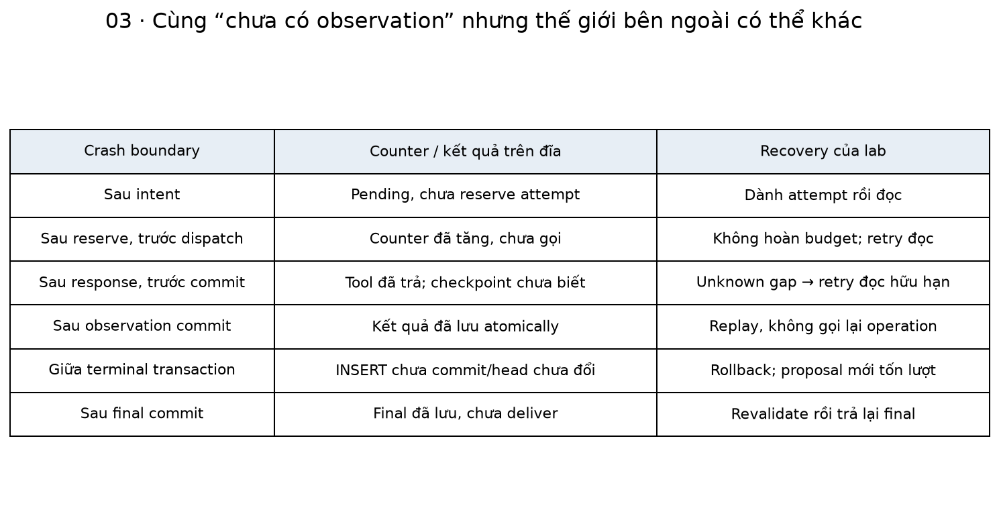
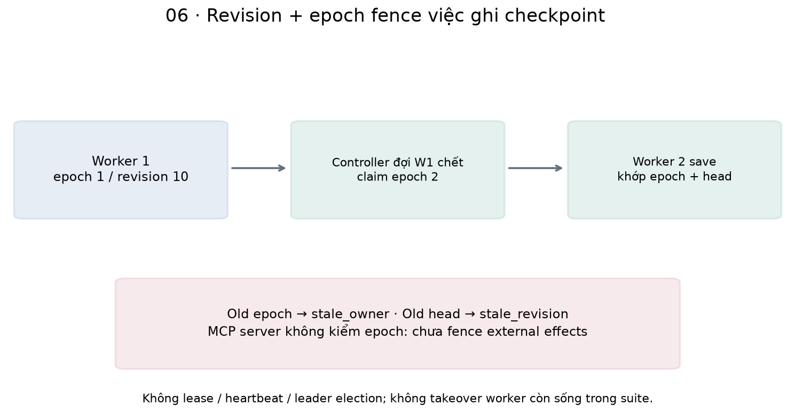
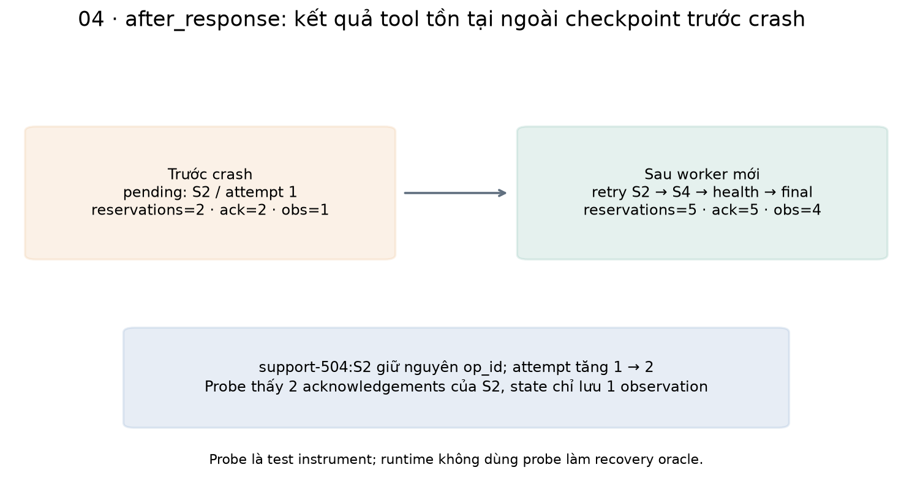
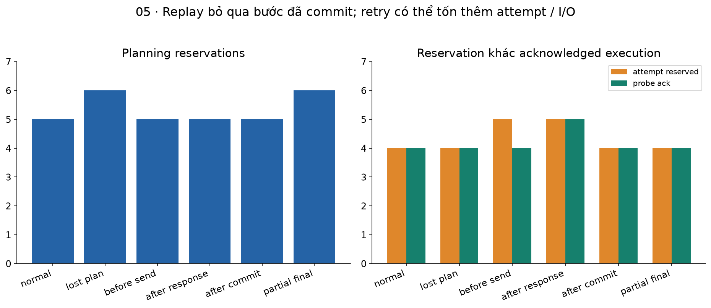
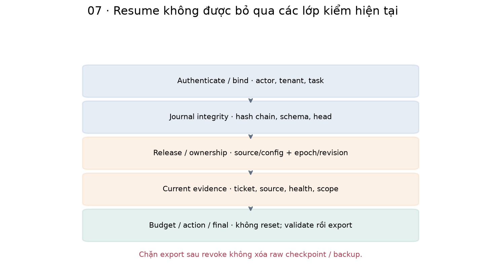

# Bài 51 — Trạng thái bền vững, checkpoint và khôi phục cho agent

[← Mục lục](../README.md) · [Bài 50](../50-lap-ke-hoach-kiem-chung-doi-ke-hoach/README.md) · [Đào sâu](deep-dive.md) · [Bài tập](exercises.md) · [Lời giải](solutions.md)

Agent ở bài 50 biết sửa kế hoạch khi search rỗng, nhưng kế hoạch, observations và ngân sách vẫn nằm trong RAM. Khi process chết, mở lại SQLite của ticket chưa giúp agent biết đã làm tới đâu. Bài này xây một vòng chạy có checkpoint thật: đóng process giữa các bước, mở worker khác và tiếp tục cùng run.

**Sau bài này, bạn cần làm được:** tách business data khỏi execution state; thiết kế checkpoint và ID; đặt commit trước/sau tool call; phân biệt resume, replay và retry; giữ counters qua restart; xử lý khoảng trống “đã chạy nhưng chưa lưu”; dùng revision/epoch chống ghi đè; tái kiểm quyền và phiên bản trước khôi phục.

**Kiến thức trước:** bài 28, 30, 33, 45–50; nền backend/transaction hữu ích. Source chạy cần các thư mục 45–46–48–49–50–51 nằm cạnh nhau, process Python sạch. Có thể đọc phần nền tảng trước khi chạy code.

**Đã kiểm:** 13 kịch bản, 25 lần khởi chạy worker subprocess, 10 lần chết đột ngột bằng `os._exit`; 60 kiểm tra mới + 349 hồi quy = **409 kiểm tra**. Planner vẫn là script của bài 50; tool chạy qua MCP thật trong từng worker. Không gọi LLM, không tool ghi ticket, không LangGraph runtime hoặc hệ phân tán production. Vòng durable mới tái dùng policy/plan guard/MCP/final gate, không nói runtime RAM của bài 50 tự hỗ trợ resume.

## 1. Từ một cuộc gọi hàm đến một công việc có vòng đời

Ví dụ: người trực yêu cầu điều tra gateway 504. Agent đọc ticket, search query mơ hồ không thấy nguồn, sửa query từ symptom, đọc health rồi trả hướng dẫn có nguồn. Mất process sau phút thứ hai không nên bắt người dùng đoán agent đã đọc gì hoặc cho phép mọi budget trở về số không.

Backend quen thuộc có request ID, job status, database transaction, retry và idempotency. Agent thêm một khó khăn: bước sau có thể do model chọn dựa trên observation. Để tiếp tục đúng công việc, không chỉ lưu tên bước “điều tra”; cần lưu dữ liệu và lựa chọn đã được chấp nhận.

| Loại dữ liệu | Ví dụ | Đủ để tiếp tục agent? |
|---|---|---|
| Business data | Ticket, runbook, tài khoản | Chưa: không biết tiến độ của run |
| Execution state | Task đã bind, observations, plan, pending action, counters | Nền cho resume |
| Context | Phần dữ liệu đưa vào planner ở lượt tới | Dựng lại từ state theo policy |
| Long-term memory | Sở thích, tri thức tái dùng ở run khác | Không thay checkpoint |
| Telemetry | Log/trace dùng chẩn đoán | Chỉ là execution state nếu được thiết kế như vậy |

Trong tài liệu [Persistence của LangGraph](https://docs.langchain.com/oss/python/langgraph/persistence), checkpointer và store có vai trò khác nhau: một bên theo state của thread, bên kia lưu dữ liệu ứng dụng qua nhiều thread. Lab tự viết journal SQLite để học cơ chế, không dùng API của framework đó. “Short-term” nói về phạm vi sử dụng, không đồng nghĩa chỉ nằm trong RAM.

## 2. Durable state và checkpoint là gì?

**Durable state** là trạng thái đã được lưu theo một cơ chế có thể đọc lại sau khi process mất. **Checkpoint** là một bản trạng thái tại một ranh giới thực thi xác định. Một snapshot chat cuối cùng chưa đủ nếu không biết tool nào đang pending hoặc ngân sách nào đã sử dụng.

Bài này dùng các phase:

| Phase | Ý nghĩa |
|---|---|
| ready | Có thể chọn bước kế tiếp |
| planning | Đã dành một lượt đề xuất; kết quả chưa commit |
| pending | Đã commit action cụ thể; có thể chưa gửi hoặc đã gửi mà chưa lưu response |
| paused | Dừng chủ động sau một observation đã commit |
| answered / handoff | Kết thúc có hướng dẫn hoặc cần xử lý tiếp |
| stopped / blocked / failed | Kết thúc theo budget, quyền hoặc lỗi |



Snapshot chứa phase, số planning turns và attempt reservations, plan history, observations, pending action và final result nếu có. Metadata của run gắn task/principal, deadline, limits và release/source identity. Không lưu API key hoặc opaque provider history. Chỉ giữ structured proposals/observations cần cho bài; không yêu cầu model cung cấp chain-of-thought.

```python
from contracts51 import State
s=State().model_dump()
assert s['phase']=='ready' and s['turns']==s['attempts']==0
assert s['pending'] is None and s['observations']==[]
```

Một checkpoint hợp lệ còn phải thỏa invariant: pending phase phải có pending action; terminal phase phải có final result đúng state; IDs observation liên tiếp. Schema không tự chứng minh dữ liệu đúng nguồn hoặc người gọi có quyền đọc.

## 3. Những ID cần giữ riêng

| ID / số phiên bản | Phạm vi và công dụng |
|---|---|
| run_id | Một công việc; resume giữ cùng ID, tác vụ mới tạo run mới |
| plan revision / hash | Phiên bản phương án của bài 50 |
| checkpoint revision | Mỗi lần commit trạng thái/ownership, tăng liên tiếp |
| step_id | S1, S2, S4 trong plan; không phải checkpoint revision |
| op_id | Một ý định tool cụ thể, ví dụ support-504:S2 |
| attempt | Một lần dành ngân sách thử thực thi op đó |
| owner epoch | Thế hệ worker có quyền ghi checkpoint |
| observation_id | O1, O2… khi kết quả đã commit |
| MCP call_sequence | Counter trong một Link/session, có thể bắt đầu lại sau restart |

```python
from contracts51 import operation_id
assert operation_id('support-504','S2')=='support-504:S2'
assert operation_id('support-504','S2')!=operation_id('support-504','S4')
```

Retry giữ op_id, tăng attempt. MCP request ID không tự là business idempotency key. Trong lab, op_id **không được gửi như một dedup key tới server**; không có server dedup. Khi đổi query bằng S4, đó là một operation mới, không đổi payload của S2 cũ.

## 4. Ranh giới commit trước và sau tool call

Một vòng chạy đơn giản nhưng dễ sai:

```text
gọi tool → cập nhật biến trong RAM → lưu state
```

Nếu tool đã chạy và process chết trước lưu, lần sau state trông giống chưa gọi tool. Lab dùng protocol rõ hơn:

1. Dành planning turn và commit phase planning.
2. Planner đề xuất; guard kiểm. Commit plan cùng action/op_id ở phase pending.
3. Dành attempt trong cùng checkpoint với counter tăng; commit trước I/O.
4. Kiểm quyền hiện hành rồi gọi tool ngoài transaction.
5. Commit observation cùng việc xóa pending, chuyển ready.
6. Chọn bước tiếp, hoặc validate final rồi commit kết quả trước khi trả ra ngoài.



SQLite cung cấp atomic commit cho các thay đổi **trong cùng transaction**. Tài liệu [Atomic Commit](https://www.sqlite.org/atomiccommit.html) giải thích cơ chế và giả định về lưu trữ. Journal của bài lưu checkpoint mới và cập nhật head trong một transaction; không giữ transaction mở trong lúc chờ MCP. Transaction đó không bao trùm API ngoài hoặc một database khác.

Journal dùng `BEGIN IMMEDIATE`, rollback journal DELETE và synchronous FULL; Python mở connection với legacy transaction control tường minh, `isolation_level=None`, rồi tự BEGIN/COMMIT/ROLLBACK. [SQLite Transaction](https://www.sqlite.org/lang_transaction.html) nêu chỉ một writer đồng thời và khả năng SQLITE_BUSY; [Python 3.14 sqlite3](https://docs.python.org/3.14/library/sqlite3.html#transaction-control) mô tả cách điều khiển transaction. Bài chưa đo throughput/lock contention hoặc mô phỏng mất điện.

## 5. Thực hành: chết sau response, trước checkpoint

Chạy từ thư mục bài 51 trong môi trường đã cài requirements:

```python
from pathlib import Path
import tempfile
from experiment51 import setup,launch,inspect
with tempfile.TemporaryDirectory() as d:
    path=Path(d)/'case'
    setup(path)
    first=launch(path,crash_at='after_response')
    before=inspect(path)
    assert first['exit']==83
    assert len(before['acknowledgements'])==2
    assert len(before['state']['observations'])==1
    second=launch(path,owner='worker2',takeover_epoch=before['header']['epoch'])
    assert second['output']['result']['state']=='answered'
    after=inspect(path)
    assert len(after['acknowledgements'])==5
    assert after['state']['attempts']==5
    assert len(after['state']['observations'])==4
```

`launch` tạo Python subprocess và đợi process kết thúc trước khi cho worker mới takeover. `os._exit(83)` dừng ngay, không chạy finally để “giả vờ crash” mà vẫn lưu state. MCP server ở trong process worker, nên không để lại stdio server con bị bỏ quên. Bài 49 đã có stdio tests; suite mới này kiểm crash của worker với MCP memory transport thật.

Một probe SQLite **riêng** ghi acknowledgement sau khi MCP dispatch trả về. Nó giúp người học đối chiếu việc tool đã trả kết quả với checkpoint chưa lưu. Agent không đọc probe để quyết định recovery. Đây là instrumentation của thí nghiệm, không receipt/status API production, cũng không ghi nhận mọi network attempt hoặc backend effect.

| Mốc ở case after_response | Reserved attempts | Acknowledgements trong probe | Observations đã commit |
|---|---:|---:|---:|
| Trước crash | 2 | 2 | 1 |
| Sau khôi phục tới final | 5 | 5 | 4 |

Hai acknowledgement thuộc cùng op S2, attempt 1 và 2. Observation S2 chỉ được commit một lần sau retry. Đây là lặp thực thi đọc với một kết quả được lưu, không “tool chỉ chạy một lần”.

## 6. Pending không có nghĩa chưa thực thi

Checkpoint pending có thể tương ứng nhiều thế giới:

| Crash boundary | Thực tế ở fixture | Recovery |
|---|---|---|
| Sau intent, trước reserve | Chưa dành attempt/gửi call | Dành attempt rồi gọi |
| Sau reserve, trước dispatch | Có counter, chưa gửi | Không hoàn tiền; dành attempt mới |
| Sau response, trước observation commit | Tool đã trả nhưng kết quả chưa lưu | Retry đọc trong budget |
| Sau observation commit | Kết quả đã bền vững | Dùng lại observation, không gọi lại |
| Giữa INSERT checkpoint và UPDATE head | Transaction chưa commit | SQLite rollback phần chưa hoàn tất |
| Sau final commit, trước trả stdout | Final đã lưu | Trả lại final sau tái kiểm quyền/nguồn |



Nếu tool là “tạo ticket”, “gửi email” hoặc “thu tiền”, không thấy observation chưa chứng minh không có effect. Cần status/reconciliation, idempotency được hệ đích hỗ trợ, hoặc chuyển người xử lý. [Fault tolerance của LangGraph, mục missing acknowledgement](https://docs.langchain.com/oss/python/langgraph/fault-tolerance#treat-a-missing-acknowledgement-as-unknown) cũng phân biệt outcome chưa biết với hành động chưa xảy ra.

Registry của bài chỉ cho retry ba tool đọc đã được ứng dụng review. Không suy từ tên tool hay readOnlyHint rằng mọi API đều an toàn. Read lại cũng có thể tốn quota, tạo log hoặc thấy snapshot mới. Lab pin dữ liệu tổng hợp và chặn snapshot/release thay đổi, không hỗ trợ tự hòa giải dữ liệu động.

## 7. Resume, replay và retry khác nhau

**Resume:** tiếp tục cùng run từ checkpoint đã commit. **Replay:** dựng lại state/decision context từ dữ liệu đã lưu. **Retry:** thực thi lại một operation/attempt; có thể gây I/O và chi phí mới.

PlanGuard được dựng lại bằng plan history và đúng observation prefix tại từng revision. Guard kiểm hash/parent/trigger/dependency như bài 50, tính lại readiness. Nếu checkpoint chứa pending action, runtime dùng chính action ấy, không hỏi planner chọn một action khác trước khi xử lý pending.

Nếu process chết ở phase planning trước khi proposal được commit, lab ghi nhận lượt cũ bị bỏ dở rồi dành lượt mới để đề xuất lại. Với LLM thật, câu trả lời lần sau có thể khác và request cũ có thể đã tính phí. Replay dữ liệu đã lưu không đòi model tái sinh cùng một đoạn văn.

Pause chủ động xảy ra sau observation đã commit và trả owner về null. Khi resume, counters/plan vẫn giữ. Nó khác crash đang giữ owner và pending. Bài chưa có pause giữa tool call, approval workflow hoặc cancellation API cho remote service.

```python
from pathlib import Path
import tempfile
from experiment51 import setup,launch,inspect
with tempfile.TemporaryDirectory() as d:
    path=Path(d)/'paused'
    setup(path)
    first=launch(path,pause_after=2)
    snap=inspect(path)
    assert snap['state']['phase']=='paused' and snap['header']['owner'] is None
    second=launch(path,owner='worker2')
    assert second['output']['result']['turns']==5
    assert second['output']['result']['attempt_reservations']==4
```

## 8. Ngân sách không trở về số không khi restart

Lab lưu counters và limits trong binding. Các mặc định: tối đa 8 planning reservations, 6 tool attempt reservations cho cả run, 2 attempts/op, 3 plan revisions. Một resume không thêm budget, kể cả attempt đã dành mà chưa biết call có được gửi hay không.

```python
from contracts51 import Limits
limits=Limits().model_dump()
assert limits==dict(turns=8,attempts=6,per_operation=2,revisions=3)
assert 6-5==1   # Còn 1 reservation, không phải 1 backend execution được bảo đảm.
```

Các case attempt_budget và per_op_budget dừng trước retry dù trước crash đã có acknowledgement bị mất khỏi state. Case turn_budget chết ngay sau reserve lượt đầu, sau resume vẫn hết giới hạn một lượt. Đổi config để tăng limit bị binding guard từ chối; cần quy trình tạo/migrate run có chủ đích.

Deadline lưu một mốc tuyệt đối, không tạo lại “thêm 60 giây” khi resume. Thí nghiệm dùng business clock tiêm vào: now=100, expires_at=160; resume now=161 phải dừng run chưa xong. **Đây là kiểm policy bằng clock giả**, không phép đo thời gian thật. Runtime này chỉ kiểm mốc đó khi vào run, chưa có ticking clock kiểm deadline giữa mọi bước; MCP giữ timeout riêng theo từng session. Cần bổ sung clock/timeout/cancellation đầy đủ trước vận hành.

Một final đã commit được xem là đọc lại kết quả, không tiếp tục execution: có thể trả sau expires_at nếu quyền/nguồn/snapshot còn hợp lệ. Sản phẩm muốn TTL cho cached answer phải đặt thêm rule riêng; không trộn nó với execution deadline.

## 9. Hai worker: revision và owner epoch

Hai worker cùng đọc checkpoint revision 10 rồi cùng ghi revision 11 có thể làm mất một update. Journal so expected revision với head trong transaction để từ chối stale revision. Owner epoch giải quyết một trường hợp khác: worker cũ quay lại sau khi quyền xử lý đã chuyển sang thế hệ mới.



Handle gồm owner, epoch và revision. Mỗi claim tăng epoch; save phải khớp cả ba. Worker khác không có takeover đúng epoch bị run_busy. Suite kiểm stale worker không thể commit sau takeover và stale revision trong cùng owner cũng bị chặn.

**Giới hạn quan trọng:** đây là fence cho **ghi checkpoint cục bộ**. MCP server không nhận epoch để fence external calls. Controller chỉ takeover sau khi đã đợi process cũ chết; không triển khai lease expiry/heartbeat/leader election hoặc tự động đánh giá một worker mạng chậm là đã chết. Không áp dụng đoạn demo này trực tiếp thành distributed lock production.

## 10. Khôi phục phải tái kiểm quyền, dữ liệu và phiên bản

Run gắn principal ID/tenant, task, limits, absolute deadline, backend/gate manifest, core source hashes và seed identity. Mở bằng actor khác hoặc thay task/limit/health release phải bị chặn. Không khôi phục bằng quyền đã lưu trong transcript rồi bỏ qua quyền hiện hành.

Trước claim, trước bước và trước export, runtime kiểm current principal/ticket/source/health. Runbook bị revoke hoặc actor bị vô hiệu hóa thì worker trả error không kèm plan/observation/answer cũ. Điều này áp dụng cả final đã commit. File checkpoint vẫn giữ lịch sử; chặn export **không xóa dữ liệu trên đĩa**.

Journal dùng JSON, không pickle. Hash chain giúp phát hiện thay đổi ngẫu nhiên/không đồng bộ và liên kết head với snapshots. Hash không có secret không chống được người có quyền sửa DB và tính lại toàn bộ chain. File cần quyền truy cập, retention/backup/encryption phù hợp ở hệ thật. Không đưa checkpoint thật của công ty vào bộ chia sẻ.

Schema/release không khớp thì reject, không âm thầm migrate. Nếu thay model/tool/parser, cần quyết định checkpoint cũ còn diễn giải được hay không; migration phải giữ IDs/budgets và được kiểm thử riêng. Bài không triển khai migration tự động.

## 11. Đọc kết quả thí nghiệm



| Case | Planning reservations | Attempt reservations | Probe acknowledgements | Final |
|---|---:|---:|---:|---|
| uninterrupted | 5 | 4 | 4 | answered |
| pause_resume | 5 | 4 | 4 | answered |
| planning_reserved | 6 | 4 | 4 | answered |
| attempt_reserved | 5 | 5 | 4 | answered |
| after_response | 5 | 5 | 5 | answered |
| observation_committed | 5 | 4 | 4 | answered |
| terminal_transaction | 6 | 4 | 4 | answered |
| terminal_committed | 5 | 4 | 4 | answered |

13 case gồm 9 answered và 4 stopped đúng policy. Tổng 54 planning reservations, 44 attempt reservations, 43 probe acknowledgements. Đây là các đơn vị khác nhau; không gọi tất cả là model calls hoặc bill đã đo. Có 25 worker launches, 9 lần exit 83 và 1 lần exit 84; không đo restart latency/RTO hoặc disk durability khi mất điện.



60 kiểm tra mới tập trung crash/atomicity/ownership/binding/quyền/budget/history, cộng 349 hồi quy bài trước. Expected stop cũng là pass; 13/13 đúng policy không phải 100% LLM quality hoặc bảo đảm mọi crash có thể hoàn tất tác vụ. Khi không còn budget, dừng là kết quả đúng.

## 12. Chạy lab, đọc artifact và tự kiểm

Từ thư mục bài 51:

```bash
python3 -m venv .venv
.venv/bin/python -m pip install -r requirements.txt
.venv/bin/python lab.py --mode hand
.venv/bin/python lab.py --mode data
.venv/bin/python lab.py --mode all --out /tmp/lesson51-run-01
.venv/bin/python lab.py --mode check
.venv/bin/python lab.py --mode experiment --out /tmp/lesson51-study-01
```

Thư mục out phải mới. Sau cài dependencies không cần mạng, GPU hoặc tài khoản AI; không có mode live. Đã chạy với Python 3.14.6, SQLite 3.53.3, MCP/mcp-types 2.3.0, Pydantic 2.14.2, AnyIO 4.16.0, jsonschema 4.26.0, HTTPX 0.28.1, FastAPI 0.162.0 trên macOS arm64 CPU. Môi trường dùng dependencies có sẵn local, chưa xác nhận fresh install từ Internet trên mọi nền tảng.

Mỗi case có world.sqlite cho dữ liệu ticket, state.sqlite cho journal, probe.sqlite cho test acknowledgement và config.json synthetic. Trusted setup sửa body ticket **trước run**; trong run không có tool ghi business data. Khác bài 50, state.sqlite thực sự được runtime ghi, nên “agent không ghi ticket” không có nghĩa toàn hệ thống không ghi đĩa.

| Tệp | Vai trò |
|---|---|
| [bridge51.py](bridge51.py) | Tái dùng policy/guards/MCP/final gate và source lineage |
| [contracts51.py](contracts51.py) | State/limits/pending, JSON và op ID |
| [journal51.py](journal51.py) | Transactions, snapshots/hash chain, revision/epoch |
| [runtime51.py](runtime51.py) | Durable loop, recovery, final/export gate |
| [worker.py](worker.py) | Fresh worker process, trusted crash hooks |
| [experiment51.py](experiment51.py) | Dataset setup, subprocess controller, probe/report |
| [checks51.py](checks51.py) · [lab.py](lab.py) | 60 kiểm tra mới + 349 hồi quy; năm CLI modes |
| [make_figures.py](make_figures.py) | Tái tạo bảy cặp PNG/SVG |

```bash
.venv/bin/python -m pip install -r requirements-figures.txt
.venv/bin/python make_figures.py --report /tmp/lesson51-run-01/report.json
```



Làm [16 bài tập](exercises.md), rồi đối chiếu [lời giải](solutions.md) và [đào sâu](deep-dive.md). Tự giải thích được: pending có thể che giấu những gì; vì sao retry giữ op_id nhưng tăng attempt; checkpoint nào ngăn gọi lại tool; và epoch đang fence ở đâu. Tiếp theo: [Bài 52 — Context engineering và memory cho agent](../52-context-engineering-memory-agent/README.md), với context projection/budget và SQLite memory có nguồn/lifecycle; planner vẫn scripted. [Nguồn/phạm vi](../SOURCES.md) · [Đề cương](../ROADMAP.md).
