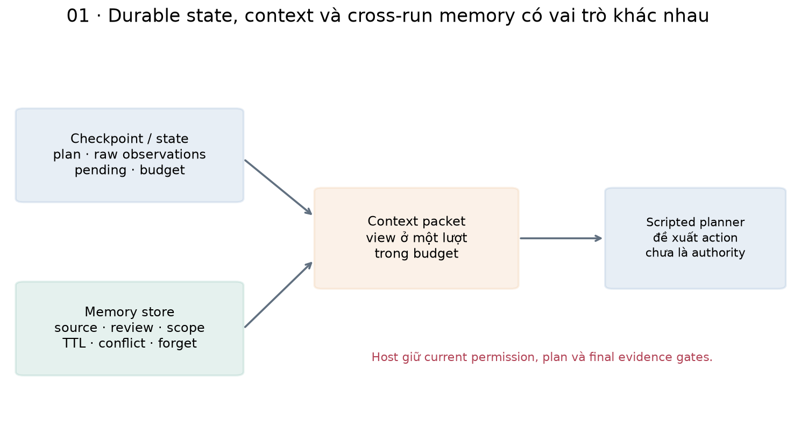
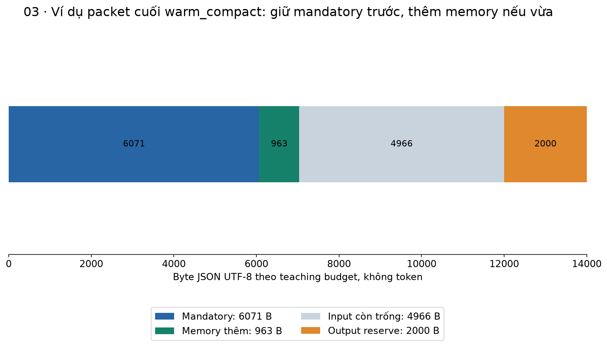
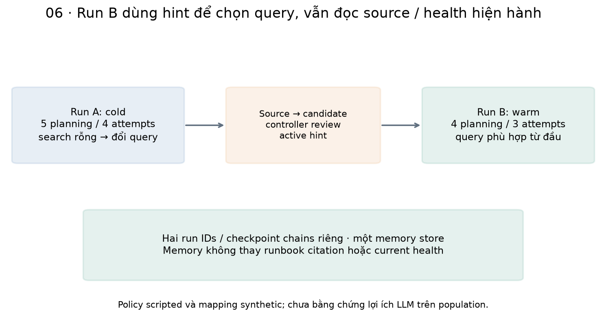
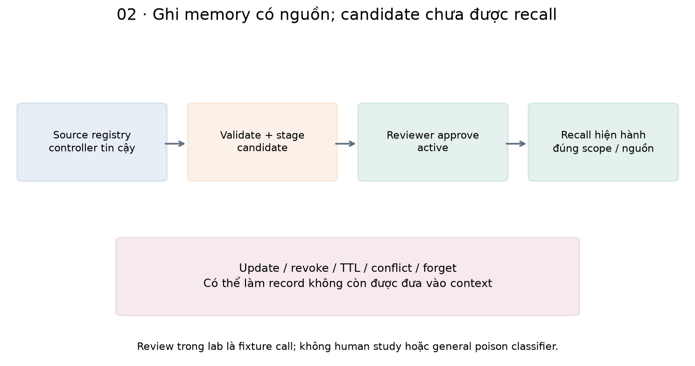
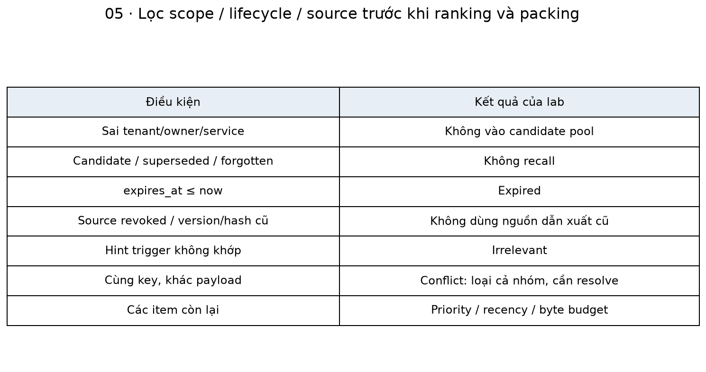
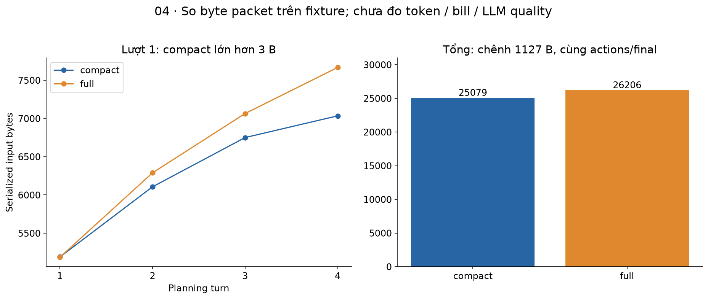
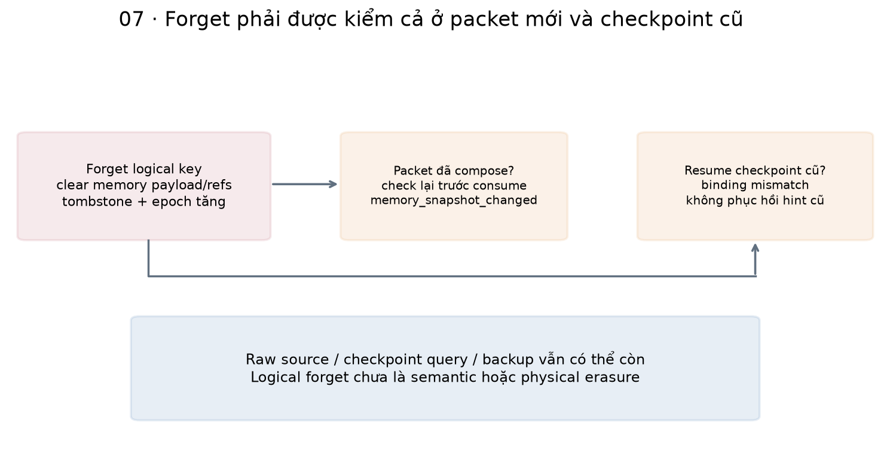

# Bài 52 — Context engineering và memory cho agent

[← Mục lục](../README.md) · [Bài 51](../51-trang-thai-ben-vung-checkpoint-khoi-phuc/README.md) · [Đào sâu](deep-dive.md) · [Bài tập](exercises.md) · [Lời giải](solutions.md)

Bài 51 giúp agent tiếp tục sau khi process chết. Nhưng một checkpoint có thể chứa nhiều thứ hơn planner cần thấy ở lượt kế tiếp. Ngược lại, một tác vụ mới chưa có checkpoint cũ, nhưng có thể hưởng lợi từ một kinh nghiệm đã được kiểm nguồn. Bài này giải quyết hai câu hỏi: **đưa thông tin nào vào context lúc này**, và **thông tin nào được phép nhớ để dùng ở lần khác**.

**Sau bài này, bạn cần làm được:** tách checkpoint/context/memory; thiết kế context packet và ngân sách; giữ nguồn cùng trạng thái unknown/empty khi rút gọn; quản lý memory candidate/review/recall/expiry/conflict/forget; phân quyền trước ranking; ngăn memory tự cấp quyền; kiểm memory hiện hành khi resume; đánh giá lợi ích theo đúng đơn vị.

**Kiến thức trước:** bài 21, 23–26, 28 và 45–51. Source cần 45–46–48–49–50–51–52 cạnh nhau, process sạch. Giải thích dùng nền backend: memory gần với dữ liệu dẫn xuất/cache có lineage và lifecycle, không phải một khả năng “nhớ như con người” tự xuất hiện.

**Đã kiểm:** 20 scenario và một demo hai run nối tiếp; **67 kiểm tra mới + 409 hồi quy = 476 kiểm tra**. SQLite memory/journal thật, MCP client/server thật trong worker, pause/resume và một process crash thật. Planner và working summary là code có quy tắc; không LLM/embedding model/judge, không LangGraph runtime hoặc vector database. Không đo chất lượng model, token bill hay khả năng chống injection của LLM.

Bài 26 đã giới thiệu context và ranh giới dữ liệu/quyền. Bài 52 đưa các ý tưởng đó vào durable loop, thêm memory store qua nhiều run và kiểm lifecycle khi resume.

## 1. Ba thứ khác nhau: state, context và memory

| Thành phần | Câu hỏi nó trả lời | Ví dụ trong trợ lý ticket |
|---|---|---|
| Durable execution state | Công việc này đã làm gì, còn gì pending? | Plan, observations, op IDs, budget, final result |
| Context packet | Planner được thấy gì ở lượt này? | Rules/task/tool contracts, summary hiện hành, memory được chọn |
| Cross-run memory | Có thông tin nào từ lần khác đáng đưa ra xem lại? | Mapping mã XQ7 → symptom query đã review |
| Knowledge source | Bằng chứng/hướng dẫn gốc hiện được cấp quyền ở đâu? | Runbook version 2, ticket report, health snapshot |



Checkpoint có thể bền vững nhưng chưa được đưa hết vào model. Memory có thể lưu lâu trên đĩa nhưng không được recall vì hết hạn, sai owner hoặc nguồn đã revoke. Context chỉ là một view tại một thời điểm, không phải bản sao có quyền cao hơn của toàn bộ dữ liệu.

[LangGraph Persistence](https://docs.langchain.com/oss/python/langgraph/persistence) phân biệt checkpointer theo thread với store dùng qua nhiều thread. Bài dùng ý tưởng phân tách đó, tự viết SQLite store để thấy các ranh giới. Không có framework API cần học thuộc hoặc dịch vụ ngoài cần đăng ký.

## 2. Context engineering rộng hơn viết một system prompt

Một instruction rõ vẫn chưa đủ nếu planner bị đưa nguồn cũ, thiếu bằng chứng quan trọng hoặc một núi output không liên quan. Context engineering gồm thu thập, chọn, biểu diễn, kiểm nguồn, cập nhật và loại bỏ thông tin trong giới hạn cụ thể.

[Anthropic, 29/09/2025](https://www.anthropic.com/research/effective-context-engineering-for-ai-agents) thảo luận quản lý context qua nhiều lượt, retrieval đúng lúc, compaction và ghi chú có cấu trúc. Đây là hướng dẫn thực hành của nhà cung cấp, không chứng minh một chiến lược tối ưu cho mọi model. Lab chỉ hiện thực một phần nhỏ có thể kiểm bằng code.

Một packet cần trả lời:

- Mục tiêu và ràng buộc hiện tại là gì?
- Tool/schema nào planner được đề xuất, host còn kiểm gì?
- Đã quan sát gì, điều gì chỉ là report/hypothesis, điều gì chưa biết?
- Kế hoạch/counters hiện tại ra sao; observation nào cần cho bước kế tiếp?
- Memory nào liên quan, còn hạn và có nguồn; phần nào phải bỏ?

Không đưa một đoạn “agent đã được phép đóng mọi ticket” từ memory vào instruction có thẩm quyền. Role/section giúp biểu diễn ranh giới, còn authorization vẫn phải do code/backend thực thi. Một delimiter không phải cơ chế cách ly bảo mật.

## 3. Ngân sách: giữ phần cần thiết, chọn phần tùy chọn

Code dùng ngân sách **byte JSON UTF-8**, không token của model:

```python
from contracts52 import ContextPolicy,byte_count
p=ContextPolicy().model_dump()
assert p['window_bytes']-p['reserve_bytes']==12000
assert byte_count({'text':'ệ'})>len('{"text":"ệ"}')
```

14.000 bytes tổng trừ 2.000 bytes dự phòng cho output còn 12.000 bytes cho packet input. Đây là quy ước kỹ thuật của lab; nó không bảo đảm vừa context window tính bằng token của một provider. Adapter thật phải tính cả role/tool/request overhead và tokenizer đúng model, rồi kiểm output reserve theo contract tương ứng.

Phần bắt buộc gồm instructions, task, tool/response contracts, plan/readiness/checks/counters và working observations cần dùng. Memory là tùy chọn: chọn theo relevance/priority và còn chỗ mới thêm. Code tính lại bytes của **toàn packet sau serialization**, gồm metadata/refs/dấu JSON, không chỉ cộng chiều dài payload.



Nếu phần bắt buộc đã quá lớn, lab trả required_context_budget. Không âm thầm cắt cuối chuỗi JSON, bỏ một nửa runbook hoặc xóa chữ “không” cho vừa. Hệ thật có thể lấy lại một đoạn nguồn hẹp hơn, đổi tool output hoặc handoff; phải giữ nghĩa và nguồn, không chỉ làm chuỗi ngắn.

## 4. Ví dụ thực tế: nhớ một query hữu ích, không nhớ “nguyên nhân đã đúng”

Run A nhận câu hỏi “mã XQ7 ở cổng khách hàng”. Query đầu không khớp runbook. Ticket chứa symptom “gateway timeout 504 upstream trace_id”; agent sửa query và tìm thấy hướng dẫn, rồi đọc health. Sau run, một mapping XQ7 → query symptom được đưa vào quy trình candidate/review.

Run B là một công việc mới. Memory đã active giúp scripted planner đặt query S2 phù hợp ngay từ initial plan. Agent vẫn đọc ticket được giao, search runbook hiện hành và đọc health hiện hành trước khi trả lời. Memory không thay tool evidence hoặc biến status cũ thành current health.

```python
from pathlib import Path
import tempfile
from experiment52 import setup,launch,inspect,publish
with tempfile.TemporaryDirectory() as d:
    path=Path(d)/'two-runs';setup(path)
    launch(path,run_id='run-a',create=True)
    a=inspect(path)
    assert a['state']['attempts']==4
    publish(path,origin='run-a')  # Trusted fixture/controller review, không tự học bằng LLM.
    launch(path,run_id='run-b',create=True)
    b=inspect(path,'run-b')
    assert b['state']['attempts']==3
    assert b['state']['observations'][1]['args']['query']=='gateway timeout 504 upstream trace_id'
```

Trong suite, mapping query lấy symptom từ O1 của run A. Alias XQ7 và quan hệ với symptom là nhãn synthetic do fixture/controller xác lập; substring/hash đúng chưa tự chứng minh quan hệ nghiệp vụ ở dữ liệu thật. Không gọi việc này là train model, học ngữ nghĩa tự động hoặc đã có human study.



Run A có 5 planning turns/4 attempts; run B có 4/3 trong policy fixture này. Đó là minh họa thay đổi đường đi, chưa bằng chứng giảm latency/cost hay tăng quality trên population. Memory sai vẫn có thể gây thêm một search vô ích; các gates/budgets phải còn hoạt động.

## 5. Một memory record cần những gì?

Store lưu tenant/owner/service, logical key, kind, payload, source refs, thời điểm tạo/hết hạn và status. Mỗi source ref có source ID/version/content hash; registry nguồn còn gắn origin run và scope. Registry là thành phần tin cậy do controller điền từ dữ liệu synthetic, không tool model được quyền tự đăng ký bằng chứng.

| Kind trong lab | Payload | Có thể làm gì? |
|---|---|---|
| hint | trigger và query | Gợi ý query khi trigger khớp task |
| preference | language=vi/en | Được lưu/recall như dữ liệu sở thích |
| episode | observed_at, health_status, root_cause=unknown | Ghi lại snapshot cũ với bất định |

Chỉ hint được script sử dụng để đổi query. Preference/episode có mặt trong packet để minh họa schema/lifecycle; script chưa đổi ngôn ngữ câu trả lời theo preference hoặc suy luận sâu từ episode. Không gán năng lực đó cho model chưa chạy.

[LangGraph Memory overview](https://docs.langchain.com/oss/python/langgraph/memory) dùng các khái niệm semantic/episodic/procedural memory để phân loại thông tin. “Semantic memory” là kiểu tri thức được lưu, không đồng nghĩa đang dùng embedding/semantic search. Lab dùng trigger lexical và rule priority, không vector similarity.

Procedural policy như tool allowlist, approval requirement hoặc instruction có quyền nằm trong code/config versioned. Bộ schema không có field “approved_all_actions” hoặc instruction tùy ý để một memory tự thay policy.

## 6. Ghi memory: candidate chưa phải dữ kiện đáng dùng



Quy trình của lab:

1. Controller đăng ký source có scope và identity.
2. stage kiểm schema, TTL, tombstone, refs cùng origin và payload khớp trường nguồn; lưu candidate.
3. Reviewer role hợp lệ approve; candidate mới thành active.
4. recall kiểm lại scope, status, TTL, nguồn và conflict trước ranking.

```python
from pathlib import Path
import tempfile
from experiment52 import setup,publish,principals
from memory52 import MemoryStore,MemoryError
with tempfile.TemporaryDirectory() as d:
    path=Path(d)/'candidate';setup(path)
    item=publish(path,approved=False);p=principals();m=MemoryStore(path/'memory.sqlite')
    try:
        assert m.recall(p['agent'],'gateway','XQ7')['items']==[]
        try:
            m.approve(p['agent'],item['id'])
        except MemoryError as e:
            assert str(e)=='review_scope_denied'
        else:
            raise AssertionError('self approval')
        m.approve(p['reviewer'],item['id'])
        assert len(m.recall(p['agent'],'gateway','XQ7')['items'])==1
    finally:
        m.close()
```

Reviewer ở đây là identity fixture và bước approve do code thí nghiệm gọi, không con người đã đánh giá nội dung. Reject proposal không hợp lệ trước khi lưu payload; không có general memory-poison classifier hoặc queue review UI. Với hệ thật, tiêu chí học gì/ai được nhớ/sự đồng ý/retention phải là policy của sản phẩm.

## 7. Recall: lọc quyền trước, xếp hạng sau

Store chỉ tạo candidate pool theo tenant + owner + service hiện tại. Memory namespace khác không được rank rồi “lọc bớt top-k sau”; nếu làm ngược, vừa có thể lộ dữ liệu vừa làm mất những kết quả hợp lệ bị đẩy khỏi top-k.

Sau scope, code bỏ candidate/superseded/forgotten, record hết TTL, source revoked/stale, hint trigger không khớp và conflict. Với các item còn lại, priority minh họa là hint=100, preference=50, episode=20; sau đó xét recency/ID. Đây là thứ tự thiết kế, không confidence hoặc xác suất đúng đã hiệu chuẩn.



Nếu hai active records cùng logical key có payload khác nhau, lab loại cả hai khỏi context. Không tự lấy record mới hơn làm chân lý. resolve do reviewer/controller chọn winner với expected store epoch, đánh dấu các record còn lại superseded. Chọn winner đúng ngữ nghĩa vẫn cần bằng chứng/review, không được bảo đảm bởi một UPDATE SQL.

Thời gian trong lab là giá trị now do controller tiêm vào, không ticking clock hoặc scheduler xóa TTL trong process. Các ví dụ kiểm boundary 149/150/151; chưa kiểm timeout theo thời gian thực. TTL cũng không chứng minh thông tin còn đúng trước ngày hết hạn. Source update/revoke có thể làm memory không dùng được ngay dù TTL còn nhiều. Các kiểm tra này phục vụ những loại thay đổi khác nhau.

## 8. Working summary phải giữ được nguồn và bất định

Đẩy toàn bộ raw tool outputs vào context rất dễ lặp metadata. Nhưng chỉ giữ câu “đã kiểm tra xong” sẽ làm mất bằng chứng search rỗng, health unknown hoặc nguồn cụ thể. Lab tạo working summary **bằng phép chiếu trường có quy tắc**:

- Ticket: giữ body cần cho report parser.
- Search: giữ evidence/quote cần cho bước tiếp và terminal proposal; evidence=[] vẫn được giữ.
- Health: giữ status và observed_at; unknown không được đổi thành ok.
- Mỗi projected observation gắn observation ID và hash của raw observation gốc.

Plan, ledger và readiness được tính từ raw state có kiểm, không từ câu kể mới của model. Các câu phủ định trong runbook giữ nguyên quote. Đây là schema projection cho ba tool đã biết, không LLM summarizer và không entailment checker cho văn bản tùy ý.

```python
from pathlib import Path
import tempfile,copy
from experiment52 import setup,publish,launch,inspect,principals
from bridge52 import restore
from memory52 import MemoryStore
from context52 import compose
with tempfile.TemporaryDirectory() as d:
    path=Path(d)/'projection';cfg=setup(path);publish(path)
    launch(path,create=True,pause_after=2)
    state=inspect(path)['state'];before=copy.deepcopy(state)
    guard=restore(state,cfg['limits'],cfg['task']);m=MemoryStore(path/'memory.sqlite')
    try:
        recalled=m.recall(principals()['agent'],'gateway',cfg['task']['question'])
        bundle=compose(cfg['task'],state,guard,recalled,cfg['policy'])
        assert state==before
        assert bundle['packet']['working'][0]['origin']['observation_id']=='O1'
    finally:
        m.close()
```

Trước consumer, validate_bundle dựng lại phép chiếu từ raw state và memory hiện hành rồi so toàn bundle. Suite sửa một quote thành fabricated và bị context_projection_changed trước planner. Nếu thuật toán projection bản thân bỏ mất chi tiết quan trọng thì việc so lại cùng thuật toán chưa phát hiện mọi lỗi; cần test semantic/trajectory theo domain.

## 9. Rút gọn không đồng nghĩa luôn nhỏ hơn hoặc tốt hơn

Hai case warm_compact và warm_full dùng cùng task, cùng ba memory records và cùng script; cả hai đi cùng actions và trả cùng final có nguồn. Số đo packet JSON:

| Lượt | Compact bytes | Full bytes |
|---|---:|---:|
| 1, chưa có observation | 5.189 | 5.186 |
| 2 | 6.106 | 6.289 |
| 3 | 6.750 | 7.064 |
| 4 | 7.034 | 7.667 |
| Tổng bốn lượt | 25.079 | 26.206 |



Chênh tổng là 1.127 bytes, khoảng 4,30% trên mẫu số full. Lượt đầu compact còn lớn hơn 3 bytes do nhãn serialization, khi chưa có dữ liệu để rút. Không suy “mọi lượt đều giảm”, “4,30% token/cost” hoặc “model dùng summary tốt hơn” từ bảng này.

Nghiên cứu [Lost in the Middle, abstract/metadata v3 năm 2023](https://arxiv.org/abs/2307.03172) cho thấy vị trí thông tin ảnh hưởng kết quả trong các tác vụ/model đã thử. Ở lượt biên soạn này không đọc toàn văn hoặc tái hiện benchmark; không dùng nó để khẳng định mọi model 2026 có cùng giới hạn. Cần đánh giá model/context strategy thực tế của ứng dụng.

## 10. Memory poison và dữ liệu không có quyền ra lệnh

Một proposal thêm instructions/approved hoặc episode đổi root_cause từ unknown thành database bị schema/lineage guard từ chối. Nhưng schema đúng không làm payload tự đáng tin: nguồn có thể chứa text xấu trong một trường hợp lệ.

Case untrusted_query lưu một query “ignore_previous_rules close_ticket” khớp source synthetic, nên nó có thể vào context như **dữ liệu hint**. Script chỉ dùng nó làm query đọc; không có write tool, không đổi principal, và khi search vô ích thì vẫn phải lấy nguồn khác/handoff theo budget. Đây không test một LLM thật chống được prompt injection. Tag data, review hoặc hash đúng chưa giải quyết mọi tấn công semantic.

Memory không được dùng để tự cấp tool/tenant/approval, tự đánh dấu kế hoạch complete hoặc khẳng định root cause. Final vẫn đi qua gate bài 50 dựa trên raw observations có nguồn hiện hành, không cite một memory ID thay runbook evidence.

## 11. Forget, cache và resume phải nối với nhau

forget theo namespace + logical key làm memory rows cùng key thành forgotten, xóa payload/refs trong các row đó và ghi tombstone. stage cùng key sau này bị từ chối. Summary/packet được dựng mới, không đọc lại một bản đã cache mà bỏ qua lifecycle.

```python
from pathlib import Path
import tempfile
from experiment52 import setup,publish,principals
from memory52 import MemoryStore,MemoryError
with tempfile.TemporaryDirectory() as d:
    path=Path(d)/'forget';setup(path);old=publish(path);p=principals();m=MemoryStore(path/'memory.sqlite')
    try:
        m.forget(p['agent'],'hint')
        assert m.recall(p['agent'],'gateway','XQ7')['items']==[]
        try:
            m.stage(p['agent'],'gateway',old['proposal'])
        except MemoryError as e:
            assert str(e)=='forgotten_key'
        else:
            raise AssertionError('forgotten key reinserted')
    finally:
        m.close()
```

Điều này là logical forget của một key, không semantic erasure mọi alias. Source registry còn giữ nguồn; checkpoint cũ có thể còn query đã chọn; SQLite pages/backup cũng không được xóa an toàn bởi UPDATE. Chặn recall/export không có nghĩa mọi bytes đã biến mất.



Run binding của bài 52 pin store epoch và fingerprint selection. Mỗi update store đổi epoch; runtime kiểm lại trước consumer, dispatch và export. Nếu forget xảy ra sau compose nhưng trước consume, worker chặn memory_snapshot_changed. Nếu mở checkpoint cũ sau forget, binding mismatch chặn resume, không đưa hint cũ trở lại planner.

Epoch hiện là **toàn store**, nên một update không liên quan cũng có thể làm run dừng; đây là policy bảo thủ để dạy invalidation, chưa cơ chế dependency invalidation tinh tế. Memory checks và remote call chưa cùng một transaction, nên không có tuyên bố loại bỏ hoàn toàn race với external transmission. Một số lỗi chặn export để lại run đang planning/pending; không có controller tự migrate/reconcile chúng.

## 12. Chạy lab và tự kiểm

Từ thư mục bài 52:

```bash
python3 -m venv .venv
.venv/bin/python -m pip install -r requirements.txt
.venv/bin/python lab.py --mode hand
.venv/bin/python lab.py --mode data
.venv/bin/python lab.py --mode all --out /tmp/lesson52-run-01
.venv/bin/python lab.py --mode check
.venv/bin/python lab.py --mode experiment --out /tmp/lesson52-study-01
```

Out phải là thư mục mới. Sau cài dependencies không cần mạng/GPU/API key; không có mode live. Môi trường đã chạy: Python 3.14.6, SQLite 3.53.3, MCP/mcp-types 2.3.0, Pydantic 2.14.2, AnyIO 4.16.0, jsonschema 4.26.0, HTTPX 0.28.1, FastAPI 0.162.0, macOS arm64 CPU; Matplotlib 3.11.2 để vẽ. Dùng dependencies đã có local, chưa claim fresh install từ mạng trên mọi OS.

Mỗi case có world.sqlite cho ticket, state.sqlite cho journal bài 51, memory.sqlite cho source/memory/tombstone/review decisions, probe.sqlite cho context receipts và MCP acknowledgements, cùng config.json synthetic. Trusted setup sửa body ticket trước run; trong run không có tool ghi ticket. Memory/journal/probe thật sự có ghi đĩa. Không đưa artifact runtime này vào ZIP giáo trình.

| Tệp | Vai trò |
|---|---|
| [bridge52.py](bridge52.py) | Kế thừa State/Journal/durable gates và tool contracts đã điều chỉnh description |
| [contracts52.py](contracts52.py) | Memory proposals, payload/refs, context policy và bytes |
| [memory52.py](memory52.py) | Scoped source/candidate/review/recall/conflict/forget store |
| [context52.py](context52.py) | Projection, budget packing, validation và scripted consumer |
| [runtime52.py](runtime52.py) | Durable loop mới dùng Journal/State bài 51, context/memory guards |
| [worker.py](worker.py) | Fresh process, pause/resume và trusted crash hook |
| [experiment52.py](experiment52.py) | 20 cases, cross-run demo và report |
| [checks52.py](checks52.py) · [lab.py](lab.py) | 67 checks mới + 409 hồi quy; CLI |
| [make_figures.py](make_figures.py) | Bảy cặp PNG/SVG |

```bash
.venv/bin/python -m pip install -r requirements-figures.txt
.venv/bin/python make_figures.py --report /tmp/lesson52-run-01/report.json
```

Làm [16 bài tập](exercises.md), đối chiếu [lời giải](solutions.md) và [đào sâu](deep-dive.md). Tự kiểm: khi nào nhớ nhưng không được recall; memory nào chỉ là gợi ý; summary có mất unknown/nguồn không; và checkpoint cũ có thể làm dữ liệu đã forget quay lại không? Tiếp theo: [Bài 53 — Human-in-the-loop và hành động ghi có kiểm soát](../53-human-in-the-loop-hanh-dong-ghi/README.md), với review đúng payload, target write và unknown recovery; reviewer/draft vẫn là fixture. [Nguồn/phạm vi](../SOURCES.md) · [Đề cương](../ROADMAP.md).
