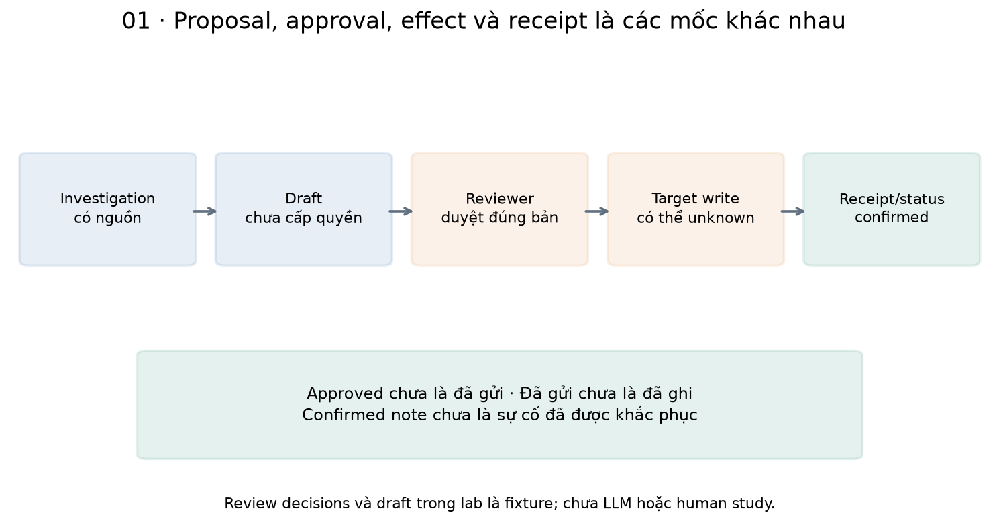
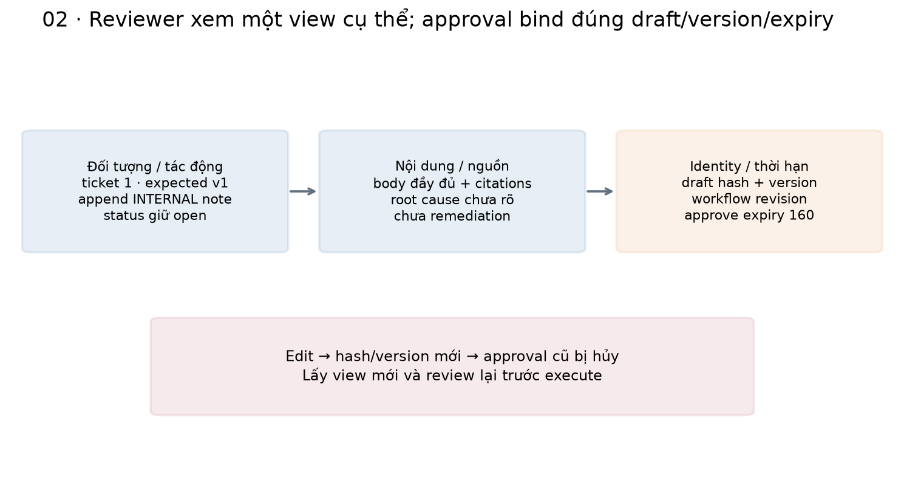
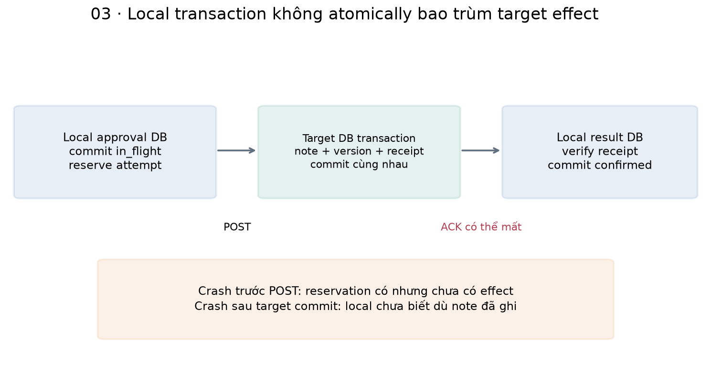
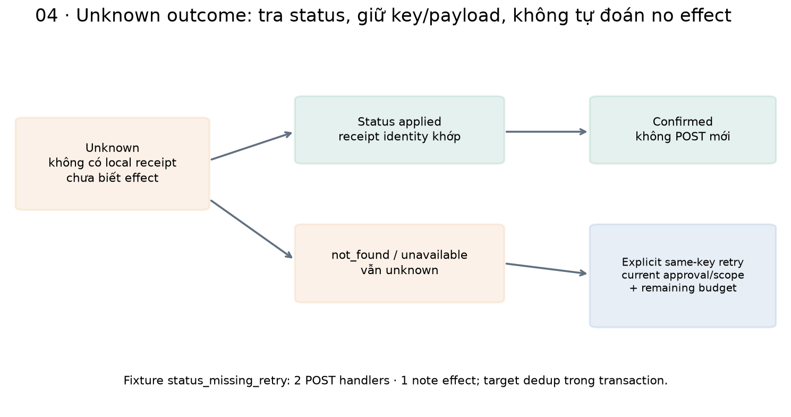
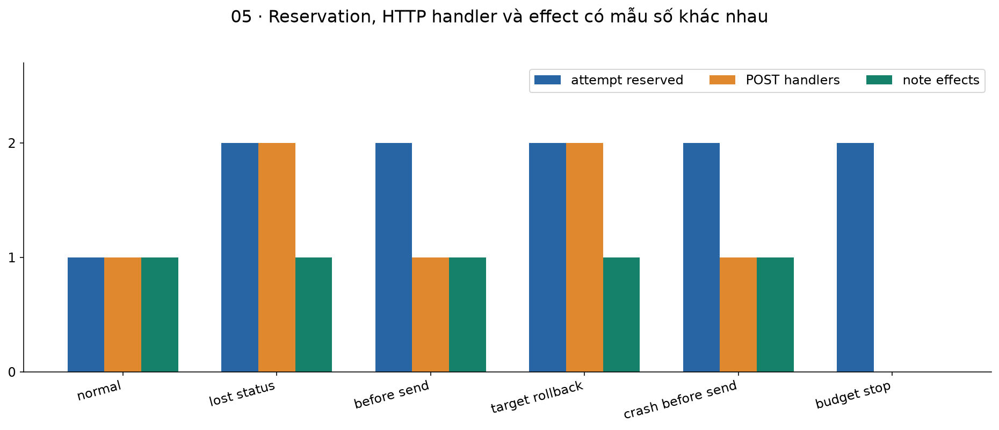
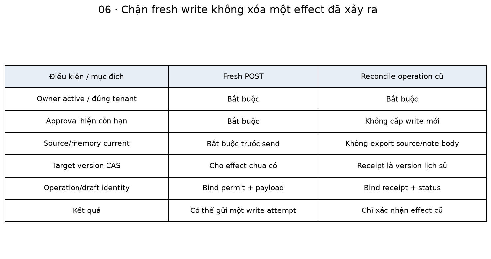
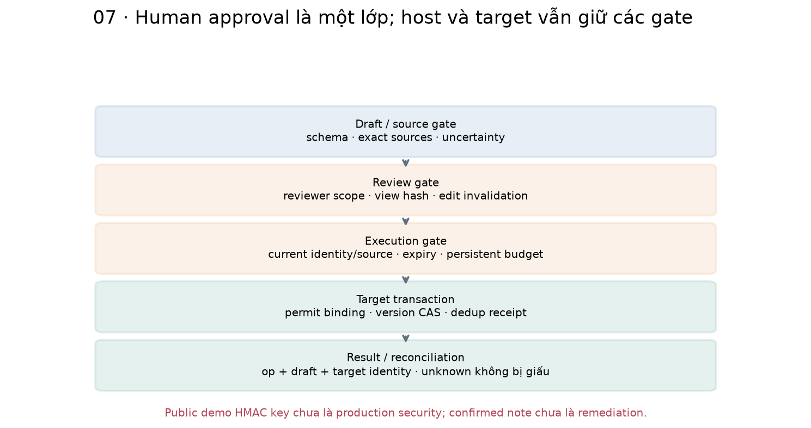

# Bài 53 — Human-in-the-loop và hành động ghi có kiểm soát

[← Mục lục](../README.md) · [Bài 52](../52-context-engineering-memory-agent/README.md) · [Đào sâu](deep-dive.md) · [Bài tập](exercises.md) · [Lời giải](solutions.md)

Agent bài 52 biết điều tra ticket, dùng memory có nguồn và khôi phục context. Nhưng một hướng dẫn có nguồn chưa cho phép agent ghi nội dung vào hệ thống khác. Bài này thêm một bước nghiệp vụ cụ thể: **đề xuất ghi chú nội bộ cho ticket, chờ người có quyền duyệt đúng payload, rồi thực thi và xác minh kết quả**.

**Sau bài này, bạn cần làm được:** phân biệt proposal/approval/effect/receipt; thiết kế review view có target/version/nội dung/nguồn/expiry; vô hiệu approval khi sửa draft; lưu ý định và ngân sách trước I/O; xử lý unknown outcome bằng status/idempotency; tái kiểm quyền/nguồn khi resume; báo kết quả đúng mức đã xác nhận.

**Kiến thức trước:** bài 27–30, 45 và 48–52. Source cần 45–46–48–49–50–51–52–53 cạnh nhau, process Python sạch. Bài 45 đã có review/write/receipt trong cùng SQLite; bài 53 tách local approval DB khỏi target DB/API để thấy ranh giới transaction và response bị mất.

**Đã kiểm:** 26 scenario dùng lại một investigation thật từ bài 52; 70 kiểm tra mới + 476 hồi quy = **546 kiểm tra**. Target FastAPI/HTTPX-ASGI và SQLite ghi note thật vào dữ liệu synthetic, có crash worker thật. Planner/draft/reviewer là fixture/controller; chưa gọi LLM, chưa có human study hoặc ticket SaaS. Review HTML là artifact đọc offline, không website có nút approve đang chạy ngoài dịch vụ.

## 1. Human-in-the-loop là gì trong một agent?

Human-in-the-loop nghĩa là một phần vòng thực thi cần quyết định/thông tin từ con người. Nó có thể là hỏi rõ mục tiêu, kiểm bản nháp, duyệt một hành động có tác động, can thiệp khi có bất định hoặc cung cấp feedback sau tác vụ. Không phải mọi bước đọc đều cần một hộp thoại xác nhận.

Trong bài này, application policy yêu cầu reviewer role duyệt việc append một **internal note**. Nó không tự gửi email, trả lời khách hàng, đóng ticket hoặc chạy remediation. Reviewer cần thấy điều mình cấp quyền, không chỉ một câu “agent muốn cập nhật hệ thống, có đồng ý không?”.

| Mốc | Đã có gì? | Chưa chứng minh gì? |
|---|---|---|
| Investigation answered | Có runbook/health và câu trả lời đã qua gate | Chưa cấp quyền ghi |
| Proposal prepared | Có draft có cấu trúc, source/version/hash | Chưa được duyệt |
| Approved | Một reviewer hợp lệ chấp nhận đúng draft trong thời hạn | Chưa gửi/ghi thành công |
| In flight / unknown | Đã dành attempt; có thể đã gửi hoặc ghi | Chưa biết chắc outcome |
| Confirmed | Receipt hoặc status hợp lệ xác nhận effect của operation | Chưa chứng minh sự cố đã được khắc phục |



[LangGraph Interrupts](https://docs.langchain.com/oss/python/langgraph/interrupts) mô tả pause để chờ input và resume từ state đã lưu. Lab tự viết workflow SQLite để học contract; không cần biết API của framework đó. Pause chỉ có ích nếu state, payload và quyết định duyệt được bind đúng.

## 2. Ví dụ: từ lời giải thích 504 đến một internal note

Một investigation bài 52 có ticket 1/version 1, runbook gateway@v2 và health snapshot degraded. Script tạo nội dung dạng:

```text
Runbook [gateway@v2]: ...kiểm tra thời gian chờ upstream và trace_id...
Health snapshot ...: degraded; chưa xác định nguyên nhân gốc. Chưa thực hiện khắc phục.
```

Nội dung này ghi lại hướng dẫn/quan sát, không tuyên bố database là nguyên nhân hoặc retry đã hoàn tất. Target action duy nhất là append_internal_note, expected_version=1. Target vẫn giữ status open sau khi ghi, version tăng lên 2.

```python
from bridge53 import digest
a={'ticket_id':1,'expected_version':1,'body':'Kiểm tra trace_id'}
b=a|{'body':'Kiểm tra trace_id rồi đóng ticket'}
assert digest(a)!=digest(b)
assert digest(a)!=digest(a|{'expected_version':2})
```

Hash dùng để bind nội dung chính xác, không chứng minh nội dung đúng hoặc reviewer đã đọc kỹ. Chỉ một thay đổi body, target, version, nguồn hay release cũng làm hash khác; không duyệt “ý tưởng gần giống” rồi dùng approval đó cho payload mới.

## 3. Review view phải đủ để ra quyết định

Review view chứa op_id, workflow revision, draft hash/version, action, ticket/version dự kiến, metadata target hiện tại, toàn bộ body, nguồn dẫn, tác động, bất định và thời hạn nếu approve. display_hash bind toàn view mà reviewer vừa xem.

| Reviewer cần thấy | Vì sao cần? |
|---|---|
| Ticket ID/tenant scope và current version | Tránh nhầm đối tượng hoặc dùng snapshot cũ |
| Nội dung note đầy đủ, tác động internal-only | Biết chính xác điều sắp ghi và nơi nhận |
| Nguồn/caveat “chưa xác định/chưa khắc phục” | Tránh biến gợi ý thành kết luận chắc chắn |
| Draft hash/version và local revision | Tránh dùng quyết định trên bản đã bị sửa |
| Proposal/approval expiry | Giới hạn thời gian quyền hành động |
| Approve/reject/edit/cancel có nghĩa riêng | Một câu “OK” không tự là quyền cho mọi bước |



```python
from pathlib import Path
import tempfile
from experiment53 import template,setup,launch,inspect
with tempfile.TemporaryDirectory() as d:
    root=Path(d);template(root/'seed');case=setup(root/'case',root/'seed')
    launch(case,'prepare')
    view=launch(case,'view',token='demo-reviewer-a')['output']['result']
    assert view['draft']['operation']=='append_internal_note'
    assert view['current_target']['version']==view['draft']['expected_version']==1
    assert view['approval_expires_at_if_approved']==160
    assert inspect(case)['target']['notes']==[]
    assert (case/'review.html').is_file()
```

render_review escape JSON trước khi nhúng vào HTML, để text từ nguồn/comment không trở thành mã HTML chạy trong trang. Artifact không chứa JavaScript/nút thực thi. Với UI thật còn cần authentication, authorization, CSRF/session protection, chống stale views và thiết kế review dễ hiểu; một file JSON dài chưa chứng minh usability tốt.

## 4. Approval là một quyền có phạm vi và hạn dùng

Approval gắn reviewer/tenant, draft hash/version và expires_at. Hash của draft bao gồm operation, ticket, expected version, body, source binding, evidence hash, release và proposal expiry. Execute kiểm lại các điều kiện này, không chỉ đọc một field approved=true.

Trong fixture: proposal tạo ở clock 100, approval có hạn tới min(100+60, 200)=160. Execute ở 161 không được gửi POST mới. Các giá trị là business clock tiêm vào để thử policy, không wall-clock timer hoặc đề xuất mọi sản phẩm dùng TTL 60 giây.

```python
from pathlib import Path
import tempfile
from experiment53 import template,setup,launch,reviewed,inspect
with tempfile.TemporaryDirectory() as d:
    root=Path(d);template(root/'seed');case=setup(root/'case',root/'seed')
    launch(case,'prepare');view,approval=reviewed(case)
    assert approval['output']['result']['phase']=='approved'
    assert approval['output']['result']['attempts']==0
    result=launch(case,'execute',now=161)
    assert result['output']==dict(ok=False,error='approval_expired')
    assert inspect(case)['target']['notes']==[]
```

Helper reviewed là controller đóng vai reviewer fixture, không phải một người thật vừa duyệt trong chat. Khi học thủ công, bạn có thể mở review.html rồi gọi worker approve với đúng expected revision/display hash. Agent role không tự approve được, reviewer tenant khác không được đọc draft.

## 5. Sửa draft là một quyết định mới

Reviewer có thể yêu cầu bổ sung comment, nhưng thay body làm draft version/hash đổi. Workflow chuyển về awaiting_review và xóa approval cũ. Muốn ghi bản đã sửa phải lấy view mới và approve lại.

```python
from pathlib import Path
import tempfile
from experiment53 import template,setup,launch,reviewed,inspect
with tempfile.TemporaryDirectory() as d:
    root=Path(d);template(root/'seed');case=setup(root/'case',root/'seed')
    launch(case,'prepare');view,approval=reviewed(case)
    revision=approval['output']['result']['revision']
    launch(case,'edit',token='demo-reviewer-a',expected_revision=revision,
           comment='Đề nghị bổ sung trace_id cho người trực.')
    state=inspect(case)['local']['state']
    assert state['approval'] is None and state['draft']['version']==2
    assert launch(case,'execute')['output']['error']=='approval_or_reconciliation_required'
    reviewed(case)
    assert launch(case,'execute')['output']['result']['phase']=='confirmed'
```

Lab chỉ cho edit phần reviewer comment, giữ base body có nguồn/caveat. Comment được ghi như nhận xét của reviewer, chưa qua semantic verification. Không dùng quyền edit để tự thay ticket, expected version hoặc action thành close_ticket. Sau khi đã dành attempt, payload bị freeze để status/retry vẫn chỉ cùng một ý định.

Draft version, workflow revision và target version là ba số khác nhau: approve làm workflow revision tăng; edit làm draft version tăng; target version chỉ tăng khi effect tại target commit. Không dùng chúng thay nhau.

## 6. Từ approved đến một lần gọi API ghi

Workflow tách local state khỏi target API:

1. Kiểm actor/reviewer hiện hành, source/memory/release, draft/approval/expiry.
2. Cấp permit bind đúng op_id và draft hash.
3. Commit phase in_flight và tăng attempt **trước** POST.
4. Gửi cùng operation ID/payload tới target.
5. Kiểm receipt identity rồi commit confirmed; response chưa đáng tin thì giữ unknown.



MCP registry của bài 49/52 vẫn chỉ đọc. Bài 53 thêm execution connector riêng cho action đã duyệt, chưa thêm write tool vào live LLM/MCP catalog.

Target dùng FastAPI và HTTPX ASGITransport: request đi qua route/schema/auth thật trong process, ghi SQLite riêng; không TCP/TLS/SaaS. [HTTPX Transports](https://www.python-httpx.org/advanced/transports/#asgi-transport) mô tả cách gọi trực tiếp ứng dụng ASGI. Timeout/lost-ack trong suite được tiêm bằng fault hooks, không phép đo network latency.

Một SQLite transaction của target commit note, ticket version và dedup receipt cùng nhau. Local approval DB có transaction riêng, không atomically cover target effect. [SQLite Transaction](https://www.sqlite.org/lang_transaction.html) mô tả phạm vi BEGIN/COMMIT; không có transaction phân tán giữa hai DB/API ở đây.

Permit dùng HMAC-SHA256 để minh họa việc bind thông điệp và kiểm chữ ký bằng compare_digest, theo [Python hmac](https://docs.python.org/3.14/library/hmac.html). **Key trong tutorial cố ý công khai, không phải credential bảo mật.** Hệ thật phải giữ issuer/key ngoài model và client, quản lý key/identity/revocation đúng trust boundary; demo không chứng minh security của dịch vụ production.

## 7. Target cũng phải kiểm, không chỉ tin host

Target kiểm actor hiện hành/role/tenant/target, permit signature/binding/reviewer/expiry, operation schema, current ticket state/version và idempotency. Approval không làm các điều kiện nguồn/target hiện tại tự đúng.

Ví dụ reviewer duyệt expected_version=1, nhưng một người khác cập nhật ticket thành version 2 trước POST. Target trả stale_target_version, không append note theo snapshot cũ. Local workflow ghi failed theo rejection contract của API fixture. Không âm thầm tăng expected_version rồi gửi lại dưới approval cũ.

Memory của source investigation có TTL riêng: test thêm cho thấy memory hết hạn ở 150 có thể chặn write ở 151 dù approval còn tới 160. SourceGate kiểm theo clock hiện tại của command.

Source investigation ở bài 52 dùng fixture world riêng; target API mới bắt đầu từ cùng ticket/version. Source checks dùng mirror/snapshot đó, còn current target version do API target kiểm authoritative. Bài chưa tự refresh mirror/re-investigate sau xung đột; cần một vòng cập nhật dữ liệu/đề xuất mới có kiểm, không sửa số version để qua gate.

Review hash/CAS chặn stale reviewer views và local lost updates. Nó chưa fence một remote request đã bay đi; permit cũng không tự thu hồi request đã được target chấp nhận. Cần biết chính xác policy được kiểm ở boundary nào.

## 8. Unknown outcome: đã có effect nhưng local chưa biết

```python
from pathlib import Path
import tempfile
from experiment53 import template,setup,launch,reviewed,inspect
with tempfile.TemporaryDirectory() as d:
    root=Path(d);template(root/'seed');case=setup(root/'case',root/'seed')
    launch(case,'prepare');reviewed(case)
    launch(case,'execute',fault='after_commit')
    before=inspect(case)
    assert before['local']['state']['phase']=='unknown'
    assert before['local']['state']['receipt'] is None
    assert len(before['target']['notes'])==1
    result=launch(case,'reconcile')
    assert result['output']['result']['last_code']=='confirmed_by_status'
    assert len(inspect(case)['target']['notes'])==1
```

Đây là ví dụ một POST đã commit tại target nhưng acknowledgement bị mất. Không thấy local receipt chưa chứng minh target chưa ghi. [LangGraph Fault tolerance, mục missing acknowledgement](https://docs.langchain.com/oss/python/langgraph/fault-tolerance#treat-a-missing-acknowledgement-as-unknown) cũng nhấn mạnh trạng thái unknown và việc tra operation status.

Ngay cả HTTP 5xx cũng chưa tự chứng minh không có effect ở mọi API. Fixture before_commit thật sự rollback ở target, nhưng client vẫn xử lý theo outcome chưa biết trước khi tra status. Không suy kiến thức của người viết fault hook thành thông tin mà client production luôn có.

## 9. Idempotency và reconciliation có nhiệm vụ riêng

Status query hỏi operation cũ đã được target ghi nhận chưa. Idempotency giúp những lần gửi lại **cùng key/cùng payload** không tạo effect mới theo contract của target. Chúng không thay thế nhau.

| Tình huống | Policy trong lab |
|---|---|
| Status applied, receipt khớp | Commit confirmed, không POST mới |
| Status not_found | Vẫn unknown; không tự tuyên bố chưa có effect |
| Status unavailable | Vẫn unknown; không vô hạn polling |
| Explicit retry cùng key sau một lần reconcile | Chỉ gửi nếu quyền/approval/source còn hợp lệ và còn budget |
| Cùng key nhưng payload khác | Target từ chối idempotency_conflict |
| Payload đã có attempt | Không cho edit rồi retry như cùng operation |



Case status_missing_retry giả lập status chưa hiển thị receipt dù effect đã có. Một POST thứ hai với cùng key/payload nhận lại receipt cũ: 2 POST handlers, 1 note effect. Target lookup dedup trước kiểm version cho request đã được ghi, nên không biến một retry hợp lệ thành stale version chỉ vì lần đầu đã tăng version.

[Stripe Idempotent requests](https://docs.stripe.com/api/idempotent_requests) là ví dụ API có contract idempotency riêng; tài liệu còn phân biệt hành vi API v1/v2. Bài không dùng Stripe và không giả định mọi ticket API có cùng retention/error semantics. Contract của target synthetic được định nghĩa ngay trong target53.py, lưu key không expiry trong phạm vi thí nghiệm.

## 10. Crash, ngân sách và cancel

Hai worker bị os._exit thật: sau reserve trước send và sau response trước local result commit. Lần mở lại đọc phase in_flight, dùng reconcile để kiểm target. Nếu status chưa có, retry cùng key cần approval hiện hành và không được reset attempts.

| Case | Attempt reservations | POST handlers | Note effects |
|---|---:|---:|---:|
| approved | 1 | 1 | 1 |
| status_missing_retry | 2 | 2 | 1 |
| before_send_retry | 2 | 1 | 1 |
| before_commit_retry | 2 | 2 | 1 |
| crash_before_send | 2 | 1 | 1 |
| attempt_budget | 2 | 0 | 0 |



Attempt reservation không bằng HTTP request gửi đi hoặc effect. Mặc định tối đa 2 write attempts và 3 status checks cho operation; chúng persist trong local workflow. Không refund attempt chỉ vì không có receipt. Source investigation vẫn có ngân sách riêng của bài 52.

Cancel trước khi dành attempt có thể kết thúc cancelled. Sau khi có unknown/in-flight, cancel bị từ chối reconcile_before_cancel: một nút “hủy” không xóa effect có thể đã xảy ra. Compensation là một hành động nghiệp vụ mới, có rủi ro/quyền/review riêng; bài chưa thực hiện tự động.

## 11. Quyền hiện tại khác lịch sử effect

Fresh POST cần current actor/reviewer/source/memory/release và approval chưa hết hạn. Nếu các điều kiện đổi, gate phải chặn ghi mới. Nhưng expiry hoặc revoke không làm một note đã commit biến mất.

Case late_reconcile tra status ở clock 161 khi approval cũ hết hạn 160 vẫn có thể xác nhận operation trước đó đã applied. Case reconcile_after_source_revoke cũng chỉ thu receipt metadata, không tạo ghi mới hoặc trả lại note/source body đã bị thu hồi. Status API vẫn kiểm owner đang active và tenant scope.

Local confirmed receipt là thông tin lịch sử về operation, không lời hứa ticket hiện vẫn ở version 2 hoặc sự cố đã giải quyết. Cached metadata không dùng làm authority cho một action mới. Review view có nội dung nguồn vẫn phải qua source checks hiện hành.



Time trong lab là clock tiêm vào, không TTL scheduler thật. Identity registry synthetic được control plane và target chia sẻ để thử revoke; chưa OAuth/OIDC, distributed revocation hoặc atomic authorization với việc gửi remote request. Các file/checkpoint/review artifact cũ cũng chưa bị xóa bởi việc chặn export.

## 12. Thiết kế review cho người thật

Một flow chỉ có nút approve vẫn có thể gây automation bias hoặc approval fatigue. Reviewer cần biết tác động, bằng chứng, phần chưa biết, cách sửa/từ chối và thao tác nào thực sự sẽ xảy ra. Giảm batch quá lớn, tránh preselected approval cho write quan trọng và đo khả năng phát hiện draft sai theo domain.

Lab không đo con người có hiểu view/hash hay chọn đúng không. Controller chủ động gọi reviewer fixture để kiểm protocol. Hệ live cần đánh giá human decision quality, thời gian chờ, tỷ lệ stale/expired/rejected/edited, false approval và chi phí tác vụ toàn bộ, không chỉ số note đã ghi.

Đừng đẩy mọi responsibility sang reviewer: host vẫn kiểm schema/scope/budget/source/target/receipt, kể cả khi con người nhấn đồng ý. Ngược lại, không coi hash/permit hợp lệ là bằng chứng reviewer đã đọc kỹ hoặc action hợp mục tiêu người dùng.

## 13. Chạy lab và đọc artifact

Từ thư mục bài 53:

```bash
python3 -m venv .venv
.venv/bin/python -m pip install -r requirements.txt
.venv/bin/python lab.py --mode hand
.venv/bin/python lab.py --mode data
.venv/bin/python lab.py --mode all --out /tmp/lesson53-run-01
.venv/bin/python lab.py --mode check
.venv/bin/python lab.py --mode experiment --out /tmp/lesson53-study-01
```

Out phải mới. 26 scenario copy cùng một investigation snapshot đã đóng connections bằng SQLite backup; không phải 26 LLM samples độc lập. Template điều tra thật qua MCP có 5 planning turns/4 read attempts. Các case write dùng HTTP-ASGI in-process và target DB riêng, không ticket SaaS, email hay mạng ngoài.

Có thể xem review.html ở case chưa thay đổi, hoặc tự tạo case manual bằng template/setup như snippet trên. Các worker commands phục vụ một reviewer/operator thật nếu muốn thao tác từng bước:

```bash
.venv/bin/python worker.py --directory /tmp/my-review-case --action prepare
.venv/bin/python worker.py --directory /tmp/my-review-case --action view --token demo-reviewer-a
# Đọc review.html và JSON, lấy revision/hash đang hiển thị rồi tự gọi:
.venv/bin/python worker.py --directory /tmp/my-review-case --action approve --token demo-reviewer-a --expected-revision 1 --display-hash HASH_VUA_DOC
.venv/bin/python worker.py --directory /tmp/my-review-case --action execute
.venv/bin/python worker.py --directory /tmp/my-review-case --action reconcile
```

Ví dụ manual cần thư mục case đã được setup, HASH_VUA_DOC là placeholder, và reconcile chỉ có nghĩa khi outcome unknown/in-flight. Không copy hash của một case khác. Demo tokens/public HMAC key chỉ dùng cho fixture, không credential thực.

Môi trường đã chạy: Python 3.14.6, SQLite 3.53.3, MCP/mcp-types 2.3.0, Pydantic 2.14.2, AnyIO 4.16.0, jsonschema 4.26.0, HTTPX 0.28.1, FastAPI 0.162.0, macOS arm64 CPU; Matplotlib 3.11.2 để vẽ. Dependencies có sẵn local, chưa fresh install từ mạng trên mọi OS. Không có mode live.

| Tệp | Vai trò |
|---|---|
| [bridge53.py](bridge53.py) | Nối investigation/current gates bài 52 |
| [contracts53.py](contracts53.py) | Draft/permit/receipt schemas và demo HMAC binding |
| [target53.py](target53.py) | Ticket API, auth/CAS/dedup, transaction effect+receipt |
| [connector53.py](connector53.py) | HTTP-ASGI connector, unknown faults, typed receipt |
| [workflow53.py](workflow53.py) | Local workflow/events, review/edit/cancel/execute/status |
| [worker.py](worker.py) | Commands độc lập và trusted crash hooks |
| [experiment53.py](experiment53.py) | Investigation template/backup và 26 cases |
| [checks53.py](checks53.py) · [lab.py](lab.py) | 70 checks mới + 476 hồi quy; CLI |
| [make_figures.py](make_figures.py) | Bảy cặp PNG/SVG |

```bash
.venv/bin/python -m pip install -r requirements-figures.txt
.venv/bin/python make_figures.py --report /tmp/lesson53-run-01/report.json
```



Làm [16 bài tập](exercises.md), đối chiếu [lời giải](solutions.md) và [đào sâu](deep-dive.md). Tự giải thích: ai duyệt payload nào; sửa draft làm approval đổi ra sao; timeout còn để lại những khả năng nào; và khi nào được nói “note đã ghi” thay vì “sự cố đã được sửa”. Bài 54 về đánh giá agent end-to-end hiện mới đề cương trong [nhánh AI Agent](../AGENT-TRACK.md). [Nguồn/phạm vi](../SOURCES.md) · [Đề cương](../ROADMAP.md).
