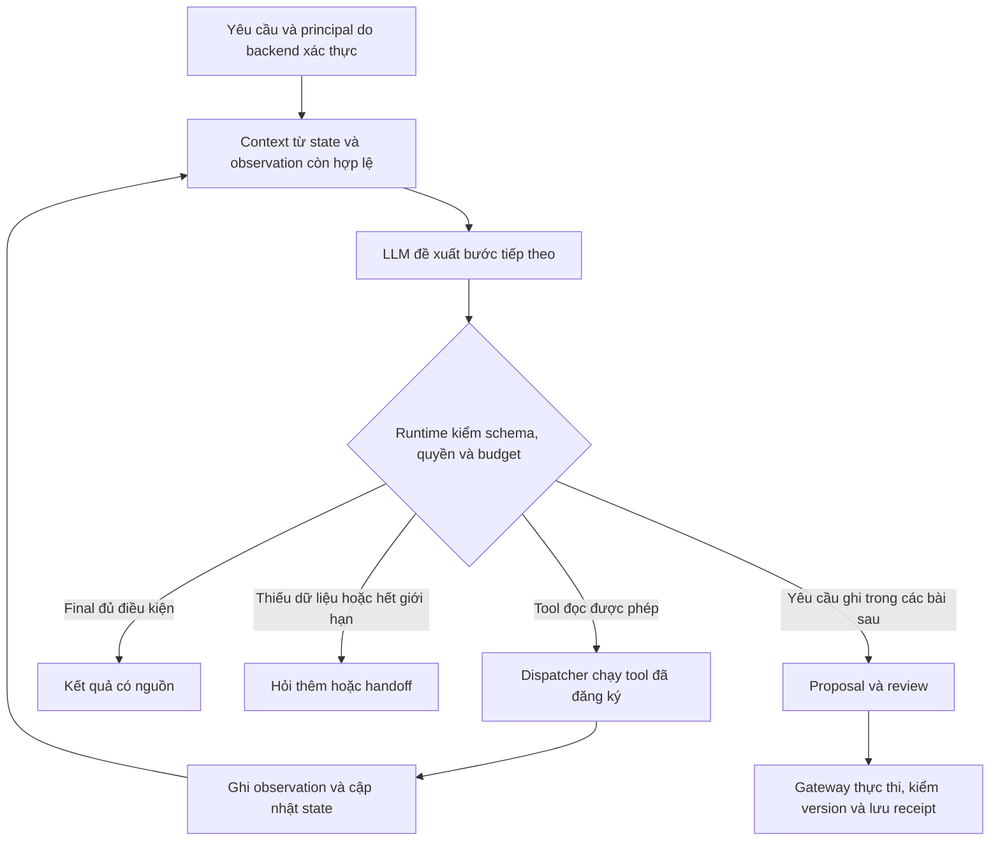

# Nhánh nâng cao — Xây AI Agent từ trợ lý hỗ trợ kỹ thuật

[← Mục lục](README.md) · [Đề cương tổng thể](ROADMAP.md) · [Bài 47: đánh giá chất lượng](47-danh-gia-chat-luong-llm-tro-ly-ho-tro/README.md)

Cập nhật: 08/11/2026. Nhánh mở rộng gồm bài 48–57: [bài 48](48-tu-tro-ly-rag-den-ai-agent/README.md) đã có tài liệu/lab kiểm offline; bài 49 đã có MCP memory/stdio lab, bài 50 đã có planning/replanning lab với planner scripted; bài 51 đã có SQLite checkpoint/crash-resume lab; bài 52 đã có context/memory lifecycle lab; bài 53 đã có review/write/unknown recovery lab; bài 54–57 còn là đề cương. Bài 1–53 đã có, chưa có bằng chứng triển khai agent live thành công. Không suy từ việc giáo trình có tài liệu rằng người học đã thành thạo.

## 1. Nâng cấp năng lực gì?

Mục tiêu là xây một **AI Agent điều tra sự cố hỗ trợ kỹ thuật**. Từ yêu cầu “điều tra ticket này và đề xuất hướng xử lý”, LLM có thể chọn công cụ, đọc kết quả, thay đổi bước tiếp theo và kết thúc hoặc chuyển cho con người. Backend giữ identity, quyền, state, ngân sách và đường thực thi.

Theo cách phân biệt kiến trúc trong [Building effective agents](https://www.anthropic.com/research/building-effective-agents), workflow có đường đi do code định sẵn, còn agent để model điều phối linh hoạt hơn. Không phải mọi tác vụ đều cần mức linh hoạt ấy. Trong nhánh này, việc tăng tính tự chủ phải có mục tiêu và phép so với baseline.

Ví dụ tình huống **giả định**, chưa là trace của một agent đã chạy:

1. Người trực yêu cầu điều tra ticket gateway lỗi 504.
2. Agent chọn đọc ticket, thấy thiếu dấu hiệu để kết luận nguyên nhân.
3. Agent chọn tìm runbook, rồi lấy snapshot sức khỏe dịch vụ nếu task cho phép.
4. Kết quả health không có dữ liệu cần thiết: agent đổi kế hoạch, hỏi thông tin bổ sung hoặc handoff; không tự biến thiếu dữ liệu thành bằng chứng database hỏng.
5. Nếu đủ căn cứ, agent tổng hợp chẩn đoán có nguồn và đề xuất bước kiểm tiếp.
6. Khi người dùng muốn cập nhật ticket, nội dung đi qua proposal/review/gateway hiện có; receipt xác nhận effect sau thực thi.

**Điểm cần đo:** agent có chọn đúng bước tiếp theo sau observation không, có biết thiếu bằng chứng, có dừng đúng và có tạo giá trị so với workflow hiện tại không? Văn phong tự tin hoặc một danh sách kế hoạch đẹp chưa đủ.

## 2. Tận dụng những bài đã có

| Phần hiện có | Dùng lại trong nhánh mới | Khoảng trống cần bổ sung |
|---|---|---|
| [Bài 27](27-goi-cong-cu-workflow/README.md)–[30](30-danh-gia-nhieu-buoc-gioi-han-hanh-dong/README.md) | Tool contract, state/memory/checkpoint, MCP và đánh giá nhiều bước | Policy trong lab chủ yếu được lập trình; chưa đo LLM chọn tool qua nhiều lượt |
| [Bài 45](45-thiet-ke-du-an-ai-end-to-end/README.md) | Corpus/ACL, ticket DB, review/version/idempotency/receipt | Chưa có planner do LLM điều khiển |
| [Bài 46](46-tich-hop-llm-tro-ly-ho-tro-ky-thuat/README.md) | Provider boundary, strict output, retry/usage và draft | Adapter hiện chặn function_call; không thể chỉ đổi prompt là có tool loop |
| [Bài 47](47-danh-gia-chat-luong-llm-tro-ly-ho-tro/README.md) | Dataset/rubric, strict rating join, slices và gate | Cần collector live và chấm trajectory, tool decisions, stop/handoff/recovery |
| [Bài 31](31-api-phuc-vu-mo-hinh-hang-doi-timeout/README.md)–[34](34-do-tai-do-tre-chi-phi/README.md) | Queue/deadline, tracing, version/rollback, load/cost | Cần nối vào runtime của agent và đo trên tác vụ nhiều bước |

Nhánh này nâng độ sâu tích hợp và bằng chứng thực nghiệm. Không viết lại toàn bộ từ đầu, cũng không đổi nhãn các fixture cũ thành “agent dùng LLM thật”.

## 3. Thứ tự bài 48–57

Bài 48–53 đã biên soạn và kiểm lab; MCP/SQLite/HTTP-ASGI target thật trên synthetic data, planner/reviewer fixture. Các số 54–57 là kế hoạch, chưa có thư mục/lab tương ứng. Mỗi bài khi viết vẫn cần giải thích nền tảng, ví dụ thực tế, code, bài tập, lời giải, hình và nguồn/giới hạn đã kiểm.

| Bài dự kiến | Nội dung và năng lực mới | Sản phẩm / tiêu chí chuyển chặng |
|---|---|---|
| [**48. Từ trợ lý RAG đến AI Agent: vòng lặp LLM và công cụ** — đã có lab offline](48-tu-tro-ly-rag-den-ai-agent/README.md) | Model chọn bước từ observation; tool call/result correlation, dispatcher, final/handoff, stop/budget | Một agent chỉ đọc với các đường đi khác nhau theo kết quả tool; có baseline workflow và trace kiểm được |
| [**49. Thiết kế tool và tích hợp MCP cho agent** — đã có lab](49-thiet-ke-tool-tich-hop-mcp/README.md) | Tool schema/mô tả/error taxonomy, discovery/capability, chuyển tool MCP vào action space có quyền | Agent gọi đúng công cụ/args, xử lý tool lạ hoặc unavailable; kiểm scope ở backend |
| [**50. Lập kế hoạch, kiểm chứng và đổi kế hoạch** — đã có lab](50-lap-ke-hoach-kiem-chung-doi-ke-hoach/README.md) | Plan ngắn có cấu trúc, dependency, kiểm giả thuyết, observation thiếu/mâu thuẫn, yêu cầu thêm thông tin | Agent đổi bước khi dữ liệu bác bỏ giả thuyết, không tiếp tục máy móc; phân tích vòng lặp lãng phí |
| [**51. Agent chạy dài: state, checkpoint và khôi phục** — đã có lab](51-trang-thai-ben-vung-checkpoint-khoi-phuc/README.md) | Event/state transitions, run/sample/tool IDs, pause/resume, crash boundaries và unknown effects | Khôi phục không reset budget/quyền; phân biệt việc có thể chạy lại với effect cần status/idempotency |
| [**52. Context engineering và memory cho agent** — đã có lab](52-context-engineering-memory-agent/README.md) | Chọn context theo task, summary/source lineage, working/long-term memory, TTL/revoke/forget và dữ liệu không đáng tin | Tái sử dụng thông tin có nguồn/quyền, tránh memory poison và dữ kiện đã hết hiệu lực |
| [**53. Human-in-the-loop và hành động ghi có kiểm soát** — đã có lab](53-human-in-the-loop-hanh-dong-ghi/README.md) | Approve đúng args/draft, scope/version/expiry, remote adapter và timeout unknown | Agent đề xuất cập nhật ticket, người duyệt thấy payload thực; retry không tự tạo effect mới |
| **54. Đánh giá agent end-to-end** | Outcome/trajectory/tool selection/stop/recovery, injection cases, repeats, judge audit và so baseline | Có bộ task nhiều bước, lỗi critical theo slice, cost/latency toàn run và kết luận không chọn ứng viên nếu chưa đủ |
| **55. Điều phối bằng LangGraph và đối chiếu runtime tự viết** | Chuyển state/control flow sang graph; persistence, interrupts và streaming theo phiên bản được kiểm | Tái chạy cùng task/fault suite để giải thích điều framework quản lý và phần backend vẫn phải giữ |
| **56. Multi-agent có mục đích** *(nhánh tùy chọn)* | Phân vai, delegation/handoff, scope từng worker, shared state và aggregation/conflict | So với single-agent cùng dataset/ngân sách; chỉ giữ nếu lợi ích đo được bù thêm chi phí và failure modes |
| **57. Vận hành và dự án tổng hợp AI Agent** | Service/worker, queue/admission, tracing, quota, version, staging/pilot, rollout/rollback | Một gói dự án người khác chạy lại được, có quality gate, giới hạn tác động và danh sách phần chưa xác minh |

Lộ trình chính bắt đầu bằng **single-agent**. Bài 56 có thể học sau bài 57; nhiều agent không là điều kiện để được gọi là AI Agent và không tự chứng minh chất lượng cao hơn.

[LangGraph overview](https://docs.langchain.com/oss/python/langgraph/overview) mô tả runtime cho orchestration có state, durable execution và human-in-the-loop. Chọn tìm hiểu ở bài 55 để đối chiếu với runtime đã hiểu; đây chưa là quyết định dùng framework cho production, chưa cài hoặc kiểm phiên bản package trong nhánh này.

## 4. Hình dung vòng thực thi đầu tiên

Agent được quyền **đề xuất lựa chọn** trong action space; runtime quyết định có thực thi lựa chọn đó không. Tool result và memory là dữ liệu có provenance, không phải chỉ dẫn được nâng quyền. Trace lưu action/args/observation/status/budget và lý do ngắn có thể kiểm; không cần thu suy nghĩ nội bộ dài của model để chứng minh agent hoạt động.

ReAct nghiên cứu việc đan xen suy luận và hành động; ở lượt lập đề cương này chỉ đọc [abstract/metadata của bài báo](https://arxiv.org/abs/2210.03629), chưa đọc toàn văn hoặc tái hiện benchmark. Không lấy kết quả trong abstract làm kết quả của dự án này.

## 5. Đầu ra cụ thể cho bài 48

[Bài 48](48-tu-tro-ly-rag-den-ai-agent/README.md) đã xây vòng nhỏ với read_ticket, search_runbooks và read_health trên dữ liệu synthetic. Runtime/protocol đã kiểm offline; live adapter có lệnh riêng nhưng chưa gọi provider. Các tiêu chí dưới đây là phạm vi thiết kế, không là claim về chất lượng LLM thật.

Hai cách chạy cần được tách rõ trong thiết kế bài:

- **Offline contract:** programmed model responses để kiểm dispatcher, correlation, unknown tool, invalid args, tool failure, stop/budget và injection boundary.
- **Live evaluation:** adapter có giao thức tool calling được kiểm theo provider/model cụ thể; LLM chọn bước từ observation thật của môi trường thử. Chỉ công bố kết quả đã thực sự thu và chấm; nếu chưa chạy, ghi chưa chạy.

Tái sử dụng tư duy HTTP/budget/usage của bài 46 nhưng phải mở rộng hoặc viết adapter tool protocol riêng. Adapter text/draft hiện tại chủ ý chặn tool calls; sửa thành nối mọi output thành text sẽ làm mất protocol semantics.

Tiêu chí để bài 48 hoàn thiện:

1. Hai tình huống có observation khác nhau dẫn đến đường tool khác nhau; chỉ ra phần do model quyết định và phần host quyết định.
2. Mọi tool call/result liên kết đúng ID; schema, quyền, scope và budgets được kiểm trước dispatch.
3. Có final, thiếu nguồn, unavailable, unknown tool, invalid args và loop/limit cases; final không tự chứng minh incident đã được sửa.
4. Collector chưa ghi ticket; kiến trúc giữ sẵn đường proposal/review cho bài 53.
5. Báo kết quả so baseline, model calls/tool calls/attempts và unknown usage theo đúng provenance; không suy live quality từ fixture pass rate.

Bước tự chuẩn bị: lấy một case 504 trong bài 47, tự viết **thông tin đã biết → thông tin còn thiếu → tool có thể bổ sung → điều kiện dừng/handoff**. Nếu không thể chỉ ra observation nào khiến bước tiếp theo đổi, tác vụ đó có thể vẫn phù hợp workflow cố định hơn.

## 6. Trạng thái và nguồn

Bài 48–53 đã có lab theo nhánh này; MCP/SQLite/HTTP-ASGI target thật trên synthetic data, planner/reviewer fixture. Bài 54–57 còn là kế hoạch. Chưa có tuyên bố đã nâng app lên agent production. Các nguyên tắc về quyền/review/effect của bài trước tiếp tục áp dụng; các phiên bản API/SDK/MCP/framework sẽ được kiểm khi viết từng bài.

Nguồn đối chiếu ngày 08/11/2026: bài Anthropic đọc phần phân biệt workflow/agent và Agents; LangGraph đọc overview/capabilities; ReAct chỉ abstract/metadata. Chi tiết phạm vi trong [SOURCES.md](SOURCES.md). Không gọi provider, cài framework, tạo multi-agent runtime hoặc triển khai dịch vụ trong bước lập lộ trình này.

Cập nhật sau bài 49: [thiết kế tool và tích hợp MCP](49-thiet-ke-tool-tich-hop-mcp/README.md) đã biên soạn/kiểm; không dùng mode live của bài 48 làm bằng chứng LLM đã chạy qua MCP49. [Bài 50](50-lap-ke-hoach-kiem-chung-doi-ke-hoach/README.md) đã có lab; [Bài 51](51-trang-thai-ben-vung-checkpoint-khoi-phuc/README.md) đã có lab; [Bài 52](52-context-engineering-memory-agent/README.md) đã có lab; [Bài 53](53-human-in-the-loop-hanh-dong-ghi/README.md) đã có lab; bước tiếp dự kiến là bài 54 về đánh giá agent end-to-end.
